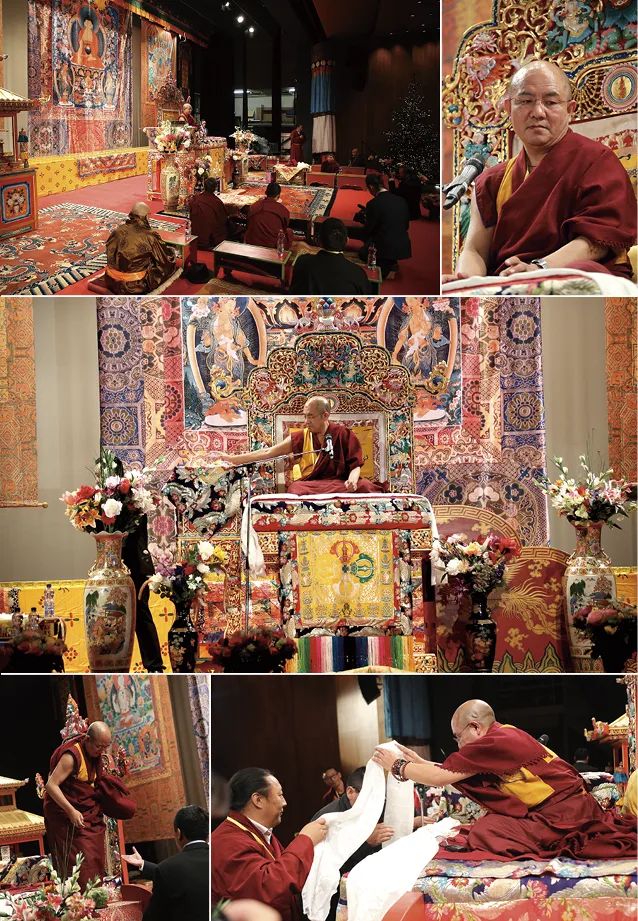
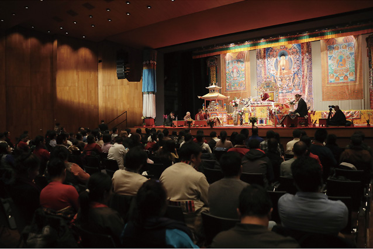
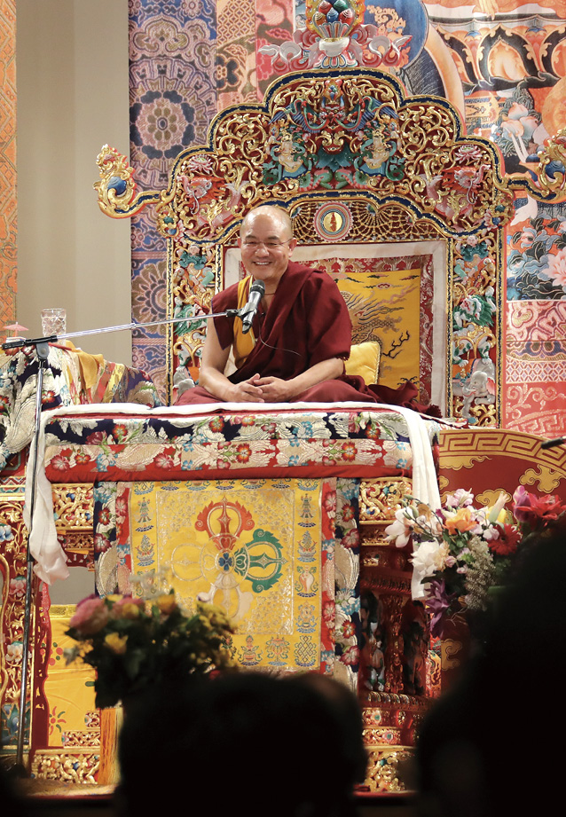
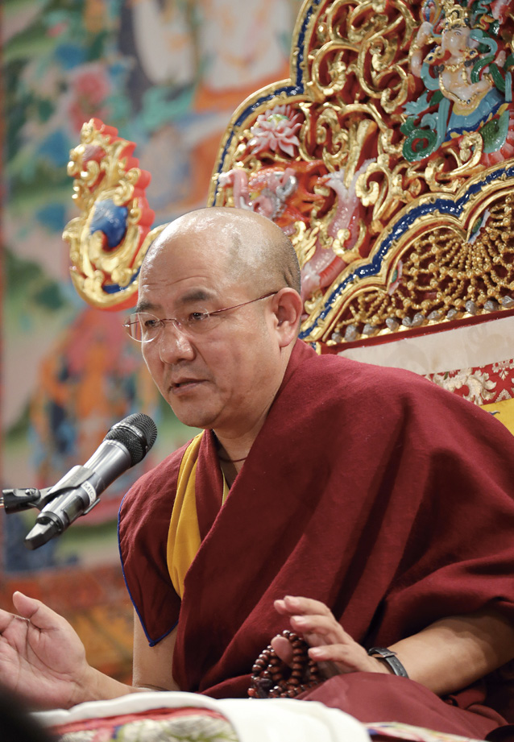
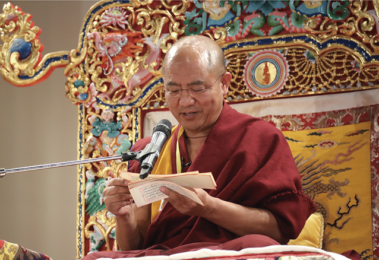
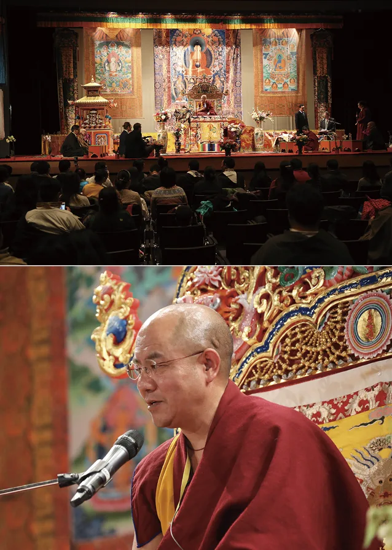
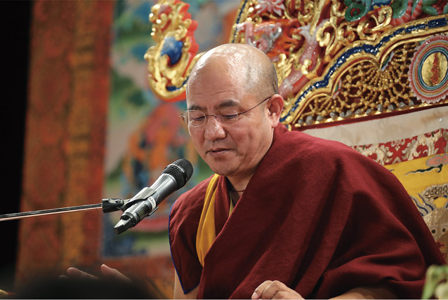
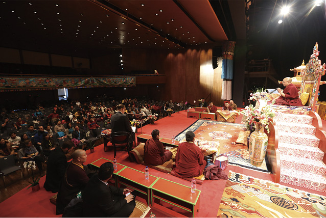

“阿难莫哀伤，阿难莫哭泣，

我于未来时，化为善知识，

利益汝等众。”

第77场

瑞士苏黎世施尼岑霍夫场馆

Schinznehof, Zurich, Switzerland

瑞士·苏黎世

2017 / 12 / 9

## 皈依和发菩提心

## Refuge and Bodhicitta

首先，为了利益天边无际的众生，获得遍知佛陀的究竟果位，请大家发无上殊胜的菩提心并恭敬谛听！

## 当务之急

现今国内的藏族学生有丰富的藏文教材，还有各团体编辑出版的藏文书籍，各寺院也在流通各种藏文经书。相比起来，国外的资源就相当匮乏了。所以，我们应该竭尽所能地整理声明学、藏文语法的论典及其他藏文书籍。尤其，给未来出生在国外的藏族孩子们提供藏文教材。这些工作都是当下急需去做的。

## 出家与在家共弘佛法

佛法既符合西方人思想，又符合东方文化和宗教。流通佛教书籍和传讲佛法都很重要。藏族知识分子有三类：一类是出家人，一类是还俗的出家人，还有一类是在家人。不管是在家人还是出家人，最重要的是努力弘扬佛法，让更多的人了解和信仰。

有些出家人各方面都很不错，即使后来还俗了依然继续修行。有些出家人还俗后，自身的想法、行为都与往昔僧团的生活习惯大相径庭。虽说任何人都有自由的权利，尤其在自由主义盛行的西方国家。但有些人明明皈依过佛教，却到处散播“皈依三宝是错的”等言论，这对他来说恐怕也不是光彩的事情。有些人因为前世业力所感，导致今生从出家人还俗成了在家人，但他能够一如既往地修学佛法，并把这些知识传讲给其他人。

纵观藏族历史，有一个奇怪的现象：出家人在显宗、密宗方面一直闻思修，而在家人除了念观音心咒、转绕、作供养外，闻思修的传统并不兴盛。在家人念咒语、顶礼、行持少许善法，出家人闻思经论、实修，就像划分好了各自任务一样。藏传佛教传承至今，无论从全世界的发展趋势上看，还是从大乘佛法来看，出家人需要遵守戒律，在家人也有行持善法的责任。

## 东西方需要互补

东西方在很多习惯上都不同。比如东方人有作揖、顶礼等礼仪，西方人就没有这些传统。西方人对心理研究得很细致，东方人看待心性的视角就截然不同。年轻人觉得西方的观念全对，老年人觉得东方的观念全对，这就导致了两代人的价值观冲突。

每个地方有自己的习俗，每个民族也是这样，渐渐形成了“成王败寇”的潜规则。所以，希望国外长大的藏族小孩，将来去藏地旅游的时候，不要用西方国家的价值观去衡量。

亚洲的历史非常悠久，西方的历史只有一百多年。但西方经济富裕、科技发达，致使年轻人会把老师的话当成唯一标准。很多藏族人和汉族人去美国留学，待了两三年后思想完全变了。尽管美国的科技很发达，但我们的传统文化、佛教信仰及佛法的甚深思想，是他们不具备的。

## 皈依的意义

阿底峡尊者说：“内外道以皈依别。”皈依，是指对释迦牟尼佛及其所讲的正法，以及追随佛陀的僧众作皈依。也就是对佛、法、僧三宝作皈依，这是共同乘的皈依。

关于皈依的意义和道理，无著菩萨说：“己尚缚于轮回狱，世间天神能救谁。”意思是，世间的天神、龙神、梵天、帝释天及很多世间护法神，连他们都还深陷于轮回的牢狱中，又怎么会有救护他人的能力呢？所以，他们不能做我们的救护者、怙主、主尊。

就像监狱里的犯人一样，他们的手脚都被铁链铐住了，即便想出去也没有自由，周围是铜墙铁壁，日夜都有狱警看守。他们连自己都救不了，又怎会有救其他犯人的能力呢？

同样，我们在轮回的牢狱中，被业和烦恼的铁链牢牢捆住，在三界轮回的痛苦大海中不停流转，完全没有能力救护其他众生。如果有人从轮回中解脱了，他就有能力带给他人真正的自由，就像监狱外的人可以把犯人接出去一样。所以，我们对佛陀和佛法皈依的主要原因，就是祈求他们能带我们远离一切痛苦。

## 视师如佛

平时修行佛法，要明白是上师的恩德，才使我们能够听闻佛法。因此，要对上师生起恭敬心、欢喜心及视师如佛的不共信心。最殊胜的皈依是视师如佛的信解心。

有些年轻人认为不用对上师有信心、顶礼，因为人人平等，“他们是人、我们也是人，人与人之间不需要恭敬”。但在我看来，具足法相上师的相续中具足证悟、悲心、解脱等功德，虽然外貌上都是人的形象，但在功德上有天壤之别。所以，我觉得对这样的上师恭敬顶礼，并没有不妥之处。我认为，为我传讲佛法的上师，其恩德无人能及。这也不只是传统，很多西方科学家、教授、学者也都依止了自己的根本上师。

当上师的身、语、意加持融入自相续，要经常忆念、祈祷上师，即使上师示现圆寂，只要听到上师的名号，也会泪流满面。比如，一个非常贫穷的人，富翁给了他很多钱，完全消除了他的贫穷。这个穷人会一直记着富翁的恩德，一旦遇到会恭敬顶礼。

相续中没有丝毫功德的人，如果依靠根本上师的加持，获得了不共的力量，使心相续具足了与以往不同的功德，那么他也会以报恩心时常恭敬祈祷。很多佛教徒因想念根本上师而经常掉泪，我觉得这一点是值得赞叹的。因相续中生起对上师的信心，即使掉一滴眼泪，也能圆满很多劫的福慧资粮，有不可思议的功德。

藏地很多上师，在特殊时期远赴印度、尼泊尔，也有部分前往欧洲和西方国家。那时，他们并不懂英语和当地语言，但他们传讲的大乘佛法和密法让许多弟子的内心得到了帮助。虽然他们已经圆寂了，但他们的弟子想起他们时会泪流满面。

以前我去这些地方的时候，这些弟子边说着想念上师，边就会哭起来。相续中真正获得了佛法利益的人都会如此。男女之间的感情也是这样，其中一个去世了，另一个会非常伤心地哭起来。可想而知，为自己直指心性的根本上师示现圆寂了，心里肯定会有种强烈难忍的痛苦。

声闻乘认为上师、善知识也是佛陀的化身。《大鼓经》里记载，佛陀涅槃之际安慰阿难：“阿难莫哀伤，阿难莫哭泣，我于未来时，化为善知识，利益汝等众。”意思是说：阿难，你不用这么伤心，我在未来的时候，会化身为具相的善知识，来利益你等一切众生；我会化现为上师、善知识的形象，到世间讲经说法、为众生开示取舍之理。佛陀明确地讲到了自己将来会化为人的形象降世。

## 信心乃功德之基

很多苏黎世当地人和藏族人都对上师有信心。一个人对上师是否有信心，从言行举止上就可以看得出来。一个不错的修行人，从藏族人的角度评判，就是对与自己有法缘的上师是否具备信心。

信心，是极其重要的。《大宝积经》云：“若不信之人，不生诸白法，犹如烧种子，不生根芽等。”意思是，人一旦没有了信心，就不具备任何白法功德，如同种子被火焚烧一样，不会生出任何根茎、苗芽。

初学佛时信心很重要。如果缺乏信心，佛法的功德丝毫也不会融入相续。当今很多学者，仅凭自己的分别念来研究佛法，虽然可以钻研到很深的程度，但相续中一点都生不起佛法的功德。

我们自己可以准备一张根本上师的小照片，平常外出时随身携带，可以向他人介绍“这是我根本上师的法相”。任何宗派的上师都可以依止，但一定要具足上师、善知识的功德。藏族人无论去哪里，都会在睡前向上师的照片磕三个头或祈祷。

## 何为皈依三宝

有些人认为，释迦牟尼佛是类似于基督教造物主一样的神。其实不然，释迦牟尼佛降生到人间，至今（2017年）已有2561年了。全知麦彭仁波切所著的《释迦牟尼佛广传·白莲花论》主要讲述了佛陀在过去世中发殊胜菩提心的故事，对于年轻人了解佛陀的功德很有必要，能真正地了解佛陀。

现今人们普遍不承认前后世和业因果，认为佛陀只是净饭王的儿子，是印度当时特别有名望的人。而《释量论》举出了很多“承许佛陀是量士夫”的理证，是对佛陀本生传的最高定解，也是了解佛陀的方式。释迦牟尼佛广转三次法轮：第一转四谛法轮，第二转无相法轮，第三转光明如来藏。若对三转法轮的内容能大致了解，是皈依释迦牟尼佛的不共方式。

听上师、善知识们宣讲佛陀的功德，依靠自己的智慧生起不退转的信心，也是皈依佛陀的方式。藏族僧众对这些肯定是了解的，在家人只是对佛陀有信心，认为佛陀是三宝、皈依处，但不清楚佛陀有什么样的功德。这样的信心，遇到外缘时很容易改变，进而对佛陀失去信心甚至诽谤。虽然我不具备丝毫功德，但对释迦牟尼佛有着永不退转的信心。

一般是以具足“三想”的方式皈依，即佛陀作名医想，宣讲的法作妙药想，僧众作修行助伴想。佛法，是从梵语“达玛”音译过来的，意思是断除相续中的所有烦恼，即调伏烦恼。正法也就是真理，如果佛陀讲的法不符合真理，就没有必要皈依；如果符合真理，就可以皈依。僧人，具有智慧和解脱的功德，能领悟真理和解脱自相续烦恼。因此，沙弥、比丘等出家弟子称为僧众；文殊菩萨、观音菩萨等菩萨，从功德方面也可以称为僧众。

藏族人历来是全民信教的。当然，也有少数藏族人没有皈依三宝。如果生为藏族人却没有皈依佛教，确实令人惋惜。当今世界上有800万左右的人受了皈依戒，掀起一股“学习藏传佛教”的热潮。国内外稍有学识的人，提到“三宝”的时候没有任何感觉，对男女间的情爱却津津乐道，这样的人有很多，但实际上这些欲乐只会给你带来暂时的欢愉，曲终人散时毫无益处。

## 皈依之功德

不了解佛法的人，会有“皈不皈依都一样”“不需要成为佛教徒，做个好人就行了”“不需要戒律，戒律会让我们没有自由”等谬论。你若问他：“好人的标准是什么？”很多人就哑口无言了。《诸法集要经》云：“戒如清凉水，深广常弥满，为彼持戒者，涤身心垢秽……旃檀沈水香，怛计薝卜花，人天咸所重，不及彼戒香。”戒，就如同清凉水一样可以洗涤身心的垢染和污秽，即便世间再名贵的旃檀香也不及戒香的殊胜。

莲花生大士曾讲过皈依的八种功德：

1．皈依后表示入了佛门，才算是真正的佛教徒。“内外道以皈依别”说的就是这个意思。

2．皈依是一切戒律的根本。别解脱戒、菩萨戒、密乘戒的基础就是皈依。《皈依七十颂》云：“虽众皆可受戒律，然未皈依不可得。”皈依是受戒时能得戒体的先决条件。

3．皈依三宝后，无始以来身语意的习气，皆能得以清净的不共之因就是皈依。

4．皈依后，除了特殊的业果成熟外，一切愿望都能如愿以偿。

5．皈依后，能免遭人、非人、天龙、野兽、火、水等的损害，即使遭到损害，也很容易遣除。

6．皈依三宝后，福慧资粮会逐渐无勤获得；如果没有皈依，即使行持再多善法，也没有一刹那积累广大资粮的殊胜力量。

7．皈依三宝后，能具足诸多不可思议的功德，后世不会堕入地狱、饿鬼、旁生等三恶趣中，也不会转生到持邪见者、边地等行列中。

8．皈依后，今生或来世必定获得解脱、遍知的果位。

以上，简略地介绍了皈依的功德和意义。

## 让众生相续中生起菩提心

先给大家念一个无著菩萨《佛子行三十七颂》的传承。我去任何地方都会念这个传承。如果能让那里的众生相续中生起菩提心，他们做任何事就不会觉得困难。寂天菩萨云：“有情种种心，佛亦难尽悦，何况劣如我，故应舍此虑。”即便佛陀也无法满足所有人，更何况我呢。但如果能让大家相续中生起菩提心，自然就能利益很多众生。

大家也应把《佛子行三十七颂》放在功课里念诵。此外，《入菩萨行论》《普贤上师言教》《菩提道次第广论》中有“修四厌离心”的窍诀，《胜道宝鬘论》等论典里有特别殊胜的窍诀法。这些窍诀，无法用价格衡量，就像黄金和醍醐一样珍贵。所以，要使人身有意义，就应经常修持传承上师们的教言。无论怎样观察，任何人、任何民族都需要修持这些法，因为它们会给今生、来世带来暂时和究竟的极大利益。希望大家不要忘失，努力修持！

现场互动

问：在每天的生活中如何利他？怎样是在无缘空性中安住？

堪布：佛教认为，利他很重要。西方更多是自我主义，首先想到的是自己。有点像发菩提心里的“国王之发心”——自己先登上王位，再利益其他众生。

很多人以为，禅修就是什么都不想而安住。但在藏传佛教中，禅修时空性的见解非常重要。大家应该通过学习《中观根本慧论》《入中论》等，对般若空性生起不共的定解。

问：亚洲教育方式、西方教育方式、藏族教育方式三者之间有哪些区别？

堪布：东西方在价值观、文化背景、民族文化等很多方面都有不同。宗教背景也不同，西方有伊斯兰教、犹太教和基督教，东方是佛教、道教、儒教。西方的思想很开放，大多数是批判主义。这是第一个区别。

第二个区别是，东方的教育方式有点保守，孩子从小没有开拓思想。

问：我非常想学藏文经论，但不知道从哪里开始？

堪布：《入菩萨行论》《普贤上师言教》《菩提道次第广论》都是非常重要的窍诀类经论。知识分子可以学中观和因明，《入中论》《中论》《中观四百论》《量理宝藏论》《释量论》《集量论》《定量论》《因滴论》等。学习这些论典，会对佛法真理生起定解，会对三宝生起信心。《金刚经》云：“一切有为法，如梦幻泡影，如露亦如电，应作如是观。”念诵一遍很简单，但其意义是很甚深的。

