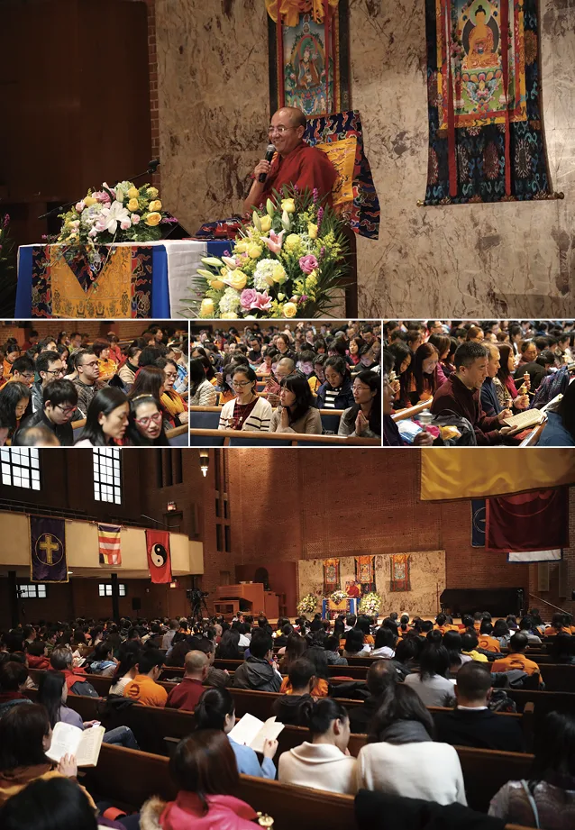
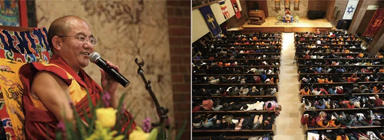
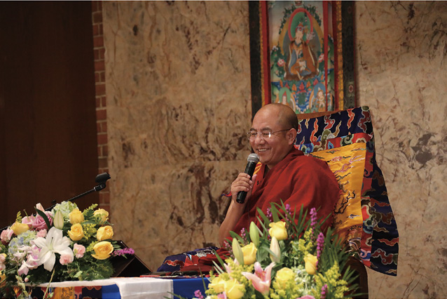
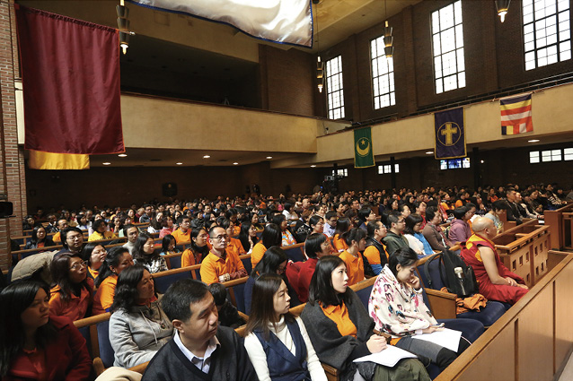
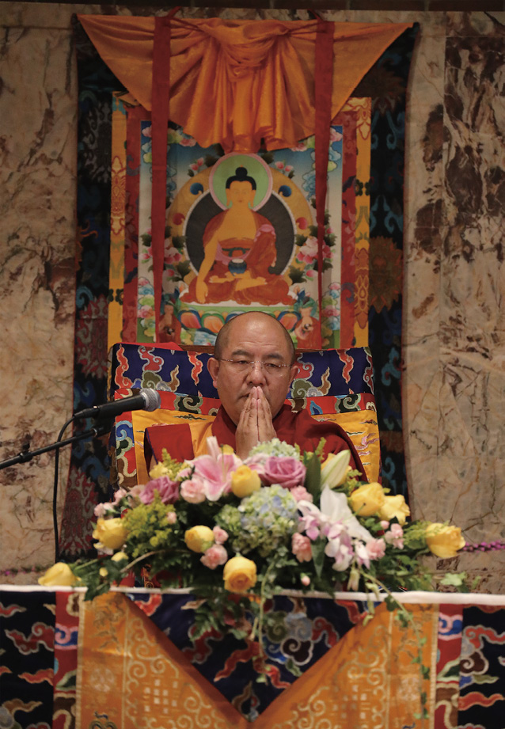
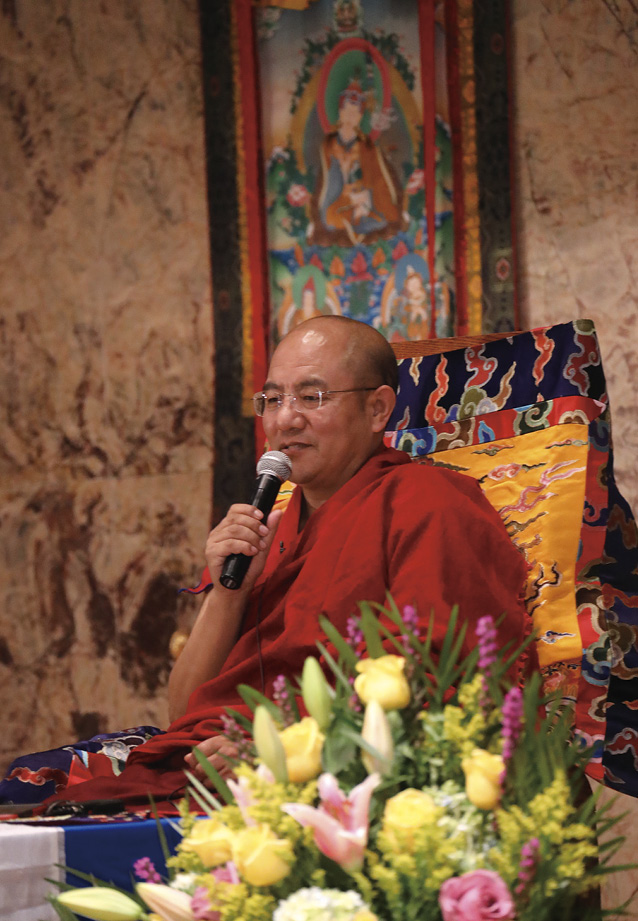
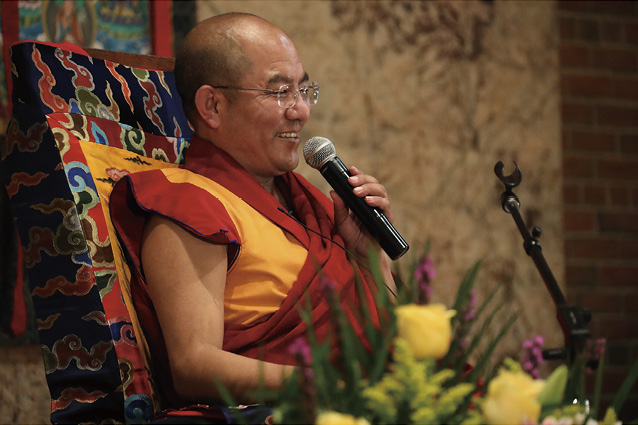

一步一步地走，  
才能稳中求进。

第68场

美国纽约BSA

BSA New York, USA

美国·纽约

2017 / 11 / 18

## 系统闻思修行的重要性

## On the Importance of a Systematic Approach in Studying, Contemplation and Practice

前天我们去哥伦比亚大学，麦克风一直不好用。为了那个麦克风，主办方的教授出去买电池，一直在外面跑。等他回来的时候，我们的讲座都已经结束了。美国的科学技术好像也没那么发达嘛——开玩笑！说美国不好，怕你们不高兴。我应该说，美国的科技非常发达，麦克风也很好。（众笑）

## 为了这个缘起，我想了很久

今天这里，主要是来自各个地方的学会道友，也有一些其他的佛教徒。上午我们一起学习，下午还有一个公开讲座，主题是“你在忙什么”。因为大家都比较忙，所以拟定了这个话题。我用汉语讲，现场有英语翻译。明天有《文殊大圆满》的密法灌顶和一个引导文，要求在有生之年修完加行。不管是藏族人、汉族人还是西方人，如果不修，这个灌顶最好不要接。

我在国内，对《文殊大圆满》的灌顶要求非常严格，必须在短暂的几年内修完加行。去年和前年，我传的所有密法，都严格按修完加行的标准来定听闻资格。这也是我们密法班人数比较少的原因。

考虑到这边有些道友一直在等，如果必须修完加行，不知道即生还有没有机会，所以对你们有特殊开许，不限定修完加行的时间。但你们要根据自己的情况，尽快完成，至少要在有生之年修完。如果不修加行，就算接了密法，对自己也不一定有利——根本用不上。

对在藏地求学的佛教徒而言，修加行并不太难。真正投入精力，几个月就可以修完。只要每天不间断，一生修一遍加行，完全没问题。不过在座的许多人，因为忙于生活、忙于工作、忙于家庭琐事，好像始终都没有时间。

有些人虽然有时间，但身体总是不行。比如磕大头，身体本来挺好，爬山旅游都没问题，但一说磕大头，身体突然就不好了，有很多很多的状况。我们凡夫人，总能为自己找一大堆理由。

现在很多密宗上师，对修加行好像没什么要求。我在这方面的要求，一直比较严格。但在你们这里，如果严格按照我的标准和要求，不知道离开人间之前，我们之间还有没有这样的密法缘分。而且，上师如意宝1993年来美国，在夏威夷灌顶，也有过一些特殊开许。所以，为了一个缘起，我这次想了很长时间，才决定明天灌顶。

## 自我定位别太高，一步一步走

今天，大多数人是学会的，所以比较轻松。在管理和闻思修行方面，我跟大家聊天似的，简单讲一讲。

这一次，我们集聚在基督教的教堂，共同思维佛教的教义，有着特殊的意义，体现了一种开放、包容和求真的心。这样一颗心，对人类和平与自他解脱，都能起到真正的作用。我们也应该以包容求真的心，先设立远大的目标，再好好地闻思修行，将来更好地利益众生。

闻思修行的过程中，我们虽然不能太自私，只想自己摆脱烦恼，但作为具缚凡夫，相续中一点一滴的自私也没有，肯定不可能。在证得一地菩萨之前，我们不可能没有自私自利的心。

经常有人跟我讲：“我做这件事情，没有一丝一毫的自私心。”其实，所谓的“没有一丝一毫”，只不过是不明显而已。即使你真的觉得没有，也肯定还有自私的习气。只要习气没断，或多或少都会有自私心和染污分别念。掺杂了这样的分别念，我们的所作所为很难百分之百如法。

有些人学了佛以后，对自己要求特别高：“都已经皈依了，我为什么还有这么多分别念，甚至还有这么多恶念？与其这样，还不如死了好！”然后开始扯自己的头发、打自己的嘴巴，狠狠地惩罚自己。

其实没有必要这样。乃至菩提果之间，修行之路都是一步一步走的，不可能一步登天。懂得这样的道理，就不会陷入深深的担忧：“为什么我还有分别念？为什么我还这么自私？为什么我还被烦恼所控制？”

还有些人，自我定位特别不切实际：“我一定要大彻大悟！”或者，“我一定要断除一切烦恼和分别念！”如果做不到，“我宁可不学佛，宁可不做善事！”甚至因为达不到目标，觉得特别惭愧、纠结、想不通，以致出现心理问题。这些都是极端的想法，大家要尽量避免。

我们做任何事情，都应该循序渐进。一步一步地走，才能稳中求进。

## 花五六个小时飞过来，到底该不该

在座的各位，都是从各个地方赶过来的。我大概了解了一下，有美国各地来的——东部、西部都有，包括像夏威夷，也有从国内来的。大家从那么远的地方过来，特别不容易。

西方人的生活节奏很快，你们都比较忙。早在20多年前，我就有深刻的感受，当时还想：“以后中国千万不要发展成这样，不然太痛苦了！”

那时，中国还比较悠闲，私家车几乎没有，出门基本是坐公共汽车。我们到了夏威夷，看到听课的人自己开着车来，非常羡慕：“这样的世界，真的不可思议！”那是我第一次知道私家车。

后来我去卫生间，看到感应灯，更觉得不可思议。回去之后，到处跟人讲，美国好先进哦，卫生间的灯，人到了自己亮，人走了自己熄。很多道友都不相信：“不可能，不可能！角落里是不是有人藏着？不然绝对不可能！”

在夏威夷，我们觉得特别美妙，特别殊胜。后来到了纽约，看到每个人都忙得不可开交，心里就想：“这些人怎么这么忙？以后汉地的经济发展了，会不会也这样？”现在汉地各大城市，基本上也变成这样了——人人都很忙。

你们这么多人，生活这么忙碌，却抽出宝贵的时间，从各个地方来到这里。我问了一些熟悉的人，他们坐飞机要花4到6个小时，都在很远的地方，光费用就是一个很大的问题。

我比较担心，觉得大家不该来，跑这一趟没什么特别的意义。平时，我通过网络视频，经常和大家见面，该讲的话，都已经讲了。你们这次过来，我也没有特殊的教言给你们，还是那些道理，“老僧常谈”。

后来又想，从密法灌顶和传承的角度，来一趟也值得吧。这两天，我一直在怀疑、挣扎，心里到底是什么想法，自己也不是特别清楚。

我问过主办方的负责人：“他们是自愿来的吧？你们没有发动吧？”真的，我一直在问，今天早上还在问：“你们没有发通知叫他们来吧？”他们说：“绝对没有发通知，是他们自愿来的。”

如果是自愿来的，那自己有自己的选择，应该没什么吧。不然的话，我确实比较担心大家，一个是时间，一个是各方面的压力。既然来了，就好好参加活动吧——今天和明天的上下午，都有活动。

从另一方面讲，为了求得正法，赴汤蹈火也值得。历史上有很多为法苦行的公案。前辈的高僧大德也好，虔诚的修行人也好，都用自己的苦行说明了一个深刻的道理：为了真理，应该有所付出。我自己年轻的时候，也一心一意求取过佛法，并为此舍弃了很多快乐和舒适的环境。

我以前给大家讲过《百业经》和《贤愚经》。里面都说，哪怕听受一个偈颂的四句教言，也有很大的价值和功德。想到这些，我又觉得你们跑这一趟是值得的。

现在的世间人，为了一些没意义的东西，也会投入大量的精力，浪费很多的金钱和时间。同他们比起来，我们获得了这么殊胜的人身，面对面地探讨大乘佛法的教义，共同追求崇高的目标，还是很有意义的。

## 两个人一起朝过拉萨，会成为永远的朋友

你们大多数人，一直在网络上学习和交流。现在有机会碰面，大家都觉得特别亲切。我在芝加哥和波士顿的时候，好多网络上的道友都来了，就跟天人在人间相遇一样：“啊，你是谁谁谁？我们以前聊过很长时间，原来你长这样，还不错！”看到每一个人，都觉得很亲切。

在某种意义上，我们佛教徒之间，应该建立深厚的感情。藏地有一种说法：两个人一起朝过拉萨，会成为永远的朋友。为什么呢？因为一起经历过路上的风风雨雨，又一起朝拜过觉沃佛像。

世间有一个词，叫做“同学”。30多年前，我有十几个中学同学。直到现在，大家还经常聚在一起“耍坝子”——这是藏地夏天的一种习俗。我们在一起度过了3年的学习时光，现在回忆起来，觉得特别珍贵。

同学中有两三个女孩子——现在已经老了，不是女孩子了，我不太认识，她们在我们班只待了一两个月，就辍学了，以后再没见过。虽然只待了一两个月，但也是同学，所以每次大家一起玩儿，都会叫上她们。刚开始，她们有点不好意思：“你们一起学习了3年，我们只学了一两个月……”但现在已经习以为常了。

我们这里也一样。有的人学了很长时间，有的却只学了三年、一年、几个月。尽管共同学习的时间有长有短，但大家都是道友，应该建立亲密的关系，保持纯真的情意。这非常重要。

有些人在网络上学习了很长时间，对道友却一点不了解，没有一点感情。实体共修的因缘不具足，对大家而言，是一件比较遗憾的事。如果有实体共修，学习气氛和道友情谊会浓得多。

我觉得，借这次机会，美国的道友们能面对面地聚一次，也很好。你们当中的很多人，以前可能就认识，但仅仅是认识而已，关系并不亲近，不像我们以前的同学那样。

各个地方的道友，同一个城市或同一个小组的，一定要建立亲密的关系和联系。这是我的一个希望。

为什么呢？别解脱戒、菩萨戒和密乘戒等三乘戒律，都强调把众生当作自己的父母，何况是乃至菩提果，永不分离的金刚道友、菩提道友？如果彼此不愿意见面、不愿意说话、不愿意接触，甚至不愿意同坐一个座位，那说明修行确实非常糟糕。

## 先学做人，再学做佛

很多世间人，内心都比较轻松、比较宽容。我在西方看到很多这样的事例。比如，候选人在竞选总统的时候，人们用各种各样的语言攻击他，甚至用鸡蛋、鞋等东西砸他，他也能保持风度，平静、安忍，一点不生气。我们可以说他作秀，但也可能他的内心真的很放松。

而我们佛教徒的心，有时却显得比较紧张。在一些佛教团体内部，人人都看得出，他们彼此的关系并不好，但他们要么在表面装融洽，要么找很多理由，说自己怎么好，别人如何不好。这种现象，很多佛教团体都有，不只是个别地区的问题。

为什么会这样呢？最主要的原因，是对闻思不够重视，佛法没有融入自心。重视闻思修行、法喜充满的人，关心的是弘法利生，对自己的区区小事，根本不会放在心上，又怎么会计较个人的得失呢？肯定不会，这是一种规律。

在修行和管理的过程中，总会冒出很多的是是非非。根源在哪里？一方面，我们太无知。如果我们既不了知佛法，又不了知世间法，就会发生这样的事。另一方面，大乘教义还没有融入自己的心。相续一旦得到佛法的滋润，我们自私自利的心、自我宣扬的心、贪欲的心、嗔恨的心——自我满足的一切心，都会消逝无迹。

因此，我们在闻思修行的同时，一定要培养良好的人格，这是学佛的基础。如果没有打好基础，修行最终会沦为口头禅，“我是闻思修行者、我是大乘佛教徒、我是某某上师的弟子、我是某某活佛的粉丝”，口头上说得再好听，没有良好的人格基础，也不可能真正建成学修的高楼。

虽然有人的地方就有是非，即使在佛教兴盛的地方，也无法完全避免是非，但如果一个佛教团体，闻思修行一点都搞不上去，各种是非却沸沸扬扬，就很难让人接受了。所以，在任何一个地方，我们都要学会平衡。

这一次，能面对面地跟大家讲，机会很难得。所以，该讲的事情一定要给大家讲明白，讲清楚。而且，我说的这些，并没有针对具体的某个人、某个地方。我是放下了我执，一视同仁地跟大家讲的。对目前存在的一些问题，我认为应该及时指出来。每个人都可以对照着，寻找自己的影子，寻找当地团体的影子。

在美国，能有这样的学佛机缘，非常难得。希望大家齐心协力，共同合作，每个人都在力所能及的范围内，放下一切，闻思修行、弘法利生。

## 无私奉献，积极配合

最近，各个地方都有很多道友，愿意出部分资金，为大家租道场。我看到，这里的每个人都在尽力奉献、无私奉献，因缘很好，也很难得。

大家付出每一分金钱和精力，都不容易。哪怕只有一元钱，也是你们用血汗换来的，而不是从天上掉下来，或从地上冒出来的。你们之所以愿意付出、愿意奉献，是因为有虔诚的信仰，心里装着无边的众生。对你们而言，人生最重要的就是财富。你们却拿了这些财富，为大家提供道场，融入佛陀如海的事业。真的非常感谢，也非常随喜。

我自己也是这样。只要有能力，无论哪里需要，我都愿意付出。这并不是口头说说，如果只是口头说说，我在佛学院和汉地讲经说法30年——那天，我的中学同学相互聊天：“听说，我们那个索达吉，现在混得不错。”我在汉藏两地“混”了30年，如果对佛教，包括对今天在座的各位，一点关心都没有，你们恐怕也不会到这里来。每个人的时间都非常珍贵，不可能无缘无故地浪费。我个人的确很愿意付出，不管是精力还是时间，或是其他方面。

在座的各位，如果你拥有一些资源，也可以无私地提供给大家。在这个过程中，所有的相关人员都应该积极配合。我为什么强调积极配合？人类众生有时候很奇怪，一会儿生嫉妒心，一会儿生傲慢心，一会儿生其他的烦恼心，甚至看到别人做善事，也会不高兴。包括我出来弘法，也有很多人不高兴。不光是我，任何一个人，只要事情做好了，就有人不高兴。要是搞砸了，就更不用说了。

我这次来纽约，肯定有人高兴，也有人不高兴——不过，我倒没有听说哪些人高兴、哪些人不高兴。你们也一样。不管做什么，善事也好，坏事也好，旁边的人，包括同事、家人等，都有不高兴的。但是，不管别人高不高兴，在这个复杂的环境中，为了弘法利生，哪怕做一点一滴的事情，也非常有意义。

有些年轻的道友，可能会感到吃惊：“啊？哪有这样的？不可能！”你们现在觉得不可能，以后慢慢就知道了。

我跟大家说这些，并不是要大家捐钱，不是这个意思。我到美国，不管在哪里讲经说法，基本上没有接受过供养，这次也一样。明天的灌顶，你们不要买哈达，我不会接受的。你们要是供养，我就在中途直接走掉。我来的目的很简单，跟大家在法上结一个善缘。

再强调一下，我今天提道场的事情，不是让大家捐钱，不是这个意思，我个人也不接受供养。但是，如果有人愿意为道场付出——各个地方都有这样的情况，那以后不管是捐助者本人，还是其他的相关人员，都要如理如法地使用道场。不要因为这个，生出各种各样的争端，搞出乱七八糟的事情。

《劝发胜心经》中云：“何处有诤及戏论，远离百由旬为佳。”对有争论的地方，我们要离开一百由旬。有争论的地方，很难修行佛法，所以一定要离开一百由旬。我想，任何人也不愿意成为争论之源。所以，大家一定要注意。

我希望各个地方的道友，能放下自我，一心一意为弘法利生的事业，做一点实实在在的事情。

## 法王如意宝在美国，有一个特殊因缘

我昨天晚上在想：如果上师如意宝还在世，看到我们大家这么努力，应该非常欢喜。

我们刚来美国的时候，力量非常薄弱。包括我自己，虽然会说一点汉语，但水平特别低。前两天他们放了一个录音，说里面有法王如意宝的讲话。我很想听上师的讲话，可却突然听到了自己的声音，特别不好意思，赶紧说：“关掉！关掉！”我那时的汉语水平，实在太差了，连自己都不敢听。比较而言，现在稍微好一点。

当时，上师如意宝看到其他教派有自己的道场，就告诉我们：“我很想在纽约创造一个缘起，建一个佛教中心。”后来有四五个人说，他们愿意来这里建道场。

那天有个道友对我说：“以后有了道场，您就可以住在这里了。”我们在这里建道场，并不是为了自己以后来了，有地方吃，有地方住。这方面从来没想过——那时没有，现在也没有。至于以后，我能不能来，来了能不能住得上，谁也不知道。我自己一个人，不管在哪里，吃住都比较简单，所以从来没有想过这个问题。

建立佛教中心的意义在哪里呢？一方面，缘起确实很好，弘扬佛法需要依靠各种缘起；另一方面，能给这里的部分华人和西方人种下善根，让他们对宇宙人生的真理有所觉悟。对我们而言，这是人生最有意义的事情。

昨天在哥伦比亚大学，有个学生问我：“人生最有意义的是什么？”我的答案是：“自利利他，不损害任何众生。”而建立佛教道场，对自利利他的事业而言，是一个很好的缘起。

当年，上师如意宝在这里建立了“喇荣显密中心”。后来由于通讯困难，没有全部运行。但这个缘起，因为上师如意宝的加持，一直延续到现在。关于这些，2013年我给学会的部分道友讲过。

2006年，学会刚开始建立，美国有个别道友也参加了。我当时也说：“在美国，有上师如意宝的一个特殊因缘，将来佛法肯定会兴盛。这方面，有许多不共的缘起。”现在看来，确实如此。虽然今天只来了部分道友，但也有这么庞大的队伍。这在西方，并不是一件容易的事。

## 我们熬了无数个夜，开了无数次会

现在，很多佛教中心是以什么方式在维持生存、弘扬佛法，你们可能也知道。虽然很艰难，但大家都在努力。虽然我们有好的资源，但如果没有合理利用，也起不到弘扬佛法、利益众生的作用，只会白白浪费。而合理利用资源，需要依靠大家的共同努力和协作。

在座的各位，都要负起相应的责任来。这么大的佛教团体，如果有一个人在里面搞破坏，很多事情都会搞乱；如果有一个人具足正知正念，如理行事，则会创造好的缘起。所以，以后各个地方的管理，一定要有健全的制度。

今天早上，我还在跟教务处的法师们商量这件事。整个美国，如果只有一个理事会，管理起来有点困难。以后，各个城市的管理模式，可能要根据实际情况来定。可能会像现在国内有些城市那样，人比较多的地方，建立理事会；人比较少的地方，则成立小组。各地和学院则直接单线联系。不然的话，管理起来可能有一定难度。

不仅仅是美国，现在欧洲好几个国家，都只有一个欧洲理事会。那边的小国家比较多，去年开理事会，好像来了十几个国家的人，更分散。我们最初也没有想到，会有今天这样的发展状况。现在，还不断有人被吸引过来，队伍还在不断扩大。因此，我们需要不断地寻找空间，完善管理机制。

目前，国内的情况比较好。本来，那么多人聚在一起开会或学习，会面临各方面的压力，很不方便。包括共修、管理和沟通渠道在内，都有这样那样的违缘。但是，大家仍然做得不错。

但刚开始不是这样的。我们是从2006年开始的，头两年确实很艰难，面临许多问题，比如内部不和、管理人员不团结、学员不好好学习等。2006年和2007年，我跟法师们经常吵架，因为实在做不下去了。就像刚刚创业的企业，每一步都异常艰难。大家经常熬夜开会，怎么办？怎么办？这个城市的管理乱了，那个城市的管理也乱了。我们熬了无数个夜，开了无数次会。这期间的很多事情、很多艰辛，外面的人都不知道。

但坚持做了几年，自然而然，水到渠成，一切都变得容易了。

现在基本上理顺了。每一年招生，比如今年某个城市招了2000或3000人，怎么找道场，管理人员怎么配合，已经轻车熟路，操作起来非常顺利。个别城市如果存在问题，需要召开理事会会议处理，法师们会先开个会，然后再跟下面沟通。整个管理在一定程度上，已经程序化、合理化，不会出现大的问题和困难。

目前美国这边的管理，还是有一点困难。法师们如果直接管理，由于时差太大，很不方便。这边想打个电话，那边已经睡觉了。你们要和学院的管理人员直接联系，确实很不容易。我现在也不知道怎么办更好。

## 人要是太放松，心就没约束了

我前两天在这里，跟一些藏族年轻人开会。我说：“在保护藏族语言和文化传统方面，我们那边比较艰难，气候也好，管理也好，都面临很多困难。”他们在这边建立了很多小组，有保护语言文字的，有放生的，大家互相学习，互相探讨，也起到一定的作用。

在这样的环境中，大家如果懂得发挥自己的优势，能做出很多有意义的事情。不过这边的人比较放松，一说管理，大家都：“啊？这里是自由的国度，谁管谁！”人要是太放松，很多事情就没什么约束了。

有时候，华人和藏人到了这里，会变得不伦不类：丢弃了自己的文化传统，又不能完全融入西方文化。西方人给你们的，只是部分资源，不可能给你们全部。得了西方的部分资源，学了西方的部分文化，就认为自己是西方人——西方人是开放的，西方人是怎么样的，将自己独特的民族文化抛之脑后，彻底不用。这很令人遗憾。

不管怎么样，在管理模式上，国外跟国内会有所不同。国内人太多，不得不提高门槛。我也想像其他上师那样，搞简单一点，谁都可以进来，但这样一来，根本没办法管理。所以，我们只能提高门槛：必须修加行，必须报学修表。

在国外，大家都比较放松，如果要求太高，可能没法适应当地的情况。这一次，对大家修加行的时间，我稍微放松了一点，其他方面再也没办法了。对我们而言，完全敞开大门，也有一定的困难。

国外的修学环境，一方面的确很好，但你们的闻思修行，跟国内道友比起来——说实在的，还是有点散乱。这里的很多小组，闻思修行都不是特别理想。虽然不能一概而论，也有部分道友学得很好，但整体来看，两地确实存在差距。

你们可能也知道一些情况。在国内一些城市，佛教团体既团结，又学习，有的道场甚至没有一点是非。我去了以后，赞叹他们说：“你们好像天人一样，没有什么烦恼。”在闻思方面，大家特别不满足，这个要学，那个也想学，求法意乐特别强。这样的佛教徒，在那边相当多。当然，也有一些不太好的，出现这样那样的状况。

我希望，大家从今天开始，一步一步提高自己的佛学水平。很多道友都跟我说：“您每来一次，我们都会有进步，所以您每年都要来。”这可能不是很现实。要靠我过来讲、讲、讲，大家才会有一点进步——我认为没有必要。

在座的各位，不管是综合素质，还是信仰、智慧，都非常优秀。不然的话，在纽约这样发达的城市，肯定待不下去。像我这样的人，在这里不要说引导别人，如果没有道友们的帮助，连吃饭都成问题。

你们这样的群体，应该有很多的潜能和资源。关键的问题是，我们现在没有一套好的方法，来开发这些资源；你们自己也没有好好整合，没有有效地利用。

当然，如果按佛教中心的基本标准来看，你们已经很不错了。这一次，我不管到哪里，都比较顺利。到了芝加哥，我一直在讲经说法，道友们一直跟着，学得很认真。到了波士顿，看到的也是一群很好的修行人，很努力。然后到了纽约——去年和前年去过美国的其他城市，大家也都在认真地学习。有些人一直学到现在，中间没有退过。

大家在学习的过程中，有时候换个道场，也可以。每个人都有适应环境的能力。我们会以比较开放、相应西方文化的方式来推进学会的发展。这样才是合理的、有意义的。

## 从闻思修，入三摩地

大家在现有的学修基础上，可能还需要更进一步，好好抓一抓闻思修行。下面，我简单地讲一下闻思修行的重要性。

这方面的内容，大家可能听过很多次了。闻思修行并不是藏传佛教独有的传统。不管你属于佛教的哪个教派，都要明白闻思修行的意义，否则没办法真正学佛。《楞严经》里提到了一尊古佛——观世音如来，他说：发菩提心，需“从闻思修，入三摩地”[^1]。这句话很重要。不要认为，只有藏传佛教才强调闻思修，汉传佛教或者其他教派，都不需要闻思修。不是这样的。

有了闻，有了思，有了修，我们才可以入于三摩地。

## 不闻思，不懂佛法的道理， 你拿什么来实修？

上师如意宝讲闻所生慧的时候说：无始以来，我们一直在轮回中漂泊。为了进入快乐的殿堂，现在一定要希求佛法如意宝的真理。

的确如此。我们无始以来，在轮回中不断地流转，不断地流转，一直到今天。如今好不容易遇到佛法，遇到善知识，如果不好好地闻思修行、了断生死，一定还会再再地流转。那什么时候才能离开痛苦的轮回呢？遥遥无期。

我经常会想：自己这个人身，还是非常有意义的，因为遇到了善知识。否则的话，这辈子就算完了。哪怕再有地位和金钱，再有权势和威望，还是注定要在轮回中不断流转。

大家也一样。今生不仅遇到了大乘善知识，还遇到了金刚乘密法。这对每个人来讲，都非常有意义，所以一定要好好听闻佛法。前两天，我在另外两个地方讲课时，也表达了同样的观点。

我们听闻佛法不是为了交作业，不是为了完成任务，而是为了深入佛法、修行佛法。对于佛教所宣说的甚深智慧，如果没有好好学习，连门都入不了。在世间学一门普通的技术，比如开车，也要老师带领，甚至学当厨师，怎么炒菜，怎么做饭，也要找个师傅来教。如果没有老师的引导，光是自学，好多人都没办法成才。而佛法涉及的出世间道理，比世间知识更深奥，如果不认真学习，怎么可能通达呢？所以，大家一定要好好听闻佛法。

上个世纪80年代，我们去五台山的时候，汉地很多佛教徒都不爱闻思。后来，我们经过种种努力，总算扭转过来了。去年还有人问我：“你们是怎么扭转过来的？”

当时，汉地的闻思气氛非常淡薄，扭转起来不是一件容易的事。但不管怎样，现在情况已经大为改观。如今，无论我到哪个学校，大家都会问：汉地为什么有那么多人喜欢闻思修行？

在西方，最早过来弘扬佛法的许多上师们，并没有带领大家进入佛法传承的传统模式。尽管这样，西方还是很有希望的，就像当年的汉地那样。

但我感觉，大家在这方面还是有一些误区。比如西方的一些洋人，觉得自己不用闻思佛法——这是一个很大的邪见。如果你不想实修，那另当别论；如果要实修，那不管你是西方人，还是东方人，都需要听闻佛法。否则，佛法的很多道理都不懂，拿什么来修呢？

前段时间，我在一些著名的大学，也遇到过这种情况——很多教授自认为懂佛法，不用再学。他们在科学领域的确很了不起，无论是研究治学，还是精通各国语言，都很优秀。但是，实际修持如果没有上师的引导，还是有一定困难。所以，我也建议他们好好听闻佛法。

而且，佛教的闻思修行都特别强调传承。一个真正的修行人，在修持任何一部法之前，都会先听一遍传承。相续中有了传承的加持，修行会更好。即便只是研究佛法，也最好在有传承的上师跟前，先听一遍传承，再着手做研究。

比如《大圆满前行》，表面上看，文字很简单，每个人都可以自己读。但实际上，自己看一遍，和从头到尾在上师面前听一遍再看，效果完全不同。《中观根本慧论》一共才400多个颂词，讲记内容也比较浅显，自己看一遍，其实很简单。但如果先听过一遍传承，学习效果完全不同。

所以，我对大家的第一个希望：一定要将闻思修的“闻”，放在重要的位置。否则，不可能真正懂得佛教的教义。

## 没有思维，佛法不能成为自己的财富

听闻佛法以后，光在字面上了解还不行，还要进一步消化，让它融入自己的相续。比如，听了《大圆满前行》——100堂课也好，20堂课也好，对其中的每一个道理，都要深入思维。这是一个消化吸收的过程。

法王如意宝说过：对佛法，光是听一下，不可能遣除怀疑。还要通过思维、分析、辩论、研讨，不断剖析，不断深入，才能生起真正的定解。

对任何一部法，都要先听闻。明白法义之后，再进行思维，直至生起定解，成为自己内在的财富。遣除怀疑、生起定解之后，才谈得上实修的问题。

思维的方法，有多种多样，可以分组学习，也可以共同研讨。现在国外的研讨班，包括你们这里，都有很多优秀的辅导员，带领大家研讨。这非常好，但还远远不够。

目前，我们的管理还不太规范，不少辅导员是各个地方的负责人自己随便点的。以后选拔辅导员会有两种途径，一是自愿报名，二是我们推荐。其实，你们当中的很多人，完全具备成为辅导员的能力和潜力。所以，大家一定要共同努力，好好研讨。

研讨班有些人，本来研讨得很好，最后却以各种理由——太忙或太累，退下来了。“我想放松放松，休息两三年，再当辅导员。”暂时不当辅导员也可以，但自己还是要认真思维法义。

要真正让佛法成为自己的财富，没有思维是不行的。《阿含经》里讲了一个公案：罗睺罗想修行，但佛陀觉得因缘不成熟，让他先给别人讲五蕴。讲完五蕴，罗睺罗问：“我现在可以修行了吗？”佛陀说：“不行，你再给大家讲六处。”罗睺罗又去给大家讲六处。讲完六处，他的心相续变得更加堪能。他问佛陀：“我现在可以修行了吗？”佛陀说：“不行，你现在应该思维无常。”他又去思维无常，并给别人宣讲。

经过次第性、系列性的训练之后，罗睺罗的相续变得跟以前完全不同。佛陀告诉他：“你现在可以修行了。”于是，罗睺罗开始修行，最后获得了圣果。

这个公案告诉我们，闻思修行是有次第的，不能乱来。首先应该听闻法义，然后进行长时间的思维。在这个过程中，大家最好相互交流，以开放的方式进行探讨。佛教徒之间，应该很好交流。大家都没有私利，都是为了众生——除了这个以外，也没什么好交流的。但有时候，一些佛教徒的心，好像并不是那么开放，甚至比世间人还拘束和敏感，什么都不敢说。这样不太好。

大家应该多进行一些交流和探讨，提高彼此的佛学水平。在佛学院，经常有一些辩论，但这边暂时没条件开展。不过，大家平时聊天的时候，可以聊一些重要的话题。我每到一个地方，都喜欢讲两个话题。一个是管理，比如管理的缺点和优点，尤其是不足的地方；一个是深奥的法义，比如对某个中观法义的理解。道友之间这样探讨，非常有意义。

我听说，这里很多地方都不能谈政治。我去一些学校，经常被人提醒：“你不要讲政治，你不要问这方面的问题。”我说：“为什么？你们这里不是很自由吗？”“不！不！不！自由当中也有不自由。反正，你不要问教授们有关政治和宗教信仰的问题。”我到了这边，一直有人告诉我“这个不行，那个也不行”，我有点搞不明白，最后只好说：“好好好，那我就装傻吧。”其实，不能谈政治也不要紧，只要可以谈闻思修就行。

## 八万四千法门，都是为了调伏烦恼

思维过后，我们就可以修行了。法王如意宝说：“释迦牟尼佛说的八万四千法门，都是为了调伏我们的相续。所以，我们不能耽著文字，一定要将法义融入自心，为了调伏自心而认真修行。”

但听说你们很多人喜欢实修，却不愿意闻思，这样容易出问题。对修行而言，前面两个环节非常重要。如果没有闻和思，是没办法修行的。萨迦班智达曾经说过：没有闻思的修行，就像断臂人爬悬崖，非常危险。

佛法要融入自心，内在一定要转换。就像电脑中了病毒，必须全部清除，才可以重新启用。我们的相续，贪嗔痴等五毒俱全，必须全部遣除，才能生起真正的智慧。目前，我们对佛法并不熟悉，相续中的习气和毛病却很多。所以真正做起来，有一定困难，需要一个过程。但是，我们还是可以相应地做一些努力。

在修学的过程中，还要注意避免误区。现在的修行人，有一些“狂禅”——没有任何基础，就开始参禅，非常危险。还有一些“狂密”，打着密法的旗号，行持不如法的行为。自己根本没有境界，却说得很好听，“一切都无来无去”。也有很多佛教道场，丢失了佛教的精华，越来越形式主义、世俗主义。

佛教的精华就是智慧。佛教徒如果没有搞清楚佛教的内涵，光在形式上做文章，整天搞会供、灌顶、火供，甚至像泰国那样，卖东西、做加持，非常令人遗憾。

我那天看到，纽约也有假扮和尚的人——剃着光头，穿着灰色的衣服。我很想拍下来，结果他很聪明，低着头走掉了。我当时想，美国居然也有这样的人。他们说，他不是出家人。这样的人，据说比较多，哪个地方都有。

现在，有很多不好的现象。有时候，是其他人以佛教的名义，做各种各样的非法事；有时候，是我们佛教徒自己不好好学习，不好好维护道场，做一些不如法的行为。

所谓的道场，是修道的场所，一定要减少是非，建立正信，树立正见。只有这样，才叫做道场。否则，一群人天天争论是非，没完没了，便失去了道场的意义。

麦彭仁波切有个弟子，叫喇拉曲智，也就是《极乐愿文大疏》的作者。他说：“没有比闻思修行更重要的事了。只有闻思修行，才能建立真正的佛教道场。”学会为什么要求大家把闻思修行放在第一位？原因就在这里。除了闻思修行，其他所有的事，都不算最重要的。

我们每个人都有责任维护道场的清净。所以，大家一定要努力。在这个过程中，应该朝着什么样的方向走，大家心里要清楚。

## 少量的知识，对付不了深重的烦恼

你们这里的道场，有“菩提功德会”，还有很多宽松的活动，当然很好。但更重要的，还应该在闻思修方面着重下功夫。如果其他泛泛的事情做得太多，表面上很活跃，实际上却没什么实质性意义。

就个人而言，不管形式怎么搞，都一定要有实质性的交流。我去过的那些学校，有些很喜欢搞形式。我说：“如果你们需要，搞这些形式也可以，把我当道具也可以。”有些很实际，一点形式也不搞。我说：“随便一点，简单一点，很好。我来这里的唯一目的，就是把自己知道的东西跟大家分享，并认真地向大家学习。”

从这几年的整体状况来看，学会还是发展得很不错。虽然这边的总体风气改变起来有点困难，但大多数道友都非常努力。西方人的思维方式，依靠我们弱小的力量，要得到彻底的转变，不是一件容易的事，而且也没有必要。我们只是希望，大家能够有次第地闻思修行。

不经过系统的闻思，很难真正通达佛教的甚深道理。有时候，自己认为自己明白了，其实不一定。我遇到的一些教授，觉得自己很懂佛法，修大圆满都没什么问题：“噢！大圆满我还是明白的！我以前去过藏地，看到过大圆满，很殊胜！”然后开始讲他的境界，好像真的看到了虚空一样。我觉得他很了不起，心里非常随喜。但过一会儿，他又讲到另外一些事情，贪嗔等烦恼好像都出来了……

有些人跟我讲：“西方人不需要闻思，以禅修为主就可以。”我并不这么认为。恰恰相反，我认为他们很需要闻思。这边有个别法师，专门用英语给西方人讲课。刚开始，他们没有太大的兴趣，慢慢地，就感觉到闻思的重要性了。

不过，我们现在还没有建立像世间教育那样完备、如法的学习机制。对西方的洋人来讲，要次第闻思还有一定困难。但我相信，以后会改变的。大家身边都有很多资源，可以逐渐影响他们。他们的见解有时候非常好，专注的精神也很不错——有些教授一辈子只研究一件事，特别有意思。比较而言，我们的心也许还要散乱一些。

这次——也不仅仅是这次，和法王如意宝是第一次来，后来自己又单独来了两次，这次是第四次了，每一次来，都感觉西方的科学家和宗教人士，对藏传佛教和东方思想很感兴趣，而且特别懂得保护。我们去过一些教授的家里，包括这次在波士顿和芝加哥，看到一些教授的办公室和家里，有特别多的藏传佛教的书籍，快赶上一个格西或堪布的藏书了。

再看看我们这些学藏传佛教的佛教徒，有没有这样的广闻博学呢？只拿一本《大圆满前行》，或其他的两三本书，可能不够。修学佛法一定要多闻。仅有少量的知识，解决不了我们的烦恼问题。

## 摩登伽女差点让阿难还俗

不过，多闻只是基础，修行才是目标。《楞严经》里面，有这么一个教证：“虽有多闻，若不修行，与不闻等。”虽然有多闻，但如果没有修行，从某种意义上讲，和没有听闻一模一样。

与听闻相比，修行更为重要。如果没有修行，即使是一个广闻博学的人，最后的下场也很可怜。法王如意宝说过：“精通千经万论的大师们，如果没有修行，那也跟鹦鹉学舌没什么差别。”一定要让佛法融入自己的心，一定要好好修行。

没有修行的人，表面上什么都懂——就像学术界的有些人，什么都会说，但真正去观察，相续中却没什么境界。《华严经》里讲道：“如人水所漂，惧溺而渴死。于法不修行，多闻亦如是。”就像一个人漂在水里，最后却口渴而死，多闻佛法却不修行，最后的结果也一样。

对佛法广闻博学，但遇到问题的时候，或者死亡来临的时候，却一点儿也用不上，真的很可悲。而且，这样的人还很多。不仅仅是我们，在《楞严经》里，摩登伽女也差点让阿难还俗。阿难之所以会出问题，就是因为没有好好修行。

修与不修，境界是完全不同的。佛陀涅槃的时候，得阿罗汉果的弟子都没有哭，因为他们知道，生老病死就是这样，没什么好哭的。但阿难却很伤心，哭得非常大声。佛陀告诉他：“你平时不好好修行，现在哭有什么用呢？我涅槃以后，你再得到阿罗汉的果位。”所以，阿难是佛陀涅槃以后，才得到阿罗汉果位的。

所谓的修行，包括两方面。一方面是打坐观修，比如观修共同外前行、菩提心、空性以及禅宗的一些修法。另一方面，对座上所修的法，不断在日常生活中串习。有些人在这方面做得很好，不管什么时候，手里总是拿着念珠、转经轮或课诵集。

大多数人认为，修行就是坐禅，必须如如不动。其实，平时念经、念咒语等，也是一种修行。我们经常讲：他是一个很好的修行人，不仅认真闻思，还通过各种方式，不断串习和体验所听闻的法义。

我们相续中的烦恼根深蒂固，要在短短的时间内转变，有一定的困难。有些修行人很着急，总觉得自己修那么久了，怎么还有烦恼，怎么还没有成就？成就不是那么容易的。无著菩萨光是修个悲心，就修了12年。12年之后，当他生起真正的大悲心时，才见到弥勒菩萨。

而且，我们也不要认为，自己一直在修行。实际上，我们大多数时间，可能都在做非法或不合理的事。

我那天去“9·11”纪念馆，心里非常感慨：“我们没有遇到这样的灾难，到现在还活着，真的很幸运。”不仅如此，我们现在没有得重病，没有出现死亡无常，还遇到了这么好的大乘佛法，特别不容易。所以，我们应该感到开心，并懂得珍惜。

但光庆幸还不够，还要给来世种下好的善根——最好跟解脱有关。即使不能这样，也不要造恶业。懂得因果取舍的道理，对我们的人生而言，非常重要、非常有意义。

## 不要低着头，只管念“嗡玛呢巴美吽”

我特别感谢这边的学会道友。我以前来过美国几次，很多方面都给道友们添了麻烦。这边不像汉地，很多事情都要依靠大家。实际上，我自己并不愿意这样。包括我在汉地，去学校或监狱的时候，也尽量不给学会添麻烦。

虽然不想麻烦大家，但还是不得不麻烦。因为我觉得，出来跟这边的老师和学生接触一下，很有必要。他们当中，有些人很想学藏传佛教，但又不太懂；有些人呢，却因为一些非常简单的问题，对藏传佛教生起很多邪见。我过来跟他们多多地交流，也许可以帮助他们多懂一点佛法，少造一点恶业。

他们生邪见的地方，本来不是什么大问题，他们自己却认为是错误的。前段时间，我在一所学校，当时有点生气，语气不是很好——觉得他们为什么会这样？后来到了别的学校，他们对我说：“你的观点很好。但我们也不是坏人，请你千万不要这样想。”我后来想了想，觉得他们说得也对。不过，这也说明一些问题。对这边的老师和学生，我们如果没有给予高度关注，确实会有很多令人遗憾的事情发生。

我希望在座的佛教徒，不要一直低着头，只管念自己的“嗡玛呢巴美吽”。大家对周围的世界，应该多一些关注。你们看基督教，现在虽然有点衰败，但他们热爱自己的教法，在各方面都非常努力。作为佛教徒，我们对自己的传承和教法，也应该有发自内心的、自然而然的爱。

所谓的爱，并不是我在口头上给大家洗脑，而是你们通过闻思，真正懂得了宇宙人生的真理后，自然产生的一种情感。尤其对心性有所认识时，谁也没法动摇我们的信心：“我的这颗心，就是这样的！”得到这个世界上的任何东西，都比不上认识自己的心性。那个时候，内在的境界永远不会改变，我们将永远享受真正的安乐。

总之，我们在学佛的过程中，首先要认真听闻，然后通过各种方式，不断地思维。在这种过程中，大家不要觉得累，也不要认为见面很麻烦。世间人为了做好某件事情，也经常聚在一起。我们为了思维法义，聚在一起也是很有必要的。通过思维生起定解以后，再去修行。

所有的佛法，最终都要落到修行上，没有修行确实很难。

## 大多数人不好好听，老师却讲得很开心

很好，你们听得比较认真。我有个毛病，下面的人如果不专注，就有点不习惯。在西方的课堂上，大多数学生都不认真，有些在睡觉，有些看其他的，但教授们却依然讲得下去——我讲不下去。我可能是中国式的教育思维，就习惯大家好好听讲。我给藏族人讲课时，他们也很专注。下面的人认真听，我自己的心也能专注，也愿意讲。

我到西方一些学校，有时也跟学生一起听课。我发现，大多数人都没好好听，但老师们却讲得很开心。如果是我，肯定讲不下去。所以我在这边，刚开始很多地方都不习惯。在学校里讲课的时候，看到下面有人走来走去，心里就想：“我可能讲得不好，干脆不讲了吧。”一产生分别念，思维就接不上了。

学会这边的人比较专注，所以时间很快就过了，这样比较好。但我还是要学着适应。所以，你们听课不要太专注，有时故意装一下，给我创造一些机会，让我锻炼锻炼。（众笑）不然，你们都特别专注，我倒是比较习惯，但换了其他场合，又没办法了。

西方人听课，好像特别不耐烦，特别痛苦。这跟我以前的习惯有点不同。也可能不是我想象的那样，而跟教育有关。西方的教育环境特别宽松，学生想干嘛就干嘛。我那天看到，一个大学老师在上面讲课，有些学生却根本不听，甚至背对着老师，自己在那儿玩电脑。

不管怎么样，我还是要适应。明天我讲课的时候，你们故意不好好听，好吧？这样的话，我可以得到一些训练。在这边，不适应不行。（众笑）

下面，我们一起念《普贤行愿品》作回向。

（堪布和大家念《普贤行愿品》）

今天也算圆满地讲了一堂课，前面有发心，后面有回向。我好长时间没念《普贤行愿品》了，看到你们都会念，非常开心。

[^1]: 《楞严经》：“忆念我昔无数恒河沙劫，于时有佛，出现于世，名观世音，我于彼佛发菩提心，彼佛教我，从闻思修，入三摩地。”
