“我得的病，叫觉性菩提心，  
能染上这个病的人不多。”

第70场

瑞典斯德哥尔摩BSA

BSA Stockholm, Sweden

瑞典·斯德哥尔摩

2017 / 11 / 25

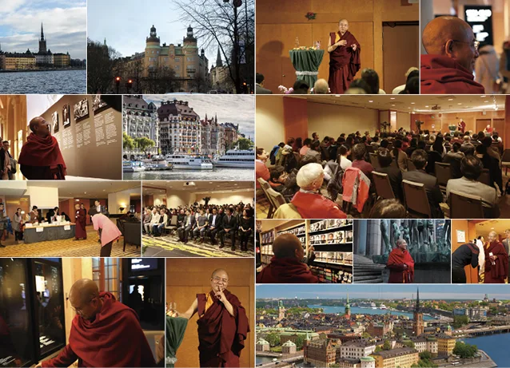

## 菩提心的力量

## The Power of Bodhicitta

主持人：

欢迎大家参加今天的讲座。有机会聆听索达吉堪布仁波切的开示，我们十分荣幸。

堪布对传讲佛法，一直极为重视。30多年来，堪布总共宣讲了9300多堂课，其中多次讲到菩提心的重要性。堪布曾经说过：“释迦牟尼佛宣讲的八万四千法门，所有醍醐精华集中起来，就是菩提心。”无论是从理论上，还是修行上，菩提心对我们每个人来说，都极为重要，都具有不可估量的价值。

下面，有请仁波切就“菩提心的力量”这一主题，为我们作开示——

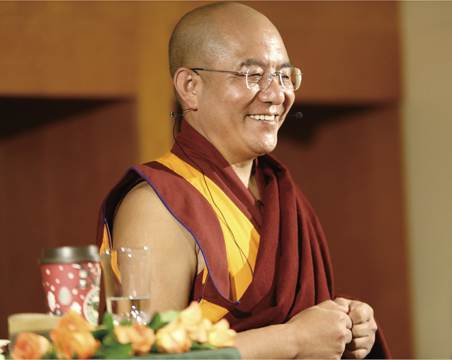

今天，在这里作一个简单的开示。我原来是想给菩提学会的高层管理人员，作一个团队合作的培训或小型演讲。后来发现，很多人对大乘菩提心都有希求，都愿意参加，所以就改变了主意，与大家一起分享并探讨这个话题。

## 这些，我都写在日记上了

现场有学会的高层管理人员，以及有信仰、没信仰的其他朋友。人数不算特别多，却来自各个国家，可以算是欧洲的一个国际性研讨会。为了这次讲座，大家从不同的国家专程来到这里，包括法国、德国、英国、荷兰、奥地利、比利时、芬兰，等等。还有一些国家，没有报上来。

我们这么多人，带着各自不同的语言、思想、文化和智慧，进行一次碰撞性、融合性的探讨，非常有意义。我是第一次来瑞典，有很多新的感受、新的兴趣，对很多事物都充满了好奇。这些，我都写在日记里了。

我在藏地，下午如果特别累，会喝一杯咖啡。很多人都劝我：“咖啡里有什么什么，不要喝，不然对身体不好。”我的胃不是太好，下午如果喝了咖啡，确实会不舒服。

但是到了瑞典，他们早上就让我喝咖啡。中午的时候，我也喝了一杯。刚才在下面，又给了我一杯。不知道什么原因，我今天喝了三杯咖啡，胃里依然比较舒服。他们说，是因为加的牛奶比较多。噢，今天的讲座不是讲咖啡，而是讲菩提心。（众笑）

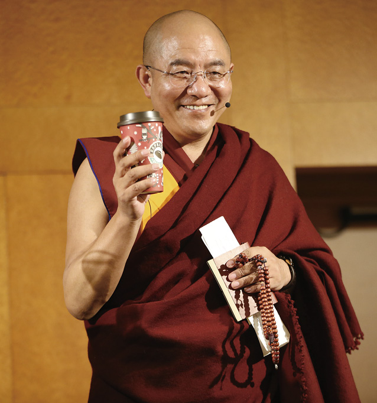

## 妙金光美女，生起了菩提心

什么是“菩提心”？在座的很多人，以前可能听说过，但恐怕只停留在概念上，对真正的内容并不懂。不仅是我们，历史上也有很多人不懂。

先讲一个故事。前一年，我翻译了《八大菩萨传》。其中《文殊菩萨传》里，有这样一个公案：在印度，有一个身相美妙、漂亮动人的女子，身上会自然发出金色的光，大家都叫她妙金光。不过，她出身比较低微，一直过着妓女的生活。

世间人耽著美色，所以她身边有无数男子围绕。一些有钱的商人之子和高贵的王子，也经常去找她。有一次，一位商人之子，用现在的话来讲，是个“富二代”——不知道你们这边有没有“富二代”的说法，陪她一起上街买金银饰宝，然后准备去花园里享乐。

他们走在路上的时候，文殊菩萨知道度化她的因缘已经成熟，就穿着一件漂亮的金色衣服，出现在妙金光的面前。文殊菩萨的金色衣服灿烂无比，妙金光身体发出的光芒，顿时变得黯淡无色。妙金光对文殊菩萨生起特别大的欢喜心，抛弃了原来的男朋友，跟着文殊菩萨跑了。

其实，她不是真的喜欢文殊菩萨，而是喜欢文殊菩萨的衣服。文殊菩萨告诉她：“只要你发菩提心，我就把自己的妙光衣服给你。”妙金光美女说：“只要能得到这件衣服，我愿意发菩提心。可是，我不知道什么叫菩提心呀！”文殊菩萨说：“你先发菩提心，我再给你讲，衣服也可以给你。”妙金光答应了。文殊菩萨便开始给她讲菩提心的道理。

文殊菩萨给妙金光讲菩提心的时候，很多国家的人都去听，其中不少人得到了相应的圣者果位。妙金光在听法的过程中，心里真的生起了菩提心。她向文殊菩萨请求：“我现在不要那件衣服了，我想出家。”文殊菩萨告诉她：“发菩提心利益众生，就是菩萨的出家。你如果放下自私自利的心，一心一意利益众生，就是真正的大乘出家人。”后来，妙金光没有出家，她发起了大乘的菩提心。

这个故事说明什么？在世间，有些人心情特别烦乱的时候，什么都不想干，就想出家。事实上，这不一定是一个好的选择。真正的出家不是这样的。这个故事还说明，我们不管参加什么活动，最好有一件事情能留在心上。比如，我今天讲的故事，如果过了10年、20年，你还能记住，那你听今天的讲座，稍微有点意义。

在我的记忆中，听过很多老师的课。有些老师的课只听过一次，但过了10年、20年，我还记忆犹新。有些老师的课听过很多次，现在回忆起来却是模模糊糊的，没有印象，不知道讲了什么。

其实，不管老师讲得好，还是讲得不好，我们自己都要懂得利用这样的机会。每一次活动，至少记一个生动的故事、一句精彩的名言或一则深刻的道理。如果能够这样，我们将来会变成极富智慧的富翁。

听了这个故事，大家还会明白：文殊菩萨的弟子，也是先通过听闻，知道什么是菩提心，心里再慢慢生起菩提心，最后身体力行、实践菩提心。所以，有些人不知道什么叫菩提心，也没关系。我下面会给大家讲。

## 此菩提心，诸善中王

在我们的生活中，菩提心是可以不离开的，发起它也可以是轻而易举的，没有那么困难。关键看有没有兴趣和意乐，只要有兴趣和意乐，我们每个人都可以生起菩提心。

汉传佛教有位著名的大德，叫省庵大师，他写了一篇《劝发菩提心》的文章。里面讲到，菩提心是一切善法之王，需要依靠种种因缘才能产生[^1]。所谓的善法之王，意思是一切善法中最重要的，也是所有善根中最大的——包括身体所作的善根、语言所作的善根，以及心里所作的善根。

菩提心不会无缘无故地产生，而要依靠种种因缘。比如，由前世发菩提心的善习气引发而产生，以及通过看大乘佛法的经教而产生，或者依靠大乘善知识的教言而产生，等等。

我们如果不关心大乘佛法，则另当别论；如果关心大乘佛法，菩提心是不可缺少的。著名的阿底峡尊者说过：“大小乘之间的差别，以菩提心区分。”如果没有菩提心，就不是真正的大乘佛教。

实际上，所谓的小乘或南传佛教，也并不是完全没有菩提心。有时候，从自身的修行来看，他们拥有很好的利他心。而我们有些人，口口声声说自己是大乘佛教徒，相续中的慈悲心却比较弱。

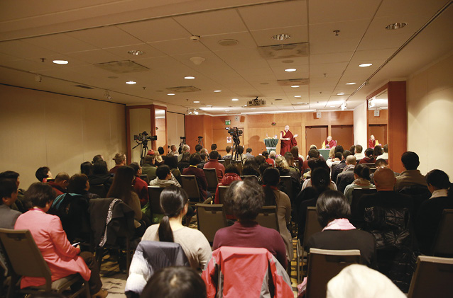

不管怎么样，从古代到今天，尤其在当今纷繁复杂的社会，利他菩提心对个人也好，对社会也好，乃至对整个地球而言，都是至关重要的。

但现在这个时代，不管东方还是西方，提倡的都不是利他主义，而是自我主义——一切以自我为中心，自我宣传，自我吹嘘。很多人为了所谓的成功，为了所谓的人生价值，有功德也好，没功德也好，都拼命地赞叹自己。一个社会，如果过度掩盖自身的错误，吹捧自身的功德，权利和义务就不一定分得清了。

我们活在世界上，一方面需要提升自我——这是非常现实的问题，在人生中不可缺少，但另一方面，关注他人，帮助他人，更是重中之重。在家庭内部也好，在社会群体也好，利他心都非常珍贵。相反，如果我们只关心自己，不关心家人、不关心朋友，乃至不关心整个社会，暂时好像说得过去，但长远来看，人生之路也许会越走越窄。

## 愿仇恨我的人，也得到快乐和满足

佛教思想流传到今天，已经有2561年了。在人类漫长的发展历程中，利他菩提心一直发挥着重要作用。回顾人类的历史，利他思想从来没有被人类践踏在脚下过。未来，人类的前程不管有多长，利他思想都具有永恒不变的重要价值。

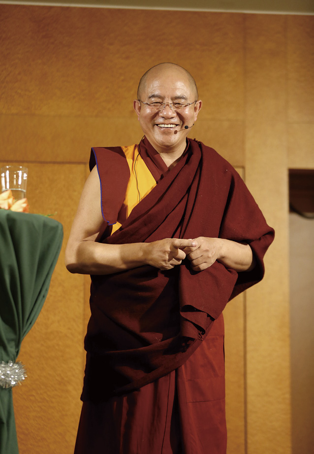

我经常在想，世界上虽然有各种不同的宗教思想，但最究竟的宗教思想只有一个。那是什么呢？利他。如果大家能认识到这一点，所有的宗教对人类而言，不管是个人，还是社会群体，都具有重要的意义。

在这个世界上，人也好，动物也好，谁都不愿意遭遇恐怖袭击，谁都不愿意住在不安全的地方，谁都不愿意交往有暴力倾向的人。所以，利他心不仅适应过去的社会，也适应现在的社会，同样适应未来的社会。

在日常生活中，我们不管动什么念头、说什么话、做什么事，都不要损害别人，不要给别人带来痛苦，而应该想：“愿我所做的一切，都能直接或间接利益与我相关、跟我结缘的人，甚至与我无缘、蔑视我、仇恨我的人，也愿他们得到快乐和满足。”

《入菩萨行论》中讲：“任他践吾顶，宁死悦世主。”意思是，不管别人如何欺负我、践踏我，甚至把脚踩在我的头上，甚至用各种方法夺去我的性命，我也不会心生怨恨，反而会用利他心，回报他的伤害，让世间怙主佛陀欢喜。

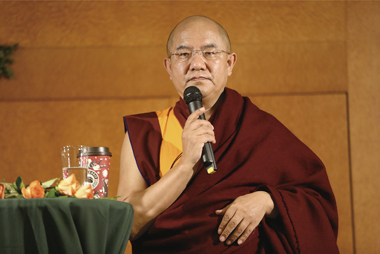

有些人可能想：“如果每个人的心都变得柔和，不对抗，世界肯定乱套了。现实社会不是这样的。”这样的想法，只不过是他们的惯性思维而已。实际上，世界并不会因为充满善良而乱套。任何时候，具有利他思想的人——“不管别人怎样害我，我都要利益他”，会过得非常快乐，而具有暴力倾向的人，却根本没办法长久存留。生活中，这样的人和事，我们经常耳闻目睹。

我坚定地认为，每一个人都应该有珍贵的利他心。这是我们有生之年，所有追求中，最好的一个目标。

## 愿你我都染上，菩提心的“病毒”

在世间，有很多传染病，比如艾滋病、肺结核等。相对于世间的传染病而言，菩提心也是一种“传染病”。不过，它是一种好的“传染病”。

有些人可能想：用传染病来比喻菩提心，会不会有过失？没有过失。《大圆满前行》的作者、伟大的华智仁波切，也用过这个比喻。

华智仁波切经常穿得破破烂烂的，四处云游，看起来像个流浪汉，特别可怜。有一次，藏地两个部落发生争斗，准备打仗。他们中间有一条必经之路，华智仁波切穿着一身破烂的衣服，躺在路口。双方战士看他一直躺在那里，以为是个麻风病人，就说：“我们要打仗了，请你滚开！”但是又想：“麻风病很容易传播，还是避开吧。”

华智仁波切有他心通，知道他们的想法，对他们说：“你们不必担心。我得的病叫觉性菩提心，能染上这个病的人不多。就算我的弟子中，也只有纽西龙多等少数人才能染上。”

他继续躺在那里，一直观修菩提心，并以乞丐的身份劝解双方。最终，这场争斗平息了，没有发生流血冲突。

在藏地历史上，华智仁波切是一位非常典型的隐士，看起来总是穿得破破烂烂的。我刚才在外面，看到一位推行李车的人，穿着也特别破烂，好像是乞丐——你们这里也有乞丐？每次看到乞丐的时候，我都会想：他是不是具有菩提心的“传染病人”呢？

这个世界很复杂，很不好说。有些人高高在上，口头经常炫耀自己，心里却没有一点菩提心的症状；有些人看起来非常普通，却具有真正的菩提心“病症”，会传染很多人。

如果没有好好修菩提心，没有生起真正的利他意乐，行为上也许能做一些事情，但不会有太大的成就。我们如果生起了真正的菩提心，一心一意利益他众，遇到再大的困难或障碍也不退失，修行一定会获得成功。

对于菩提心，并不是因为某个宗教在提倡，所以我们要追求。大家用智慧观察会发现，对今生也好，来世也好，在社会的每一个角落，菩提心的确非常有意义。

## 利他心最终成就的，是自己

有了利他心，表面上是我在帮助别人，实际上，是别人在成就我的人生。

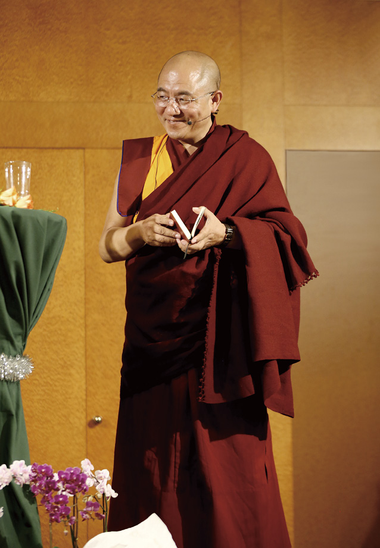

再讲一个故事。19世纪末20世纪初，世界兴起了空中飞行的探索热潮。其中，有一个叫塞缪尔[^2]的美国科学家，也在从事飞机研究。不过，他的心态不纯，很希望通过试飞成功，获得声誉和财富。由于他在哈佛大学任过教，美国科学院也给他颁过奖，所以社会上下都看好他。美国政府资助了他5万美金，大大小小的媒体也跟着他，追踪他的研究进展。

当时，莱特兄弟私下里也在造飞机。不过，他们没有什么社会资源，完全是个人努力。他们希望以此改变世界，改变人类的生活方式。在利他思想的驱动下，他们进行了多次试飞，并把每次试飞当作生命中的最后一次，后来终于试飞成功。但事情过了好几天，美国政府才知道，因为所有的媒体都在跟踪另一个人，并没有关注他们。

有时候，利他心会帮我们挖掘出自身的很多潜力，最终成就我们自身。实现了自他二利的人，一旦离开世间，人们永远不会忘记他。喜欢伤害别人的人，离世以后，人们也不会忘记——会用另一种方式怀念他。

## 来一趟人间，尽量不要害众生

人生最高的境界，既不是拥有多多的金钱，也不是拥有高高的地位和大大的权力，而是实现最高尚、最巅峰的觉悟。这在佛教里，就叫做“成佛”。菩提心的内涵，是要让所有众生都实现这样的觉悟。可见大乘佛教的利他心，并不是某个宗教独占的、狭隘的、教条的思想。它的广大愿力，涵摄了所有众生的觉悟和安乐。

“我要让所有的人，包括仇恨我的人在内，都达到思想觉悟的最高峰”，能发如此宏愿的人，应该是一个高尚的人吧？这样的高尚者，一定会给社会带来正面的影响，而他自身的利益也会不求自得。可见，在自他利益之间，是可以形成这样一种良性循环的。《大集经》中也说：菩提心是一切佛法的根本，生起菩提心以后，所有功德都会蒸蒸日上[^3]。

因此，你们有没有信仰不要紧，是不是佛教徒也不要紧，最要紧的是，大家来人间一趟，尽量不要损害众生，并尽可能地帮助所有的人，乃至所有的生灵。

愿心不可思议，愿力也不可思议。我们如果这样发愿，今生和来世一定会得到不可思议的快乐。

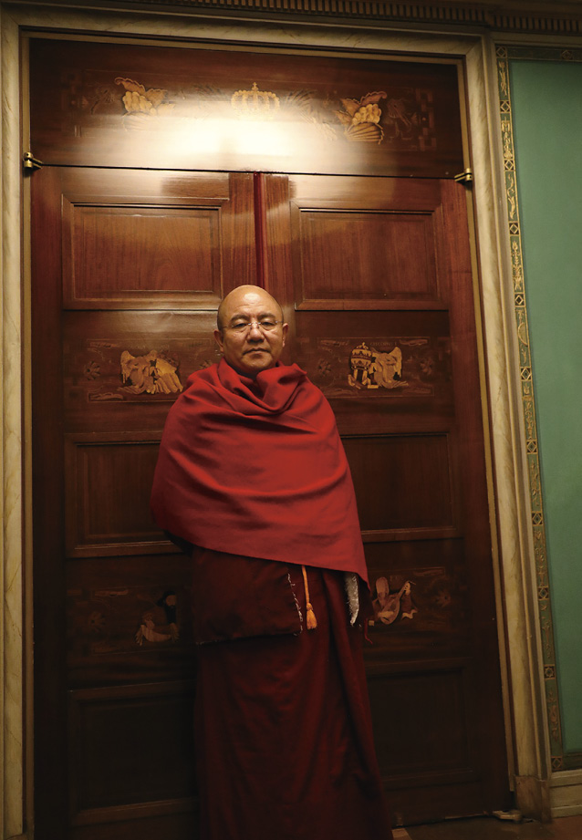

现场互动

问：刚才您说到利他心，又提到忍辱——忍受他人的伤害。最究竟的忍辱，应该是无辱可忍，对吧？但是，现实生活中还是会有很多伤害。面对这种伤害，律师的辩护、法院的判定，有没有意义？能不能拿起法律武器来保护善良者？

堪布：在现实生活中，我们如果特别能忍，特别柔弱，可能会被人看不起，甚至受到欺负。所以，自己应该变得坚强起来。一个内心坚强的人，一般不会受到别人的侮辱和摧毁。另外，依靠法律来保护自己，也非常有必要。

听说，瑞典的法律没有死刑，是吧？我去了你们的库姆勒监狱，感觉里面太舒服了。在这里受法律的制裁，好像不是那么可怕，跟住四星级宾馆差不多。（众笑）

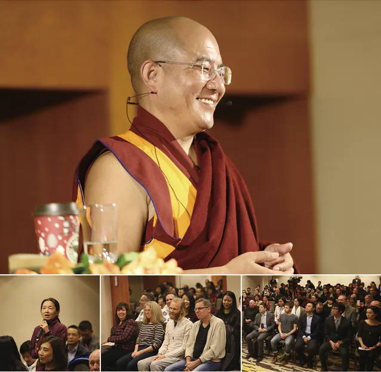

我问狱警：“这里这么舒服，会不会有人故意犯罪？”他说：“不会。”“我在其他监狱了解到，有个人反反复复犯罪，一共进了7次监狱。你们这里有没有这样的情况？”他说：“从来没有。在我们这里，凡是从监狱里毕业的，都是永远毕业。”这也许跟人的素质有关。

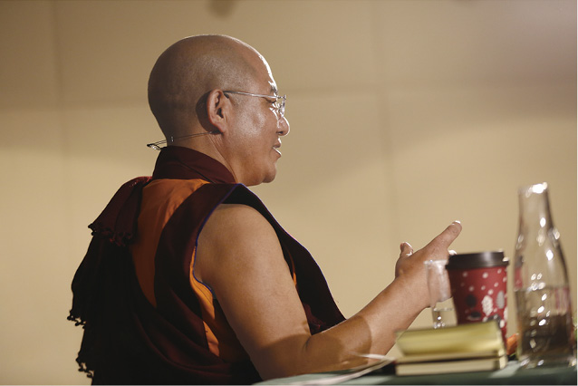

问：一个佛教徒和一个道德高尚的人之间，有什么样的关系和区别？

堪布：一个好的佛教徒和修行人，一定是道德高尚的人，但道德高尚的人不一定是佛教徒。有些人没有任何信仰，或有其他的宗教信仰，但他们的行为也非常让人敬佩。也有一些人，虽然是佛教徒，但言行举止并不那么高尚。

所以我希望大家，尤其是佛教徒，言行举止一定要如理如法。这是做人至关重要的一个原则。在任何一个地方，高尚的美德都是受欢迎的，也是人们需要的。

问：学密宗真的可以今世成佛吗？

堪布：昨天我去斯德哥尔摩大学，见到了一位名叫斯蒂文森的教授，他专门研究《米拉日巴传记》的作者——藏宁·赫鲁迦[^4]。我问他：“你为什么研究这个？”他说：“全世界的人都知道，米拉日巴尊者是一位非常伟大的成就者。藏宁·赫鲁迦能为他写传记，肯定也有非常高的境界。”所以，教授专门将他作为自己的研究对象。

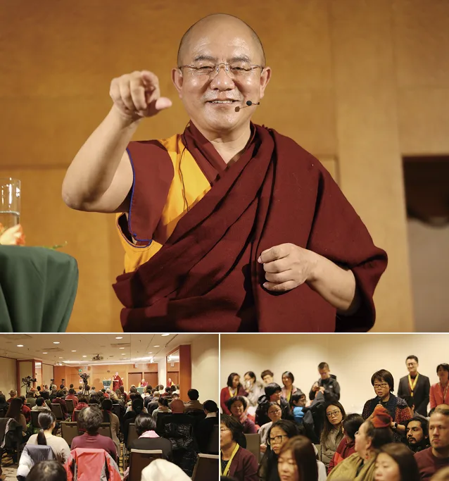

米拉日巴尊者怎么评价自己呢？他说：“我本是一个非常平凡、非常普通的人。但是，通过自己的忏悔和努力，即身成就了佛果。”米拉日巴尊者的成就，就是刚才讲的最高觉悟，也叫金刚持，也叫佛果。在藏传密宗当中，不管是大手印，还是大圆满，都有今生成就或成佛的殊胜修法。

问：菩提心与空性有什么样的关系？我们今生如果没有生起圆满的菩提心，是不是就没有机会证悟胜义菩提心？另外，我们在修上师瑜伽的时候，可不可以直接观您？因为法王如意宝没有见过，观起来比较困难，直接观您，穿上法王的衣服，这样行不行？

堪布：第一个问题。《中观庄严论释》中讲，由于根基不同，有些人先证悟空性，再发菩提心；有些人先发菩提心，再证悟空性。两种情况都可以。

第二个问题。修上师瑜伽的时候，不能直接观我——需要用法王如意宝的衣服盖着，说明信心还不够。

一般来说，上师瑜伽有两种观想方式：按照龙钦巴尊者《大圆满虚幻休息》的观点，直接观上师的形象才能获得成就；而在晋美朗巴尊者和华智仁波切等上师的修法里，显现是本尊，本体观为上师。

关于这一点，我以前也分析过。如果对上师真的有对佛一般的、非常有智慧的信心，直接观上师的形象也可以。但一般来讲，最好观本尊，比如莲花生大士、文殊菩萨或者其他本尊的形象。这样观，信心不会退转。否则，你跟上师关系好的时候，把他观在头顶；关系不好的时候，不要说观想，可能连看都不想看。所以长远来看，观本尊比较保险。

[^1]: 《劝发菩提心》：“此菩提心，诸善中王。必有因缘，方得发起。”
[^2]: 塞缪尔·兰利（Samuel Langley，1834年-1906年），美国天文学家、物理学家、航空科学探路者，曾多年致力于可操纵、有动力的飞机研究事业。美国管理学家西蒙·斯涅克在TED演讲《那些杰出的领袖怎样激励我们行动》中认为，塞缪尔造飞机失败，是因为没有好的信念。
[^3]: 《大集经·虚空藏菩萨所问品》：“虚空藏菩萨答宝手言：‘善男子，菩提心是安一切佛法根本。一切法住菩提心故，便得增长。’”
[^4]: 即藏宁·赫鲁迦·乳毕净坚（1452年-1507年），密宗成就者，师从竹巴噶举。编撰了历史上内容最广、流传也最广的《米拉日巴尊者传》。后世对米拉日巴尊者的认知，多源于此部著作。
