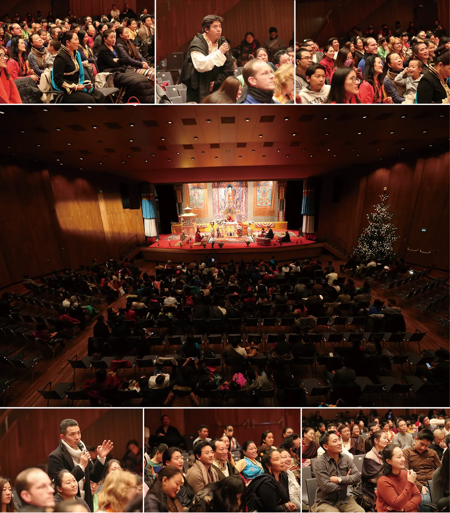
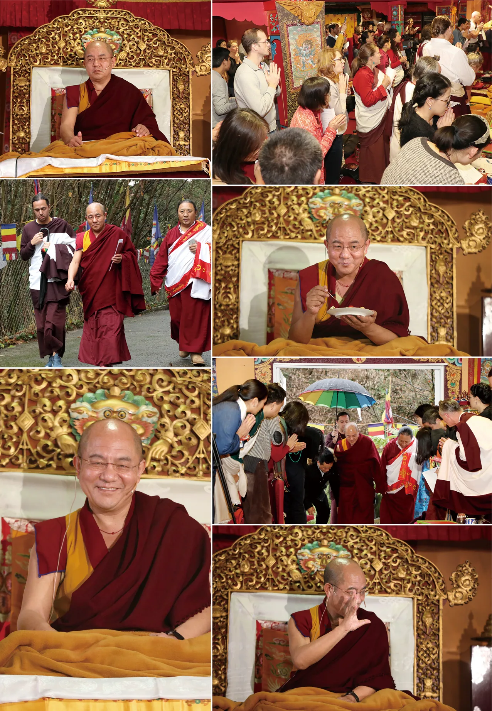
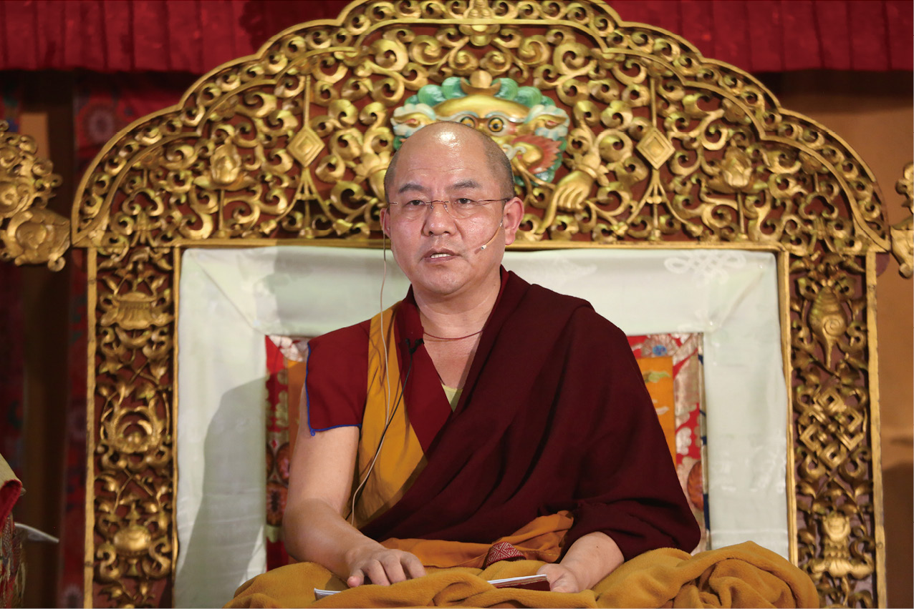
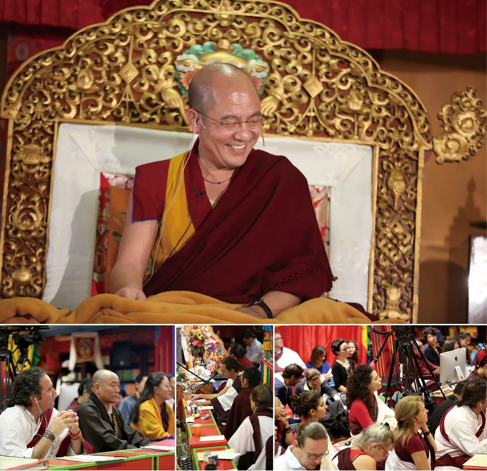
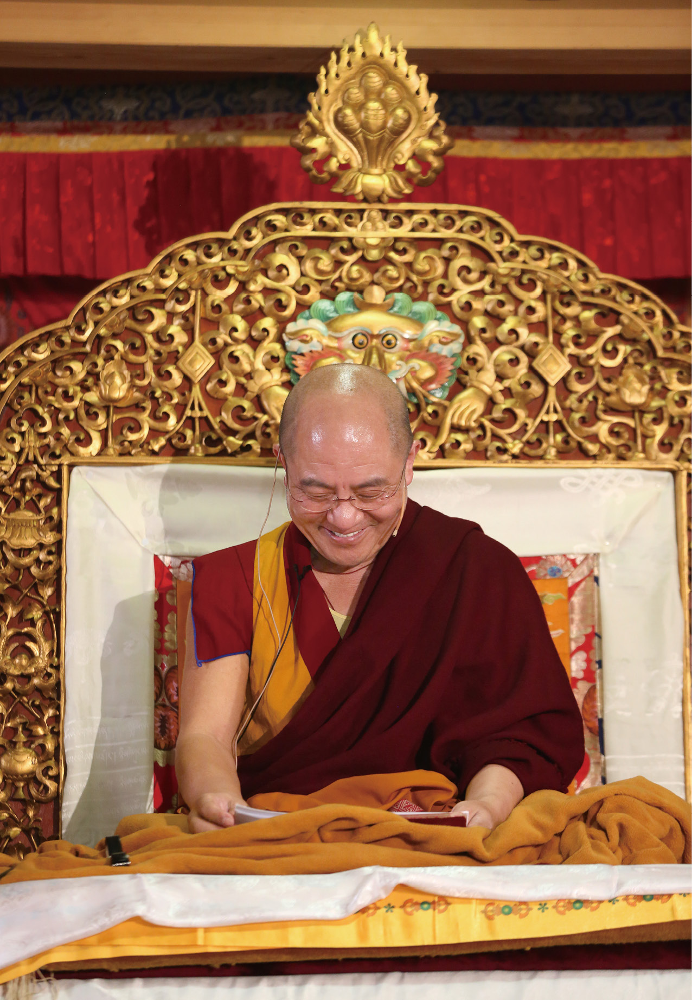
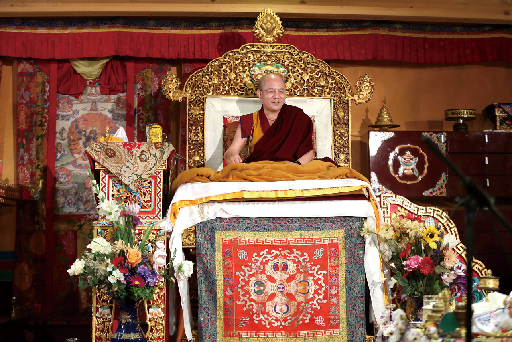
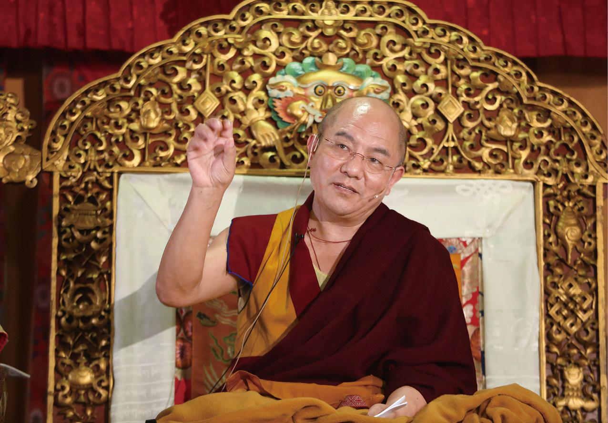

上师瑜伽是所有法的基础，  
是依靠信心获得殊胜证悟的不共法门。

第79场

瑞士持明大乘林

Rigdzin Suisse - Thegchok Ling

瑞士·洛桑

2017 / 12 / 12

## 上师瑜伽和修行的关键窍诀

## Guru Yoga and Key Instructions for Practice

大悲摄受具诤浊世刹，尔后发下五百广大愿，

赞如白莲闻名不退转，恭敬顶礼本师大悲尊。

今天主要讲“上师瑜伽”修法，同时，有英语、西班牙语及其他语种的翻译。经云：“天龙夜叉鸠槃荼，乃至人与非人等，所有一切众生语，悉以诸音而说法。”往昔，佛陀也是顺应各道众生语言来传法。

## 上师瑜伽的核心是上师

上师瑜伽在佛法中占有重要地位。虽归类于前行法，但从实修角度划分也属于正行法。历代传承上师一致承认：上师瑜伽是所有法的基础，具有遣除障碍、增上修行的作用。

上师瑜伽，是依靠信心获得殊胜证悟的不共法门。西方宗教认为：如果没有信心，就会堕入地狱受到惩罚。佛教所说的信心是追随真理、对正法生定解。所以，要先懂得信心的道理，再追随。否则，只是凭兴趣追随，就是迷信。

任何佛经论典，都不承认不符合真理的观点。《胜出天神赞》云：“我不偏向于佛陀，亦不歧视外道宗，何派具有胜道理，我即依此为导师。”意思是，我既不偏向佛陀、佛教，也不歧视外道教派，只要是宣说符合真理的教言，我就依止此人为导师。

因此，要用智慧观察是否符合真理。如果不符合，无论是佛陀的教法还是上师的教言，不修持也没有过失。是否符合真理需要智慧观察，智慧需要闻思修获得，否则无法了知佛陀的究竟意趣和上师的密意。

有些上师不重视四厌离心、五加行等基础，直接给弟子传授“大圆满”“大手印”“大威德”“喜金刚”等最高见解、最超胜修法。由于基础不牢固，终有一天师徒均会显露出过失。所以，修窍诀时需要闻思的基础。

曾有大德说，修密法前很长一段时间内，应主要修五加行和其他前行法。如果前行修得稳固，那修行就不容易中断，最终结果也会很圆满。以前，藏地有位玉科喇嘛，是非常有加持力、有名望的上师。他特别重视修前行，他的弟子们后来都成为了很好的修行人。

## 上师是真正的佛陀

很多人觉得上师也是人，与自己是平等的。因此，没有必要恭敬上师、祈祷上师赐予悉地。其实，佛经论典中说的上师，等同于佛陀。不是说上师的身体、语言是佛陀，而是具相上师相续中的智、悲、力、功德与佛陀等同，与诸佛菩萨的密意无二无别。从这个角度讲，上师的密意就是法身，等同于佛陀。

依止上师是有次第的：最初观察即把上师当朋友，未在其前听法时先观察其过失及功德；尔后于上师前得法并生起“上师等同佛陀”的定解，即上师的功德、事业与诸佛菩萨无二无别；最后通达心的本性，上师的心与自心无二无别。

如实了悟自心实相后，才明白上师就是真正的佛陀，自然会生起定解和信心。此时，视师如佛的信心才不会退转。如米拉日巴尊者所说：“无人山谷岩洞中，恒具出离厌世心，上师乃为三世佛，强烈信心永不离。”意思是，在寂静无人的山谷岩洞中，我生起了出离心、厌世心，传授我甚深窍诀的上师是三世诸佛的化身，对此我怀着强烈的信心，恒常不离。

上师的确与佛陀无二无别，若没有上师，仅凭自力是无法通达万法实相的。一想到上师的事业和佛陀的事业无二无别，自己会生起不共的定解。

## 证悟实相靠上师加持

了悟自心实相，主要依靠上师的加持。如经云：“当知胜义俱生智，唯一积资净罪障，具证上师之加持，依止他法诚愚痴。”意思是，我们所证悟的胜义俱生智慧，唯一依靠积资净障、具有证悟的上师加持而获得。除此之外，想靠他法获得证悟是愚痴的行为。

如果自己有信心，为自己传授窍诀的人就可以称为上师；如果没有太大的信心，莲花生大士、诸佛菩萨的化身或让自己结上法缘的人都可以称为上师。

上师的加持融入相续后，上师的恩德无人能比，内心也经常生起欢喜心和不共的定解。如经云：“具德上师诸所行，刹那亦不生邪见，所作见为法信敬，愿师加持入我心。”意思是，具有德相的上师，所有行为都是度化众生的方便，一刹那也不对上师生邪见，将上师的一切行为都视为佛法而生信心和恭敬，祈愿上师的加持融入我自心。平时可以用此偈颂祈祷上师。

依靠上师的加持而了悟自心实相，与大学里学生依靠老师学知识是截然不同的。木匠、石匠、铁匠、裁缝等手艺人也拜过很多老师，他们之间只是师生关系。以前上学时有语文、化学、物理、数学、藏文等老师，他们只是教一般知识的老师，与密法里所说“直指心性、开示大乘佛法”的三恩德上师相比有天壤之别。

我的家人或老师离世时，虽然内心痛苦，但并不是无法忍受而痛哭流涕。而为我传授不共大乘法的根本上师——法王如意宝晋美彭措和德巴堪布，他们离世的时候，内心的痛苦极其难忍。现在偶尔做梦醒来，也因想念上师而流泪。

## 选择上师还是本尊

德巴堪布是一位具有加持力的上师，他给我传讲了《大圆满前行·普贤上师言教》等珍贵的法，我相续中对佛法的不共见解、功德，都是依靠他老人家才生起的。若是经常忆念这样的上师，功德比观修本尊更殊胜。续部中云：“何人俱胝劫，修十万本尊，不如一刹那，忆念上师胜。”

曼达拉瓦空行母现见本尊坛城时，莲花生大士问她选择上师还是本尊，她选择了本尊，于是莲花生大士将所有法传给了益西措嘉空行母。坛城中的所有智慧本尊当下就消失了，结果她没有得到法。如果让你选择自己的根本上师还是本尊，大多数人都会选择本尊，但其实上师的加持力比本尊更为重要。唯有上师的恩德能让我们真正证悟！

大学里教授研究的只是某种知识，与证悟的殊胜智慧大相径庭。在座的人里大多数是密咒师，密咒师不需要广大的闻思，只需要一个解脱法。藏传佛教有在家白衣密咒师和出家僧众这两类应供处。在家白衣密咒师虽有家庭，但主要还是修行佛法、穿白衣、留有发髻。藏族历史上有国王铺开自己头发，为持教大德、佛菩萨作地毯并恭敬顶礼。出家僧众是指持戒的修行人，需要剃头发、胡子，身穿三法衣。现在的出家僧众较少，多数是在家白衣密咒师。各地的瑜伽士、瑜伽母也和你们一样身穿白衣。

以前通过微信、Facebook看到你们身穿白衣开法会、念经，这既是表法，也是庄严的威仪，与佛陀的意趣相合。国王恩扎布德对妻子、眷属、五妙欲都不愿舍弃。经云：“在赡部洲美丽花园，变成狐狸也如成仙，舍弃妙欲的解脱法，无论何时也不愿要。乔达摩！”乔达摩就是释迦牟尼佛。国王对佛陀说：“在南赡部洲的美丽花园，即使变成狐狸也像成仙一样快乐，如果要舍弃五种妙欲才能获得解脱法，无论何时我也不愿意。”于是，佛陀给他开示了不用舍弃妙欲、在家人也可修道的密法。之后，国王和眷属依靠佛陀的加持、密法的加持获得了解脱。

## 依靠上师认识心性

现在若像当时的人那样，全部获得持明果位是很困难的。但全知麦彭仁波切所造的甚深窍诀——《直指心性》的密意，即便没有文化、没有勤奋用功，依靠大圆满法的加持力、密法的加持力，也能如实了悟自心的本体，轻而易举获得持明果位。《直指心性》中云：“不必广闻深思及磨炼，唯以窍诀之宗护心性，城中众多咒士虽不勤，速谙持明地即深道力。”意思是，密法的修持不需要广泛的闻思，而是在已经认识觉性后，唯以窍诀护持心性，众多在家密咒师虽然不勤作，但实际上已经通达了心的本性。

一般显宗的法需要多年闻思修，并付出很多努力和勤奋。密法的修行不用特别勤奋，到寂静的山谷去简单地念些咒语、观心的本体、禅修，或边干家务边观自心，无论何时都对心性实相生起不共的定解。虽不像出家人那样广闻博学，但也已不失己道、不离法味精华、不离证悟觉受。如此，修法觉受就会在相续中自然生起。之所以在相续中能轻易地生起殊胜证悟，最主要来源于持明传承上师的教言、甚深道的加持力、甚深法的力量、信心及与根本上师的誓言。因缘具足时，再平凡的人也能在相续中现量获得殊胜证悟。

对上师生起信心后，认识心性就毫不困难了。全知麦彭仁波切在《大圆满愿文》中说：“自心简易难信之秘密，愿以上师窍诀力见之。”意思是，心的本来面目非常简单，因为太简单的缘故，自己很难相信，希望依靠上师的窍诀和加持，让自己能够认识心性。

《入行论》云：“若不知此心，奥秘法中尊，求乐或避苦，无义终漂泊。”如果不认识佛法的精要即心的奥秘，纵然努力追求快乐或避免痛苦，仍免不了无义地漂泊于轮回中。无数人通过观心的秘密，进而认识了心的本来面目，无论修持轮回或涅槃的法都变得非常简单。

## 认识心性的窍诀

你们可能也听受过一些直指心性的窍诀。这些窍诀归摄起来，就是让心自然安住，认识心的本面、自性光明。大圆满和显宗般若经典里的窍诀，都是让心自然安住、认识心的本面。显宗经典《中般若经》中云：“心无心，心性即光明。”“心的本体是空性，心的本性是光明。”这两句与大圆满的见解很相似。很多人依靠汉传佛教的《金刚经》而证悟，还有很多人通过念诵《维摩诘经》而证悟。

法王如意宝在密法中讲到：“心无改造自然住，三藏四续乃精华，怙主麦彭仁波切赐教言，本无语自然出。”意思是，自心无有改造地自然安住，就是大圆满三藏四续的精华，本来是不想讲给他人的，但却自然流露了出来。经典中讲“观自心”时眼睛专注于虚空，有很多窍诀是用虚空比喻自心——心的本体空性如虚空一样。“光明”则是用其他的来比喻。

全知麦彭仁波切云：“此时直面之虚空，观其犹如自之心，散乱分别当下空。”意思是，我们直视虚空时，虚空无有自性，当生起贪、嗔、痴、慢等各种分别念时，用自己的心来观察心，嗔恨的自性、贪欲的自性等都是不存在的，都是五智的本性。这一点依靠上师的窍诀，直指而认识分别念的本性是智慧的本体。

## 虚空喻心性是甚深窍诀

显宗有很多“虚空”的比喻；密宗《法界宝藏论》的注释《法界宝藏论·教证库》中，每一品都是用虚空作比喻。全知无垢光尊者在《法界宝藏论》里讲了很多“虚空”的比喻。世间人觉得土地很有价值，但修行人认为虚空更有价值。《法界宝藏论》中说：“虚空是空性的、没有任何本体，但不是什么都没有，心性还有光明的部分。如来藏的光明，无始以来都存在。认识了本性，才能证悟心的本体。只是了知空性，并没有真正认识心的本面。”

敦珠法王的前世嘉贡多杰敦珠，在有些窍诀中讲到：“大圆满的见解是眼睛专注于虚空，也就是观察虚空的本体。眼睛要专注于虚空，但是虚空没有什么可见的。”《般若摄颂》中云：“有情自言见虚空，观彼虚空如何见。”意思是，有人说见到了虚空，但如果仔细观察，虚空是空性的、没有什么可见的。

《量理宝藏论》中云：“庄严孔隙之虚空，非为虚空之能立。”意思是，庄严虚空、孔隙虚空都不能称为虚空存在的证据。比如，天空显现蓝色是庄严虚空，孔隙内没有看到其他色法的部分是孔隙虚空。大圆满中经常用虚空比喻心的实相。如实了知心的本体、本基空性的实相。

虚空喻为自心，是传承上师们的甚深窍诀。我一般不给普通学佛人、大学老师、学生讲这些法义，因为他们不会如理地修持甚深的佛法。但是，你们中心的学生，从各方面看确实对密法有信心，也算是真正修行佛法的人。所以，给大家简单地讲了上师瑜伽修法及观察自心本体。

## 寄予希望

最后，提两点希望。第一是，以后无论南卡仁波切、萨迦堪布以及其他宁玛派的僧人、上师来传法，这里的藏族人和西方人，可以一起来听闻佛法，上师们也应该以悲心给他们传法。这里没有藏地那么多寺院、佛塔和转绕的地方，但最重要的是要让当地人了解佛法。

以前，南卡仁波切为主的上师们传讲过《普贤上师言教》《入行论》等。以后，即使有少数藏族人听法，也看看是否能为他们讲法。各地乘飞机过来的人就是为了听闻佛法，藏族人更没有理由不去听了。希望藏族人一定要听法，上师们也一定要传法，修五加行、闭关等都是必需的。这是第一个希望。

藏族上师们将来在欧洲或美国等地，应该以无偏的心来讲法，这是最重要的。在短暂的人生中，修行佛法是特别重要的事。如果没有真正修法，确实什么时候死亡也不清楚。因此，获得珍宝人身时，最重要的是上师和弟子都重视佛法，且应以更好的方式重视佛法。这是第二个希望。

这次来到南卡仁波切的佛教中心，即持明胜乘洲，看到很多修行人在直指心性、三年三个月闭关等方面做得非常好。看到你们在认真地修行佛法，我也很随喜！
