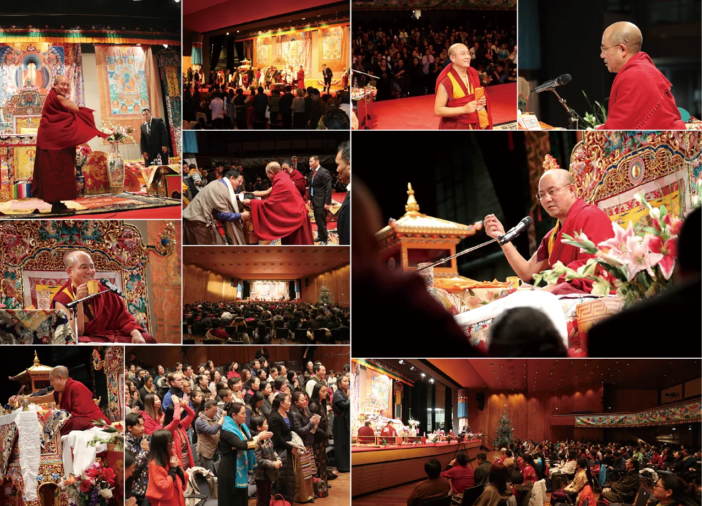
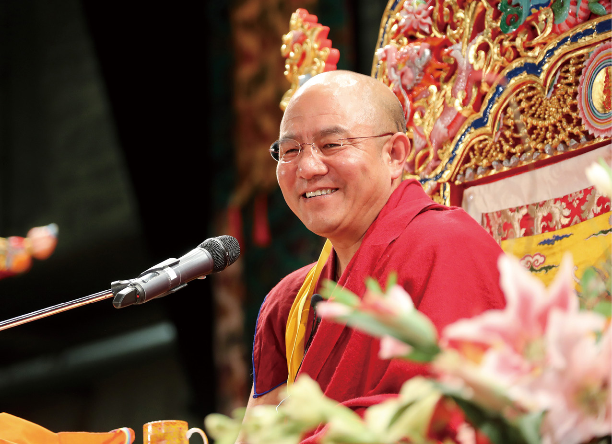
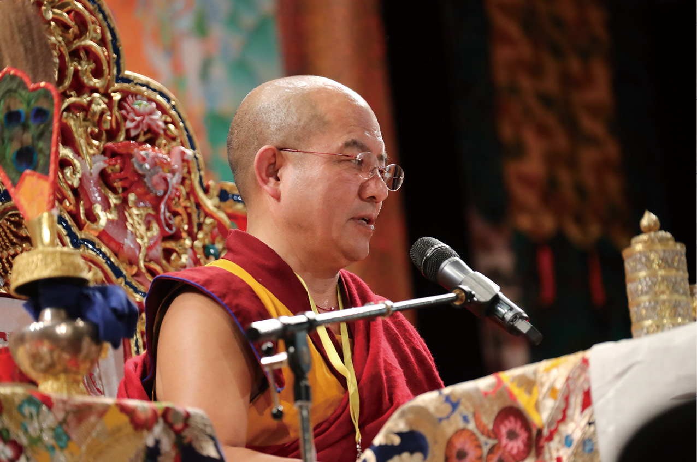
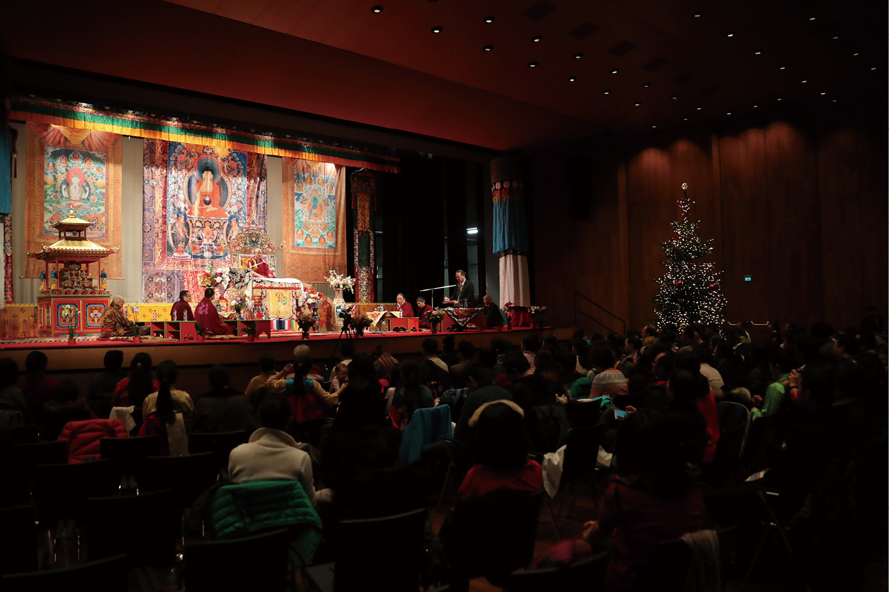
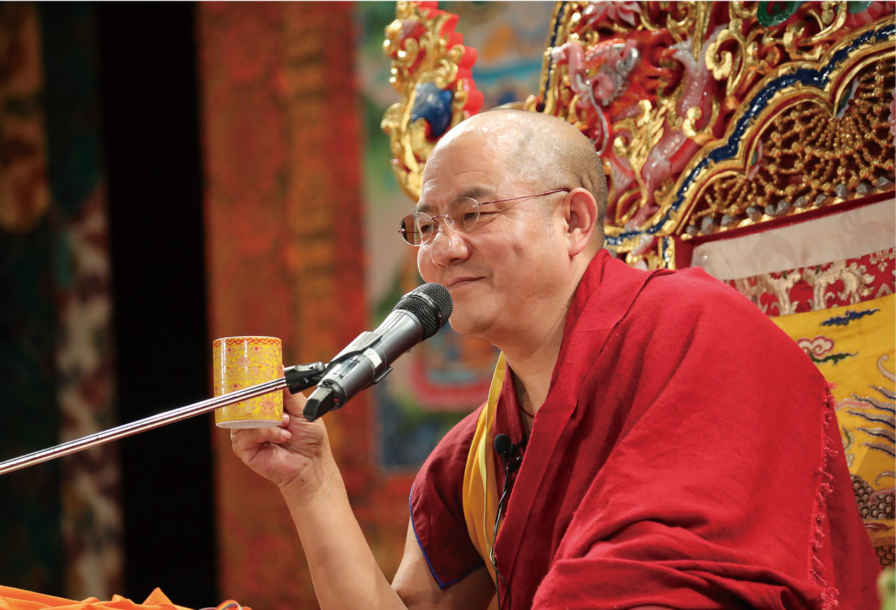
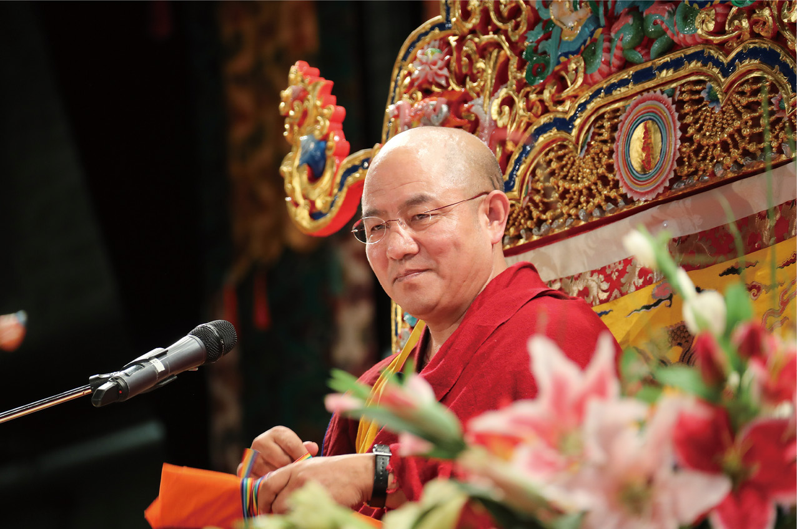

愿一切众生都能具足快乐！  
愿一切众生都能远离痛苦！

第78场

瑞士苏黎世施尼岑霍夫场馆

Schinznehof, Zurich, Switzerland

瑞士·苏黎世

2017 / 12 / 10

## 四圣谛

## The Four Noble Truth

首先，请大家在听法前，为利益一切众生发起无上殊胜的菩提心，愿自己今生来世都能利益一切有情。希望大家以这样的心态听闻佛法。

## 略说发菩提心

我们学习的主要是大乘佛法。大、小乘佛法主要以发心来区别。大乘佛法是做任何善法时以菩提心摄持。如果没有以菩提心摄持，那么善根会非常微弱、易遭毁坏，对自他没有利益。因此，寂天菩萨在《入行论》第一品中，宣讲了菩提心的广大功德。我们在行持善法时，至少也要发起相似的菩提心。

藏族传统里早已融入了大乘佛教的思想。比如，藏族老年人每天都手摇转经轮、念诵。虽然他们文化水平不高，但是心里会经常作意：我是为了一切众生而回向，为了一切众生而做这件事。以毫不造作的发心，口中说道：“为了一切众生而回向！愿一切众生都能具足快乐，愿一切众生都能远离痛苦。”看得出来，藏族老年人天生就有一颗菩提心。

菩提心，略讲分为愿菩提心和行菩提心。愿菩提心，类似于去某个地方前先有想去的愿望，即立下“我要度化一切众生”的坚定誓言。行菩提心，是在不舍愿菩提心的基础上，行持六度万行。平常可以从这两方面，观察自己相续中是否生起了菩提心。

真正的菩提心是很难生起的。因为想让一切众生获得佛果，要么自己先获得佛果，如“国王之发心”；要么先让其他众生获得佛果，如“牧童之发心”；要么自己和众生一同获得佛果，如“舟子之发心”。

而生起相似的菩提心并非难事。相似的菩提心，是指对沉溺于轮回苦海中的众生，生起“想让他们离苦得乐、获得究竟佛果”的利他心，以这样的心态在行、住、坐、卧中去行持。关于相续中生起菩提心的功德，《入菩萨行论》中云：“生死狱系苦有情，若生刹那菩提心，即刻得名诸佛子，世间人天应礼敬。”意思是，系缚在生死牢狱中的苦难有情，只要生起刹那的世俗菩提心，立即可以尊称其为如来之子，世间的人天都应该向他礼敬。

皈依和发心是佛法的重要基石。若是缺少它们，受戒、灌顶等也很难真实得到。很多人一方面不承认前生后世，一方面却在修大圆满、大手印等密法。

## 保护藏文化和佛法

这次主要是给藏族人讲点佛法，因此对藏族人提出的希望是“闻思修行”，即先在上师、善知识前听闻佛法，然后对听闻的法义反复思维、讲、辩，最后实际修持已思维透的法义。宗喀巴大师云：“始初多求广大闻，中于教理现教授，后于昼夜精勤修，普令回向教增长。”

佛法是种教育，如果没有认真学习，就无法深入佛法内涵。作为藏族人，更应要学习佛法——显、密教法都要学，更应该打好佛法基础。今天这位翻译者的佛法基础就非常扎实，无论是四谛法还是其他方面的法，他基本上都能听懂。如果一位译者缺乏良好的佛法基础，即便能轻松驾驭语言，也无法准确译出佛法方面的内容。因此，藏族人一定要先打好佛法基础再实修。

国内藏族年轻人，既不想修行佛法，也不愿了解它。即便他们中有学佛的，也是对佛法各种批判：“这是封建落后的旧思想，学这些没有任何价值，这些需要舍弃……”还做了很多抵制佛法的行为。

虽然大家都有言论自由，但歪曲事实、违背道理地一味批判，会误导不了解藏文化和佛法的人产生邪见，进而诋毁和诽谤。年轻人口才好、智慧敏锐，但也不敢和一些格西、堪布辩论。他们是以傲慢心、嫉妒心去诋毁藏文化和佛法的。就算藏文化和佛法再势弱，也不是经不起智慧观察的，更不是经不起他人批判的。这一点，大家有目共睹！

之所以势弱，是受上世纪五六十年代的巨变影响，遭受了非常严重的损害；再加上21世纪全球受西方文化的影响，加速了它的衰落；而外部其他民族、国家的同化，也带来了不小的危害。时代与格局的多重突变，使它难上加难。但是，只要藏族人思想统一、团结一心，就算做不了太大贡献，也不要从中作梗。

萨迦班智达说：“如栖林间之猴群，粪便洒于绿树中。”意思是，就像栖身于林间的猴群一样，它们居然将粪便洒在自己的住处——干干净净、郁郁葱葱的树上。如果年轻人舍弃自己的传统文化，破坏它、说过失，这也很令人费解。

众所周知，上世纪六七十年代，藏文化遭受了极大的破坏。当时有很多人帮助我们，现在却是我们自己人破坏自己民族的语言、文化。其他民族肯定是既不了解，也无法给予帮助。几千年来，藏文化和藏传佛教一直代代相传、保存完好，但能否延续下去呢？

现在的藏族年轻人，一边领着其他民族发的薪水，一边批判藏文化、藏语和藏文。因此，无论出家人还是在家人，都要好好思考一下：如何护持、延续藏文化和藏传佛教？

## 四圣谛法

“四圣谛”是佛陀第一转法轮的要义。当年，佛陀在鹿野苑传讲的主要内容就是四圣谛。四圣谛虽然属于声闻乘的法，但是大乘和密乘中无不涉及四圣谛法。

《宝性论》中云：“如病应知因须断，乐住当得药当依，苦因苦灭如是道，应知应断应触修。”意思是，首先应了知病苦和病因，然后要知道断除病痛、得到安乐的方法就是依靠服药。弥勒菩萨在此论中以病人作比喻，阐述了四圣谛，即了知苦谛，断除集谛，依靠道谛，现前灭谛。

共同声闻乘，如泰国、缅甸、斯里兰卡等地的南传佛教修行人，都在修习四圣谛、十二缘起法。日本、韩国、中国等地的北传佛教修行人，也主修四圣谛法。藏地佛教各宗派及苯波教也有修“四圣谛”法。藏族修行人一定要了知四圣谛法。否则，只是手里拿着念珠、口中念着观音心咒，并不一定就是真正的修行人。

泰国僧人经常讲“四念处”“四圣谛”，泰国老百姓并不知道四圣谛，他们只是对三宝祈祷、顶礼。他们虽然有恭敬心，却不懂怎样修行。藏族人貌似佛教徒，实际是否生起了出离心、是否了解出离心的涵义？是否生起了菩提心、是否了知菩提心的意义？他们的佛法知识非常匮乏，不懂获得解脱的不共之因，也不懂如何修行。

如今，风靡汉地、香港、台湾的“人间佛教”，其实就是人天乘中的人乘，与基督教大致相同。他们在慈善、环保、关怀病患等方面做得比较好，但在“四圣谛”等涉及解脱的真因——福德、智慧资粮方面没有趋入。昨天，我见了一位在汉地弘扬“人间佛教”的负责人。他说自己皈依佛教已经20年了，却发现自己不了解出离心、菩提心，更没有实际去修行。他感到内心很痛苦，因此向我咨询如何是好。

藏族修行人也应该好好反省一下：修了这么多年佛法，自己到底有没有生起出离心、菩提心？暂时不谈是否证悟了无我智慧，先看看自己是否了解四谛法？这些问题，我也是再三观察自相续。因此，大家在修学佛法的时候，一定要先懂得佛法。

## 了知苦谛

轮回有因和果，涅槃也有因和果。轮回的因，是外器世界和有情众生所摄的一切万法都是痛苦的自性。一切万法都是痛苦大海的波涛，一切万法都成了痛苦的因。佛陀曾开示：一切万法中，有些是痛苦的本质，有些是痛苦的因，有些是现量感受各种痛苦。

弥勒菩萨云：“不净粪中无香味，五道之中无安乐。”六道轮回中的一切众生都是毫无安乐可言，如同不净粪里毫无香味一样。以前，有人和我辩论——他和妻子外出旅游，感觉很快乐、很幸福，即使佛陀说没有快乐，他依然觉得和妻子逛花园很快乐。其实，佛陀并不否认所谓的“快乐”，但是这种“快乐”是易变的、短暂的、不稳固的、经不起观察的体性。

人们常说的财富、庄严、高贵等，只是世间名言上的暂时快乐，之后就会变成苦因。如果我们详细思维，必然会生起定解：轮回是痛苦的自性。

宗喀巴大师在《三主要道论》中说：“思为猛烈四瀑冲，难挡业索紧束缚。”意思是，三界有情被生、老、病、死的猛烈瀑流所冲击，被业索紧紧束缚着，没有一丁点的自由。

人一生有很多苦：生苦、老苦、病苦、死苦、求不得苦、爱别离苦、变苦、行苦、苦苦……如果一一分析，人生确是痛苦的自性。以自己的生活经验，可以对此生起定解。无论生活再怎么快乐、幸福，当真正感受到生、老、病、死的时候，决定对佛陀讲的“苦谛”确信无疑。

## 断除集谛

追根溯源，一切痛苦的因是“集谛”，即业和烦恼、执著和无明。宗喀巴大师在《缘起赞》中说：“世间所有诸衰败，彼之根本为无明。”一切轮回痛苦的根本就是无明。无明，包括我执和我所执。月称论师在《入中论》中说：“慧见烦恼诸过患，皆从萨迦耶见生，由了知我是彼境，故瑜伽师先破我。”意思是，诸位瑜伽师以智慧照见，烦恼等诸多过患都由萨迦耶见所生，因为了知“我”是萨迦耶见的境，所以瑜伽师会先破“我”。

集谛，即需要断除的无明、我执。大小乘在了知苦谛、断除集谛方面，没有显著的区别。比如，喝咖啡时咖啡的苦味即苦谛；苦味的来源即集谛；咖啡里加糖或牛奶，从而消除了苦味，即灭谛、道谛。

## 依靠道谛

依靠“道谛”，类似于病人为治好病，需要好好吃药。

修学佛法之人，根基各有不同。对下等根基来说，先要断除十不善业、断除五无间罪、行持善法。即初入佛门修正道，尔后逐渐以空性见断除人、法我执，了知空性即方便道。

圣天论师在《中观四百论》中云：“先遮遣非福，中应遣除我，后遮一切见，知此为智者。”意思是，修习解脱道时，应先断除非福德的十不善业，尔后要证悟无我，最后通达诸法实相，了知此次第者是智者。譬如，大乘五道十地即资粮道、加行道、见道、有学道、无学道，相续中次第生起相应的功德。

若是通达了“胜义中一切万法都是空性的，名言中如幻、如梦、如寻香城、如乾闼婆城等”，就是通达了缘起法。通达缘起法后，对现有名相的执著就会消失。《中观根本慧论》中云：“如幻亦如梦，如乾闼婆城，所说生住灭，其相亦如是。”如幻、如梦、如寻香城、如乾闼婆城都是没有自性。

## 现前灭谛

《中观根本慧论》讲到：一切法都能证成是如梦如幻的。现前“灭谛”即证悟中观，也可以说证悟大手印、证悟大圆满。如果一个人证悟了空性，即使遇到痛苦、烦恼，也不会受任何危害了。

一切法于胜义中远离一切戏论、于名言中无自性。如果对缘起显现生起了定解，就通达了中观。

龙树菩萨在《中观根本慧论》中说：“众因缘生法，我说即是空，亦为是假名，亦是中道义。”意思是，所有的法都是缘起法，缘起法在胜义中是空性的，名言中只是缘起显现，这就是中观道。如果有人能现前此深义，就是证悟了胜义谛。藏传佛教的很多上师确实是大成就者、证悟者，他们已经证悟了空性，且证得大圆满的更多。

现前灭谛后，小乘是自己趣入寂灭、涅槃，而大乘是利益所有众生。大乘不共的见解，就是乃至成佛一直利益众生。大乘佛法的核心，就是利益一切众生获得菩提果位。

## 人生的重点是解脱

《长阿含经》中说，阿难有次出游时，看到很多小孩比赛射箭，他们都在射屋门上的一个小孔，结果所有的箭都射中了这个小孔。阿难觉得很神奇，于是讲给佛陀听。佛陀说：“这没什么稀奇的。一根发丝分成一百根，其中的百分之一作为箭靶，如果能射中它，这稀不稀奇？”阿难说：“非常稀奇。”佛陀说：“这也不稀奇，很容易的。”

佛陀在《佛说箭喻经》中说：譬如心脏被箭射中了，探寻箭的材质、来源没有任何意义，把箭拔掉才是最要紧的。同样，短暂的人生没有时间学很多知识，最紧要的是从轮回中获得解脱和遍知的佛果。

许多专家一生都在研究“海的深度有多少”“天上的星星有多少”等，虽然对人类有伟大的贡献，但跟自己的解脱毫无关系。全知无垢光尊者说：“所知如空中群星，纵学亦无尽头。”即使花很多时间学习知识，也是没有止境的。

想让短暂的人生变得有意义，需要修习四圣谛等法。首先要认真地学习，中间要仔细地思维法义，最后要去实修。最终利益身边的人，帮助所有众生。

现场互动

问：念诵观音心咒时，观想咒字是右转绕，还是左转绕？

堪布：仁增果吉顿持尊者讲观音修法时讲到：把自己观为观音菩萨，心间中央是藏文“舍”字，周边以六字“嗡玛呢巴美吽”右旋围绕而念诵。“六字住于六瓣上，嗡玛呢巴美吽舍，如是明观身放光。”

问：粗大和细微缘起上的人无我、法无我，请您略微讲解一下。

堪布：《入中论》中提到人无我和法无我：“无我为度生，由人法分二。”佛陀为让众生获得解脱，讲了两个“无我”，即法无我和人无我。其中，人无我主要是断除我见。如果证悟“人无我”，就能断除烦恼障。“无我”就是断除我所执，比如我的帽子、我的鞋子等，对一切法都要证悟无我。如果证悟“法无我”，就能断除所知障。

有人认为，证悟无我是断除了常有、唯一、自在的“我”。实际上不是这样。《入中论》云：“证无我时断常我，不许此是我执依，故云了知无我义，永断我执最希有。”证悟人无我，主要是断除将五蕴执为我和我所。常我并不是我执的所依，这样的常我没有什么可断除的。而“断除了常我和其他造物主等”既不是佛教观点，也不符合事实。
