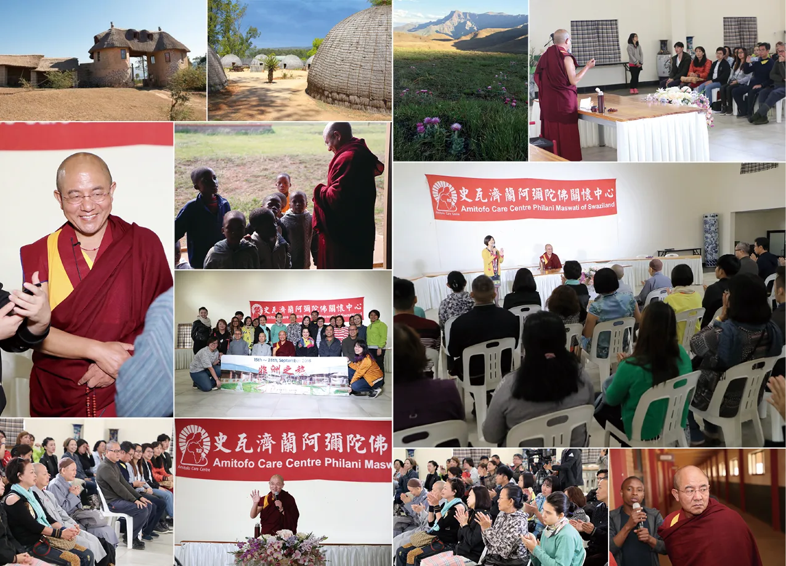
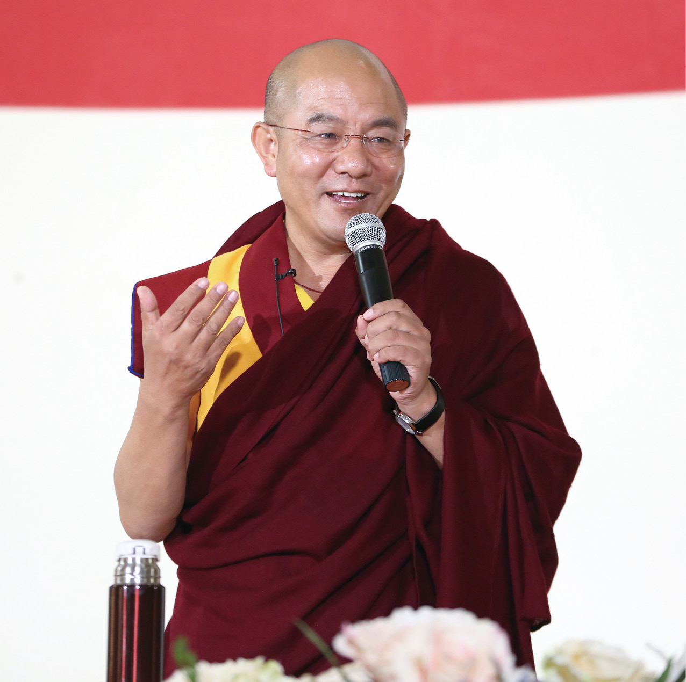
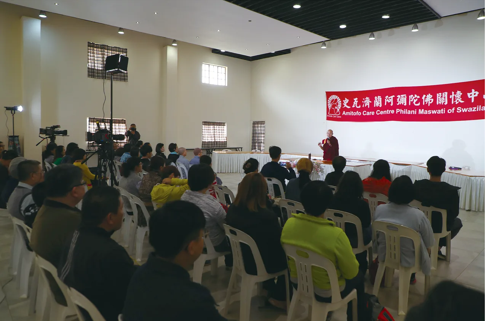
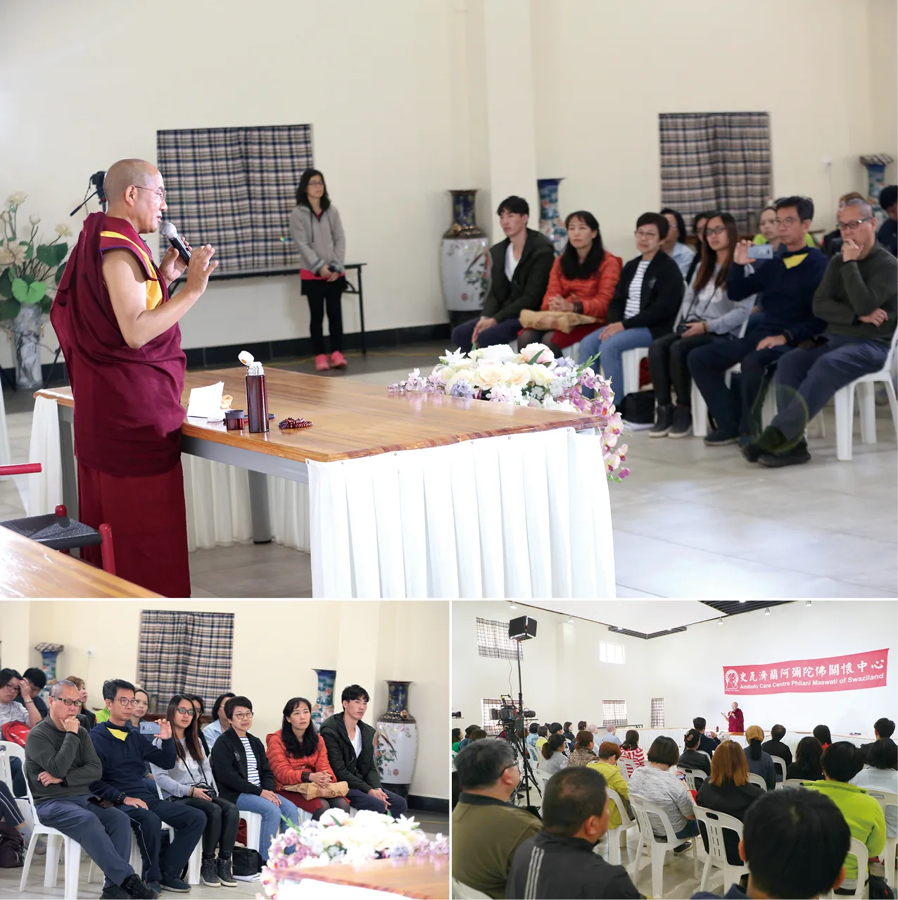
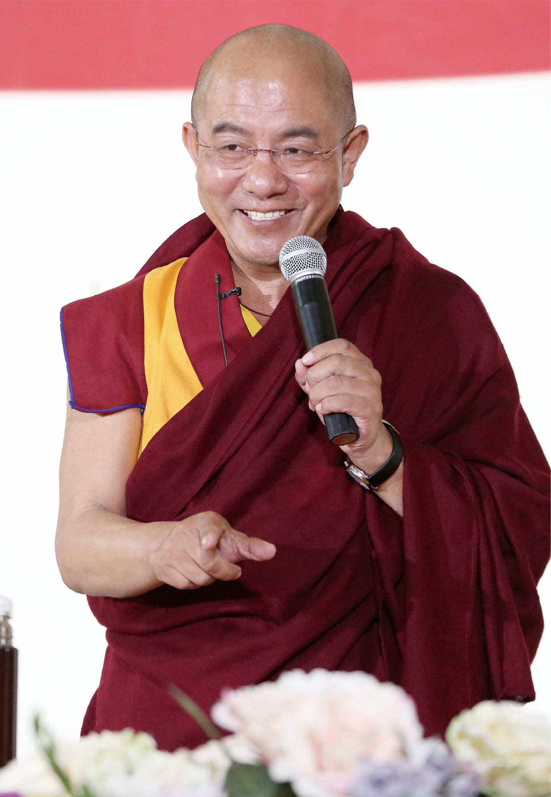
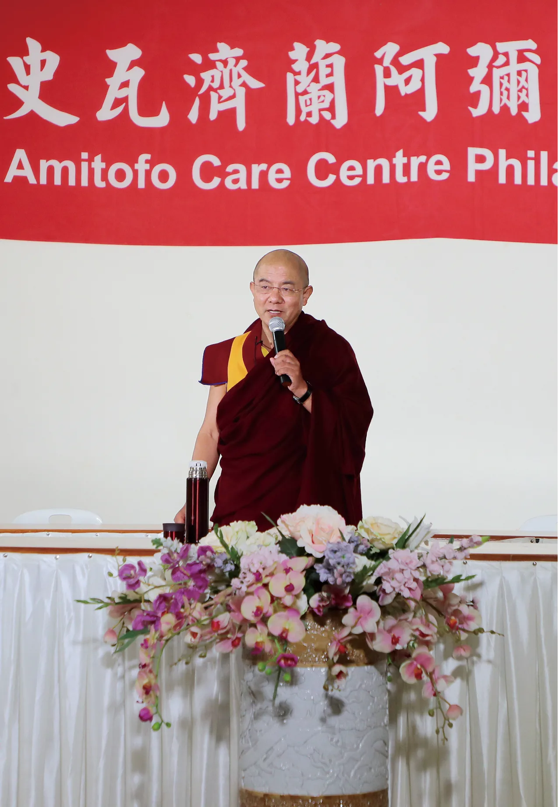
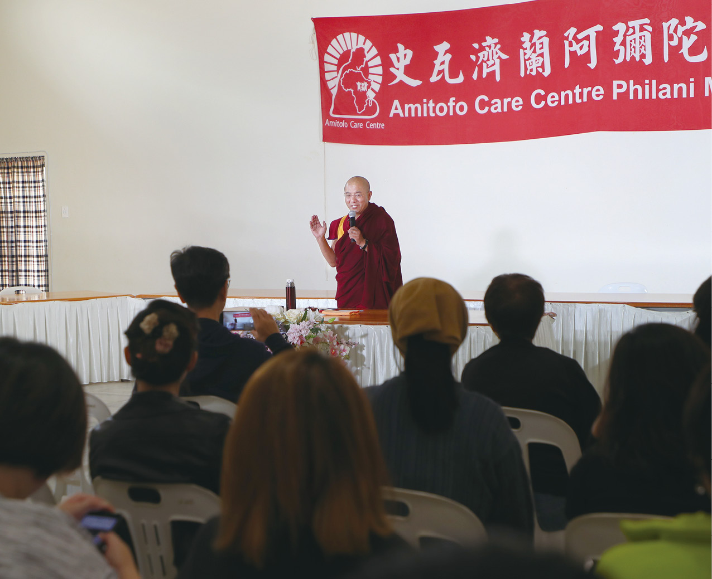

大乘佛教的基本理念，就是要无条件地利益众生。

第82场

非洲斯威士兰ACC阿弥陀佛关怀中心

Amitofo Care Center, Swaziland

非洲·斯威士兰

2018 / 9 / 21

## 在爱中呼吸

## Breathe in Love

主持人：

大家早安。昨天，大家已经和索达吉堪布见过面了。索达吉堪布在三年前就曾来过非洲弘法。大家很有福报，能够再度迎请堪布来非洲为大家讲经说法、结法缘。最难得的是，我们新加坡ACC中心在没有任何特意安排的情况下，能有因缘在此听法。

既然今天机会如此难得，我们也无需过多赘述，就先恭请堪布来为我们做开示。今天的主题是“在爱中呼吸”——

阿弥陀佛！早上好！很高兴与在座各位进行简单的交流。首先，我为大家分享“在爱中呼吸”这个话题，之后可以随意、轻松地互动讨论。大家有任何问题，都可以在此探讨和交流。

## 真正的快乐来自发菩提心

三年前，我曾来过非洲。记得第一次来之前，内心比较忐忑。然而真到了这里，一切都和我想象中的不一样。

亚洲各方面的资源都比较丰富，不论是信仰层面的精神财富还是物质财富，我觉得都应该传递到这里，与大家分享、共同学习。确实应该有更多人关注非洲这片土地。即使是佛教的出家人，大多数会选择去美国、英国、澳大利亚这些发达国家，相比之下，选择来非洲弘法的人，连我们藏传佛教徒也不多。汉地的居士，以及不同国家的佛教徒，大部分愿意去圣地朝圣、旅游，选择到非洲来发心、来关心这里的老弱病残等弱势群体的人很少。

这次来非洲，是我自己的选择。原本今年有一个半月的出行时间，计划头半个月去英国、荷兰等欧洲国家，接下来去澳大利亚和新西兰，最后两周来非洲。但由于护照和签证等原因，行程不得不缩短为半个月。在澳洲、英国和非洲这三个选项中，虽然非洲的条件差了些，但我最终还是选择来这里，进行为期半个月的交流。

在座的善男信女大部分来自新加坡，且有些人已多次来此领养当地的孩子，帮助这里的公益团队弘扬佛法、利益众生，非常了不起。在不同信仰、不同肤色、不同传统的这片土地上，要营造一个共同的理念，并非易事。有些人已学佛多年，有些还没有信仰，但大家都非常有意乐做慈善。佛教的基本理念就是要无条件地利益众生，要坚固这颗利他之心，这是大乘佛教最直接的精髓，这与人们行善积德的理念不谋而合，从这一层面讲，你们来到非洲这片土地做公益非常有必要。

非洲无论是教育、科技、生活条件，都不及澳洲、英国等发达国家。当然，我们来这里不是为了享受，作为佛教徒，这里更适合我们修行。到了非洲，我发现不需要刻意修菩提心，只要看到这里的众生，就会在内心生起慈悲心，慈悲心、菩提心会自然增上。在这里，我的发心不会受到任何染污，不会因为名声、财富、健康、快乐等世间八法而分心，更不会产生贪欲之心。我会得到很多在别处得不到的精神财富，相信各位对此也有同感。所以，我把这里当作最好、最清净的修行环境。

听说有些人经常来这里关注当地慈善事业的管理与发展，一直在坚持不断地发心，这非常了不起。你们行持不染世间八法的善行，是最有功德、最有意义的。三年前，我曾去过纳米比亚、莱索托，发现当地的义工太不容易了。我曾认为，从汉地去藏地支教、为当地的学校做义工已属不易，但与在此地做义工相比，各位更不简单、更了不起。藏地虽然气候恶劣、高寒缺氧，但至少不会存在治安差、疟疾等各种危险。

我是第二次来非洲，但来斯威士兰是我人生中的第一次，感觉非洲之行因缘很好。之前去莱索托时，我们乘坐的小飞机比较破，于是，今年来斯威士兰就不敢再坐飞机了。慧礼法师说可以坐车，但要花五六个小时，我同意了，一方面能欣赏非洲大陆的风景，另一方面，当时去莱索托的乘机体验确实不佳。那次经历不同于以往任何一次，不但飞机设施陈旧，甚至连机场的卫生间都要手动冲洗，这些给我留下了深刻的印象。

所以，能来这里发心的人，往大了说，是一种菩萨精神；往小了说，是修慈悲心的好机会。人在安逸的温室中是修不出任何境界的，到了非洲，参与以往根本不敢尝试的发心活动，对修慈悲心确实非常有帮助。

以前我们通过媒体宣传，以为非洲人愚痴、野蛮、落后，这些负面信息掩盖了该民族的真面目。来到非洲之后才发现，这里与我们原本的认知不一样——非洲人特别善良、热情，只不过受到物质条件的限制，没有先进的科技以及与外界交流的沟通工具，所以，我们很有必要帮助他们。

在我看来，这里的人们很难从外表区分美与丑，因为我不知道当地衡量美丑的标准是什么，我很想问身边人这个问题。昨天，当学生们在台上表演时，十几个孩子似乎都长得一模一样，如果让我挑选出谁最好看，那真是很为难。但是，不管这片土地上生存着什么肤色的人，他们的内在需求、基本感受，与世界上任何一个地方的人完全相同。

## 不求回报的才是大爱

大乘佛法有一种自他相换的修法——众生的痛苦由自己承担，把自己的快乐赐给他人。我们对非洲人民用这种修法，真正爱上他们、关心他们，这需要莫大的力量和勇气。我们习惯对与自己各方面相似的人表达善意，但善意不能只停留在表面，不能只是形式主义。当你真正发自内心想要解决他人的困难、遣除他人的痛苦时，这样的爱心，才可称为大乘佛教中无私的爱。

其实，常被世人所称赞的爱，并非真正的爱，甚至恰恰相反，世间的爱情是自私的最高境界——即使你爱我，我也可以选择爱或不爱你；只有当你无私地爱我，我才会接受你，如果你爱上了别人或是对我不再专一，我也会随即改变对你的爱。世间大部分人都是如此。不管东方人还是西方人，经常用“我爱死你了”“爱你一辈子”这些甜言蜜语来包装爱情，但这真的是“爱”吗？不一定。男女之间的爱非常苛刻，令对方没有自由，对方的一句话、一个动作稍有偏差，内心就会立刻生起嗔恨、反感等负面情绪，甚至连杀害对方的心都会产生。

世间情杀事件比比皆是，人们口口声声说的“我爱你”要打上双引号。世人常说“爱得越深，恨得越深”，可见，爱中也含着恨。即使曾经山盟海誓，最终还是会变化无常，爱会在一瞬间会变成恨，这就是世间所谓的爱。

大乘佛教的爱与世俗的爱有着云泥之别。大乘的爱是无私的、无条件的，无论对方做任何事情，甚至用各种方式伤害我时，我也不会嗔恨，并会在对方需要时给予帮助，因为我爱你，这种爱方可称为“大爱无疆”。

大家也许看过相关记载，文殊菩萨在因地时，即使最怨恨的敌人攻击他、伤害他，文殊菩萨不但不以牙还牙，反而以慈悲心对待，这种爱非常伟大。

真正的爱不谈条件，也不想从中获取任何回报。在座的各位对非洲孩子的爱也是不求任何回报的，不会要求孩子长大成人后成为自己的子嗣、后代，照顾自己的生活起居。我们帮助他们，是因为他们很可怜，没有父母的照顾、没有家人的陪伴，如果再不学习文化知识，那今后的人生会非常艰难。大家用自己的财富来帮助他们，使孩子们有机会获取文化知识，在学习方面无有遗憾，这对他们而言非常可贵、非常有意义。所以，无条件地帮助弱势群体，这就是大爱。

## 善用财富

当今时代被称为“后现代主义时代”，它提倡的理念是：不求固有既定的真理，只要对自身有利的便是真理。很多年轻人提倡这种理念，不管是宗教、哲学，甚至科学等，只要能对个人带来利益，即使它不符合真理，也会被认可和接受；反之，若自己得不到真实的利益，那即使是公认的真理也会遭到排斥。所以，这个时代又叫做“纯粹物质主义”或者“纯粹的利己主义”。

由于受到西方“利己主义”思潮的影响，利他主义思想在逐渐消亡。西方很多理念完全不同于佛教的大乘思想，西方的思想是建立在自我主观意识的基础上，先以我为中心，质疑对他人无条件付出的必要性，由此而产生了利己思想。当佛教徒为他人无私奉献或做慈善时，这群利己主义者无法接受，不明白为何要去领养孤儿？这样做对自身或对自己的企业发展、对个人成长和实现梦想有什么好处和利益？

不论是佛教徒还是没有任何信仰的人，若是衣食无忧，就该多帮助他人，这很重要。人的生命有限，拥有的财富有限，能为社会做贡献的力量也有限，若能以有限的生命开启无限的功德和善行，从佛教前后世的时间和空间维度来看，的确非常难得。

台下各位年龄基本相仿，若是在求学阶段，各方面的因缘没有成熟，可能没有时间、能力和财力去帮助他人；等到了七老八十的年纪时，大部分人的身心各方面又不具足帮助他人的条件。所以，当下的时光正是最好的时机。人活在世间，不能只为了养活自己，不能事事都只想着安排好自己的家人，使其衣食无忧，这是非常狭隘的思想。当你有能力、有资源时，就去分享给有需要的人，这非常有必要。

人的财富如同河流一般。当长江、黄河流经某座城市时，人们就会说它们属于这座城市；当它们流入另一座城市，又被说成属于该地的水源；当同一条河流经不同国家时，不同的河段归属于不同的国家。财富亦是如此，今日你所拥有的房子可能曾经属于他人，当自己一旦死去，财产便会易主。世间财富在不断更换着主人，如同河流，不断流向各处。在我有能力支配金钱时，用它们去做对社会、对他人有益的事，这样才能真正体现金钱的价值。

我经常在藏汉两地资助贫困大学生，每一次当我把钱送到他们手里时，其中的一些人甚至会感动得流泪。那时我真正感受到，钱用在这些孩子身上是有价值的。如果我们只是用在自己身上，丰富的衣食受用可能也会令自己感到快乐，但时间一长，哪怕住五星酒店、住豪华别墅，最初的新鲜感也会随着时间逐渐消失。因此，把钱用在需要的人身上，非常有意义。

爱因斯坦也曾说过，一个人的价值，应当看他贡献了什么，而不是看他索取了什么。这句话很有意义。一个人活在世上有没有价值，不是看他拥有多少金钱，也不是看所处职位高低，重要的是，看他用财富创造了多少有意义的事。如果一个国王、大臣掌权时，权力、财富都分配不当，那他也会成为历史的罪人。

很多人通过自己的勤奋获得了金钱和财富，各方面的条件非常优越。但是，若没有利用好财富，当你离开人间时，会放不下很多东西，但即使你再不情愿，到那时也是徒劳。佛教里经常将寿命、财富和身体，称为三种执著之法，与其将它们永远封存起来，还不如用大乘的菩提心摄持，利用它们多做善事，因为善事的功德可以永存。多做对他人有利之事，自己生生世世都不会经历贫穷、孤独和抑郁，不会感受各种痛苦。

## 善发大乘菩提心

我的上师晋美彭措法王曾说：“秉性正直心善良，若欲长久利己者，暂时利他乃窍诀。”意思是，为人要秉性正直、心地善良，即使想长远考虑自身的利益，暂时也要先做利他之事。表面上看似你在利益他人，但终究对自身非常有利。

藏传佛教的大德华智仁波切曾说过：“烦恼少即痛苦少，烦恼多即痛苦多。”经常帮助他人，内心的烦恼会越来越少，而经常考虑自己的人，内心的痛苦和烦恼会越来越多。所以，我们要尽力去除烦恼敌。世间为什么会有这么多痛苦？原因就是来自于自私心，自私心会给人带来各种痛苦。如果把心放远、放宽，那就不容易起烦恼。

前两天，我来到非洲草原，当时就在思考：如果我是这部落家庭中的孩子，我的思想、教育、穿着，以及肤色，自己是否会感到满意？可能大家也会和我有同样的思考。当我看到这里放牛的小孩，就情不自禁地回想起自己的童年，当时的自己也和他们一样。出家前，我16岁才开始上学，那时家里就居住在藏地部落的帐篷里，和这里部落的小房子差不多，只不过他们居住在一幢幢小房子中，而我们是一个个小帐篷，甚至比这里的房子还小一些。当时，我的父母、弟弟以及三个妹妹，一家七口就居住在一个小小的帐篷里，里面还有堆积的杂物，有时家里来了客人，留客人过夜的地方都没有。

这里被誉为“非洲瑞士”，风景确实很美，但居住条件却不尽如人意，想到要一辈子扎根于此，对我们来说的确有一定的挑战。这样的环境又会让我们想到什么呢？一个人如果生存在这种环境中，有没有机会修行？能不能对社会做出贡献？这是我们需要思考的重点。

总之，对于这片土地，我们要怀有一颗纯真的爱心，如孟子所说：“爱人者，人恒爱之；敬人者，人恒敬之。”你爱别人，别人也爱你；你恭敬别人，别人也恭敬你。

佛陀说过“诸恶莫作，诸善奉行”，这与传统文化教育理念如出一辙。他教导我们利他还是利己呢？声闻乘的基本教义是自己离开所有的烦恼、获得解脱，而大乘佛法的教义，是倡导用自己的修行来帮助别人。若我们不具备利他心——明明有能力帮助他们，却缺乏实际行动，还口口声声认为自己是一名大乘佛教徒，这完全名不副实。大乘佛子应无私地帮助众生。不论信仰汉传佛教还是藏传佛教，都属于大乘佛教。大小乘的主要区别，以是否具备菩提心为界限，阿底峡尊者曾说：大乘佛教和小乘佛教之间，以菩提心来区分。

各位也可以扪心自问：自己学佛、修行这么多年，所作所为是否想过让众生离苦得乐？如果念阿弥陀佛时，只想着自己往生极乐世界得到解脱，这是小乘的发愿，并不涉及到真正的大乘佛教。

## 给ACC中心的一些建议

对于ACC，我并无任何管理责任，在这三年中自己做的贡献虽不多，但很上心，这已超出了我对藏地的一些寺院、道场、佛学院的关注程度。我如此关注的原因，一方面，是我刚来非洲时，慧礼法师以及几位成员为我创造了一个很好的缘起，对此我特别感恩；另一方面，这里的非洲孩子确实很需要社会各界人士的帮助。在亚洲或其他地方，虽然也有不少需要帮助的人群，但从教育、环境等综合因素来看，他们需要被帮助的程度仍有别于非洲。在地球文明已经进入高科技时代的当下，斯威士兰的人均寿命是50岁左右，这和日本、新西兰等发达国家是七八十岁相比，的确相差太大。

那天刚到约翰内斯堡，慧礼法师告诉我，ACC团队已交由其他专业组织管理。这当然非常好，是非常理智的做法，因为寿命无常，需要培养接班人，全世界也都遵循这样的规律。但是，我想提一个建议：在交接管理的过程中，要尽量做到细致完善，否则，慧礼法师近二十年时间打造的成果会功亏一篑，这非常可惜。这一切虽与我本人无关，但我也一直牵挂此事，希望原先ACC的负责人还要继续努力。我也想对慧礼法师说，不能完全放弃ACC的管理，因为前人种树很艰难，后人乘凉虽轻松，但若没有把树维护浇灌好，树很容易枯萎。

此前，我去过纳米比亚、莱索托等几个国家当地的慈善组织，不管是组织的居住条件还是管理模式，很多方面都让我感觉非常不可思议。这让我联想到ACC，若理事会不再参与管理，我担心原来的施主和发心人员是否还会坚持。

慧礼法师做了相关的B计划，我很认同。这就正如我们佛学院，自1990年到2014年，我一直担任佛学院的七大理事之一，长达24年。至今，学院对我们退休的几名理事依旧尊重如初，不论任何重大的事情，始终会邀请我们参加相关会议，做最终决定时，也会慎重考虑我们几位的意见。其实，我们当时也有必要参加重要的会议，若完全做到新老交替，年轻理事的理念和思想虽然活泼，但在实际操作中，由于缺乏经验，并不能事事得心应手。

纵观历史，欧洲的很多国家从君主世袭制变成民主制。当时的国王在民众中有一定的权力和威信，导致新的民主制度并不成功。君主和国王代表权力和身份，作为新上任的首脑，要会观大局，国王除了是一国之主外，手中还有一套成熟的管理制度，有些管理非常成功，这在欧洲各国的历史中比比皆是。如今的ACC有很多发心人士，虽然我不参与管理，但最近也一直在思索：如果非洲这么多国家的ACC都渐渐没有了发展，那是非常严重的问题。在世界各地，我们都有一些佛教团体，有时在当地突然增加很多成员，若管理不善，会使很多人失去信心。如果这里的居住条件、管理都出现状况，到那时还想再回到接管前的样子，这会让双方都感到尴尬和不适。

所以，在新旧管理的改革过程中，建议慧礼法师千万不要完全放弃管理，你们可以做B计划，但同时也要考虑周全。大家这么辛苦地走到今天，实属不易。我在佛学院管理汉族僧众已经三十年了，我也很想退居二线，但由于至今都没有找到合适的接班人，所以一直还在亲自管理。一想到有人接替，我也会感到犹豫，因为自己辛苦付出到现在才看到成果，如果有一点差错，可能就会功亏一篑，这也是我不想看到的结果。

我发现，ACC一些重要的负责人交替得有点频繁，原先慧礼法师带我参观的时候，好多地方都有第二期、第三期工程的计划，但昨前天才得知这些计划都没有了。这么大的变化，是好是坏很难说清。

非洲当地现有的宗教徒中，基督教占60%、伊斯兰教占30%，其他宗教大概10%左右，在这种环境下，能拥有一个佛教道场非常不容易，这应该是菩萨的誓愿才能成办的。但是，如果现在依靠其他外缘，将这里的村落建设成一些公共建筑设施，作为佛教徒，看到这一切比较痛心。因此，作为ACC团队新领导人的你们责任重大，希望各位要善于观察、善于用人，否则，事情最终的发展恐怕不会如你所愿。

## 继续奉献

中心现在有两百多个孩子，老师要照顾好他们的身体等各方面情况。我看到他们的卫生情况都很好，这在非洲非常难得。孩子们自己洗衣服，寝室里的被褥也非常干净整齐，这都是老师们的功劳。老师们责任非常重大，希望大家能给孩子们多教授些有用的知识，因为这样的因缘很难得，当他们从这里毕业后，可能就再也没有继续读书的机会了。

我非常注重孩子们的教育情况。昨天我和他们聊天，有一个孩子告诉我说，他已经读了6年的书，还要继续读几年，总共会读12年左右，我听了很高兴。作为老师，你们在这里确实很辛苦，大家放弃自己故乡的一切，来到这里无条件地做志愿者，这相当不容易。

这里的孩子大多数都没有家庭，昨天一个孩子跟我说，他家里兄弟姐妹、奶奶姑姑倒是不少，但就是没有父母，说着说着眼睛都湿润了。这里的每一个孩子都有不同于常人的身世，在这样的人群中发心，确实面临着很大的考验。因此，当得知有些老师已经在这里奉献了六七年时，我真的觉得很伟大、很了不起。

很多人去了南极、北极后，拿出照片炫耀说：“看啊！我这次去了南极、北极，爬上了喜马拉雅山……”但这些并不是值得炫耀的事，在非洲这片土地上陪着孩子们读书、学习、生活，才堪称伟大。在非洲，物质虽然很重要，但更重要的是给予孩子们精神上的帮助。当地的就业率并不高，失业率却在40%左右，跟其他国家相比非常不乐观。领养孩子的父母们，也应关注孩子们的教育，将来他们要真正生存于世，知识是他们的必备武器。

ACC在这里的作用很重要，大家务必要一如既往地帮助这里的弱势群体。我对新加坡及本土ACC的很多负责人表示感谢！第一次来这里，在没有约定的情况下，能与新加坡的各位团队成员见面，非常有缘。谢谢大家！

现场互动

主持人：

感恩索达吉上师为大家慈悲开示、分享。我觉得自己很有福报，因为上师三年前来非洲，去纳米比亚和莱索托时，我有幸与上师同行。

索达吉上师很谦虚。他说在这三年中，没有为ACC做出贡献，其实上师一直在默默支持ACC，不论在大小事务上，还是所需的各种支援上，上师一直有付诸实际行动。对此，我们要代表ACC感恩索达吉上师所付出的一切！

再者，上师刚才提到，他原本可以把今年唯一一次出国的机会选择去澳洲或是新西兰，但是，上师选择了非洲，这使得我们非常感动。其实，在非洲大地上，我们真的很需要像索达吉上师这样的高僧大德乃至社会各界的支持及协助。

今天的机会很难得。上师于19日才抵达这里，他一下飞机，就舟车劳顿到了斯威士兰的首都，又马不停蹄奔赴各处开始为大家做演讲。昨天是在斯威士兰大学宗教系做的演讲，今天在现场给诸位做完开示后，下午还要给我们的小朋友们开示交流，接着明天还要去酋长的住处，跟那里更多的居民结上法缘。所以，我们真的是很有福报，同时，我们也衷心地感恩索达吉上师对我们无微不至的关怀！

上师非常用心地准备了这次演讲，才能够让我们听到这么多有益的开示，也希望大家在对孩子们的教育以及诸多方面能更加用心。再次对索达吉上师说声感谢，同时也感谢大家！阿弥陀佛！

机会难得，不知道大家是否准备了问题想要提问。上师可以给大家一点提问的时间吗？

堪布：OK，没问题！

问：刚才上师您说到自己小时候和这里的孩子一样，全家生活在一间小房子里的相似经历。我想知道，您当时的想法是什么？我之所以提这个问题，是因为我时常在问自己，我们现在所做的一切，对他们是否真的有益？

我自己也有些经历：那时我在柬埔寨、泰国帮助当地建设学校，当学校建立后，教的是英语、泰语及柬埔寨语。我当时问孩子们，他们的梦想是什么？得到的回答是，梦想走出自己的村子，要去首都或者大城市。但是，当他们都离开了自己的村子后，父母不但没有小孩帮忙务农，更没有做其他事情的能力。

每每想到这些，我会感觉自己做错了。因为，当地村里有自己的生活方式，我们的做法是否真的有助于他们更好地改变生活和发展当地的地方产业？因此，我想请您开示，我们现在做的一切，是对还是错？

堪布：你提的问题很好。若有能力，还是要尽量推广教育，这不会对他们有害，反而对他们会有很大的帮助。

在我小时候，当时都不用去上学，直到有一年出了个政策：如果孩子不去上学，家里就要交高额罚款。父母原本想让弟弟读书，但他不愿意，于是16岁的我就去上了小学。如今，我比普通牧民懂的知识多些。我英语不好，藏语和汉语还可以。虽然学得还不够，但是，当年如果没有去上学，我肯定走不出那片山沟，也无法在当地建学校、帮助当地改善教育等。

所以，你要相信，自己做的这些事对他们有利。而且，如果这些村落的人有能力走出去，将来可以再回来发展村落。所以，只要有能力，就一定要帮助这些人，这对他们非常有用。

问：我们做事不求回报，无私奉献，若对方以怨报德，我们该用什么心态对待他？

堪布：大乘佛教有菩提心的修法，在观修菩提心时，分为知恩、念恩、报恩，即首先要知道一切众生都对我有恩德（知恩），忆念他人的恩德之后（念恩），对众生要有报恩的心（报恩）。作为修行人，以报答众生恩德的心做善事是有必要的。当修行达到一定境界时，连报恩的心都不需要，但这对普通人来说有一定的困难。

从大乘来讲，行善不图报恩，这是最高境界。我们在当地做善事，应该是不求回报的，即使对方恩将仇报，我还是要把该做的事情做好。如果是在别处做善事，也许会有求回报的心态，比如在领养孩子时会考虑“将来自己老去时，这个孩子是否会照顾我”。我再三强调，在非洲做事情不要求报恩，要完全用无私的心帮助对方，不管有什么变化，都希望对方好，这才是大乘佛教无私的心。

我刚才说，自己到了这里，虽然没有特意修慈悲心，但它却会自然而然增长。我想在座很多人也有同样的感觉。当看到这种慈悲的对境时，自己多少都会感受到，这个地方真的很需要大家的帮助。一些富裕的国家和家庭，他们浪费的金钱和财物，可以在这里帮助很多家庭和孩子，因此，资源整合很有必要。

我们常说“百闻不如一见”，只有当自己亲眼看到了实际情况，看到这些部落的生活以及他们的家庭情况后，我们才会有所感悟：原来在这个世界上，还有这么一群人在这种环境下生存着。与他们相比，我们不管是文化、物质等各方面都有天壤之别。和我同行的一些人，在国外的生活条件比较好，他们说，如果自己的父母来到这里也会有感触。我熟悉的一些朋友，每天都过着特别奢侈的生活，既不知道报恩，也不知道感恩，认为这样的生活理所当然。其实，他们哪怕是以旅游的方式到这里看一看，心灵也会有所触动。

问：我是新加坡ACC理事。想请教上师，所谓“恶有恶报，善有善报，不是不报，时辰未到”，如果是这样，为什么不直接出现现世报或者立刻发生相应的因果报应，从而让世人更警惕，或者不会一错再错？比如，人做了一件错事，马上就能有相应的因果惩罚或者教训，那不是比别的方式更加立竿见影，让人不会再犯相同的错吗？同样，如果行善，福报为什么不立即显现，为什么一定要等到下一世呢？若想让人相信轮回，这样不是更能鼓励大家做善事吗？

堪布：“善有善报，恶有恶报，不是不报，因缘未到”，这是佛经当中讲的因果报应。这句话是对的，但因果分为现世报、后世报、顺后世报，不是所有的善和恶都以现世报的方式呈现，有些顺后世报，要过几千几万年以后才会出现。

比如，农民种庄稼，为什么不能马上得收成？种下去的种子为什么不能马上结果呢？因为，不同种子的成熟时间不同，有些需要一年，有些需要两年。生物学家在对植物种子进行分类时，发现有些种子需要几十年才能开花结果，有些却在短暂的时间内就能发芽。所以，外在的因果缘起是不同的。

同样，因果也是如此，个人内在快乐和痛苦的因果缘起不是依靠外在的事物，善恶因果有它自己的规律可循。每个人在自己的心田种下了善和恶的种子，有些很快会成熟，而有些却需要很长时间，因为这样的种子比较“顽固”，无法在很短的时间内成熟，只有在因缘和合的条件下才会“开花结果”。

因果报应，并不像其他宗教所说，有一个造物主在随时安排着每个人的因和果。世上没有任何造物主，一切皆是因缘，当因和缘具足时，善恶的果报会呈现；如果因缘不具足，暂时不会有任何外在的表现。若有一个所谓的上帝来支配和操控每个人的因果，那他就有权力给全人类示现一个现世报，提醒人们少走弯路、多做善事。如果这样，世界很快就会变得更加美好，可世间没有造物主。

佛教中的《稻秆经》《俱舍论》《阿毗达磨》《佛说未曾有因缘经》，这些经论里有非常详细的相关描述。若我们懂得这些道理，就会明白，原来现世报、后世报是这样来的。

问：关于孩子的教育，是以书本为主还是以实践为主比较好？我个人觉得，尤其是在南非，现在的孩子比较受宠，大部分课程都在教室里学习，而实践比较少。若孩子们现在能多学习一些知识，当面对真正的生活挑战时会不会更有把握？

堪布：教育和实践这两者都需要。首先，如果没有课本上的引导，只是依靠行动来引导学生，这有一定困难。因为，有些事我们无法用自己的肢体语言来描述、介绍给孩子，他们必须要有常识的储备。

在藏地，我们虽然承办一些学校，但仍必须按照当地政府所安排的课程进行学习。此外，光学政府安排的课程还不够，因为这些课程对于道德方面的教育比较缺少，我们还添加了人文以及道德方面的内容，当孩子在学校读了十多年的书后，完全有资格毕业。否则，即使读书多年，最后可能毕业证都得不到，那今后在世间生存会有一定的困难。

同样，孩子们在这里学习五年、十年后，至少也要小学和中学毕业，这样方便他们在社会上找到一份工作。同时，最好给予一些实际操作的课程。

中国国内的很多学校，只是传授知识，实际操练比较少，这两方面其实都很重要。中国学生每天要上很多节课，除此之外，还要学钢琴、舞蹈……压力重重，特别痛苦。

西方国家对孩子特别放松，让他们自由发展自己的智慧和潜能，不会对他们过多干涉。在这样的教育环境下，好多学生长大后，语文、数学等科目都不好，甚至连名字都写不好。青春太放逸是很可惜的。西方教育更强调激发孩子们的创造性，但是，当孩子们创造力平平时，最终学业也一般。

其实，如果把东西方的教育方式适当地结合起来，理论与实践并行，让孩子走中道，应该对孩子们的成长有非常大的帮助。

昨天这些孩子们舞跳得那么好，武术又不错，身体都练得那么结实，我想，他们的心更加可以锻炼。中国孩子的身体素质不如这里的孩子，其实他们同样可以练练武功。少林寺培养出来的武僧看起来好像不如这边的小朋友们威严，他们拿着各种兵器的时候的确很威武。因此，从小锻炼身体，把基础打好也非常重要。
