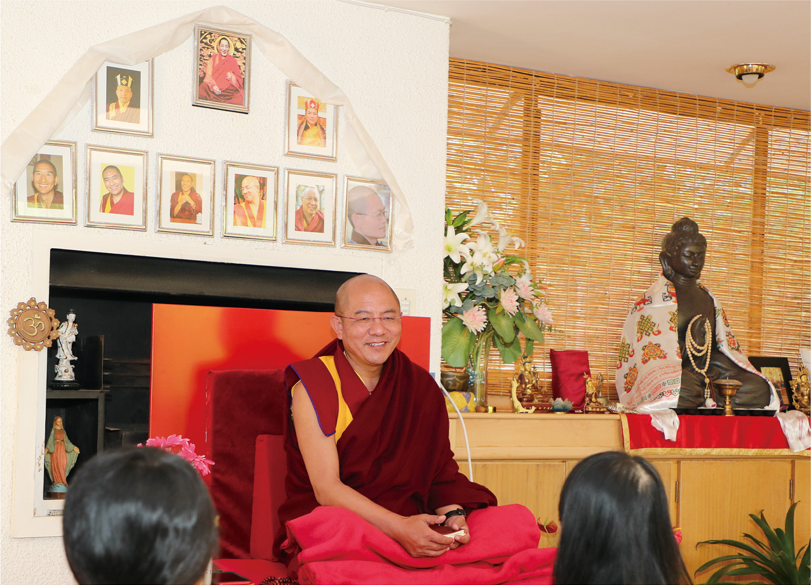
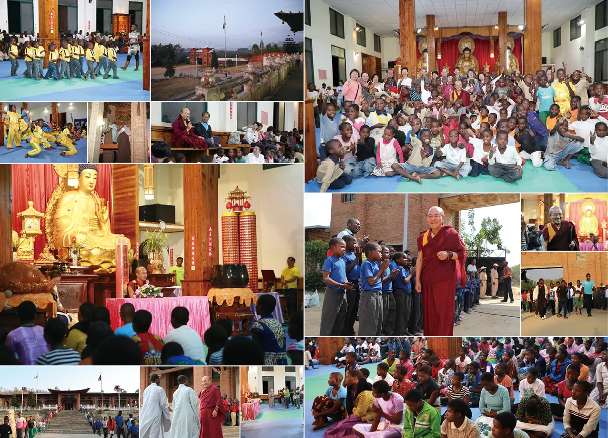
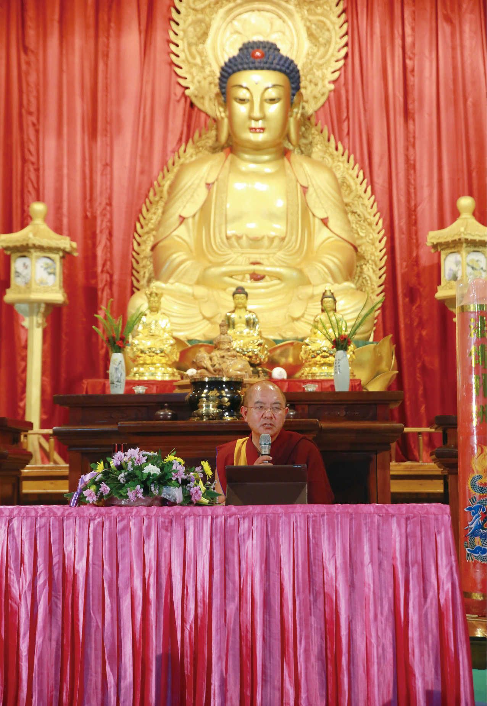
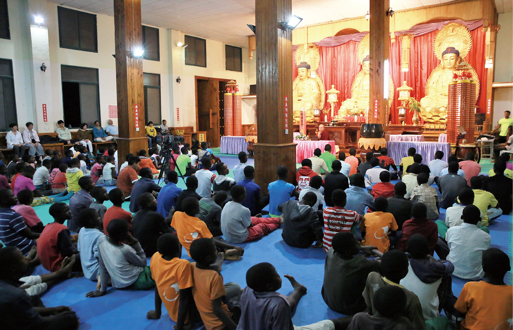
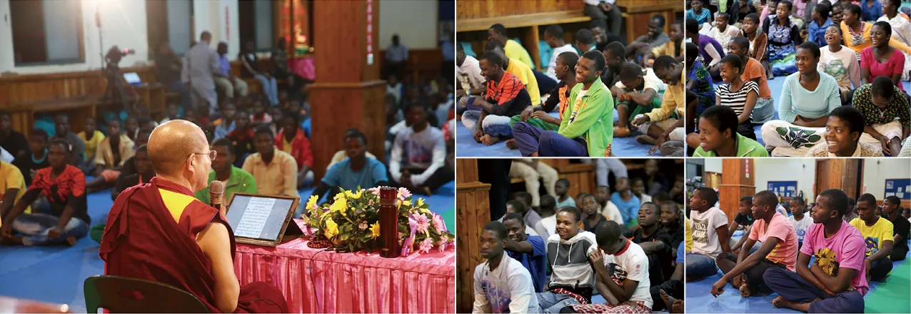
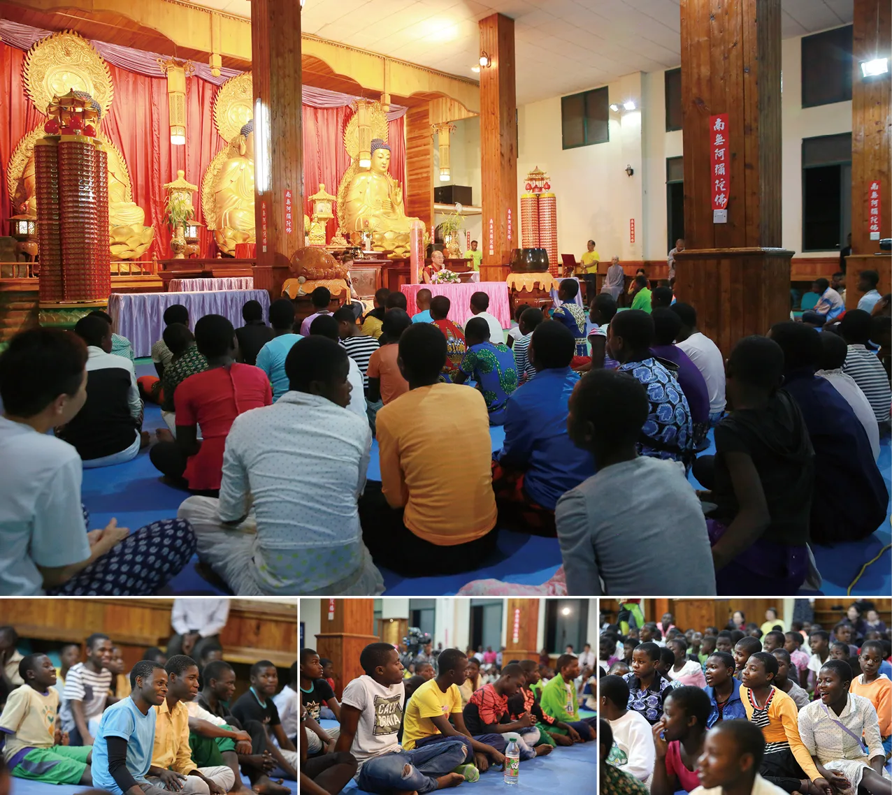

读书就如毛毛虫蜕变成一只蝴蝶，不是一件容易的事。但是，这也是人生必须经历的过程。

第85场

非洲马拉维ACC阿弥陀佛关怀中心

Amitofo Care Center, Malawi

非洲·马拉维

2018 / 9 / 25

## 在苦难中成长

## Growing Through Suffering

大悲摄受具诤浊世刹，尔后发下五百广大愿，

赞如白莲闻名不退转，恭敬顶礼本师大悲尊。

我以身口意三门恭敬的方式，向本师释迦牟尼佛作了顶礼。今天，在座的各位多是来自高年级学生以及优秀的老师，我准备利用一个小时左右的时间与大家做个简单的佛法交流，之后，我会为大家念《佛子行三十七颂》的传承。此法非常重要，可以令任何一个国家和地区的人听闻后得到加持，从而生起菩提心。所以，不论去往何处，我都会念诵《佛子行三十七颂》给大家加持并赐予吉祥。

我们今天汇聚在马拉维的这所学校，迄今为止已有14年的创办历史。如今，学校已颇具规模，这和常住此处的慧礼法师，以及在座的各位义工、老师们所做的贡献是分不开的。

## 永存感恩

这是我第一次来到马拉维。在2015年时，院区曾邀请过我，但由于时间关系未能成行。现在来到这里，感慨万千。一方面，不论是农田、矿产还是植物，马拉维的资源都非常丰富，且当地人心地淳朴善良、清净忠厚，但另一方面，马拉维缺少成熟的科学技术，也缺少提升教育的理念和资源。

在座的每一位学生，在将来的人生中，与周围人相比，具有很大程度的优势。因为，你们从小接受了马拉维当地语言和文化的教育，同时也有机会学习英语，大部分人还懂得中文，这对适应当今世界发展十分重要。在全球化的今天，英语和汉语这两种语言，不论是用于弘扬自己的传统文化，还是在日常生活中，都非常具有实用性。

这三年以来，我常与当地的师生保持交流，我们彼此都很珍惜这种因缘。在举办“世界青年佛学研讨会”时，我们也邀请了这里的学生参加，算上今年已是第三次。第一次和第二次是在泰国清迈，今年由于特殊原因，我无法参加“世青会”，但是，这里去参加研讨会的同学都很优秀。

在这几年和非洲孩子的接触中，我发现其实大家都很聪明，学习知识非常快，智慧根本不低于亚洲、美洲、大洋洲等任何其他地域的人，在某些方面，你们敏锐的智慧甚至胜过其他民族的人。纵观历史，非洲出现过诸多对整个世界有贡献的伟人。因此，只要我们具足学习的因缘和条件，大家所具有的智慧完全能为世界做出伟大的贡献，能和世界上任何一位智者相提并论。

此时此刻，我深刻感受到，在马拉维当地能有这样一所学校是如此重要。如果没有这所学校，在座的各位，不要说学习其他国家的语言文字，可能连将来的生存都成问题。等你们长大成人之后，曾经培养过你们、为你们付出的这些老师、义工们，也许有些人仍然健在，有些可能早已过世，但无论如何，到那时，你们会深深体会到今天我所说的——他们对各位有着深厚的恩德，因为是他们为大家的人生带来了真正宝贵的精神财富。

我们这里有长期的发心人员，即使有些人发心比较短，但人数也不少。这里大概有一百多位发心工作者和教职工老师，其中有些人已在这里做志愿者长达八年，有些人两年至五年不等。长期待在这样一个资源匮乏、随时可能出现各种不安全因素的环境中为他人奉献，非常了不起，这就是伟大的菩萨精神。

今天还有来自澳洲的团队以及其他各地的志愿者，你们都长年累月、始终如一地支持关怀着我们的学校，这种精神非常难得。如果是我，短暂来说问题不大，但是，若让我长期留在此处做义工，发自内心地说，我可能做不到。将心比心，我深切感受到，这里的老师们以及抚养你们的父母们都非常不容易，因此，大家要对他们永远存有一颗深深的感恩之心。

## 破茧成蝶

大家从早上六七点就开始学习直到深夜，整天沉浸在这种学习气氛中，这对我们每一个人来说非常难得，以刻苦学习来度过自己的童年是有必要和有意义的。如果我们虚度了童年时光，甚至没有读书的机会，那整个人生就会处于一种悲哀和无用的状态。虽然，不论是读小学、中学、高中还是大学，学习并不很容易，甚至让人感到沉闷或痛苦，但是，这在整个人生旅程来说是必不可少的经历。

若一个人没有读过书，且不说为整个社会、整个人类做贡献和有意义的事情，甚至连维持一个家庭也有一定的困难。你们的祖辈和父辈们，由于条件的限制而无法读书，从而导致他们这一生根本无法成办任何大事，甚至连一些小事也无能为力。所以，不读书的过患以及由此而导致的一系列痛苦不胜枚举。

凡是在这里的学生，不论是小学还是中学，读八年或十年，我都希望大家一定要努力完成自己的学业，一定要坚持到底，千万不要中途辍学，否则，在自己的一生中，很多有意义和美好的事都会变得遥不可及。不论你的亲朋好友，还是你的父母想要阻碍你学习，你都要十分清楚，这完全是错误的建议，不管别人如何影响你，你都不要动摇自己的决心。

在我读书的时候，周围也有人建议我不要学习。现在想起来，若当时听从他们的建议，那我这一生不会有任何出息。所以，我郑重地建议大家，现在有这么好的学习机会，一定要坚持，要努力完成所有的学业，做到善始善终。

读书也许并不那么快乐，而且，学习过程中也会有很多挣扎、坎坷和挫折。有一个比喻：读书就如毛毛虫蜕变成一只蝴蝶的过程。这不是一件容易的事，但却是人生必须经历的过程。如果没有这样的磨练，人的一生是不完整的。

从前，有一个小孩，当他看到毛毛虫蜕变成蝴蝶的过程如此艰难，便出于好心，用剪刀剪破毛毛虫外面那层厚厚的外壳。然而，由于违背了自然法则，孵出的蝴蝶因为身体胖重，很快就死去了。破茧成蝶的过程一定是艰难无比的，同样，若想成为一个有智慧、有能力的人，就该在自己年轻时好好努力读书，这也是一个破茧成蝶的艰难过程。只要我们从小认真对待学习，今后的人生一定会比较美满。

不读书的人生不是完美的。我的父母都已过世，他们都不识字，甚至连自己的名字都不会写。我还有几个兄弟姐妹，但除了我之外，没有一个上学读过书，若想成办一些大事有一定的困难，因此，他们只能单调地生活着。

你们的情况和我不尽相似。若荒废学业，人生会充斥着迷茫，且会殃及你们的子孙后代，世世代代都会重蹈覆辙，成为迷茫的一群人。从宏观来说，这对我们整个人类社会的福祉和发展都无有益处。

## 创新精神

再过一两年，这里的部分学生即将面临毕业，那时，他们将会处于人生的十字路口，选择出国深造，还是留在自己的家乡，亦或是去别处工作，我对此很关心。最近，我和学校相关的老师也在商量，虽然我的能力无法让所有人都如愿，但你们中的一些人，如果希望出国留学，或是在自己本国继续读大学，在因缘具足的情况下，我也会资助部分学生，提供学费，使得他们能完成学业。

倘若因缘具足，我想将来在马拉维建立一所技术学校，让人有一技之长。如果梦想成真，这对当地人来说很有用、很受益。因为我听说一些私立学校，按照当地币种来算，一学期大概需要二三十万，这对于普通家庭的孩子来说根本无法承受，而公立学校又存在着入学难的问题。因此，如果能在当地建成一所技术学院，大家压力就会减轻，对当地的孩子有很大的帮助。当然，从人力和财力方面来看，这都不是简单容易的事情。

昨天，我和这里几位非洲学生及老师顺便聊了聊，他们都觉得我的想法和建议，对于当地的孩子来说非常有必要。如果能实现，将来会对很多学生的前途产生积极的影响和帮助。我和ACC的老师们也探讨了一番，他们也表示支持，但执行起来非常不容易。因此，我也在继续考虑中。若各方面的因缘具足，将来大家也可以一起推进相关事宜。

虽然大家目前的生活、学习，需要依靠他人的帮助和支持来改善和提升自身的生活质量，但同时，我们应具有自食其力的创造性，否则，仅是依靠别人的支援而活，这是非常危险的。现在有些国家，有一群人完全指望着国际志愿组织、慈善人士和机构来维持学习和生活。若只是依赖他人生活是非常不可取的，我们一定要依靠自己的双手，勤奋劳动来维持生活，间接为我们身边的人创造优良的生活条件。我们不能永远靠别人的支持和帮助，一旦哪天身边的支援者离开了，就会变得束手无策，无法生存。

我个人而言，从小就有一种创新精神。当我还没有上学时，就自己学裁缝剪裁衣服，我会做本民族多种不同的服装，包括皮革缝制的帽子、鞋，以及日常穿的皮袄衣服等。我在13岁之前就挨家挨户到别人家里去给他们做衣服，虽然并不收钱，但还是愿意学做很多不同的衣服。此外，我还学过铁匠，制作过一些小物件，有铝做的锅、舀水的瓢，如果它们用坏了、有了破洞，我能用工具马上修补好。我还会做很多事，包括铁灶。可能大家听不明白这是什么，但总之我会做。还有自制小推车（我看到这里有些孩子也有这种玩具），那时的电话线很粗，我把线做成一个圆圈，再做一个铁钩，推着这个圆圈在路上跑。我幼年时经常这样玩耍，还给很多小朋做过各种玩具。所以，年少时我还是有很多小创意的。

以色列的犹太人也同样很聪明。去年我去耶路撒冷时，发现全世界很多知识产权、各种不同的技术都掌握在年轻的犹太人手里。其实，有些有才能的人和你们年龄完全相仿，但是，他们已经开始通过自己的智慧和头脑，研究出有用的技术，并把自己的知识产权卖给世界各地的企业家及团队。

非洲的孩子们一定要有创造意识，无论是出于养活自己的目的，还是为整个世界和人类做贡献，创造意识非常重要。

我希望，老师们在教导孩子时，一定要给他们传递能活学活用的、具有实用性的知识。如果老师只是用传统式的教学方式给学生们授课，下课时间到了就离开，对教育没有激情、活力和感染力，这是不可取的。作为老师，本身要有清晰的头脑，要和学生共同研究某个领域或课题，一定要让学生们努力学习、不断创新，有能力把握未来的一次次良机。同时，学生们也应把所学的知识及智慧，在日常生活中灵活运用。将来国际上会有很多企业家来到马拉维投资或是开发，那时，就需要把所学的知识和技能运用起来。

### 漫谈信仰

最后，我想和大家聊聊关于宗教信仰。在座的各位都信仰佛教，也经常读诵三皈依，每天有早课和晚课，时常念诵《佛说阿弥陀经》。关于其他宗教，如天主教的《玫瑰经》、伊斯兰教的《古兰经》，以及基督教的《圣经》，也会在将来的宗教课中有所涉及，大家要懂得各个宗教的相关内容。

不论个人有无信仰，对于不同的宗教一定要用开放、包容的心态去对待。马拉维不同于其他地方，如果你信仰佛教，你的家人或周围人可能会用异样的眼光看待你，在这种情况下，你更需要了解佛教的内涵。用佛教的慧眼来看待其他不同宗教时，是不相违、不抵触的，此种道理，要懂得如何正确地传递给他人。尤其是我们的佛学老师，一定要给学生认真地讲课，让每位学生懂得相关的佛教和宗教知识。否则，光是学世间的学问，即使在这么好的一个佛教环境里面长大，但到将来的某个时候，可能会意识到，自己对佛教知识其实一无所知。

我曾在西方遇到不少在基督教教堂和学校里成长和学习的孩子，遗憾的是，他们对基督教的教义一窍不通，这非常危险。我听说大家学习了十善、六波罗蜜多等很多佛学教义，此等教义不能仅仅停留在理论上，每一位学生必须在实际生活中对此具有更深刻的了解。

我的演讲已接近尾声。最后，我想简单说一点，如今我们生活在特殊的时代，也许个别人会具有既是基督徒、又是佛教徒的双重信仰身份，大家要知道，这是不相违的。因为，基督教也承许有地狱、天堂之说，也提倡爱、慈悲和关爱众生，我们佛教亦是如此。因此，具有双重信仰的身份是可行的。就我个人而言，佛教是我的第一信仰，但对于基督教、天主教所提倡的博爱精神和布施心的信条，我也接受。

各位非常有福报，虽然生长在一个环境比较特殊的地方，但是，你们能亲眼见到佛像，有机会学习佛法的甚深法要，同时，自己也在行持六波罗蜜多等诸多佛法行为，这对于此生而言非常难得。因此，希望在座的每一位老师和学生能珍惜眼前的一切，坚持好好学习、好好修行。

今天，大家听课纪律很好、很专注，本来我还想说更多，但由于时间关系我会留到下次，也许我在马拉维还会有因缘和大家再次相见。我有一个特点，不论在什么地方，如果现场听众听得很认真、很专注，我就愿意多讲些内容，否则，即使时间再宽裕，我都没有动力多说些什么。大家今天在一起的时间虽然短暂，但以各位诚恳认真的态度为缘起，我确信，今后我们还会有因缘再次相聚。

接下来，我为大家念《佛子行三十七颂》的传承，需要几分钟时间。

（堪布念传承）

我再教大家几个殊胜的咒语，大家跟着我念：文殊菩萨心咒“嗡阿Ra巴匝纳德”，观音菩萨心咒“嗡玛呢巴美吽”，莲师心咒“嗡啊吽 班匝儿格热巴玛色德吽”，度母心咒“嗡 达瑞度达瑞 度瑞索哈”，释迦牟尼佛心咒“嗡 牟尼牟尼 玛哈牟尼耶索哈”，阿弥陀佛心咒“嗡阿弥得瓦阿耶色德吽舍”。

好！扎西德勒，才让罗嘉[^1]！

[^1]: 藏语，汉意“吉祥如意、长命百岁”。
