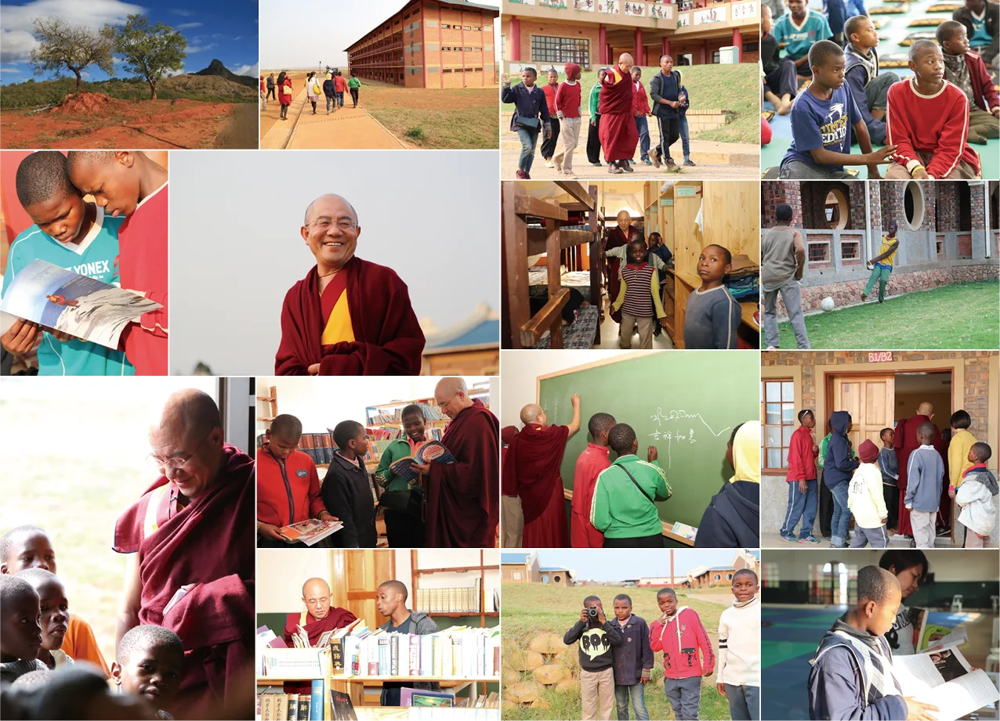
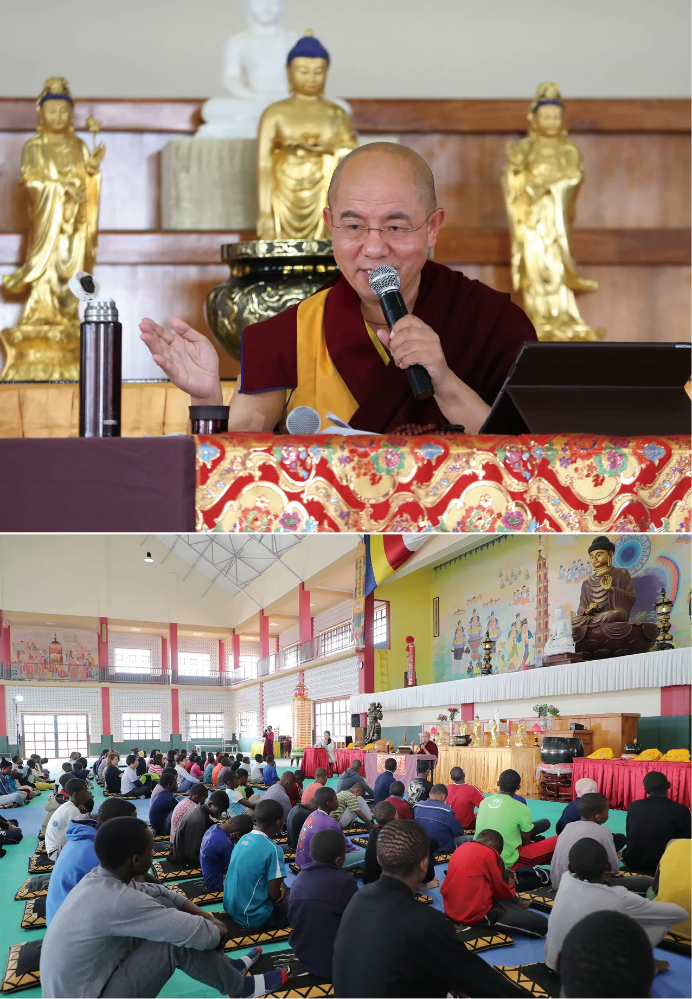
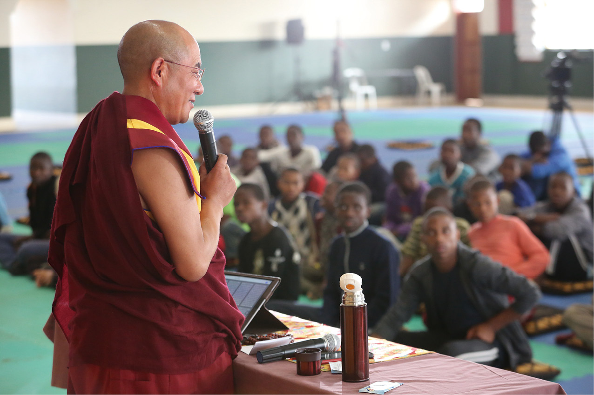
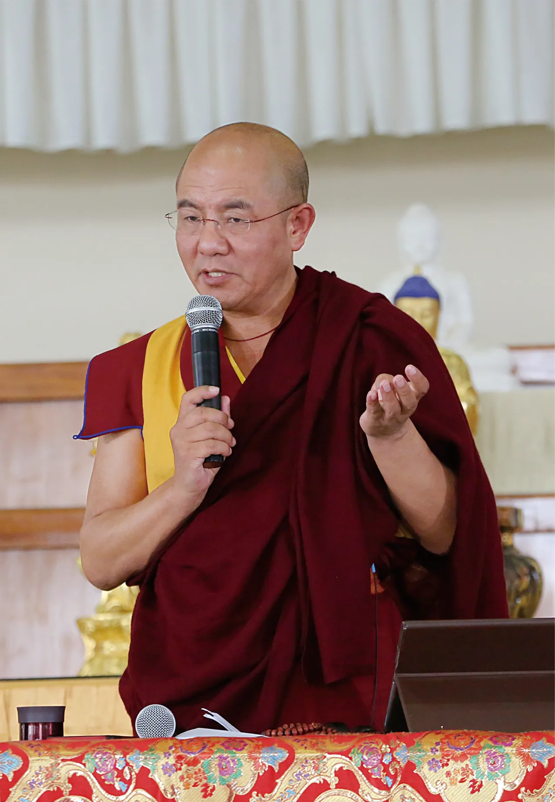
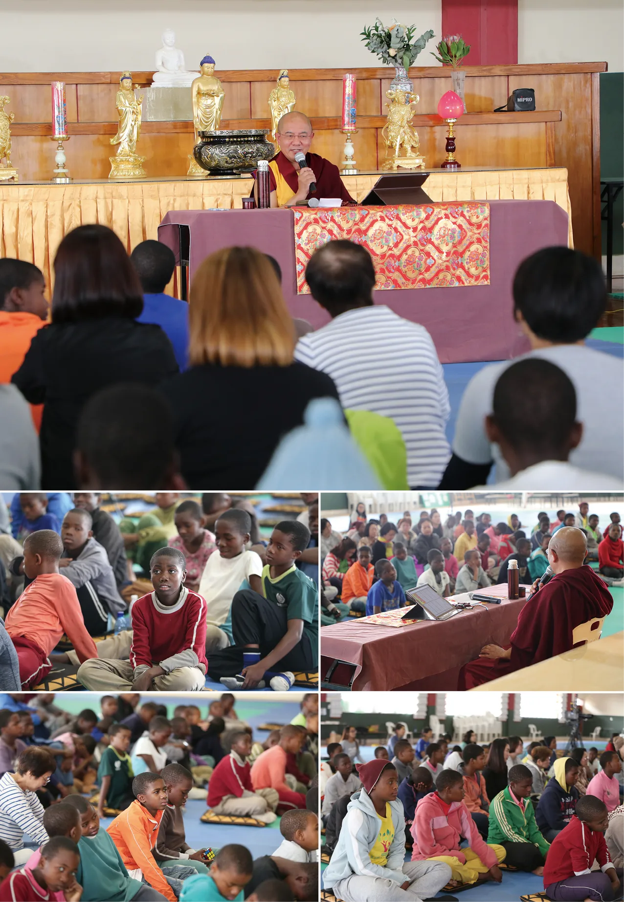
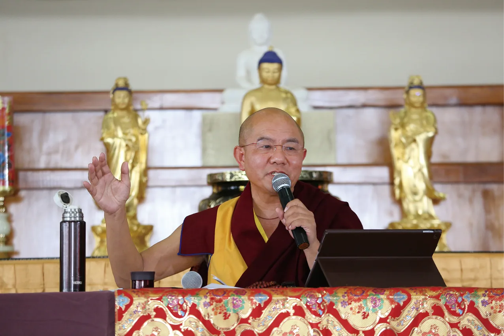
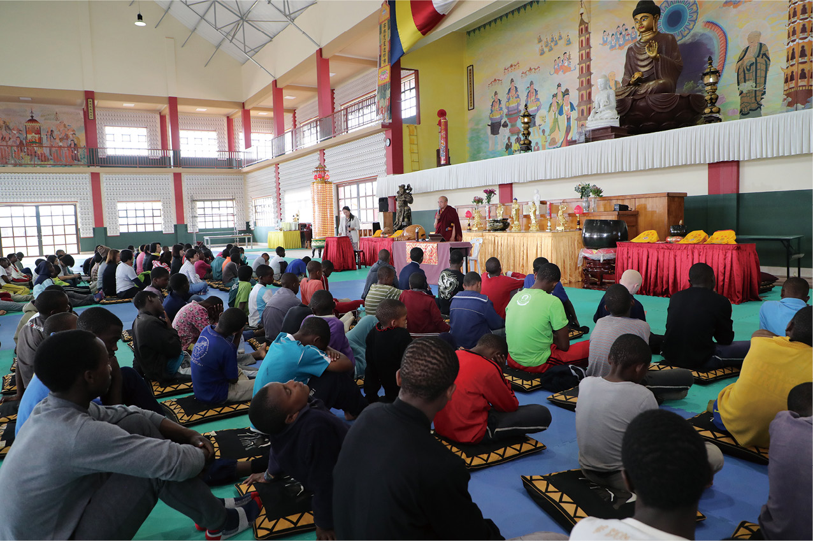

当我在信仰释迦牟尼佛、阿弥陀佛的同时，

也可以同时信仰基督教所强调的爱和包容。

第81场

非洲斯威士兰ACC阿弥陀佛关怀中心

Amitofo Care Center, Swaziland

非洲·斯威士兰

2018 / 9 / 21

## 在苦难中成长

## Growing Through Suffering

主持人：

首先，我为小朋友们介绍索达吉上师。此前，大家还没机会和上师如此近距离地接触和交流。昨天，上师看了你们的表演后，对大家都表示很赞叹。

索达吉上师自始至终都很支持我们ACC中心，对大家的教育方面尤其注重。多年以来，上师一直关注着大家的学习状态。每一年在泰国举办的“世界青年佛学研讨会”，上师都会给我们提供免费的名额，让马拉维的哥哥姐姐们有机会参加。因此，大家今后也会有机会去亲临现场，参加这么殊胜的佛学活动。

今天，上师特别抽空来到这里，给我们五年级以上的孩子们作开示和交流。之后，如果大家有问题想提问，也请不用害羞，要知道，这样的机会实属难得。我也长话短说，恭请上师为我们开示——

今天，很开心和大家有机会见面、互相交流，这是一个很好的因缘。

昨晚，ACC的小朋友们表演了非常精彩的节目，你们的歌舞、武术都非常棒。虽然一些歌词我听不懂，但从表情上可以看出，你们展现了一种超越想象的快乐和脱俗的自然力量。昨天，我也见到了新加坡以及各地热衷于做慈善的一些人，我们都被大家的表演所吸引。你们的歌舞表演极富激情，我留意到，现场的有些人感动到流泪。尤其是看到你们的少林武术时，感觉勇猛有力，让人不由得产生畏惧心，害怕你们的刀、箭、鞭子会打到我们。（众笑）

我们在泰国举办“世界青年佛学研讨会”时也邀请了非洲的很多小朋友，当时，我和来自台湾、马拉维的孩子们有过沟通。我们在新加坡举办活动时，也和ACC的小朋友们进行过交流。当时现场每个人的内心都充满了活力，具有很高的智慧，心地也非常善良。

我第一次来斯威士兰，不知道今后是否还有机会再来。人生中的有些际遇，是第一次，也是最后一次，但我希望，自己不是最后一次来这里。我还会来斯威士兰以及其他的非洲国家，和有缘的朋友见面。明天我会见你们的部落酋长，还有当地的老百姓，大家会有更多沟通以及互相学习的机会。

今天中午我吃得比较多，小朋友们也吃得不少。一般吃得太多，到了下午上课就容易犯困。昨天中午，我给斯威士兰大学宗教系的老师们、同学们讲课时，正好是饭点，在讲课现场，看到学生们听得非常专注，我想，他们会不会是因为若不认真听讲可能就吃不上饭？当时，我讲得也很专注，因为我也想尽快讲完可以早点吃饭。（众笑）

## 信仰基于慈悲和包容

今天，大家在一起交流，这很有意义。全世界有七十多亿人口，人们出生在不同的国家，分布在不同的地方，所秉持的传统也不一样。我们虽有着不同的信仰与肤色，但彼此唯一的相同点是：全人类都共同希望追求快乐和避免痛苦。所以，大家要懂得全球一体化进程和文化理念，只有这样，人与人之间、国家与国家之间，才会消除隔阂、矛盾和冲突。

回顾19到20世纪，那时，非洲是封闭的，很少和其他国家的人结婚生活，互相融合。直到21世纪，地球上任何国家的人都可以毫无阻碍地融合到其他国家和民族中共同生活。曾经，信仰佛教就不会去接触基督教、天主教或是伊斯兰教等，同样，基督徒也不会信仰佛教。但是，当今时代完全打破了种种传统观念，作为一名佛教徒，可以同时信仰佛教和基督教。当我在信仰释迦牟尼佛、阿弥陀佛的同时，可以同时信仰基督教所强调的爱和包容。

当今世界，人类拥有慈悲和仁爱的精神，这些精神出自各个不同的宗教，不同的宗教精神又可以融入一个人的行为中去行持。虽然我是一名佛教的出家人，但我依然可以去基督教堂，去不同的宗教场所，与不同宗教信仰的人交流和接触。我想对在座的朋友们强调的是：以往我们父辈一生也许只信仰一个神，或一种宗教，包括我们家里，父母那一辈只承认佛教，但是，21世纪的今天，此观念有了很大的转变，我们这一代，除了接受佛教外，对于世界上其他宗教也都会认可。

若大家与周围或家人在宗教观念上起冲突时，你们需要和他人解释，佛教是一个非常包容的宗教体系。昨天，我与宗教系的老师及学生也有过讨论，我们要知道，佛教不会排斥任何一个宗教派别，甚至还会去学习诸如基督教、天主教等其他宗教的理念。大家除了信仰其他宗教之外，完全可以继续信仰和学习佛教，甚至更多宗教，你们应该需要从小培养这样的一种理念。将来大家上了大学，会在寝室遇到不同背景以及不同信仰的学生，你把他们视作敌人还是朋友呢？佛教徒不能只认可佛教的一切而视其他宗教及信徒为敌人，这样彼此都会非常痛苦。

这个时代，对于双重信仰是可以接受的。我经常会去基督教、伊斯兰教教堂，也经常会和牧师、其他宗教的导师以及不同的宗教人士共同进餐、聊天，甚至同住一个宾馆，大家内心都十分从容，毫无任何抵抗，我们都很包容他人，都用非常开放的心态来接受一切事物。

## 人生需要一颗勇敢坚定的心

在座的朋友们，有些从小就无忧无虑地顺利成长，不曾遇到过任何逆境；有些从小就失去了父母亲人，成长过程非常痛苦，甚至还会遇到各种困境。但无论如何，在人生旅途中，大家都需要具备一种非常坚定的心态，它会让我们的学习、生活变得更加精彩和有意义。

不知大家是否看过《哈利波特》的电影或是小说？喜欢吗？（有些孩子回答：看过！）其实，不光是你们看过，很多大人也喜欢看。对于《哈利波特》的创作，我也有过了解。小说的作者J.K.罗琳是个英国人，是一位单亲妈妈，她有过一段伤心烦躁的时光。

J.K.罗琳虽然出生在英国这个非常富裕的国家，但由于家庭原因，使得她的生活并没有过得很好，甚至连房租也交不起。罗琳经常会在咖啡厅或比较压抑的环境中创作小说，《哈利波特》的第一部就是在这样的环境中完成的。出乎意料的是，小说出版后卖得非常好，之后，她又一口气连续写了七部。《哈利波特》的故事很长，简单来讲就是：哈利波特从小经历了与同龄孩子不同的遭遇，因为他的父母被伏地魔所杀，成为孤儿的他直到十几岁都寄人篱下，生活在他的姨夫家中。之后，他去了魔法学校，在那里学到了不少知识，也结交了很多好朋友，同时，通过不断努力学习，自己也变得特别坚强。最终，哈利波特克服种种艰难，降伏了强大的对手伏地魔，为自己创造了美好的人生。

这个故事告诉我们，人生在世，由于各自不同的业力和命运，有的人会遭遇无法想象的折磨和痛苦，有的人却生活得幸福美满。有的人不会因为所遭受的一切而向命运低头，从此一蹶不振，反之，他们会更加坚强地往前走；而有的人，由于被命运摧残而没有勇气面对将来。

你们每一个人的命运都无法预料。有些人会选择继续读书，有些会回自己的部落工作。但无论在人生中遇到什么困难和痛苦，一定要学会坚强地面对。在我们的人生轨道上，要避免去做那些与自己良心相违的事，比如杀生、偷盗或是相违道德的行为，希望在座的各位一定要牢记于心。

另外，我还有一个有趣的故事想和大家分享：主人公是非常著名的黑人伊尔·布拉格，他是美国历史上第一位荣获“普利策”新闻奖的黑人记者，堪称美利坚新闻史上的一大奇迹。他获得如此殊荣，并非由于自己从小学习优秀，据他本人描述，他所获得的一切，和父亲的教育理念有着极大关系。

他父亲是一名水手，经常在大西洋中航行。布拉格从小就意识到，由于种族的缘故，黑人的社会地位十分低下，所以非常自卑，不曾对自己的人生抱过任何希望。然而，父亲对他做的两件事，让布拉格触动很大，也由此让他对人类做出了非常有意义的贡献。

第一件事是，父亲带他去参观梵高的故居，那是一个非常狭小破旧的小木屋，里面还有一双梵高曾穿过的旧鞋。布拉格好奇地问父亲：“为什么举世闻名的梵高会看起来如此贫穷和寒酸？”父亲回答说：“梵高在世时，穷得连妻子都娶不上，直到死后，画作才举世闻名。”

另一件事，父亲带布拉格去丹麦参观了安徒生的故居。布拉格一直认为，安徒生应该是住在类似皇宫的地方，可事实却并非如此。于是，他问父亲为什么安徒生也如此贫穷，父亲回答说：“其实，安徒生的父亲是一个鞋匠，靠给别人补鞋维生，他的生活并非如我们想象得那么美好。”

每当布拉格想起二十年前父亲给他讲的这两个故事，他就深刻体会到，世上这么多名人，他们也都经历过各种苦难，但由于后天的努力和勤奋，最终在人生中获得了成功。

我不知道你们曾经的生活如何，但大家回顾人生时，应该正视以往的经历，不要灰心、伤感、自暴自弃，用负面情绪去否定自己，否则是懦夫的行为。你们应该用坚强和勇敢的心态来面对人生。

## 用知识完善自己、征服世界

改变命运的方法之一就是积累福德。要知道，每个人今生的命运都和前世的业力有关，前世若积累了很多福德资粮，那这种因缘在今生成熟后，自己不需要勤作就能自然获得财富，过上幸福的生活。

另一种改变人生的方法就是学习，知识能改变一个人的一生。当我们学习时，一定要跟随一位好老师，如果这位老师能认真讲授宗教和艺术等各类世间知识，你们在这样的熏陶和教导下，各方面会成长得非常快。

在学习过程中，千万不能懒惰、散乱，要将自己所有的精力和时间用在学习上。大家正处于学习知识的大好时光，应深度地去钻研。我16岁才开始上小学，在此之前，一直在山上放牧，没有读书的机会。之后，通过自己努力，还是学到了不少有用的知识。

你们已经遇到这么好的老师，一定要非常认真地去学习。中国有句古话：“少壮不努力，老大徒伤悲。”大家若虚度了现在的好时光，当你人到中年，回想起现在的种种，一定会产生极大的后悔心，但那时后悔也来不及了。

而且，你们学习的范围要广泛，这就如世界各国推行的教育一样，语文、数学、外语、物理、化学、历史、政治、宗教等都要广泛地接触。我看大家的武术和语言学得不错，其他学科也要同样如此。在整个教育体系的推行中要涉及各个科目，希望在座的老师能引起重视。如果我们不能给学生们传授有用的知识，将来他们的人生也会因此而面临各种问题和挑战。

我在自己的家乡开办了三所学校。其中一所小学今年接收了1030名学生，另外一所小学有400多名学生，还有一所中学，接收了800多名学生。当地政府给学校安排了老师，我们也欢迎来自各地能教藏文、英文、中文的老师以及志愿者加入学校。小学的学制是六年制，中学是三年制，所以，两者相加共是九年制教育，等孩子们学完所有的课程，他们学到的东西是十分有价值的。

我家乡的学校，完成九年制教育的孩子都已经毕业，今年（2018年）也即将迎来254名毕业生，我会去参加他们的毕业典礼。其中大部分学生都学得不错，当然，也会有个别学生不努力，几门课的平均分都不到二十，我对他们说：“大家学了九年的课程，最终得到这样的成绩不太好，你们需要好好努力。”

对斯威士兰当地的教育体系，我不太了解，但参考中国的教育体系来看，小学六年，初中三年，高中三年，当学生完成了十二年学业，已达到高中的水平。这里的十二年和中国的十二年也许相似，你们在这里经历十二年的学习，完全可以高中毕业。昨天，我看到你们武术表演非常出色。但是，我希望今后能看到你们的文化成绩也同样出彩。今后的你们，或许用武术征服别人的机会并不多，但更重要的是，我们要用知识来征服自己、完善自己。希望ACC中心的领导们，在今后教育方面能为学生考虑得更完善些，若能参考常规的教育制度来推进，对孩子们来说将是最需要的。

## “不放弃”才会花开见佛

我们刚才谈论的是学生在十二年的学习生涯中可以小有所成。不仅世间的学问需要时间积累才能有收获，在佛教中，修行十二年也同样会有一定的成就。

最后，我想和大家分享一个通过努力修行十二年而终获成就的佛教故事：佛教中有一位无著菩萨，他在鸡足山修行，为了能尽早亲见弥勒菩萨，在山上苦苦修行了三年。但是，三年里他没有修成任何验相，甚至连一个好梦都没有。于是，他心灰意冷地想放弃。下山途中，他看到有个人正在磨一根铁棒，那人告诉无著菩萨，自己要把这根铁棒磨成针。无著菩萨看到眼前的一切，联想到自己这几年毫无成果，应该是努力不够的缘故，于是又回到山上继续修行。

就这样又过了三年，无著菩萨还是毫无感应，也没有一点修行的验相。于是，他又走出山洞准备下山。在洞口，他看见有一串水滴从高处不断地往下落，居然把地面的石头滴穿了一个孔。他思忖到，长年累月的重复，连水滴都能穿石，我的修行没有任何验相，一定是自己精进不够。于是，无著菩萨再一次进入山洞继续修行。

就这样又过了三年，他依旧没有获得任何修行成果，于是，他又走出山洞想放弃修行。路上，他看到有一个人正在用一根羽毛擦拭一座山，他连忙上去问缘由，对方告诉他，由于这座山挡住了房子的阳光，所以想用羽毛来擦拭这座山，将其磨平。无著菩萨心想：世间人如此勤奋，我这几年的修行又算得了什么？于是，他再次回去修行。就这样，无著菩萨又修行了三年。

这样反反复复，整整十二年过去了，他还是一无所成。于是，他再次沮丧地下了山。路上，无著菩萨看到一条身上长满蛆的老狗，顿时他对这条狗产生了无比的悲心。就在他准备用舌头帮狗舔去身上的蛆时，他竟然亲见了弥勒菩萨。这个故事告诉我们，即使花很多精力和时间做一件事，回报不一定说来就来，但如果自始至终没有放弃，也许最后一刻会迎来成功。

在座的很多人都是慈善家，大家不要因为已经做了五年、十年，十二年的公益事业，就认为“我该退休了”，你们还要不断地努力，这样才能把公益事业做得更好。很多同学也已经学习了五年、十年、十二年，大家不能自满，因为学无止境。在佛教中，如果想要成就，经历了十几年的修行依旧没有任何境界，这时绝对不能选择放弃，而要继续坚持。所以，不管是学习、做慈善还是世间任何一件事，绝不能因为一些小小的挫折而放弃。“不放弃”是最重要的一个成功因素。

有些慈善家会由于年龄问题而想放下正在从事的事业。其实，年龄不是问题。今年新上任的马来西亚总统年逾九十，但他仍可以连任；现任美国总统拜登也有七十高龄了。所以，年龄不是问题，从事慈善事业的各位，也不应该因为年龄问题而退缩，大家应该继续努力。

我们的孩子们，不管今后人生如何，都要活到老、学到老，不断地学习。学习是唯一能改变自己人生的方法，学习会让我们的生活更加美好。谢谢！

主持人：

感恩上师对大家的加持！大家都已经听到上师对我们的勉励，学习很重要，学习才有好的未来。不知大家此刻有何感想，或者请教上师问题都可以。

参会者1：今天，我想对上师亲口说声“谢谢”。您今天来到了斯威士兰，我们大家都很高兴。两年前，我在新加坡见过您，没想到上师会来到我们这里，今天有机会能够在这里再次见到上师。您所说的每一句话都对我们很有帮助。的确，我们学习时，就会自然而然地想到上师的谆谆教导，我们也会和同学们分享自己的心得和感受。能够见到上师的机会很少，今天能够见到您的人都是十分有福报的。我们希望今后能请上师再来斯威士兰。谢谢！

参会者2：师父好。我只是想和您说，谢谢您来到斯威士兰！希望您今后有时间再来我们这里。也谢谢您帮了我和我的爸爸和妈妈！

主持人：

大家要把握好机会，如果没有更多问题，接下来上师就会去参观大家的住处、学校以及整个院区。好，大家请起立，我们再次感谢上师为大家做的精彩开示以及给予大家的美好祝福！
