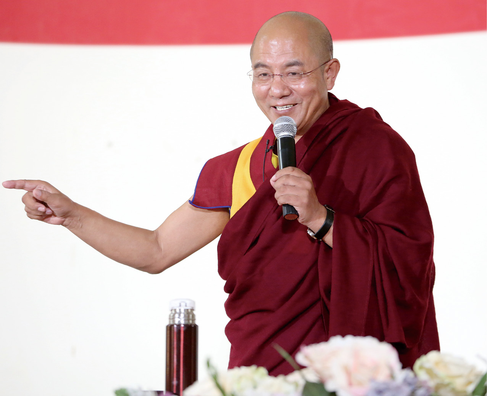
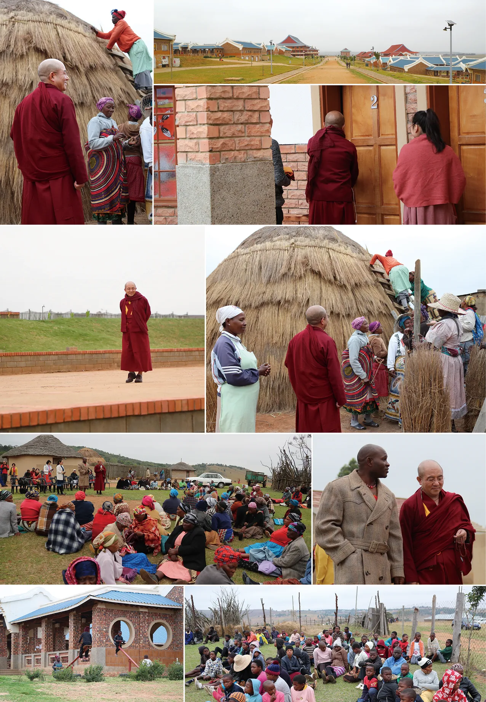
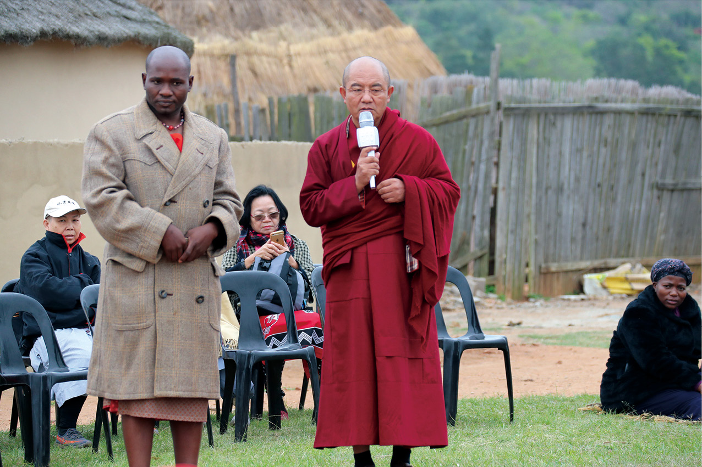
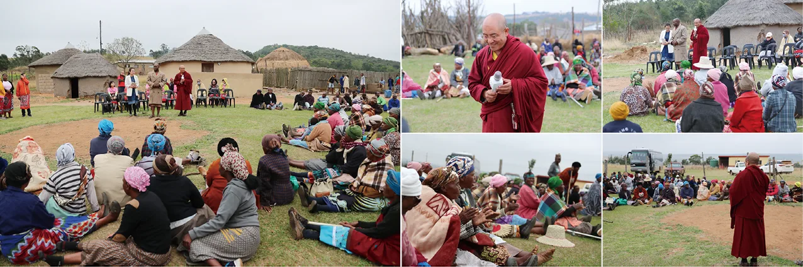

善良的心，就是黄金。

第83场

非洲斯威士兰原始部落

Swaziland, Africa

非洲·斯威士兰

2018 / 9 / 22

## 对斯威士兰部落的开示

## Speech given at Swaziland Tribal Village

主持人：

今天，部落里的男女老少都穿上了自己最好的衣服，以光鲜亮丽的形象参加这次重要活动，迎接我们远道而来的贵宾——索达吉堪布。

上师开示之前，请莫桑比克ACC的院长，为我们介绍一下上师。他讲英语，由酋长翻译成斯威士语。一会儿上师开示的时候讲汉语，翻译成英语之后，再由酋长翻译成斯威士语。

斯威士兰的官方语言是英语和斯威士语，但部落里绝大部分人只懂本族语，因此需要这样翻译。上师去下一个国家——马拉维也是如此，需要有人把上师的开示翻译成当地的本族语——齐切瓦语。

我注意到一个有趣的现象，当酋长把上师的话译成本族语时，无论说什么，听众都会在下面热情地回应，发出“哦”“耶”“咦”“呀”的声音。这样会让讲者感觉非常好，知道大家都在认真听。下面就有请上师为我们做开示。

今天，我们能与酋长见面，听他介绍这里的情况，因缘非常好。我是第一次来这个国家，我看到这里的人们非常善良、淳朴，笑声特别纯真、自然。受到你们感染，我的内心也非常欢悦，觉得这次收获很多。

今天，我主要跟大家分享四个话题：

第一，当今是全人类以一种文化融合，谋求发展进步的时代，所以，大家很需要了解全世界的文化。希望在座各位能让自己的孩子不断接受教育。为了应对未来的发展趋势，孩子们现在就应该学习英语、汉语，或者其他语言。这样，他们的人生才会逐渐改变。

第二，如今，全球化的西方文化已对各国的传统造成了一些冲击。非洲有着非常古老的文明和传统，这个时候，大家一方面需要尊重自己的传统文化，另一方面，也应不断学习世界上的各种新科技和新文化。

第三，斯威士兰人虽然以信天主教、基督教为主，但并不排斥其他宗教。其实，其他宗教不管在这个国家的教育、医疗，还是在人文思想、行为健康等方面，都起到很大作用。所以我想，在座各位在保持自己原有宗教信仰不变的前提下，应该也可以接受其他宗教。

最后，我想和大家分享著名文学家莎士比亚的一句话。他说：“善良的心，就是黄金。”我相信，在这片土地上成长的所有斯威士兰人，心地都是很善良的。希望你们每一个人，能善待一切生命。

今天有这样的因缘非常好，十分感谢你们！我想送给大家一个吉祥的祝福：祝愿你们身体健康、家庭幸福、心情快乐！

最后，我用藏文给大家念诵怀业祈祷文、释迦牟尼佛圣号、法王如意宝祈祷文、遣除道障祈祷文的传承……

上师开示结束后，听众中一些妇女纷纷站起来。她们边唱边跳，充分展示出能歌善舞的天性。

我们问当地人她们在唱什么，得到的答案是：他们感谢国王把这么好的人带到斯威士兰，因为上师以爱心和恭敬心对待每一个人。他们很感谢上师送的礼物，也希望上师能继续帮助斯威士兰人，让所有人过得越来越好。

在欢快的歌声中，在一片感恩心中，当天的活动圆满结束。

午餐之后，上师一行开车返回约堡，又是5个多小时的行程……
