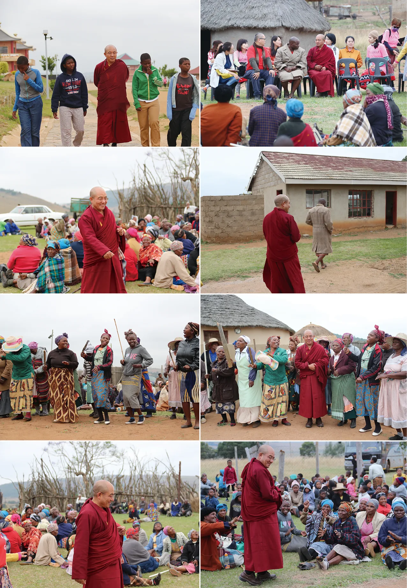
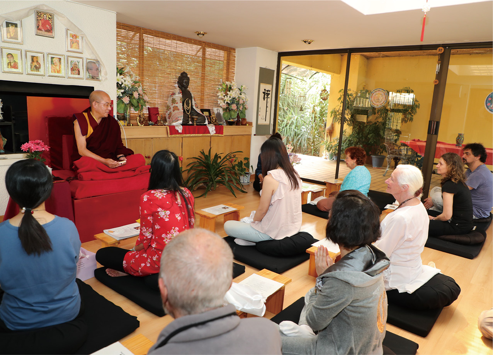
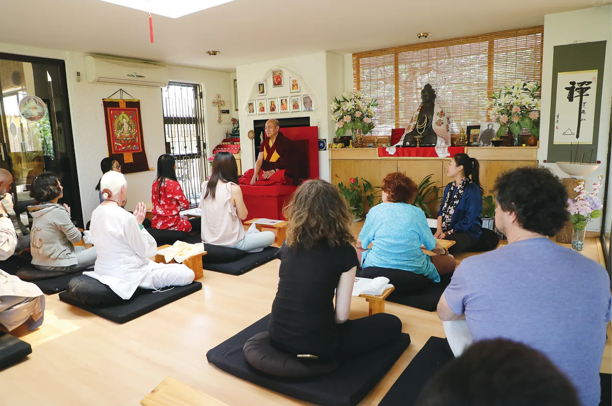

“很抱歉，这次我想去非洲。”

第84场

南非约翰内斯堡禅修中心

The Johannesburg Meditation Centre, South Africa

南非·约翰内斯堡

2018 / 9 / 23

## 对非洲禅修中心的几点希望

## Vision for African Meditation Center

三年前，我们也在这个中心一起讲闻佛法。上次我来非洲的第一站是约翰内斯堡，记得当时我们刚下飞机就来到这里，也受到了在座各位的热烈欢迎。

刚开始，我不太清楚非洲的状况，来到这里之后，感觉非洲还是很不错的。这让我不禁想起一句话：一个人如果只去过南非，没有去过约翰内斯堡和开普敦，那不算是真正到过非洲。

三年前，非洲菩提学会只有一个学员。三年后的今天，我又来到这里时，学员已有十多人，这是非常好的。很感谢在座所有人的努力。

目前在中国大陆，我们通过三十多年的努力，已经产生了一定影响。每次我传法，包括网络在内，听众至少有两三万人。但在非洲这边，因为以前没有传法的因缘，再加上文化的隔阂，并且由于自己各方面的原因一直没有机会过来，所以，与当地人结缘有一定难度。

我刚开始计划来非洲的时候，心里比较迷茫，没有什么确定性，但初到非洲之后，感觉却非常好。在非洲，我认识的人不太多，所以很需要和大家一起传播佛法。这种因缘是比较特殊的。

## 令人高兴的三件事

在我来过非洲之后的三年里，这边有几件事情让我挺高兴。

首先，这里的菩提学会学员虽然不多，但数量却在不断增加，并且，在座各位都在很认真地学习。这是第一件让我高兴的事。

第二件，在这个中心，以西方人为主的学员，不但不间断地学习《妙法莲华经》《维摩诘经》等经典，还一直学习我们英文组法师的课程。通过这样闻思，大家都得到了一些收获。

现在很多佛教中心都缺少系统闻思，从这一点来看，我们虽然人数不算多，但每个人都一直坚持学习，这是很难得的。有些道友每天从早上三四点钟就开始闻思，每星期上好几堂课。这种精神和行为，让我非常感动和欢喜。

第三件令我高兴的事情是，这三年来，我们和ACC的慧礼法师一起，帮助了一些非洲孩子，包括孤儿和一些大学生。我们在做事的过程中，认识了很多非洲当地人，彼此结下了甚深的因缘。

这次我原计划去新西兰和澳大利亚十五天，去非洲十五天。澳洲的行程涉及十多所大学、几所监狱，以及一些民间活动。后来由于一些原因，这次我只能出国十五天，这样一来，对于这两个十五天计划，我只能选择其一。在仔细考虑之后，我觉得这次非洲之行的因缘可能比较好，因此来到这里。

澳洲的一位堪布当时强烈邀请我去他那里。我对他说：“很抱歉，这次我想去非洲。”他考虑了一下说：“也可以，不管是藏传佛教，还是其他宗教人士，来澳洲的多一些，去非洲的比较少。你去的话，原则上我同意。”这位堪布可能心里也有点意见吧，因为澳洲的行程很早之前就安排好了。不过，他也认为我去非洲是有必要的。

这次非洲之行比较匆忙，过程中，很多人都付出了大量的时间和精力，特别感谢你们的热情参与！

### 几点希望

因为时间关系，今天我就不多说了，只给大家提出几点希望：

第一点，这里的中心或学会，虽然人数不多，但大家一定要有信心，因为世间很多伟大的事业，刚开始都是由少数人发起的。虽然最初没有很多人参与，但最后却产生了极大影响，令很多人受益。所以，希望大家不仅自己一如既往地学习佛法，也要把佛法的理念传播出去，帮助更多人。

第二点，非洲学会组织大家共修，每个月都有一些网络课，希望大家能积极参与，这对自己的学修非常有帮助，每个人都要努力维护好这个团体。

希望大家不管遇到什么事情，彼此都能和睦相处。现今，学会、这个中心，以及ACC这三处的人，是我们目前在非洲很好的因缘。希望大家能珍惜现在的机缘，不断学习。

第三点，希望大家把现有的一切，看作一个非常殊胜的因缘和特殊的弘法利生机会。在非洲，哪怕给一个人的相续中种下一个善根，与在其他佛法兴盛处让很多人结上佛缘相比，两者的差别还是很大的。

非洲很多地方都受基督教等其他宗教影响，直接弘扬佛法有一定困难。但这不要紧，我们可以与其他宗教合作，把双方共同的理念结合起来，互相学习。至少要消除很多人对于佛教的误解，遣除他们的邪见，这也是一项很大的工程。

虽然暂时很难在此建立起像佛法兴盛地那样的闻思修机制，但只要我们自己不间断学习，同时依靠善巧方法不断弘法利生，我觉得这种行为也非常有意义。

最后一个希望，我们的传承上师——法王如意宝，确实是一位极具加持、非常伟大的上师。他传下来的教言特别珍贵，我们在有生之年，不管遇到显宗法，还是密法，都极为难得。希望在座各位，不要当一名形象上的佛教徒，而应发自内心地珍惜法王传下的这些法门，好好修行。

虽然我们为了对外弘法，有时需要一些善巧方法，但更重要的是提升自己内在的修为。希望在座各位遇到这样难得的法门之后，能不断地学习和实修。实修之后，内心会获得一种力量；有了这种力量，影响周围的人才不会很难。
