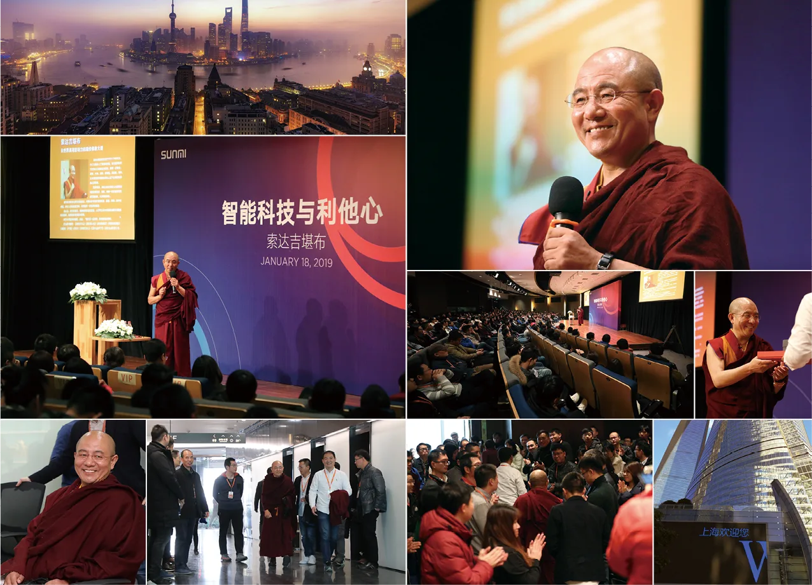
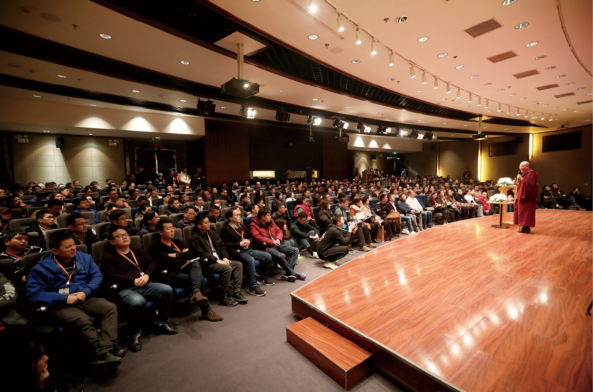
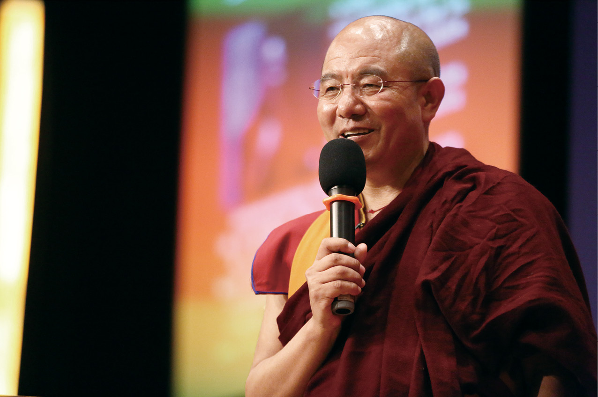
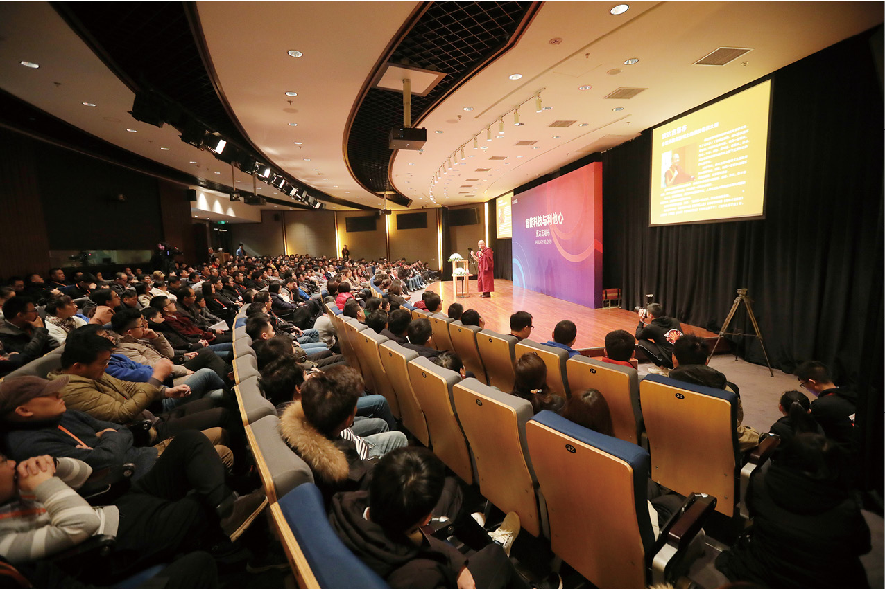
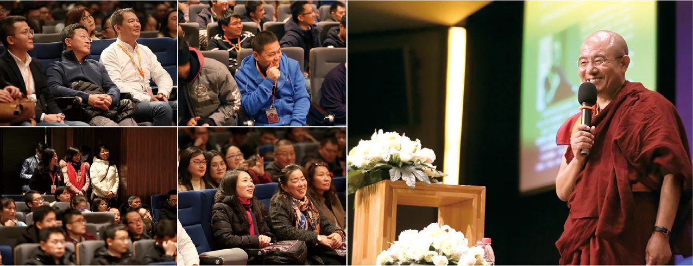
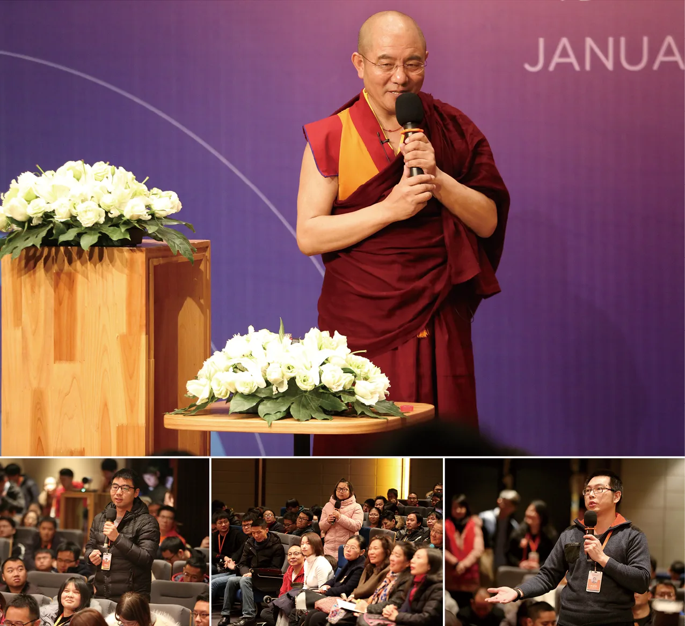
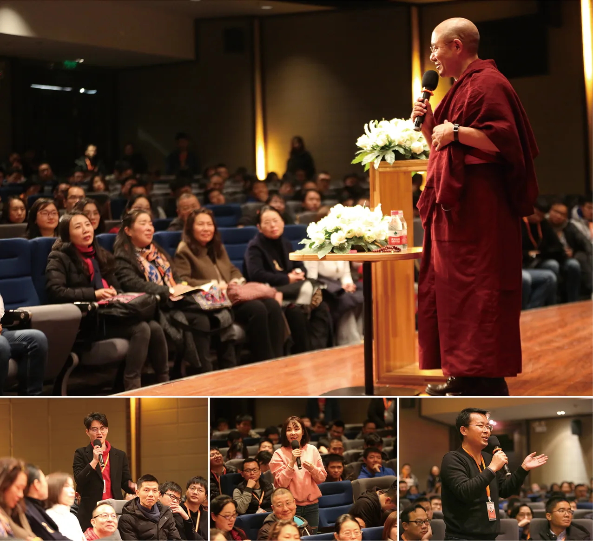

人工智能只是一个工具，  
掌握在什么人手里，才是最关键的。

第87场

上海商米科技集团

Shanghai SUNMI Technology Co.

中国·上海

2019 / 1 / 18

## 智能科技与利他心

## Smart Tech and Altruism

主持人：

非常荣幸，今天请到了全世界具有重要影响力的藏传佛教大德——索达吉堪布！堪布对藏传佛教的法义学修极深，并不断用现代化的方式向人们传递生命的真相，是唯一在哈佛、耶鲁、牛津、剑桥、斯坦福、清华、北大等世界近百所高校演讲过的佛教心灵导师。此外，堪布还出版了上百本公开和内部图书。我们真的很有福报，今天能在现场聆听堪布的演讲。

堪布今天的演讲主题是“智能科技与利他心”。演讲时间是9:30到10:30，然后10:30到11:00是提问环节。希望大家保持恭敬，用心聆听。如果有疑问，可以在提问环节和堪布直接互动。

接下来，有请我们的贵宾——船长上台致辞！

船长：

首先，我代表商米集团感谢索达吉堪布！今天真的很荣幸，能够请到堪布给商米全体员工讲“智能科技与利他心”的教言。也欢迎各位旁听的嘉宾！

我作为商米的创始人和CEO，一开始就觉得商米的核心价值观应该是——我问一下咱们的员工：商米的核心价值观是什么？

“利他心！”

是的，商米的核心价值观就是利他心。读书的时候，我们有老师带领，但是毕业以后，进入工作岗位，却很难遇到人生的导师。荣幸的是，我在11年前，遇到我的上师索达吉堪布。从那个时候开始，我的心中就种下利他心的种子。

我记得跟上师第一次见面，就发愿吃素，一眨眼已经坚持10年了。5年前，也就是2013年，我创办商米的时候，就发愿：公司的使命和价值观就是利他！

我认为，如果企业一开始的发心就是利他，不管每一位员工具体在思考什么、做什么，最后的结果一定是好的，一定能利益身边的人，利益更多的人，乃至整个社会和全人类。我非常感恩我的上师，一开始就给我种下了这样的种子。

我们的人生都是跌宕起伏的，有顺境，也有逆境，会面临各种诱惑和烦恼。如果有一位好上师，像明灯一样指示我们用利他心一步一步地去利益身边的人，利益更多的人，乃至整个社会和全人类，我觉得非常非常难得。

人身难得，佛法难求，善知识难遇。我这一生真的很荣幸，遇到了这么好的善知识！下面，大家以热烈掌声欢迎索达吉堪布——

今天很高兴，能和商米的全体员工，和这么多高科技人士进行沟通交流。我做过很多讲座，有时会客套地说一下自己“很高兴”，但今天的高兴不是口头上的，是发自内心的。

为什么呢？有两个原因，一是有这么多年轻人依靠科技创新得到了真正的利益。大家通过自己的智慧和技术，以利他心的方式，为个人，为家庭，为周围乃至整个社会提供服务，这在全球很多领域都是比较罕见的。另外，你们公司的技术创新和业务发展也很快，时代的竞争这么强烈，你们的产品能进入近百个国家的市场，应该说非常难得。

第二个原因，你们公司的价值观是“利他心”。在这个自我主义盛行的社会，这样的价值观非常非常难得。也许有些年轻人认为：“现在是以自我为中心的特殊时代，哪有讲利他的道理？自己才是最重要的。”人在年轻的时候可能会这么认为。但当你到了一定年龄，在复杂的社会里把各种事情都经历过以后，可能会明白：人活在这个世界上，以自我为中心的奋斗和努力虽然重要，但发自内心地用实际行动去做利他的事情，才是更重要的。

## 最好的时代，最坏的时代

我今天跟大家交流的话题是“智能科技与利他心”。这个话题在当前来讲非常关键。为什么这么说呢？在座的这么多人，每一位都这么年轻、有活力。从拥有的智慧和掌握的技术而言，你们是这个时代的主人，是这个世界的主人。不过，由于我们彼此受到的教育不同，在宗教的利他心方面，我受的教育可能多一点，所以我们今天的交流和互动还是很有必要的。

学历方面，你们大多数都是本科生、研究生或博士生，甚至有国外留学的经历。你们不但对现代科技知识了如指掌，更重要的是，还拥有很强的研发和创新能力。这一点非常难得，非常重要，是这个时代不可缺少的。不过，大家可能缺少的是什么呢？一种真正有价值的道德观念，或者说利他心——发自内心地想要帮助身边的人、帮助周围的人。这样的心态，你们是否拥有？我不太清楚。现在很多年轻人内心比较浮躁，烦恼比较多，痛苦也很多，以此工作和生活都受到一定影响。你们是不是这样呢？

我认为，如今这个时代非常特殊。既是最好的时代，因为现在的生活条件和节奏跟以往任何时代都不同，非常便利，非常迅速；但另一方面，这个时代又非常不好，因为人心的道德水平不断下滑，大家承受的痛苦比任何时代的人都更为深重。很多数据表明，科技的发达并没有让我们的幸福指数跟着上升，相反，还在不断下降。

表面上看，生活在这个时代的人应该很快乐。我们做任何一件事的效率，都超过了以往的任何时代，是那么快速有效。不管是交通工具，还是信息工具，都非常便捷。可是，当每个人反观自己的时候，却在内心发现了许许多多的欲望和痛苦，简单说，就是佛教所说的贪、嗔、痴一应俱全。

数不清的贪婪和欲望控制着我们的心：网上有那么多好东西，自己拥有的却很少很少；世界上有那么多成功人士，自己却达不到他们的境界；竞争对手、家人以及种种社会现象，都那么让人讨厌，由此生起各种不满……内心的嗔恨、欲望、贪婪、嫉妒、傲慢等负面情绪，可以说是纷至沓来，防不胜防。

我觉得，在这样一个特别的时代，在座各位一方面要不断地努力学习和工作，一方面也要学会时时刻刻调整自己的心态。如果心态调整不好，工作可能就做不好，生活也过不好，自己辛辛苦苦建立起来的价值观也不一定能够实现。

在这方面，如果有一些佛教的信仰，做起来可能相对容易一点。不过，我并不是在这里宣传佛教。你们有信仰或没有信仰，都可以。佛教经常讲随缘度众，有因缘的人给他种下善根，他自己会获得成长的机会；如果没有因缘，再怎么讲也没有办法。

现在的年轻人，一定要有利他的人生观和价值观，就像刚才你们“船长”所讲的那样。它不但应成为企业的核心价值观，更重要的是，大家在做人的时候，也要发自内心地要求自己：一定要在有生之年坚持做利他的事情。哪怕很小很小的一件事，坚持下去也很有意义。比如，拿出每个月工资的1%或者0.1%来帮助他人，用这样的行为，慢慢开发内在的善良，慢慢培养自己的利他心。这种商业理念，在如今时代真的至关重要。

## 人工智能是利是弊

大家都知道，人工智能时代跟以往的工业革命和互联网时代等，很多地方都不相同。我不是人工智能方面的专家，这方面的知识没有你们多。你们在这方面有专门的研究，相关的理论和技术非常擅长，是真正的专家。但是，这几年以来我也一直在关注人工智能的发展动态。

去年，我们在泰国开了一个世界性的佛教研讨会——第八届世界青年佛教研讨会，当时的主题就是“人工智能与佛教”。来自全世界的科技界人士，南传佛教、北传佛教、藏传佛教的修行人，都用各自的观点阐述了人工智能对人类社会的利弊问题。大家探讨和交流的结论是，人工智能兴盛于世是大势所趋，没办法阻挡，也没有必要阻挡。但是，如果没有掌握好分寸，它的利弊就很不好说了，可能给我们带来很大的危害，也可能带来很大的利益。受到危害的时候，很多人可能会牺牲在它的控制下。得到利益的时候，无论是物质还是精神，很多人可能都会有所收益。

就人工智能对人类社会的影响而言，很多人都比较担心，比较恐慌，因为它可能会取代我们的工作，影响我们的生活。在真正的人工智能时代，大多数人都会失去工作机会，成为无用之人。到那个时候，大量的汽车司机不用了，老师也不用了，翻译也不用了。我的“职业”是给大家讲课，不过很多人跟我讲，以后也可能被它们取代。

实际上，人工智能再怎么样，毕竟只是一个科技产品，最终还是要由人的智慧来控制。它给人类带来的是利还是弊，关键看我们的心是善还是恶。人心善，大多数人工智能是掌握在我们手里；人心恶，大多数人工智能还是掌握在我们手里。说到底，人工智能只是一个工具，掌握在什么人手里，才是最关键的。就像我们经常用的钱，有智慧、有道德的人拿到手以后，会用来利益身边的人，当然也利益自己；而没有道德底线的人一旦有了钱，整个行为则完全不同，到最后可能是毁人又毁己。

现在很多人害怕人工智能控制人类，我觉得一段时间内还不会出现那么严重的现象。但人工智能兴盛以后，可能会在很多领域给人类带来痛苦。尤其是人工智能掌握在有些人手里后，他们得到的利益可能会比较多；而被人工智能取代的这些人，会走投无路。举个例子，如果科技公司的业务全部人工智能化，那么肯定会裁员，到时候成千上万的人全都不用了。什么原因呢？人工智能的工作效率比人类高。

在座各位如果有一颗真正的利他心，看看怎么样把它运用到产品的研发和设计上去。真正的利他心是可以用到产品上的。而且这种力量会传递给每一个客户，再通过客户慢慢传递到社会的各个角落。这样的精神和理念，可以让我们的社会多一些幸福感、安全感，这是非常重要的。

## 追求自我与物质的代价：空心症

各位有没有这样的利他心，可能很难说。因为现在盛行的是西方自我主义的价值观，大家都以自我为中心。而且西方所谓的自我主义，基本上就是物质主义。所以很多人对自己内心的快乐、安宁与平和，不一定重视。

古代的人很讲道德，但现在这个时代，好像不需要道德，人们对所谓的道德基本上持漠然的态度。大家眼下最关注的是什么？就是物质，就是金钱，就是自我。即使对自己的精神领域，也是模模糊糊，不太重视。至于身边的人，周围所有的生命，以至整个社会，更是慢慢地选择忽略。在这样一个时代讲利他主义，也许并不是很管用。

尤其是亚当·斯密在《国富论》里，不断强调商业模式与自己的发展，而所谓自己的发展，就是如何将别人拥有的财富和商品，用来为自己服务。这种商业理念和我们佛教讲的无条件利益众生，完全是相违的。

受西方价值观的影响，现在很多东方人的心灵导向变成了什么？只求自己快乐。自己快乐最主要的源泉是什么？金钱。把所有的快乐和幸福都建立在金钱上。只要有钱，就是快乐，这是很多年轻人的想法。

实际上并不是这样的。所谓的金钱，没有的时候，觉得有了它会快乐，但真正拥有的时候，也仅此而已，而且还可能依靠它感受无法想象的痛苦。虽然现在这个社会没有金钱肯定不行，因为生存需要物质基础，但是过多的财富、过分地贪婪，对自己的健康和心态都是不利的。

因此，我希望年轻人在工作时也好，生活中也好，都应该时时观察自己的内心，关注心灵的安宁平和，不能每天都看网络，玩手机，以各种各样的碎片文化充塞自己。虽然目前这种形势改变不了，但我看到年轻人每天都刷手机，真的很担心，因为很多垃圾知识对大家的内心健康非常不利。现在很多年轻人都得了一种病，叫做“空心病”：没有真正的价值观，觉得活在这个世界上没有什么意义，对学习和生活都不感兴趣。原因在哪里？就是只看重物质，不关注内心，任由垃圾信息和碎片文化侵蚀自己的心灵。

我记得北京大学有位教授分析说：现在北京大学30.4%的学生对学习没有什么兴趣，甚至对老师、对所有的知识学问，都生厌烦心；40.4%的人觉得生活没有什么意义，甚至非常厌烦。我们想一想，北京大学的学生在国内应该是最有希望的，如果这些年轻人都觉得学习没有什么意义、生活没有什么意思，那其他大学、其他领域的学生和成年人，到底该怎么找到人生的价值和生活的希望？

在这个时候，我们最需要的是什么呢？利他心。这非常重要。有了利他的价值观，生存将非常有意义，生活也非常有意思。比如我们，对自己的生活也好，学习也好，非常有热情。原因是什么呢？我们觉得，生存在这个世界上，哪怕去做一点点利益众生的事情，也是非常有意义的。这就是大乘佛教的思想。

## 利他心，让企业走得更远

你们也许听说过，也许没有听说过，整个东方佛教的主流就是大乘佛教。大乘佛教的核心价值观是什么呢？无条件地利益众生。这种精神和现代经济社会的新理念有点不同。有些人不一定听得惯，甚至有点反感：“什么意思？无条件利他？简直是一本正经地胡说八道！”

实际上不是这样的。在我们这个社会，如果每个人都有哪怕一点点利他心，也是非常珍贵，非常重要的。你们公司有今天的发展，也应该跟你们刚开始的发心和行动有一定的关系。

在国内，马云应该是成功的一个案例，不管到哪里，都有很多人在谈论他，我也看过他的一些事迹。我虽然不做商业，但有时候也看一些世间书籍。其实，马云刚开始的时候，也提到过利他。虽然在社会的各个领域，都有一些人对他不满，但这个很正常，当自己的利益受到冲击时，人都会心生不满。事实上，也有很多人因为他而得到了利益。

对得到利益的这部分人而言，应该用这样的利他精神和行为去创造更多的利益。在这个过程中，是可以找到很多方法的，比如引入佛教里讲的菩提心。菩提心是什么呢？今生哪怕能让一个众生在生活、物质或心态方面得到一点利益，我也要心甘情愿去做。这是大乘思想最精华、最重要的窍诀。

当然，你们这样的科技公司，要完全无条件地付出也是不可能的事情，我也没有这样的想法和要求。但是，当整个人类社会都在提倡以自我为中心的时候，我们似乎可以从另一个角度思考一下：如果所有的人都只讲自己，连身边的人都不愿顾及，将会导致什么样的结果？过于重视自己、珍爱自己，可能到一定时候，我们对家人也漠不关心，对朋友也漠不关心，甚至对自己周围的一切，包括自己的企业在内，都漠不关心。当人类社会的每个人都活成了单独的个体，所谓的发展是很难实现的。

在互联网和人工智能时代，人和人之间应该是互通的。如果你帮我、我帮你，大家都有生存的空间，也会有发展的机会。相反，在一个我吃你、你吃我的时代，不论群体还是个人，都不会有太大的发展余地。

有时候我在想，我跟你们的思维模式还是有一定差别的。你们不管做软件开发，还是别的工作，跟我的生活方式都完全不同。怎么不同呢？我的几十年人生，都在长长的经书里寻找自己的价值观；而你们这些年轻人，先是在学校里学习，然后毕业找工作，然后因为工作需要到全世界走一走……我们的人生经历和价值观应该有很多不同点。

但是，我们在寻找快乐或者解脱方面，还是有共同之处的。比如，你们有痛苦，我也有痛苦；你们不喜欢痛苦，我也不喜欢痛苦；你们会追求快乐，我也会追求快乐——虽然快乐的点有时候不同。对我们发了大乘菩提心的人而言，真正利益到他人，会发自内心地快乐。

刚才在你们公司聊天的时候得知，刚开始你们公司只有十几个人，而今天已经有了几百个人。我非常开心：这几百个人，每个人都能找到这么好的工作。我发自内心地觉得，这在世间是一件很好的事。虽然这种快乐是靠你们自己努力得到的，跟我没有什么关系，但我还是为大家感到开心。这可能跟我受到的教育有一定关系——我不知道你们有没有这样的心态，比如，我群体中的几百个人有了一定发展，这个堪布以前是什么样的，现在各方面都有很大进步，我都会发自内心地生起欢喜心。

## 人类的智慧和爱心，不应被机器抹杀

不管怎么样，各位今后在工作中应该有真正的爱心。在这个时代，真正的爱心非常珍贵。没有爱心，我们就变成机器人了。人工智能一方面很好，让我们的生活得到了便利，但同时，由于智能产品越来越简单，导致人类变得越来越愚笨——除了动动手指，其他都不会。以前的人开车，对路线一般都比较清楚。现在有了导航，的确很方便，但很多司机却根本记不住路，只要导航一停，就什么都不行了。

过去很多人记东西是用人脑，现在是用电脑、手机。一旦电脑没了、手机没了，人就跟傻子一样，什么都不知道。所以说，智能产品一方面给我们提供了很多便利，但另一方面，也把我们带入了越来越愚痴的状态。怎样寻找一种平衡，我们不得不思考。

你们现在的年轻人，在电脑和手机使用方面非常精通，你们的父母和更老的一辈人，什么都不会，看起来不能与时俱进。但是与他们头脑里记得的知识、心里装着的智慧相比，你们可能才是真正的笨。我希望这方面大家多多地思考。在某种意义上，人类内心的觉悟需要主动开发，如果不开发自己的潜力和智慧，一味依靠人工智能或系统化的集成数据，到一定时候，人类真的找不到生存在这个世界上的价值。所以，我们应该不断学习，提升自我。

按照佛教的教义，我们每个人都有潜在的智慧。虽然人工智能的智慧都是人类发明的，但如果人类不关注自己内心的智慧，将来恐怕真的会被人工智能打败。佛教认为，众生都有如来藏，不管是佛菩萨，还是现在所谓的科技知识，都藏在我们每一个人的心里。通过正确的方式开启，每一个人都可以现前这样的智慧。如果不去努力开发，一味地享受和依赖物质上的智能，那人类自己的智能会越来越下降，直到完全不能使用。到时候，人类原有的道德、智慧和爱心，慢慢就僵化了，慢慢就沉睡了，人类固有的灵性特质和内涵，也许沉入海底，也许变成化石。

人类延续了几千年的具有价值的思想珍宝，也许人工智能一出现，就被摧毁了。从某种意义上讲，人工智能最后可能会抹杀人类文明。虽然我们很多时候不得不使用现在的科技产品，但有时候是不是也该思考一下科技发展背后的代价？

## 这个时代，是在前进还是后退

大家不能一味地觉得：“哇！现在科学这么发达，非常好！”其实，好的同时也有很多的不好。为什么这么讲呢？我有时候在思考，现在做什么都那么方便，只要有一个手机，打车也可以，吃饭也可以，以后可能连手机都不用了，只要有一张人脸——只要你的面孔没出现什么问题，有了钱就绑定在人脸上，轻轻松松走遍天下。

即便是这样，我们会不会快乐呢？不一定。有时候看看科技的发达程度，“噢，这个时代应该是很快乐的”，但很多时候却看不出什么快乐，每个人仍然有一大堆烦恼。在我们父母辈、爷爷奶奶辈年轻的时候，人心更加健康、纯洁。而现在，为什么有那么多大学生自杀，有那么多人得抑郁症、空心病以及各种各样的身心疾病？

在人类历史上，身体不好的人是比较多的，而心理有疾病的人不太多。可现在，却有那么多年轻人觉得活着没什么意思，找不到生存的价值和意义。这是非常悲哀的一件事。科技这么发达，物质那么丰富，人那么年轻，却对生活、对人生感到失望，好像看不到希望似的。我们人类社会是在进步，还是在退化？这方面可能也要想一想。

我遇到的很多年轻人，好像都有这个倾向。按理来讲，现在的年轻人对社会应该充满信心才对，不管是智慧还是能力，他们跟以往的人相比，都有一定的超越性。可是很多人却活得不开心，打不起精神，提不起兴趣，对工作没有热情，人际关系也搞得一团乱麻。

尤其是现在的很多独生子，刚从学校里面出来时，在别人眼里，“哇！这个人应该很了不起，知识水平那么高！”可是跟人一交往，别人稍微讲一句不合心意的话，心就开始要崩溃了，痛苦得要马上辞职了……这样脆弱的心，要活下去的确不太容易。

其实古代的人，近代的人，甚至上个世纪的人，科技没那么发达，心却是很健康的。他们在生活、感情或工作上遇到困难的时候，根本不会选择所谓的退缩和自杀，太多的负面情绪也不会有。

这个时代到底是在进步，还是在退步？真的不好说。光看物质，人类也许是在进步。不过也不一定，历史上人类文明非常兴盛的某个时期，那时的人也觉得自己所处的时代是最兴盛、最光明的，可是到今天一看，几百年、几千年前的人类文明，有些并不是那么有价值。所以我们今天认为科技发达给人类带来了利益，也许再过十年、二十年甚至几百年，就不是我们想象的那样了。

## 保持热情与感恩，远离孤独和抑郁

而且，在座的各位还应该时时保持一颗警惕的心，因为科技日新月异的发展，会给我们的生活带来非常大的变化。你今天是搞科技的，也许过一段时间情况完全就不同了。在如今这个时代，大家的工作也好，生活也好，心态也好，都是不稳定的。佛教讲“万法无常”，万法在每一瞬间都在变化。其实一瞬间的变化，在如今的竞争市场是很容易看到的。总之，一方面，我们要有无常感；另一方面，我们要有追求新时代的信心和热情。

有时候，我真的觉得现在的年轻人应该很开心、很快乐，因为掌握了那么多的知识。可事实上，他们如今的生活压力很大，情绪不是很好，每天都在手机上看各种各样的信息，心态受到一定的染污，眼睛也逐渐变得近视，跟身边人的交往能力也越来越弱。因为这样的原因，很多人都得了心理疾病。尤其是在国外，得抑郁症的人越来越多，国内也差不多有这个趋势。

我前两天看到一则官方新闻，说中国现在大概有1亿多抑郁症患者。这样的话，每14个人当中就有一个。不知道咱们这里有多少个人……得抑郁症是很痛苦的，对吧？我没有得过，不太清楚。不过我看过这方面的介绍，得抑郁症的人，好像对工作、对整个生活都没有热情。

其实，热情很重要。刚才有几个领导跟我讲：“您对讲课好像很有热情。”这一点，我自己也承认。我当老师已经有三十多年了，确实很喜欢看书，也很喜欢给大家讲课，而且从来没有想过自己活着没有意义。即便以后老了，也不会失落。只要还有一口气，能给一个人讲讲课，跟一个人聊聊天，也觉得很好。

如果全世界的人都放弃我、舍弃我，也会很坦然，因为一切都是因缘法，没有什么大不了的。哪怕只能帮助一个人，我也会跟他好好地沟通，可以聊一聊历史，可以聊一聊人工智能，也可以聊一聊菩提心。

我始终觉得，活在这个世界上很有意义，而且活着就是一种巨大的成功。你看，很多人还没出生就已经离开了世间，有些人才几岁就得了各种各样的病，而我们，到现在依然健康地活着。这难道不是成功吗？

前几年有个记者采访我，她问：“您最大的成功是什么？”我说：“到今天为止还活着。”你们也许会想：“活着有什么了不起的？人人都活着。”其实并不是这样。什么事情都不能从负面去想，而应该从正面来看。我们每个人身边都有很多资源和机会，这些都是来之不易的，应该感恩我们的父母、老师、朋友和对手。有了周围的这些因缘，我们才有了今天。

尤其要感恩那些对我不好的人。从大乘佛教的角度，尤其是从你们公司的核心价值观来看，这是最重要的。每个人身边都有一些对自己不友好、天天让自己不开心的人，每一个好人身边都经常有坏人加害。佛经里也讲，每一尊佛的旁边都有一个提婆达多。要特别感谢这些人。对自己不好的敌人、坏人、竞争对手，发自内心地感恩，这是大乘佛教最重要的一种修行。我相信你们都有这样的包容心。

## 给自己一个底线：不害众生

总而言之，我们不能害任何众生，这个非常重要。尤其是你们搞科技研发和做产品的时候，要尽量地饶益有情，饶益所有的众生。一般来讲，人分为几种。最低级的人，害别人，最终也害自己，或者害别人，自己从中得利；中等的人，既不害别人，也不饶益自己；上等的人，自己得到利益，也让他众得到利益；最上等的人，先利益他人，最后利益自己。这是做人上中下的不同层次。

我们活在这个世界上，要尽可能地做不害众生的事情。当然，经商的过程中，有时候难免会直接或者间接伤害别人，这时我们要在内心忏悔，以此清净自己的罪障。佛教里有一句伟大的颂词，是寂天菩萨说的：“不管是做什么事情，都要直接或者间接饶益有情[^1]。”有些事情，我们可以直接帮助别人；有些事情不能直接帮助，但可以通过间接的方式来饶益。关键是自己要有一颗利他心。只要坚持去做，这个利他心会慢慢成熟，慢慢开花、结果的。

做人如果能始终坚持这一点——无论社会变成什么样，自己的利他心不中断，那不管你是什么身份的人，都是我们经常说的菩萨。如果心里一直存着害别人的恶心，不管你显现上多么了不起，你这个人对社会也是有害的，像毒品一样。

我们出家人也是一样的。在佛教中，出家是一种比较殊胜的选择，但是如果内心经常想害别人，那即使穿着出家衣服也没有任何用。而有些在家人心地非常善良，所作所为一直在利他的框架中进行，这是非常好的。

## 利他，是最好的利己

我真正希望的是，你们的利他心要真正落到实处，不能光喊口号，而没有实际行动，甚至内心根本没有这个想法。像有些企业一样，天天喊利他，也许内心完全背道而驰，这样的话，可能没有太大的意义。

你们如果有了利他心，对自己将来的家庭也一定有很大的利益。有一颗温柔、利他的心，会让周围的人对你另眼相看。而且，即使别人对你心怀恶意，因为自己内心很柔软，你也可以应对所有的问题。可能是多年来学习大乘佛法的原因，我自己真的是这么认为的。

虽然这个世界的利他心确实不怎么样，尤其是西方的很多思想，和我们东方的大乘思想有一定冲突。读一些鼓吹西方自我主义的言论时，大家也许觉得以自我为中心的确很重要，但如果过度吹捧自我，到最后自己可能会无路可走。佛教是这样讲的，儒家也是这样讲的。现在的商业理念，提到利他的有很多。有些人是真正想利他，有些人虽然不想利他，但是通过利他的方式，自己还是有所收益。

我有一个老师，叫法王晋美彭措。他是这样讲的：即使你最终的目标是自己的利益，但如果你有利他的心和行为，你自己的利益最后也会实现[^2]。我觉得这句话说得千真万确。即使现在不能真正利益他人，但只要有这颗利他的心和利他的行为，在你成长和创业的过程中，别人都会信任你，帮助你。相反，如果没有这样的心，只想着自己，也许你在这个社会很难成功。

## 幸福就是：认识自己的心

我希望在座的人，不但要有物质的成功，还要有精神的成功。我刚才在你们的价值观中也看到类似的理念。“追求全体员工物质和精神两方面的幸福，对人类社会的进步发展做出贡献”，我记得这是稻盛和夫的一个商业理念。我非常佩服稻盛和夫——这么成功的商业人士，对大乘佛教这么有信心。他以利他心创业，带出了两个世界五百强企业，而且对大乘佛法六波罗蜜多的解说也非常到位。

可以这么说，包括李嘉诚和比尔·盖茨在内，东西方很多有名的慈善家，都是依靠利他心，逐渐对人类社会做出很大贡献的。我们虽然不一定有他们那么大的福德和力量，但可以在自己的国家和家庭等小的范围内有一颗利他心，并从中收获真正的幸福。

不要以为，只要有物质就可以得到真正的幸福。其实不是这样的，真正的幸福存在于我们的内心。尽管让物质与内心完全脱离，在今天这个社会很难做到，但当我们拥有适当的物质条件时，就需要向内看，去认识自己的心。要懂得以知足少欲的理念，培养内心的满足感、成就感和安全感。佛教里的这些理念，才是幸福的真正源泉。

当然，所谓的幸福，并不是没有任何违缘。我们大家的人生都有很多曲折。你们以前的人生不一定是平平坦坦的，以后的路也会弯弯曲曲。但只要不断简化和净化自己的内心，即使遇到了很大的挫折和痛苦，你也会非常坚强，非常坦然。如果没有内心的调解方法，即使没有任何违缘和障碍，你也会觉得走不下去，对整个世界都看不惯，最后实在没办法，很可能选择自杀。现在很多年轻人就是这样，莫名其妙地陷入痛苦，莫名其妙地选择自我终结之路。其实，不管怎么样，人都应该开心地活着。

我去年年底去了非洲几个国家，深深地感到，我们这里的很多人，生活真的非常幸福。看到那些待在监狱里的人，看到贫困的学生和老百姓，我心里很难过，可他们却照样活着，而且活得很开心——他们唱的歌很好听，跳的舞也很好看。可是我们很多人，不要说唱歌跳舞，连最简单的微笑都不会了，整天闷闷不乐、愁眉苦脸、怨气冲天，这样的人生，真的没有什么意义。

我们的人生很短暂。在这短暂的人生里，好不容易有机会跟大家一起活着，应该好好珍惜。我们不仅要一起活着，更要一起开心。

在座的各位非常年轻，有一定的世间智慧，但可能还不够。希望你们多学一些心灵方面的知识，比如大乘佛教、儒家思想等传统文化。在有些人看来，古人的思维方式比较陈旧落后，应该抛弃。其实不是这样的，在心灵调整方面，古人有非常敏锐的智慧，对我们的生活非常有帮助。希望大家不要放弃古人的智慧和爱心，温故而知新，一定可以收获很多有价值的东西。这对现代人来讲，也是非常重要的。

总的来讲，希望大家依靠人工智能这样的超世纪智慧，去帮助现在和未来的人。这是我们的共同目标。

现场互动

问：我是智悲德育的发心义工。公众号自改版以来，粉丝逐渐增加。请问，在即将来临的智能科技时代，我们应该写出什么样的文章，来吸引更多的家长和孩子们加入智悲德育的学习？

堪布：我看过你们的很多文章，非常好，我自己公众号上的文章都不一定比得上你们。看得出，你们在这方面花了很多时间，对这个时代也比较了解。

以后可能还要不断地思考。现在很多年轻人有暂时的智慧，长期的智慧却比较少。因为很多人喜新厌旧，刚看到一种知识觉得很新鲜，但过段时间就不愿再去思考了。这是大多数人的一个通病。

你们的智悲德育对很多家长和小孩来讲，都有积极的意义，可以在孩子们幼小的心里种下善根。这种善根不会一天、两天就成熟，需要日积月累。慢慢慢慢地，他们虽然身处这个时代，但也会有变化。

如果在孩子小的时候，没有给他们播下爱心和德育的种子，他们长大了就很难有完整的人生。就像我刚才讲的，在座的很多年轻人，在学识方面很不错，但这不叫智慧，只能叫知识。真正的智慧体现在道德、爱心和做人方面。而这些，现在的学校教育非常缺乏。现在的学校，基本上只负责知识的传播，除了这个以外，其他方面，包括如何做人、孝顺父母、心怀感恩等，老师自己也懂得比较少。

你们的文章暂时来看，还是比较不错的，但不知道能不能长期坚持。做什么事情，都要有耐心。而现在的人，工作比较多，耐心比较少。你们如果能继续下去，应该是很好的。我也希望你们能够这样。

问：刚刚听您讲利他心，我一直很好奇：这个心是怎么来的？怎样才能管理好这个心呢？

堪布：这颗利他心确实不太好找。《金刚经》里讲：“过去心不可得，现在心不可得，未来心不可得。”在胜义实相的层面，这个心是得不到的，但在世俗假相的层面，这颗心每个人都有。而且，这个心有善心、恶心，有狡诈心、利他心，各种各样的分类。

按照《俱舍论》的观点，心分为主要的心王和分支的心所。心所共有51种，其中一部分是烦恼心，一部分是善心，还有一部分是无记心——既不是善的，也不是恶的。

给我们带来正能量、带来快乐的，叫做利他心或善心。给我们带来痛苦的，叫做烦恼心，比如贪心、嗔心、嫉妒、傲慢等。心的本体，在胜义中是得不到的。不仅是内在得不到，从外在找也得不到。物理学家观察外在物质时，将其一直分解到中子、质子、电子……最后什么也没有。比如对这朵花进行分解，从粗大到细微，从细微再到无分微尘，最后无分微尘也得不到。但若不经详细观察，按照世俗共称的概念来讲，所有物质在我们面前似乎是存在的。

同样的道理，没有详细观察的时候，我们的利他心可以得到，害心也可以得到。不仅心本身能够得到，它带来的后果也可以得到，比如利他心带来的成功和快乐，害心带来的监狱之苦等，这些都是真实不虚的。

佛教对心的分析非常细致，探索内心世界是佛教最重要的内容。所以我认为，在对心的分析和认识方面，佛教应该是最权威的。其他宗教对心虽然也有一些探索，但没有佛教那么深细。

一般而言，科学领域研究物质比较多，对人的心灵方面的探索比较少。除了做一些意识方面的检测以外，在心灵的其他方面，科学界基本没什么有效的方法。而佛教在这方面的研究成果则数不胜数，除了唯识宗和中观宗的论著，还有有部和经部等有实宗的论著。

我希望我们的年轻人，应该对这颗心多一些关注。看看自己的内心到底是什么样的，我们人类到底是什么样的，“我”到底是什么样的——所谓的“自我”，它的本体到底存不存在。这方面如果多一些观察，对大家的生活会很有帮助。

问：我们公司目前的理念是利他心，利益的是客户——广大的人民群众。问题是，我们虽然利益了客户，给他们带来了比较好的产品，但对竞争对手而言，却是直接的损害。在损害竞争对手和利益客户之间，如何取得平衡？

堪布：佛教著名论典《入菩萨行论》中讲到，当我们直接去帮助众生的时候，可能会间接地伤害其他众生。因为不是故意的，所以没有过失。

佛教另一部著名的论典《入中论》里面说：“损害别人的观点没有过失。”意思是什么呢？比如，我在建立自己的正确观点时，不正确的观点或者其他观点因此而倒塌，我是没有过失的。同样的道理，你用利他心建立你的客户群时，利他心以外的人受到损害，换句话说，你为了利益你的客户，间接让非利他心圈子的人受到损害，你是没有过失的。但你如果想“我要故意用害心来摧毁竞争对手”，这个肯定不行。

所以，以利他心作为商业活动的前提，以客户为中心进行各种运作，应该没有过失，而且这种方式也是合理的。就像我要去建佛塔，走路的时候不注意，踩死了一些小虫。对这些小虫而言，我不会有过失。佛经当中讲，有些业虽然造了，但是不会成熟。你在建立利他心的时候，其他人受到一些损害，虽然你这么做了，但不会积累罪业，佛教是这样的观点。

问：我刚刚接触商米的时候，就知道我们船长是信佛的。当时感到很好奇，也很意外。我们接触船长的时间其实不长，但您接触船长有十几年了。大家应该都想知道，从佛教徒的角度，您怎么评价这个弟子？

堪布：看一个人，有时候从表面看不出来，有一种说法叫做“路遥知马力，日久见人心”。我跟他接触的过程中，对他的基本印象是：做事很认真。

最开始，应该是十年前，我们都在香港中文大学参加一个讲座。后来，我们开始在香港办佛教论坛，你们船长和其他三位，每年都会跟我一起参加。

我们第一届“世青会”在藏地色达办的，后来在香港教育学院办了三届，在泰国清迈朱拉隆功大学也办了三届。去年我没有去成，但前面的七届都参加了。这是一个世界性的佛教论坛。在整个过程当中，我们相互都比较了解。他对佛教的信仰是智慧型的，并不是迷信，而且有利他的思想。

你们船长在刚开始创业的时候提出了利他的理念，是值得赞叹的。而且，这不仅仅是一个理念，对你们大家而言，也是一个机会。我觉得对他的评价，从他的行为来看会比较合理。而在这方面，我对他的了解就是：做事很认真。

我跟他们四位，已经参加了七届“世青会”。去年我没有去成，如果去成了，就是八届了。我们每年都在做这件事情。从长远来看，做事情的耐心很重要。

还有一个，他的利他心很重，不然，他不会提出这样的理念。在现代社会，这种带有奉献味道的词汇，圈子里的很多人不一定接受。还有，他对科技很感兴趣，有一种超前的思维。这一点，在当前社会还是很重要的。他也非常关注自己身边的人，希望让大家得到真正的利益。

问：刚刚有人问，利他心从哪里找。我认为利他心是从他人的身上感受到的。举个例子，我好几次去吃午饭，都遇见了同事Jack。他看见我的第一眼，都会给我一个很大的微笑。我当下就觉得自己的心被温暖到了。那一刻，我是不是从Jack身上找到了自己的利他心？我想知道那一刻的我，是不是也有利他心？

堪布：你当时这颗“利他心”比较特殊，带有一些电视和电影里的味道。当然，我觉得这样的一颗心也很重要。

其实，利他心不仅仅是看到别人的微笑才产生，从别人对你不屑一顾的眼神中也同样可以得到，你承认吗？这在我们的修行中很重要。我们有时候遇到的事情比较特殊，别人会对你怀着仇恨和蔑视，在这个时候，也可以培养自己的利他心。

我昨前天发了一条微博：“登不同的山，知道自己的体力够不够；见不同的人，知道自己的修行好不好。”看到不同的人，可以检验我们自己的修行境界怎么样。遇到好人的时候，我的修行肯定很好；但是遇到的如果是坏人，自己的修行好还是不好呢？我们佛教徒有时候会认为自己很善良，但在对你不好的人面前，你还会不会善良？

利他心有不同的层次。一般的利他心是维护自己的家庭和身边的人，而菩萨的利他心是关爱所有的众生，包括怨恨的敌人。对怨恨的敌人，也要去真正帮助，这种心是很伟大的，我们现在可能都做不到。对所有的人——不止是所有的人，还包括人以外的其他众生，凡是有生命的，都要真诚地帮助，这种善良的心，一般人很难做到。所以我认为，大乘佛教的伟大就在这上面。凡夫人很难做到，因为我们心上都有一种自私的染污。

问：我是一位90后。最近这两年，90到95这个阶段的年轻人过得都比较苦。可能是时代和文化的压力把我们推到了这种境地。我们要考虑买房、买车，还要考虑娶老婆，这些压力已经很大了，可我们还要考虑利他心，要去深化这个利他心……我觉得利他心是一个很光明、很自在的心态。可是，我们的压力已经这么大了，该怎么去平衡自己的心态，做到身在黑暗、心向光明？

堪布：你的这个问题很现实。其实，不仅是你们90后，前面的80后、70后、60后，他们也要面对这样的生活，也要承受压力。后面的00后，也需要买车、买房。

事实上，所谓的利他心，并不是把自己所有的一切全都不要，全部用来利他。不是这个意思。应该拥有的东西，你们可以拥有。因为你们毕竟是在家人，而不是出家人，正常的生活条件肯定都需要。

对你们而言，拥有一颗利他心，就是在工作和生活中保持一颗善良的心。有了善心，你需要的东西也许很容易就得到了。即使没有得到，也不会有那么大的抱怨。

现在的人普遍没有满足感，欲望很大，而且在欲望驱使下，得不到想要的东西就非常痛苦。所以我觉得，所谓的利他心，对你们的正常生活是没有什么负面影响的。

当然，按照佛教的观点，每个人的福报都是不同的。如果没有福报，即使再怎么努力，生活有时候也很困难；如果自己各方面的福报很好，利他心也比较重，你对生活的愿望也许很容易就实现了。

问：我是一个产品经理，平时在工作中会接受一些方法论的指导。今天听了您的演讲，我敢肯定地说，我们大部分人在未来三五天之内，都能保持非常强劲的利他心。但是三五天之后，我们可能就忘了，需要刻意去寻找。是不是需要有一种方法论来指导，让我们一直保持利他心？因为我们平时工作确实很忙，而且特别务实，很容易忘掉以务虚来修炼自己的心。

堪布：挺好，你说得很对。所以，我在佛学院会不断地讲课。如果几天不讲，自己就会忘掉很多修行。我身边的人也是这样的。

其实，人真的需要持续的知识传递，也需要传递的因缘和环境。你们公司既然把利他心写入了价值观，我相信我走了以后，你们的利他心不会走的，三五天之后，应该不会像你说的那样。甚至三五年之后，三五十年之后，你们公司的利他心应该还存在。至于以什么样的方式存在，你们所有的人都有责任。

既然是你们的核心价值观和愿景有利他心，围绕这个利他心开展什么样的活动，传递什么样的信息和价值观，这是大家都可以思考的。我以前讲《入菩萨行论》时说过，作为一个企业，完全按传统方式来学习真正的利他心，不一定现实，不过也有很多别的方法，比如写一篇文章，拟一则企业文化的宣传，包括利用你们的公众号传递利他思想，发一些相关的片段、教言、窍诀等，都可以不断地推行。你们公司的很多口号也带有利他的内容，这也是提醒大家不忘利他心。总之，经过长期的潜移默化，逐渐逐渐地，在座的很多人都会被熏染的。教育不可能一天之内就让我们发生改变。

现在世界上的人基本上不强调，所以这个社会的利他心很少被宣传。你们有这个口号，真的非常难得。而且在座的各位年轻人，你们有智慧，也有爱心，会不断思考这个问题。我相信随着时间的推移，慢慢地，你们的利他心会不断地成长，并不会三五天就消失。过一段时间就是春天了，春天一来，万物都会不断生长。

问：您对自己的定位是一个传播佛教的老师。我非常好奇，是什么原因让您选择了这个职业？在30年的经历中，有没有什么事情让您感觉非常挫败？您是怎么挺过去并继续传播佛教的？

堪布：我当佛教老师，跟现在很多老师可能有点不同，因为我这个老师是免费的，而且是自愿的。

我以前读的是师范学校，但是没有真正毕业，也就是说，还没拿到毕业证我就出家了。这段经历比较特殊。我的人生没有什么特别的挫败，在记忆里，想不起来有特别的变故。

我刚开始的想法是，只有出家，学习佛法才比较方便，而且我从小就很喜欢出家人的行为，心里也很想出家。所以我在师范学校临近毕业的时候，还没有拿到正式的毕业证，就悄悄跑到佛学院去出家了。之后我还是很喜欢当老师——很多佛教徒都比较清楚，我喜欢当一个普普通通的老师。

现在也是这样，很喜欢给大家讲课。其实我如果不想上课，哪怕一天也不上，都是可以的。我是自由的，上面也没有人管着我，要求我必须上课，但我自己愿意一直上课。我这种习气可能比较特殊，也算是自己一个小小的爱好。

在成长过程当中，我觉得不断学习很重要。我也希望在座的各位年轻人，不要因为找到了工作，就什么都不学了。这样不是很好。既要学习工作领域中的相关知识，更重要的，还要学习传统领域的知识，以及佛教利他方面的思想。这些知识对你们个人的生活，会有很大的帮助。尤其当你们遇到一些特殊的人生经历时，它可能发挥更重要的作用。

我个人虽然没有遇到过什么特殊变故，但是我经常给大家讲调心的方法。他们听了以后，都有很大的收获，得到了很大的帮助。其实，只要有一颗坚定的心，人生就没什么面对不了的事。如果心比较脆弱，即使没有遇到什么违缘，我们也可能会倒下。

所以，如果每个人带着一颗快乐的心，一颗学习的心，一颗利他的心，生活不管怎么样，都应该是有意义的。

[^1]: 原颂为：“直接或间接，所行唯利他。为利诸有情，回向大菩提。”
[^2]: 原句为：“若欲长久利己者，暂时利他乃窍诀。”
