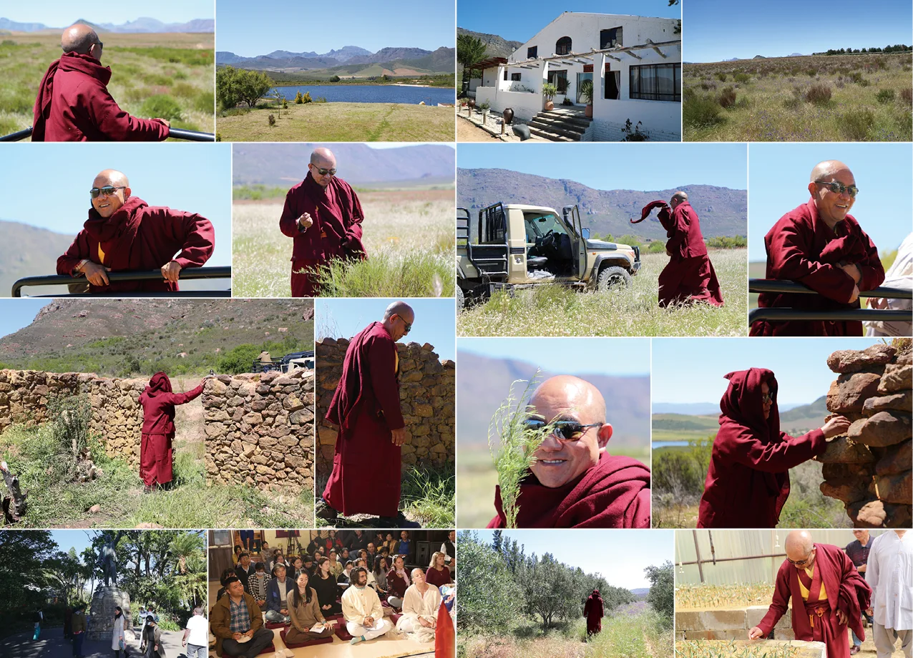
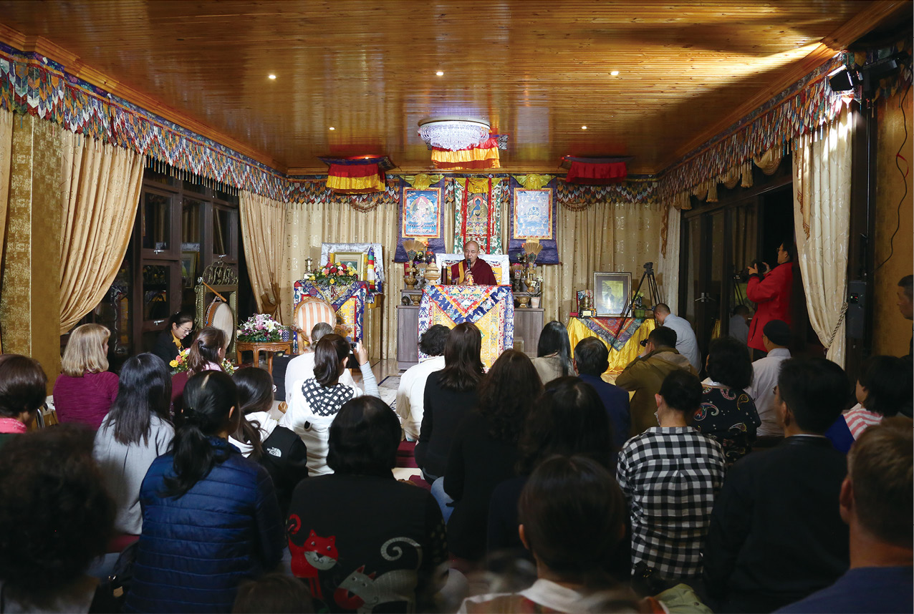
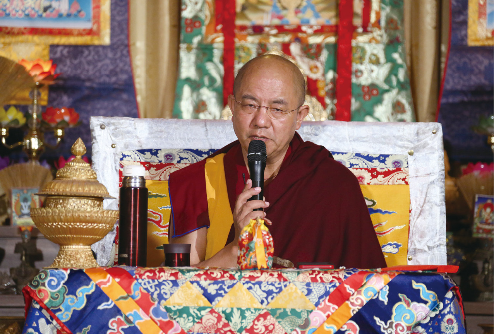
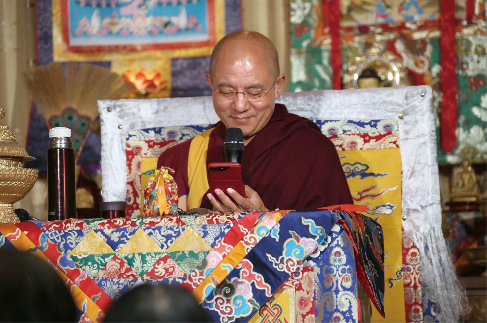
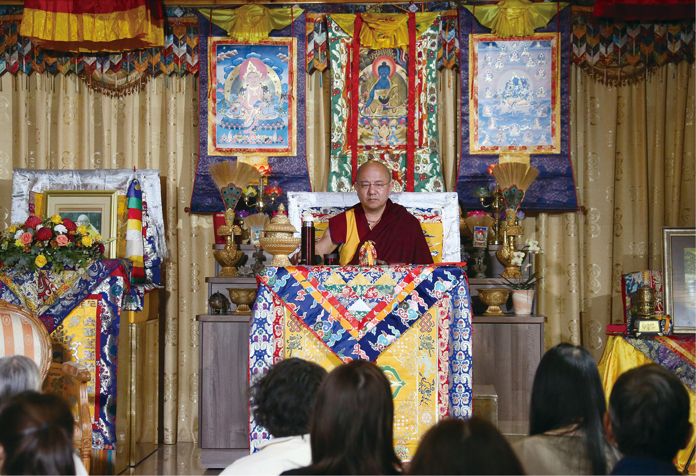
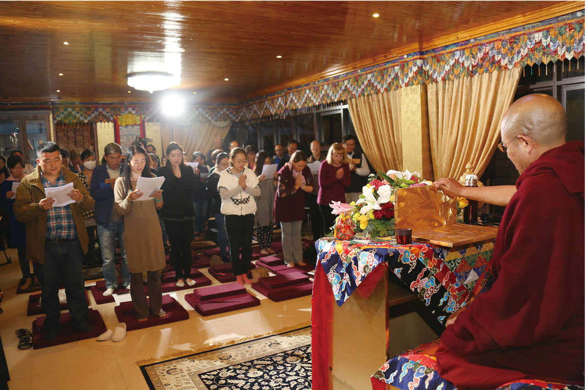
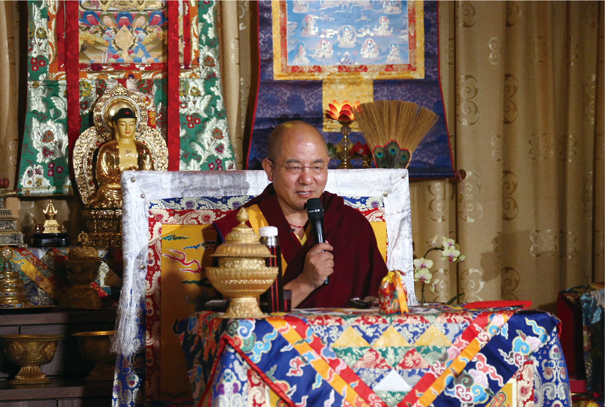
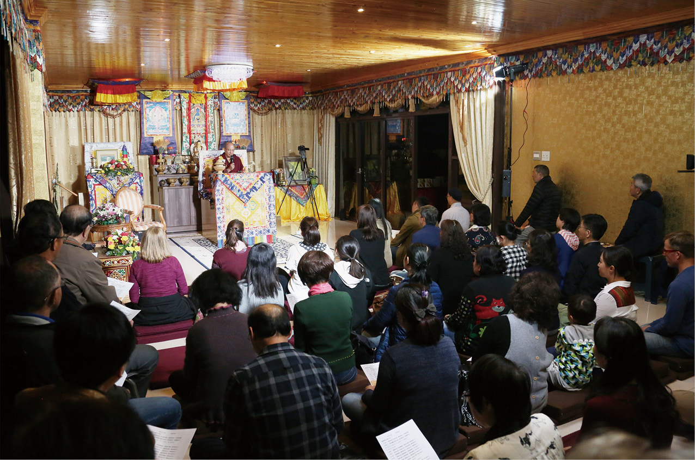
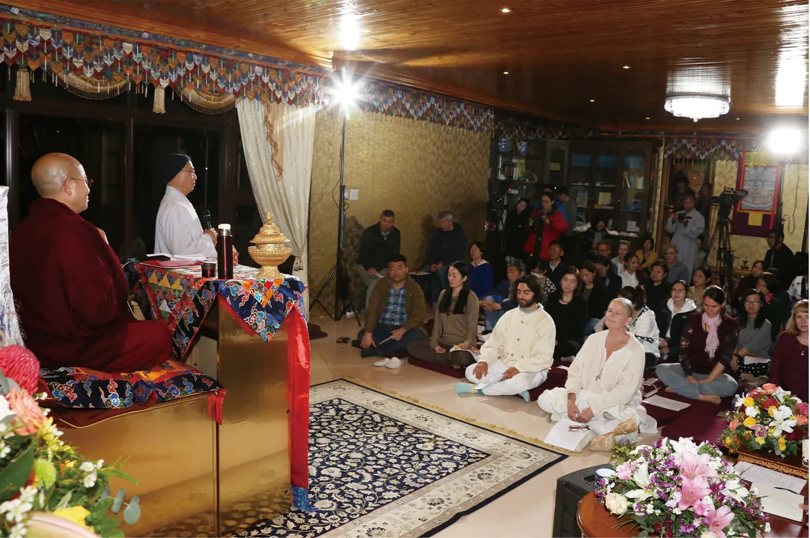

最上等的人，  
先利益他人，最后利益自己。

第86场

开普敦药师佛道场

Medicine Buddha Center, Cape Town

南非·开普敦

2018 / 9 / 29

## 浅谈《佛子行》

## Brief Explanation on “37 Practices of a Bodhisattva”

慧礼法师：

首先，我代表南非佛教界恭迎索达吉上师法驾开普敦，挚诚顶礼三拜！

上师的尊容、身份和修行，其实不用我多说，大家也很清楚。对我们佛教徒而言，有一个正确的观念很重要。我们读书是希望了解这个世界，了解人类和历史，而学佛是为了了解整个法界，了解生命，了解真理。

佛陀来到人世间，主要目的是告诉大家法界和生命的真相。但佛陀住世时间很有限，在佛涅槃以后，需要很多上师、法师继续佛陀的事业——弘扬佛法和传播真理。

今天我们非常幸运能与大修行者、大善知识索达吉堪布相聚于此。堪布是在广大悲愿的驱使下，自愿发心来非洲开普敦的。希望大家能用请佛住世、请转法轮的诚敬心和愿心，聆听堪布的开示。

大悲摄受具诤浊世刹，尔后发下五百广大愿，

赞如白莲闻名不退转，恭敬顶礼本师大悲尊。

首先，顶礼本师释迦牟尼佛。

今晚，我利用短短的时间，与大家在佛法方面做一个交流，共同学习《佛子行三十七颂》。

## 《佛子行》是营养丰富的精神美食

这部论典只有三十七个颂词，可能很多人都读过、学过或修行过。它看似简单，但实际上，里面的内容非常深奥，意义极为广大。自古以来，藏传佛教各派，包括宁玛派、萨迦派、格鲁派、噶举派和觉囊派，以及其他宗派，都非常重视这部论。我个人也对这部法很有感情。

这回是我第二次来非洲。两次到访，非洲的佛教徒赠送给我很多纪念品，包括各种食品，如橄榄油、夏威夷果、国宝茶等等。而我每到一个地方，都会把《佛子行三十七颂》作为最好的纪念品送给他们。也许有人想，我们送的纪念品可以吃、可以喝、可以用，而您给的这个传承，有什么用呢？

大家都知道，保持身心健康，既需要外在的物质食粮，也需要内在的精神食粮。今天我给大家传授的《佛子行三十七颂》，在滋养内在精神方面，是一种营养丰富、最好的美食。

当然，如果你们不相信，不愿意食用它，其功效不一定能显现出来。如果真正去食用这种精神食粮，它对我们的身心确实能起到不可估量的作用。

## 得到传承，也即得到无形的力量

今天，我主要是给大家念诵《佛子行三十七颂》的传承。过程中，对于一些重要偈颂，会稍微解释一下。

在座有些人可能不知道何为传承。传承承载着一种无形的力量，当你得到一部法的传承之后，就获得了这种力量，这时你的心态和承载力与以往完全不同。对于任何法，我们有没有传承，在学修时会有一定差别。因此，藏传佛教非常重视传承，并且从佛陀住世时期开始，就不间断地一脉相传，直至现今。

就像这部《佛子行三十七颂》，它由无著菩萨所造，距今已有七百多年历史。无著菩萨又名无著贤，住世七十多年，他并不是印度的无著菩萨（世亲论师的哥哥），而是藏地一位非常了不起的大菩萨。《佛子行三十七颂》的传承，从无著菩萨造论开始直至现今，一脉相传，从未间断过。我今天给大家念了之后，你们就可以确认自己得到了此论的传承。

## 《佛子行》具有超凡加持力

无著菩萨所造的论典，加持力非常大。不管是《佛子行三十七颂》，还是《入行论释·善说海》，通过听闻、忆念、思维这些教法，相续当中自然而然会生起菩提心。所以，藏地各个教派都很重视这部论典。我的上师，法王晋美彭措，不管到哪里都会传讲这部《佛子行》。我曾跟随上师去过国内外很多地方，在他面前我得过这部法的传承应该不下100次。

《佛子行三十七颂》如今已被译成多国文字，不管是哪个国家的人，不管是在家人还是出家人，不管是佛教徒、无信仰者还是信仰其他宗教的人，包括信基督教、伊斯兰教、犹太教的，其中很多人都对这部法感兴趣。

刚才我讲过，这部法文字看似简单，但其实内容并不简单。这三十七个颂词，流传至今已七百多年，并且受重视程度越来越高——自古以来，能达到这种境界的作者并不多。我们需要学习这样的金刚语。佛教的金刚语，与普通语言差别很大。

## 修才能得到

今天我们把这部论的英文版本也发给大家了，希望你们能重视起来，有时间最好多念诵，这样自然而然就能明白里面的内容，并获得加持。通过念诵或观修这些非常有加持力的经论，可以获得超越自然、超越自我的一些境界。

我们今天来这里的车程有两三百公里。慧礼法师在车上念诵了《法华经》，之后又念了一些其他经典。我怕打扰他，不敢问，便偷偷看了一下，发现他正在念诵《地藏经》。我一般也这样，坐飞机的时候，会习惯性地念一两部经。但在车上我一般不念，因为眼睛有点花，并且有点晕车。慧礼法师在车上也坚持念经，这一点很值得我们学习。

前一段时间，我发了一条微博，内容是：作为佛教徒，再忙也不要忘记每天的课诵，再累也不要中断每天的修行，再烦也不要随意跟人吵架。

我们作为佛教徒，不管是念诵有加持力的经论，还是学习自己感兴趣的教义，包括每天的修行，都不应该间断。如果你没有信仰，不是佛教徒，那另当别论；如果你是一名佛教徒，最好不要仅满足于有一个法名或皈依证，而应该在自己的实际行动中，在有限的人生中，做一些具有广大功德的修行。

佛教的内涵很丰富，现在主要有南传佛教、汉传佛教、藏传佛教三大系统；每个系统都有诸多分支，汉传佛教分为净土宗、天台宗、华严宗、禅宗等，藏传佛教也有格鲁派、宁玛派等很多教派；各个教派又有各自重视的不同经论。这一点与其他宗教不同，其他宗教大多有一部代表性的典籍，比如伊斯兰教有《古兰经》，天主教有《玫瑰经》，犹太教和基督教有《圣经》，道教有《道德经》，儒教有《论语》等。

这些宗教的经典应该也有强大的力量。有一次，我在耶路撒冷看到各教派的信徒，用各自的经典在那里虔诚祈祷。有时候，人类不得不承认，世界上确实存在很多神奇的力量。

## 传授《佛子行》传承

下面，我开始为大家念诵《佛子行三十七颂》的传承。

> 已获暇满大舟时，为自他渡轮回海，

> 日日夜夜不懈怠，闻思修持佛子行。

> 贪恋亲方如沸水，嗔恨敌方如烈火，

> 遗忘取舍愚暗者，抛弃故乡佛子行。

> 离恶境故惑渐轻，无散乱故善自增，

> 净心于法生定解，居于静处佛子行。

无著菩萨刚写完《佛子行三十七颂》，拿着稿子坐在屋顶上校对。这时，突然天空刮起一阵大风，把写着颂词的纸张吹向四面八方，最后一张都没剩下。他不得不根据记忆又重写了一遍。

无著菩萨觉得这个缘起很好，因为，这预示着将来这部论典能在整个世界弘扬开来。以这个缘起，他在每句颂词的后面都加了“佛子行”，意即这是菩萨的行为。

第一颂“已获暇满大舟时，为自他渡轮回海，日日夜夜不懈怠，闻思修持佛子行”。意思是，我们应该珍惜难得的暇满人身，若想自己和他人都从轮回的苦海中得到救度，就应该日日夜夜不懈怠地闻思修行，这是佛子的行为。

我们现在最大的毛病是有时候容易懈怠，不好好修行。自己不好好修行，也不好好帮助他人，十年二十年就这样白白过去了。希望大家从现在开始，一定要利用好自己的暇满人身，精勤地闻思修行、利益众生。

寂天菩萨在《入行论》中云：“暇满人生极难得，既得能办人生利，倘若今生利未办，后世怎得此圆满。”我们现在获得了极为难得的暇满人身，如果今生没有很好地修行，后世怎能再度得到呢？再没有比浪费此暇满人身更愚痴的事情了。

我不清楚在座各位的修行怎么样。听说我们这里有各教派的佛教徒。其实，修习哪个教派的教法都是可以的，因为每个教派都有能使人成就的闻思修方法。关键是，我们有没有用自己难得的人身信仰这个法，以真正想获得解脱的信念摄持，在有生之年认真修行，这是非常重要的。如果没有修，十年、二十年很快就过去了，这样空耗自己的人生非常可惜。

> 长伴亲友各分离，勤积之财留后世，

> 识客终离身客店，舍弃今世佛子行。

长期相伴的亲友，最终都会分离；勤苦积累的财富，最终都会留在人间；心识最终会舍弃自己的身体，就像客人最后会离开旅店一样。所以，放弃今生是佛子的行为。

此处是讲无常。了知诸法无常非常重要，懂得无常之理后，在瞬息万变的当今时代，内心会很容易接受变化，比如感情、财富和人际关系的变化；身体以前很健康，后来慢慢变差了，等等。

我们离开人世时，心识会离开自己的身体，就像旅客最后离开旅馆一样。到那时，今生拥有的一切丝毫都带不走。藏传佛教常用一个比喻来形容：人死亡时，就像从酥油中拔出一根毛发，带不走一丁点酥油，同样，我们的身体和财物，包括拥有的房子、车子或金钱等，死亡时不得不全部放弃，心识随着业风离开这个世间。而死亡的时间，谁也确定不了。所以，每个人应该做好最坏打算，经常思维：如果自己明天离开，现在的一切有什么可贪恋的呢？具有这种无常观非常重要。

很多不学佛的人不太懂得无常之理，虽然知道自己总有一天会离开世间，但内心并没有强烈的无常感。而修习过无常的佛教徒，与世间人完全不同，确实有一种紧迫感。如果自己心里没有无常感，那修行不一定很好，做事也不一定积极。很多古大德都认为，如果一个人无常观修得好，他其他的修行应该也不错。

我很喜欢《大游戏经》里的一个教证：“三有无常如秋云，众生生死等观戏。”这是佛经里非常重要的一个偈颂。意思是，三界中没有任何恒常的事物，皆具变化性。有情众生不断地生死、流转，就像人们所看到的戏剧人物，他们从出生到长大，再到衰老、死亡，历经风风雨雨之后，很快就谢幕了。

世间生命的确没有什么可靠的，作为一名修行人，对无常一定要有深刻的认识。在修无常方面，我个人还算有点境界，一般对任何事情，都会做好无常的准备。

> 交往恶人增三毒，失坏闻思修事业，

> 令成无有慈悲者，远离恶友佛子行。

修行过程中，抛弃恶友很重要。否则，我们相续中的贪嗔痴会自然而然增上，而慈悲心则会慢慢减弱。

交往什么样的朋友很重要。如果你交往猎人，可能会逐渐喜欢上打猎；如果你结交商人，可能会渐渐喜欢经商；如果你交往渔夫，可能会慢慢对捕鱼感兴趣。总之，众生在没有登地之前，一般都会受环境和朋友的影响，正所谓“近朱者赤，近墨者黑”。所以，大家一定要远离恶友，这一点在修行中非常关键。

> 依止正士灭罪业，功德增如上弦月，

> 殊胜上师较自身，更为珍爱佛子行。

此颂是讲依止善知识。如果依止了殊胜的上师，自相续中的罪业将会逐渐灭尽，并且闻思修行、智悲和菩提心等所有功德，会像上弦月一般越来越增上。对于这样殊胜的上师和善知识，我们的珍爱程度应胜于爱惜自己的身体。

有位大德说过：一位上师的好坏，可以用弟子的行为来推知。因为，如果上师爱喝酒，爱做各种非法之事，弟子可能也会变成这样；如果上师喜欢禅修，弟子也会喜欢禅修。很多佛教徒的行为都与上师有关。

不知道在座各位有没有自己的上师善知识？如果有了上师，那么这位善知识一定要能给你指明解脱之路，让你明白佛教的道理，这一点很重要！我们不能仅注重善知识在世间法方面对你怎么样，这个有也可以，没有也可以，最关键的是，要注重善知识对自己出世间解脱的引导。《华严经》云：“佛法无人说，虽慧莫能了。”佛法虽然蕴含智慧，但如果无人讲经说法，人们依靠自力无法了悟其中甚深的意义。因此，我们一定要依止一位上师。

像本论的作者无著菩萨，他在一生当中依止过四十多位上师，其中有两位对他影响最大，令他获得证悟。像无著菩萨这样的圣者，都依止过那么多位上师，其他人更不用说了。因此，我们在修行过程中，依止一些有智慧、有慈悲、有窍诀、有引导方法的上师非常有必要。

今天我本想给你们多讲几个颂词，但因为时间关系，所以只能先把传承念完，然后再讲一个颂词作为总结。

（堪布用藏语念完了《佛子行》的全部传承……）

其中有一个修心方面的偈颂：

> 一切境现唯心造，心性本来离戏边，

> 了达此理于二取，皆不作意佛子行。

意思是，器情世界的一切现象，全部是自心的显现，而心的本体远离四边八戏。了知这些道理之后，对所有外境的所取和有境的能取，不应再有任何执著。

也就是说，我们在禅修过程中，通达外境的显现和内在的显现全部远离四边八戏，这是空性中最高的境界。我想看看大家通过修行，能否认识自己心的本来面目。

其实，佛教很多甚深的空性道理，通过禅修入定后方能了知。寂天菩萨造的《学集论》中有一个教证：“真实而入定，方知佛所说。”意思是，通过真正入定，才能了解佛陀所说的远离四边八戏、甚深的空性教义。所以，拥有禅修境界的人，才能通达佛陀所说的到底是什么。

不知道在座有没有人修过密法的大手印、大圆满，或者大中观？如果有的话，无论是通过观察还是禅修的方式抉择，最后都会懂得，自己的心如同虚空一般。虽用虚空来比喻心，但实际上，心和虚空也有所不同。这时你无论产生贪嗔痴，还是其他分别念，自己都完全明白，心的本体原来就是这样，它是空性和光明无二的一种境界。在禅宗当中，这种境界被称作“明心见性”。

当年，寂天菩萨最开始讲《入菩萨行论》时说：我不敢说自己能利他，造的《入菩萨行论》不一定对众生有利。但是，当他讲到第九品《智慧品》的末尾时，却展露出了证悟的境界，如云：“如我当受持，一切如虚空？”意思是愿所有的众生，也像我一样证悟如虚空般的空性境界。寂天菩萨在此发愿，愿后学者能真正通达万法空性的本体。

希望各位都能了知佛教的究竟思想：从见解方面讲，是离戏空性；从行为方面讲，是利益一切众生。一般而言，如果在见解上有所突破，确实证悟了万法皆空的道理，那么对其他未证悟空性的众生，自然会生起大悲心。所以，佛教很多经论都讲，证悟空性和生起大悲心是同时的。一个修行人如果有非常强烈的大悲心，他一定会证悟空性；如果证悟了空性，他对众生一定有大悲心。

作为佛教徒，如果内心什么感觉都没有，也没有帮助众生的热情，这不是一个好的状态。前一段时间，我们去了马拉维的一所师范学校，校长和副校长对我们说：“现在很多老师都没有积极性，这是最大的麻烦。”当时我心里想，现在很多佛教徒也没有积极性，不仅对修空性没有感觉，对利益众生也缺乏热情。其实这样不是很好，我们应该有一种强烈的信念和紧迫感，想着“人身非常难得，我一定要修行；世间有这么多可怜众生，我一定要救度他们”，这才是真正大乘佛教徒该有的思想。

完整讲解《佛子行》可能需要好几天时间。今天因为时间关系，我只能象征性地为大家解释几个颂词。希望在座各位一定要懂得这三十七个颂词，细致思考每一个道理。也许里面的个别偈颂行持起来有点难，因为讲的是比较高的修行境界，比如，远离故乡、远离亲友等很多方面，你们暂时不一定能做到，但其中有部分应该可以做到。希望今天之后，大家能认真地自学，多看一些《佛子行》的注疏。目前，这部论有很多藏文和汉文的注释。

以后如果我们还有机会见面，我不希求任何财供养，而是希求你们的法供养。这次在开普敦听我讲《佛子行》的道友，我下一次会好好考考你们，看你们会不会解释这三十七个颂词。今天时间太短了，我只能做简短的讲解。如果你们听完之后，不深入学习和思维，我是不满意的。要想真正通达《佛子行》的内容，还要靠你们自己的努力和付出。

我翻译过无著菩萨的传记，尊者接近圆寂时，有些弟子祈求他留下遗嘱。尊者说：“我没有其他遗嘱，《佛子行》就是我的遗嘱。”前辈大德们留给我们的教言，文字虽然很少，但确实非常珍贵。没有信仰的人可能觉得无所谓，但作为大乘佛教的信仰者，得到这样珍贵的窍诀，对自己的修行极为重要。希望每一个人都能重视起来。

## 三点希望

最后，我想对各位提三点希望。

第一，希望在座来自藏传、汉传等不同教派的道友们能明白，虽然大家的教派不同，但实际上都是佛教，佛法僧三宝也都一样，最初发心、中间积累资粮、最后成佛，这些都没有差别。只不过佛法在融入不同国家、不同民族的时候，因为要随顺他们的传统和习惯而略有不同而已。我看到这里的气氛非常融洽，这样非常好。

此外，我希望我们佛教徒不仅内部要团结，与其他宗教徒以及无信仰者，也要和睦相处。人类历史上，发生过很多次由于肤色不同、信仰不同、民族不同而导致的冲突事件，这给人类带来了极大危害，有些损害至今还在延续。所以，有了“团结就是力量”的信念，人类才有希望发展，我们的修行才有希望成功。

第二，作为佛教徒，很有必要学习佛教的经论。如果不懂佛教的教义，在推崇教育的当今时代，我们会显得很愚昧。希望大家至少能学几部经论，比如，藏传佛教的《菩提道次第论》《大圆满前行》《胜道宝鬘论》《入菩萨行论》，汉传佛教的《妙法莲华经》《金刚经》《六祖坛经》，或者其他传承的经论。学了之后，还要在有限的人生中尽量去思维和实修，这就是所谓的闻思修行。这一点非常关键。

第三，在座各位无论在这里待十年、二十年，还是三十年，一方面自己要认真修行，另一方面，也要积极参与利他事业。自己无论做什么，都应该用一种利他心摄持，这样才算真正的大乘佛教徒。

前两天我去了慧礼法师办的一些孤儿院，感觉要想在非洲大陆上利益众生，一方面，需要慈悲心，另一方面，需要一些善巧方法，这一点也很关键。希望我们都能一如既往地在这片土地上，力所能及做一些对众生有利益的事情。

现今，世界上有很多贫困、痛苦的众生。我最近去了几所非洲监狱，看到里面很多囚犯非常痛苦，内心感触很深。我们只是自己享受大乘佛法的快乐或者修行的快乐，是不够的，还应该尽量帮助他人。

现今，非洲仍有很多人生活在偏远地区或部落，他们在恶劣的环境中生活，忍受着各种痛苦。我看到时，心里特别难受，就像佛教一个比喻所描述的：有一位断臂的母亲，看到自己的孩子落入河中，被水冲走，她因为没有手臂无法搭救，内心非常痛苦，只能一边失声痛哭，一边跟着水流奔跑。我当时的感受与这位断臂母亲一样，虽然非常牵挂这些村民，却没办法帮到他们。给他们讲佛法吧，彼此的宗教不同，他们难以接受；用钱财帮助他们吧，自己又没有足够的财富。看到他们的生活后，我晚上睡不着觉。每次吃好吃的就会想，那些人可能一辈子都没尝过这么好的食品，一辈子都吃不到我们平常的一顿饭。今天中午我们的饭菜很好，我刚才还在想，这么新鲜的蔬菜，那些人也许永远都吃不到。

希望我们每个人都能以自己的悲心和行动利益众生。不管自己有没有能力，只要有一颗利他心，利他行也会慢慢成熟的。

今晚我就说这些，还剩十多分钟，作为提问互动的时间。

现场互动

问：感谢上师为我们念传承。末学有几个问题，想请上师慈悲开示。

一、如果站在法界高度看佛教教理，佛教的核心思想到底是什么呢？是平等觉、空性观，还是缘起观？

二、您所说的闻思修，和通教所说的信、解、行、证的联系和区别是什么？

三、请问站在藏传佛教的立场上，怎样解释“中道”？

四、佛陀成道之后，首先宣讲了二十一天《华严经》。《华严经》的当机众是方外大士，连舍利弗和大目犍连都听不懂。我想知道，既然佛陀了知一切，为什么要在地球上宣讲这部除方外大士以外，其他众生都听不懂的法？

堪布：因为时间关系，我只能简单回答你的四个问题。

一、从法界角度讲，缘起、空性都是一致的，学了《缘起赞》之后，就能明白这个道理。

二、闻思修和信解行证这方面的教义，学了《阿弥陀经》或者《华严经》，应该就能明白。闻思修中的“闻”就是听闻，其他说法也是从发愿到最后证悟之间的差别。

三、所谓中道，就是中观般若思想，如《金刚经》所蕴含的思想。藏传佛教的“中道”与之完全相同。

四、佛陀虽然在地球上讲了一些阿罗汉和凡夫听不懂的佛经，但可以给有缘者种下善根，而且有些菩萨能听懂，其他佛也能明白。

问：我们修净观的时候，会思维世界一切万物都是自心的显现；修慈悲心的时候，会观想众生正在受苦。请问，怎样同时修这两种法？是不是应该观众生受苦都是自心不清净的显现呢？

堪布：佛教的修行包含大乘的修法，如唯识宗或中观的修法。我们先用“万法唯心造”这句教言，来观察整个世界的一切显现就像晚上的梦境一样，不管是好是坏，都是自己的分别念和习惯在作怪。外境的一切和梦境，只是我们习气坚固和不坚固的差别而已，都是心的一种显现。当我们修行达到一定境界时，就会明白万法唯心的道理。

我们对众生观悲心是在世俗谛层面修；“万法唯心”的修法是进一步观察，它是接近胜义谛层面的一种观修方法；最后将心抉择为空性，则是胜义谛层面的观察。

从世俗谛角度讲，众生因为没有通达空性，所以在迷乱的显现中确实会感受痛苦。所以，我们要对众生发慈悲心。像佛陀虽然已经通达了万法唯心并证悟了空性，但在世俗显现中还是去不断度众生。所以，我们应该分开二谛，从两个层面去观修。

关于这个问题，密宗里讲过三种等持——因位等持、现位等持、真如等持。因位等持，是观一切万法皆为空性；现位等持，是观没有懂得空性的所有众生；真如等持，是指为了度化可怜众生而观想金刚萨埵或其他本尊，是从本尊的种子咒开始观。一般来讲，密宗修法为了解决这个问题，需要在一个观修中，一层一层地全部修完。

主持人：

我们还有两个请求：第一，请上师与大家合个影好吗？第二，今天的机缘非常难得，慧礼法师刚才讲得很简短，所以，我们想请和尚做一个最后总结。大家鼓掌欢迎。

慧礼法师：

我来非洲二十几年了，与大家见面和一起修行的机会很多。今天能听到上师讲法，才是最重要的，这样的机会非常难得。不过，我虽然来非洲这么长时间了，但在座大部分人我好像都没有见过啊。（众笑）

修行，法界唯心，生死唯念。所谓法界唯心，就是说我们要知道，这个法界，可以说空间是无量无边的，众生也是无量无边的，时间是无始无终的。在法界之内，我们常有各种比较、计较，比如，我们看到蚂蚁、蚊子那么小，便经常看不起它们，觉得踩死它们不算一回事。可是你想过吗？天界的众生看我们，比我们看蚂蚁还要小。我们以为人活一百年应该很长了，但如果以天界第二层天的角度讲，我们的一百年仅是他们的一天而已，一个人早上出生，晚上就死掉了。

有些人在修行过程中，觉得自己一天念了多少佛号、持了多少咒、修了多少功德，很了不起，走路都摇摆、有风。但实际上，佛的修行无量百千万亿劫没办法形容，无量百千万亿恒河沙劫没办法形容，无量百千万亿恒河沙阿僧祇劫没办法形容，无量百千万亿恒河沙阿僧祇那由他劫没办法形容……我们人实在是太渺小了。

不过，每一个最渺小的生命都是法界的中心、宇宙的中心。宇宙再大，法界再大，也是我心内的法界、心内的宇宙；众生再多，也是我心内的众生。所以，不要看轻自己，不要看轻短暂的时间，我们的生命是由每一个念头堆砌起来的。在生活当中，为人不要有太多比较、计较。如果要比，就去跟天比，跟罗汉比，跟菩萨比，跟佛比。

生死唯念，虽然我们现在活着，但不晓得什么时候无常就到了。如果随时准备接受无常、面对死亡，你就会珍重每一个当下、每一分、每一秒，好好地用功，好好地修行。

感谢上师法驾开普敦为大家开示说法。我们都是佛弟子，希望彼此互相勉励，互相加油打气，一起走在成佛的菩提大道上，一起获得成就。谢谢大家，阿弥陀佛！

主持人：

大家来自各个地方，语言都不一样。刚才我们用中文做了祈祷，现在我想请Karen用英文带领大家总回向。上师的驾临给了我们听闻佛法的机会。在听完上师和慧礼法师的开示之后，我们把此次闻法功德回向给法界的一切众生，愿一切众生都能够离苦得乐，得到究竟的佛果。请大家一起合掌。
