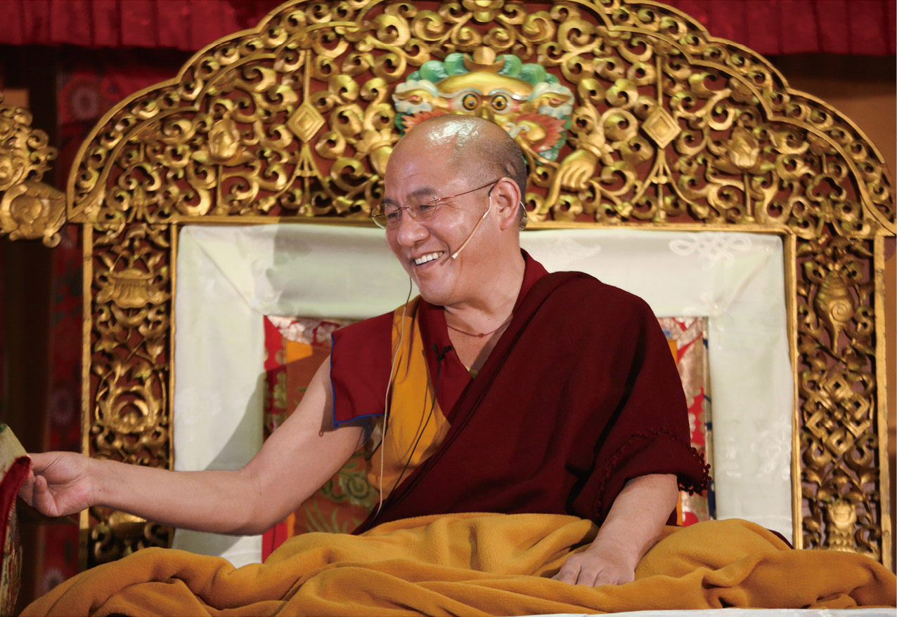
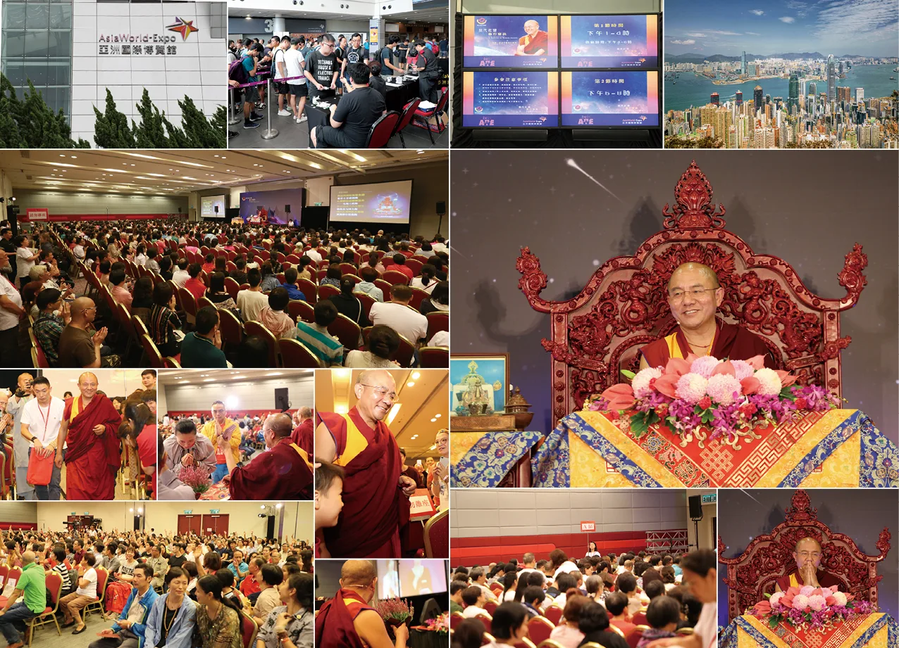
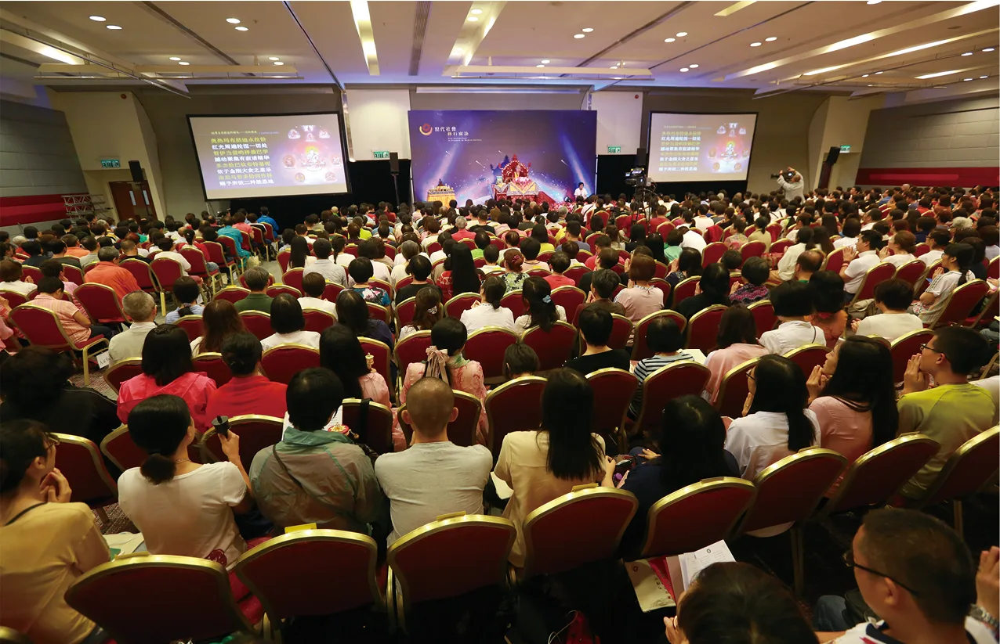
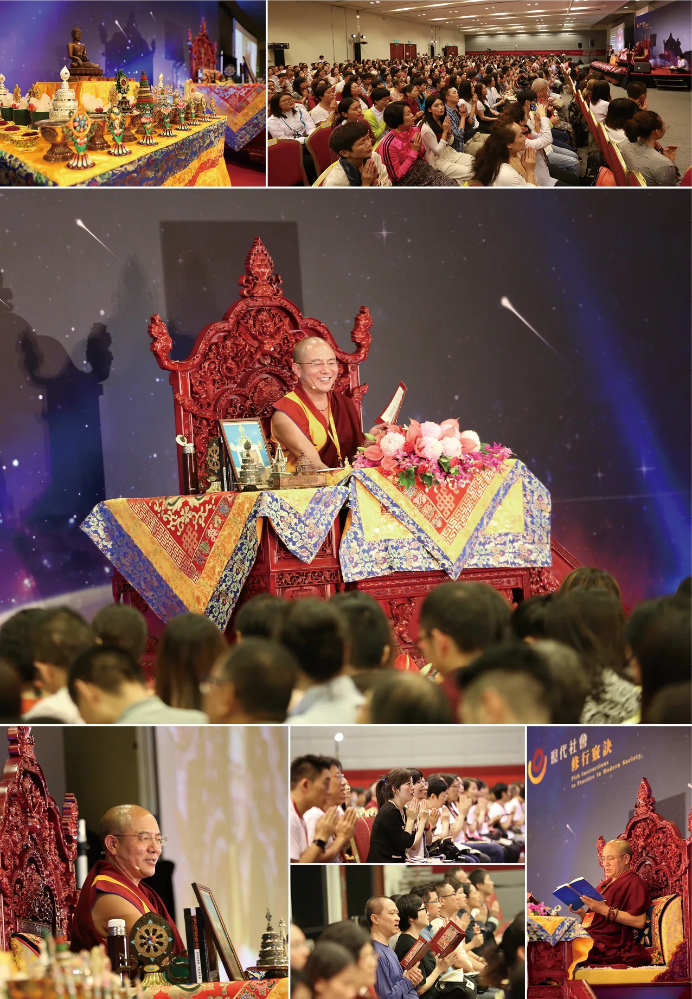
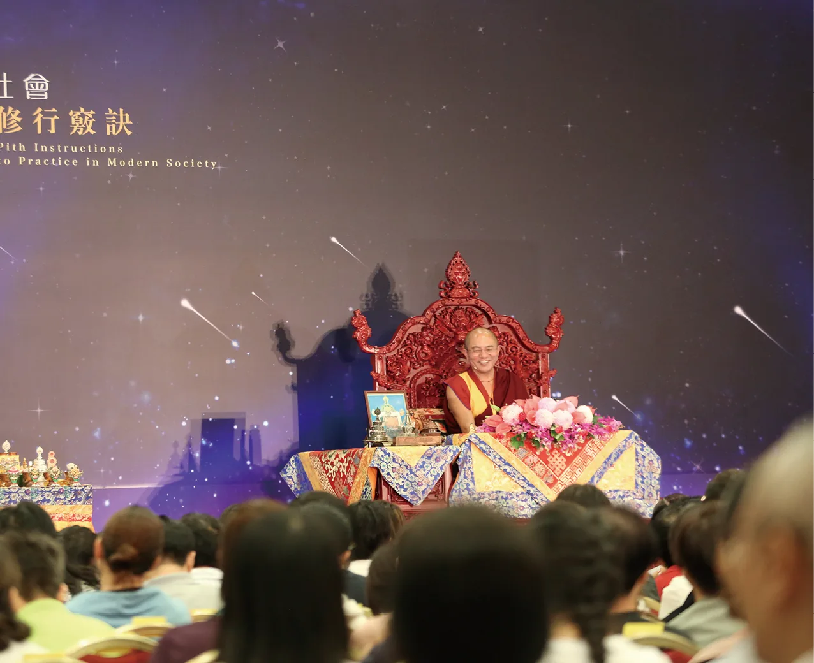
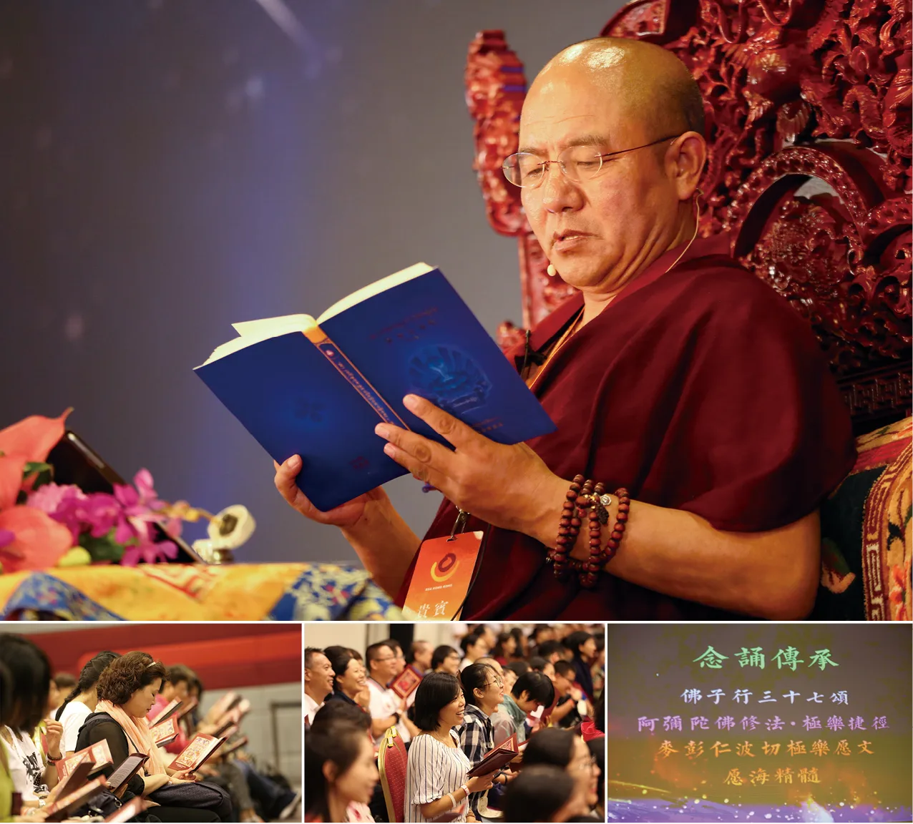
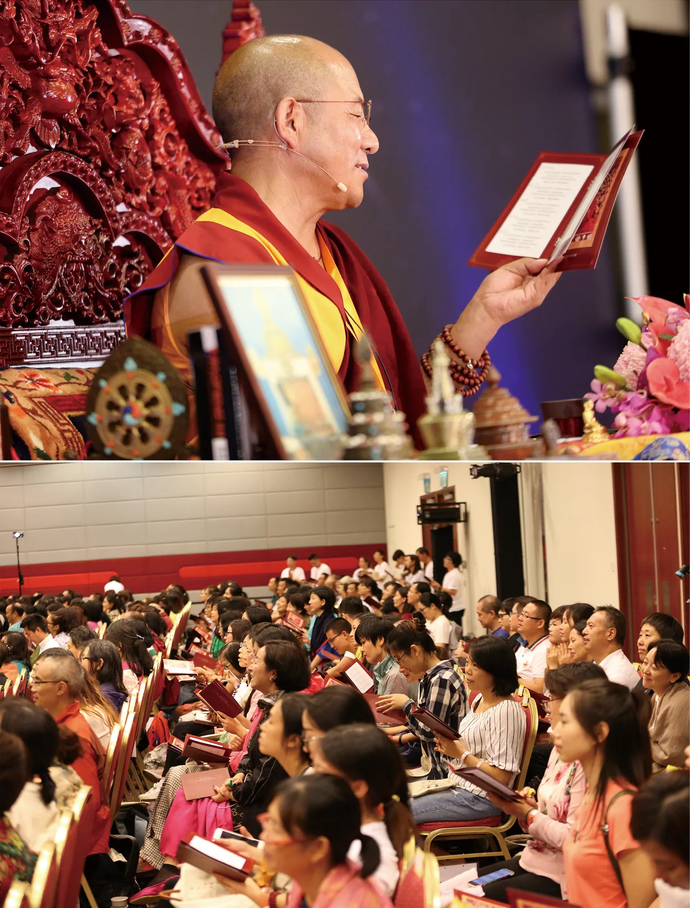
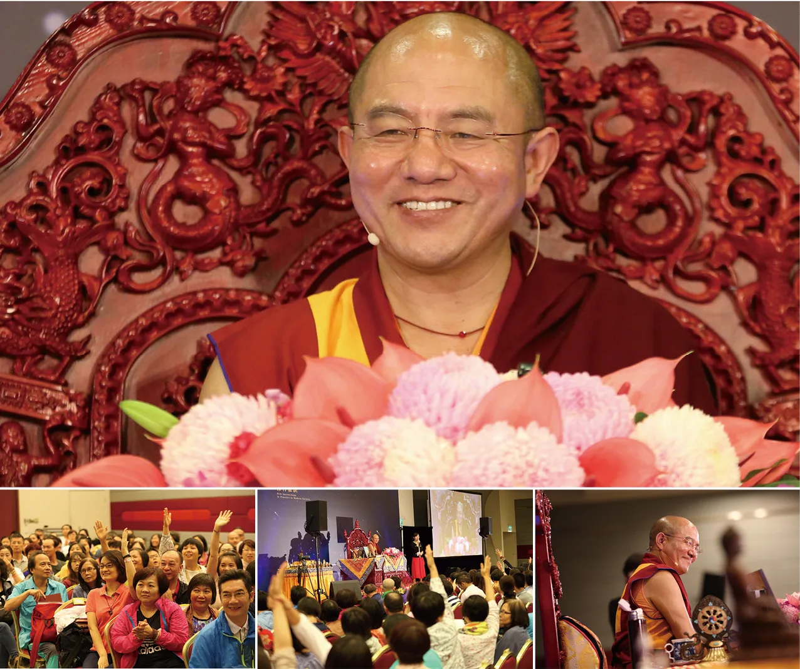
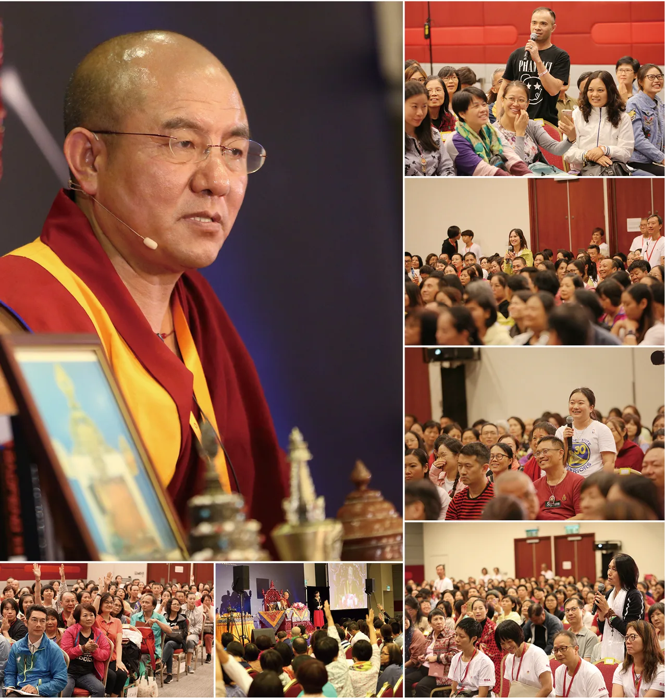

我没有别的窍诀，只有一个要求：

发心殊胜、正行殊胜、回向殊胜，

一定要落实到实际生活当中去修。

第80场

香港亚洲博览馆

AsiaWorld-Expo, Hong Kong

中国·香港

2018 / 9 / 17

## 现代人修行窍诀

## Key Instructions to Modern Practitioners

主持人：

我们今天坐在这里很不容易，经历了台风的肆虐，再加上交通不便，尽管如此，也挡不住我们坚定的求法之心。正所谓“千磨万击还坚劲，任尔东西南北风”，“山竹”台风虽强大，却挡不住我们对佛法的希求心，非常随喜赞叹各位今日的到来。

索达吉堪布与我们香港有着深厚的因缘，二十几年前，就曾随同法王如意宝访问香港。2011年应邀两次来港，在香港中文大学等几所著名学府以及教育机构举办了六场演讲，至此拉开了在香港弘法的序幕。2012年至今，发起并举办了多届世界青年佛学研讨会，与众多年轻人、有识之士交流探讨，将佛法的真理与当今科学相结合，引导世人正确面对学业、情感、工作以及人生。2016年元旦，首次在香港将来自莲师传承的清净佛法，以法会的形式传播给众多有缘佛子。今天善因成熟，我们再一次迎来堪布击大法鼓、降大法雨。

在香港这个国际大都市，生活节奏飞快，常常听到师兄们说：“唉，我好忙啊！又要上班，又要照顾家人，哪有时间修行，哪有时间完成功课呀？”“我在工作生活中常常生起烦恼，该怎么办哪？”我们该怎样做才能不被烦恼牵着鼻子走，而能从容淡定地做心的主人？我们如何在红尘中修习佛法，找到心中的净土？非常期盼堪布能给予我们智慧的指引，赐予我们慈悲的加持——

今天，我们一起在香港举办了这场不大不小的法会。在此特殊时间（17级台风“山竹”袭港），有个别道友因为台风、交通等原因，未能准时到场，请相关工作人员后面为他们特殊开许一下。刚才很多人都打电话跟我说：“我迟到了怎么办？会不会马上关门？”我说：“不会，香港的大门永远为你敞开！”（大众鼓掌）

首先，特别感谢穿白色衣服的组委会团队，针对此次活动所做的精心筹划、精心安排，以及应对各种突发事件。虽然法会时间是在今天下午和晚上，但他们很早之前就已做好充分的准备。筹办过法会的人可能有同感，准备的过程非常辛苦，多方面都需考虑周详。所以，首先特别感谢举办此次法会的主办人员和所有参与者。

## 对大乘佛法的希求心尤为重要

这次法会时间比较巧合，恰逢台风离开香港。各位能亲临现场很不容易，听说有些人定的航班被取消，再次定又再次被取消，如此反复四五次；还有些人换了多种交通工具后终于抵达；还有些人说，在网上买票跟小孩过年抢红包一样，刚发布消息时就开始“抢”，很久才“抢”到。

因为种种原因，此次法会规模不大。大家知道，2016年举办万人度母法会，当时确实有一万多人，被关注得比较多，我也有些担忧。以后不再适合开大规模的法会，否则，效果如何也不好说。

以目前的状况来看，在香港、澳门开法会，如果提前做好准备，一万人、两万人、甚至十万人以下，应该问题不大。但考虑到各方面的原因，此次仅安排了六七百人次的规模。

在座的各位比较有缘分。原本还有很多人也想前来，但网络听课暂时比较方便，除了密法，我们很多课程基本会在网上公布。在现场参加正式的讲课、正式的法会可能更有感觉，城市里的佛教徒，到了喇荣、到了藏地以后，感觉在现场听课的效果截然不同，所以许多人愿意前往现场，这也很好。

大家为了这两堂课，经过了很多周折，耗费了许多精力与时间，其实这非常值得。本师释迦牟尼佛的广传中，佛陀在因地时为了一个偈颂，越过刀山火海希求正法。人身难得，佛法难闻，遇到大乘善知识、志同道合的同修也极为难能可贵。故而，为了听法、修法，花一定的时间、精力应该是值得的。因为这边无法住宿，前天去往市中心，昨天回来时风特别大，我略感担心：车会不会被风吹到桥下去？我跟司机说，“到中间开，不要靠在桥边，车子被风吹得左右摇晃。”

世人为了生存也是披星戴月，我们每个人为了佛法、为了众生、为了真理的学习和修行而付出尤为值得。香港本地的道友们稍微好一点，但外地的道友为了听两堂课，有很多家事、公事都要提前安排和处理，在香港这样高消费的城市更要考虑诸多因素。此次面对飓风的挑战，大家勇敢地来到这里不容易，有一定的风险。

我今天早上说：“今天讲课，会不会大家都不敢来？”他们说：“应该会来，只不过人少一点而已。”现在看来人也不少，该来的都来了。对大乘佛法的信心、希求心很重要。如果每个人内心特别希求正法，行动力就会完全不同。所以，我非常随喜大家的信心。如果今天是世间的会议、宴会，或者娱乐活动，我相信很多人能找到各种借口和理由请假，但大家并未如此。所以，也可以看出大家对佛法的欢喜心和希求心，这很重要。

刚才主持人提到，我个人与香港的因缘非常不错，最早是在1990年随同法王如意宝来香港，彼时来港极为不易。当时法王如意宝去印度、尼泊尔、不丹，回国时经由香港过关，在此小住了几日；1993年，法王去美国、法国、加拿大等西方国家，往返都经过香港，然后去台湾，又从台湾返回香港；1995年，法王去新加坡、马来西亚，返回时也经过这里；我1999年去泰国时也曾到过香港，后于香港教育学院开过三届“世青会”；此前，我在香港中文大学、香港科技大学、香港大学、香港理工大学演讲时，每次前后都会在香港停留数日。

前几年度母法会也是在香港亚博展览会馆举行，当时，经过几天的学习、共修，许多人对佛法、对藏传佛教产生了信心，那次给每个人发了绿色念珠。刚才看到很多人举手，虽然我听不懂香港话，但好像在说那年有谁参加过法会。之前随同法王访港时，我的普通话不是很标准——现在仍不太标准，但比以前好一点，香港人听不懂，每次都需要翻译。现在你们只需要一个主持人，其他的基本上能听懂，所以，你们的普通话也有进步。（众笑）

## 修行以贤善的人格为基础

我不爱说客套话，但在香港，无论是学校的老师或是佛教徒，大家的心比较沉稳、淡定。我并非今天见到你们故意表面赞叹，而是内心确有此感。我时常接触不同城市的人，很多地方十年前、二十年前学佛之人基本看不到，但这边，包括参加过“世青会”的大学教授在内，大家的人格都非常稳定，第一次见到时如此，过了七八年、十年以后，再见面时仍旧如此，并非变来变去——今天特别开心，突然就不高兴了、翻脸了，不是这样的。也许是因为香港历史与英国文化之间有着何种关联，我不得而知。

此次前来参加法会的部分佛教徒长期跟随学会学习，以前法王在世时认识的很多香港佛教徒，迄今为止仍保持着对藏传佛教的信心与修行。虽如前所说“工作很忙、没有足够的时间修行”，此类问题大城市里的人都同样存在，但大多数人心比较淡定、比较沉稳，可以说信心坚固。

若想学习佛法，首先，从世间层面来讲，人一定要诚实、诚恳、忠厚，以此为基础，才能修出真正大乘佛法的境界。否则，倘若连基本的世间人格都不具备，出世间的修行则很难以成功。虽然我们处于比较散乱的时代，但是，只要有坚定的信心、善良的人格、坚固的智慧，修行其实并非如想象中困难。当然，虹身成就、往生极乐，可能需要一定的境界，但在这辈子成为一名合格的大乘行者，这一点，于在座的各位而言并非难事。但也不能因为身处浊世，整天以“特别忙”“根本没时间学佛修行”为借口而放弃学修，再怎么忙、再怎么累，有些功课也应坚持。

前两天，我在微博上有感而发：“作为佛教徒，再忙也不要忘记每天的课诵，再累也不要中断每天的修行，再烦也不要随意跟人吵架。”这句话也有不少人关注。确实，我们虽有“佛教徒”之名，但有时心情烦乱，很想找朋友、家人、同事狠狠地吵一架，甚至想动手打人，这样不好。在那种状况下稍微冷静一下，如果想打人，明天再打；如果想吵架或者痛骂他，明天再说吧。最好能够隔一天的时间，如果实在不能隔一天，隔一个小时也可以，也许一个小时以后，就像台风走了一样，嗔恨心也会消失无踪，这是古大德们修行的教言。

## 作为佛教徒，一定要闻思修行

修行并非嘴上功夫。现在很多“修行人”口头上讲得头头是道、特别漂亮，“明空无我、离戏光明、一切都不执著、一切都是禅的妙用、觉性的妙力”等，但在现实生活中做得比较差。修行真正用在世间、用在行为上时有一定的困难。

原因是什么呢？首先，我们对整个佛教理论的系统学习不够；其次，对佛法的道理未能通过思考真正树立定解；第三，在日常生活中未能很好地串习、贯彻、修炼。因此，我们一直强调，作为佛教徒，一定要闻思修行。

### 1．闻

首先，若是没有听闻、没有系统地学习，很多人无法通达佛教的教义。系统学习之后才明白，佛教所讲的道理原来是这样，而自己最初仅是以一种盲目的心态皈依佛门。就像世人学习英文、法语，或者其他知识，若没有系统学习，只是听一两节课、看一两本书，或者听一个朋友讲一讲，根本无法深入。亲自学习一段时间以后，才完全明白整个教育的体系、架构。

所以，作为佛教徒，无论是出家人还是在家人，都要花一定的时间，全面地了解显宗、密宗，以及理论和修行的各种方法。到一定的时候，不依靠其他善知识、其他道友，依靠自力完全可以消化佛教所讲的知识。同时，自身有了一定的境界和认识以后，可以感化志同道合的同行道友。

否则，如同蜻蜓点水般泛泛地翻一本书，然后去见一位上师，在上师面前办个皈依证，“给我加持一下、给我摸个顶”，跟上师共同进餐、合影，再把照片放到社交平台……这样能否解决问题？当然，作为有信仰者，我们并不排斥上述行为，至少说明你与具有功德的佛、善知识，有一定的殊胜因缘。但是，自相续的烦恼、无明、黑暗，以何种方式来认识它？以何种方式来对治它？以何种方式最后根除它……所以，首先系统听闻非常非常重要。

在香港求灌顶、求加持的人比较多。上世纪90年代时，我们很羡慕，此地有这么多上师、这么多法会，各方面都很方便。但系统的学习，无论是佛学院还是居士团体，都比较少。当时几乎每个礼拜天都有黄财神的灌顶——尤其是台湾和香港，黄财神的灌顶非常多，有时是五方财神的灌顶。有些人也许自己没有福报，得了很多黄财神的灌顶，结果越来越穷。（众笑）

听闻极为关键。最好在善知识面前学习《大圆满前行》等法，虽然《大圆满前行》从字面上不难理解，但在善知识面前听闻的效果与自己看书完全不同。

### 2．思

然而，仅仅只是听闻，从不思考也不行，一定要思考。最初思考时有很多疑问，这些疑问可以在上师面前，在有经验、有体验、有智慧、广闻博学的道友面前请教。佛法方面要时常沟通，佛教徒坐在一起不要整天谈论“哪家素菜馆好吃、哪位上师的加持品好喝”，当然偶尔聊一下放生，这个好吃、那个好吃也可以，但佛教徒每一次聚会时从不讨论法义，一直讲素菜的价格、品质，我们也并非依此维生。

所以，平时内心的烦恼、忧愁、怀疑，甚至有邪见时，可以与有智慧的道友讨论：“我现在对佛法生不起信心，我现在对某个法义非常迷茫，这是什么原因？”大家可以沟通。这样之后，很多怀疑和邪知邪见，依靠自己闻思的力量可以遣除；如果智慧还不够成熟，依靠旁边道友的指点可以断除。最后心非常清净，至少不会对佛法产生邪见，不会对佛陀产生邪念，对自己有缘的传承上师、传承教派完全是正信。

现在有些人容易产生邪见、邪念，其实是因为你学得不究竟。以我们的智慧，真正能打破或者能推翻佛教的相关观点，以此而产生邪见的人，到目前为止我未曾见过。的确是因为你自己并未懂得甚深教义。

极少数人是对佛教团体中的个别现象产生邪见，但我觉得，如果完全明白佛法的教理，他人的行为不会令你退失信心。从网络上有些资料中可以看出，不管是汉传佛教还是藏传佛教，个别人行为不如法、有一些丑闻、负面的信息时，“我对佛产生邪见了，再也不学佛了。”其实这是很愚痴的想法。如果自己对正法有不可退转的信心，个别人的行为也不会影响你。

藏传佛教的仁达瓦大师曾说：“纵然成千上万尊诸佛菩萨来到我的面前，给我指引其他的路，我的心永远也不会动摇。”诸位朋友们，他是这样说的。如果学得非常坚定，自己的信心不会动摇。

我个人也是如此，初到佛学院时，信心不稳固、容易动摇。后来经过长期的系统闻思，学习了显宗的五部大论、密宗的《大幻化网》、大圆满的见解以后，不敢说现在有什么高的境界和了不起的证悟，但至少在有生之年，我对佛法、对显密教法的信心永远不会改变。这一点，我可以在多少人当中非常坚定地说，“哪怕出现最糟糕、最难以接受之事，我内心也不会动摇；佛教徒当中、任何寺院发生任何事情，丝毫不会影响我的信心。”这是思维的结果。闻思修行当中的思维——自己反反复复思考，然后需要辩论、需要探讨，到一定的时候，信心会达到坚固。

### 3．修

第三方面，作为佛教徒一定要修行。否则，平时通过手机、网络学习很多知识，但那些知识到最关键的时候——生老病死面前用不上。昨天出现这种天灾人祸时，很多人非常害怕，如果真的面临生病、面临死亡、面对大自然的灾难时，如何摆脱内心的恐惧、恐慌？作为一个佛教徒，平时的修行在关键时刻要能用得上。

假设无常观得很好、一切万法的空性观得很好，在那种时候，你的内心非常淡定，完全可以按照自己的方式面对，不会有任何恐慌。但在座的很多人连无常观都有一定的困难。修行很重要！

按有些说法，现代人称为“新人类”，“新人类”与“旧人类”的风格差距很大，价值观与古人不同。由于广告的宣传引导，我们想要的东西特别多，你的化妆品、你的衣服、你的车、你的房屋……你所有的这些实用价值不一定很强。比如你买一辆一百万的车，可能百分之七十的速度用不上；买一个非常昂贵的手机，百分之七十的功能用不上，仅仅出于内心的某种渴求，而内心的渴求跟实际的需求之间存在一定的差距。

以前的“旧人类”，只需求实用之物，所以生活压力不大。他们的衣服不一定有很多款式，三四件就已足够。现在全世界的广告都能在我们眼前展现，而且每一个广告的宣传语越来越吸引人，“用了这个永远不会老”，面对这些，人们会有一种渴望与追求，但其实我并不需要，只是我想要。正所谓欲壑难填，而知足少欲就能令自心宁静、安宁。

## 出淤泥而不染

眼下处于较为特殊之时代，一方面，弘扬佛法、传播佛教方面的知识很方便。昨天早上“山竹”台风看起来有点厉害，我在微博上发“大家多念度母心咒和莲师心咒”，仅昨天一天，阅读量已达两百三十多万，也许是因为害怕或者着急，临时抱佛脚。但无论临时抱佛脚，还是心里确实祈祷本尊，依靠此种方便，大家共同来祈祷也非常好。但另一方面，负面的信息、知识、广告也在全世界泛滥，比如“这个产品用了以后长生不老”，全世界的人都能在很快的时间看到，故而，人生存于世会比较彷徨迷茫，这是当今时代的特殊性。那能否回到古代呢？我们已被卷入时代的浪潮，想回去不可能。

庄子讲过一个故事：以前，孔子的弟子子贡，路遇一老农，抱着一个水罐打水，在菜地里辛勤灌溉。子贡说：“老先生，现有种新型机械，灌水时十分轻松，不必如此辛劳。”老者回答说：“我不需要。使用机巧之器，必然会在行为方面做出趁机弄巧之事；多做趁机弄巧之事，必然会在意识方面萌生投机取巧之心。老夫修道养德，投机取巧之心在胸中扎下根，纯洁的德性就会破坏了；纯洁的德性一旦破坏，寂静的灵魂就会动荡；寂静的灵魂常常动荡，玄妙的大道就会离弃。所以，机械虽好，但我不愿使用。”

老农的做法确实很有智慧，因为他的心一直专注于旧有的模式，坚守在固有的文化中。但在21世纪的今天，无论是香港、大陆，还是其他各个国家，我们不可能不利用时代的工具，如果将每个人的手机、电脑全部没收，可能待一天都很困难。

所以，随顺时代的同时要知道，在当今五花八门的信息爆炸的时代，如何把握自心的清净？如何令自己高尚的品德不被染污？

大多数信息看起来非常有吸引力，因为背后有很多商人精心策划，故而，人心特别容易被吸引。当然，好的技术、好的知识能用上，作为佛教徒，我们也十分赞叹。如果按以往的方式，佛教徒在各地根本没有共同学习的机会，现在依靠一些科学技术，在不同的地方都能共同学习。但与此同时，很多不必要的信息令我们玩物丧志，包括我自己，虽然在寂静的喇荣山沟已经待了二三十年，但现在也离不开电脑、手机，用完了以后很容易再看一下信息、广告，最后念诵也没有念完，很多事情无法完成。所以，现代社会的人跟古人比较起来，在修行上确实有很大的挑战。

在座的各位身居红尘，而且都有自己的工作、家庭，以及社会上的各种关系，不可能每天右手拿着转经轮、左手拿着念珠，“嗡玛呢巴美吽、嗡玛呢巴美吽、嗡玛呢巴美吽……”，如果这样，周围的人会对你投来异样的眼光，感受到来自各方面的压力之后，你就会被他们所转，将修行全部放下。故而，我们应当思考：如何把握自己当下这一颗心？

## 天下本无事，庸人自扰之

我们被很多现象捆绑、束缚，确实很难走出去，但有些事情应该是庸人自扰，其自身并不真正具有让世人一直沉迷的作用与能力，而是自己耽著这个对境。

藏地有一个家喻户晓的故事：以前在喜马拉雅山，有一位老修行人，带着一个徒弟，共同修行了很多年。老和尚时常对小和尚说：“你要懂得宇宙万物的真相，即一切都是幻相——幻化的相。”小和尚问：“能否请您为我解释一下：幻相到底是什么样？”有一天老和尚跟小和尚说：“明天让你与幻相见个面。”因为小和尚经常听老和尚说“一切都是幻相，一切都是幻化的”，所以他非常期待见到这个“幻相”。当晚他一夜未眠，想：明天我一定要见到“幻相”的庐山真面目。

第二天一早，一老一小去河边沐浴，开始正常的功课、禅修，在山里修行。回来时，老和尚看到前面路边有棵大树，他走过去紧紧地抱住那棵树，大声对小和尚吼道：“小和尚，快过来救我，这棵树要把我带走了！”小和尚感觉奇怪：明明是你自己抱着那棵树，并不是树抱着你呀。老和尚还在继续喊：“你救我啊救我啊，快过来救我啊！”小和尚不以为意地说：“这棵树并没有缠着你，你自己过来就是了。”

老和尚说：“你到底是不是我的弟子？如果是，就来救我！”小和尚勉强过去拉老和尚，但拼命拉也拉不动。他只好说：“你自己想办法吧。”过了一会儿，老和尚放弃那棵树，自己过来了。小和尚百思不解其意，心想，你是在给我演戏吗？老和尚说：“你看到的，就是所谓的‘幻相’。”

他的意思是，包括感情在内的任何事情，其实如同此树一样如如不动，它的本质从来都是无利无害的，只不过我们自己执著它。现在是信息时代，老和尚只是抓一棵树，我们可能抓很多棵树。其实这些树根本没有打扰你，可我们要去这里投资，要去那里搞建筑……一个人抓着很多棵树，一直不放。实际上它只是一种幻相。

从此之后，小和尚对所有宇宙万物的真相有了进一步的认识：原来，外在的现象并没有束缚我，只不过是我自己的心一直紧紧地执著对境。

如同帝洛巴所说[^1]，显现不会束缚你，执著才会束缚你，放弃执著，这就是修行。当然，在现实生活中，因为受生活所迫，有些事情我们不得不追逐，只能沿着这条路走下去。

我们可以说是时代的受害者，就像昨天，有许多叶子被卷入风浪，一直卷到很高的天空中。21世纪，每个人每天拿着电脑、拿着各种设备，过五分钟看一下手机，过五分钟又看一下……你们很多人担心信息来了，等一会儿还没有下课就马上开机。在此种环境下，对治烦恼的智慧要不断提升。

像古代修行人那样，一天二十四小时当中非常精进地念经、禅修，城市里的人自不必说，喇荣的五千僧众也未必能做得到；泰国、缅甸等很多原始佛教团体，也无法逃避这个时代。不如披上铠甲，坚强、勇敢地面对。

以上讲述了与现今时代有关的内容，作为修行者，该以怎样的心态面对。在这样非常复杂的环境中，还是要学习和修行，没有退路。你不信佛教也可以，没有信仰也可以，但如果你信仰佛法，一定要修行。今天的题目，现代社会修行的窍诀，窍诀还没开始讲呢！（众笑）

## 现代社会的修行窍诀——三殊胜

现在开始讲。“修行的窍诀”，一个具有吸引力的题目更能吸引大众。大体上大家都知道三殊胜，很多上师们也讲过：最初发菩提心、中间正行无缘、结行回向。以前讲《入行论》时也专门讲过一堂课。

在座的各位都信仰大乘佛法，这样的人生非常有意义。这里有些人有财富、有地位、有名声、有世间的福报，这些是不是很有意义呢？暂时来讲可以这样说，但从长远来看，并非真正有意义。甚至有些人的财富、地位，即生当中也让自己痛苦不堪，依靠这些造了非常严重的罪业，来世一直在地狱等恶趣无法解脱，有这种可能。

人生最有意义的是什么呢？就是遇到大乘佛法。不仅是佛教徒，任何一个人，如果他能遇到大乘佛法，则人生非常有意义。原因何在？因为大乘佛教的究竟精髓就是利益众生。

利益众生，在当今世界所有思想中是最高尚的。各个国家选最高领袖时的标准不同，但都有一个共同目的——想选出对人们有利益的人；任何一个宗教，无论是基督教、天主教，或者伊斯兰教、犹太教，要选最高领袖时，也很希望选出对所有教徒都有利的宗教人士，这种思想准则是大家的共同标准。

大乘佛法的利他，不仅是利益人类，还包括了所有的众生。并非因为我信仰大乘佛教才跟大家这样讲，作为没有任何信仰的人，不用站在信仰的角度，而应该从人类价值观的角度看：大乘佛教的究竟思想对全人类而言，是最为宝贵、最为究竟的精神。

所以，各位遇到了这种思想，而没有遇到现在有些极端主义、恐怖主义，以及世间流行的许多其他不良思想，这是非常有福报的。如果我们是这些思想群体的“粉丝”，可能会伤害很多众生，非常可怕。因此，首先要认定自己价值观的取向，这很重要。

在这样非常复杂、非常散乱的时代中，每时每刻要看各种信息、看各种广告，我们作为佛教徒该如何修行？其实最重要的就是“三殊胜”——发菩提心、正行无缘、最后回向，它在很短的时间便能行持。

### 1．加行发心殊胜

若是平时的善行已经以三殊胜摄持的修行人，今天就当作温故而知新，因为肯定还有进步的空间；如果以前没有以三殊胜摄持，那么从今天开始一定要重视三殊胜。

三殊胜中的第一个——发菩提心，非常重要。我们的思想、心态，分为无记的发心、不善的发心、善的发心。不善的发心，按大乘佛教的思想，即使是听法、放生等表面的善事，如果是为了今生的名闻利养、健康、发财，究竟而言，并非善的发心。

还有一种心态是无记的发心：今天参加法会、行持放生等，实际并没有什么想法，只是随波逐流，莫名其妙地跟着他们来了，我也不知道为何要来，这叫做无记法。这两种心态都要放弃。

那需要的是什么呢？善的发心。善心的发心当中，有一种发心——希望自己获得清净戒律、自己解脱，这是自私自利的心，不可取。那么，应以何种心态而行持呢？每次行持任何要善法前要观想：为了天边无际的一切众生而如是行持，比如念诵前要观想，我要为了天边无际的一切众生、令一切老母有情获得无上正等觉的果位而念诵。一定要这样观想。

起初的观想会带有造作性，但慢慢便能运用自如。心是可以修炼的，就像原来很僵硬的身体，通过经常跑步、锻炼以后，慢慢会变得柔软。身体和心的不同之处在于，身体是有限的，而心具有无穷的力量，我们可以不断地修利他心，令其变得无限广阔。很多人因为家庭和环境的原因，从小缺乏大乘佛法的滋润，一直特别自私，慢慢跟大乘佛教的群体、大乘佛教的论典、大乘佛教的教义相结合以后，利他心会变得广大、无限。

藏地的老年人有转绕的习惯——转绕经轮、佛塔、寺院、玛尼石堆，我偶尔跟他们一起转绕，边转边听他们发自内心大声地发愿：“我为了一切众生而转绕……”他们的文化水平很低，有时连藏语也说不清楚，但内心确实很清净。听到以后，我自己非常惭愧，我也算是一个为人讲经说法的堪布，可他们每天从早到晚非常虔诚、非常认真地发心，就是为了天下无边的一切众生。这种发心我们每一个人有没有？希望自己观察自心。

我们不可能像喜马拉雅山的修行人一样，每天一直闭关、修行，但能够做到的是，早上起来念经、磕头之前，去上班、忙于家庭、工作的各种琐事之前，先发个菩提心。我时常早上起来后念诵《八吉祥》《大自在祈祷文》，在此之前先发菩提心——今天一切所作所为都是为了利益众生，哪怕跟人吵架也是为了利益众生。吵架的行为当然是不善的，但若是内心已经发了菩提心，吵架也是为了以不同的方式利益他，所以菩提心很重要。

我自己没有什么高深的修行，但小时候受到一些老上师的影响，早上起床之后、晚上睡觉之前，习惯性地有一些念诵，并不是像现在有些年轻人，睁开眼睛第一件事就是玩手机，然后照镜子……这样不好。起来以后第一件事要发菩提心，功德非常大。《王狮经》中云：“为度诸众生，发起菩提心，以此摄诸法，以此得喜乐。”早上起来为了利益众生发菩提心，然后以菩提心摄一切法，以此获得一切心安和喜乐。

今天讲的第一个是发心——起床之后，或者做任何善事之前，先发菩提心。我们刚才在念《普贤行愿品》之前也有发菩提心，这是非常关键的，在菩提心的摄持下，所做之一切事都成为大乘的行为。

### 2．正行无缘殊胜

第二个叫正行无缘，正在做这件善事时，心一定要专注。当然，真正的正行无缘是安住于入定状态的一种修行，《大神变经》有云：“身无动摇，语无动摇，意无动摇，此乃三轮体空之戒。”身体无有动摇，做任何一件事情身体有其相应的姿势；语无动摇，念诵、放生，做任何善事，语言不会夹杂闲话、粗语、恶语，语言与所做之善事完全相应；心无动摇，做善事时，不会因为嗔恨心、贪心等而中断，心无间断，一直专注于此，这叫正行无缘。

以后做任何事情，在未结束之前，中间尽量不要产生烦恼。比如听一堂课，最初要发心，中间很认真地听课，尽量不要散乱、不要掉举、不要昏沉、不要睡觉，不要被很多负面情绪所控制。

### 3．后行回向殊胜

最后是回向。做任何善根要回向，如果有时间，最好念《入菩萨行论》的回向品，或者《弥勒回向文》《普贤行愿品》《极乐愿文》的回向文；若时间不够充裕，可念短的回向文：“文殊师利勇猛智，普贤慧行亦复然，我今回向诸善根，随彼一切常修学。三世诸佛所称叹，如是最胜诸大愿，我今回向诸善根，为得普贤殊胜行。”用这两个偈颂来回向很重要。意思是：文殊菩萨您的勇猛智慧如何、普贤菩萨您的发愿力如何，我也要随同您们一样恒常如是修学，将三世所造之一切善根回向给无边众生，愿天下所有的众生离苦得乐。或者用“索南德义[^2]……”这个回向文也可以。

在座的各位，无论从何处来，远自哈尔滨或是莫斯科，所作所为若能用三殊胜摄持，则非常有意义。以后做任何善事，早上起床后就要发菩提心。我再三地讲，因为大家从四面八方聚集于此极为不易，还是要有所收获，更重要的，以后在行为上要有改变。开完度母法会后，我看到很多人都有一颗绿色的念珠，但这只是一个装饰品而已，我也有一颗红色珠子，但这能不能真正体现我们的修行呢？也不好说。

今天讲的三殊胜：做任何善事之前要发菩提心；中间不要被负面情绪斩断，包括没有回向、颠倒回向、向人炫耀、生嗔恨心，这些都是毁坏善根的因；最后要很好地回向。修行有一定的困难，但只要能想得起来的时候，要如此而行。像古大德那样，在12年、20年中长期闭关修行，你们都无法做到，最多是12天到藏地去看一看。但能做到的是：做任何善事之前要发菩提心，中间不要被负面情绪影响而中断善法，最后一定要回向。

今天讲“现代社会修行的窍诀”，我没有别的窍诀，只有一个要求：发心殊胜、正行殊胜和回向殊胜，一定要落实到实际生活当中去修。十年以后，如果我们再次遇到，我会问你：“还记得那年在香港讲的是哪三个窍诀吗？”你要能回答得上来。光会说不行，行持了没有？如果再过十年、二十年，哪怕每天念一遍短短的课诵，也坚持在最初发菩提心，中间很认真地将此善事做好，后面念回向文——若没有时间念《普贤行愿品》，念“文殊菩萨智慧勇猛，普贤慧行亦复然，我今回向诸善根……”两个偈颂也可以，如果能这样做，非常好。

藏传佛教的很多修行人，的确能长年如一日地如此行持。我以前认识的很多上师，他们经历过非常特殊的年代——如果看到有人手上拿着念珠，可能会受到一定的惩罚。即便是在那样的年代，他们仍然以三殊胜摄持，坚持不断地修行，极为难得。

我个人虽然没有什么大的成就，但因为小时候父母、老师和善知识的影响，在血液中有根深蒂固的大乘殊胜窍诀的习气，无论何时何地，发心、回向等很多方面自然而然会做，并非特意造作。这一点跟现代社会人有点不同。

在今后的修行中，希望大家主动、自觉，不可能永远都有一个老师、一个上师提醒你：“你今天发心了没有？回向了没有？”我们也并不是幼儿园的老师，“你做作业没有？弹钢琴没有？不要出去玩啊！”大家应该非常有自觉性，如果你与大乘佛教没有任何因缘，没有一点兴趣，我们也不可能强迫。但是，如果真的想学习大乘佛法，在修行的每一个环节，都不能离开“三殊胜”，这一点很重要。

主持人：

由于时间关系，问答环节移到后面，先请上师为我们皈依、授戒、传授传承，好吗？（大众鼓掌）

（堪布念诵藏文传承：《佛子行》、麦彭仁波切《极乐愿文》、法王如意宝《愿海精髓》的传承）

## 传授三皈五戒

先传授三皈依。这里有尊释迦牟尼佛的佛像，观想在佛像面前受就可以。

五戒，是指“杀盗淫妄酒”。此处的“杀”主要是杀人，杀动物不犯根本戒，第一个是不杀人。偷盗，很多年轻人可能不太好守，因为它的要求比较高，一般只要能守一分戒律即可称为“居士”，比如不杀人，很多道友应该可以受。在此基础上是不妄语，平时的妄语不犯根本戒，此处是指说“上人法妄语”，比如“我已经获得了阿罗汉，已经获得了大神通”，现在有些假上师、假居士，“我看到什么，我看到附体了，我有神通了。”这些是大妄语，言说大妄语则犯根本戒。一般建议受这两条——不杀人（包括不堕胎）、不说妄语，如果五戒全部能受也很好，根据自己的情况。念诵时，如果“不邪淫”这一条暂时做不到，那你就不念这一句。

下面我念一遍，你们跟着念一遍。听到“我名”的时候，说出自己的名字。

大德一心垂念我，我名某某，从此时起，终身皈依佛，两足尊；皈依法，离欲尊；皈依僧，众中尊。请大德从此时起，乃至终身时止，摄我为受持三宝戒之居士。（三遍）

此乃方便（师说）；善哉（自说）。

这是皈依。我通常用藏文来念，汉文基本没有传过，但这次他们要求用汉文念。

下面，受五戒可根据自己的情况。

愿师垂念我，往昔圣者阿罗汉，如何断除杀生而不杀生，如是我名某某，亦从此时起，乃至终身时止，断除杀生而不杀生，我以此第一支，向圣者阿罗汉之学处随修、随学、随作；此外，往昔圣者阿罗汉如何断除（此处自己做不到的不要说）盗取、邪淫、妄语、谷酒、酒粉、能醉、放逸之物，如是我名某某，亦从此时起，乃至终身时止，我以此支之学处（此时发愿要守持的学处，比如不杀生、不妄语），向圣者阿罗汉之学处随修、随学、随作。

此乃方便（师说）；善哉（自说）。

这是居士五戒。

## 《上师晋美彭措祈祷文》简释

以前，我在五台山写过一篇上师如意宝的祈祷文，今天边念传承，边从字面上给大家简单做个解释。原本不在安排之内，但这次工作人员已经给你们印出来了。（大众鼓掌）

无等大恩文殊怙主上师如意宝晋美彭措祈祷文

这是无等大恩上师殊胜怙主上师如意宝晋美彭措的一个祈祷文。

顶礼上师文殊师利菩萨！

首先是一个顶礼句。

> 语日轮照心间莲，语天女戏喉乳海，

> 三传上师住顶垫，皈处总集摩尼知。

“语日轮照心间莲”：“语日轮”是文殊菩萨。文殊菩萨的智慧光芒，照映上师心间的莲花。

“语天女戏喉乳海”：“语天女”是妙音天女，欢喜游舞在喉间。这也是一个比喻，文殊菩萨的加持日光融入上师心间，妙音天女语智慧的加持融入喉间，故而造诗、造论无有阻碍，这是妙音天女的语加持。

“三传上师住顶垫”：持明表示传、如来密意传、补特伽罗耳传这三大传承的上师，住于上师的顶上。

“皈处总集摩尼知”：所有皈依处的总集就是上师如意宝，如意宝您了知我的一切心念，祈祷您加持我，垂念我！

此偈主要是从身、口、意三个方面，讲文殊菩萨、妙音天女和三大传承上师在上师不同的位置——上师的心是文殊菩萨，五台山文殊菩萨是语自在，法王如意宝受到了他的特殊加持；上师的语是妙音天女，因为造诗最好的是妙音天女；上师的身体与三大传承上师融入一体。祈祷上师的身口意加持我，希望您经常赐予我加持！

> 您乃三时佛化身，动心六十梵音语，

> 普天无缘大悲心，加持成熟吾三门。

上师您具有身口意的功德，身体是什么呢？您的身体是三世佛的化身——未来、过去、现在三世诸佛的功德集聚在一起；您的语言是动人心弦的六十种妙音——佛陀的六十种梵音，非常动听、让人非常感动，您的语言具足了动人心弦的六十种梵音；您的心是什么呢？周遍法界的无缘大悲。上师的身口意三门和其他人不同，希望您加持我的身口意——身体要成为佛的身体，语言要同样具有六十种梵音的功德，心也要成为无缘大悲心。

当然，现场有些人不一定见过法王如意宝，也不一定有传承的联系。但你可以观想自己有缘的上师、有缘的本尊。这是祈祷以上师的三门来加持我的身语意三门。

下面讲法王的一些功德。

> 教法证法莲闭时，文殊勇识三密日，

> 雪域金山上升起，祈祷开教莲苑尊。

当时，“文革”和民主改革已经过去，佛教在那期间受到很大的损失，藏地教法和证法的莲花基本上要闭合了、消失了。当年，上师如意宝以文殊菩萨勇士身口意的太阳——上师与文殊菩萨身口意的日光无有差别，让光明再次在雪域的金山上升起。“雪域”就是藏地，“金山”是色达，金色草原的意思。本来藏地由于特殊的历史原因，佛教几乎隐没，但您披上文殊菩萨三门的铠甲，让太阳从雪域的金山上升起，对于开启佛陀教法莲苑的上师尊，我向您虔诚祈祷。这是法王当时的事业。在特殊时代，法王对佛法重兴确实起到了非常大的作用。

> 佛法透明水晶镜，沾染恶世破戒垢，

> 纯净三戒白绸拭，祈祷再弘佛教尊。

佛法本来如同透明的水晶明镜，但因“文革”时期沾染了恶世破戒的垢染，佛教寺院中对三乘戒律——别解脱戒、菩萨戒、密乘戒的违犯非常严重。当时藏地几乎没有清净戒律的寺院，上师如意宝用清净三戒的白色绸缎来擦拭，重新整顿佛教。我1985年刚去学院时，法王正在发起藏地寺院，包括在家人在内的清净戒律方面的整顿。

在特殊时期，佛教遭受了重创，若上师未做如是整顿，现在很多寺院都不堪设想。当时很多大德都已纷纷圆寂，新的佛法继承人也无从知晓清净佛教之原貌。在那时，法王要求住在寺院里的僧人必须守持清净戒律等，再次振兴了佛教。这在法王的传记里有记载，方便时可以看看。

下面主要介绍法王的功德。

> 讲经善缘自召集，辩论非见自远去，

> 著论诗词自流露，祈祷具智三德尊。

藏地智者的九大功德，法王全部具足。此处先讲讲、辩、著三种功德：讲经，法王讲经说法很厉害，有善缘的众生不用召集、自然前来，就像蜜蜂自然集聚在花园一样；辩论，带有非见、邪见的人自然而然远离了，如果辩论很厉害，外道等具邪知邪见者，就会逐渐离开佛教的团体；造论，他的文笔特别美，而且他的造论跟其他人不同，我们造论需要查阅很多资料，到处去搜索——那时没办法上网，但法王很多优美的文句都是从智慧海中自然流露的，不用冥思苦想。所以，祈祷具有三德智慧的尊者您。

> 智慧洞察诸所知，严谨远离细堕罪，

> 贤善呵护诸苍生，祈祷圆圣三德尊。

这里是讲智、净、贤三种功德：法王的智慧，洞察世间和出世间的一切所知；他的戒律，连细微的堕罪过失都已远离，戒律非常清净；心非常贤善，呵护所有众生。智慧、戒律、善良，是智者的三大功德。所以，祈祷圆满三大功德的尊者您。

> 以闻圆满教理力，以思吸取诸真义，

> 修行觉相本任运，祈祷成就三德尊。

这里是讲闻、思、修三种功德：以闻慧，圆满了所有教证和理证的力量，对教证、理证非常精通；以思慧，吸取了所有胜义谛和世俗谛的意义；以修慧，证悟了觉性的本相，对大圆满的最高境界任运自成。所以，祈祷成就三德的尊者您。

> 愿生生世水晶串，誓言丝线善妙穿，

> 精进利益群生时，不离欢喜摄我等。

这一偈是我自己发愿：愿我生生世世中，誓言清净、永不间断，犹如水晶念珠串在丝线上，于精进利益众生的过程中，刹那也不离开上师，愿上师欢喜摄受我等。这是在上师面前发愿，永远不要破誓言，在利益众生的过程中，令上师欢喜，不要生厌离心。

> 清净戒律嫩白莲，未遭堕罪垢霜害，

> 明耀妙慧艳花蕊，与文殊怙您同缘。

这也是一个发愿：愿我的清净戒律如娇嫩的白莲花，不要遭受寒霜般堕罪的侵害；愿我的妙慧像花蕊一样清晰显现。在戒律清净、智慧清净方面，愿与文殊上师您同等缘分。就像《亲友书》所讲，戒律和智慧很重要。

> 佛说四谛法轮日，神洲弘法圆满时，

> 祈祷文殊上师尊，长久安住文殊座。

这是祈祷法王长久住世：佛陀初转四谛法轮的那天（六月初四），恰逢法王在五台山圆满一百天，祈祷文殊上师如意宝您，长久安住于文殊法座上——当时在清凉寺有一个文殊法座，这也是一种缘起。愿您像文殊菩萨一样永远住于世间，以童子相来利益无量众生。

> 如此祈祷妙音赞，文殊幻化净土中，

> 语自在现上师时，善缘弟子设喜宴。

“文殊幻化净土”指五台山，文殊菩萨的净土。

“语自在现上师相”：“语自在”是指文殊菩萨，也就是说，文殊菩萨显现为上师的形象，上师如意宝是文殊菩萨的化现。

“善缘弟子设喜宴”：自己有缘依止善知识时，非常欢喜。

我写这个祈祷文，已经过去三十年了。去年（2017年）在五台山时，我从当年的一个笔记本里拿出来了。三十年中没有人看，我也没有给别人看。三十年过了以后，六月初四那天我拿出来了。这次不知道你们从哪里得到的？

> 您深教言一句价，遍满虚空之黄金，

> 供云海献不可量，世出世恩何以报？

这是当时我的心情：上师您为我们传讲显宗或密宗一个偈颂的价值，以遍满虚空的黄金来供养都无法报答，更何况是世间和出世间的所有恩德了。我该怎样报答您呢？

世间恩德是，我刚来学院时，上师时常为我提供饮食、衣物，还带我前往五台山等地；出世间恩德是，为我传授了许多佛法知识。这是当时自己的心态。下面还有一个比较特殊的心态，你们不一定能发现。

> 于无等恩慈师前，我无财富之供养，

> 亦无辛勤敬承侍，唯以净心献颂赞。

“于无等恩慈师前，我无财富之供养”：在无等大恩上师面前，我没有福报做财富供养——1987年我去五台山时比较穷，不像现在，在学院修很多经堂，算是众弟子中世间福报还可以的。我去五台山时，只有一千多块，接近返回时钱不够了，向另一位堪布借了两百块。堪布说：“我的钱也不多，你回去后要马上还我。”

“亦无辛勤敬承侍”：1985年上师去藏地的很多寺院时，我和三个人当侍者。而去五台山时，上师没让我做侍者，所以心里有点……我当时很想做侍者，但上师说：“你做翻译就可以了，不用待在身边。”所以，我在这里说“没有缘分再承侍您、恭敬您，唯一只能清净心来供养”，是当时有一点意见，话中有话。（众笑）

可能是因为这个原因，后来上师在各方面加持我。五台山之后，上师去印度、新加坡、美国都带着我，所以我觉得，有时候该说的还是要说，因为上师非常有智慧。

此文，火兔年（公元1987年）六月初四佛初转法轮之吉日于汉地五台山南台静处清凉石寺，僧人索达吉恭敬奉上。善哉！愿一切吉祥！

这是1987年，距今已有三十二年了。

现场互动

主持人：

由于时间关系，问答环节的时间有一点紧张。上师慈悲给我们这个机会，大家可以准备三个问题，一个人只能问一个，这样就刚刚好。有问题的请举手。

问：我们现在在修四加行，我已经快圆满。上一届您开许他们可以听密法，我想问我们能开许吗？如果开许，我这个人肠子特别直，不能保守秘密，怎么办？您能不能加持我一下？

堪布：修加行很重要。虽然每位上师的要求有所不同，但如果想学密法，最好是把加行修完。密法对整个人相续的改变、对整个人的证悟，有非常大的帮助。虽然有些上师有不同的要求、规定，但我们还是建议修加行。

进入密法班的要求比较严格，每年都会开许一部分，当然，以后变成怎样也不好说。现在的网络上课以后能不能继续，也不是很确定。但不管怎么样，按照要求，密法班的资格比较高，所需的时间稍微长一点，但长期这样修行，也能观察一个人的耐心，所以要一直不断地努力。

至于如何保守秘密，按照相关的密法教义去做，应该问题不大。

问：现在互联网宗教管理出台了一些新的政策，还在征集意见。如果一旦落实下来，就会禁止我们线下共修或传法。但是我非常珍惜这样的机会，想请上师开示一下，我们该如何继续闻思修行？

堪布：征求意见我也看到了，有很多佛教徒非常反对，但这能否起作用也不好说。如果他们真的想执行，不管是征求也好、不征求也好，这些政策都会落实下来。宗教在未来完全跟以前一样，可能有一定的困难。但具体的，我也在思考当中。

网络课程如果不受影响，像这几年，很多人住在自己的地方，同时可以学习佛法，那非常方便。当然，如果以后实在不行，我们也坦然接受。因为以往每一个时代的高僧大德都没有网络，但他们同样可以修行、传法。只不过对你们来讲有点可惜，没有以前那么方便。

所以，这件事情具体会怎么样，我也在做两手准备。一方面随顺、随缘，另一方面，看看有没有其他合法途径让大家共同学习。这一点，我以前已经预料到，包括去年、前年，尽量让更多人一起听法。这种机会比较难得，一旦失去了，很多人才意识到它的珍贵，觉得非常可惜。

如果未来没有网络课程，有些新学员又会回到红尘，没办法捞上来，我有这方面的担心，毕竟很多人不可能放弃工作和家庭去学佛。但现在是信息时代，只要在这方面努力，希望有一些办法吧。

问：我来自澳门，想了解一下藏传佛教对同性恋的看法，请您开示。

堪布：藏传佛教对同性恋没有什么特殊观点。我在不同场合也讲过，佛陀在《毗奈耶经》《阿含经》《正法念处经》中说，这是因为众生的业力不同。

藏传佛教中，没有看到哪位大德对此有专门解释，只是在讲戒律的时候提过：因为众生的业力不同，有些人贪恋异性，有些人贪恋同性。贪恋，是不符合实相的妄念，正因为如此，要断除这种不清净的念头。讲戒律时也经常会讲到，有些人对年轻人产生贪心，有些人对老年人产生贪心，有些人对异性或同性产生贪恋之心。

现在国际上，同性恋越来越多，尤其有些西方国家，像新西兰，同性婚姻已合法化，而美国纽约、澳大利亚好像还没有合法。所以，全世界众生的理念与以往不同。

佛教中并没有因为有些众生是同性恋，就把他看成怪物、看成特殊种群。虽然这种行为与传统伦理道德不太相合，但不管是贪著异性还是贪著同性，都是一种颠倒的分别念，对此佛陀早有明示。

问：我们修上师瑜伽时，要将自己观成金刚瑜伽母；祈祷文殊菩萨时，要观想成妙音天女。但我发现这有点矛盾：如果我是金刚瑜伽母，那么我已经很完美了，为什么还要祈祷莲师加持我？如果我真的是金刚瑜伽母，应该没有分别念。

还有一个问题，如果我们知道自己的问题所在，怎样冲过这个瓶颈？打个比方，我有贪心出来了，怎样去冲破、调伏、降伏这个烦恼？

堪布：第一个问题，《大圆满前行》中讲过，这是上师相应法中，与上师的智慧和方便相应之缘起，并非因为金刚瑜伽母有什么障碍。

观修生起次第时，要将自己的身体观为清净的本尊身体，比如观为金刚瑜伽母，然后再依靠清净融入而获得加持。这是智慧和方便的象征，并非一者清净、一者不清净。

这种生起次第的修法，你们学密法时会知道。生起次第的主要特点是，器世界和有情世界，包括本尊和自己，全部都要观成清净。而且，这一切并非本来不清净，特意要观成清净。不论自己也好，本尊也好，整个身体的相，无论从哪方面讲，没有一个不清净的。现在我们认为的这些不清净，只是自己的分别念而已。到了密宗见解比较高时，所有的净、不净变成无二，这叫做等净无二的见解。这样观想，正是为了让我们圆满见解的力量。

现在我们的见解有好坏、男女等各种相，“这是清净的、这是不清净的”“这是好的、这是不好的”……为了打破这种执著，在密宗玛哈约嘎里有很多生起次第的修法和道理，尤其在《大幻化网》中讲得比较清楚。以后你们有机会学的话，就会非常明白。

第二个问题，每个人都会产生嗔恨、贪心、嫉妒、傲慢，有很多烦恼。当你产生这些负面情绪时，如果用大乘佛教的对治方法，或者密宗的对治方法——认识烦恼的来龙去脉是怎么样，其本体是空性还是光明，就可以将其当下断除。

当然，烦恼也并非想断就能断，毕竟习气比较根深蒂固。只有长期修行的人，断除烦恼、调伏自相续比较容易。如果没有长期修行，光从理论上明白它是空性的，但实际上，负面情绪仍会不断涌现。因此，修行需要长期才能见效。

[^1]: 帝洛巴尊者对那若巴尊者说：“显现不缚执著缚，断除执著那若巴。”
[^2]: 藏音：索南德义坛加惹巴涅，托内尼波札南潘学匠，结嘎纳其瓦隆彻巴耶，哲波措类卓瓦卓瓦效。汉意：愿以此福得遍智，击败一切过患敌，度众离生老病死，波涛汹涌轮回海。
