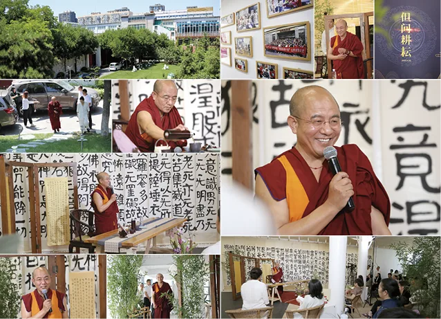
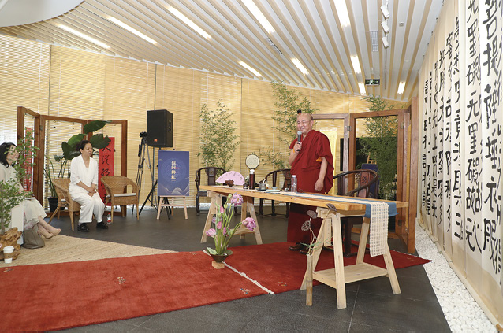
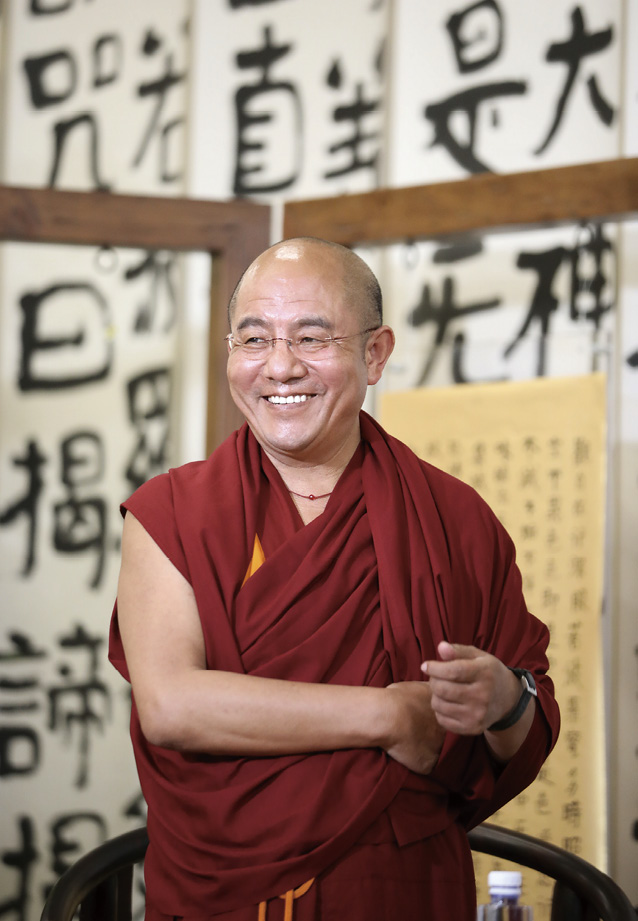
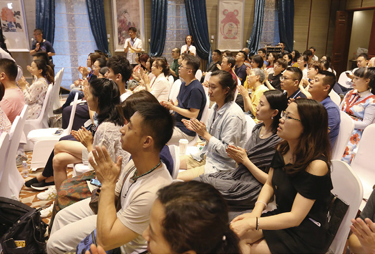
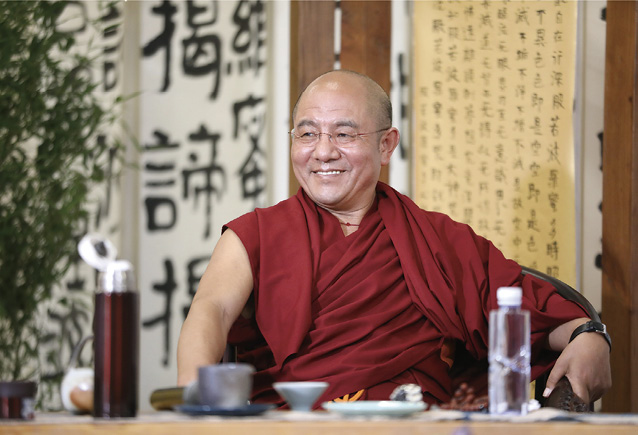
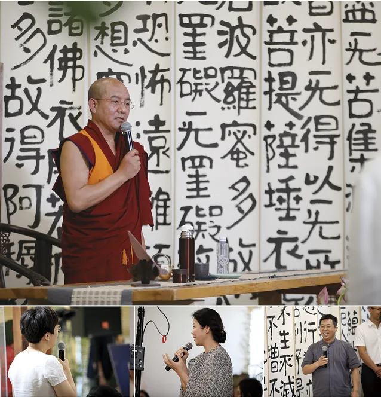
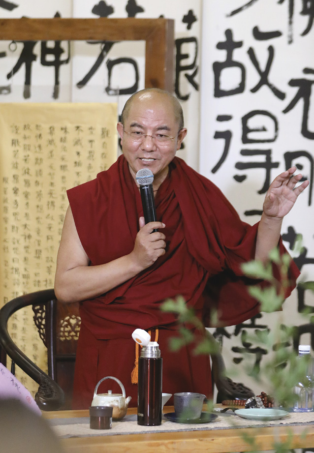

不管发生什么事情，  
我们都需要对自己负责，  
对家庭负责，对社会负责，对众生负责。

第91场

中国企业家俱乐部

China Entrepreneur Club

中国·北京

2019 / 6 / 22

## 但问耕耘

## Work on the Cause, Never Mind the Result

主持人：

今天是夏至的第二天，天气非常炎热。很高兴能够在这个炎热的下午，和大家一起，与索达吉堪布度过一段珍贵的时光。

索达吉堪布在1985年舍俗出家，依止法王如意宝晋美彭措为根本上师。堪布在讲经说法的同时，还不断地翻译经论、著书立说，截至现在已经付梓的有300余万字，大量出版作品受到城市读者的喜爱。

堪布还创立了很多慈善机构，创办了慈善小学、中学和图书馆等项目。他还呼吁大家关爱身边的人，帮助了很多社会边缘群体和贫困人群。他倡导用科学的方法放生，救助了非常多的生命。对于今天的沙龙主题——“但问耕耘”，堪布和在座的所有企业家一样，在传递智慧的路上，深深耕耘了几十年，从未停止过。

简短的几分钟，没办法完整讲述堪布几十年来的耕耘轨迹。不过，在很多场合，堪布都会说一句话。他说：“我不知道自己会活多长时间，但是只要有一口气，哪怕只有一个人愿意听法，我都会全心全意地用佛法去饶益他。”我觉得，这可能就是“但问耕耘”的全部意义。

接下来，让我们用热烈的掌声，欢迎索达吉堪布为我们做主题演讲——

今天下午，我们大家在这里聊一聊。不算什么演讲，也不算什么开示。在座的各位，都是非常优秀的成功人士，在人生的旅途中都很了不起，是对社会很有贡献的人。我今天没有特别准备，也不用做准备，因为我们有共同思考和探讨的很多话题。只需要打开心扉，随心所欲地跟大家聊一聊就可以。

## 学一点佛法

今天的话题是“但问耕耘，不问收获”。人这一生，好像很需要追求一个结果，但实际上，我们可能更需要把握当前的心态，并好好地加以保护。

在漫长的人生路上，各种各样的事情都可能发生。但不管发生什么，我们都需要对自己负责，对家庭负责，对社会负责。如果是一个大乘佛教徒，比如像我，可能还要加上对佛法或者众生负责。这是一个比较大的话题，能不能做到，得根据自己的具体情况而定。因此，“但问耕耘”的话题，我们在生活中可能随时都需要思考。这的确很重要。

在座的各位，有些是有信仰的，有些则没有信仰；有些对佛教有一点兴趣，有些人不一定有兴趣。作为一个从小信仰佛教，30多年来一直在佛教的知识体系中学习、思考和修行的人，我对自己的人生总结是什么呢？不管有没有信仰，佛教的有些知识对我们的今生乃至生生世世，应该都是有所帮助的。

这一点，我并不是站在佛教徒的角度来讲的。佛教有一句深入人心的名言：“我既不站在释迦牟尼佛的立场上，也不站在其他宗教的立场上，我只站在公正客观的立场，谁的宗教有真理，我就归属于谁。”我以自己的心作证，从公道公正的角度分析，如今这个社会，确实需要用佛教的一些方法，来解决精神的梳理、心灵的开导以及对自心的观照问题。

现在的物质生活水平已经达到了一定高度，但人们的内心却充满了空虚、不满、抱怨……因欲望得不到满足等有各种负面情绪。这个时候，如果我们自身没有心灵的良药，是很难支撑下来的。生活也好，精神也好，光依靠外在的物质和因缘，根本没办法获得饱满的滋养。

## 调一点心态

我建议在座的各位，如果有兴趣，最好用佛教或其他宗教甚至不涉及任何宗教的禅修方法，来调整自己的心态。通过禅修，我们的心会越来越坚强，越来越淡定，到时不管世界发生什么难以超越的大事，我们都可以稳如泰山，毫不动摇，轻松地面对。

在这繁杂的人世间，遇到各种各样的红尘烦恼，是非常正常的现象。一个人如果有一定的调整能力，外境发生任何事情，或者遇到任何风雨，心态都会非常平稳。

所以，我们要学会调整自心。在座的很多企业家，可能都有一些调心的方法，我们佛教的修行人也有。总的原则是，这颗心不能绷得太紧。如果绷得太紧，很多事情都没办法成办。

佛教里有一个很好的故事。一位叫昼辛吉的人，特别擅长弹乐器。后来他出家修行，却一直修不上去，就向佛陀请教。佛陀问他：“听说你在家的时候，特别擅长弹乐器。”他说：“是啊！”“那你弹乐器的时候，弦是绷得很紧，还是很松？”他说：“两者都不是，松紧要适度。”佛告诉他：“修行也是这样的。不要绷得太紧，也不能放得太松。”

现在这个社会，很多人都觉得压力特别大，有时简直喘不过气来。每个人做的事情都特别多，都会遇到各种各样的状况或违缘，心里很难承受。其实，情况越是复杂的时候，我们越要有一颗平常心。

我记得以前上初中的时候，学过一篇古文，叫《后羿射箭》[^1]。后羿的射术非常精湛，即使骑在马上，也能射中。有一次夏王问他：“你是不是擅长射箭？”他说：“是。”“你既然擅长射箭，那我专门给你设一个靶心。如果射中了，我赏赐你一万两黄金；如果没有射中，我要惩罚你，削减你一千户的封地。”因为是夏王的命令，后羿不得不答应。搭弓的时候，他的心里忐忑不安，手一直在颤抖，脸色也变了，整个行为跟以往完全不同。结果，他连射两箭，都没有射中，彻底失败了。

他平常射箭都是百发百中，按理来讲，射中国王为他设的靶子，百分之百没有问题。但为什么失败了呢？因为他的心态没有调整好，失去了平常心——面对巨大的赏罚，他有了得失心，患得患失。

我们经营企业也好，修持佛法也好，做其他什么事情也好，患得患失的心越重，结果可能越不理想。我觉得“但问耕耘”这个话题很好，不管结果，只管凭着自己的良心、善心和责任心，尽心尽力地去努力。结果也许很好，也许不如想象的那么理想，但不管怎么样，自己的努力和付出一定是有意义的。

## 想一点失败

在现实生活中，很多人对自己都比较失望，因为看到的总是别人的成功，自己不管怎么努力，好像都离成功很远。

有些人认为，只要付出了努力，就应该获得成就。很多年轻人在创业和做事的过程中，都会互相赞叹，互相鼓励：“这件事情你只要肯做，绝对不会有任何问题！”“以你的能力、智商、情商、办事的技巧和方便，做这件事绝对没有问题！”这样的想法虽然很积极，但事情恐怕不是那么简单。

其实，在眼睛看不见、耳朵听不到的地方，还隐藏着很多的因素。这些因素和因缘如果不具足，尽管我们付出了比别人更多的努力和勤奋，结果也不一定如我们期望的那样。所谓的努力和勤奋，并不是我们认为的那么简单，成功也不是那么容易。

有一句古话，大家应该很熟悉，叫“谋事在人，成事在天”。古人认为，做任何事情，只有十分之三的因素在人手里，另外的十分之七由天决定。所谓的天，就是天理。做任何事情，都需要天时、地利、人和三方面的因缘。人和，只占三分之一。许多事情的成功，既来自我们的勤奋，也来自前世善业所积累的福报。这里面，有相当一部分因素是我们看不见的。

然而，在现代教育理念下成长起来的很多人，并不承认这一点，也不会把它纳入自己的思考范围。我们经常看到，一些年轻人在对未来进行规划的时候，总是倾向以成功的正面案例来激励自己，不太愿意面对失败的案例，也不太愿意考虑可能导致失败的各种因素。

我觉得，作为一个世间人，不管是创业，还是做别的任何事情，最好给自己设定50%的成功希望和50%的失败可能。你心里一定要明白，这件事有可能成功，也可能失败。以这样的心态来做事情，或许更有利益。

对很多人来讲，如果成功，不用说，很容易面对：“啊，我当初是如何考虑的——自己早有安排！”而一旦失败，你会怎么应对？在当前来讲，这个问题非常重要。

可是，很多人在失败方面的预算和规划都做得比较少。我经常遇到知识界的教授和学者，以及在社会上有一些实力和影响力的企业家和精英人士。他们的很多思考也比较偏颇。对好的方面，有许许多多的计划和安排，一层一层的，非常丰富。不好的方面，简单的一句话就过去了：“应该没有什么问题。”“凭我的判断，应该会成功，不用担心什么。”

在我们佛教内部，虽然做任何一件事情，佛教都能提供一些好的方式，但也不可能用一句话解决所有的问题。有些人说：“你只管念佛就好，一定能遣除一切违缘。没什么问题。”事实上并非如此，佛号不是万能的。也有些人说：“你祈祷黄财神肯定马上发财，没有什么问题。”这也是不一定的。当然，我不是说黄财神没有这个功德，但你想凭一句话决定所有的事情，肯定不可能。

## 懂一点因果

佛教最深刻的道理就是因果规律。因果规律的背后隐藏着什么呢？就是因和果。我们今天得到的所有成功和财富，都是即生或者前世做过的一些善事成熟的结果。过去的善业跟现在的善果，存在一定的关系。

这一点，从来没学习过这些道理的人，也许会半信半疑。但也没什么吧。一旦自己在生活中感受一些特别的苦乐时，可能才会有所感悟：“这一切的背后，也许真的有一种因果。”

因为有因果的支配，我们这一生的财富、名声和地位才能得以实现和保全。如果没有这些因和缘，无缘无故就得到了财富和名声，这是不可能的。

这样的因果关系，西方很多科学家称之为因果定律，意思是一旦种下了种子，不管是善的种子，还是恶的种子，虽然当下不能成熟，但过一段时间——有的甚至过几百年、几千年，它的果一定会成熟。很多人以前在这方面思考得不是很多，其实这样的定律在每个人的生活中都会体现。

我想跟大家说的是什么呢？做人应该懂得善和恶的差别。现在很多人都愿意做善事，包括有些企业家，非常积极地在做一些慈善活动和基金，不断地回馈社会。也有一些人，在这方面并不是特别乐意。

有些人虽然做了很多事情，但因为行善的果报没有当下现前，反而在做的过程中出现一些不顺，加上没有系统或长期地学习佛法，便对因果产生怀疑和不满：“我这么努力地行持善法，为什么会遇到这样的情况？”

其实，在漫长轮回中，因果相互循环，相互起作用，非常复杂，不可能一行善法就立刻得好报。

佛教有一部著名的论典，名叫《亲友书》。里面说：“有者所造诸罪业，纵未即时如刀砍，然死降临头上时，罪业之果必现前。”我们现在做的恶业，不会像刀砍身体马上出血一样，这一世马上就现前果报。但实际上，种下的恶因永远不会空耗，等到死后，恶业的果报一定现前，令你堕入恶趣感受痛苦。

恶业如此，善业也一样，成熟果报也需要时间。我们今天得到的财富或痛苦，都是前世造的善业或恶业的结果。我现在所造的善业和恶业，在我的晚年或者来世，也一定会出现果报。

善恶的种子并不是一种下马上成熟，就像农民在春天播下种子，要到秋天才能收获一样。因果规律需要时间来体现。植物的成熟大多需要一个季节，也有一些特殊的情况，需要好几年甚至几十年的。而我们有情众生造的善业和恶业，除了极个别特殊的善业和恶业外，大多数都需要一世以后才成熟，就像春天播种秋天收获，中间翻过一个季度才有结果。这一点，学过佛教的《俱舍论》《阿毗达磨》以后，可以明白真正的因果道理。

如果我们深信因果规律，便真正可以做到“但求耕耘，不问收获”，在努力的当下，不去考虑最后的结果。如果能够这样，最后得到的结果也许会更好。

## 有一点利他心

我们要想成功，除了自己的努力，最根本、最重要的一条是什么呢？利他心。在座的各位，对自己和家庭的生存，不会有什么烦恼和压力。各位需要考虑的是，如何将拥有的财富回馈社会，因为这些财富本身就来自社会。

### 1．厚德者，方能载物

虽然这些财富是你自己的努力和福报所得，但你的福报跟总的社会群体也有一定关系。而且，你所有的福报都来自你前世所造的善业。福报再大，也是前世造福，即生受报。如果没有继续做善业，这辈子把福报用完了，下一辈子福报穷尽，很难再拥有今生的成功。所以，不断为自己行善培福是很重要的。

现在很多人想不通：“别人都成功了，我这么努力，为什么还不成功？”按照佛教的说法，最根本的原因就是福报问题。福报是什么？就是你前世造的善业。如果前世造了很大的善业，你即生的福报不会穷尽；如果前世没有积一点福报，即生再怎么努力也很难成功。

佛教有一句话：“勤奋如山王，不如积微福。”付出山王一般的勤劳和努力，不如积累火星那么一丁点的福报。也就是说，你再怎么样勤奋，如果没有一定的福报，也很难如愿以偿。今生的奋斗和努力虽然很重要，但更重要的是，要有一些过去世积累下来的福德资粮。

佛教的《广大游舞经》中说：“具有福德者，亦成诸所愿。”有福报的人，哪怕说一句话，做一件事情，都能如愿以偿。相反，没有福德的人，不管怎么努力，事情都很难成办。

《易经》里有一句话：“德不配位，必有灾殃。”没有福德的人，如果拥有过高的地位，必定会出现祸殃。他有名声，但也许会翻车而死；他有财富，但会遇到各种各样的麻烦，很快就一贫如洗。没有福德的人，很难支撑这些。

古人经常讲，厚德载物。有了深厚的德行和福报，财物也好，名声地位也好，自然可以承载；如果芝麻许的福德都没有，所谓的名声、地位和财富等，是根本没有办法消受的。

在这个世界上，的确有一种我们肉眼看不到的、非常隐秘的东西，它叫福德。没有福德，世间的许多事情都难以成就。

我们小时候都看过《三国演义》。里面说，谁拥有庞统和诸葛亮，谁就可以统治天下。后来，刘备把两个人都纳入自己的阵营，结果非但没有统治天下，连小小的蜀地都没有全部掌握。这也是说明，没有足够的福德，所谓的才能和谋略也起不了太大作用。

很多时候，一个人暂时好像有地位，有财富，有相貌，但由于福报鲜少的原因，手里的钱很快就飞走了，地位也没了。而有一些人的福德，不仅这一世，乃至多少世都能一直撑下去。这是什么原因呢？因为他在不断地积累善业。

### 2．人生短暂，及时行善

所以，当我们拥有财富和地位的时候，一定要尽量帮助别人。这一点真的非常重要。现在的社会，贫富差距特别大，需要帮助的人很多。在这个时候，我们如果占有过多的财富和资源，一直紧紧地掌握在手里，可能不是太好。况且，当我们最后离开人间的时候，很多东西也是带不走的。

想一想，我们的人生其实非常短暂。从小时候开始，一直读书、读书，读到近三十岁，才算全部读完。然后你开始创业，十几年以后，人就四五十岁了。这个时候就算成功，也已接近衰老。即使有势力，有钱财，享受的时间基本上也没多少了。有时候想想，我们的人生再怎么样辉煌，好像也没有什么。

而且，人活一生，沉沉浮浮很难预料。当你拥有一切的时候，人人都赞叹你；一旦你的人生出现无常，大家马上对你另眼相待。昨天我听到一个北京的企业家说，他刚开始白手起家，特别辛苦。后来，在股市赚了很多钱，变得风光无限。去年股市下跌，一下子就赔了20个亿。朋友们全都离开了，所有人对他的态度都发生了180度的大转变。

我是一个佛教徒，跟你们的某些价值观不一定相同。每当我听到这些故事的时候，都会想：“人生的确充满了各种各样的无常啊！”这些道理在佛教里讲得非常清楚。有时候，我们也可以多思考思考。

总而言之，我觉得拥有财富或者拥有资源的时候，应该尽量去帮助别人。如果能诚心诚意地帮助别人，我们人生的很多问题也许都能很好地解决。

### 3．成功喜悦，与众共享

前段时间我看到一篇文章。说是台湾有一家面馆，开了100多年，经历了三代人，一碗面始终只卖15块钱。作者为了吃面，排了2个小时的队。后来他问老板：“生意这么好，你为什么不提价？一碗面卖20块钱肯定没问题。而且，你为什么在别的地方不开连锁店？”老板回答说：“我的目的不是为了赚钱，而是为了让大家舒舒服服地吃一碗面。赚钱对我而言，是次要的。”

确实是这样。我们在做事情的时候，如果很尽心、很专注地帮助别人，不管是客户也好，其他人也好，都一心一意地给予帮助——哪怕只能帮到1个人、2个人、3个人也可以，反正能帮多少就帮多少，如果能够这样，自身需要的很多资源自然而然就会聚集。

如果我们最开始的定位和目的就是赚大钱，一心想在客户身上捞很多，像现在很多企业或团体那样不择手段，以各种方式骗取客户或他人的钱财，最终得到的结果肯定没什么好的。不过再不好，也是自己搞出来的。

如果有一颗利他心，成功的喜悦一定是自己和他人都能品尝到的。即使没有成功，自己在这个过程中所做的一切都是善的——心善，行为也善，所以失望的心不会那么强烈，不会特别痛苦。

一个人活在世间，按照大乘佛教的教义，不管怎么样，都应该有一种自我奉献的精神。我们的很多痛苦，都来自自私，来自我执。有了强烈的我执和自私心，人与人之间的竞争和冲突会不断地出现，自我和欲望会不断地膨胀，最后导致许多不愉快甚至伤痛的事情。

## 多一点欢喜

我们做任何事情，都应该保持一种平和的心态。这也是很重要的。

禅宗有一个故事。师父告诉弟子：“修行的时候，心要平静，不要太执著。”弟子说：“按照您说的方法去修，我什么时候可以开悟？”师父说：“10年。”弟子说：“10年太慢了！我如果特别努力地修，什么时候开悟？”师父说：“那可能要20年。”弟子说：“那我夜以继日地修，白天不休息，晚上不睡觉。”师父说：“那你永远开不了悟。”

这个故事也许是真实的，也许是虚构的，但它所讲的道理却值得我们思维和参考。有些人做事情的时候，尤其是做一些有意义的事情时，特别着急。事实上，心里越着急，目标往往离我们越遥远。

最关键的一点，要保持自己的欢喜心。佛教里有一句话：“遭遇任何事，莫扰欢喜心。”不管遇到什么事情，我们的心态都应该保持欢喜和平稳。心态如果调好，做什么事情都很容易。

现在很多年轻人都有一些心理问题，整天都是一副着急的样子，一会儿产生一个嗔恨心，到了晚上却睡不着，吃安眠药的人越来越多。在一个社会里，如果安眠药的生意越来越好，可能不是个好事。所以，我们的心态要平和一点，随意一点，放松一点。

其实，生活中发生的任何事情，都是有因有缘的。有些因缘可以改变，有些因缘不能改变。不管能不能改变，我们都要用一颗淡定的心来面对，因为因缘会变，我们的心也会变。

比如，现在看来非常重要的事情，10年、20年以后我们再来回顾，它们都成了过眼云烟，已经变得不再重要。10年前、20年前我们特别重视、特别烦恼的一些事，现在看来都不成为一件事。我们在读书时代特别执著或者创业时期非常重要的一些事情，现在已经不是那么重要。

从佛教的视角来看，世间的许多事情都是如梦如幻。表面上，如梦如幻的道理非常简单，实际上，如果认真思考其中的意义，人生的很多事情用它来对照，还是有很深内涵的。

## 听一点建议

### 1．坚持学习

最后，给在座的各位提三点建议。第一个建议，你们有信仰也好，没有信仰也好，如果系统地学习佛教的道理，对自身的帮助会越来越明显，人生的很多问题都可以得到解决。现在很多人认为自己有信仰，但这种信仰仅限于私下里看一两本书。这样的信仰，对自己也许有一点帮助，但跟真正的深入学习还是有很大的差别。

以后如果有机缘，自己最好深入学习一些佛法。如果对佛法没有兴趣，可以学一些其他知识。现在这个时代比较开放，想学任何一门知识都能找到途径。

我很赞叹李嘉诚的学习精神，他60多年以来，一直坚持每天学习。还有查理·芒格，他的学习精神也令人钦佩。作为一个世间人，他已经90多岁了，依然每天不断学习。这些成功的企业家，并没有因为有了一些资产和地位，就停止学习。

现在这个时代，如果没有不断地学习，也许很快就跟不上社会的发展了。这个时代变化太快，跟以往任何一个时代都不同。如今是新商业时代，所有的产品、经营模式、商业模式等，都在不断变化。

在我们佛教内部，包括一些传统寺院，大家所学的佛法内容虽然不用改变——这个完全跟得上时代，但是学习方法也在不断进行调整。我们寺院以前根本没有电子产品，现在都要学习使用电脑，包括利用网络学习。否则，在这个信息时代，佛教徒的生活方式最后可能也没办法维持下去。

因此，我们很多商人，很多企业家，可能也需要不断调整自己的生活方式和工作方式。包括我们对于将来的一些目标，都需要不断根据新的形势和信息，进行调整和改变。

我们每一个人，都应该活到老，学到老。始终保持一种学习的精神，我觉得确实很重要。如果没有学习，一直停滞不前，这个时代最初是什么样，最后变成什么样，我们可能都不知道。很多佛教传统的寺院和佛学院，如今也在思考，怎样才能跟上时代。我们现在面临的状况，跟以往的几千年完全不同。

现在，每过几十年就有一个大的变化，不是一般的、区域性的变化，而是全球性的变化。现在使用的这些设备，几个月就升级换代一次。网络上不断涌出新的名词，年轻一代在讲什么，年长一点的根本听不懂。他们用的网络语言，有时候听起来，真的不知道到底是人话，还是别的什么语言。孩子们有他们自己的一套沟通方式，世界已经变成他们的了。我们快成了被淘汰的原始人，很多年轻人都这么认为。

所以说，不管什么身份的人，都要不断地学习。这对保持自己的记忆力也有帮助。不断学习的人，老了以后不容易得老年痴呆症，身体也不会老得那么快。对很多人来讲，学习就是一剂良药，对身心都非常有益。而且，服用这剂良药不能间断。藏传佛教有一句名言：“即使明早要死亡，也应学习诸知识。”即使明天离开人间，今天也要学习各种知识。

### 2．遵循因果

我们在做事的过程中，一定要遵循因果正理。很多人都认为自己是一个非常善良的人，其实有些人所谓的善良，不过是自己的想象而已，并不是真正的善良。按照传统文化或者佛教的某些要求，我们身口意所做的很多事情，都是不如法、不如理的。

所以，我们要懂得“善有善报、恶有恶报”的因果准则。懂得这个准则以后，做人做事就会有分寸，也会有一定的标准。自己的言行符合这些标准，生存在世间自然而然会有许多资源。

一个善良的人，带给周围的好的磁场和正面力量，我们的眼睛也许看得到，也许看不到，但不管怎么样，他都会自然而然地集聚许多好的因缘。相反，如果我们的所作所为是恶的，心也是恶的，周围所有的顺缘都会跟你背道而驰，最后自己会变得孤苦伶仃，非常可怜。

所以，为了他人，也为了自己，我们随时随地都要懂得遵循因果。这不仅可以创造良好的人际环境，对自己的心态和形象，也有非常正面的作用。

### 3．有一颗利他心

在座的各位，很多都是有影响力的企业家，每个人的手下，都有成千上万的员工。这些人都要依靠企业生存，而你们是企业的领导者、灵魂人物，所以最终靠的还是你们。对这些人，你们要经常想到给予帮助。这样的利他心很重要。

现在这个社会，特别需要帮助他人的精神。在这方面，我想你们很多人都做了非常大的贡献。因为解决一个人的就业问题，按我们佛教的说法，是一件功德无量的事。我们经常看到，一些失业的人走投无路，特别可怜。如果能为他们提供安全可靠的工作岗位，即使你修行不好，其他方面做得不太圆满，但能让一个可怜人有吃有穿、有安全感，你来到这个世界也是很有意义的。对人生而言，这可能是最有意义的事情。

我本人虽然不是做这个的，但也经常劝说身边熟悉的企业家和老板这样做。其实，哪怕只帮助一个人，也是很有意义的。比如说，给找不到工作的一个人安排工作，给找不到出路的一个学生提供学费，给没钱去医院看病的一个病人提供资金。有时候，对一个穷苦人而言是天大的事，对有福报的人来讲却是轻而易举的。

人活在世界上，我们的能力不是一直不变的。到一定时候，自己不一定还有这样的能力，因为随着年龄或因缘的不断变化，都会发生改变。所以，当自己拥有权力、拥有财富的时候，至少也要用来帮助一些人。用现在的话来讲，就是一种社会责任。

在座各位，你们现在有这个能力，也应该对下面的员工传授这样的教育。以后他们有能力了，至少也可以再多帮助一个人。如果这样的话，比如，我们这里有100个人，100个人再帮助100个人，那200个人都会有生活的出路，有生活的希望。

对于这个社会，如果没有特别去关注，很多情况可能不知道。一关注，才发现有这么多老人，有这么多病人，有这么多穷苦的人，有这么多失学的孩子。尤其当我们去一些偏僻的地方，比如非洲或东南亚那些被战争扰乱的难民营，那时心里会特别感慨：“虽然我们都活在这个人世间，但是却有这么多的不公平！”对遭受不公平的这些人，哪怕给他们一点暂时的安慰和快乐，也是非常有意义的。

今天跟大家分享的就这么多吧，其他的暂时想不起来。谢谢大家。

现场互动

主持人：

听完堪布的演讲，我觉得整个身心都非常放松，没有刚开场那么紧张了。谢谢堪布！非常受益！

我也觉得，萧总设定的“但问耕耘”这个主题，非常温暖。不管是“但问耕耘，不问收获”，还是“因上努力，果上随缘”，都是让我们放下执著，轻松前进。虽然我不是企业家，但是我相信，在座的企业家在管理公司的时候，不仅承担着巨大的社会责任，也承受着巨大的心理压力。希望堪布这一个小时的演讲，能给大家带来一些新的能量和新的思考。

接下来，我们进入自由交流的环节。萧总，这个活动您主办的，您有什么问题，可以第一个跟堪布交流。

问：顶礼堪布！刚才您说到开悟，我一直在想这个“悟”。从某种意义上讲，艺术家有艺术的开悟，企业家有企业家的开悟，但真正开悟的人，跟我们凡夫人有什么区别呢？

娄老师曾经跟我说：“你要像佛一样做人。”佛教里有十不善业和十善业，都是对身口意的要求。如果我把十善业做好了，是不是就做到了像佛一样做人？

堪布：开悟的话，按照禅宗的说法，有大的开悟、中等的开悟，以及小的开悟。大的开悟就像佛一样，断除所有的烦恼，开启所有的智慧。因为佛的意思就是“觉悟”，梵语中叫“布达”，藏语里叫“桑杰”——“桑”的意思是所有的障碍都已经清除了，“杰”的意思是所有的智慧都已经开启了。

这样的开悟凡夫是没有的。我们的很多障碍都没有清除，比如贪嗔痴的障碍、遗忘的障碍等，有很多烦恼和所知方面的障碍。我们的智慧也没有开启，只能部分地了知这个世界，没办法知晓万法整体的真相，而且了知的这一部分也不清晰，早上记住的东西下午就忘了。

像佛那样的开悟是非常广大的，我们暂且不谈。一般禅宗大德的开悟，或者说菩萨的开悟，跟凡夫人还是有很大差别的。我们的心不淡定，明明知道这样做是错误的，但仍然一而再、再而三地犯，然后一而再、再而三地忏悔，又犯，又忏悔。真正开悟的人，对自心的本体完全认识，不会被外境的诱惑所转，不会犯这样的毛病。

我们凡夫有四种颠倒。哪四种呢？常、乐、我、净。本来事物不是常有的，而是一天一天、刹那刹那都在变化，我们却执著为常有，比如一直认为昨天的我、今天的我、明天的我，都是一样的，永远不会改变。本来是不快乐的东西，我们却认为是快乐的。无始以来，我们一直沉溺在轮回的苦海中，受了很多苦，却自以为很快乐，没有一点出离心。本来所谓的人我也好，法我也好，都是不存在的，但我们却认为我是存在的。我们的身体也好，其他东西也好，本来都是不清净的，我们却认为它是清净的、美好的。我们被这四种颠倒一直束缚着，但自己却不这么认为。

所以，凡夫人跟开悟者之间，确实存在很大的差别。不要说真正开悟的，那些接近开悟的人跟我们相比，都有很大的差别。在生活中承受同样的压力，或者遇到同样的痛苦，我们觉得难以面对的时候，对接近开悟的人而言，却是一件非常简单的事情。比如遭遇亲人离世或事业失败时，作为一个接近开悟的人，他不会有任何烦恼，非常淡定。可是我们呢？不要说这样的大事，即使遇到一点小小的事情，无论是关于感情还是事业，都跟雷霆爆发似的。越执著的人，爆发得越厉害，甚至觉得整个天都垮掉了，整个世界都倒塌了，心烦意乱得没办法生活。

不要说接近开悟的人，稍微有一些佛学境界的人，比如无常观、因果观修得比较好的人，跟我们也是完全不同的。有这方面境界的人，家里的亲人死了，有没有痛苦呢？也会有，但跟我们还是有差别，他的痛苦不会像我们这么强烈。面对死亡的时候，他会不会畏惧，会不会害怕呢？也许有一点畏惧，也许根本不害怕。虽然死亡令很多人恐惧，但对他而言，是一件很平常的事情。对真正的开悟者而言，则成了最好的旅行。

开悟者和不开悟者之间的差别，我觉得太多了。一般来说，我们先要从文字上认识，再通过思维了知，然后通过坐禅去了悟，最后达到开悟。真正开悟的时候，有特别多的境界，就像佛陀在《大藏经》里描述的那样。这些境界，我们光是读到相关的文字，也会享受到无量无边的利益。所以说，悟与不悟，差别还是很大的。

问：据我观察，世界上经济发展得最好的地方是北欧，也就是瑞士、挪威和瑞典。再往下是欧洲其他国家和美洲、澳洲。再差一点的是东南亚和南亚，南亚基本上是垫底的。从这几个地方的信仰来看，北欧是天主教，欧洲、美洲和澳洲是基督教，东南亚、南亚是佛教。可不可以说，信佛教的大多是经济不发达地区呢？

堪布：其实经济的发展，我倒不觉得北欧很好。所谓的发展，可能也要从物质财富和精神财富两个方面来看。物质财富的话，北欧、北美这些地方，比较而言的确好一点。我前年去了瑞典、挪威等国。去的时候发现，这些国家的社会福利和公共待遇都比较好，可那里有时一天只见得到三四个小时的太阳，所以得抑郁症的人非常多——他们自己认为抑郁症是天气造成的。真正的原因，也许是天气，也许不是。

至于东南亚，有一些国家佛教的确比较兴盛。但是，如今在日本、美国，佛教也可以说非常兴盛。其他宗教比较兴盛的地方，比如非洲，有54个国家，很多信仰基督教和伊斯兰教，但是这些国家的经济比东南亚更差。

一般来讲，信仰和经济并没有直接和密切的关系。事实上，世界经济一直处于变化当中。二次世界大战之前，欧洲的经济应该是很好的。二战之后，欧洲经济就不行了。按照欧洲人自己的说法，经济全部都在美国手里。将来到底在美国手里，还是在中国手里，也不好说。

众生的福报，不能简单地用五大洲来划分，这样分可能不太符合实际情况。整个亚洲有这么多国家，佛教兴盛的只有几个国家吧？相比而言，经济最差的一些亚洲国家，却是一点佛教都不信的。在非洲很多最贫穷的国家中，连“佛”的名字都没有听说过。现在日本和德国的一些城市里，佛教中心的数量都超过了其他宗教的场所。

现在有些人，根据自己片面的分析，表面上好像可以这样讲。其实，如果具体分析会发现，经济和信仰并不能通过这样的片区来对应。每个地方的众生信仰都不同。中国也是一样。是不是没有信仰的地方，经济就发展得特别好呢？也不一定。大多数北京人的信仰还是很不错的，他们的经济状况也相当不错。就全世界而言，不丹的幸福指数最高，早在多年前就是这样，他们不管心灵也好，财富也好，各方面因缘都很不错。美国人在一段时间内是经济霸主，可他们的心灵状况却是全世界最糟糕的——去年有一个报道这样讲过。

所谓的经济发展，对提高人们的幸福指数能不能起到作用？如果发达的物质文明不能为我们带来幸福和快乐，那么所谓的经济发展，在某种意义上就是一种障碍。事实上，单纯的物质并不能满足我们对美好生活的期望，或者说，物质不能完全给我们带来幸福的生活。

因此，你刚才的分析，是比较粗略的。全世界有200多个国家，真正细致分析的时候会发现，佛教最不兴盛的地方应该是在非洲。54个国家中，真正信仰佛教、建有寺院的地区非常少，而信仰其他宗教或没有任何宗教信仰的国家特别多——但他们的经济却并不发达。所以，这方面可能还需要观察。

问：我是一位高校的老师。刚才听您解答问题时，我想到了禅宗的一句偈语：“荆棘丛中驻足易。”我们在艰苦的环境中，为站稳脚跟而打拼，相对来说比较容易。但是，“月明帘下转身难”，当我们处于比较惬意的境地时，比如在座的成功人士，已经实现了财富的自由，再以坚忍不拔的毅力，去追求更高的目标，却比较困难。沉迷在月明帘下的美好之中，往往很难脱身。

我的师祖顾随先生曾经写过一首绝句：“绝代佳人独倚楼，江头看惯去来舟，一从读会灵均赋，不爱欢娱只爱愁。”在这样一个周末，我们本来可以放松一下，然而，因为精神上的需求，或者希望得到更高的引领，有这么多朋友聚集在这里，说明大家都有一种同气相求的愿望。“不爱欢娱只爱愁”，我们在自我体认的时候，在读书的时候，可能都有这样的感受：人生，总是和苦、和欲望纠结在一起。如何才能解脱？这是一个很大的问题。

我常常苦恼的是什么呢？我可以坐在书屋里读书，对人生有更多的了悟。也可以像以前一样，每天坚持做108个礼拜，不断地追求一种精进。但是如果想有更大的发心，比如去利他，去社会上承担更多的责任，就要占去很多个人的时间。我有时想，如果把时间用在个人的修行上，是不是可以达到更高的境界？但这样做，就不可能把我们的师教思想传递给更多的人，这将成为自己一生的亏欠。这个矛盾是我目前最大的困惑。

堪布：你讲的其实也对，尤其是有这方面爱好和希求的人，应该选择一个比较休闲的地方，自己喝喝茶，看看书，尽量地与世隔绝。现在的社会比较复杂，跟人交往，跟社会交往，都不是那么容易的事情。

但是就世间的利益而言，当自己稍微有一点能力的时候——我们有能力的时间其实是很有限的，如果付出自己的一些时间和精力，可以帮助到别人，我觉得还是应该把自己的时间和精力奉献出来。在这个过程中，也许会利益很多的人。

按照大乘佛教的教义，我们应该在利众中修行，在修行中利众。如果我们心的力量比较强，这是最好的修行方式。禅宗里经常讲，“行住坐卧都是修行，无不是禅，无不是修”。在工作中修行，在生活中修行，尤其是和你交往的许多人，为他们做一些有意义的事情，这是很好的修行机会。

相反，如果我们心力不够强，则会产生很多烦恼，最后很可能退失道心：“我做了那么多的事情，为什么还没有回报？为什么社会不认可我？为什么因果对我不公正？为什么我越做越失败……”自己把自己往后拉，产生各种倒退的心。

每个人的心力都不相同，有的人心力比较强，有的人则比较弱。我们很多成功的老师，已经八九十岁了，还在做很多事。刚才我跟老师们交流，有的老师已经九十多岁，现在还不断地写书法、接见人。像这样的人，心的力量是非常强大的。

所以关键还是要看我们的心力。如果心力足够强大，身体没有特殊的疾病，就可以给自己的利他心提供服务大众的机会，去做更多的事情。如果心很脆弱，即使自己很年轻、很光鲜，但遇到事情的时候，哪怕只是一点点小事，玻璃心也会马上碎掉。所以，按照大乘佛教的理念，我们要把自己的玻璃心练成金刚心，以这颗金刚心去做更多的事。

为什么藏地的很多高僧大德、汉地的很多非常了不起的老师，他们在八十多岁、九十多岁甚至上百岁的高龄，还能非常坚强地做事？因为他们练就了一颗与众不同的心。心的力量跟很多因缘都是不相同的。

总之，心力很重要。如果心的力量很强大，即使身体不好，每天照样可以做很多利益他人的事。如果心早就死了，身体再强壮也没有用。

问：您的话让我想起了宋代宗杲大师的一句诗：“好将一点红炉雪，散作人间照夜灯。”个人的力量总是微不足道的，就像红炉边的飞雪，刹那即逝，但它必定带给人世间一份清凉，变成一颗颗照夜的明灯。但是现实之中，我始终有一种亏欠感。比如说，我全力以赴地想做好自己的工作，想利益更多的学生，但却往往忽略了自己的老公、孩子和父母。本来，是该自己照顾父母的，可实际上父母对我的关照和付出更多一些。这个时候我会觉得很内疚：难道我是一个社会的人吗？难道我的家庭把我奉献给社会了吗？可能自己的层次还达不到更高的境界，那怎么才能更上一层楼？希望听听您的开示，谢谢！

堪布：我们在做利他的事情时，不管是社会上的成功人士，还是修行比较好的修行人，在某些方面，对身边人有所忽略或照顾不到的情况，或多或少应该都存在。但我想，如果一心一意地为社会、为他人付出，家人也好，身边的其他人也好，刚开始可能不理解，但慢慢还是会理解的。

而且，如果我们的心力能够支撑，对家人也不可能完全不管。一天的时间中，是可以给家人留出一部分的。对家人，其实不用像有些人说的那样——每天都黏着他们，每天都围着他们转。被一些非常小的事情所转，实际上是浪费时间，不值得。只要心里关心他们，不要抛弃，就可以。

有些人可能有点偏堕，只为他人做事，对家人就像陌生人一样，或者一点都不关心。这样也不对。我们和家人之间有着最深的因缘，如果对他们都没办法利益，利益其他人可能更困难。所以，我自己感觉，如果把时间合理安排，应该是可以兼顾的。

有人问曾国藩：“你每天做这么多事，又是写作，又是看书，还要处理军事上的很多事情。你是怎么做到日理万机的？”他说：“我看书的时候就是看书，写作的时候就是写作，会客的时候就是会客。”对每一件事情都一心一意、一步一步地做，这就是他的窍诀。

我们也可以学习。比如，我该陪家人的时候，就陪家人；该做慈善的时候，就做慈善；该工作的时候，就工作；该学习的时候，就专注地学习。如果自己的时间安排得有规律，各方面都可以兼顾，不会混在一起。

有些人没有做什么事情，经常陪家人，家人还是不高兴，因为家人的要求有时候会比较高。你整天围着他，努力对他好，他也许还是不开心。所以，我们对家庭也好，对父母也好，该给的时间一定要给到，除此之外的大量时间，应该用来帮助众生，或者做其他有意义的事情。

我们要像曾国藩那样，做任何事情时，心都很专注，不要散在外面。有些人不是这样的，他的心很乱，所以这个做不好，那个也做不好。陪家人的时候想着工作，工作的时候又想着陪家人，事情全都乱套了。这种做法我是不赞叹的。

我在佛学院的时候，上午该开会就开会，该接待就接待——不管什么层次的人，我都会去接见。到了下午，我会跟相关人员说好，手机全部关机，然后专心地做自己的事：看书，写书，备课。

刚开始，有些人会问：“你为什么关机？”慢慢地，他们也就习惯了。我需要有自己的时间，这个时间我要自己控制，不可能天天都跟你们玩。

所以，如果我们自己做事很有规律，很多事情应该都可以兼顾。

问：“但问耕耘”，这个题目我很喜欢。我是做互联网创业的，平时工作很忙，也需要花很长时间。所以，如果每一次耕耘都想着结果，我可能坚持不下去。我总觉得，自己努力、努力，努力到最后一刻就好，尽全力就好。

刚才堪布说了，我们的身体会出现问题，我们也需要面对死亡，我们周围的人也面临这样的问题。我想问的是对死亡的态度问题。假如我生病了，怎么去面对？如果身边有人出现这样的状况，我怎么去安慰？还有，堪布您怎么看待死亡？

堪布：首先，不管是谈死亡也好，谈工作也好，我觉得心态很重要。有些人在工作中总是抱怨“我没有时间，我好累，我好烦”，一直给自己增加负面的情绪。其实人活在这个世界上，做一些该做的事情，不应该那么累。我们不应该把工作和生活设定为特别痛苦的事，而应该把它们当作一种享受。比如说，开会也好，工作也好，出差也好，都尽量去享受它的过程，让它成为自己独有的一种体验。

在佛学院，我作为一个出家人，本来应该好好地闻思修行，但却不得不处理很多琐事。有时候，我旁边的很多堪布都在看书，我却必须去处理一些繁琐的大小事务，按理我应该很痛苦：“噢，他们都可以学习，我为什么每天要遇到这些事？不想见的那些人，为什么总要跟我开会？”

但我对自己的心态进行了调整，认为这是自己命中注定的享受和福报，然后乐观、正面地去迎接每一件事情。因为好多事情都是我不可能逃脱的，既然不可能逃脱，那就摆正自己的心态。至少当前来讲，这对我是一个很好的善缘。哪怕是面对跟自己立场相反的各种各样的人，跟他们进行各种交谈，对自己也是一种锻炼，是一种修行。

至于死亡，不管自己也好，身边这些人也好，包括世间所有的人，都有生老病死。这方面，佛教还是有办法的，它有一整套面对生老病死的方法。佛陀当年之所以出家，也是因为看到处于生老病死中的众生非常痛苦。为此，他发愿出家，证悟了宇宙人生的真相，然后广转法轮，把解脱痛苦的方法告诉众生。在佛教中，死亡的时候怎样调整心态，尤其是死亡之后如何离苦得乐，这方面讲得非常清楚。

当然，如果没有很好地学习或了解，恐怕还是不能解决问题，因为这是一个比较大的话题。比如说，我总有一天要死——自己首先要有这方面的思考，那我死的时候要怎么面对？死亡以后，依靠善恶的因缘，我将来的去向是哪里？对这些问题，如果我思考过，也学习过，当死亡真正来临的时候，就不会有任何恐惧。

藏传佛教有很多临终关怀或者临终观想的方法。如果有这方面的培训和修行，当旁边有人死亡的时候，我可以给他讲：“世间上所有的人，没有一个不需要面对死亡的，你不要害怕。”然后对他进行心灵疏导和引导，这方面其实有很多内容可以讲。

临终关怀的内容，在《大圆满前行引导文》《六中阴》等很多论典中都有介绍。通过学习，关于死亡的道理，自己完全可以想通。虽然死亡是无法逃脱的，但我们至少可以非常坦然地面对。

问：虽然是主持人，但我也有问题。我是开书店的，在现在这个时代，开书店基本上等于亏损，是利润非常微薄的一个行业。为什么我会从事这个行业呢？因为这是我一直以来的梦想。我对这个行业有一种像堪布传播佛法般的巨大热情。十年前，我开始在这个行业耕耘。当时进入这个行业的人，90%是基于对独立书店、实体书店的热爱。大家都知道，在北京风入松、清华东门、北大东门那一片，有几十家书店。所有这些书店的从业者都是我的偶像和老师。我跟着他们学习、工作了十几年。今天，他们的很多书店都已经关门了，我还在这里面继续努力。

但是，尽管我很努力，可是时代已经变了。现在大家看到的书店，可能都是通过融资等金融手段来占据市场。在资本运作下，我们自由投资人遭到巨大的挤压，面临着非常大的危机，同时还要承受读者越来越挑剔的评判标准。生存和呼吸的空间越来越小，我们这帮小小小小老板们，该怎么耕耘？我有时甚至很困惑，当初这个行业选错了吗？自己耕耘了十几年，基本没有收获，以后还要继续耕耘下去吗？希望堪布可以给我一点点指引，让我心里有一点答案。

堪布：你们的问题越来越尖锐。提问题的人比较容易，回答问题的呢，有点困难。你们因为遇到了一些实际的问题，事先有很多酝酿和思考，而我呢，对方方面面的情况，有些了解，有些不了解。但不管怎么样，我给你的回答是这样的：

你说的是开书店的事，我认为不仅仅是开书店，在信息时代，或即将到来的5G时代、人工智能时代，每一个人，不管表面上看来如何风光，如何成功，实际上都承受着很多的压力，非常不容易。现在做企业的，不论是民营企业，还是国有企业，都有很大的压力，虽然大家不一定说出来，但就像你刚才说的那样，很多人都在不断地努力、努力，耕耘、耕耘。至于耕耘的结果，有可能得不到任何收获，甚至收获一大堆的债务、一大堆的抱怨、一大堆的痛苦。

这样的现象越来越严重。在将来的时代，你们经营的实体书店，包括一些纸质媒体，都可能发生变化。实体店最后可能全部飞到“虚空”去融资了，虚空中的融资又再融到其他地方去。我虽然不是做企业的，也不是开店的——只是一个住在山里的出家人，但每当看到或听到很多消息的时候，心里也会觉得不安全：现在这个社会，变得那么快，很多人的努力到最后可能一无所获，好遗憾啊！所以，我也不敢说，你的耕耘什么时候有收获——确实不好说。

但是，大家只要还活着，我觉得就是最大的收获。我们每一个人，能够在这个时代活下来，都特别不容易。以后有两种选择。有一种可能，依靠一种善心，继续坚持。就像你刚才讲的一样，自己爱看书，也希望别人通过读书得到好的教育，以这样一颗善心，为着这样的目的，一直不断地努力。这样的话，在具体的形式上也许可以做一些改变。

还有一种可能，这条路会越走越狭窄。那个时候，可能还是要调整。现在所有的企业都在不断地调整，这跟以往的经营方式完全不同。我刚才也讲了，我们佛教的弘法方式也在调整。从整个社会发展的趋势来看，现在的实体门店也好，纸质的媒体也好，将来可能会越来越少。尤其是书籍，我们现在手机上可以看，很多书都可以下载，一台电脑上可以下载几万本书，不用再到书店去。

这可能是将来的一种调整，我们心里要有变化的准备。但是，这也是一种耕耘吧。

[^1]: 《苻子》云：夏王使羿射于方尺之皮，径寸之的。乃命羿曰：“子射之，中，则赏子以万金之费；不中，则削子以千邑之地。”羿容无定色，气战于胸中，乃援弓而射之，不中，更射之，又不中。夏王谓傅弥仁曰：“斯羿也，发无不中！而与之赏罚，则不中的者，何也？”傅弥仁曰：“若羿也，喜惧为之灾，万金为之患矣。人能遗其喜惧，去其万金，则天下之人皆不愧于羿矣。”
