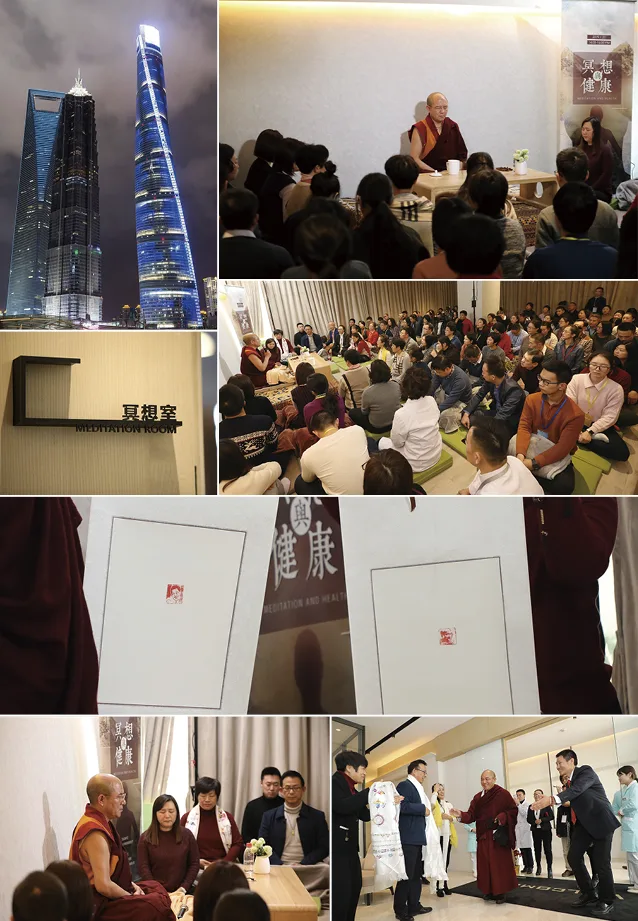
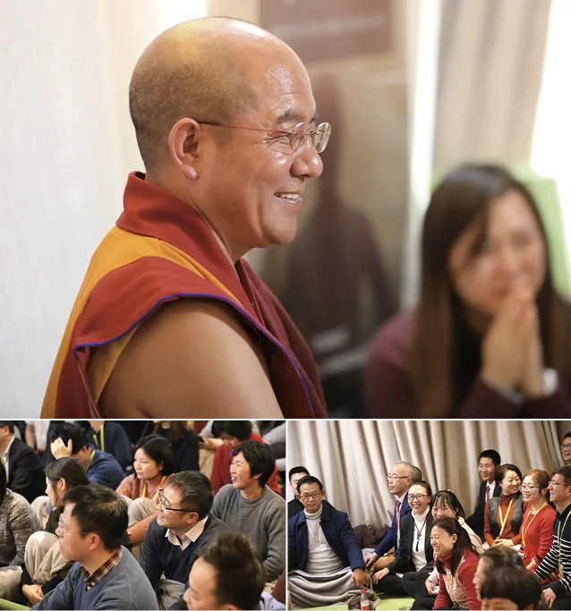
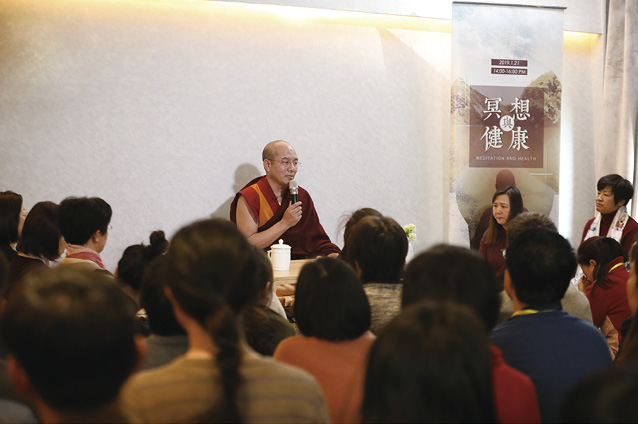
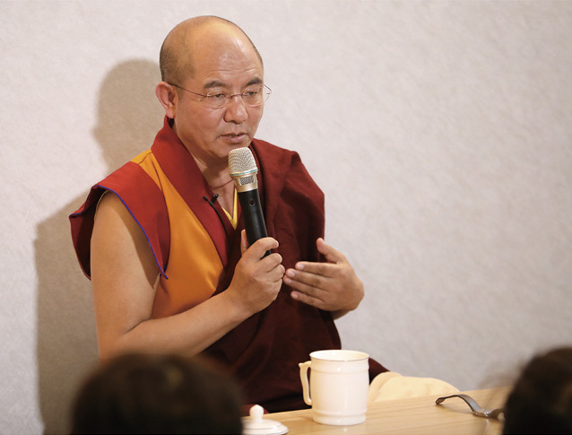
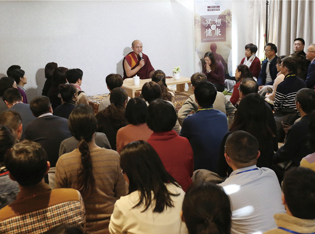
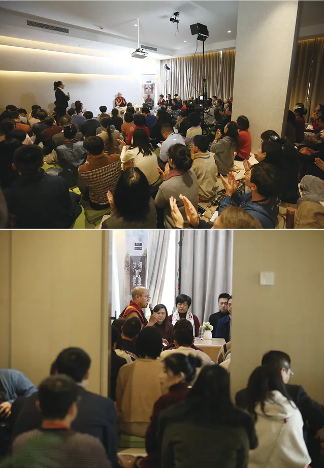
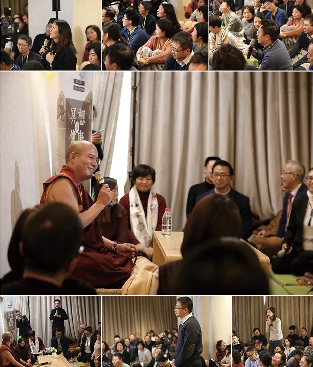
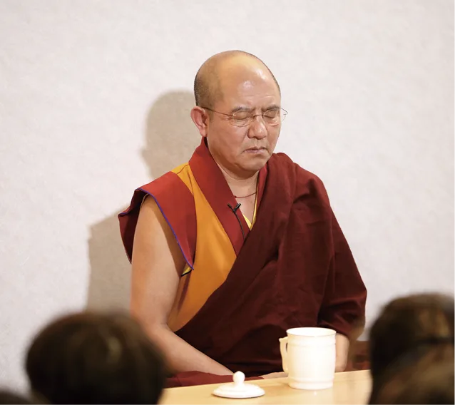

我们这颗心，  
可以将负面的东西，  
沉浸在清净、光明和空性的境界中。

第88场

上海整合医学研究院

Shanghai Institute of Integrative Medicine

中国·上海

2019 / 1 / 21

## 冥想与健康

## Meditation and Health

主持人：

下午好！我是歌特维集团董事长。首先，让我们以热烈的掌声，欢迎享誉海内外的藏地高僧大德索达吉堪布的到来！也欢迎所有远道而来的专家、学者和朋友们！

人们常说，健康就是财富。只有拥有了健康，才能拥有幸福，收获智慧。集团旗下的整合医学研究院、医学检验所和健康管理中心，是一个致力为人类身心健康提供服务的平台。今天，“禅修、冥想与健康”论坛，能在歌特维举办，我们感到无比荣幸。

接下来，让我们和令人尊敬的佛教大师索达吉堪布近距离、面对面地交流互动，希望大家都能得到极大的收获。感恩大师！感恩大家！

非常荣幸，今天能在这里和大家一起交流冥想的知识。这里是一个整合医学院，可能有很多我想象不到的新知识。现在的科技非常发达，很多研究成果都是我们非专业人员难以想象的。而且各领域的划分相当复杂，我们看西医时有一种体会，好像每个专家的专业都不同，有时候不免产生各种困惑。而在这里，传统医学和现代科学联手，共享很多资源，不同维度、不同领域的专家、学者和医生坐在一起，共同研究人体和人心的各种疾病，以一种圆融的方式，将健康的各个领域整合起来，为病人寻找好的治疗方法。这种理念，在当今时代应该是比较需要的。

我对医学不太了解，只对藏地的医学有过兴趣。其他的，包括中医和西医，只在自己看病的时候需要，病好了就不管了。不过，心理医生也好，西医中医也好，对我们每个人来讲确实都非常重要。

## 禅修——传统的心理医生

在整合各种资源、知识和经验的基础上，大家可能还需要重视一下传统的“心理医生”，也就是各大宗教都在运用的一些冥想方法。如今，这种方法在全球非常受重视，被认为是行之有效的心理疗法。不过在亚洲的很多国家，现在还处于启蒙阶段。

作为一个佛学研究者、修行人、普通的佛法老师，我自己确实觉得，好多人的心理疾病和身体疾病都跟自己能否调心有密切关系。如果懂得调整心态，长期禅修，不容易经常生病。即使生了病，也会很快痊愈，就像经常锻炼的人身体都比较健康一样。爱锻炼跟不爱锻炼的人相比，还是有一定差别。

锻炼身体有一套属于它自己的方法，而要锻炼自己的心，最好的方法就是禅修或冥想。

今天因为时间关系，我只能跟大家简单介绍一下。短短的时间内，不可能讲得非常透彻，但可以抛砖引玉，给大家打开一个思路，让大家在这方面稍微有些思考。

如今世界上的很多国家，比如澳大利亚、新西兰、印度等，不管发达还是不发达，禅修在人们的生活中都处于重要位置。今天这里来自不同领域的人，以后可能都需要对禅修进行研究，需要修行，这对你们个人的身体健康、心理健康以及延长寿命等，有非常大的利益。

## 什么是禅修？

禅修的内容是包罗万象的。就像我们给别人推荐一种药，肯定要对这个药本身作个介绍，比如它的药效如何、副作用有哪些等，把需要注意的几项列出来。今天我也按这几项来给大家介绍禅修。

这里的很多人，不管是高管，还是医生，可能都是多年的修行者，对我今天所讲的内容，应该比较熟悉。也有一部分人，刚开始对禅修生起兴趣，今天听到的会是新知识。

首先，什么是冥想？这一点大家一定要搞明白。冥想，在藏语中叫“桑丹”，意思是心专注于一处，心识能安住、安定，或者说让心入定。在梵语中叫三摩地。有一部经叫做《三摩地王经》，讲了很多禅定方面的教义。在汉语当中，有时候叫禅定，有时候叫禅，有时候叫定，有时候叫冥想，有很多不同的名称。在西方国家，有时候叫做zen，有时候叫meditation。

不管怎么称呼，都是一个意思，即用自己的心观察自己的心。通过这种方式，来认识心的本体。在这个基础上，再让心慢慢慢慢沉淀，安住，清净。这样的一种状态，就叫做禅定。

如果广说，禅的本体和分类非常多。总之，所谓的禅，就是用心来认识自己的心。当心安住在一定的境界时，它真正的本性，你会认识。

在相对深一点的层面，就如《金刚经》所讲的那样：“过去心不可得，现在心不可得，未来心不可得。”确实如此，当我们用心来观察自己的心时，会发现这颗心的本体是空性，得不到的。如果再进行分析，现实生活中心虽然是存在的，但却如梦、如幻、如阳焰、如水月一般，是显而不可得的一种状态。当然，这是佛教比较深的内容，专业性比较强。

现在很多西方学者，一讲到这些深细的地方，他们就不是特别感兴趣。所以在心的本体方面，我今天也暂时不谈。

## 禅修的几种类型

禅的分类是怎么样的呢？比较高的一种境界，就是净土宗和禅宗经常讲的“明心见性”，佛教的专业术语叫做“真如禅定”。获得了如来的境界、佛的境界，或者开悟者的境界，这个时候，就像我刚才讲的那样，对自己心的本体会完全明白。这样的境界，有时候说明心见性，有时候称一心不乱，有时候叫做大圆满、大手印，等等，有不同的说法。当然，这些对我们来讲是比较高的。

中等的禅定境界叫做四禅八定。一般来讲，入了这样的禅定，会超越我们平时所见的各种现象。如果在禅修的过程中，发现了心的部分真相，可以入定很长时间，有些人入定七天，有些人两三天、两三个小时。这个时候，心可以如如不动，而且保持很长时间。佛教的有些论典讲，无色界和色界的众生可以入定很多年，甚至多少万年。对我们普通人而言，这样的禅定境界也比较高。

第三个，就是一般的禅定。叫做什么呢？世间禅定。这种禅，对世间人来说比较好使，不需要皈依，不需要学佛，不需要任何宗教标签，只要让心安住下来就可以。现在世间有很多这样的禅修。

这一类禅修，在社会上非常流行。我们去餐厅、素食店，或者书店、会所、咖啡店等各种不同的场合，经常看到“禅”这个字。这个时候，禅就是指心灵的一种寂静。在那些场合，是没有所谓的宗教的。

在西方，比如西雅图、纽约等城市，有不少公认的高科技公司，他们的很多高管每天都会禅修半小时左右，也有把禅修安排在星期天的。我比较了解他们的修法。包括在各个大学的禅修室，大家禅修的时候，基本上只是让心安住下来，“先以金刚跏趺坐的坐式坐好，嗯，现在好好打坐，让心安住……”

当然，这种打坐方式，某种意义上可以压制我们的烦恼和痛苦，降低我们的血压，缓解我们的压力，平息心中的分别妄念和痛苦。但从佛教的角度观察，真正的禅修，应该是断除我执。所谓的“我”，在根本上是不存在的，不管是通过禅定的修行，还是通过理论的推断，这个“我”都得不到。

但现在有些禅修者，总是强调“我”应该安住在什么当中，“我”要怎么怎么——始终有个非常完整的“我”，一直保护着、保养着。从佛教的角度来看，这种禅修并不是特别究竟。因为没有断除“我”、没有以空性见解摄持，它暂时可以压制心中的痛苦和烦恼，让不好的情绪得到控制，但长远来看，由于没有认识到烦恼的根本——我执，不但没有认识到，而且还要“我”好好安住，所以解决不了生死大事。

就像有些动物——藏地有一种雪猪子，又叫做旱獭，冬天可以“入定”三个月，不会产生任何分别念。但是它的禅修境界并不是很高，春天的时候又照样出来了。

现在很多人都喜欢修一般的世间禅定。大家应该知道，如果自己已经有一定的禅定功夫和窍诀，可以往更高的禅修层次走。尤其是有一些佛教基础或者其他宗教背景的人，如果仅仅安住在心的明了、空性和无念的状态，并不是很高的境界，应该希求进一步的提升。这方面，佛教有一本书，叫做《大圆满禅定休息》，我以前翻译过。这本书非常珍贵，把禅定的各种歧途讲得非常清楚，对真正的禅修者来讲，特别特别重要。

关于禅定的重要修行次第，英文中有一些相关的资料，汉语中也有一部分。以前有一名叫做莲花戒的论师，他翻译的《修行次第论》详细描述了禅修的步骤，第一步怎么修，第二步怎么修，第三步的境界是怎么样的，等等。

今天在座的人，到底修的是出世间比较高的、远离一切戏论的境界呢？还是转生到色界、无色界，或者属于人间的非常稳固的禅定？还是现在东西方非常流行的只管把心安住下来？当然，能让心安住，也有非常大的作用。

## 禅修的功德

以上简单讲了禅修的几种分类。下面讲禅定对我们身体和内心的作用，或者说禅定的功德是怎么样的。大家可能也非常关心这个问题。

### 1．现代人深陷心灵痛苦

生活在这个浮躁的世间，平时很难避免各种分别念的此起彼伏。我们每一个人都觉得自己很健康，实际上有些属于亚健康，有些已明显得了抑郁症、自闭症以及其他各种各样的心理疾病。有些心理疾病，现在国际上还取不出符合其特征的名称，而实际上跟健康的身心状态有本质的差别。得这种疾病的人如今越来越多。

据我的了解和观察，心理不健康的人在任何一个时代，都没有21世纪这么多。人类历史发展到今天，应该说是比较漫长的。在过去的每一个时代，众生都有生老病死，谁也没有逃脱过。按理来讲，现在的医学技术和条件这么发达，人们在各方面都应该快乐而健康。可事实上，各种报告的指标显示却并不是很理想。

原因在哪里？也许是这个时代的医学仪器越来越高级，身心的一点点毛病都能检测出来，也许是这个时代的众生真的比较可怜——身体和心理都有太多的疾病。尤其抑郁症，这是一种非常普遍的心理疾病。包括我们今天在座的人，也许只是自己不说而已，实际上有很多人得这个病。（众笑）

原因是什么呢？主要是我们的执著导致的。就像我刚才讲到的，每个人的我执都非常非常严重。当生活达不到自己的目标、满足不了自己的欲望时，我们心里会非常痛苦，而且一直压抑、累积，最后发展成一种疾病。

### 2．禅修，驱散身心负能量

在这种时候，我觉得禅修非常重要。不管你有心理疾病也好，没有也好，都应该在日常生活中坚持禅修，哪怕每天早上5分钟，晚上5分钟，或者早上半个小时，晚上半个小时，这对自己的心理健康有非常大的利益。经常禅修的人，即使遇到特别严重的灾难，也能坦然面对，所以基本上不会得什么抑郁症之类的心理疾病。

通过冥想来促进身体的健康，现在网上非常多。有些是真的，有些是假的，暂时不谈这个。我想强调的是，坚持禅修的人，他的气色、心态以及整个人生状况，都与一般人完全不同。现在汉地也好，藏地也好，各个地方都有很多爱禅修的人。这些人通过禅修，心里的负面情绪越来越少，精神状态越来越好，甚至遇到了人生难以解决的问题，他们也可以迅速地、轻而易举地处理好。

去年，也就是2018年7月份，发生了一件事，大家可能都知道，我当时也很关注。泰国有13个少年足球队员，去一个原始森林的洞里探险。当他们到达洞的最深处时，突然下大雨，爆发了洪水，所有的洞口和出路全部被水淹没。这件事引起了全世界的关注，中国、日本、美国、英国和澳大利亚等国家，有很多人去参与救援。后来好像过了十几天，仍然没有找到这些孩子。

大家都觉得，这些孩子可能没什么生还的希望了，因为洞里缺氧，又没有食物。本来，他们只是去探索，很快就会回来的，没想到出现这样的状况，而且已失去联系十几天……

最终找到他们时，是什么样的情况呢？13个少年完好无损，安然无恙，没有任何生命危险，根本不是奄奄一息的样子。当然，各个国家对此事的报道程度有所不同。实际的情况是，这个足球队的队长有禅修经验，在危急情况下，队长带领大家一起禅修。他们以禅修的力量，远离了一切恐怖和危险。

大家都知道，普通人如果七天不吃任何食物，是非常危险的，但这些孩子却坚持了十几天。这件事情，让全世界的很多科学家开始重新思考医学对人体的实际作用。这一点，我们也可以思考。

事实上，真正的禅修对我们身体和心灵的作用，是非常明显的。这种作用，有些是我们自己能够发觉和体会的，有些则是我们难以想象的。包括在佛教徒内部，很多人对禅修的境界也很难想象。

我遇到过一些大学生，抑郁了很多年。我让他们把心放松下来，早晚都做一些禅修，或念一些咒语。这其实是一个很简单的事情。没有信仰的人可能会认为：“简直是胡说八道，这样做能有什么用？”但实际上它起到的作用，真的很难用语言表述。这些都是非常真实的案例。

很多人以前可能没有品尝过禅修的利益。如果你没有这方面的经验，我建议你试一试，把所有的我执、欲望、嗔恨等负面情绪全部放下，安住在心的本来状态中。在这个时候，你如果是有缘者，会认识自心的本来面目；即使没有认识，当下的负面情绪也可以消于真心当中。

我们每一个人都有阿赖耶识，又叫藏识或如来藏识。在这个如来藏识中，可以沉积很多负面东西。一般的垃圾扔在大海里后，大海本身有一种净化能力，会慢慢将这些垃圾腐蚀，而不会受到染污。同样的道理，我们这颗心也可以将负面的东西，全部变成清净、光明和空性的境界。那个时候，身心所有不健康的因素都将远离。

### 3．禅修，让你远离非人干扰

除了现实生活中的负面情绪，人生中还有很多其他的负面力量，比如所谓的附体、着魔等。有些人认为，这是不可能的，世界上哪里有鬼？哪里有神？事实并不像这些人想象的那样，我们的生命确实会受到一些外来力量，也就是各种非人的影响。这些负面的影响，如果坚持禅修，也可以远离。

我看过汉地的一个公案，好像是宣化上人讲的。说是有一个经忏师，经常到外面给别人超度、念经。有一次在回来的路上，下起了大雨，他也没有什么挂碍，就在桥下打坐。

依靠特殊的因缘，他听到旁边总有鬼在说话。刚开始，有个鬼说：“这里有一座金塔，非常光亮，我们可不可以去顶礼？”过一会儿，经忏师的腿有点痛，就把双盘松下来，打单盘。这个时候，鬼又说：“这里有一座银塔，我们要不要去拜一拜？”又过了一会儿，他的腿非常痛，于是把身体彻底放松下来。这个时候，鬼又说：“这里有一块土堆，不知道是从哪里来的？”

他不知道他们在说什么。休息了一会儿，又开始打起坐来。每次单盘的时候，鬼就说“银塔”；双盘的时候，鬼说“金塔”。后来他明白了，打坐的时候一定要正式，要么双盘，要么单盘，不能随便。

虽然汉传佛教有些观点认为，坐禅的时候身体不是最重要的，念佛的时候嘴巴不是最重要的，但是实际上，打坐的坐式还是很重要。我以前在其他地方也讲过，打坐的时候最好能双盘，不能双盘也要半跏趺坐。双盘你们应该知道，就像释迦牟尼佛的坐式一样。这种坐法实际上是一种缘起，智慧和悲心的力量可依靠它融入自己的心中。

这一点，我们自己也可以感觉到。比如，当自己特别累的时候，以打坐的这种坐式，闭着眼睛稍微坐一下，各种烦恼和痛苦就慢慢消失了。如果随意地以其他坐式，反而会产生更多的痛苦和分别念。

## 禅修的坐式

接下来我们体验一下禅修的感觉。禅修有毗卢七法的坐式，很多人以前可能都听过。大家可以试一下。

首先第一个，应该跏趺坐[^1]。

第二个，我们的脊柱，也就是整个身体要端直。有一种说法，身体端直则里面的脉端直，脉端直则心端直。有禅修功夫的人一般都坐得比较直。没有禅修功夫的话，坐的时候会一直动来动去——在一堂课当中也看得出来。（众笑）

有禅修功夫的人，不会刻意闭眼睛或睁大眼睛，目光一直自然垂视。有些人即使睡着了，也保持这样的姿势，就像一尊佛像。有了禅修功夫，连睡觉都跟一般人不同，不会倒下去。这是二个条件，身体要端直。

第三个，双手在脐下结等印，和阿弥陀佛的手印一样。或者左手结等印，右手结压地印，就像释迦牟尼佛的手印，但禅修时结这种手印的比较少。还有一种叫心性休息手印，就是用两手掌盖着膝盖。这是第三个条件，手印。

第四个，双肩稍微往后展。

第五个，颈部不要往后仰，应该稍微往前倾，因为这里有些脉络需要压住。

第六个，眼睛直视前面的虚空。刚开始禅修如果有分别念，闭着眼睛也可以。达到一定境界的时候，最好不闭眼睛。初学禅的人，睁开眼睛看到各种各样的东西，心很难安住，闭上眼睛会好一点。总之，根据功夫和境界的不同，自己决定睁眼还是闭眼。不过睁眼的时候，也不能睁得太大，否则旁边的人看到会有点害怕。（众笑）

最后一个，舌头顶住上腭。在禅修过程中，这种做法对控制唾液有不共的作用。禅修的姿势，腿脚、身体、双肩、手、脖子、眼睛和舌头，一共有七个要点，所以叫毗卢七法。在不同的佛教书里，个别地方稍有不同。

科学界和其他宗教，通过不同的方式进行过测试，发现这样的坐式非常有用。因此我们在修行时，一定要采用这种坐式。当然，这种坐式只适合初学者。如果我们的修行已经很好，时时刻刻都可以把控这颗心，那禅修的时候躺着也可以，站着也可以，不需要固定的坐式。那个时候的任何境界都是光明的、无分别的，不容易产生分别念。

尽管今天天气比较热，大家还是按照我刚才讲的要点，禅修一会儿。如果你自己有一套令心安住的方法，也可以用。

禅修时，最好能认识自己心的本性，这是最高的境界。如果没有这样的境界，不产生任何分别念，让心在光明、清净和空性的境界中放松也可以。其实，我们在生活和工作中感受到的各种烦恼和痛苦，用内观的方式一安住，就会当下荡然无存。

下面一起简单地修几分钟，大家可以结合自己的方式进入。

（堪布带领大家禅修）

## 念咒——禅修的另一种方式

这样的禅定比较舒服，大家可能愿意一直这样坐着。还有一种方法，当我们压力比较大，或者遇到了各种各样的不开心，这时可以一边持诵咒语，一边让心安静下来。这叫做什么呢？观察修。禅修有两种，一种是安住修，安住于禅修的境界当中；一种叫观察修，用自己的智慧来观察万事万物的本体，最后抉择为空性，也可以念六字真言。

念六字真言的，不一定就是佛教徒。汉地有些人根本没有信仰，但对观音菩萨还是很有兴趣和信心。世界上其他地方也是这样，有一部分人对佛教没有信心，但对观音菩萨是承认的。所以六字真言就相当于精神上的灵丹妙药。依靠它，能控制我们的恶分别念，生活中那些不太好、甚至比较恶劣的习气也可以依此来断除。

所以我的建议是，如果你实在不太愿意修禅——修不下去，那可以选择这个简单易行的方法，念“嗡玛呢巴美吽”。不用皈依，也不用学佛，只是念念这个咒语。大家可以尝试一下。我们佛教徒比较熟悉的这个咒语，对非佛教徒也非常管用。通过这种方法，同样可以让自己的心静下来。

你可以一边念诵，一边观想这个咒语发出光芒，能利益很多的众生，也能遣除自己身体的疾病和心里的不良情绪。表面上看，这种方法比较抽象，现代科学也无法论证，但确实有很多实实在在的成功事例。

我今天不讲什么大道理，只给大家提供一些实用性强的方法。因为现在这个时代，非常注重实用性。否则，我讲一个大道理——网上也有很多这样的道理，在这里给大家放一个PPT，大家也许有印象，也许没有印象。我希望今天讲的东西，大家在将来的生活中都能够用上。哪怕你是很了不起的科学家，也要面对生老病死。

第二种禅修方法，就是念六字明咒“嗡玛呢巴美吽”。可以默默地念，也可以发出声音。这个咒语非常有力量，可以说是人类精神的妙药。下面我们一起念一百遍“嗡玛呢巴美吽”，这也是今天的一种冥想方法。

（堪布带领大家一起念咒）

平时早上起床后，晚上睡觉前，或者在工作中，大家都可以念这个咒语。如果工作环境不方便出声，就默默地念。念咒时候的心，不一定要专注到什么东西上，一心一意地念就好。包括我们走路时、坐车时，总之，任何环境下都可以念。多念这个咒语有很大的利益，对我们身体和心灵的健康都有帮助。以上讲的是禅修的作用和功德。

## 禅修的五种障碍

下面，我讲一下禅修中容易发生的障碍。

按照佛教的观点，禅修的第一个，也是最大的障碍，是懈怠懒惰。现在，很多人要么忙着赚钱，要么忙着吃喝玩乐，比如看电影、赌博、刷手机、跟别人聊天等，各种玩儿法。平时有空，不好好学习，不好好修行，一旦遇到不好的事情，手忙脚乱，就准备要修行了。这样不是很好。懈怠有两种，一种是非常懒惰，天天睡懒觉；另一种是每天忙些没什么意义的琐事。现在的人特别散乱，尤其是在人工智能和网络时代，大家的心理都既脆弱，又散乱。我们如果不断除以上的种种怠惰，是没法进入禅修的。

第二个障碍是什么呢？忘失圣教。以前得过禅修的一些教言、窍诀和方法，但运用的时候却忘得一干二净，什么都没有了，只好按照自己的方式来进行。这样也不是很好。禅修之前，最好先看一些成就者写的书，记住关键的要点。现在网络上有些禅修的指导，听起来比较合理，实际上没有什么真正的价值。

我们在世间学开车或学一门知识，都要找一个专业而权威的指导，那学习参禅和冥想，自然也需要权威的书或者专业老师的引导。如果把这个引导忘掉了，那你就没办法趋入真正的禅修。以上两种情况，对进入冥想都会有障碍，这是加行的障碍。

第三个障碍，是对禅修本身的障碍。在禅修的过程中，有时心一直往内收，特别地困，修着修着就睡着了——进入了最深沉的“禅修”，我们每个人晚上都会有这么一段时间的禅修（众笑）。有些人的“禅修”已经达到8个小时，甚至9个小时。本来是要冥想的，却不知不觉进入了睡眠，这不太好。这叫做昏沉。

还有一种情况是掉举，指的是禅修时心定不下来。人虽然坐在禅修垫上，但是心早就离开了，一直妄想纷飞：“我该如何去赚钱，等会儿要怎样怎样。”一共才5分钟的禅修，他就看5次手表，因为他很着急，“我等会儿怎么打车，怎么回去，再如何如何……”心里一直在盘算。这样的话，只是身体打坐而已，心根本没办法入定。昏沉和掉举，是禅修最大的障碍，会障碍禅修本身。

第四个障碍叫对治行。在禅修过程中，一直很焦虑：“我修的是不是光明？我修的是不是空性？修偏了没有？修错了没有？应该用什么调伏分别念？”心里不断地涌现各种念头。这也是没有必要的，禅修的时候心应该很放松，很平静，一直修下去，不要过于进行对治。

第五个叫做不行对治。在禅修的时候，根本不管当下的状态，观得对也好、不对不好，散乱也好、不散乱也好，反正就这样坐着。这样的禅修，跟不修没什么两样，所以也是一种障碍。

这五个障碍，在我们大乘佛教所有的禅修教言中都有。你们要记住啊，第一个是懈怠，第二个是忘失教言，第三个是昏沉掉举，第四个是行对治，第五个是不行对治。这五个障碍一定要远离，否则，禅修和冥想是没有办法进行的。关于禅修，还有九种住心法和其他修法，由于时间关系，我在这里不多讲。

## 立志禅修，认识最高的境界

不管怎么样，我们每个人在生活中最好有一种禅修，时间长也可以，短也可以。心的这种安宁也叫做等持，对我们的身心健康能起到非常大的作用。

你们也知道，爱禅修的人，像佛教的许多高僧大德，能活到一百多岁。他们大多数长期吃素，经常参禅。我在泰国等南传佛教国家那边，经常有一种感受：坐在爱禅修的人身边，会觉得比较温暖，因为他们的心是寂静的，调柔的。不像我们一般人，一会儿非常欢喜，一会儿非常伤心，一会儿欲望特别强烈。我们认识自心的本性以后，看到的世界，跟现在这个世界还是有一定差别。

按照佛教的教义，佛陀也是通过禅修，最后认识了心的本性——共同乘的大多数宗派的说法是这样。不知道你们有没有看过米拉日巴尊者的传记。事实上，尊者也是通过苦行、禅修，以一个地地道道的凡夫身，抵达了修行的最高境界。尊者的经历，跟汉地六祖大师比较相似，他们都没有学习太多的理论，依靠修持禅定，认识了最高的境界。他们走过的路，我们每个人都可以走。

有些时候，专家也好，学者也好，有自己的傲慢，可以说是一种职业性的分别念，心一直没法融入本来面目。如果一直这样，到死也不会认识自心的本面。而我们有些人，身份虽然非常普通，却有可能认识最高的境界。尽管没有什么丰富的专业知识，最后却认识了自身本具的如来藏本体，这个可能性是有的。

## 禅修的最高目标：利益众生

在座的各位，从身心健康或提升智慧的角度考虑，需要选择禅修。但我们禅修的最终目的是什么呢？利益众生。当我们的智慧真正得以提升，或达到最高境界时，不会因为坐得非常舒服而天天入定。现在大家坐的垫子都很舒服，但这只是让你开悟的暂时条件。你开悟以后，不能一直坐在这里，而应该走出去，度化众生。

世上还有千千万万的众生没有开悟，他们很可怜。明白这一点后，你肯定坐不住，垫子再舒服，也不想坐在上面。你会觉得：“像我这样的人，一直坐这里，太可惜了，一定要去度众生！”总之，大家禅修开悟以后，最高的境界是像佛陀一样，像菩萨一样，去利益众生。

我希望各位都能拥有好的心态。有了好的心态，就会有好的形象；有了好的形象，不管是自己，还是身边的人，都会非常开心。如果心里天天产生自杀的念头，“唉！活着真没意思，好痛苦啊”，那给周围的人带去的也都是负能量。这样没有必要，活着还是很有意义的。

大家先应该通过冥想来提升自己的智慧。有了真正的智慧，你们的悲心自然会开发出来。用这种悲心，可以帮助身边很多需要帮助的人，这就是我们活着的意义。这一点，每个人通过自身的努力和正确的方法是可以做到的。

其实，很多修行人以前非常痛苦，不管是有钱、有地位，有什么样的外在条件，都走不出痛苦的包围。后来通过禅修，基本上认识了心的本来面目，心力变得强大，遇到什么都很快乐。这样的方法，我觉得在当今社会是非常需要的。

有些年轻人以为，传统文化和宗教思想对自己不重要，平时一点也不关心。一旦人生出了问题，再去寻找，已经晚了。在这之前，凡是对人生有意义的道理，都应该去认真了解，认真学习，认真修行。希望大家能认识到它的重要性。

现场互动

问：随着科技的不断发展，人类的病也五花八门，越来越多，但医院的传统治疗对抑郁症和恶性肿瘤等却没有太大帮助。既然佛法能够帮助我们从六道轮回中解脱出来，那么如果通过如理如法的冥想、修行和行持善法，可否让这些疾病得到很好的治疗？请您慈悲开示，并给这样的病痛患者一些信心和希望！

堪布：其实我经常去医院。一到医院，就感觉全世界的人都生病了一样。

前段时间我在川医做了一次体检。我习惯性地自己排队、自己挂号，跑来跑去。在这个过程中，看到很多的病人，有些非常严重，有些不是那么严重，这个时候，自然而然生起一种感慨：不管是中医还是西医，医生们真的很伟大。

有时候，虽然会出现医患关系紧张的各种新闻，但我认为这些只是个案，大多数医生确实非常辛苦。有些做手术的医生，往手术室一站，基本上就是一整天。

前年我在北京做了个手术，花了6个多小时，在整个过程中，医生们一点都没休息。我问医生：“你们平时是不是也这样？”他说：“你这才6个小时，不算很严重。还有8个小时、十几个小时的，中间根本没办法离开。”

因为工作太劳累，很多医生晚年身体都不好。所以，我们对整个医学界的人，应该有一颗感恩的心。

现在的中医、西医和藏医，他们的治疗并不是没有意义。有时候，一些疾病本来会让我们离开人间，但通过治疗，让人重新有了生存的希望。而且，有个别的病，中医也好、西医也好，的确束手无策，没法治。通过佛教的修行方法，有些好了，有些也不行。

世间的各种疾病，往往比较复杂，我们应该一分为二地分析，不能一概而论。就像有些病，中医治不了的，西医可以；西医治不了的，中医可以；中西医治不了的，佛教可以；还有些病，医生和佛教都没办法。总之，有各种各样的情况，我们需要多方面地了解，这个很重要。

当然，生病有时也源于众生的一些业力。我自己生病的时候，不会抱太大希望，不管怎样都可以，反正已经活了这么多年——这是我一直以来的心态。如果还有希望，我会通过佛教的方法，念念经，坐坐禅。如果是西医明显观察到的疾病，光靠禅修可能不行，还是要去医院。如果医院实在没办法，那就好好地念念经吧。

生命再长也就那样，到了七八十岁，觉得也该离开了。在这之前的10年、20年，很快就过去了，寿命不过是数字而已。在这个世界上，每个人都是来也匆匆、去也匆匆。

问：我们正在学习《入行论·静虑品》，其中讲到了自他交换。请问，怎么修自他交换，怎样才能切身感受他人的痛苦？

堪布：《入行论·静虑品》主要的修法是自他交换和自轻他重。自他交换，是一种观察修。具体观察的方法，在《修心七要》中讲得比较清楚：“我自己所有的快乐都奉献给其他有缘众生，其他众生的痛苦都由我来承受。”这样的观修方法非常殊胜。

昨天有个人对我说：“我现在病得比较严重，去医院治疗也有一定困难。”我就想到了《修心七要》里讲的修法：“如果我生病对众生有利益，让我生病也可以；如果我健康对众生有利，让我健康也可以；如果我死去对众生有利，让我死了也心甘情愿。”这样的心态，对修行境界高的人来讲，是最好的自他交换——用我的死、我的病和我的不幸，来让其他众生快乐、解脱。

其实，这样的菩萨，在世界上真的存在。佛陀因地的很多公案，都是这样的。当众生遭遇饥荒时，他就变成大鱼，让他们吃掉；当众生遇到灾难时，他就出现在他们面前，替他们感受痛苦。这是非常伟大的精神和行为。在这世间，一个人救了另一个人的命，或者做了一点好人好事，就会得嘉奖赞扬之类的，而菩萨是完全为他人奉献自己，这种精神值得大家思考。

如果自己有一些信仰，生病是修自他交换的好机会。你若已是癌症晚期，药石无效，这时候如果能调整心态，放下执著，把自己的身体奉献给众生，也许反而就痊愈了。不过，对很多人来讲，这是很难想象的一种治疗方法。

主持人：

下面，我想给教授们一个机会，好吧？我自己也是一个教授，以前很傲慢。要让我给谁跪下磕头，那是不可能的。后来吸收了佛法的智慧，我每天都私下给自己不喜欢的人磕几个头。坚持一两个月以后，她开始喜欢我了。现在，我俩能够手挽着手走路。这真的很有意思。我们的教授，谁先举手？

某教授：

尊敬的上师，您的开示，令我非常感动，真的有泪水涌出的感觉。在美国，我也听过其他宗教的布道。但这一次，我非常非常地感动，特别是最后您说到的，要走出去利益众生。我没有什么问题，就想表达一下：我们搞科学研究的人，从某种角度上讲，是要负载一定责任的，要走出去！我想，以后会把您最后说的这句话，宣讲出去。谢谢！

问：我是做整合医疗的，其中很大一块是能量医学，也就是通过调整人体的频率来调整人体的健康。我们认为身体的疾病有两块，一块是功能器官性疾病，一个是能量方面的疾病。我们认为的阴阳平衡，就是器官与能量之间的平衡。但是我们现在走得很艰难，因为大家相信器官这种看得见、摸得着的东西，不相信能量这种看不见、摸不着的东西。您是怎么看能量医学的？

堪布：你的这个问题，因为我不是这方面的专家，所以听得似懂非懂。

我也听说过，在医学界对人体的各种测试中，所谓的能量实际上分为两个层面：一个是物质层面的，也就是身体所蕴含的能量，跟人体的经络、器官、系统等有关，这是色法的能量；另一种能量，用佛教的观点来讲，是没有颜色、没有形状的，跟心识层面有关。

不知道你们学过《俱舍论》没有？这部论典说，万法可以归摄为十八界，包括六种根，即眼根、耳根、鼻根、舌根、身根、意根；六种境，即色、声、香、味、触、法；六种识，即眼识、耳识、鼻识、舌识、身识、意识。

其中，第六识——意识，属于心法的范围，比较抽象。我们心里产生的痛苦和烦恼，其实就是意识的一种状态。现在很多科学仪器对有色、有形的东西，可以进行检测，但自己的意识什么时候出现、什么时候消亡，却一点概念也没有。

科学界对意识的研究，仅限于对大脑、心脏的研究，主要停留在物质层面。尤其是西方科学，对意识研究得很少，很难真正触及其本质。即便是目前的心理学，也没有找到特别有效的途径进入意识领域。所有医疗仪器和专业知识，针对的几乎都是身体。

身体和意识之间的衔接，如今可以说存在断层。我觉得你们研究的能量医学，实际上跟内心有关。但一触及情绪、念头、欲望等，现代医学就束手无策，找不到合适的参考资料。换句话说，凡是跟情绪、业力有关的，医学是没有办法的。

其实，有些疾病，我们叫做业力病，医学根本观察不出来，但它的确存在，只不过比较特殊。如果站在医学的立场，把它界定为一种病变，好像也不是很准确。

在某些方面，正如你们所说，可能需要借助佛学的力量。昨天崔教授私下和我谈了这方面的探索研究，我也跟她讲，这是很有必要的。在西方，很多脑科学、心理科学等方面的专家，都会请宗教人士参与自己的研究。你们的能量医学，从这方面也可能会找到切入点，获得某种层面的初步性突破。

不过，我不敢确定一定如此。因为你的问题，我的确听得似懂非懂；我的回答，你可能也听得似懂非懂。

问：前天您讲，现在好多人的痛苦来自心中有“我”。刚才您讲，当我们修炼到比较高的水平时，应该走出去帮助他人，这样自己也能获得快乐。我目前的工作是研究从新手成长为专家的心路历程，虽然还不到专家水平，但却经常在工作中感到喜悦。我想问问您，在您的成长过程中，您的快乐是不是一直和不断给予他人快乐有关？

堪布：我的成长经历，跟你们很多人都不太相同。

我23岁出家。16岁之前没有学过任何知识，一直当牧童，在山上放牛。16岁才上小学，然后是中学、师范，简简单单地读书，书没读完就出家了。出家后一直到现在，都在山沟里待着。我们喇荣山沟真的很小很小，到了你们上海，一看还有那么大的城市，觉得自己像是井底之蛙。我接触的人、过的生活，都非常简单，整天和出家人一起辩论，禅修环境也比较单纯。

对一个人来说，自己的快乐从何而来，随着年龄的增长，还是会有不断变化。年轻的时候，心态各方面比较活跃；到了中年，对地位、名利比较重视；老了以后，对自己的健康比较执著。每一个阶段沉迷的都不太相同。

不管怎么样，人生的每一个阶段，都应该是学习的过程，没有必要特别执著。小的时候，我们特别执著玩具，但到了今天，也知道玩具没什么好玩的。今天的人们，在很多方面都比较执著，比如大学教授执著职称等。虽然人生应有一定的竞争和奋斗，但也不要过多去贪求，这样才能活得更自在、更快乐。

“随缘”这个词，来源于佛教。表面上谁都会说，但在实际生活中，却是一个很轻松、很有效的方法。

主持人：

我接触的很多上师，也许并没有索达吉堪布这么有成就——他们在更小的山沟里修行，但是到了外面的世界，却没有一点恐惧和不安。而我们很多教授却有不安，包括一些很厉害的教授，也会在某个舞台上急得冒汗。这就是开悟者和普通人的区别。开悟的状态，是很多人没法体验的。所以，我们都好好地禅修，希望有一天也能进入这样的状态，好吗？

问：我在教孩子们学《弟子规》。发现孩子们很难专注，就带他们禅修。我让他们以毗卢七法的姿势坐好，然后说：“不要想吃的，不要想喝的，不要想玩具。”但觉得这样提醒他们，反倒啥都想起来了。又说：“放空自己。”可对5到12岁的孩子而言，不太可能知道什么叫放空。尊贵的堪布，希望您给弟子和孩子们的禅修作一些指导。

堪布：小孩子打坐，虽然不一定打得很好，但是人在小的时候，生活的点点滴滴对将来都有很深的影响。从小有这个习惯，我觉得很好。

你跟他说“不要想吃的”，他可能真的就想起了吃的，但让他这样安坐，也是在培养良好的习惯。泰国的很多小孩子，禅坐的时候非常可爱，他们可以一直坐很长时间。我们藏地的有些小孩儿，也会禅坐。

孩子们坐禅的时候，也许起心动念非常非常多，但是小时候的习惯对人生真的很重要。让他们慢慢地学，至少保持五分钟不动，闭着眼睛坐好。长期坚持，会有效果的。

很多人老了以后才开始禅修，或到了中年才开始，与其这样，不如让他们在小时候就练习。对他们来讲，这才是一个好的开始。

问：我在学校里是做行政工作的。原来没有接触过佛法，更多把它当作一种哲学。当然，我本人对佛学非常敬重。我晚上睡觉或早上起来，有时也会做一些思考，比方说我是谁，我从哪里来，等等。想多了以后，会非常地困惑。您刚才讲，禅修其实是为了发现自我。我深受启发，同时又产生了困惑——我不知道自己的理解对不对：修行是不是一个从找到自我，再到发现无我的过程？可是我们修行本身是为了找到自我，并偏执于自我的这种状态，这和最后的结果是不是比较矛盾？

堪布：每一个真相，都需要通过智慧来认知。同样，我们每一个人的自我，也需要用智慧来认识。一种方法是让心静下来认识，另一种方法是通过各种逻辑推理，也就是以科学分析来认识。

这位老师提的问题很好。平时，我们谁都不会去寻找自我。每一个人都理所当然地认为“我要赚钱，我要如何如何”，但实际上，我到底是什么样的，值得大家认真思考。在生活中，如果能像禅宗参话头那样，多问一下“我是谁”，可能会对自己有个提醒。然后进一步观察，我到底指的是什么？这是更高层次的探求。

佛教中最高的开悟，是最后要找到我的真相：我在也可以，我不在也可以。当然，关于我，各个宗教的说法都不相同。有些宗教认为我是实实在在的，比如永恒的神我；有些宗教则认为我是不存在的。这些都是宗教的观点。我们现在不说宗教，只要一个科学的结论：我到底是什么样的？如果心里有这样的探究，这是最好的修行，最后得到的也是科学的判断。

科学的判断是什么呢？不加任何信仰，不加任何感情色彩，唯一用理性的智慧进行观察。未经观察的时候，大家都认为我就是我，我是存在的。现在就来观察一下：这个所谓的我，到底是指心呢，还是指身体？如果我是心，心到底在哪里？如果我是身体，那它是整体还是支分？或者，过去、现在、未来的哪一个我，才是真正的我？

有些时候，在寻找自我的过程中会认识到：“我们在这个世间，一直认为的那个我，经常寻找的那个我，原来是这个样子……”会有一种比较奇妙的境界。OK！

主持人：

再次感谢尊敬的索达吉堪布给我们的精彩开示和答疑！下面我们送给堪布一份特别的礼物。这份礼物来自一名曾经的抑郁症患者。他通过佛法的修行，现在已经完全康复了。

他为索达吉堪布和晋美彭措法王，各刻了一枚人物章——把他们的照片刻到了一方印章上。在我们国家，这种技艺目前还很少有人掌握，他是自学成才的。当年奥巴马来上海访问时，主办方也是用这样一枚章子作为礼物相赠。他因为抄写《心经》，并学习堪布的教言，得到了很多的启示，最后走出了抑郁症。所以他委托我们，把这份心意送给堪布——

（堪布接受礼物）

[^1]: 跏趺坐，佛教术语，即互交二足，将右脚盘放于左腿上，左脚盘放于右腿上的坐姿。在诸坐法之中，以此坐法为最安稳而不易疲倦。
