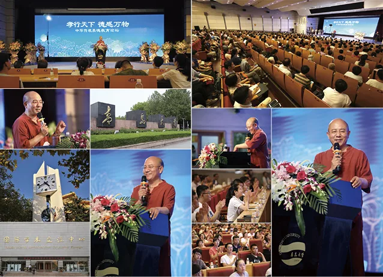
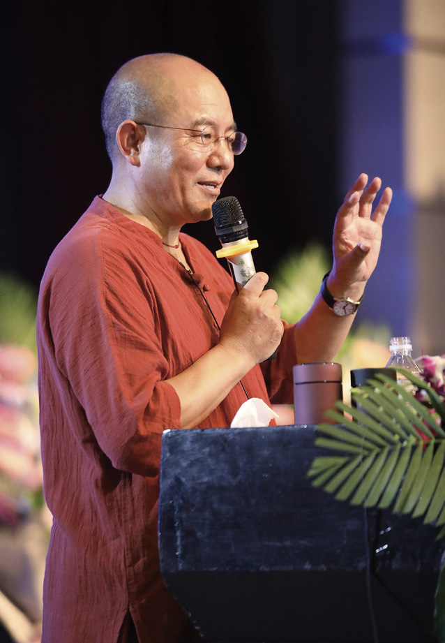
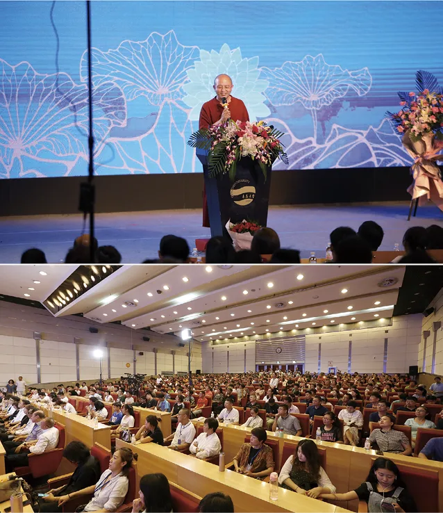
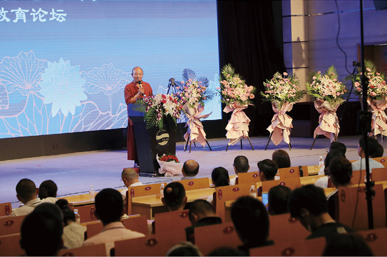
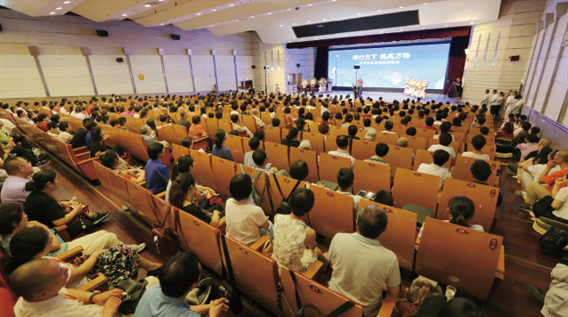
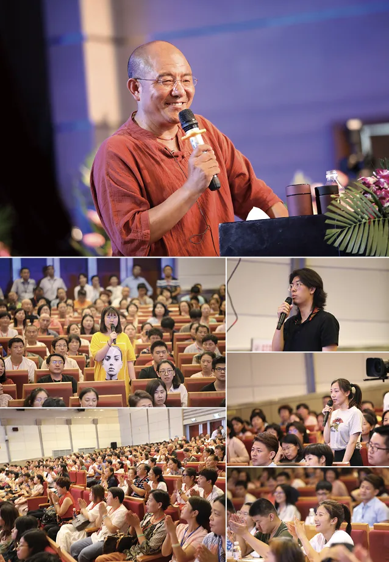
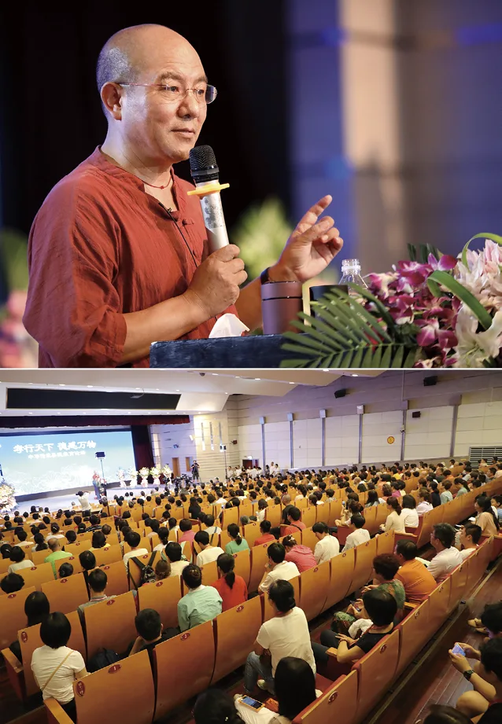
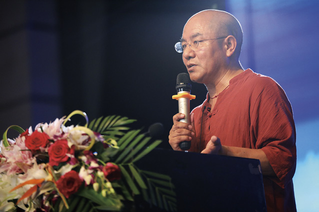

如果你坚定地走一条路，  
全世界都会为你让路，  
为你创造方便。  
这就是理想的力量。

第89场

中华传统美德教育论坛

Chinese Virtue Education Forum

中国·山东

2019 / 6 / 17

## 孝行天下，德感万物

## Filial Piety and Virtue

主持人：

接下来，我要向大家隆重地介绍一位老师。他就是索达吉堪布，全球著名的文化学者、教育家、慈善家！

堪布亲自捐建了两所小学和一所中学，资助了许许多多的贫困大学生、失学儿童、重大疾病患者等，参与建立了敬老院、医院、孤儿院等，并积极投入各种救灾、救难的公益活动。2008年和2010年，堪布与国家领导人一起，参加了第三届、第四届国际慈善论坛，并发表了主题演讲。

此外，堪布还受邀在国际国内许多知名学府，比如哈佛、耶鲁、剑桥、清华、北大等一百多所高校进行演讲，去过国内外几十所监狱、看守所、戒毒所，宣讲中华民族的传统美德，宣讲《弟子规》，宣讲做人做事的根本和底线，为和谐社会作出了重要贡献。

接下来，请大家全体起立，并以最热烈的掌声，欢迎索达吉堪布！

很高兴今天能跟各位老师、各位同学，一起探讨国学，探讨我们传统的孝道文化。

在我的前面，有很多老师跟大家作了真诚交流；在我的后面，也会有很多老师作精彩分享。我不是国学专家，更不是国学大师，但对传统文化有着极大的信心和兴趣。在座的大多数老师和同学，对我们的传统文化也充满了信心，并有求学的意乐。

人类到了21世纪，科学技术飞速发展。在这样一个特殊的时代，每一个同学、每一个老师，思想都是崭新的，既懂得西方的科学技术，也懂得东方古老的传统文化。然而，由于东西方文明的冲突日益剧增，人们的思想变得比较复杂，生活也变得比较复杂。

少数人可能认为：“所谓的孝文化，不过是要求我们恭敬、承侍自己的父母，是控制和约束我们的工具，有点封建迷信。”其实不是这样的。虽然从表面看，传统文化不那么重要，但实际上，在我们的生活、工作和学习中，它能帮我们解决许许多多的问题。

在现代社会，人与人之间的关系非常复杂，很多人都为人际关系而苦恼。夫妻关系矛盾重重，离婚的人越来越多。老师和学生之间、父母跟子女之间，相互不理解的现象也非常严重。此外，现代人的压力特别大，有家庭的压力、工作的压力、感情的压力，等等。这些问题和压力，如果懂得传统文化的甚深道理，都可以解决，可以缓解。

## 给大家推荐三本书

### 1．读《孝经》，了解丰富的孝文化

《孝经》的文字不多，只有十八章。我前年用16节课讲过一遍，感受非常深。我当时想：现代学生的很多问题和痛苦，这里面早就有答案；老师们的很多抱怨和烦恼，这当中也有答案；父母和子女之间的紧张关系，运用其中的理念也可以解决。我甚至觉得，所谓的孝文化，从广义上讲，每一个人都应该学一学。

有些人认为，孝文化只有一条，就是恭敬父母，听父母的话。其实，在古人的思想里，孝文化非常丰富。《孝经》当中讲，天子、诸侯、卿大夫、士和庶民五种人，都有各自不同的孝文化的定位和标准。天子、诸侯和卿大夫的孝，是对国家、君臣和百姓负责，需要处理好这三方面的事务。士和庶民的孝，则是在家孝敬父母，其中又包括生前之孝和死后之孝；在外则以忠顺之心，处理好和上级之间的关系。

现在，很多人都沉陷于迷茫的状态。而依靠这部短短的《孝经》，很多迷茫都可以消除。所以我想，在座的老师和同学，可以一起学学《孝经》。不要把《孝经》看作是只教人如何恭敬父母，诸如给父母洗洗脚，方便时打个电话，如何成为一个乖孩子之类的简单理念的传播工具。实际上，我们在生活难以解决或想不开的很多问题，通过学习《孝经》都能迎刃而解。

### 2．《弟子规》，不只是孩子的读物

我给大家推荐的第二本书，是《弟子规》。在座的许多人，应该都学过这本书，内容比《孝经》多。我以前也给别人讲解过，并把它翻译成了藏文。后来，我作了一些注解，出了一本书，叫做《弟子规另解》。

《弟子规》里面，也讲了如何处理和父母、亲人、朋友乃至君主等上上下下的关系。在为人处世、待人接物、心态转化等方面，讲得非常好。很多人学了《弟子规》之后，人生都有很大的变化。

有些人认为，《弟子规》只是孩子们的读物，在幼儿园、小学、中学阶段学一学还可以，一旦上了大学，就不用读《弟子规》了。这是一个错误的想法。我们每一个人，不管是大人还是小孩，学一遍《弟子规》，自己的认知都会有很大的提升。

我们的很多痛苦，都是因为认知或价值观出了问题。认知提升了，痛苦自然会减少。你要是和朋友的关系处理不好，在儒家和佛教的思想中，一定会找到原因和解决方案。

所以，我也建议大家学习《弟子规》。所谓的学习，并不是随便看一下，而是一定要学懂，让自己在思想上有所收获。要觉得自己收获颇丰，学习才算成功。老师们囫囵吞枣，随便讲一讲，学生们走马观花，随便看一看，能不能达到学习的目的呢？肯定不能。

不管你有没有信仰，都应该学习传统文化中的重要经典。之前很长一段时间里，人们都不太重视《弟子规》。而这几年，不管是在大学，还是社会各个阶层，大家都开始重视。但我觉得，力度还不够。

我认为，每一个人都要学《弟子规》；不但要学，还要学好；不但要学好，还要认真行持。理论跟行为之间，毕竟还有一定距离。有些人学得很好，讲得很精彩，做得却比较糟糕。有一种说法，“理论与实践之间，可以跑一匹马”，意思是距离比较远，说的和做的完全不一样。

认真学完这部论典，对自己会有新的认识。我几年前讲过一两遍——先给少数学生讲过，后来又在大众中讲过，也算是学过一两遍。现在，还想再讲一遍，或再学一遍。

### 3．《善生经》，教你处理六方关系

我给大家推荐的第三部经典是什么呢？《善生经》。今年，2019年，我讲过一遍，共十一堂课。内容是什么呢？也是人际关系。

人际关系确实非常重要。如果人际关系搞好了，人生的大半烦恼都可以消除。现在的人，因为吃饭穿衣、饥饿贫困带来的痛苦比较少，大多数痛苦来自欲望过多，或欲望得不到满足，或者说，大多数痛苦来自夫妻关系处理不好、朋友关系处理不好。

这个时候，要学一下《善生经》。《善生经》的讲解方式比较特别，提到了东、南、西、北、上、下等六个方向，每个方向都代表一种关系，我们自己则站在中央。下面有仆人，上面有领导，周围是父母和亲朋好友。我记得父母在东边，老师在南方，西方是夫妻，北方是亲友。

有些人只对领导恭敬，对下面的人毫不客气，经常踩在脚下；有些人对下面特别爱护，特别慈悲，但跟上级关系不好，经常顶撞上级，甚至被开除；有些人跟上下级的关系还算可以，但跟东、南、西、北四方的关系却搞不好。

在座的每一个人，都站在中间，都要面对六方的关系。当然，同学们现在没有六方，将来会有。在《善生经》当中，自己和六方之间，互相都有要求。比如子女对父母有要求，父母对子女也有要求；老师对学生有要求，学生对老师也有要求。并不像有些思想那样，只要求下面的人怎么做，对上面却没有约束。实际上，每个人的内心都渴望公平。如果老师自由散漫，却要求学生遵守纪律，学生就会受不了：为什么只要求我们守纪律，老师却不守？

《善生经》不是这样的。老师要遵守老师的几条规则，学生要遵守学生的几要规则；妻子要遵守妻子的几条规则，丈夫要遵循丈夫的五条规则；亲戚也好，仆人也好，长辈也好，都有与自己身份相呼应的若干条规则。

学好了《善生经》，对家庭关系、师生关系等，都会处理得很好。

从大的方面讲，我们每个人都是地球的微小细胞。个人如果做得好，家庭也会做得好；家庭做得好，社会群体也会做得好；如果群体非常圆满，国家乃至整个世界的和平，也容易实现。

我们的烦恼和痛苦，一部分来自内心，一部分来自外部的人际关系。掌握了人际关系的处理方法，就会过得特别快乐。所以我建议大家，好好学习《善生经》，这对当前来讲非常重要。

## 寻找传统文化的气息

如果我们把这些全部扔掉，还有没有传统文化呢？很难说。历史学家们认为，东方文化或者说亚洲文化，有八千年的文明，有五千年的文明，有三千年的文明，等等，有各种不同的文字记载和说法。但实际上，如果用智慧观察，我们自身的修养或生活，还有没有这样的文化气息呢？

中国的传统文化，归根结底就是儒释道三家，即儒教、佛教和道教。这三种教派，都是在公元前600年到公元前500年之间出现的。孔子、释迦牟尼佛和老子是三派的始祖，都生活在两千五百多年前。从春秋战国开始，经由秦、汉、三国、两晋、南北朝等各个朝代，一脉相传两千多年，这些文化我们现在还有没有呢？印度文明也好，日本文明也好，中华文明也好，亚洲的很多文明，除了博物馆里陈列的少数文物以外，真正的文化现在还有没有？

这个问题，值得很多专家学者去观察。

我们五千年或八千年的亚洲古文明，当今在我们的生活当中，能看到、能感受到的有多少？翻开我们的课本，翻开琳琅满目的各类图书，除了极少数的诗词和文字外，我们的传统印迹还有多少？历史书上虽然有一些记载，但它们却放在藏书阁里，落满了灰尘。在我们的基因中，或者说在我们平时的生活中，还有没有这些文化呢？除了极个别的服饰风格和礼义廉耻的词句，传统文化还剩下什么？

两千五百多年前的印度，佛教的仪式、念诵、文字、传承，现在极少数寺院还保留着一部分。除此之外，其他的地方有没有呢？也许有，也许没有。

## 碎片文化切割下的人生

我们现在真正拥有什么呢？近代文明、现代文明。这几年是人工智能时代，再过一段时间，可能就是所谓的6G时代。很多专家认为，再过十年、二十年，整个人类将处于虚幻的世界。

其实不用几十年，我们现在就处在类似虚幻的世界里面。为什么这么讲呢？现在很多人都有一种病：五分钟没用手机，心里就发慌。“可能来重要信息了”，然后五分钟打开一下，十分钟打开一下。如果一个下午没看，比如刚才几个老师讲课的时候，可能很多人都有点着急，生怕错过什么重要信息。其实有没有重要信息呢？很难说。

现在大多数人的生活，都被手机和电脑控制着，真正自由的时间几乎没有。网络的碎片文化，能不能形成整体的人生观、价值观和世界观？很难。因为它没有真正的架构，就像各种瓦片和砖砾堆在一起，虽然个个看起来都很精彩，但却什么也不是。要做成宏伟的建筑物，需要砌在坚实的框架上。

东西方的文化碎片，琳琅满目，令人眼花缭乱，不看好像不行，但看的话，时间很快就没了，看完也就忘完了——现在应该还算可以。如果分析家们说的是真的，再过十年、二十年，人类将处于虚幻世界，情况可能更糟糕。

这个时候，我们不能怪任何人。大环境已经变了，我们只能接受。有些专家特别着急，抱怨说：“我们五千年的传统文化快毁掉了，怎么办啊？”但着急也没有用。整个世界，短短的几十年，已经彻底改变。将来，还会变得更快。

企业的文化在变，学校的教学方式在变，媒体的形式也在变。以前的传统媒体，现在很少有人看——现在看电视的有多少？看电影的有多少？全部都在看短视频，还有的人已开始体验特殊的VR头盔。人类正处于快速变化的时代，我们固有的文化不断受到冲击，甚至可以说遭遇了灭顶之灾。

## 两头讨巧的新兴人类

孩子们不再孝顺，尤其是西方留学回来，跟父母的思想会有一些差距。对此，父母特别着急，特别抱怨：“你们这些90后、00后，怎么会这样？”西方的很多思想，跟我们东方的传统文化，确实有一些不同。

现在有些孩子，觉得对自己有利，就搬出西方思想：我要自由，不要多管我的生活；我要自信，跟着自己的心走；我要强大，要实现自己的理想；我要有梦想，要做自己喜欢的事情，等等。

西方的年轻人，不会依赖父母，到一定的时候，就自己去创业，去挣钱，独立生活。但涉及这方面时，刚才那些孩子就不提西方思想了：“你们是我的父母，必须给我钱！”父母不但要给学费、生活费，甚至已经大学毕业了，已经成家了，还要啃老，还一直要父母给钱。

一方面，他们需要东方思想，因为自己不愿意独立，希望父母提供经济和思想上的帮助和指点；另一方面，他们又需要西方思想，希望有自己的空间，父母不能过多约束，不能逼婚，不能控制他的生活，等等。

现在这个世界，确实比较复杂。父母和子女之间、老师和学生之间，关系都比较复杂。但不管怎样，我们应该理解这个世界。

## 心不快乐，GDP增长有何用？

短短的时间内，东西方文化相互碰撞。传统文化强调的天地人伦，根本比不上西方科技文化的力量。虽然西方的科学技术对人类的发展作出了巨大贡献，可是，西方的科学技术对人类也造成了极大的危害。现在很多人的心理疾病，都来自科学技术，因为科学技术只管生活或物质，对人类的内心世界从来都没办法。除了西方心理学有少许涉猎，西方思想对人类心灵的探究基本上是空白。

本来，东方的传统文化有很多调心的好方法，但是，现在的老师和孩子都觉得，这些古老的思想跟自己没有关系。尤其是在一段时间当中，孔子的思想、佛陀的思想，被批斗、被舍弃，最后基本上没有了。现在要重新延续传承，确实非常困难。在某种意义上，我们现在的文化，根本没有几千年历史，主要都是在学西方的文化思想。

文化和知识是有差别的。现在的很多大学生，知识比较丰富，不管是数理化、网络通讯、新兴科技等，都掌握得不错。但有没有文化的传承呢？没有。如果不信，那你说一说，你家的文化传承是什么？你可能会说：“我要问问父母。”但你的父母也不一定知道。现在网络上流行的，大多是西方人或现代人创造出来的新兴文化。它们能不能解决我们内心的困难和痛苦？不能。

我们并不是一定要弘扬传统文化，有一种类似宗教的狂热，不是这样的。我们之所以弘扬传统文化，是因为它在调整内心方面非常出色。这样的文化传承如果不重视，一味地追求科技和物质的发展，人类将来是不会快乐的。如果人类不快乐，社会再发展，又有什么用呢？单纯GDP的增长又有什么用呢？尤其将来AI统治整个世界，我们如果没有坚强的意志，没有远大的理想，这个世界会有多么可怕！

## 今天的大愿，明天的生活

我经常去一些学校，发现有些学生非常不错，不管对于当下的学习，还是未来的理想，都有自己的目标和追求，这个很重要。如果在学校就有这样的志向和愿景，将来一定会有成办这些的力量。

现在有一种说法：“今天的大愿，是明天的生活。”今天如果立下大愿，将来要成为科学家，成为医生，成为老师，并为此不断地奋斗，将来就会变成那样。即使不能完全成真，也会给自己的人生带来很多方便。

如果你坚定地走一条路，全世界都会为你让路，为你创造方便。这就是理想的力量。

但现在有一部分学生，基本没有理想，在学校完全不看书，天天玩手机。问他：“你的追求和理想是什么？”可能除了吃吃喝喝以外，什么都没有。曾国藩是著名的政治家、思想家、哲学家，他曾经说过一句话：“不为圣贤，便为禽兽。”人有两种，一种走圣贤之路，一种走禽兽之路。如果没有远大的理想，没有利他的思想，那就和动物没有什么差别——光是吃吃喝喝，动物也会。曾国藩的说法也许有点过激，但确实值得我们深思。

作为学生，一定要有理想，这个很重要。不管是去西方留学，还是留在国内读书，都应该有明确的目标。就像做作业一样，树立理想应该成为我们的必修课。如果大学期间都在迷茫，那什么时候才能苏醒过来？如果自己都不考虑自己的未来，谁又能真正为你考虑？

《周易》里面有一句话：“蒙以养正，圣功也。”意思是说，童蒙时代就应该培养孩子的纯真无邪与浩然正气，这是圣人的功德。如果放任孩子在学生时代浑浑噩噩、放逸散乱，等他们进入青年时代或者建功立业的年龄，谁能帮助他们？

实际上，个人的未来、家庭的未来、社会的未来，都需要我们有理想。而这样的理想，传统文化都进行了阐述。古人大多有齐家、治国、平天下的抱负，终级理想是利济普天下的民众。这样的理想，现在多数人是没有的，有的只是个人主义。

自己以后要赚大钱，买好的房子、车子，找到满意的人生伴侣，尽情享受天伦之乐，这是当前很多人的理想。实际上，你即使真的有钱、有实力，能享受这样的生活，对整个社会的意义又有多大呢？

人不能只为自己活着。即使不能变成伟大的人物，也要发下广大的誓愿。什么样的誓愿才叫广大呢？按照大乘佛教的教理，我们要发誓让天下的所有生命离苦得乐。有大誓愿的人，总有一天会发挥自己的作用。

## 佛教徒出家，就是不孝吗？

有些学生可能想：在传统文化当中，比如说佛教，是不是不孝顺呢？

有一部佛经叫做《大方便佛报恩经》。当时，佛陀在灵鹫山，有人跟阿难尊者说：“汝师不报恩德。”为什么呢？因为佛陀才生下七天，母亲就离开了。后来，他又把父亲扔在家里，自己去追求甚深之道。为了消除人们的误解，佛陀讲述了这部经，里面有很多公案和故事。其中讲到，佛陀不仅即生关爱自己的父母——成道以后，为了报答母亲的恩德，专门到三十三天为母亲宣讲正法，在过去世，当父母遇到饥饿时，他也曾将自己的身肉布施给父母。

从这个层面来讲，佛教的思想跟儒家还是有差别。儒家一般认为：不孝有三，无后为大。古代人特别重视传宗接代，所以有这样的说法。佛教徒出家修道，不能传宗接代，所以看似不孝。实际上，佛教徒出家的比例是极小的，尤其是现在，几乎没有。另外，很多世间人即使没有出家，也不愿意结婚、生子，家庭的传承很难延续下去。所以，传宗接代困难重重，并不是佛教导致的。

实际上，佛教究竟的理念，并不是让人出家，而是让人觉悟，让人的心变得宽广、慈悲。弘一大师、太虚大师出家以后，帮助了多少人，做出了多么伟大的事业，大家应该清楚。我们能说他们不孝吗？绝对不能。

我们的思想观念，应该从大的方面拓展，对局部和偏狭的部分，要慢慢地拓宽。传统或佛教文化的有些思想，和现代文化之间是有平衡点的。找到这些平衡点，对我们来说非常重要。

## 百善孝为先

总之，我们应该站在客观公正的立场，进行深入的思考和抉择。传统文化到底是什么？在社会、学校和家庭里，现在有没有传统文化？如果有，是哪些？如果没有，需不需要？如果不需要，大家都去学西方文化，到底行不行？

这三四十年，西方文化在全世界泛滥，可以说是铺天盖地。照这样下去，我们内心的很多痛苦，可能都没办法消除。而有些人通过修行，通过学习传统文化，变得非常快乐。即使生活发生了巨变，依然能坚强地面对。这就是内心得到调理的一种体现。如果用其他的方法，比如某些科技文化或新型医疗手段，恐怕很难起到这种作用。

传统文化有这么好的调心方法，有这么好的精神文明，大家应该一起捍卫，一起守护，一起弘扬。如果能够这样，每个人都有机会获得真正的快乐。

以后，我们在学习的过程中，一定要有进步。不管是学传统的文化道德，还是学现代的科学技术，都要像古人说的那样：“苟日新，日日新，又日新。”每天都应该有进步。即使没有进步，也不能倒退。社会要进步，个人的内心必须先跟上。这是一个方面。

另一方面，我们自己在进步的同时，不能损害他人。“己所不欲，勿施于人。”我们不愿意感受的痛苦，不愿意接受的事情，对其他的生灵而言，也是一样的。所以，我们应该尽量地帮助别人，做真正有意义的善事。

“百善孝为先。”一切善都以孝为本，以孝为先。而所谓的孝，就是一种善良的心。要延续这颗善良的心，就必须学习。我刚才讲到的三部经典，《弟子规》《孝经》《善生经》，如果学得很好，生活中遇到任何困难，我们都有智慧和能力去解决；工作上的痛苦和烦恼，我们也能轻松面对。尤其对我们现在最大的困扰——人际关系的处理，有非常大的利益。

我今天就讲这么多。谢谢大家。

现场互动

问：我是来自青岛大学商学院的一名学生。现在有很多大学生选择整容，您觉得是否有必要？我们是应该引导他们正确认识自己，还是选择接受或者包容？

堪布：如果对身体没有损害，整整容也可以。现在这个社会，大家都喜欢颜值高的人。相貌庄严，也会给身边的人带来快乐。

关于这个问题，我其实咨询过很多专家。长远来看，如果技术非常好，对身体没有损害，或没有大的后遗症，整容也未尝不可。整完以后，相貌跟以前相比，确实会好看很多。而且，如果大多数人都整容，只剩下几个不整的，给人的感觉可能也怪怪的。

我比较担心的是大家的健康。有时候新闻报道说——可能只是个别的案例吧，有些人因为整容，最后出现这样那样的问题。如果是这样，即使长得不太好看，也不建议去冒险。毕竟健康才是最重要的。

我个人在这方面，虽然问过很多人，包括专业做整容手术的、开美容店的，甚至问过一些韩国人，但到目前为止，还没有确切的答案。可能需要分析具体情况，不能一概而论。

问：我是青岛大学商学院会计系的一名学生。现在“校园贷”比较流行，很多学生为了一时的享乐，去乱借校园贷，以致最后还不起。对校园贷造成的不良后果，您怎么看？

堪布：我也发现，大学校园里的借贷问题非常严重。现在，很多学生都有及时行乐的观念，商家便针对这种心理，推出各种校园贷，非常吸引人。

有些学生，可能并没有特别关心自己的家庭，以及自己的未来，加上没有智慧，受到身边见闻的影响，便随波逐流，去借校园贷，最后给家里带来非常大的压力，甚至连学业都没法完成。

所以我觉得，在大学期间，大家一定要把心放在学业上。如果心思没在学习上，带着各种欲望进入校园，那你待在学校的意义不是很大。

实际上，不仅我们的一些学校有这种情况，西方很多学校也面临着比较大的挑战。所以我想，老师们的引导很重要。上课的时候，老师不能只讲知识，还应该教学生怎么样做人。老师不教学生做人，教育的作用就体现不出来。如果仅仅是学技术，那学校都成了“技校”，而不是真正的学校。当然，个别老师自己可能也在参与这些，有时候也很苦恼。

不管怎样，我认为学生在学校里，一定要刻苦学习，不应该过分享乐。我们以前学习的时候，条件非常差，但心比较静。不管是学习8年、10年、20年，作为一个学生，就应该专注学习，刻苦努力，这是重中之重。

问：我是一名大一的学生。现在人们都说，要爱别人，先要爱自己。我的问题是，怎样才能做到接受自己，或者说我们如何才能做到自爱？

堪布：现在还有一种说法，“要像爱钱一样，爱自己和他人。”

关于爱自己和爱他人的话题，课本上不是特别多，因为课本多以知识为主。在传统文化里，比如我推荐的《孝经》和《弟子规》，都讲到了如何爱自己和爱他人的问题，这一点很重要。

西方学校提倡的个人主义，也不是完全不合理。一个人如果不爱自己，经常折磨自己，比如自残、自虐、乃至自杀，那他是不可能爱父母的。如果对自己的生身父母都不爱，对恋人和朋友也没办法爱。如果对身边的朋友都不爱，那对同事、素不相识的人，乃至整个人类，爱心更是没办法扩展。

人类最伟大的思想，就是“爱”。任何宗教、任何古老的思想，都包含了这个“爱”字，所以今天的我们也同样需要。如果我们既不爱自己，也不爱家人，乃至对所有的生灵都不爱，那表面上看来是人，内心跟人还是有一定差别。

动物也有自己的感受，也会吃东西、喝水，也会追求自己的快乐。人和动物最大的差别就在于，人类有互相帮助的爱心和奉献精神。

我觉得，在幼儿园、小学、中学阶段，都应该有爱的教育、慈悲的教育。爱的教育有几个方面，其中最基本的，就是懂得爱护自己。我看现在有很多学生，根本不知道爱护自己，一直熬夜、熬夜，吃夜宵，然后看连续剧，到了第二天，整个人都是迷迷糊糊、晃晃悠悠的。整天吃很多垃圾食品，吃这个吃那个，最后把身体搞坏了。甚至打架、酗酒、抽烟，等等。

对健康非常不利的事情，很多学生却在肆无忌惮地做，父母不制止，老师也不劝阻，最后健康的身体没有了，心态也越来越糟糕。等他们毕业以后，要他们为社会、为家庭做一些事情，是非常困难的。

现在最关键的是什么呢？学校对每个学生都要有爱的传递。当然，这种传递在课本上很难找到，只在传统文化里还有一些。有了爱的传递，每个人都懂得奉献利他，社会才会和谐，人才是真正的人。

问：我是波士顿大学传媒学院的一名在读研究生。我发现有很多大学生，都处于非常不安的状态，也就是您刚才说的迷茫状态。因为大家普遍不太自信，却对未来有着特别高的期待。而且，生活在物质主义的社会里，很多信息都在加重我们内心的焦虑。在这种情况下，我们应该怎样能静下心来学习？或者去做自己要做的事情？

堪布：你说得对。现在确实有很多人，包括我认识的有些学生，因为害怕面对社会的压力，不愿意毕业，想一直读书。但是我觉得，不能有这样的恐惧感。虽然这个社会很复杂，物质主义盛行，人人都是“金钱动物”，只认金钱，没有什么理想，也没有什么真正想做的事，想的全是如何赚钱，认为有钱就会快乐，但有了钱也不快乐，各种痛苦会纷至沓来。不管怎么样，我们还是应该对自己有信心。心的力量很重要。

大学生们为什么迷茫呢？因为，不管是东方的大学，还是西方的大学，都只是灌输知识的机构。除了极个别老师以外，真正给学生作人生引导的很少很少。如果学校能引导大家走上利他的人生之路，引导大家做一个坚强的人，这样的迷茫可能会减少很多。

我特别喜欢一句话：“心若向阳，无畏悲伤。”如果我们的内心，无论何时都处于宁静而阳光的状态，生活就没有过不去的坎。任何事情，我们都可以坚强而理性地面对。

其实，迷茫也没有什么，要懂得随缘。按照目前的人生方向，自己去努力就好。当然，人生的路，并不像有些同学在学校里想象得那么美好。有人觉得家庭生活特别美，但真正成家以后，很多问题都会出来；有些人认为找到工作很幸福，但你找到了工作，内心如果不坚强，也会遇到很多问题。生活本身就是这样的。

问：我是来自英国杜伦大学大二的一名学生，就读于市场营销专业。看了您在世界各地的大学演讲，受益非常多。我目前面临着毕业和就业的压力，父母对我的职业有所期许，但我有自己的想法。如果按自己的想法去做，父母难免会生气、失望或不理解。怎样才能圆融地处理好这个问题？

堪布：你是不是不想回来？现在很多父母，把孩子送到其他地方去读书，最后孩子不想回来，他们就不高兴。

不知道你的想法，跟父母的期望有什么样的矛盾。当然，这也是正常现象。你可能需要和父母多次谈判，像中美贸易一样。你跟父母之间，可以相互提条件。经过长时间的多次探讨，你如果确定自己想要什么样的生活，父母最后也许会同意。

究竟来讲，父母基本上是听孩子的。如果实在不行，你就慢慢地熬时间，一直拖、拖、拖。（众笑）

问：教育有一种先入为主的规律，应该怎样引导世界观已趋稳定的大学生，以及自己的父母亲人，让他们对传统文化生起信心，能够接受，能够理解？另外，弟子们发愿和您一起弘扬传统文化，请加持我们。感恩！

堪布：把传统文化弘扬于世界，有一个最根本的问题：能不能先感动自己？比如你学了《弟子规》《三字经》《大学》《中庸》等传统经典以后，有没有觉得，两千多年以后产生的许多现代思想，根本没法和历史悠久的传统文化相提并论？

我讲《孝经》和《弟子规》的时候，偶尔会发现，有些理念跟现代社会格格不入，没办法讲，所以就婉转而过。但其中的大部分思想，确实是感天动地，即使对现代人而言，也非常鲜活。如果没有这样的精神支撑，现在的人会过得非常苦恼。

我经常听到有人讲：“因为学了传统文化，所以我得救了！”“我通过修行，最后获得了新生！”感觉人生没有希望的时候，自己通过学习某种理念或修行，最后坚强起来，坚持走到今天，在这个世界上，这样的人还有千千万万。

所以，我们如果真想弘扬传统文化，一定要先把它学懂、学透。先花几年时间，通过各种方式，懂得它最精髓的部分。那个时候，你才有弘扬的能力，才不会停留在口头上，才能让每一个听闻者得到身心的切实利益。

现在很多人、很多学校都在说“我们在学习传统文化”“我们在推广传统文化”，实际上只是挂牌而已，里面并没有传统文化的实质，不过是搞一个形式。

如果老师确实通达了精华意义，就一定会给学生分享思想醍醐。所以我想，最关键的，要看自己能不能通达其中的甚深之意。

问：我是来自中国海洋大学的一名老师。在此聆听您的演讲，非常荣幸。中国有一句古话：“仓廪实而知礼节，衣食足而知荣辱。”我们国家这几十年，物质生活发生了翻天覆地的变化，但精神世界却存在不少的问题。您怎么看这个问题？在当今时代，我们如何才能做到知礼节、知荣辱？

堪布：我们现在确实丰衣足食，很多人都有满足所需的物质资源。但我们的精神文明却有一些断层和缺失，比较苍白。

物质文明和精神文明发展不平衡，对许多国家、很多人来讲，都是正常现象。但精神与物质之间的落差不能太大，否则生活水平前所未有地提高，精神文明却一直得不到提升，甚至倒退，人们的快乐或者说生活质量是没办法提升的。

唯一的办法是什么呢？复兴我们的传统文化，弘扬我们的传统文化。这对每个人、每个机构来讲，都非常重要。如果没有确信可靠的方法来弘扬传统文化，任凭物质文明高速发展，到一定的时候，整个社会会失去平衡，人们的生活不一定快乐美满。

所以我的建议是，要想尽一切办法，把曾经失去的传统文化找回来，现在弥补还来得及。目前，我们有许多国学老师，有许多重视传统文化的力量。

试图依靠物质解决所有的问题，归根结底，是西方文化给我们带来的困境和歧途。西方人在工业革命之后，把所有的幸福都寄托在金钱上，极度提倡个人主义、物质主义。认为只要物质发展了，一切快乐都没问题。但到后来，西方社会也面临着各种各样的困境。只不过，西方有比较成熟的法律体系，还有一些宗教传统，所以情况比我们稍微好一点。

但是，如果我们也像西方那样，只注重物质，自己又没有好的平衡机制——既没有传统文化，又没有宗教信仰，仅仅依靠物质，肯定解决不了方方面面的社会问题。

我们面临的最大问题是什么？精神越来越苍白，欲望越来越膨胀，整个社会出现了各种各样的状况。幸好，我们有很多的大学和老师，在一如既往地重视国学。我希望，包括企业家、高校老师以及艺术界人士在内的各个领域的有识之士，都能像今天一样，从不同层面、不同维度，向学生传递传统文化的价值和意义。

这里的每一个人，兴趣、爱好和特长都不相同，如果大家都从各自不同的角度进行弘扬，传统文化的复兴也不是特别困难。

问：很抱歉，我的腿有病，只能坐在轮椅上提问。现在的网红效应，对年轻人的价值观和消费观产生了很大的影响。大学生应该如何正确看待这种现象？网红现象应该怎样和传统文化的弘扬和传播结合起来，起到更积极的作用？

堪布：我其实比较关注网红效应。但有些事情，关注了也没有用。

许多传统文化对年轻人缺乏吸引力，各种新兴艺术和网络文化却受到很多年轻人的热烈追捧。原因是什么呢？传统文化的弘扬需要基础，需要积累和沉淀，而现在的新艺术、新文化，尤其跟商家有关的，包括一些新媒体，会花很多精力，私下了解人们的心态，比如大学生喜欢什么东西，喜欢什么语言、什么行为，喜欢什么脸型、什么服装，然后针对这些特点专门设计，专门安排。然后，个别大学生就在某些场合，迅速变成网红。

那天我在机场，看到一个学生，带着二十多个人。所有的人，都在给他拍照片，前前后后一直这样拍。他自己有点傲慢，走路的姿势都跟别人不同。他戴着一顶帽子，把脸挡着，基本上不让人看。很多人，包括有些女性，都蹲下来，从下方给他拍照。

他如果真的有智慧、有能力，那值得拥有这样的待遇。一个人有自己的才艺、演技、特长，确实值得赞叹。但在网络时代，有时候该出名的不一定出名，不该出名的，甚至有一些怪异行为的，出起名来却非常容易。

我想，传统文化要跟新媒体完全结合，可能有一定的困难。一是传统文化需要基础，需要沉淀，一是这个时代的人觉得它陈旧、古老，跟自己的生活毫无关系。不过，我们如果通过相应的传播方式，让人们认识传统文化的重要性，最后逐渐逐渐地，人们还是会回来的。

西方国家有个别的人，曾经一味地追求外在的物质，后来发现物质不能带来快乐，又回归传统文化。在西方，有些国家只有两三百年、六七百年的历史，他们最后都会回到自己的传统文化，我国的历史有几千年，大家在追求物质文明的路上走累了，也可能回来休息一会儿。

问：我来自中国HRD俱乐部。去年，承蒙您的厚爱，专门给我们俱乐部录了一段开示的视频。您在视频里讲到，希望我们每个人都能忘掉焦虑，健康而勇敢地活着。我想利用这个机会，对您表示衷心的感谢，感谢您对我们的加持！

在当今的职场上，虽然我们经常说要调节自己的内心，但因为有太多喝酒的机会，太多熬夜的机会，太多加班的机会，最后往往都做不到。我的问题是，我们如何做，才能够处理好这些关系，真正做到健康而勇敢地活着？

堪布：每个人都有烦恼，都有不开心的时候，都有对自己不满意的地方。不过从大的方面讲，只要健康地活着，就是一种成功。为什么呢？当你将要离开这个世间，或是遇到特别大的灾难，或是得了重病，那时才会知道，只要健康地活着，哪怕什么也没有，也非常快乐。

你提到的问题，很多上班的人都会遇到，比如熬夜，早上不吃饭。我个人认为，除了特殊情况以外，不管是学生、老师，还是其他人，正常作息都是最好的长寿秘诀。不管你晚上睡多长时间，一定要早一点起床。你们海边有那么好的跑道，早上起来可以跑一跑步，锻炼锻炼身体。

熬一次夜，三天都没办法恢复，经常熬夜的人身体都不是很好。酗酒，从佛教的因果观念来讲，过失很大；从现代医学或健康理念来讲，酗酒就像吸毒，对免疫系统和神经系统有极大的危害。我们能活到今天，很不容易。为了继续活下去，一定要掌握基本的健康常识，懂一些基本的健康理念。

很多年轻人不吃早饭，喝点咖啡就去上班或者上学，这样的习惯非常不好。我最近一直在强调吃早饭的重要性。从头一天晚上，到第二天早上，我们的肚子一直空着，需要及时补充大量的水分和饮食，所以早上一定要吃饭。这样的饮食习惯对健康很有帮助。身体健康了，坐禅也好、工作也好，都非常有力量。为什么有些宗教的大德特别长寿？就是因为作息非常规律。

寂天菩萨有一句特别著名的名言：“遭遇任何事，勿扰欢喜心。”不管什么时候，不管遇到什么事情，都不要不欢喜，一定要开心、快乐，这个很重要。一直痛苦、抱怨，没有必要。人能活多长时间，谁也没法确定。在世的时候，不管怎样也要开心。

我本人就是这样。不管发生什么事情，我都觉得有因有缘，应该随缘，不会扰乱自己的欢喜心。这对自己的各方面都有意义。
