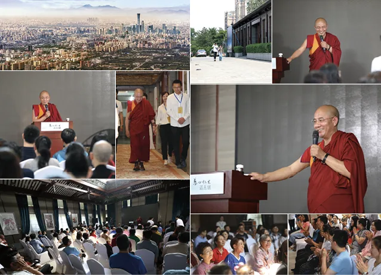
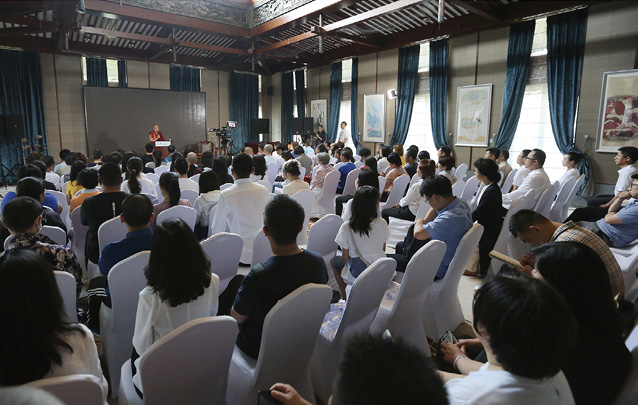
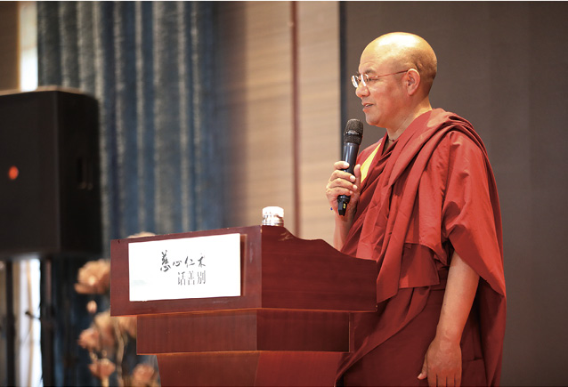
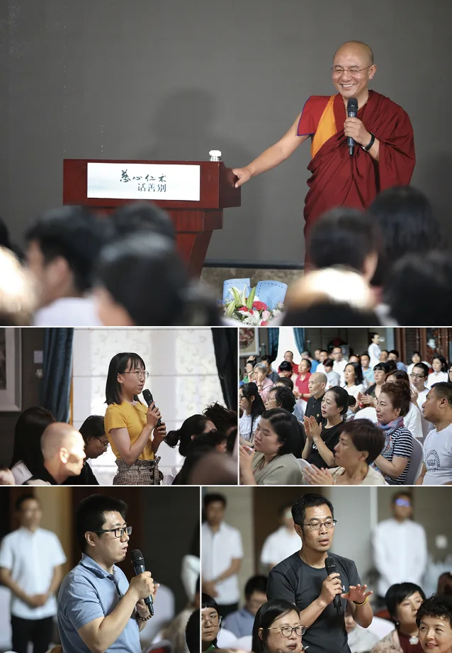
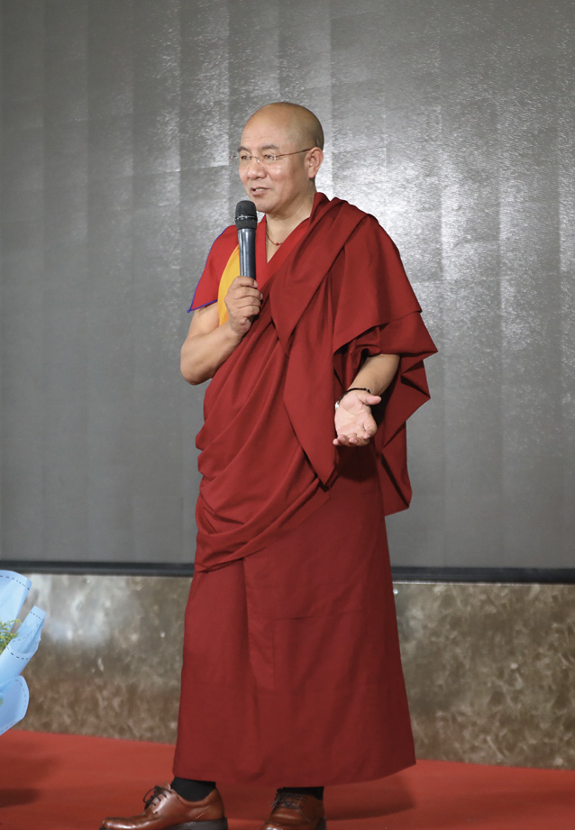
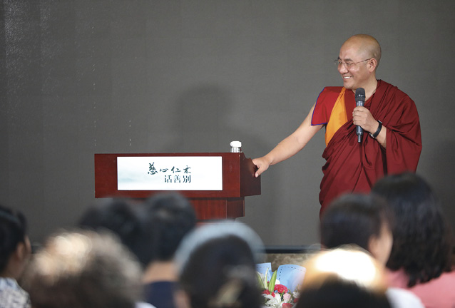

如果每个人都有利他心，  
那我们这个社会是有希望的，  
我们这个民族是有希望的，  
我们这个地球是有希望的。

第92场

北京星期八文化中心

Day 8 Culture Center, Beijing

中国·北京

2019 / 6 / 23

## 慈心仁术话善别

## Compassion-Hospice Care

主持人：

尊敬的索达吉堪布、各位嘉宾、各位医护工作者，大家下午好！

欢迎大家来到“慈心仁术话善别”的讲座现场。我们荣幸地请到了索达吉堪布，和大家一同交流。堪布是国内外公认的大德，培养了很多学生。30年来，他的足迹遍布全球各地，一直践行在弘法利生的路上。自2007年开始，堪布先后建立了小学、养老院等公益机构。对此，相信大家通过刚才的视频已有所了解。

今天现场有很多医护工作者，大家每天的工作都关涉生死，也比平常人见证了更多的生离死别，令人敬重。而在佛法中，有很多的智慧和方便方法来照顾和利益亡人、病人以及健康的人。现在，我们有请索达吉堪布进行“慈心仁术话善别”的演讲，为我们分享这方面的经验！

各位老师，各位医生，很高兴跟大家有这么一个交流的机会。今天我主要讲临终关怀，或者说佛教对于死亡的认知。

## 人生很短，不知不觉就老了

我23岁出家，然后一直在一个非常小的山沟里学习。有将近10年的时间，和外界没有什么接触。后来，去了一些地方，了解了一些社会现象。之后，除了平时的学习，也做一些慈善，比如刚才介绍的，建了一些学校。

我所建的学校里，有2所小学——在校生大概有1600人，还有1所中学。前两天我下来的时候，中学刚刚送走了第4届毕业生。到目前为止，已经有860个学生从中学毕业——建中学的时间比较短。小学做得稍微长一点，差不多有12年了。

在这之前，自己一直在山沟里默默无闻地看书、学习，做一点翻译，给为数不多的人讲讲课。人生就是这样。刚开始一直读书、学习——你们可能也是这样，中间创业，然后安家立业，付出各种努力，不知不觉就到了人生的最后，基本接近圆满了。尤其是到了五十岁，知天命的年龄，精力开始不足，身体也不太好，很多方面都没有年轻时那么轻松活泼，那么满腔热忱。

我觉得人生非常短暂，真正做事情的时间，可能也就10到20年吧。当然也有个别人，能力非常强，心力也非常强，到了80多岁、90多岁，还在为社会做贡献。

我的人生比较平淡，也比较简单，没有什么大起大落。这一生，是以平常而普通的僧人身份度过的。

## 生命的终点，不该如此冷漠

### 1．缺失的死亡教育

接下来，跟大家分享一下佛教关于死亡的道理。就像刚才主持人说的那样，在座的大多数来自医学院和医院，有些是医生，有些是护士，有些是志愿者。你们经常陪护病人，帮助病人，都是经常和死亡打交道的人。

每个人都绕不开生老病死，最后一定会面对死亡。不管什么身份，包括在座的每一位，最终都会离开世间。而我们身边的人，更是一直在陆续离开。

离世的时候，绝大多数人都很悲伤，并出现各种惨状。除了极个别修行人或大成就者以外，能够非常自在、非常洒脱地面对死亡的人，可以说非常非常少。

本来，关于死亡，不管是自己的死亡，还是他人的死亡，都值得我们认真关注。可是，在我们的教育中，这一块却非常欠缺。在座的各位可能非常清楚，一些著名的媒体人也经常说：中国人的死亡教育，连小学水平都没有。死亡教育对我们来讲，确实非常陌生。

在西方或者其他发达国家，虽然他们的一些做法我们不一定完全认同，但他们从小就接受死亡教育，对死亡非常关注，还是值得我们借鉴的。由于他们在死亡方面有关心，有思考，有认知，有训练，因而在面对自己的死亡或者亲人离世的时候，心态一般都比较正常。虽然心里也很伤心，很痛苦，甚至悲痛欲绝，但“有生必有死”的规律，他们还是容易接受的。

可是在我们这里，很多人对“死亡”却比较忌讳，认为不吉利。平时在生活中也不会聊，不会谈，因为一谈起这事，就感到恐惧、害怕——既害怕自己的死亡，也害怕别人的死亡。包括看到尸体的时候，也有一种恐惧感，甚至对放过尸体的屋子或地方，也比较忌讳。比如拉过尸体的汽车，好长时间大家都认为这车放过尸体，一定要注意。总之，有各种忌讳。

事实上，真正的尸体并没有什么可怕的。藏传佛教有一位非常伟大、非常著名的修行人，叫米拉日巴。他是怎么说的呢？“见而生畏之尸体，本为现在之身体。”我们认为非常可怕的尸体，实际上就是我们每一个人现在的身体。只不过我们现在的身体有灵魂，可以行动，死去的时候心识离开了而已。身体本身并没有什么改变，死前死后都是一模一样的。可是，对有心识的“尸体”，我们不怕，而对没有心识的尸体，大家却非常害怕。这不太符合逻辑。

### 2．潦草的后事处理

对在座的各位医生护士而言，死亡是再正常不过的一件事，因为在你们眼前，许许多多的人上午还活着，下午就离开了。

我们佛教里也有一个著名的偈颂：“上午见多士，午后有不见；午后见多士，翌晨有不见。”意思是说，很多人上午还在走，下午就不见了；或者下午还在走，第二天早上就不见了。当死亡的因缘到来之时，许许多多人真的会在突然之间离开我们。

现在，大多数人离开世间，都是在医院，在医生护士的眼前。所以死亡这件事，对医护人员而言，可能没什么感觉，因为看得太多，接触得太多。刚开始可能会觉得：唉，这个人要死了，好可怜，永远消失于世间……有一种比较特别的感受。但见得太多、遇得太多，最后确实没什么感觉，已经麻木了。

这是正常现象。除非极特殊的个别人，比如自己的父母或亲友，当他们离开时，我们可能会特别伤心。那个时候，觉得死亡如此残忍，如此可怕。会有这样的感受。

总体而言，我们现在对死亡的认知和态度都非常简单。且不说佛教对生命的珍惜和重视，仅从道德或传统文化层面，人们对死亡的重视度也远远不够。

我前两年讲了传统文化中的《孝经》。里面讲到，作为儿女，对父母的疾病、死亡，包括父母离世后的所有后事，必须非常重视。这跟现代人的做法完全不同。现在有些年轻人，父母死了后，马上处理，当天就送火葬场。第二天，把这个情况在微博上简单发一下。整个过程，都好像没啥感觉，非常非常草率、冷漠。

比较而言，我们藏地的情况要好得多。你们可能都清楚，藏地基本上99%的人都信仰佛教。在佛教的传统中，人死了以后，一定会在七七四十九天当中，非常隆重、认真地为他做佛事。七七四十九天之后，才算真正做完。第二年还要做3天的佛事，有些会连续做3年的佛事，中间不能断。

如果经济条件特别不好，非常贫穷，家里人死了以后，只能给他念7天的经，或者两个7天的经，或者三个7天的经，这个时候，周围人都会说：“唉！他们家太穷了，太可怜了，连49天的佛事都没办法做下去！”

这也许是民间传统，也许是佛教独特的做法，但不管怎么样，对活着的人来讲，心里有一种安慰。总之，藏族人对后世的重视，远远超过其他很多地方的人。

大家对后事的简单做法，主要源于没有受过死亡教育。各位都知道，不管读小学也好，读中学也好，读大学也好，一路走过来，我们的教育对死亡都不会提一个字。而且只要一说起死亡，大家都特别地排斥。

## 死亡不可怕，正确认识死亡

很多修行人对死亡的态度并不是这样的。以前，汉传佛教有一位非常伟大的修行人，叫做印光大师。他的禅房里挂着一幅特别大的“死”字。这是什么意思呢？大师是在用这个“死”字，时常提醒自己：人终有一死，一旦无常出现，自己该怎么准备来世；而在活着的时候，行持善法方面该如何打算、如何计划。作为高僧大德，是这样面对死亡的。

大概十多年前，我也想学一下印光大师，就写了汉文的“死”字，挂在自己的小屋里。结果，来访的客人经常跟我说：“这个不吉祥，你最好不要挂。”我心里想：“没有什么不吉祥的，人的死亡非常正常。”对我而言，死亡真正来临的时候，应该不会那么害怕，也不会那么紧张。

不过，尽管我个人完全能接受死亡，而客人们一看到这个字，都会提出各种各样的反对意见。最后，我不得不把它取下来。没办法。

目前我们对死亡的理念，在某些方面的确有所缺失。有一位美国的学者[^1]，经过30年的研究，写了一本书。书里面说，大多数现代人对死亡的态度，会经历五个阶段：拒绝、愤怒、挣扎、沮丧、接受。

当听到死亡讯息的时候，人的第一个反应是非常恐怖，特别害怕，拒绝承认自己会死。然后开始抱怨，“为什么会是我？”接下来会想尽一切办法挽救，比如跟医生讨价还价：“我有没有办法不死？”当发现事情已经到了无能为力的地步，就特别沮丧，陷入抑郁的状态。最后只好接受，对一切事情不再有兴趣。

有时候，我们会看到癌症晚期的病人，在得知诊断结果时的伤心绝望，以及最后不得不接受事实的整个情绪变化。甚至有一部分病人，因为特别惧怕、紧张，最后病情越来越严重，越来越没希望。

## 推进死亡和临终关怀教育

### 1．借鉴国外成熟经验

这种种情况的出现，就我们而言，还是有责任的。我很希望医护人员能够有组织地为病人及其家属提供死亡的教育和临终关怀。这种组织性的推进，对病人非常有利益。

怎么样推进呢？可以借鉴新加坡、马来西亚等国家的经验。这些国家在临终关怀的慈善方面做得非常成功。他们组织了专门的团队，凡是需要临终关怀的人，这些团队都会在人力和财力方面提供帮助。这样做，会让濒临死亡的人得到一定的安慰。

在座的各位经常可以看到，医院里的一些病人，比较有经济实力，也有人陪护；而有些人，真的是无依无怙，什么依靠都没有，可怜兮兮地看着旁边的病友，自己独自等死。他们的子女、亲戚和朋友，都远远地躲开了，除了关心他的存款和房产以外，连基本的慰问都没有。在这种情况下，我想，我们的医护人员是不是可以考虑一下，依靠一些方法来帮助他们呢？

当然，这对在座的各位医生护士而言，可能也力不从心，真正做起来非常困难。我知道大城市的很多医生，每天都要接待很多病人，照顾每位患者的时间非常有限。

国外的医生相对比较轻松。去年我在美国纽约做了个体检，医生当天就只看我一个人，看得特别细，各种检查都做。真的，除了我以外，就没有别的病人了。我当时心里想：“哇，这样的事，在国内根本没办法办到。”医院里虽然也有其他的病人，但这些病人是在其他时间约的其他医生。那些医生也都比较悠闲，比较放松。

我们这边不是这样。这里的医生，一个上午可能都要看几十个人。我自己的身体不好，以前在北京做过手术，所以认识很多北京的医生和护士，他们都特别特别累。所以有时候，尽管自己有一些事情，我也不忍心打扰他们。他们一直忙来忙去，一会儿看这个，一会儿看那个。有些患者素质也不怎么高，要求特别多，很挑剔，这个也问，那个也问……

其实，现在的医务工作者，如果没有真正的利他心，要坚守在这个岗位上，并不是一件容易的事情。我们都知道，这份工作的压力非常大。在这样的压力下，还要对素不相识或者接近临终的病人，给予帮助和开导，对很多医务人员来讲，不一定做得到。

### 2．合理处理遗体

虽然现实情况是这样，但这些病人或临终者确实很需要关心。为什么呢？因为这些人最后离开这个世间，就是在医院里面——城市里的很多人好像只能在医院里死。而医院基本上没有很多太平间或停尸房，有些医院甚至根本就没有。

对此，我问过一些医院的人。他们说：“现在的医院连活人的床位都没办法安排，死人更不用说了——死了就得马上拉走。”那这样的话，有时候可能人还没有真正死去，就被塞进冰柜往殡仪馆送了。

按照我们佛教的说法，人死了以后，遗体最好24小时之内不挪动，3天之内不处理。这是很多佛教经论一直强调的，而且讲得比较清楚。原因是什么呢？人死的时候，身体内的心识会离开。有些人的心识会很快离开，有些人的则不能，甚至有的断气两三天以后，又复活了。你们可能也听说过，殡仪馆的火化炉里有时候会听到人的哭声——很可能是假死的人醒过来，被火燃烧时发出的。所以按理来讲，处理遗体需要等待一段时间。

关于这一点，科学界现在也有证明。美国耶鲁大学的很多研究者，以死亡的动物大脑做实验的时候，发现在36个小时之内，还有恢复心识的功能[^2]。但是，按照医学标准[^3]，当人的心脏停止跳动或大脑细胞的活动停止时，就认为已经死了。人死了还不到一个小时，就要赶快抬走，送到火葬场。其实这种做法，以真正的传统来看，不太合理。

对此，在座的各位可以设身处地地想一想。比如，你的父亲或母亲刚刚死去，刚刚断气，就立刻放进冰柜带走——暂且不说亡者的灵魂到底离开没有，仅从世间的良心或者人之常情来讲，也有点令人不忍。而亡者灵魂的离开，确实需要时间。

不过，现在的大城市里，对这方面几乎没有关注。大家都不关心这件事。人死了以后，“噢，死了？马上送走！”其实，这是很不合理的做法。

### 3．医院应有的关怀——停尸房

按理来讲，医院应该配备一些停尸房。对亡者和他的家人而言，停尸房是非常好的缓冲。一个人死了，周围人的情绪一般都非常躁动。这个时候，如果暂时让遗体放一两天，对亡者和家人都有利益。对每个医院来讲，这都是很重要的服务。所以，我特别建议医院配备停尸房。

国外很多慈善医院和临终关怀医院，都有这样的服务。病人如果在医院实在没办法了，就会被带到临终关怀医院，在那里安详地死去。

而且，现在的人有一些比较特殊的要求，比如给临终者做电击等形式上的抢救。这些抢救，有时候可能真的只是一种形式。虽然病人真有活过来的可能——不同的因缘，会有不同的结果，但不管怎么样，如果病人确实没有活下去的希望了，最好送到临终关怀的医院去。这很有必要。

我以前去过青海西宁，那边有一个医院，在这方面做得比较好。他们布置了不同的房间，有基督教的，有佛教的，还有伊斯兰教的。人死了之后，如果家属有信仰，可以选择自己所属宗教的那个房间。对没有任何信仰的人，他们也准备了一个停放尸体的房间，只不过是空的，没有任何布置。

在我的记忆中，那所医院一共有四间不同的房子，分别是佛教的、基督教的、伊斯兰教的以及没有任何信仰的。这是他们给死者和家属准备的。人死了以后，就放到那里，家人可以稍微待一两天。我觉得这样的做法比较人性化。

而我们很多人是什么样的呢？对活着的人很关心，一旦他接近死亡，就特别冷落，一点不重视。至于死了以后，就更不用说了。

我们的教育一直是“人死如灯灭”，人都死了，还有什么希望呢？还有什么好见的呢？死了，就已经完全结束了。其实并不是这样。我们完全可以从深奥的逻辑学和心理学角度，分析得出人的灵魂延续不断的结论。

所以人死了以后，应该为他做49天的善事。放生也好，诵经也好，行善也好，连续不断地做，这对亡人的意义非常大。

当然，如果家属什么信仰都没有，不承认这些，那从做人的角度，也至少应该多给亡者一些时间。如果在他外气虽断、内气未断的时候，就把他送到火葬场或者放到冰柜里，我觉得真的非常残忍。

不过，即使残忍，现在很多人也没有办法，因为把尸体放到家里，大家都比较忌讳。甚至有些儿女，把父母的遗体弄到家里也不愿意。我听说，很多人宁可花一些钱，直接送到殡仪馆去。

除此之外，还有一些不太乐观的现象。医院虽然有一些停尸房，但都外包出去了。外包以后，放一天要好几千，甚至几万。如今，人们的很多理念都跟金钱挂了钩。人的死亡也好，疾病也好，都被推到了生意场上。

### 4．尊重生命和慧命

本来，我们的教育、医疗等不应该跟市场买卖有关系，但现在却扯上了关系——人的身体和慧命都变成了交易。这样的交易，最后损害的是什么呢？损害的是我们每一个人的切身利益。

在这样的状况下，教育也成了很大的问题。在一些大城市，连读一个幼儿园，也要花几万块钱——我听到很多在家人这样哭诉。听说今天是中考的日子，很多家长可能人坐在这里，心却一直飞在外面。

现在的教育和考试是个大问题，医疗也是。如果我们的教育、医疗全部和金钱挂钩，很多事情，包括我们的生命和慧命，都会变成赚钱的工具。有一些人经常说：“我们这一代人，在社会上就是纯粹的经济动物。”在人们的价值观里，除了金钱以外，就没有别的更多东西了。所谓的艺术也好，宗教也好，文化也好，都不是很受重视。

这就是现在的人类社会。一方面不断地发展——就全球而言，现在的科学越来越发达，物质越来越丰富，技术越来越先进；另一方面，人们内心的痛苦却越来越多，压力越来越大，烦恼越来越重。

这个社会到底是在进步，还是在退步？也许真的值得怀疑。如果人类的物质文明和精神文明都不断进步，我们的生活应该一天比一天好，就像天堂一样，没有什么痛苦，每天都非常幸福，沉浸在快乐之中。

可现实是，随着物质文明的发达，我们的心态却越来越浮躁，心情越来越伤感。这是什么原因呢？根本问题出在哪里？其实，根本的问题就在于我们的内心。如果内心的问题没有解决，物质文明再怎么发展，人类也脱离不了痛苦的状态。

## 提几点具体建议

下午讲课会有点困，我一般不太愿意下午讲。不过，大家看起来都还比较精神，我们就再聊一下。我刚才讲到，现在的社会对死亡并不是很重视。以后我们怎么做才对呢？

## 一、以平常心，接受死亡

一个人寿命尽了，要离开世间，我们谁也没办法阻拦。佛教虽然没办法让每个人不老不死，但有一套系统的调心方法，让我们从容地面对衰老，面对疾病，面对死亡。我觉得这个很重要。

有了这方面的理念和训练，就可以用智慧来面对一切。譬如说，一个人身体非常健康，后来却生了各种各样的疾病，或者以前长得很好看，现在老了很难看。有佛教常识的人会知道，一切都是无常的，有生必有死，都是分离的本性，这些变化很正常，所以坦然地接受。明白这一点，真的很重要。

## 二、谨慎护持临终善念

### 1．保护临终者的善心

对那些接近死亡的人，应该好好保护他们的心。作为医生或护士，我们应该经常对重病患者给予安慰，这尤为重要。现在个别医护人员，病人本来就得了癌症，却故意在他面前说：“你得了癌症。”尤其在最初，病人还没办法接受的时候，直接给病人讲他的病情，不太合理。

事实上，很多医护人员都会用自己的方式来安慰病人，我觉得很好。佛教认为，要尽量让患者在善的心态中离开，因为临终的善心对亡者而言，非常关键。

佛教里有一本书，叫《法苑珠林》，里面讲了两个公案：有一个无恶不作的屠夫，一辈子都杀生。接近死亡的时候，他遇到了一个念佛的出家人，由此生起一颗善心。因为这一念善心，他死了以后没有堕落。另一个是国王，一辈子行持善法。但在临终的时候，一个人触碰到他的身体，令他非常痛苦，他便以极大的嗔恨心，恶口谩骂。以这个原因，他死后堕入了恶趣。

一辈子做善行，只因临终的一颗恶心就堕落恶趣；一辈子做恶行，临终的一颗善心就令他转生善趣。这是什么原因呢？有一部佛经叫《那先比丘经》，里面给出了问题的答案。说是有一个国王问那先比丘：“临终的时候，有些人在短短的时间内行持一个善法，马上就得解脱；有些人做了特别多的善行，却因一点点恶心而下堕。这是什么原因？”那先比丘讲了一个比喻：“一块很大的石头，如果放在船上，就不会沉下去；一块很小的石头，如果放在海面上，会直接沉下去。”也就是说，临终时如果有一颗善心，就像拥有了一只船，尽管曾经造了很大的恶业——像一块大石头一样，但依靠善心的保护，依然不会堕落。

### 2．自己临终，也要保持善念

不知道在座各位有没有信仰？不管有没有信仰，对临终的知识有一些了解，以后离开人世时会从容一点。临终的时候，我们的心一定要专注，不能对今生的财物、儿女、亲眷等产生太大的贪心、嗔心或嫉妒心。如果生起这样的恶心，一定会堕落。

假设你有信仰，但这辈子修行很差，基本上没行持什么善法。尽管如此，当死亡真正来临的时候，你也一定要保持一颗善心。你要想：“这辈子所造的罪业全部清净了，现在该洒脱地离开了，没有什么放不下的。我肯定会转生到清净的地方，不会堕落！”有这样一颗清净的心，依靠善愿的力量，你会得到解脱。

尤其是离开的时候，一心观想释迦牟尼佛、阿弥陀佛或者莲花生大士等，依靠观想圣尊的功德力，一定会解脱生死。我并不是在这里胡说，如果你们有缘，可以去看看相关的临终教言。诸佛菩萨的加持力非常大，一个人临走的时候，如果给他捎口信，他会很重视，一定会想办法来接你，把你送到你需要去的地方。

总之，离开世间的时候，如果能专注地祈祷佛菩萨，依靠佛菩萨的加持力，以及自己的善根力、善心力，一定会得到解脱。

### 3．帮助亡者提起善念

临终善念如此重要，但仅凭自己的力量，并不容易生起。如果有人在旁边助念，会帮助亡者提起正念，生起善念。

所以我有一个建议，以后，当我们身边有人离开时——其他方面我们帮不上忙，想救也救不了，他的生命已经穷尽，没办法了，应该尽量在他的耳边念一念“阿弥陀佛”或者“嗡玛呢巴美吽”。这样的佛号或咒语，哪怕只念一遍，功德也非常大。对亡人而言，这比什么都重要。

我们藏地有一种说法：平时所有财产的价值，都比不上临终的一句观音心咒。真正面临死亡的时候，我们在世间的名声也好，财富也好，地位也好，一切的一切根本带不走，唯一需要的就是精神上的寄托。而精神上的寄托，依靠阿弥陀佛、观世音菩萨、大势至菩萨的善愿力和加持力，会有非常非常特殊的效果。不过，这一点不是依靠我们的分别心能了知的，必须有甚深的智慧，才能明白其中的道理。

以后我们在医院看到死去的人，或者自己身边有人死去，如果信仰上能接受，应该为这些亡者默默地做一些超度，念念经，祈祈福，做一些加持。这些都是很重要的。

### 4．成立助念团

西方人的思想一般比较开放，虽然自己不是基督教徒，但人死的时候，还是会通过基督教的方式，对亡者给予安详的陪送和处理。所以有时候，我们虽然没有明确的信仰，但对于亡者的离开，还是应该好好地重视一下。以什么样的方式重视呢？最好给与他精神上的陪送。

在座的很多人，可能也是助念团的。对亡者而言，助念非常重要。现在的大城市里，要找出家人为亡者念经，有一定困难，不太现实。但我们在家居士可以行动起来。哪怕组织三四个人，给这些亡人念念经，也是很重要的。

不过，这样的念经最好免费，最多在主人那里吃一顿饭，不要接受很多供养——居士不收供养好一点。我以前编过助念的小册子，里面有《普贤行愿品》《阿弥陀经》等。这些念诵对亡人而言，是莫大的鼓舞，有莫大的利益。

我们很多人活在世间，只承认眼前的金钱、眼前的身体，而不承认更深层次的精神领域和更重要的来世。如果不承认这些，确实会“不知后世，无恶不作”。佛陀在《涅槃经》中讲，一个人如果对自己的后世绵绵不绝的甚深道理不了知，那在短暂的人生中，什么恶业都会造。这是非常可怕的。

## 三、临终关怀的社会运作

### 1．避免歧途

我们在临终关怀方面，有很多需要做的事情。不管是在学校、医院，还是社会团体，死亡教育都值得我们关注。只关心活着的时候，死亡以后什么都不管，我觉得这种目光太短浅了。

当然，像日本的有些佛教团体，人死了以后，把念经超度作为一种商业行为，作为一种交易，除此之外，没有更多的关怀和教育。这种方式，我不是很赞叹。

我也不认可现在大多数人的做法：人死了以后，当天就处理，第二天就无所谓了。这也太残忍、太不合理了。人是由灵魂和肉体组成的，灵魂离开的方式有很多种，只承认肉体、不承认灵魂的观念的确比较可怕。

在座的各位医护人员、从事临终关怀的慈善人士，我觉得对你们而言，更重要的是应该关注：自己或他人将来离开这个世界的时候，应该选择什么样的方式？

### 2．进行一些改革

目前，我们很需要对临终关怀作一些改革。什么样的改革呢？应该团结各方面的社会力量，共同协作。

首先，佛教团体应该在各个地方建立一些场地，为临终者提供关怀，为亡人念经超度。这些是我们应该做的。

社会的慈善人士也应该建立一些对活人和死人都有利的场所。而且这样的活动不能为了赚钱，不要有生意目的，而要有一颗清净的心。当然，场所运作的基本费用还是需要，不能完全免费，但是目的不是为了赚钱。这样的平台和行为，对当前的社会来讲，是不可或缺的。

人员方面，一定要有志愿者，可以是专职人员——这个很重要，也可以是兼职的——可以在医务人员和老师中建立团队。

如果全社会都更加重视对于亡者的关怀，并拥有广大的专业团队，将来人们离开世间时，会得到一定的保障。如果没有这样的风气和服务，很多人对死亡都会非常害怕。但害怕也没有什么用。

现在社会上的很多做法，并不是很乐观。不管从佛教层面，还是从世间层面来看，处理方法都不太妥当。其实，我们要改变一些风气。当然，要改变的话，关键是先要认识到它的必要性。

## 四、为自己的死亡做准备

### 1．大德们的准备

我们如果有较高的修行境界，当然很好。因为修行到一定境界，对死亡不会畏惧，不会恐惧。在《大圆满前行引导文》里，引用了米拉日巴尊者的一个教言：“吾初畏死赴山中，数数观修死无定，已获无死本坚地，此时远离死畏惧。”意思是说，我最初因为害怕死亡，所以去到山里，数数观修死亡无常；我不断地修，不断地修，现在已经得到了于死无畏的境界。

确实如此。如果我们一直修死亡无常，到最后，对自己什么时候死、以什么方式死，一点都不会害怕。

藏地另一位高僧大德塔波仁波切也说过：“开始的时候，害怕生死所追，务必像鹿子逃出笼子一样义无反顾；中间的时候，务必像辛勤耕耘田地那样，做到死而无憾；到了最后，要像大功告成的人一样，做到心安理得。”

我们刚开始修无常的时候，对死亡会有非常大的恐怖。到了中间，自己获得了一定的自在，就像农民种的庄稼收获了，心里非常踏实。最后，像成办了伟大事业的人一样，对死亡胸有成竹。我们如果有这样的境界，什么时候死都可以，没什么可害怕的。

在藏传佛教中，有些境界比较高的人，会像乞丐一样死亡，像野兽一样死亡。乞丐不管在哪条路上死，都没有什么差别，都无所谓；野兽在哪一个山间死去，都没有什么要紧的，都是自在的。

### 2．普通人的准备

如果我们的境界很高，死在哪里都没关系，都一定会解脱。可是，如果我们还没有到达这种境界，那么死亡的时候，怎么样面对、怎么样处理、怎么样选择，就很重要了。

我们对自己的后事，可以事先写好遗嘱，给自己的亲友也好，身边的人也好，提前作个交代。在国外，很多人都是年轻的时候写遗嘱，对死后的很多事情都有安排。可是我们很多人不敢写，一写遗嘱，别人就觉得这个人是不是马上要死了。

其实，死亡无常对每个人来讲，都值得关注，因为在这个世界上，谁都没办法逃脱死亡。就像《因缘品》所讲的“明日死谁知”，明天会不会死谁知道啊？可我们都有一种模糊的概念：“明天虽然有可能死，但应该不会那么快。我没有理由不死，但也没有理由会死。”而事实上，世界上所有的众生，都是在短短时间中离开的。

再过100年，今天现场所有的人还有没有呢？我想肯定是没有的。再过90年有没有？再过70年有没有？这样一算，我们的人生并不是特别长，都会在短短的时间中死去。

既然这样，那我死的时候会是什么样呢？最好有一种修行境界，为自己的来世作保障。这样的话，生生世世都能遇到正法、度化众生，非常有意义。

## 结语：将利他心，融入终临关怀

我今天主要跟大家讲的是临终关怀。我特别希望在座的每一位，看起来是一个一个人，实际上你们手上有很大的权力。如果你们每个人都有利他心，一定能帮助到千千万万的病人，千千万万的临终者。

在这个社会上，并不是所有事都由一个人来做，而是大家既有分工，又有合作。如果每个人都有利他心，那我们这个社会是有希望的，我们这个民族是有希望的，我们这个地球是有希望的。相反，如果每一个人都非常非常自私，最后大家都得不到快乐。

我以前看到过一则寓言，讲的是天堂和地狱之间的差别。首先说地狱：地狱其实有很多的食物，但是地狱的人手里用来舀食物的瓢很长很长，根本喂不到自己嘴里；他们又很自私，互相都不喂，结果所有人都快饿死了。这就是地狱，虽然有资源，但不愿意分享。紧接着看天堂：还是在类似的一个地方，不同的是，每个人都把自己舀到的食物，喂给别人吃，这样互相喂，互相分享，大家都过得特别快乐。这就是天堂。

所以，医务人员也好，临终陪护者也好，一定要有发自内心的利他心。以这样的利他心，哪怕只帮助一个人、两个人、三个人，对这些人而言，也是非常大的利益，而且自己也会非常快乐。如果一直坚持，帮到的人还会越来越多。

现在很多人都觉得压力特别大，原因是什么呢？因为有自私心。我们如果有一颗利他心，经常帮助别人，自己的痛苦很容易忘记，也很容易消失。一般来讲，利他心比较强的人，过得非常快乐，而自私心非常严重的人，不但不快乐，还经常得抑郁症等。

总之，所有快乐的源泉，就是利他心！

现场互动

主持人：

接下来是我们非常期待的提问环节。就像堪布刚才所讲的那样，我们很多工作人员可能每天都要面对死亡，但是又缺乏死亡教育，所有和死亡相关的工作和心理建设都是由自己完成的。在这个过程中，想必大家有很多的思考，也有很多的困惑。欢迎大家提出问题，请教堪布。

问：我在医学科研单位，从事医学和心理学的一些工作。我有一个朋友，学习藏传佛教，三四十岁时，得了一个病，去世了。在他临终前，我和他聊天，问他面对死亡会不会恐惧。他说他的心很安，觉得自己要去的地方让他感到很踏实。我想问堪布：佛教讲无常，而在死亡的时候，有那么多变化和不确定性，怎样才能获得心安？

堪布：表面上看，佛教是一个宗教，实际上，佛教可以说是一门心灵科学。我觉得，无论是社会哪个阶层的人，不管是生者还是亡者，佛教在某些时候，都能给他提供一种特别的引导。

世间的任何一件事情，都靠自己的心。如果心比较淡定，哪怕是天大的事情，也有坦然面对的勇气。

就像你刚才说到的那样，一般人对死亡是没办法接受的。就像天要塌下来了，想都不敢想，听都不想听，觉得死亡是这样一件可怕的事情。但如果你平时对佛教的教义，尤其是死亡无常有所了解和修行的话，情况就完全不同了。

一个真正的佛教徒，会一直观修死亡无常，因为这是佛法中非常重要的内容，各教各派的大德们都特别重视。如果你在很长的时间里，对死亡无常的道理不断地思考，不断地修行，一旦真正遇到了，就不会觉得可怕。就像世间的一个士兵，平时认真地进行训练，最后到阵地上与可怕的敌人作战时，很多动作都会运用自如，非常熟练。

其实，我们很多恐惧都是虚妄的，有些甚至连自己都不太了解。按照佛教的教义，死亡并不可怕，只不过换了一个身体。比如，你在这里是一种心态，去到别的地方，变成了另一种心态，这是一个过程。或者说，虽然我换了一件衣服，但身体不会改变，死亡只是换了一个外壳，我们的心识并没有改变。

如果明白这样的道理，死亡虽然是一个新的里程，但自心却更有把握，更轻松。某些时候，我们换个角度，认识就会完全不同。有信仰的人，在这方面比较熟悉。没有信仰的人，从道理上也可以明白。

人世间的有些事情，并不是依靠物质，也不是依靠想象来安排的。很多都跟我们的信仰、跟我们的宗教、跟我们的内心有关系。这个时候，超越药物、超越技术、超越现实能力的某些力量，对我们心灵更能发挥有效的作用。

关于这一点，确实值得我们去思考。刚才你讲的情况，确实存在。藏地的一些修行人，以及很多高僧大德，对死亡都没有什么恐惧，而且很乐意接受。

问：我们在做医学人文方面的工作时，经常会谈到一个问题：医生和护士见的死亡太多了，如果每一次死亡都投入很多情感，最后可能就崩溃了，所以他会训练自己，隔离这些死亡的影响。时间长了之后，就形成了一个壳，对人情冷暖不再那么敏锐，因为有一个自我保护。我感觉这是一种矛盾。医生做的事情，和生老病死关系非常密切，需要面对很多死别和新生，同时又要把自己的感情隔离起来，内心会有一种冲突。我想问堪布，您对此怎么看？您会给医生护士们提一些什么样的建议？

堪布：我非常理解您说的这种情况。因为职业的关系，医生的心里渐渐会出现一些类似“壳”的东西。当然，有些是特意隔离形成的，有些是时间长了变得没有感觉。

我所在的寺院，每天都有好多尸体要超度。刚出家时，我每次去念经超度，心里都会想：“这个人活着的时候，是那么风光，现在却变得像石头一样，冷冰冰的，好可怜啊！”后来，因为每天都要超度，慢慢就不那么伤感了。

医生也是这样，可能刚开始会有一些感情的投入，或者职业的思考，但时间长了以后，不一定会继续下去。

不过我觉得，作为一个医生，除了职业的态度以外，大家更重要的是进行感情和情绪方面的训练。而且这样的训练，作为医生非常方便。经过训练以后，你会有更多的同情心和慈悲心，而所有这些善心都会变成正面的力量，不会成为负面的拖累。到时候，你对亡者和病人付出再多的关注，也不会影响自己的心态和职业。

我们的心态和情绪本来就有正面和负面之分。面对亡者和病人，很害怕、很痛苦，不敢摸、不敢看，刻意地远离，我觉得没有这个必要。如果你对每一个病人、每一个亡者，就像大乘佛教所讲的那样，都有一种特别的悲悯心、同情心，你会有更多的机会去帮助他们，饶益他们。

我觉得，一个真正治病救人的医生，应该具有这样的心态和理念。你本来就是做这件事的，如果有更多的同情心，就会有更多的机缘去帮助患者，也有更多的机会实现生命的价值。

总之，不要总是从负面去理解自己的行为和理念。像有些人那样：“啊，你不要天天用‘病人很可怜’的话来影响我的心情！”这样的隔离态度，其实不太好。我们的思想如果是正面的，有大乘佛教的慈悲心，那付出再多，也不会受负面影响。不但不受负面影响，还会更加积极地工作。

所以，从某种意义上讲，只要放下自己，我们的内心就不会有矛盾和冲突。

问：现在大家面对死亡，有更多元的选择和方法。比如说我们会有“生前预嘱”，自己决定在临终的时候接受什么样的手术或者治疗。还有一些更极端或者突出的选择，比如说安乐死，自己选择死亡。当然，我们国家可能不允许，而有的国家是允许的。我想问，佛教怎么看待安乐死？

堪布：历史上，有一些高僧大德认为，如果屠夫一定要杀牛，最好是用安乐死的方法，因为可以减少牛的痛苦。

在很多国家，法律不允许安乐死。从佛教的戒律上讲，不管是通过安乐死还是其他方式结束他人的生命，都是杀人，会犯杀人的罪业和戒条，这是不允许的。

当然，也有很多国家，不但法律支持安乐死，很多人也会选择安乐死。所以我觉得，安乐死也好，关于死亡的其他选择也好，每个地方的传统和每个人的选择都不同。

问：尊敬的堪布，在这里见到您，非常有缘分，非常开心。我是一名志愿者，从事的是“安宁疗护”工作。在带队的过程中，我发现新来的志愿者，因为看到了老、病、死的痛苦，陪伴结束后内心会有一种无力感。尽管他们自己是佛教徒，却依然不知道用什么方式，让心力强大起来。具体地说，念什么咒语、什么佛号、什么佛经，能帮助大家在陪伴的时候，以及回到家里后，从低落的情绪里走出来，变得有力量？

堪布：首先，佛教徒如果做志愿者，应该有一些灵活性。每个人的信仰不同，每个地方的情况不同，我们不要不分情况，随便去做志愿者。

当然，对愿意接受的人，我们用佛教的方式给予帮助，非常好。如果对方不愿意接受，则要根据当时、当地、当事人的情况，灵活选择。只有这样，才能真正帮助到别人。这非常重要。

第二个，不管是对治个人的情绪低落，还是为他人提供帮助，心中默默地念观世音菩萨的心咒，或者释迦牟尼佛的名号，都非常起作用。这样念诵以后，自己的心可以慢慢沉静下来。当心沉静下来以后，再继续念诵。依靠自己的信心和咒语的力量，心力又会有新的提升。

我也是这样的。有时候，看到特别可怜的病人或特别贫穷的家庭，心里会很难过。尤其是去非洲的时候，看到几个比较特殊的场面——那些人马上要饿死，马上就不行了，很长一段时间，我的心都没办法平静下来。回来之后，自己念了一些咒语，慢慢才恢复了平常的状态。

现在科学对此也有印证：依靠咒语的力量，心的确能得到平静或者清净，咒语有这个作用。也许与自己的信仰有关系，像我的话，每当心情不太好的时候，就把手机全部关掉，好好地念念咒语。念完100遍或者1000遍时，心情自然而然就好起来了。这种力量很难用语言说清楚。

第三个，自己可以禅修。禅修是让心得到平静的好方法。很多时候，我们心情波动都是因为自己的分别念没办法调伏，无法控制。念头此起彼伏的时候，整个人的状态都是混乱的。如果懂得禅修，心态会平衡得很好。所以我建议大家，心情不好时，最好做半个小时的禅修。这是一个很好的办法。

第四个，我们要经常发利他心。比如说，你今天做志愿者的时候，受到了别人的谩骂，心里很不舒服，要想：“我做这件事情，不是为自己。为了众生，为了他人，我受这样的委屈，受这样的折磨，受这样的痛苦，非常值得——前辈的高僧大德们，为众生受过多少委屈和折磨啊！”如果能像这样，念头一转，内心也许会发生很大的变化。

问：我是医学院的在读研究生，之前通过阅读和学习佛法，了解了一些关于死亡的知识。最近身边有人因为抑郁症自杀，而且好像没有什么原因。以前看过的知识解答不了我的疑惑，所以想请教您一下：抑郁症患者是如何走到这一步的？他们选择自杀的时候，是什么样的一个状态？是像我们现在一样，在正常情况下选择的吗？还有一个，发生这种事情之后，我们能为他们做些什么？

堪布：首先，抑郁症是现在的一个时代病。去年有一个统计，中国有9000多万抑郁症患者。如果是这样，十几个人当中就有一个得抑郁症的。我们今天这里有100人左右吧？不知道有多少人得抑郁症。

在英国和荷兰，基本上六个人中就有一个抑郁症患者。所以说，抑郁症现在是非常可怕的一种心理疾病。抑郁症的主要根源，可能是物质发展得比较快，精神又跟不上，心理承受了各种各样的压力，最后出现很多的不平衡。

抑郁症确实非常可怕。最好的方法——我在不同的场合也讲过，是念一些不动佛心咒和莲花生大士的咒语。不动佛的咒语是“嗡 赞扎玛哈若卡那吽啪的”，莲花生大士的咒语是“嗡啊吽 班匝儿格热巴玛色德吽”。这样的方法，在当前是比较适合的，很管用。

人为什么自杀？叔本华认为：“当一个人死亡的勇气远远超过活下去的勇气，就会选择自杀。”按照一些民间说法，世间有一种“自杀魔”，当这种魔入于某个人的心时——他自己并不知道，这个人就会自杀。

比如说，他想上吊，会看到有人给你一个花鬘，说这个花鬘套在你脖子上很美。然后他就接过来，套在自己的脖子上。其实他套上的是绳索，结果就自杀了。或者，他跳楼的时候，感觉自己是在骑马——心完全被魔控制了，自己却并不知道。还有一种情况，他确实不愿意活在这个世上，唯一的选择就是把自己灭掉，除此之外，没有什么更多的原因了。得抑郁症的人，可能实在活不下去了，因为他生存得非常痛苦。

第三个问题，当我们看到有人自杀或以其他原因死去时，按照佛教的观点，亡者是很可怜的，最好给他念念观音心咒，或做一些善事。一个人离开世间的49天之内，为他做的任何一件善事，对他来讲都有很大的利益和作用。所以，当身边有人离去时，我们最好做一些功德和善事，并回向给他。

问：我是一名心理咨询师。我的父母都快八十岁了，我很希望他们学习佛法，但却很难说服他们。我爸爸会说：“我受了这么多的教育，不相信有神，也不相信有佛。”他只相信他看得见的。我该用什么样的善巧方法，去跟他们谈生死的问题？

为了利益他们，我用了很多办法，现在他们每周会看一集您讲的《净土教言》。我还想让他们念一念阿弥陀佛或一些咒语，但他们也很难做到。请问，什么样的善巧方法能让他们每天念咒、念佛？他们的精神状态倒是挺好，我爸爸爱唱歌，妈妈也唱歌，每天都很开心。

堪布：一般来讲，每个人的信仰和价值观都不相同。如果有一些好的因缘，子女让父母稍微改变一下也可以。如果实在没办法，不改变也没什么。因为所受的教育不同，改变他们的观念很困难，尤其是心灵的信仰。这是一个方面。

第二个方面，我以前在不同的大学，和不同的知识分子，有一些关于心识和信仰方面的访谈与演讲，方便的时候可以给他们看看。他们既然愿意听净土方面的教法，其他内容应该也可以。最好让他们慢慢接受。即使不接受也不要跟他们吵架，不要特别勉强他们。

第三个方面，既然他们都爱好唱歌，那就给他们提供一些歌唱释迦牟尼佛的佛歌。用诸如此类的方便，给他们种下一些善根，也未尝不可。

问：您刚才是从宗教的角度“话善别”，但大部分医务工作者都是没有宗教信仰的。这种情况下，用善的力量可以帮助到临终的患者吗？比如说一颗善良的心，一个善良的眼神，一个有爱心的拥抱，可以帮助到患者吗？

堪布：有一个统计，现在全世界70多亿人，没有任何宗教信仰的大概有10亿，剩下的60多亿人都有宗教信仰。

当然，我们在帮助别人的时候，没有宗教信仰也没关系。只要有一颗善良的心，比如善心、善念、善意，就是特别重要的一种慈善。佛教讲的十种善业，都围绕着一个“善”字。如果能做到真正的善，即便没有宗教标签，也非常好。

佛陀在《法句经》中说：“莫轻小善，以为无福。”不要因为这个善法很小，就认为没有福德而不去做。“水滴虽微，渐盈大器。”一滴一滴的水虽然很微小，但是逐渐积累起来，会变得很多，能装满非常大的容器。

我们这颗善心的力量，是非常强大的。古人经常强调“日行一善”，这其实很重要。如果心地善良，心善则一切善；相反，心恶则一切恶。总之，善的心念会让我们的所作所为都充满快乐。

问：我是一名医务工作者。实习的时候，我在一个重症监护室。我发现那里的很多病人，呼吸是靠呼吸机维持，饮食是靠胃管注入。他们的生命体征是有的，但是很痛苦。按照佛教的观点，这种生命状态下的神识是什么样的？

而且，这种社会现象现在似乎越来越多。因为大家，包括家属在内，都面临着选择障碍，不知道该怎么办，以致用电击、呼吸机等去维护患者的生命，有的甚至长达几年。作为一个“安宁疗护”的志愿者，我感觉这种状态非常痛苦，却不知道怎么帮助他们。对此，请问您有什么好的建议？

堪布：这类病人的痛苦，我见到过一些，包括植物人，有些看起来生不如死，活着好像没什么意义；有些长时间待在重症监护室，非常痛苦；有些一直处于昏厥状态，持续好几个月；有些承受着各种各样的电击疗法，看起来特别残忍……

佛教讲业力，每个众生的业力都不相同。如果他的家人做了这样的选择，他自己也有这个业，我们虽然在他身边，也只有默默地为他念念咒语。除此之外，没有更好的方法。

前一段时间，在我们家乡，有一家人去外地，结果翻了车。其中有个女孩子，是个学生，已经没什么知觉，成了植物人。现在死也死不了，活也活不成。她一直躺着，偶尔睁一下眼睛，大多数时候眼睛都闭着。也许在很长时间内，她都只能这样活着。以前我在澳洲也看到过这样的植物人，母亲陪伴她很多年，她自己看起来也非常痛苦。

佛教认为，这种业力如果没有穷尽，很难脱离痛苦。佛经里说，如果把宠物或动物弄得要死不活，并放置很长时间，这种业力最后会落到自己身上，在五百世中感受同样的痛苦。

这种众生的感受，跟我们正常人的感受完全不同。而且，他们的生命力特别强——我看到过很多这样的病人，怎么也死不了，但又跟活人的生命不一样，看起来特别可怜。

每次看到这些病人，我都会默默地想：“业力真的不可思议。这个众生以前不知道造了什么业，要以这样的方式感受痛苦。”除此之外，也没有办法。众生业力现前的时候，佛陀的妙手暂时也无能为力。

问：我奶奶2000年患的阿尔茨海默病，之前还有意识，现在躺了七八年，基本上没有什么意识了。我爷爷现在80多岁，像刚才那个老师讲的一样，他也一辈子都是唯物主义者，完全没有宗教信仰。之前我请过一张西方三圣的画像，希望放在奶奶的床头，但爷爷没有放。奶奶这个状况，不知道什么时候会百年归去，我担心到时对爷爷打击很大。怎样才能有一种强大的力量去帮助他们，让他们有一些勇气，比较坦然地面对死亡？

堪布：不管怎么样，我是这样认为的，也许我的观点有点片面：没有信仰的人，不管什么身份，在面对生、老、病，尤其是死亡的时候，都会比较痛苦。

前两天，我在北京大学，听到有些老师和学生谈起一些老师。这些老师对社会是有贡献的，但他们的某些见解根深蒂固，对死亡一直不屑一顾，最后真正遭受疾病和死亡的痛苦时，惨叫声让人非常难过。

如果能提早对死亡有所准备，即使没有什么文化，对社会没有特别的贡献，在面对疾病或死亡的时候，至少也有一些心理准备。

即使生命无限风光，或者拥有健康的身体，但最后都会遭受生老病死的折磨与毁灭。如果提前有所准备，一旦真的落到身上，就不会那么痛苦。即使有痛苦，也不会完全崩溃。而没有信仰的支撑，即便是世间的成功人士，到了最后一刻，也会深陷苦楚。

所以我想，不管是对你爷爷也好，其他活着的人也好，我们都没有必要去强行改变他们的信仰和生活方式。但我们自己应该明白，人这一辈子，如果没有专注心灵的提升和训练，一旦痛苦纷至沓来，一定会束手无策。

现在很多知识分子，包括大学里的年轻学者，都开始对死亡有所思考，其实是有原因的。因为现在这个社会，人们并不是那么愚昧，很多人开始关注生老病死的大事。

有些人的思想很难改变，我们没有必要强求。但不管怎样，我希望大家都过得快快乐乐。

问：我来自一个社会公益组织，服务于“安宁疗护”。我们服务的对象，都是3～6周癌症末期的患者，从幼小的儿童到成年人都有。从陪伴开始到送走病人，每一次的陪护，我们都感觉精力和体力有很大的消耗。当然，在这个过程中，大家的心上还是有很多收获——用自己的生命去陪伴生命，自我也会有一些成长。但大家私下沟通的时候，都觉得消耗很大。怎么样提高团队整体的心力？

堪布：你们的选择非常好。现在这个社会，人心比较冷漠，不要说陪伴素不相识的人，甚至让亲生子女陪伴父母，为他们送终，有时候也成问题。

这个现象的主要根源，在于我们的佛教文化和儒教文化受到了西方文化的冲击，这几年越来越严重。尤其是西方留学回来的极个别人，在孝顺父母、孝德敬养、照顾病人等方面的意识，好像越来越淡薄。这样的情况下，如果能自愿发心陪伴临终患者、为他们送终，有非常大的功德。

当然，这个事情，并不是说起来那么简单。其实做任何事，理论是理论，实际是实际，我一直这样认为。在理论上，谁都可以说。像我们佛教徒，尽管发了特别大的愿，“要为一切众生发菩提心，要利益所有的众生”，可一旦遇到关系不好的人对自己诽谤、攻击，心里马上恨之入骨。理论、发愿跟实际行动的结合，很难，常常面临非常大的矛盾。

不过我认为，最关键的还是自己的心。如果我们的心堪能，愿意做这方面的善事，消耗应该不会太大。心若有强大的支撑力量，身体只是作个陪伴而已，没有什么的。当然，还要看你们有多少人。大家可以轮班，不断地替换。

现在这个社会，人们为自己忙碌，远远超过为别人忙碌。为自己花10个小时的人非常多，为别人花1个小时的人非常少。所以，听说你们这里有这样的志愿团队，我非常赞叹。一个社会有更多这样的志愿团队，很重要。我们的很多善心人士，对这样的团队应该在各方面给予支持。

很多时候，我们做恶事比较顺利——没有限制，没有违缘，非常容易，而做善事却处处碰壁。要么身体没办法继续，要么心里没办法坚持，要么周围的环境有各种违缘，要么亲朋好友带来各种不方便……会有很多的障碍。正所谓：“道高一尺，魔高一丈。”所以你们这样的善行，肯定有很多的违缘和困难。

但是，如果我们的心喜欢做这样的事，应该没问题。以前新加坡有一位老居士，经常去陪病人。到90多岁的时候，还非常健康。特蕾莎修女也经常到病房去，当时她年龄那么高，也没有问题。你们这个团队，个个看起来身体都比较健壮，气色不错，应该不会倒下。

总之，做任何善事都是靠心力。如果心力强，就没有任何问题；如果心死了，再怎么也做不下去。这个世界上，最关键的力量就是心。如果有心，什么路都可以走，到喜马拉雅山顶都没有问题；如果心力不行，那肯定走不远。

问：我是一个医务工作者，也是一个佛教徒。我的问题是，在患者非常痛苦的时候，可不可以用善巧方便说一些“谎话”，先安抚他？从您刚才对上一个问题的回答，我已经有了答案——关键是看自己的发心。我还想请您开示一下，怎么样去把握善巧方便的这个尺度？

堪布：用善巧方便来开导患者，非常好。至于尺度，你自己来把握。这个得根据实际情况，不是我能决定的。因为每个地方的状况都不相同，你需要根据你们医院的情况、当地的整体形势和环境，用自己的智慧来掌握。

问：我是一个从事安宁疗护的医护工作者，经常会跟临终患者打交道。您刚才讲到，人是由灵魂和躯体共同组成的，躯体是有形的，灵魂是无形的。这样的话，躯体可以量化，灵魂如何评估？躯体和灵魂是不是同步离开的？

另外，据我的观察，有的人在离世的时候，除了躯体痛苦以外，确实有灵性痛苦，而且灵性痛苦越深的人，离世的路程越艰难。用什么样的方式，能够在短期内，把临终者的灵性痛苦尽量降低？虽然宗教的力量可以减少灵性的痛苦，但我没有什么宗教背景，病人的背景也是千差万别，在这种情况下，我们该怎么做？“安宁疗护”提倡让逝者宁安，我觉得自己在这方面比较欠缺，所以想请教您一下。

堪布：第一个，我们人确实是由躯体和神识组成的，躯体是暂时的，神识是永久的。现在科学也证明，人除了物质的成分，还有一个无形的神识。关于这方面，我在其他书当中讲过，在这里不多说。

佛教认为，身体的痛苦跟心识的痛苦是两种不同的痛苦，但是，身体的痛苦会对心起作用，心的痛苦也会对身体起作用。这两者既是分开的，又能互相产生影响。

第二个问题，没有任何宗教信仰的人，虽然我们同样很关心，希望减轻他的痛苦，但有时候可能很难。而在某些特殊的场合，你可能也没办法问他的信仰。除了医院的医生、护士共同出力，为他打一些止痛针外，可能没有别的办法。

精神上的安慰能不能起到作用，不好说。很难。如果有真正的利他心，可以根据病人和当场的情况，灵活把握机会。这可能是唯一的选择。除此之外，我也想不出更好的办法。

问：我之所以问上面的问题，是因为有一个患者，他刚到来的时候就跟我们讲，他的灵魂和肉体不是同步的。他说：“我的灵魂已经开始离开了，但是我躯体还在。”第二天早上，他非常平静地离开了。我一直在想一个问题，临终患者的周围一般都围着很多人，如果有机会跟患者单独聊一下，可能会帮他释放很多压力和痛苦，但我不知道怎么去实现。

堪布：如果我们的医务人员和志愿者，有一些时间和方便去帮助临终患者，是最好的，也非常重要。临终患者的心态非常脆弱，尤其是有些患者身边，根本没有关心和帮助他的人。一方面，他清楚地知道自己要离开这个世间了，一方面，却没有一个人给他安慰……那个时候，哪怕用一句非常简单的语言安慰一下，对他来讲，也是莫大的帮助。

所以，不管是医护人员，还是志愿者，经常以一颗利他的心，去帮助患者和临终者，非常重要。我们都有这样的体验：生病的时候，旁边的医生哪怕只说了一句比较温馨的话，我们都会终生难忘。特殊时期的帮助，真的非常重要。

二十多年前，我在厦门住院，个别护士对我特别不好。现在想起来还有一点不舒服，虽然没有报仇的心，但每次想起来的时候，“哦，那个时候我受过很大的欺负。”（众笑）

主持人：

感谢堪布为我们带来精彩的分享，也感谢各位用心地参与和聆听。无论是否有信仰，是否有医生或者志愿者的身份，我们都发愿用善良的心来对待他人！让我们再一次起立，用掌声恭送堪布，表达我们的感激！

[^1]: 美国著名的心理分析医生伊丽沙白·库伯勒·罗斯（Elisabeth Kübler-Ross）通过对大量晚期患者的访谈及研究患者临近死亡前的心理活动，将濒临死亡的过程分成五个心理阶段：拒绝、愤怒、挣扎、沮丧、接受。详见其著作：《论死亡与临终》（《On Death and Dying》）
[^2]: 2018年，耶鲁大学的研究人员将大脑从被宰杀4小时之后的猪体内取出，通过实验，这些离开了身体的大脑“复活”了，并存活了36个小时。这一发现，对脑死亡的本质提出了质疑。
[^3]: 死亡标准目前有心脏死亡和脑死亡两个，从法律上承认“脑死亡”为人体死亡标准的国家有美国、瑞典等十来个国家，从医学上承认的国家有德国、日本等几十个国家。我国法律和医学都承认心脏和呼吸停止为死亡标准。
