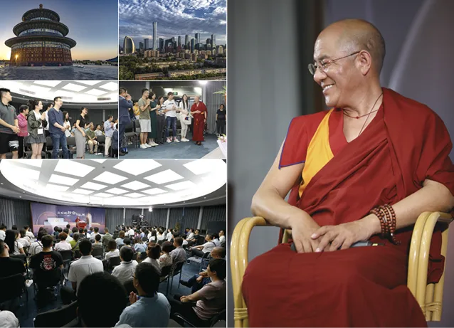
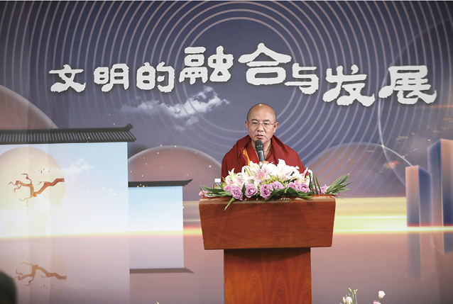
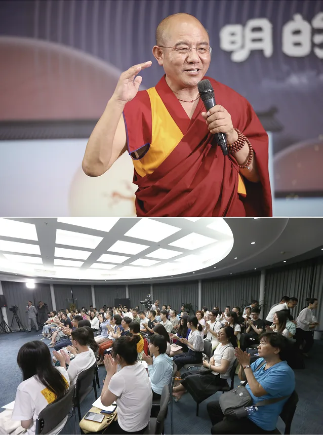
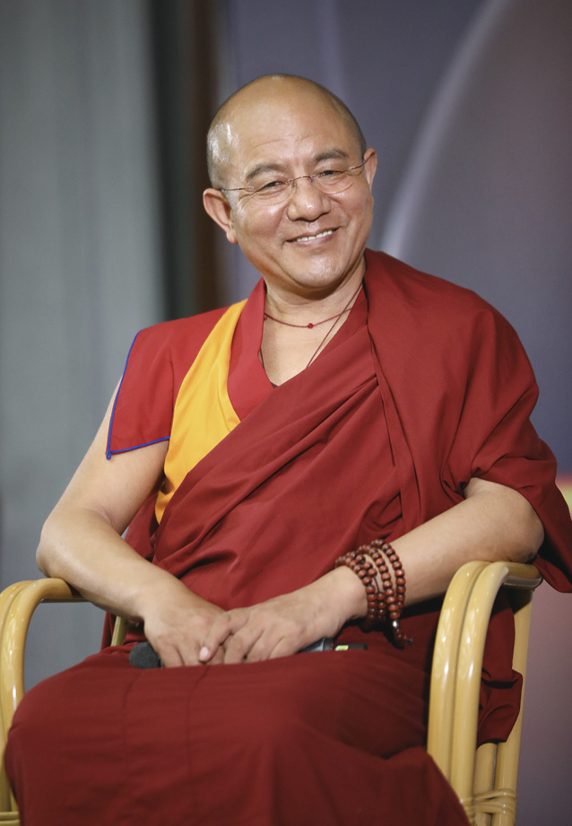
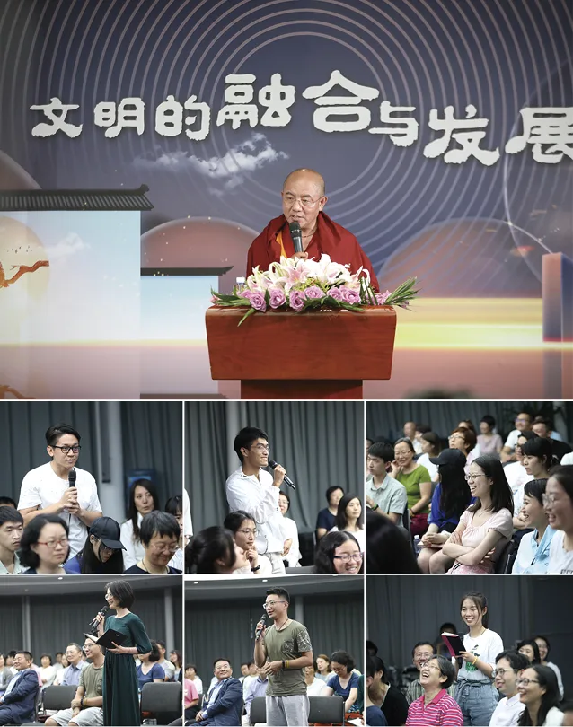
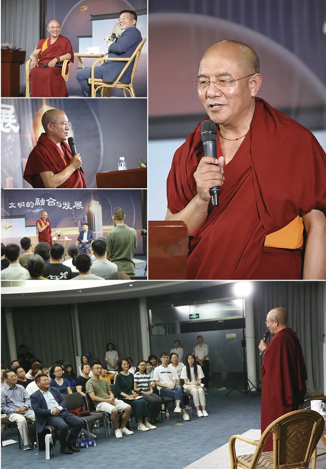
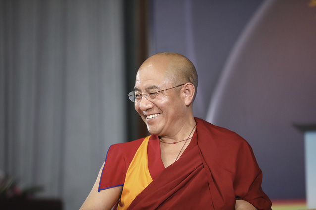

现在的人类需要什么呢？  
需要具有利他思想、  
强大能力以及卓越智慧的人。

第90场

北京启明星辰公司

Venustech Group, Beijing

中国·北京

2019 / 6 / 19

## 文化的融合与发展

## Cultural harmony and development

主持人：

大家晚上好！

欢迎来到“文明的融合与发展”主题演讲的现场。今天，我们的主讲人是来自四川喇荣五明佛学院的索达吉堪布。

堪布既是一位讲经说法的老师，也是一位优秀的管理者，还是一位足迹遍及世界各地的智慧传播者。在过去的十多年里，堪布去过十多个国家、三十多个城市，在一百多所高校累计演讲二百多场。国内的清华大学、北京大学，国外的牛津大学、哈佛大学等，堪布都播下了智慧的种子，并把东方文明传到了世界各地。让我们把掌声送给堪布，谢谢！

今天，大家能够在这里欢聚，都非常开心。从佛教的角度来说，这是一种因缘。下面让我们一起聆听，这位广闻博学的智者带给我们的主题演讲“文明的融合与发展”。掌声有请索达吉堪布——

正如刚才主持人所说，从佛教的角度讲，今天我们大家集聚在这里，是一种因缘，也是一种善缘。我先用短短的时间，简单讲一下自己的看法，算是抛砖引玉。关于“文明的融合与发展”这个主题，我没有具体研究，事先也没有特别花时间去分析，只能跟大家聊一聊自己的一些想法，提出几个思路，供大家参考。等一会儿，在跟院长探讨的过程中，在座的各位老师和学生，也可以加入进来，我们一起交流、互动。

## 思路一：提升精神文明，绕不开宗教

### 1．宏观上被动，微观处主动

现在是一个非常开放的时代，跟以往任何一个时代相比，多元文化的特征都更为突出。在这个时代，每一个人都很重视自己的发言权，并拥有自己的新闻平台，自己的思想可以及时通过平台分享出去。大家也都有一颗包容和开放的心，相互间可以接纳，也可以提出不同建议，甚至批评。

总体而言，人类文明发展的脚步，现在谁也没办法阻挡——已经到了这样的地步。我记得美国著名的投资家查理·芒格[^1]说过一句话：“宏观是我们必须要接受的，而微观才是我们能有所作为的。”人类文明发展到今天的程度，这是宏观上的一种变化，每个人都只能接受，这个大框架我们是没办法逃脱的。但是，在微观或个人方面，不管是情绪的调整，还是生活的转变，每一个人都有权力，依靠自己的能力和智慧发挥作用。

### 2．文明的碰撞：是融合，还是吞并？

对文明的融合或发展，我也曾经关注过。在座的各位可能都比较清楚，文明从大的方面，可以分为七大版块[^2]或者八个种类[^3]。比如中国文明、日本文明、印度文明、西方文明，还有阿拉伯文明、玛雅文明、非洲文明等。当然，对文明体系的划分，存在各种不同的观点，这里不多说。

这些文明在今天的时代，到底是相互融合，还是彼此吞并？或是继续按以前的方式发展？也许，我们可以做这样的思考：在古文明时代，信息传递没有现在便捷，交通也没有现在方便，所以世界上不同的文明都有自己生存的空间。而今天这个时代，信息、交通等各种设备都非常先进、快速，曾经并存于世的诸多文明不可能再像以前那样互不相干，各自前行。

按照如今的发展趋势，世界上各种不同的文明将来要么全部融为一体，变成一种新的文明——没有任何文化倾向，也没有任何宗教色彩，总之，要么没有任何标签，以一种全新的模式存在，要么求同存异，共同发展。

这是一个很现实的问题，在座的许多人可能也思考过。我作为一个佛教徒，有时也不得不进行思考。我们东方的佛教文化，已有2500多年的历史，现在却受到以西方文化为代表的很多文化的冲击，而且非常严重。不仅是佛教，世界上很多宗教如今都在不同程度上受到了冲击。在这个时候，我不得不担忧，再过10年、20年、30年，这个延续了2500多年的人类文化会不会面临前所未有的更严峻的挑战？

按照历史阶段划分，人类文明刚开始是狩猎文明，大多数人依靠打猎来维持生活。后来是农耕文明，务农是生存的基本手段。在全世界范围内，人类以这种方式度过了漫长的岁月。中世纪结束后，工业文明发展起来，改变了人类靠天吃饭的生活方式——依靠各种机器来工作、谋生。再后来，应该是智力文明，包括现在的人工智能，或者说智能文明、信息文明。

我们现在的生活方式，跟过去任何时代都不相同。这样下去，人类固有的文明以后还会不会存在，也值得思考。人类几千年积淀下来的所有价值观和生活方式，最后以另一种全球化的方式存在，这样的可能性实际上很小。因为每一个国家、每一个民族，甚至每一个家庭，都有属于自己的优秀文化，都非常珍贵，不太可能完全融合到一起。

### 3．物质文明对人类发展的意义何在？

这些文化的底蕴和历史背景都跟宗教不可分割。比如说，印度文明有印度教和佛教的背景，中国文明有儒教、道教和佛教三教融合的思想，西方文明有基督教，阿拉伯文明有伊斯兰教，非洲文明和日本文明也有各自的宗教背景。这些宗教的教义在如今的社会，有一部分能被现在的人接受，有些则不能。实际上，宗教跟人类的精神文明联系非常紧密。要保护精神文明，宗教是绕不开的话题。

大家可能都看得出来，当今世界的发展偏重于物质。可以说，人类的物质文明已经达到了一个顶峰。从各方面来看，我们的物质条件都是前所未有的。那我们的精神层面是不是也达到了顶峰呢？不一定。现在人们心理和精神层面的疾病，比如抑郁症、自闭症以及各种精神综合征越来越多，自杀的人也越来越多。

从历史上看，人类在21世纪的生活水平算是比较高的。可是反过来看，科技越来越发达的时候，我们内心的收获是否成正比呢？是否得到了同等的幸福和满足呢？不一定。尤其在发展中国家，很多年轻人越来越自私，越来越趋近纯粹的自我中心主义。而且，这样的现象日益严重。

如果精神文明跟物质文明达到一种平衡，人们对美好生活的希求，或者说人们未来的美好生活，应该是有希望实现的。当物质水平越来越提高，而我们的欲望却越来越强盛，痛苦越来越猛烈，烦恼越来越严重，那人们实际上获得的幸福和快乐必定越来越少。这样一来，所谓的物质文明，对人类的发展，到底有什么样的意义？在精神文明极度匮乏的时代，我们应该怎么去实现对它的提升？这方面，值得大家深思。这是我给大家提供的第一个思路。

## 思路二：继承无我利他的宗教文化

### 1．佛教：解决所有众生的所有痛苦

不管人类社会怎么发展，佛教的教义都不会脱离人类的生存现状。而且，佛教的教义在某种意义上，特别值得大家思考，也许会给大家提供很多方便。为什么这么讲呢？大家都知道，世界上的很多文明，都跟当地人们的生活息息相关。而佛教的教义，针对的是全体众生。只要人类存在，它就能为人类的生活提供帮助。当年释迦牟尼佛出家，成道，转法轮，所有这一切，目的都不是为自己，而是为了天下所有的众生，为了解决全人类的痛苦。

因为他看到了人世间生老病死的各种痛苦，一心帮助人类解决这些大问题，所以发了菩提心，出家修道，最后示现成佛，在人间转了三次法轮。三次法轮宣说的教义，都是为了让人们内心的痛苦和烦恼减少，乃至全部灭掉。可以这么说，佛法就是开发智慧的妙药，也是提升精神境界的妙药。

当然，可能有些学生和老师会认为：“这个出家人，在对佛教教义进行自我宣扬。”可以这样理解，也可以不这么理解。为什么？因为佛教的教义，不用我来美化，明明白白已摆在我们的生活、工作和所有的研究领域。

研究过佛教的人都不难看出，佛教的教义并不是自私的，也不是短视的、片面的，它的目的是什么呢？就是让天下所有的众生内心的苦恼、身体的苦痛全部消除。佛教要解决的，是这样的大问题、大苦恼。佛教的任何教义，都不离这个核心思想。不管你从十二缘起中去探究，还是从四圣谛中寻找，或是从八正道中观察，或是从六波罗蜜多中寻觅，都会发现这种精神。

同时你还会发现，这样一种智慧、一种精神，对整个人类来讲，都非常有用。我今天并不是在这里随便给大家宣扬、赞美。事实上，不管有没有信仰，只要真正明白佛教的教义，生活和工作中的苦恼就可以轻而易举地解决。而这件事，对我们每个人而言，都极为重要。

### 2．脆弱的时代，需要坚定无私的智者

人类离不开生活，有生活就会有感受。这些感受如果是负面的，就一定要解决，否则一直存放在那里，久而久之，会成为内心的一种疾病。对于内心的病患，我想，任何一个有智慧、懂取舍的人，都不愿意跟它同住。

如今这个社会，人们的内心并不怎么强大，很容易产生焦虑和痛苦。佛教的禅修方法、无我思想、利他精神，对今天这个时代的人们来讲，是非常珍贵的精神妙药。这样的良药，不管你有没有信仰，只要去服用、去享受，一定会有效果。不但自己的身心得以健康，甚至让你见闻忆触的其他有缘众生，也能在不同程度上得到真实的利益。

在座的很多人，在世间的科学或其他研究领域，我相信你们都是佼佼者。有些老师对整个人类社会有非常大的贡献，学生们如果一心追随你们的学识、智慧和道德情操，他们将来过上好的生活，获得一定的成功，没有什么问题。但我觉得这个并不是最重要的。

现在的人类需要什么呢？需要具有利他思想、强大能力以及卓越智慧的人。这样的人，当今时代迫切需要，却又非常稀少。高等大学里很多非常了不起的知识分子，包括留学回来的海归们，整天想的都是自己的名声、自己的事业和成功。如果我们的眼中、我们的心里，没有关注全世界的人类，没有装着需要帮助的人，这样的工作愿景可能不是很完美。

### 3．继承宝贵的精神遗产

因此我在想，有些可有可无的文化，可以让它随着历史长河的波浪，像垃圾一样消失。比如古代的狩猎文明，从保护动物的层面来讲，或对整个人类社会而言，并不是很文明、很优秀，消失了也没什么可惜的。

但有些文明确实值得我们去保护，而它们在跟其他强势文明结合的时候，很有可能被后者吞噬。如果有一种文化，非常有价值，非常珍贵，对人类社会非常有利，最后却消失在这个地球上，不管对当前还是未来的人类而言，都是非常可惜的。因为一旦消失，就再也找不回来了。

虽然这类文明的生命力非常强大，在这个地球上已经存活了几千年，但在这个冲击性非常大的社会浪潮中，却很容易被终结。如果让它彻底消失，我们在座的，包括这个时代所有的人，也许都会成为历史的罪人。因为我们本该保护的一些知识、文化和精神遗产，却没有好好保护，没有好好继承。这将是非常令人痛惜的一件事。

因此，现在我们每一个人的肩上，都有一个不可推卸的责任。什么样的责任？要继承、发扬人类各种有价值和意义的文化，包括宗教文化。这是我想讲的第二点。

## 思路三：继承独具魅力的藏传佛教

在我们藏地，佛教已经存在了1300多年。实际上，佛教的适应能力是比较强的。不管是在印度、泰国、日本、中国，还是在西方，佛教都会很快跟当地文化融合在一起。它在汉地，跟汉文化融在一起；在藏地，和藏文化融为一体；在西方，它跟西方文化融在一起。它不但跟当地文化融为一体，而且对推动整个世界文明都做出了贡献。

在座的很多年轻人也许去过藏地，也许没有去过。藏地的蓝天白云、青山绿水以及经幡、寺庙、海螺的声音，都是比较吸引年轻人的。但我并不觉得藏地的魅力仅仅在于风景美丽，更重要的是，佛教思想在藏地很多人的心里已经扎下了根。年轻人不应该只看到藏地美丽的风景、风貌，还要了解藏地人美丽的心灵——大乘佛教的慈悲心、利他心和无我智慧。这样的心髓，如果你能得到，利益确实不可估量。

正因为此，藏传佛教如今吸引了很多年轻人。不管有没有信仰，他们都很感兴趣；不仅感兴趣，还进行深入研究。藏传佛教的理论学习方式，包括思考、辩论、逻辑推理等，对新一代的年轻人或者思想成熟的智者来讲，非常有吸引力。这也是为什么现在西方很多高等院校都很喜欢研究藏传佛教。

大家学习藏传佛教的原因，有以下几个方面：第一，藏传佛教自古以来就有非常严密的逻辑性，强调理性和推理，这跟西方的哲学思想比较类似。第二，藏传佛教的修行次第非常清晰，不管是基础也好，正行也好，一步一步给大家讲得很清楚。第三，藏传佛教很多的传承，千百年来一直没有间断过，包括教言、教授、窍诀的传承等。第四，藏传佛教在历史上没有受到严重的破坏。虽然中间有衰落的时候，但并没有伤及根本。尽管有一段时间，很多寺院遭到了破坏，但内在的思想体系并没有真正受损。正因为这样，在青藏高原的这片土地上，至今依然保留着这样神秘、甚深的教法和证法——完备无缺的佛教体系。

这样的佛法，令如今的很多人特别向往。大家经过不断地学习、研究和修行，内心得到的收获，不是口头几句话能说清楚的。包括在汉地的各大城市，学校的老师和学生，西方和东方的很多学者，通过对这样非常系统、非常有次第性的教理，不断地串习和学习，给自己的心灵带来了很大的利益，减少了很多的压力和痛苦。这一点非常重要。

## 从细节入手，保护各类珍贵文化

最后，我想提一个建议。在这个世界上，每一个民族和国家所拥有的具有几千年传承的灿烂文化，都是非常有意义的，每一个年轻人都应该负起保护的责任。

在全世界来讲，要保护任何一个文明，总结起来都需要从几个方面入手：首先，要保护文明的语言文字，因为它们是文明的根本。一旦语言和文字消失，所谓的文明就没办法再崛起。现在极个别少数民族和弱小地方的文明正在消失，有识之士应该行动起来，拯救当地的语言和文字，或者保护，或者继承。这是第一个方面。

第二个方面，文明最重要、最根本的载体，实际上是艺术。艺术涵盖了方方面面，比如诗歌、绘画、唱歌、舞蹈以及具有特色的其他形式。艺术是人类心理的特殊表现，艺术如果消失，文化将从根本上消亡。所以我们对任何一个文明的艺术，都要认真去保护。比如在藏地，哪怕很简单的一首歌曲、一支舞蹈或者佛教的一些金刚舞，我们都希望原汁原味地保留下来。

第三，还需要保护人们的饮食和服饰文化。同样是吃饭，北京人有北京人的饮食文化，四川人有四川人的饮食习惯。你们北京人经常在菜里加糖，上海人可能加得更多，而四川人一般不加糖，而是加辣椒和花椒。各地都有各自不同的饮食文化。除此之外，还有衣饰穿着方面的文化。不同时代、不同地方，人们的穿着都有所不同。一个地方的饮食和服饰传统一旦消失，当地的文化传承必定会受到巨大的冲击。

第四，是对宗教的保护。前面讲过，任何文明实际上都有宗教的背景。美国的亨廷顿[^4]在他的著作《文明的冲突与世界秩序的重建》里讲到，文明中最重要的是什么呢？宗教。在冷战之前，大多数冲突是在意识形态的范围内，之后才是文化的冲突。当然，文明冲突的背后，可能更多的是现实利益的冲突，跟利益有关系。但不管怎么样，宗教一旦消亡的话，它影响下的文明也必将因此而消亡。

总之，每一个地方的珍贵文明都理应传承下去。这方面需要在座各位年轻人的共同努力。

现场互动

问：我是来自清华大学医学院的博士后，主要研究社会认知神经科学，重点是关于自我的研究，跟佛教里的我执非常相近。

您刚才说，文化最根本的问题是文字。我个人认为，文化虽然兴于文字，但文字也会成为它的一个隐患。特别是在融合过程中，不同文化之间的融合障碍，就是因为彼此的文字语言不能够很好地沟通。您一直从事翻译，把藏语的经论翻译成汉语，是否也面临着文字或者语言方面的融合问题？您是怎么把藏语经论最核心的东西，用另一种陌生的语言进行解释的？我想，如果这个问题能够得到很好的解决，两种文化之间的沟通会更容易，产生的误解也会更少。

堪布：实际上，不同的文化之间，有时候的确可以融合，但不太可能完全融合，会有一种求同存异的主线。像汉语和藏语，从语言的层面来讲，我觉得可以有共同点。因为汉语作为一门语言，是表达思想的一个工具，藏语也是一种语言，也是表达思想的工具。但在翻译的过程中，并不是把汉语完全融成藏语，或者把藏语完全融成汉语，不是这样的。

一般而言，翻译有意译和直译两种方式。意译的时候，是把藏文的意义用汉语来表达。比如，我们佛教里经常讲到的菩提心，在藏语里叫“香且森”，翻译成汉语就叫菩提心。从意义上讲，二者应该是融合的。为什么呢？因为藏传佛教对菩提心的修法、理解以及阐述，非常广泛。现在按照汉传佛教的用法，把它译成了汉语。如果汉语的修行人按照藏传佛教的模式去推广或者修行，完全可以得到藏传佛教的教义。表面上看，这是两种不同的语言文字，但通过翻译，这两种文字体现的文化价值，实际上都得到了提升或弘扬。所以我觉得，每个民族的语言文字或者艺术表现，都有它自己生存的价值。

在保护的过程中，有些方面需要完全的、彻底的保护，不能狭隘。我在翻译包括一些密宗法要在内的藏传佛教珍贵法义时，有些人向我当面直言：把这些翻成其他民族的语言，对我们本民族是一种损失；这么珍贵的文化在别人面前泄露，在历史上也是不太好的行为。那我为什么还要翻译呢？我是这样认为的，这些法义非常有价值，有一部分人因为语言的隔阂，依靠藏语来通达有一定困难，翻译出来以后，会有更多的人从中受益，而这些教义也会得到弘扬和保护。

同样的道理，我们汉地的文化，包括国学、儒家的一些知识，如果翻成藏文，也会有很多不同的意义。所以，我觉得文化之间的融合不一定就是完全一体化，因为每个文化都有它的生存方式，都有不同的价值。

问：好的，谢谢您！我还想借这个机会，向您表示感谢。我在清华读博士和做博士后研究的时候，经历过非常大的困难和非常黑暗的时期。您讲的《入菩萨行论》给了我非常重要的指导。在您的帮助下，我渐渐走出了那段黑暗的日子，谢谢您！

堪布：这就是语言文字融合的体现。（众笑）

问：我是中国传媒大学播音与主持艺术学院的学生，是今年的应届生。我认为“文明的融合与发展”，放在国家层面上，可能是制度自信、文化自信等一系列自信，而对我个人来说，可能就是个人的修为——在生活中和其他人的文明冲撞以及融合。比如，在工作中碰到一些奇奇怪怪的人，控制不住自己的时候，应该如何用禅修的思想、无我的思想、利他的思想，来化解心中的情绪？

堪布：我们每个人在这个世间，都难免有一些负面的情绪、压力和烦恼。当然，像你们这样的传媒人士也好，像我们这样的宗教人士也好，尽管生活中经常提到自我强大、自我强势之类的词，实际上，在烦恼面前，尤其是涉及自身问题的时候，我们都有脆弱的一面。

我们在讲理论的时候、安慰别人的时候，都会说“你要强大一点”“没事”“没问题”，但当同样的问题发生在自己身上时，就有事了，不再那么轻松。我们有些佛教徒也是这样，自己没有痛苦的时候，很会跟别人讲：“你禅修一下”“没有事”“‘我’是不存在的”“烦恼就是菩提”，等等。一旦事情发生在自己身上，就很难受，所有的禅修都用不上了。

我们藏族有一种说法：“小小的火星，落到身上跟落到衣服上，感受是不同的。”意思是说，有些痛苦落在别人身上时，自己觉得没什么忍不了的——就跟火星落到衣服上一样；虽然只是一个小小的火星，可一旦落到自己身上，“哇，特别痛”，痛苦降临自己的头上了。从佛教层面来讲，安忍是非常重要的一种修行，而且不是一天两天的事。甚至修两三个月，也不一定能解决问题，长期修行以后，才逐渐能解决一些。这是一个方面。

第二个方面，我觉得现在大家很需要强大的自信。如今在社会的各个角落，压力都比较大。每个人表面上看起来很成功，非常光鲜，实际上内心非常脆弱，就是所谓的玻璃心。这种现象确实比较多。因为非常简单的一句话，这个人就废掉了，没办法再爬起来；因为非常简单的一点事，这个人就一蹶不振，陷入重重困难。

从这个层面讲，新时代一些有文化、有知识，尤其是在西方留过学或读过高等院校的人，可能还没有过去那些没什么文化的人坚强，他们虽然没有那么高的文化，没有那么多的知识，但是内心有一种坚强的意志和强大的力量。

其实，在生活和工作中遇到各种各样不愉快的事情，是非常正常的现象。我自己也是这样的。在佛学院搞建筑也好，做管理也好，出去讲课也好，都经常遇到很多事情。不过我会提前在心里有所准备：“这件事情60%会不顺利。”我先在心里这样告诉自己。一旦遇到不顺，可以坦然面对。

《入菩萨行论》中有一句话：“遭遇任何事，莫扰欢喜心。”不管遇到什么事情，自己这颗欢喜的心、平静的心，最好不要被扰乱。当然，说是这么说，当真正遇到的时候，可能还是会有一些困难。但不管怎么样，如果提前有所准备，任何事情都可以面对。现在很多年轻人，或者说成功人士，最关键的问题可能还是心力——自信不足。虽然口口声声说我们要自信，但实际上这方面还是比较差。

因此，在这方面我们可能需要更多的心灵禅修，并多方面学习关于心灵的知识。刚才那位同学说，《入菩萨行论》在减轻她心灵压力方面发挥了一些作用。的的确确，佛教对有些道理讲得比较明白，如果深入学习，能解决很多现实问题。比如说无常的道理，我们如果学得好一点，当工作出现了无常，感情出现了无常，生活出现了无常，至少自己不会选择自杀，不会做特别不理智的事情。

所以，我们对自心的修养和调整非常重要。自己心里如果能淡定一点，不管遇到什么事情，都应该能轻松地面对。

问：我来自北服，是一名在读本科生，非常高兴能够见到您。我的母亲是您的弟子。我的父亲是一名人民教师，他非常善良，兢兢业业，总为学生着想。但脾气特别暴躁，也喜欢钓鱼、吃海鲜，对母亲念佛保持中立。我相信我的父亲是有善根的，只是还未成熟。请求您慈悲加持我的父亲，让他早日戒杀茹素，听闻您的正法。对我个人而言，怎样才能把我自己、母亲、弟弟和爸爸这些“文明”融合在一起？

堪布：其实，每个人的因缘不同，家庭状况也不同，你跟你的父亲，以及跟其他家人之间的关系，不一定能全部融为一体。要把每个人的选择和爱好，都统一到一条线上，需要一定的因缘。

在这种情况下，我觉得家庭和合最重要。虽然你父亲做的有些事情，作为佛教徒，你和母亲有点不太接受，但是在他的眼里，你们的有些行为也是不能接受的。所以要从两方面考虑，互相都需要接纳和包容。不管是在家庭，还是在学校，每个人的基因或者阿赖耶上的种子都不同，要想合而为一，完全一致，有一定困难。当然，我们可以根据自己的情况，在不毁坏和合原则的条件下，互相之间共同协商、共同探讨。如果能够这样，也是很好的。

你父亲是一个非常优秀的教师，我觉得这个非常非常重要。现在这个时代，从很多方面来讲，我们的生命和慧命需要依靠医生和教师。一个非常优秀的老师，可以培养出非常多的优秀学生。这对整个家庭、整个社会乃至整个人类来说，都有不可估量的贡献。

他依靠自己的方式，有一些自己的爱好，你们如果觉得他的这些爱好不合适，可以慢慢跟他商量，但不要在很短的时间内，就要求他跟你们一样。也许从他的角度来看，对你们有些行为也很难接受。既然他可以包容你们，你们也应该包容他。

问：我是来自中国传媒大学的学生。我们都知道，宗教学在文明中占有很大比重。而现在，佛教徒的数量和佛教覆盖的面积，都不像基督教、伊斯兰教这么多。我的问题是：有没有可能，有朝一日所有的宗教文明能够统一——因为不断地融合，到最后肯定就融为一体了，共同利益全体人类？

堪布：很多学者的研究表明，现在佛教徒的人数大概是5个亿。在未来的10到20年之内，也不会增加很多。有一种观点认为，到2075年，世界人口的三分之一会变成伊斯兰教徒。基督教在上个世纪发展得比较快，但现在年轻人退教的比较多，所以基督教当前的发展也不是很理想。

从教义来看，佛教也好，伊斯兰教或基督教也好，各个宗教都在提倡慈善、善良、慈悲、善心等，有很多美好的地方，但是不同宗教之间的教义冲突自古以来就存在。尤其在西方国家，历史上的很多战争与冲突都跟宗教有关。不管怎么样，随着人类的发展，所有宗教最后融为一体的情况，我觉得不会出现。

现在西方人特别喜欢不加标签，而倾向于抛开所有宗教，推崇一种单纯的善良，或者说一种慈善，一种美德。这样的理念，西方人是比较喜欢的。由于西方人的思想和理念在全球影响比较大，所以将来唯一的可能，是出现一种无有宗教名称的善的“宗教”，或者说帮助人们获得快乐的心灵科学。因为现在很多年轻人只愿意信仰心灵的科学，而这种心灵科学实际上也可以说是一种宗教。

除此之外，我觉得这几大宗教要全部融为一体，可能很难。除非是其中一个吞没并统治全天下——其他宗教全被消灭，也许会以这样的方式融为一体。但是这样的结果，我们都不愿意看到。因为在这样的冲突中，佛教不一定能战胜其他宗教。大家都知道，佛教比较讲慈悲，待人处事极为平和。西方的很多人，包括很多媒体，经常传播佛教的负面形象，而对其他的个别宗教，所有媒体都不敢惹，不敢播。有时候，佛教因为自身的慈悲，反而受到了很多世间团体的歧视与轻视。

问：我是中医药大学的学生。现在好多文明的传承都遇到特别严重的问题。在中医圈内，有一种说法叫“一代不如一代”。师父学到的东西，给后面的弟子传不下去，弟子学的东西再传给弟子，就更少了。佛教可能也面临着这样的问题。以前18、19世纪“利美运动”时期，蒋贡康楚仁波切等大德传承了大量密法，但有些后来都消失了。21世纪的信息非常发达，大家都崇尚文化快餐。在这样的时代，怎样才能把更多的文明传承下去？请堪布给出一些建议。

堪布：你提的问题很有意思。中医“一代不如一代”，我们佛教也是“一代不如一代”，确实是这样。以前的很多高僧大德，在佛教方面的造诣非常惊人。在17世纪、18世纪，藏传佛教的很多大德都著作等身，非常了不起。现在很多所谓对佛教有贡献的活佛、上师，可能也没法跟那些大德相提并论。还有一种情况，尽管前一世非常了不起，但是他们的转世——到了第二世、第三世，也不如前一世了。

但这个时代也有比较方便的地方。信息时代的好处就是文化传播比较广，如果后继有人的话，这个“人”会比较多。比如说，以前在佛教内部，一个人讲经说法可能只有10个人、20个人听闻。现在只要因缘具足，成千上万的人都可以听。同样，世间的任何一类知识，中医也好，其他专业也好，通过网络，全世界的很多人都可以接受。

网络时代的信息传播量比较大，传播范围比较广。只要我们有这个能力，有这个心愿，在文化传承的深度方面，也许一代不如一代，但是在广度方面——比如我们佛教，就未必是“一代不如一代”，依靠信息时代的便捷，现在佛教信息的传播量还是比较不错的。

总之，每个时代都有它不同的文化传播方式和不同的继承人。我们从这个层面来理解，是不是好一点？

问：我是一名从事潜能开发的老师，我把佛法的一些方式方法融入自己的教学中，在学生那里得到了很好的反馈。我想请教您，怎么样把佛法跟教育更好地融合？

堪布：我认为，一个老师如果能把教育的理念，尤其是跟道德有关的道理很好地讲给学生，就是把大乘佛教的教义跟教学融合在一起了。因为现在有些学校只传知识，不传道德。这样培养出来的学生，也许知识方面非常不错，但行为方面可能不是很理想。

作为一个老师，不但要给学生灌输知识，更重要的，在学生面前，老师应该代表他的父母，要像父母管教自己的孩子那样，对学生的点点滴滴、方方面面进行教诫。我觉得，能这样做就是把佛教的教义融合到了课堂上。

问：我是北京邮电大学的老师，研究方向是比较文学。我对道家文化非常感兴趣。据说《道德经》和《金刚经》之间的关系是相通的。我想请教一下，您对这个问题怎么看？

还有一个，堪布有一次说要讲《论语》。我想问堪布，以后有机会能不能讲一下《道德经》？

堪布：实际上，我们《金刚经》里面讲的是空，《道德经》里面讲的是道，比如说“道生一，一生二，二生三，三生万物”，从道当中显现万事万物，宇宙间的万事万物都离不开道。《金刚经》里说：“见诸相非相，即见如来。”“凡所有相，皆是虚妄。”从道的层面或者空性的层面来讲，二者应该有相通之处。

我讲完《论语》以后，如果各方面的因缘具足，也可以讲一讲《道德经》。不过我没有传承，讲得可能不好，所以没有自信。

问：我是北京邮电大学的研究生。刚才，您在给大家提出的第一个探讨点中提到：科技发展对精神文明发展的作用和意义何在？我想问的是：科技文明的发展和佛教的发展，它们是并列的呢，还是说会在某一个山顶融合？

堪布：我以前写过一本书，叫《佛教科学论》。在这本书里，我从佛教的角度分析了现代科学，其中引用了爱因斯坦的一句话：“任何宗教，如果有可以和现代科学共依共存的，那就是佛教。”我觉得佛教的思想，尤其是大乘的利他思想、无我精神、苦集灭道四谛以及四法印等道理，可能是科学没办法企及的。因为只要人类存在，我们的痛苦就存在；只要痛苦存在，就需要能息灭痛苦的佛法，这是一种规律。

当然，科学这种文明也需要一直存在。但科学再发达，也只是着重以观察或者测试的方式探索外部世界，对物质文明的发展非常关注。我们内心的发展或者说对人类内心的开发和挖掘，到目前为止，可能除了极少数的心灵科学家以外，科学界基本上是空白。所以，我觉得科学跟佛学在某种程度上，可以有共同发展的空间。而在某些意义上，比如佛教注重的内心挖掘或者证悟方面，科学有一定困难。

问：我最近一直在读《金刚经》，有许许多多的问题，没法一一地提问，就问一个小问题。《金刚经》里很多地方都提到“受持四句偈”，这四句偈到底指的是哪四句？

堪布：不管你读《金刚经》还是其他佛经，都会经常看到“乃至四句偈”。其实，像“一切有为法，如梦幻泡影，如露亦如电，应作如是观”，这样一个四句话的偈颂，就是佛经中讲的“四句偈”。“四句偈”就是指一个偈颂。

《金刚经》里还讲：“若以色见我，以音声求我，是人行邪道，不能见如来。”像这样的偈颂，也可以称之为“四句偈”。

有时佛经里会说，对这样的四句偈读诵、听闻、受持的功德如何如何大，尤其是很多大乘经典里，都会讲到哪怕听闻一个“四句偈”的功德和利益。《金刚经》讲的“乃至四句偈”，应该也是这样的意思。

主持人：

再次感谢索达吉堪布为我们带来“文明的融合与发展”的精彩主题讲座！也非常感谢大家的精彩提问！

收获智慧的时光总是非常短暂，现场很多朋友还意犹未尽。在这里，堪布给大家推荐了很多本书，比如《入菩萨行论》等。谢谢！

[^1]: 查理·芒格（Charlie Thomas Munger，1924年-）美国投资家，巴菲特的黄金搭档，被巴菲特称为“心灵导师”。曾和巴菲特联手创造了有史以来最优秀的投资纪录——伯克希尔公司股票账面价值以年均20.3%的复合收益率创造投资神话，每股股票价格从19美元升至84487美元。
[^2]: 有一种观点认为，现在世界的文明分为西方文明、斯拉夫文明、拉丁美洲文明、东亚文明、伊斯兰文明、印度文明、非洲文明，共七大文明。
[^3]: 塞缪尔·亨廷顿在其著作《文明的冲突》中，将目前世界的文明分为了八类，分别是中华文明、日本文明、印度文明、伊斯兰文明、西方文明、东正教文明、拉美文明、非洲文明。另有观点认为，世界八文明体系分为亚洲太平洋文明体系、南亚文明体系、地中海大西洋文明体系、中东阿拉伯文明体系、北美大洋洲文明体系、拉丁美洲文明体系、非洲文明体系、犹太文明体系。
[^4]: 萨缪尔·亨廷顿（1927年-2008年），美国当代政治学家，因主张文明冲突论而闻名于世。
