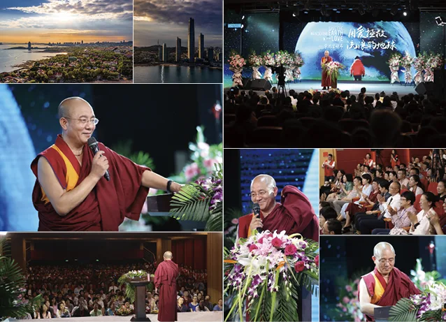
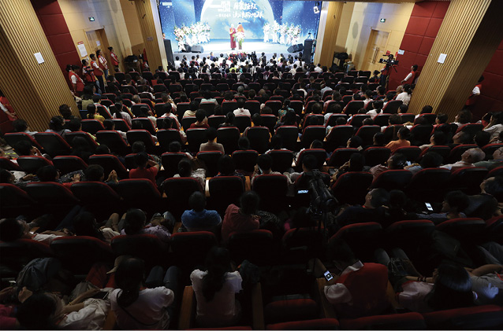
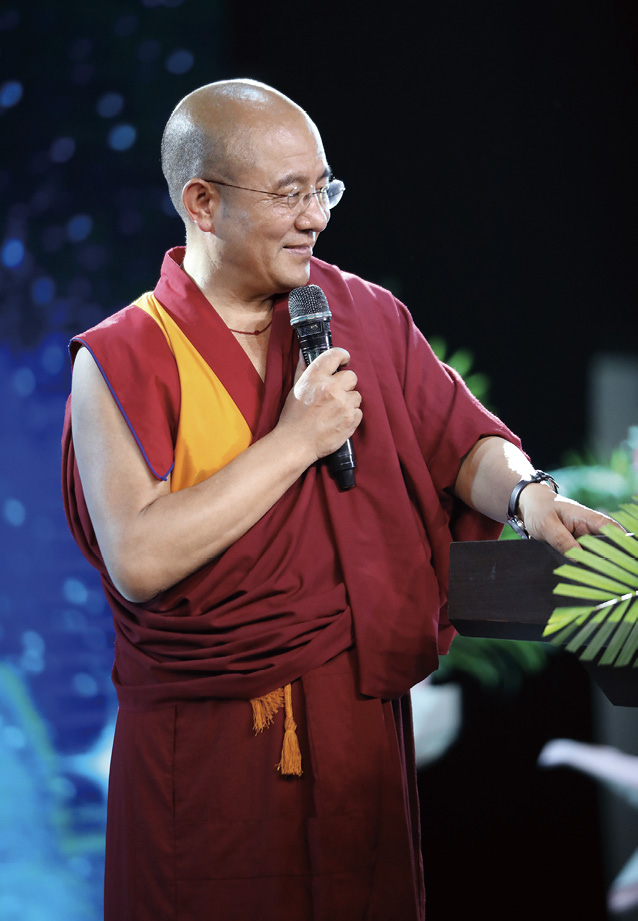
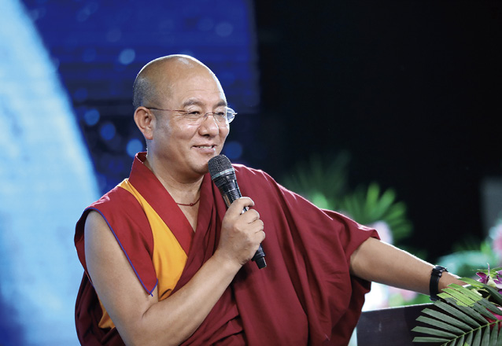
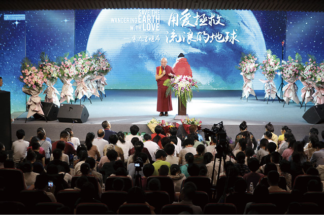
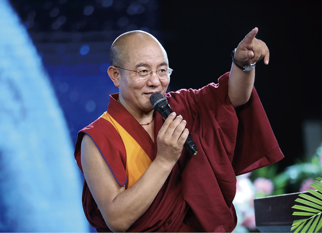
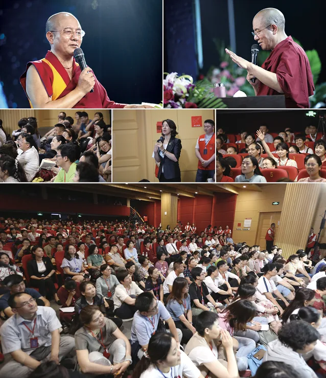
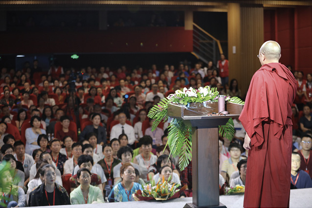

人类自己在这个地球上，  
可能有毁灭的危险，  
但是整个地球，谁也没办法毁灭。

第93场

青岛如是剧场

Rushi Theater, Qingdao

中国·山东

2019 / 7 / 2

## 用爱拯救流浪的地球

## Love for the Watbndering Earth

主持人：

尊敬的索达吉上师，亲爱的朋友们、师兄们，岛城各个公益慈善组织的慈善家、爱心人士、志愿者，还有咱们的义工菩萨们，大家下午好！

我来自微尘·福慧基金。首先，对大家的到来表示热烈的欢迎，也代表大家对上师的到来表示最热烈的欢迎！

上师是一位闻名全球的文化学者、公益慈善家及教育家。上师亲自捐建了两所小学和一所中学，以及敬老院、医院、孤儿院等，并坚持资助贫困大学生、失学儿童、重大疾病患者，还参与了一些赈灾救难活动。2008年和2010年，上师与国家领导人一起，参加了第二届以及第四届“国际慈善论坛”，并作了主题发言。

上师还受邀在国内外著名的学府作巡回演讲，其中有大家非常熟悉的哈佛、斯坦福、耶鲁、剑桥、华盛顿以及港大、清华、北大，还有咱们山东的山大和青岛大学。堪布上师还去过欧洲、非洲以及国内的许多监狱和看守所，给那些特殊的人员做演讲。

上师常常对我们说：“这个世界上，再也没有比做好事更好的事情了。正是因为有那么多人欢喜付出、欢喜做好事，我们的地球家园才更加幸福、美好。”

今天，我们再次相聚，共同聆听上师的慈悲开示。让我们以最最热烈的掌声，再次欢迎上师。有请——

青岛，我来过多次，作过很多次交流。今天，又一次来到这里，跟许多慈善家、志愿者、慈善基金会的善男善女以及具有爱心的义工菩萨们，共同探讨、共同学习，我真的非常高兴。

在山东，尤其是青岛，很多人心地善良，有利他精神，喜欢做善事。我并不是在这里说好听的话，对我而言，反正不会一直在这里，没有必要刻意说这些。你们这里的人，的确很淳朴、很善良、很诚实、很忠厚，对善事非常有兴趣。这也许和文化底蕴有一定关系。

## 无常，不变的规律

今天的话题是“用爱拯救流浪的地球”，我们要思考的是人类的家园——地球。

对我们而言，这个话题也许有点大。大多数人平时关心的只是自己的身体、自己的家庭、自己的工作，再大一点，也超不出自己的城市、自己的民族、自己的国家。除此之外，一般不会想到这些特别大的话题，比如宇宙的问题、地球的问题、人类的问题等。实际上，这类问题非常值得我们思考。如果大家都不关注它，我们生存的家园、我们的这个世界要继续存在下去，将来也许有一定困难。

在今年，我看到一则消息，是联合国和其他一些国际组织，通过调查和观察后给全世界提出的警告。消息称，整个地球或人类的生存寿命，可能只有21年了[^1]。如果人类现在不努力拯救地球，短短几十年内，整个世界很可能发生翻天覆地的变化，包括全球气候失衡导致的许多物种灭绝以及各种天灾人祸。

也许，这是很多科学家在有目的地散布一些消息，也许确实存在这种危机。因为现在这个世界，不管好的变化，不好的变化，都出现得特别快。这一点，在我们人类身上也观察得到。比如，本来非常健康的身体，一下子就生病了；本来非常贫穷的人，短短的时间内却变得非常富裕；本来非常富裕的人，短短的时间内却变得穷困潦倒。

世界正在发生种种变化，其实这非常正常，因为无常和变化是这宇宙不变的规律。因此，人类必须要考虑自己赖以生存的地球家园，将来会变成什么样。

## 流浪的地球，流向何方

### 1．电影

在座各位应该有所了解，今年年初上映了一部电影，叫《流浪地球》[^2]。它是一部科幻片，票房已高达40多亿，世界电影史上排名第114名。在全球电影界来看，大家对它的关注度还是挺高。

电影里讲到，人类由于自身的各种原因，在地球表面已经无法生存，只能转到地表以下。后来，因为太阳迅速衰老，不断膨胀，整个太阳系都将被它吞没。为了自救，人类提出了“流浪地球”的计划，在地球表面建造了很多发动机，推动地球离开太阳系。地球离开太阳系后，非常孤独，要在宇宙太空漂泊2500年，中间遇到木星的吸引，差点坠毁于木星，出现了种种危急情况……

虽然里面的很多内容，离我们现实生活比较遥远，但也间接传递了某种信息，让我们不得不深思。人类对自己的所作所为如果继续不约束、不重视，将来可能会导致难以想象的后果。

### 2．现实

如今全球环境恶化越来越严重，包括气温的升高、冰川的融化、海平线的上升、高原地区的沙漠化，等等。诸如此类的变化，前所未有，正在持续发生。

最近在印度，因为天气酷热，有400多万人没水喝。不管在火车上，还是在自己的家园，都有很多人因为太热而离开人世。此外，还有大量的动物被热死。印度本身就是一个特别炎热的地方，加上全球升温，变得更热了。在澳洲，气温甚至高达50℃以上，特别极端，热的地方太热了。

冷的地方，情况怎么样呢？去年冬天，气候寒冷的藏区，包括玉树、甘孜等地，纷纷出现各种各样的雪灾，死了很多人，也死了很多动物。美国的中西部，气温甚至低至零下50℃。当地人说，这么冷的冬天，他们一生都很少见到。

热的地方，热得前所未有；冷的地方，冷得前所未有。整个世界的状况，变化得非常快。

## 反对《巴黎协定》

为了改变越来越严重的气候灾难，2016年，全球177个国家专门签订了著名的《巴黎协定》[^3]。许多国家都认识到，如果人类现在不全力以赴地拯救地球，这个世界将发生令人无法想象、难以控制的各种灾难。

然而，在这个过程中，西方国家的个别领导人[^4]，却完全不承认全球变暖的事实，他们甚至认为，科学界观测到的全球气候变化并不符合实际。正因为这样，国际上对《巴黎协定》有各种不同的说法。

但我个人认为，个别的国家也好，他们的领导也好，之所以不承认全球变暖的事实，是因为在他们的价值观里，唯一只有自身的利益。除了自己的经济利益或者金钱以外，他们并不关注人类的生命、地球的寿命、环境的保护等涉及全人类利益的重大问题。

他们对许许多多的善法不关心，唯一只关心如何增长GDP，如何满足自己的贪欲。在这样的趋势下，科学界、宗教界和其他领域的专家学者都非常关注的一些理念，他们一直排斥、一直忽视，甚至在不同场合不断散布完全相反的理论。之所以有这样的认识差距，也许是因为彼此的思想和价值观不同，也许是因为他们唯一的目的就是以自我为中心，以经济发展为中心。如今每个国家最为关注的，就是所谓的经济发展，也许有这个关系。

## 科技发展了，慈悲和善良呢？

在座的各位，可能已经想到了环保问题，这确实是我们不得不关注的话题。如今在全世界，很多人都在推广环保主义和人道主义。因为许多有爱心、有智慧的人士，一直在关注人类共同的美好家园。

我们可以观察到，现在的地球跟以往完全不同，已经处于病入膏肓的状态。最主要的原因是什么呢？人类的欲望在不断地增长。欲望不断增长的原因又是什么呢？跟当前盛行的个人主义和物质主义密切相关。

古代的文明，虽然在经济上、外在的物质上，没有今天这么丰富，但是不管在哪个国家，人们的内心都有信仰，都有所敬畏。他们对大自然，对全人类的历史，都有尊重之心、畏惧之心、恭敬之心，也有遵守各类法则的道德信念。任何国家，任何民族，如果随意破坏大自然，人们都不会同意。

但是工业革命之后，近代文明发展起来，人们的价值观变成了什么呢？唯一就是金钱。为了金钱，什么样的行为都可以不作约束，什么样的对境都可以不敬畏。

原因是什么呢？主要是科学技术的发展。在某种意义上，科学技术确实能征服大自然。有了科技，人类可以飞上月球，可以潜入深海，可以根据自己的想象，在太空做各种事情。自从有了科学技术，很多人都认为，只要相信科学，一切都可以拥有。这个时候，所谓的因果观、敬畏心，包括对大自然的尊重之心，全部都烟消云散。

在这种心态下，人类毫无节制地使用科学技术，并由此产生了一种傲慢心，认为在这个世界上，唯有人类是主人，想什么就做什么，对大自然肆无忌惮地破坏，从来没有想过，自然界对我们会有报复和反抗。由于这样的原因，现在东西方对大自然的破坏都非常严重。

为什么对大自然的破坏这么严重呢？因为错误的见解或价值观。有哪些错误的价值观呢？说起来很多，但归根到底，是西方的科学观。人类依靠西方的科学技术，在交通、通讯、生活便利方面，有没有发展、有没有利益呢？不可否认，在某种程度上确实有很多利益。但是所有这些利益、所有这些方便，究竟而言对人类有利还是有害呢？某种意义上有利，某种意义上却是有害的。

西方的科学技术是在什么样的心态下发展起来的？自我中心主义的自私心态下发展起来的。大家都知道，近代西方很多价值观都是以自己为中心，根本不考虑自然界的承受能力，也根本不考虑所有人类以及地球上的所有生物。他们从来不会想这些，只考虑自己的物质文明、自己的幸福快乐。只要这些东西不断地增上，这就是他们的价值观，这就是他们所作所为的真正意义。这与东方传统文化的思想截然不同，在某种意义上甚至是相互抵触的。

而且，如今许多人是怎样认为的呢？只要科技发展了，社会的发展和人类的进步，都是非常容易的事。所以大家一味地学习西方的科学技术。大多数国家的人心，都已经被近代发展起来的崇拜科学的思想同化了。

这个时代，外在的物质的确有前所未有的发展。而我们内在的心灵，是不是随着社会生产力的发展，也得到了进步和快乐呢？并没有这样。物质的发展跟内心的倒退，这是两个完全无法平衡的状态。当二者失去平衡的时候，人类自然而然会感受到一种浮躁，一种痛苦，一种苍白。

这几年，全世界的焦虑症、抑郁症等各种心理疾病日益增多。其数量之大，前所未有，超过了人类历史上任何一个时代。为什么外在的物质越来越发达，我们的内心却越来越没有安全感、快乐感？因为大家一味地学习西方文化，不管好的坏的，一律照搬。

## 错误的根源——全盘西化

西方好的地方在哪里？他们的科学技术。不好的地方呢？自私自利的思想。东方的传统文化和思想，包括儒家、佛教和印度教等宣讲的正义、美德、敬畏因果、敬畏自然等甚深道理，在西方的历史和文化中是非常欠缺的。

我们一味地学习西方文化，最后得到的结果是什么呢？精神文明跟物质文明之间失去平衡。人类最关键的错误是什么呢？一味地只学习科技，一味地只关注物质。由于人类的整体思想陷入了错误的泥潭，最后丢失了自己的传统文化，丢失了自己的善良和慈悲，丢失了内心的安静和快乐。人类用双手制造了自己的痛苦。

英国哲学家罗素曾经说过：你们去西方，只学习科技知识就可以了，不要学习其他的[^5]。可是，我们却把西方所有的东西全部拿了回来，除了科技知识，还包括他们的思想和心态。对自己拥有的传统文化，崇尚善良等美德，则全部放弃。如今地球家园遭到了如此大的破坏和损害，与人类的错误观念与科学技术有密切关系。

## 欲望带来痛苦

我一直在思考，人类到底是在进步还是倒退？如果是进步，那么应该有一种跟以往不同的生活——以往很痛苦，现在至少不那么痛苦，毕竟大多数人的奋斗目标，就是为了让自己和他人过上美好的生活。如果大家的日子今年比去年难，明年比今年难——越来越难，那我们的进步体现在哪里？

大家可能也感受到了，现在不管是工作还是生活，好像一年比一年难，有点熬不过去。我这几年去过很多地方，接触了不同层次的人。很多人都告诉我，现在越来越累，越来越疲惫不堪——心累，做事情特别特别艰难。

尤其是这几年，由于股市的原因，加上中美贸易战，以及世界局势的复杂多变，企业家也好，做慈善的善男信女也好，普通老百姓也好，总之，各行各业的人都觉得做事情很难。

原因是什么呢？如果从佛教的角度来观察，在某种意义上，这就是众生的共业。众生会有一种共同的业力，表现在：某一段时间内，整个国家的人会一起享受快乐；另一段时间，这些众生又共同感受痛苦。如今这样的阶段，可以称为众生的共业。

但另一方面，我们也要知道，现在所有的不平衡，大家感受的所有痛苦和烦恼，跟个人的欲望也有一定关系。当贪欲心越来越重、欲望越来越强，我们需要的物质会越来越多，我们对生活的标准会越来越高。但物质不管怎么丰富，也始终达不到我们的要求，于是痛苦就产生了。

比如说，我买了一栋房子，觉得不行，还想要买两栋。可是买两栋的话，经济上自然而然就有压力了。有了一辆车，觉得不行，一辆不算很好，还要再买一辆。人的欲望是永无止境的。正因为这样，我们人类被称作欲望众生——欲望越来越强烈。

佛经里有一句话：“整个世界降下金子的雨，贪欲强烈的人也一直满足不了。”欲望的坑永远都没办法填满。你在这里有一栋房子，可能还想在美国买一栋；在美国有一栋房子，还觉得不行，听说加拿大那个地方特别美，有个海滨城市，然后在那里再买一栋。这样一来，每一个地方的房子你都需要付出很多，压力自然就来了。

《大圆满前行引导文》里面讲：有一匹马，会有一匹马的痛苦；有一条茶叶，会有一条茶叶的痛苦。在短暂的人生中，如果一直不断地贪求，何时才有了结的时候？

现在人们看得特别多，听得特别多，贪欲自然没办法控制，肯定会产生更多的欲望。如今的自然环境越来越差，和我们人类自身的行为有一定关系。

现在，为什么很多地方喝不到干净、清澈的水？为什么很多地方呼吸不到清洁、健康的空气？为什么很多地方看不到蓝天白云？为什么很多地方享受不到健康食品？这些都是人类自己造成的。

所谓的人类，只是一个总的概念，事实上我们每一个人都是其中的参与者。我们现在如果不去反思自己的行为，自己必定会成为人类历史的罪人，可以这么讲。

## 用爱，拯救地球

今天在座的各位，很多是热心肠的慈善家，你们的精神特别可贵。现在慈善公益很难做，你们却没有放弃，一直认真帮助可怜的弱势群体，做一些有意义的事情。这是很重要、很可贵的一种精神。任何一个人，如果具有一颗善心，就是对自身的挽救，也是对自身的保护。这样的善心，非常重要、非常有价值。

### 1．地球不需要拯救，而人类需要

刚才讲，我们要拯救人类，拯救整个地球。其实，在某种意义上，地球不一定需要我们的拯救。为什么？从历史上看，我们这个地球，已经有40多亿年的岁数了。这么漫长的岁月，地球早就经历过很高的温度、很高的二氧化碳浓度以及许许多多的灾难。所有这些危机，它都一段一段地平安度过了。到了最后，地球还是地球，没有消失在宇宙中。学过一点自然知识的人都应该清楚，地球不可能突然就消失了。

但是，在地球上生存的人类，却很有可能消失。人类欲望的膨胀，会导致地球上的物种慢慢灭尽，而国家与国家、人与人之间，为了抢夺资源互相打仗，会发生各种各样的战争。如果发生第三次、第四次世界大战，人类的家园应该毁灭得更快吧。

你们可能也看到了，现在各个国家的武器装备非常充足，不管是导弹还是核武器。这些武器一旦瞄准对方，短短一瞬间，就可能将对方毁灭，不像前两次世界大战。这就是现在的人类——拥有大量的财物和大量的武器。如果你对世界各国的军事感兴趣，通过网络和书籍就可以了解到这些。

我喜欢看书，国内国外各种各样的书，有时间都会看。但有时候真的不敢看：“哇，太可怕了，会不会发生？”没有因果正见的国家首脑现在越来越多，如果某个人的心魔动摇，得伤害多少条生命？毁坏多少个家园？这是非常可怕的事情。

事实上，地球是不会毁灭的，地球不需要我们去拯救。从某种意义上说，70多亿人在地球上是非常渺小的，能力等各方面都很渺小。人类自己在这个地球上可能有毁灭的危险，但是整个地球，谁也没办法毁灭。不管人类怎么破坏，到了一定时候，比如几百万年以后，地球依靠自身的力量，完全可以恢复。这一点，通过历史可以看出，通过自然常识也可以看出。流浪的地球，虽然漂泊，但一段时间以后，它自己可以稳定下来。

现在最关键的是，各个地方的小“地球”、小环境，已经染上了疾病，已经被破坏、被染污了。如果我们每一个人依然没有对大自然的敬畏感，没有因果正见，一味地自私自利、为所欲为，这是非常可怕的。

现在很多人没有因果观念，一味地追求生产力的发展、经济的发展。大家的三观，除了赚钱，没有别的东西。唯一追求的，就是依靠物质来增加自己的幸福感。从某种意义上讲，这是非常不道德的一种行为，也是非常肤浅的一种行为。

### 2．善的力量，需要集聚

我想说的是什么呢？为了拯救这个地球，拯救我们人类，社会各界人士要联合起来，去做一些善事。比如，这里的慈善人士，可以依靠自己在慈善界的力量，去努力开展一些活动。宗教界的人士，有宗教信仰的这些人，也要齐心协力，发挥善的作用。如果你是演艺圈或体育界的人，歌星也好，影星也好，球星也好，可以依靠自身的力量，倡导保护环境之类的有意义的事情。

有一些歌星，铁粉特别多。现在这个时代，要是文艺界、影视界来了一个明星或歌星，会有成千上万的人一直追逐，不吃不喝地追着他。我看到过一则报道，一些中学生连上学的兴趣都没有，一直追星。有些歌星发现后，通过自己的方式，帮他们交补课费，慢慢让他们不断地学习。这些“星”的影响力很大，如果能投入这项行动，还是很有意义的。

总之，社会各界的人士都有这个责任。不管你在什么行业、做什么，都应该通过自己的影响力，用自己的方式，做一些有意义的善事。

### 3．行善，为自己存福报

做善事，对当前非常重要，对未来也非常重要。就个人而言，这是一种福德的表现。表面上我们是在帮助别人，实际上对自己也有很大的利益。就像银行里的存款，如果没有继续往里存，只知道每天取一点、每天取一点，最后会全部取光。本来存了一点，之后一有机会就往里面存，不断地存，就一直有钱用。不过，有些人只知道取，从来没有存，最后只有把钱全部用完。这样的结局，确实有点可怕。对有能力的人而言，做慈善就是在为自己存福报。

元朝的时候，有两个人，因缘比较特殊，同年同月同日出生，连时辰都是相同的。后来，他们在同一个地方，同时考试，同样都考上，最后得到了同样的官位。不过一个分在鄂州，一个是在黄州。

过了一段时间，在黄州做官的人突然死了。鄂州的那个人有点害怕。他想：我俩从前的经历全都一样，现在他死了，我可能也快了。他马上准备自己的后事。但过了七天还没有死，他就跑到一个祭祀的地方，先祭拜天地，然后祈祷：“我为什么还不死？如果天地有灵，请我的朋友托梦告诉我。我俩同年同月同日出生，考试、做官也全都在同一个时间。他已经死了七天，我还没有死，这是什么原因？”

当天晚上，黄州死去的那个人，在梦中告诉他说：“我们两个本来是要同一天死的，但因为你在生活中做了很多善事，又非常节俭，而我经常浪费，还做了很多坏事，所以我提前死了。”

所以，表面上看，做善事好像在帮助别人，实际上对自己的寿命也好，财富也好，也有很大的帮助。世间有一种说法，叫“禄尽人亡”。一个人的福禄如果耗尽，就一定会死；如果福报没有用尽，还会有活下去的因缘。有些人福报很大，不管做什么事情，一会儿突然出现一个机会，一会儿又突然出现一个机会，不断地产生好的因缘。

我自己做慈善的时候，也有这种感觉。很多善事，好像只要有发愿，慢慢地，各种因缘自然而然就出现了。如果自己没有发愿的话，做这些善法的机会一直不会有。这就是福德因缘的体现。

不管是非常普通的人，还是有一定福报的人，不断地积累资粮，不断地做利他的事情，都是非常重要的。如果能够这样，自己会身体健康、财富增长，善心也会不断增上。

### 4．七种布施，总有一个可以做

有些人可能会想，很多亚洲人都有种想法：所谓的慈善，所谓的拯救地球和人类，应该是有钱人的事情，和我们普通人没有什么关系。其实不是这样。

《杂宝藏经》里讲，布施一共有七种。哪七种呢？

首先是身布施，也就是身体力行，经常用身体帮助别人，服务别人。

第二个是语布施，经常赞叹别人，讲别人的功德。

第三个是心布施，心里很善良，经常产生信心、欢喜心、恭敬心，对别人的成功和圆满特别随喜，没有嫉妒心。

第四个是和善施，也就是有和颜悦色的表情，对人非常热情，而不是冷冰冰的。

第五个是微笑布施，经常以欢喜心面带微笑，遇到任何一个人，都以微笑相迎。有些人的脸上始终保持着微笑，就像观音菩萨一样，有些人却不是这样，不知道什么原因，整天愁眉苦脸的。脸上带着微笑，也是一种布施。

第六个是床施，给别人让位子，提供座位。

最后一个是舍施，给别人提供住处。

这些布施，我们每个人都可以做。小小的一个布施，对自己是一个很好的机会，对别人也非常有意义。

以这样的标准来看，善事不一定非得有钱、有势力、有官位的人来做。只要有一颗善良的心，在日常生活中都可以做善事。不管遇到什么样的人，都可以做以上的七种布施。依靠这七种布施，我们可以在很短的时间内，达到布施波罗蜜多的很高境界。总之，即使为了自己的利益，我们也应该多做布施。

### 5．有一种功德，超过供养佛菩萨

为了他人的利益，经常以一颗善心做布施，也很有意义、很有功德。这样的布施，有时甚至超过了供养诸佛菩萨的功德。可能很多佛教徒认为，供养佛菩萨、修佛塔、修寺院，供养出家人、供养佛菩萨的像，应该有非常大的功德。做这些善法，功德的确很大，但为世间一些特别可怜的人做一些慈善、提供一些帮助，功德更大。比如，在一些偏僻的地方——像非洲，有很多读不起书的孩子，特别可怜，资助他们读书。另外，医院里没有医药费的病人，偏远地方无人照顾的孤寡老人，以及在街头流浪的乞丐等，这些人都特别可怜，帮助他们的功德都很大。

在人类社会里，表面上看来，人和人都是一样的，实际上每个人的福报和命运都不相同。有些人认为自己很可怜——以前是企业家，很了不起，现在破产了，经济状况特别不好。事实上，你再可怜也不会没有吃的、没有喝的、没有穿的，跟那些人的生活和命运相比，你的痛苦应该不算什么。只不过我们的欲望比较大，要求比较高，标准跟其他人的有点不同。以这样的原因，自相续的烦恼不断地萌生。在这种情况下，我们最好去做一些布施。这样的布施和行为，远远超过供养诸佛菩萨的功德。

清朝的大官纪晓岚，很了不起，很多历史资料中都会出现他的事迹。乾隆时期，他写了一本《阅微草堂笔记》，里面讲了一个公案：以前，有一个比丘尼，在观世音菩萨圣诞日，做了各种各样的供品。因为供品很多，她一直忙碌着，弄了半天，最后累了，停下来休息，却不知不觉睡着了。她梦见观世音菩萨亲自显现，并告诉她：“寺院门外有四五个难民，把这些供品布施给他们吧。你不供养我，我也饿不着，可如果不布施他们，他们可能会饿死。布施这些难民的功德，超过供养我的十倍。”

她醒来以后，很惊讶，马上到寺院的门口去看。果然有四五个特别饥饿的难民在那里。于是，她把观音菩萨像前的那些供品，全部布施给他们了。这是一个汉地的故事。

现在很多人喜欢把自己的财富用作供养，供养上师、供养高僧大德、供养寺院。其实，很多寺院都是金碧辉煌的，不一定缺钱。上师也好，高僧大德也好，如果没做什么重大的事情，一般也不缺钱。不缺钱，还给他们供养，锦上添花，意义不是很大。

那应该怎么做呢？把这些金钱布施给非常可怜的、真正需要帮助的那些人。现在世间有些人，一顿饭要花几千块钱。如果把这几千块钱拿出来做布施，偏远地区某个孩子一生的命运，可能会得到改变。

我去年去非洲的时候，真正地感受到人世间是这么不平等。那里的很多人，真的快要饿死了。但是，全世界的人都没有什么关注。据说，一些联合国的慈善团队，一年只去一次两次。在整个非洲的大沙漠和大平原上，有50多个国家，很多都处于饥荒和战争的状态。国际志愿组织却根本不把这些看在眼里。

其实，世间的慈善团队也好，国际援助也好，有些也是有目的的，总想着自己会得到什么。如果能得到一些利益，可以做一做；如果一点好处也得不到，那就都不愿意。有些国际组织的情况，也是这样的。

一到非洲，就完全理解了：噢，在这个世界上，众生的命真的很不平等！而实际上他们的命运，哪怕通过很少的一点财富，也可以改变。大城市里，人们穿的一件衣服、开的一辆车，甚至一顿饭的钱，省下来帮助他们，也确实会改变很多人一生的命运。

### 6．财富无主人，布施增福德

我们做慈善、做善事，不能只有一时的热情。刚开始，“啊，我要做什么什么善事”，过一段时间，就像气泡破了一样，什么都没有了。这样是不行的。做任何善事，都应该持之以恒。很多慈善家，坚持每年或者每个月都将自己收入的一部分用来做慈善。这样其实很好。

大家如果认真地思维一下，会明白这样的道理：对于现在拥有的这些财富，我们并不是它长期的主人，只是暂时的。再过10年、20年，这个财富的主人也许就不是我了。时过境迁，到时候是什么状况，真的很难说。在某种意义上，我们拥有的这些财富，今天很不错，明天也许就荡然无存了。就像烟花一样，不知不觉就上去了，在天空中显得特别美丽、特别灿烂，但在很短的时间内，就消失在空中。

我们的财富确实如梦幻泡影，佛经中也是这么讲的。很多人刚开始不知道什么叫梦幻泡影，等他的股票一跌再跌，一下子就亏了几百万、几千万甚至几个亿的时候：噢，原来财富真的如梦如幻！那个时候，对如梦如幻的认识非常深刻。我接触的很多人，当股票不断上涨时，不知道如梦如幻，心里一直有一个欲望，“会再涨、会再涨”；一下子没有的时候，“哇，确实如梦如幻”，很多人都有这种感觉。

总之，我们如果能用利他心去做善事，对自己非常有利，对他人也非常有利。这样长期坚持，心里有一种无常感，同时也有利他心——这样的心态，对我们佛教徒而言，是非常重要的。

### 7．利益众生，耕耘最好的良田

我最近一直在翻译校对一本书，是我们藏地很著名的卫萨空行母的传记。里面有一段怎么讲的呢？她总共活了四十多岁，大概在36岁的时候，在一个地方讲经说法，给六十多个人灌顶、讲课。一段时间以后，她觉得：自己没有内在的修行功德，却天天给别人讲课，没有什么意义，还是好好去闭关吧。

她心里决定好了，以后好好地闭关，不去讲课了，利益众生很难。当天晚上，她做了一个梦。梦中，她看到一个老妇人，放着一块很好的良田不耕，却去旁边重新开垦一块荒地。空行母以讥笑的表情对她说：“你太笨了，把这么好的田地晾在那里，却去另外的地方开垦荒田。这种行为太愚痴了！”老妇人回答说：“我的做法跟你的想法基本上一样吧。”空行母问：“为什么？”老妇人说：“讲经说法就是真正的利益众生，你却不做，要自己闭关。这种想法跟我的做法，在某种意义上是一样的。”然后给她唱了很多的金刚道歌。

有时候，一些佛教徒也会觉得，做利益众生的事情会耽误自己的修行。我们有些发心人员也是这样：“我现在不发心了，要去闭关修行！”有一次，我去上海，个别发心人员就跟我讲：“我明年就开始闭关，发心太耽误时间了！”我说：“一边修行，一边发心，做些有意义的事情，应该没事吧？”“不行不行，我一定要好好地闭关！”后来，他真的不发心了。但不发心之后，闭关也没有很好地进行。

有些人没有专门闭关，一边做利益众生的事情，一边自己好好修行，进步也很快。有修行能力的人，什么都可以做。有些人认为，自己所有的障碍，都是因为利益众生或发心。其实并不是这样的。你如果没有发心、没有利益众生，修行照样没办法增上——上不去的。

## 结语：发大愿，做大事

行善的人，各种各样的善事都要做。从全局来看，我们发的心要大一点。如果发心大，自身的烦恼会越来越小，能力会越来越强。大乘佛教经常讲，一定要发大愿。有了大的发愿，每个人都会产生很大的力量。如果只想着个人的身体、个人的家庭、个人的痛苦和烦恼，脑子里整天都离不开这些，会一直钻在牛角中没办法拔出来，越来越痛苦。

如果心里装着的是整个人类，拯救人类、拯救地球对我们个人而言，虽然比较大，但只要有这颗心，就像文殊菩萨和观世音菩萨发的愿那样，总会发挥自己的一份光和热。

世间有很多盲人，两只眼睛都见不到光明，可是他们却那么坚强地活着，就像海伦·凯勒那样。其实，我们现在拥有的已经很多很多，也许当我们什么都没有的时候才会发现，当我们健康的时候，当我们利他的时候，其实就是拥有一切的时候。遗憾的是，我们当时没有珍惜。

拯救地球的框架虽然比较大，但我们仍然要发这样的愿：度化全人类，度化天下所有的众生！发大乘菩提心，度化天下无边的一切众生，这是每个大乘佛教徒，哪怕念半个小时的课诵集，也不能忘记的发心！

为什么要这样发心呢？因为有了这颗心，我们对整个人类、整个地球就会做出自己的贡献，就会发挥自己的能力。如果没有这样的心，一直自私自利，也许最终会毁坏自己，也毁坏整个世界。

我希望，我们每个人都能按照大乘佛教的教义，发大愿、做大事，这样一来，拯救人类将会有非常大的力量！

现场互动

问：刚才您在演讲中说，布施微笑也是一种慈善行为。我以前看过您的一个演讲，其中也讲到“慈善的根本是心”。可是在现实生活中，很多慈善行为如果没有金钱，就根本进行不下去。甚至有些人认为，慈善组织就是一个富人俱乐部。我们应该如何看待慈善与金钱的关系？在一个慈善组织中，什么东西是最重要的？

堪布：如果全社会所有的人都具有善心，或者说全民素质已经达到了一定的高度，就不会把慈善只当作富人的事情，也不会把慈善家做慈善的活动聚会，看作富人俱乐部。在个别的西方国家，从幼儿园到小学，再到中学，整个教育体系都在推广慈善的理念，各种社会体制也在激励人们的慈善行为。当然，这种慈善跟佛教提倡的慈善，在某种意义上还是有所不同。

现在整个大环境，都在宣扬物质主义和自我中心主义。在我们东方，慈善确实做得不够。甚至有些人觉得做慈善的人很傻：自己辛辛苦苦赚来的钱，为什么无缘无故地给别人？为什么要帮助那些跟自己没有任何关系的人？很多人不理解，觉得做慈善就是做傻事。不过，不仅仅是做慈善，凡是和主流思想或者大众观念不同的理念，人们都会质疑，甚至排斥。这是一个常见的现象。

针对这样的问题，我们首先要从身边做起，从孩子做起，在这类群体中普及慈善的观念，然后再推及全社会所有的人。要让家人、孩子或学生明白，慈善应该是每个人都需要做的事情。

有些家庭，会让孩子每个月都从零花钱中拿出一部分，比如说1%，慢慢地积累，到一定时候，就带着他，拿这个钱去做慈善。如果在孩子很小的时候就告诉他，他的零花钱或学杂费里面，有一部分要捐出来做慈善、做公益——从小培养慈善理念，长大之后，他的行为自然而然会受到影响。

而且，做慈善并不是一次性的行为。今天看到一个病人、看到一个穷苦的孩子，就去帮一下，有这么一个突然的行动，然后就再没有别的行动了。真正的慈善不应该是这样。

我们每个人的钱，不管是凭自己的勤奋努力得到的，还是通过其他途径得到的，都是社会的资源。既然这些资源来自社会，尽管自己不得不享用一部分，因为需要生活，那还有一部分，就应该拿出来回馈给社会。如果这样做了，自己的财富会比较稳固、比较长久。否则，在自己非常富裕的时候，全部财产都独自吞下，等到一无所有才后悔：“噢，我曾经拥有很多财富，可那时却一点善事都没有做……”特别可惜。

总之，大家应该通过各种途径，把慈善的重要性和必要性向社会各界人士推广。先慢慢地从道理上引导，行为上也不松懈，配合着推行一些慈善活动。到一定时候，人们自然而然会接受慈善的理念。

问：很久以来，我一直在听堪布的课，也在看堪布的书，却从没有这么近距离地接触过堪布。感谢慈善基金，让我今天能亲见堪布，并荣幸地皈依堪布。

我是做企业的，也是一个佛弟子。在修行的过程中，我遇到很多障碍，也遇到一些烦恼，心情总是不太平稳。这也许不是我一个人的困扰，我想凡是做企业的，包括我身边做企业的一些朋友，大家都有相同的问题。我现在面临的困境是：自己修得不好，企业又遇到了困难。想放下企业，好好去修行，但看到这么多员工们，又不忍心离开。祈请堪布开示：我现在不做企业，选择修行，合适吗？

堪布：你的问题，我在前面的演讲中，也间接提到了一些。其实作为一个企业家，对社会应该是有一定责任的。前一段时间，我在给佛教徒的一个开示中讲到：我特别赞叹一些企业家对当今社会的贡献。在这个时代，很多人都找不到工作。如果一个企业家能招收很多人，解决他们的就业问题，这是一个非常大的菩萨行。

为了兼顾修行，你可以合理安排自己的时间。比如，每个星期的一、三、五上班，二、四、六修行。这样一来，企业就不需要放弃了。至于修行，如果二、四、六的全天时间你都用上的话——其实，修行是很累的，即使让你真正实修，有时候也不一定修得动，还是想休息，那不如去自己的企业放松一下，跟大家聊一聊，很亲切的。

所以我的建议是：既要帮助众生，也要自己修行。从大乘佛教的思想来讲，这两者确实都很重要。

问：我是如是书店的。（主持人：如是书店的董事长夫人，也是如是学习中心的创始人。）感恩大家。作为一个新的修行人，自己的企业又很忙，应该怎样去平衡时间？另外，我很想带动身边的伙伴一起修行，怎样才能感染他们，带领他们一起做有意义的事情，帮到更多的人？

还有一个小问题。企业运营过程中，我遇到了各种困难和沟坎，因为焦虑，有时晚上整宿睡不着，但是一想到自己做的事情特别有意义，又非常开心。这种既快乐又焦虑的状态，应该怎么去平衡？我的企业怎样才能走得更远、更久，从而带动和帮助更多的人？

堪布：第一个问题，你们企业的团队，从某种因缘上讲，是很好的。刚才我也听了你们的介绍，知道现在经营书店很难。即使很难，但能给大家提供阅读和增长智慧的机会，还是非常有意义的。现在这个时代流行的是碎片文化，很多知识没有整体的框架。如果我们在书店里，一本书一本书系统地看，内心建立的架构，与碎片文化带来的支离破碎，是截然不同的。

我个人也在思考，自己人生最大的转变，依靠的也是佛教里的大经大论，像《大圆满前行》《入菩萨行论》等论典。是这些法本传递的思想，让我彻底转变。

我们依靠自身的能力，依靠对某个学问和专业的爱好，坚持为大家的学习提供舒适的环境、提供各种方便，这种精神，在如今这个时代，确实非常难得。虽然我们背后的用意和发心别人不一定看得出来，但不管怎么样，直接或者间接给众生、给人类带来的正面思想和价值，是难以估量的。

所以，我很随喜你们多年来给大家提供阅读和智慧的善行。我自己也在思考，以后建一些书店或图书馆。表面上，可能谁都不知道它的意义所在，但逐渐逐渐地，会给人们带来一些不共的利益。

你的团队要引领一种什么样的精神呢？实际上，每一个团队的精神，都跟其核心人物和领导班子的思想密切相关。作为团队的领导，我们应该有一颗善心，可以弘扬《般若波罗蜜多心经》，在内部建立利他思想的主流文化。这种文化，要经常跟员工强调。

今天有很多企业家在场。作为一个企业家，对自己下面的员工，也有一份传递正能量的责任。当然，员工有没有信仰是个人的事情，不要强加。我前两天在别的地方，听到一件事情，说是一个企业家问他的员工：“你信不信佛？”如果不信，那就马上开除。我想，这有点太过了。不过，也是他的一种方法吧。

虽然我不建议这样，因为信仰是一种比较特殊的缘分，不能强求，但还是比较赞叹对知识、佛教和信仰有一些看重的人。所以，我觉得团队可以提倡这方面的思想。我遇到很多企业，让员工念《心经》《弟子规》等。这样的企业文化非常好。这是第一个方面。

第二个问题。现在大家的心态好像都是这样的。有时候比较开心，觉得自己获得了人身，身体健康，各方面的条件也不错。但有时候，因为工作压力、生活压力、家庭关系，各种各样的事情，心里觉得特别烦。这可能是我们每个人，尤其这个时代的很多人，特定的一种状态吧。大家都有心情不太好的时候。

要解决这个问题，我觉得最好是修行大乘的利他心，按照《入菩萨行论》讲到的那样去做。如果我们真正有利他的心，生活中遇到任何事情，虽然也会烦恼、会痛苦，但不会特别强烈。也就是说，如果利他思想慢慢培养出来了，自私引发的痛苦必然会减少，我们心里的浮躁、烦恼一定慢慢会消失。

我们有些佛教徒，以前烦恼非常重，经常心情不好，现在不管怎么样、发生任何事情，都很开心、很快乐。这就是修利他心的结果。所以我觉得，大家最关键的，还是好好修利他菩提心。如果能够这样，你的心情会越来越好，烦恼会越来越减少，而且所作所为都非常有意义。

希望大家以后多修一些利他的菩提心，这真的非常好！

问：首先，感谢如是书店，感谢师兄给我们创造了这样的机会，让我们可以见到堪布。很多年前，我就已经成为堪布的粉丝了。一个机缘巧合，我在机场买到了堪布写的《苦才是人生》。后来出了一个系列，我都非常愿意读。在外面的书店，也可以买到堪布的著作。我有一个倡议，希望大家把堪布这些正能量的著作，多跟周围的人分享。

我有一个来自远方的问题——我一个国外的朋友，想请教堪布：如果别人误会自己，这是自己的业力问题，还是他人的业力问题？误会别人是一种过失吗？

还有一个问题：在很多成长型团体，比如学佛团体，女性的比例现在越来越多，可不可以理解为，这个时代是女性觉醒的时代？我觉得作为女性，我们可以在很多场合或者关系中，起到纽带的作用。当我们学佛或者接触一些正能量的时候，怎么样发挥我们的优势，把这种正的能量传递出去？

堪布：你告诉他，如果别人误会自己，要观察事情的具体经过。一般会有两种情况。第一种情况，比如我误会了某个人，是因为我的智慧不够。别人的许多行为本来是如理如法的，我却对他生起了错误的心念。还有一种，确实与被误会者自己的行为和思想有关系。在佛陀时代，诸如此类的故事非常多。比如诽谤某个出家人，主要是诽谤者自己相续中有邪见，因而稍微有一点因缘，就大做文章：“啊，这个人如何如何。”

现在网上的很多事情，有些完全就是一种诋毁。虽然不能说完全没有理由，因为他们也会讲一点点理由，但的确是依靠一点点把柄，就开始说事。而有些被诽谤的对象，自己的行为也的确有些不如法。现在网上传递的信息，也有两种情况。总之，具体的问题可能要具体地分析，这个非常重要。

第二个问题，是关于女性的。在世间，女性比较有爱心和慈悲心。全世界的人口数量方面，女性和男性的差别不是很大。在中国，好像男性要多一点，因为在很多中国人的家庭观念里，一定要生个男孩。不知道山东怎么样，我们藏地是这样的。

昨天我听到一个亲戚说：“家里生了两个，都是女孩。很想生个男孩来继承家业，但一直没办法如愿以偿。这是什么业力？”我以前查过，中国的男女数量好像相差2000多万，男性多一点。这可能跟以前的计划生育有关，如果家里只能要一个孩子，很多人都会选择男孩。

现在不管开展什么活动，尤其是行持善法方面，女性会多一点。而在监狱里，男性要多一点——不能这样说，有点过分，开玩笑！但是，在很多场合，比如学佛和慈善活动，女性确实要多一些。我们人类的母亲是女性，女性天生有一种爱，爱是慈悲的母亲。所以，这可能跟女性的爱和慈悲有关系。

最近，在一个国际会议上[^6]，有一个领导提出了女性国际地位平等的问题，也有很多人讲了维护女权、维护女性的一些观点。具体内容我在这里就不讲了。

问：见到您非常激动。以前都是在网络上看见您。现场见到您，觉得您比网络上年轻得多。我以前资助过一个女童上学，从中得到一个启发：如果以自己的名义搞一对一的慈善资助，可能会让很多不学佛的人参加进来，效果是不是更好？

堪布：我们做慈善也有很多年了。一对一的资助，一方面是很好的，对捐赠者来讲，会觉得比较方便。我们也有一对一的项目。但是，有时候具体工作和实际操作起来不是特别容易。其实最重要的是，一对一也好，基金会也好，作用基本上都是一样。在基金会中，有专门助学的项目，和一对一的差别不是很大。目前大多数人都选择直接依靠基金会来帮助别人。这样也很好。

每年，全国各地都有很多需要资助的大学生。通过基金会搞一对一帮扶，刚开始我们也做过。后来因为整个工作程序比较复杂，再加上一对一的方式，家长和捐赠者的要求有时候不是很一致，家长有这样的要求，捐赠者有那样的要求，长期下来，工作就比较难做。凭我们的经验，如果愿意捐赠，可以直接跟基金会联系。如果非要一对一，以个人的名义来做，也非常好。

问：特别感恩，能有机会聆听上师的开示。我为什么激动地高举自己的手呢？我有一个闺蜜，她之前告诉我，如果能见到上师，她会在上师面前默默地发一个愿，让上师加持使她有能力医治人们身心的疾病。她还跟我说，如果我见到上师，就等于她见到上师了。所以我要站起来，代她在上师面前发这个愿，同时自己也随喜赞叹，发一个同样的愿。

前面一位企业家问过一个问题，说做企业和修行可能有时间上的冲突。我的想法和她恰恰相反。所以我对钱财的希求之心比较强。但在求财的过程中，心里也会矛盾，这样会不会让自己的心走远了？请上师开示，怎样才能守住自己的这颗心，又能有金钱去帮助别人？

堪布：所谓求财，“君子爱财，取之有道”。我们做慈善，做利益众生的事情，多少会有对钱财的希求之心。不过在这方面，我还是建议：随缘吧，自己有多少能力，就做多少。

佛经里讲过一个公案。有一个贫女，看到波斯匿王供养了僧众特别多的供品，她自己没钱，便以欢喜心做了一盏小小的供灯，并以菩提心作了回向。后来声闻阿罗汉去灭灯的时候，其他的灯都灭掉了，这盏灯却怎么样都没法熄灭。佛陀告诉他们：这是以强大的发心力所摄的供灯，一般的声闻缘觉是没办法摧毁的。

不管自己有什么样的财富，哪怕是一分钱、一毛钱、一元钱，如果发菩提心来摄持善根，功德都是无量无边的。相反，如果在做布施或其他善法的时候，不但没有广大的发心，而且还产生了傲慢心、炫耀心、嫉妒心，在某种程度上，会耗尽自己的功德和善根。所以做财布施的时候，还是随缘比较好。

刚才我讲到了七种布施。没有钱，也照样可以布施。比如，可以根据自己的能力做法布施，给周围的人讲一讲非常有价值的大乘思想。作为佛教徒，我觉得这是最重要的一种财富。还有，我们可以发愿，像刚才讲的一样，发大的愿，像《普贤行愿品》那样去发愿。发愿的力量特别强大。

至于修行和工作，有时候是有一些时间上的冲突。但事实上，可以这么讲，我们大多数人的忙碌并不是因为工作。很多人认为，自己修行不好是因为发心或做慈善。我并不完全认同这样的观点。

也许，我们大多数时间都用来散乱了，不一定是在发心做事。很多人说，我太忙了——闻思不好的原因是做了发心工作。这种人，可以拿出一个礼拜来观察一下，用文字记录一下：每天发心多长时间，修行多少个小时，散乱多少个小时，睡觉多少个小时。这时候可能会发现，发心不一定是用时最多的。修行和发心之间的关系，对很多人来讲，可能需要重新做一些功课。

问：我们是做生意的，有时候为了感激别人，会请人吃饭。可我们是佛教徒，不能吃肉，不能杀生。请别人吃饭时，有时候我们到了，他们已经把菜点好了，一桌子的蛤蜊、活虾、活蟹子……我们很纠结，很难受，却不得不在这条路上循环。请问，怎么样才能够行为如法，又能够感恩到别人？

堪布：吃饭的时候，作为佛教徒，我们不能因为自己吃素，就要求别人也吃素。这是不对的。

前两天，我们去了一个地方。那个领导说：“我们今天的餐桌上，有荤的，也有素的，可以‘一锅两制’”。我觉得这个名词比较新鲜，也赞叹道：“我们的人群，有一部分是吃素的，有一部分是吃荤的。我完全同意你的‘一锅两制’”。我们吃素的一部分人，就开始素食。

吃饭的时候，因为自己吃素，就强行让家人和朋友不吃荤，对别人来讲也是个大烦恼，做起来有一定困难。所以我想，“一锅两制”还是可以的。以前台湾的有些法师也经常说，可以吃肉边菜。这是第一个方面。

你说的这件事情，作为一个企业家，跟社会人士交往是很难避免的。尤其是青岛这样的海边城市，造的杀业确实比较严重。作为佛教徒，我们应该懂得忏悔。我有时在想，如果自己从小就在这里成长，肯定杀了很多众生，更需要念金刚萨埵心咒来忏悔。在别的地方要念10万的话，海边的人可能要翻倍，需要念20万。所以在忏悔方面，更要引起重视，因为你们从小就是这样生活的，吃得比较多。

幸好，现在大多数佛教徒皈依之后，基本上不会点杀，甚至坚持吃素。这是我们佛教徒对众生最大的一个贡献。如果你没有皈依，继续这样下去，即生不知道要造多少业——我不是说非佛教徒啊。

那天，一个朋友跟我说：“我现在修行不好，特别特别烦。”我说：“这个没有什么吧。至少你皈依三宝以后，没有亲自点杀。这是你皈依之后最成功的修行。”我当时确实是这样讲的。这是第二个方面。

第三个方面，你们经常招待客人的话，最好想办法让那顿饭不要有点杀的行为。可以通过其他方式跟他们提前讲好：“今天这一顿饭，如果非要吃肉，最好吃事先准备好的，比如冰箱里的。”

去餐厅吃新鲜的、活的动物，作为一个佛教徒，你如果亲自买单，过失非常大。其实别人不一定非要吃活的，如果他们有这个要求，可以说一些妄语：“今天刚好没有新鲜的！”（众笑）

[^1]: 2018年，联合国政府间气候变化专门委员会（IPCC）发布了《全球升温1.5摄氏度特别报告》，报告称全球升温需限于1.5℃而非2℃，否则2040年，世界将陷入极大危机。以目前的气候变暖速度持续下去，预计全球气温在2030年到2052年间，上升幅度就将达到1.5℃。如果现在不进行深度减排，到2030年之后，已经来不及了。科学家认为，为了避免未来的灾难，人类需要在短短几年内改变世界经济，碳排放量必须在未来10年内大幅降低，达到2010年的45％。但由此带来的损失将达到54万亿美元，所以遭到美国等排量大国的反对。
[^2]: 《流浪地球》，是由中国电影股份有限公司、北京京西文化旅游股份有限公司等公司联合出品，由郭帆执导，屈楚萧、赵今麦、李光洁、吴孟达等领衔主演的科幻灾难片，于2019年2月5日在中国内地上映。故事背景设定在2075年，太阳即将毁灭，地球已不适合人类生存。面对绝境，人类开启“流浪地球”计划，试图带着地球一起逃离太阳系，寻找人类新家园的故事。票房收入为46.55亿元（中国内地），6.998亿美元（全球）。
[^3]: 《巴黎协定》（The Paris Agreement），是由全世界177个缔约方共同签署的气候变化协定，对2020年后全球应对气候变化的行动作出了统一安排。其长期目标是将全球平均气温较前工业化时期上升幅度控制在2摄氏度以内，并努力将温度上升幅度限制在1.5摄氏度以内。协定于2015年12月12日在第21届联合国气候变化大会（巴黎气候大会）上通过，2016年4月22日在美国纽约联合国大厦签署，并于2016年11月4日起正式实施。
[^4]: 2017年6月2日，美国总统特朗普以“巴黎气候协议以美国就业为代价、不能支持惩罚美国的协议”为由，退出《巴黎协定》。
[^5]: 罗素在《中国问题》一书中认为：“西方文明虽然在近代的科学领域占有优势，但在人生的终极目标和意义的洞察方面，中国尤为深刻。”“西方社会的生存方式是追求极端个人主义、斗争、榨取、不满、破坏，以及效率主义，这些西方固有的文明缺陷，导致了人类社会的生存危机。”“如果西方不低下头来，重新认识并学习东方智慧，西方文明将使人类走向彻底灭亡。”
[^6]: 2019年6月，女性传承国际会议在加拿大温哥华召开。来自160多个国家的8000多位世界领袖、部长、议员、王室成员、私营企业高管、民间社会组织领袖、青年人、诉讼律师、学者、社会活动家参加。会议以“力量、进步、改变”为主题，从个体、组织和运动三个方面关注力量如何推动或阻碍进步和变革，以实现性别平等为目标。
