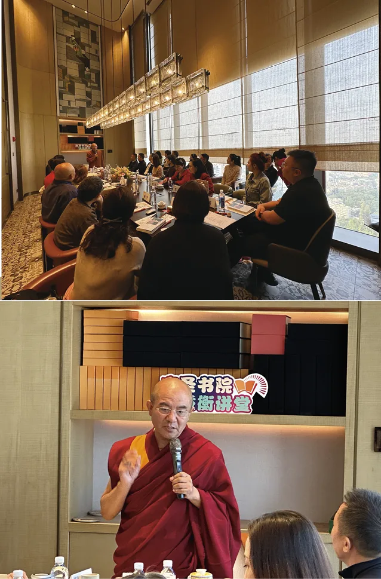
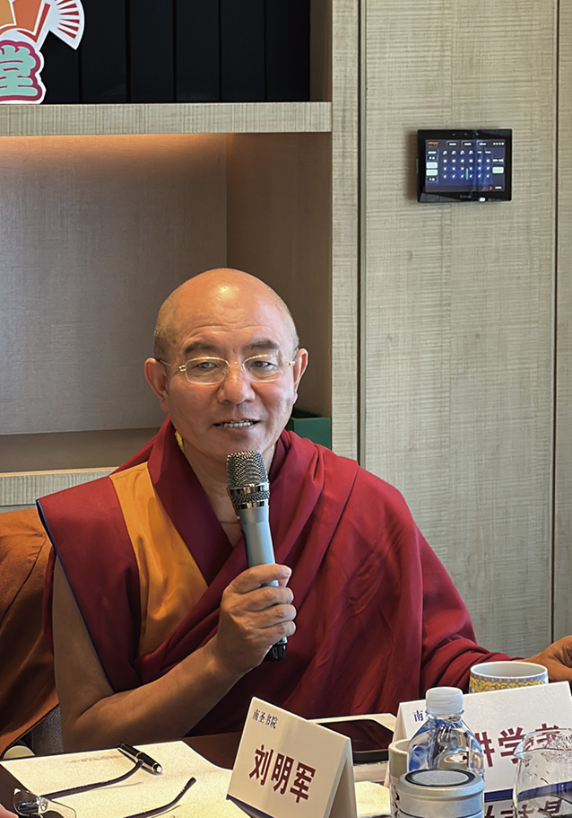
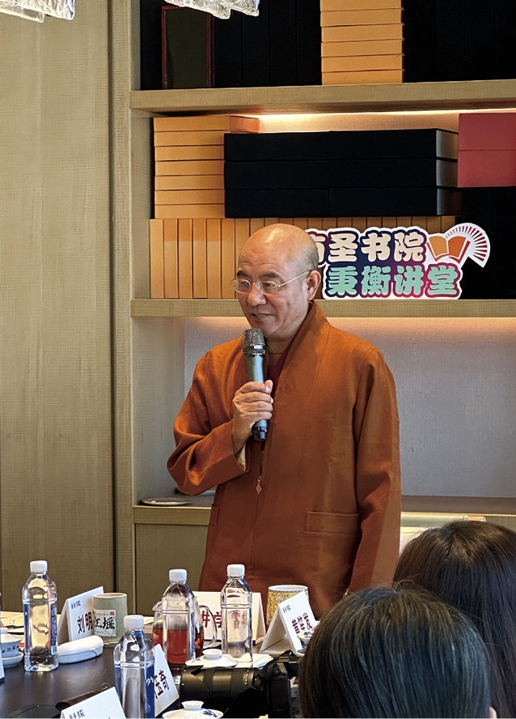

一切都如过眼云烟，  
三十年前的这段经历在我现在的记忆当中  
只剩下了一点一滴，如同人生路上的一粒微尘。

第100场

南圣书院

Nansheng Academy

中国·成都

2023 / 10 / 22

## “梦尘回忆”对当下的启示

## Lessons from "Recollections of the Time Gone By"

主持人：

大家好，我是长江商学院的CEO。首先，感恩上师索达吉堪布今天来到这里。

去年6月30日，我和长江商学院的院长等人在炉霍县酒店拜见了尊敬的上师仁波切。当时我们想，既然来到了心之所向的色达，那也该好好学习吧。后来在上师的支持下我们创建了一个书院，上师为其取名“南圣书院”。

通过南圣书院，很多人从最初的相遇、相识，到跟随上师学佛、做善事，内心有了很大提升。我们创办书院的宗旨也是为了让大家学习更多有益身心的知识，尤其跟随上师学习佛法、利益众生，因为上师会把他一生的智慧都传递给我们。下面有请院长讲话，谢谢——

院长：

大家今天能来参加这次聚会，我感到非常开心。在座大多数都是企业家，人生已经过半。我觉得企业家在追求财富自由和生活幸福的同时，也需要不断提升内在的智慧，这样生命才会更加丰盈、圆满。

由于因缘际会，去年我和一些同学去了川西藏区，见到了上师仁波切，我们在上师面前共同发愿：余生一定要好好学佛、多做善事。之所以这样发愿，是因为学佛可以开启我们的智慧，行善可以增强我们的力量。

依靠这一愿力，去年我们回来后不久，就在线上搞了一次学习分享会，反响还不错。为了能让大家更系统地学习，创造一个长久聚会的因缘，今年我们在政府部门正式注册了“南圣书院”。对于这一举措，上师老人家给予了大力支持，并答应每年会尽量抽出时间给大家上上课。平时，我会在各个讲堂为大家做辅导。

在座很多人都去过五明佛学院或者有去的想法。五明佛学院是法王如意宝在上世纪80年代初创办的。法王被世界公认为大成就者、大伏藏师，他对藏传佛教的贡献几乎可与宗喀巴大师相比，他们都对佛教的复兴和发展做出了巨大贡献。现今，五明佛学院已成为世界最大的佛学院，影响力非同凡响，在弘扬佛法和培育僧才等方面发挥了重要作用。

五明佛学院能有如今的发展，除了创始人以外，也离不开索达吉堪布等一些上师的努力。索达吉堪布是法王如意宝的主要继承者之一，他已精通显密一切教法，证达了不可思议的境界。上师不仅在学院担任重要管理职务，还为汉地四众弟子讲经说法三十余年。在讲经之余，他把藏传佛教很多珍贵的宝典译成了汉文，方便我们学习。现已整理好的有三百多册。

上师不仅在学院内部授课，还经常到外面与院校师生和社会各界人士交流。他曾去过国内外100多所高等院校，为老师和学生做各类开示，并多次在香港和泰国举办“世界青年佛学研讨会”，引导来自全球各地的学者、年轻人共同探讨一些新概念和人类需要关注的问题。

现今，由于各方面因缘不足，这样的机会已经非常少了。在座各位今天能亲耳聆听上师的演讲，也是自己的福报，这次机会极为难得，万望珍惜。希望大家能在学佛路上一直走下去，丰富自己有限的生命。

接下来，就让我们一起感受佛法的智慧，感受上师的加持，欢迎上师为我们做开示——

非常感谢大家。刚才院长已经大致做了介绍，我在2010年至2019年大约十年期间，去了国内外的很多地方，包括大学、企业、监狱等。可以说，除了在学院正常授课的几个月外，其余时间大多都用在与各界人士交流方面。2020年出现疫情后，由于各方面因缘不具足，我基本没有出去。

## 缘起

这次小范围与大家聊聊天，是因为之前我对院长等人做过一些承诺，但没想到很多人从沈阳、深圳、重庆、北京等地特意赶来。若早知如此，我不一定答应，因为自己也讲不出什么更有价值的东西。

这次既然有这个因缘，我就与大家简单交流一下。你们心里有什么疑惑，觉得哪里不合理或者难以过关，都可以提出来。当然，有些问题我能回答，有些答得不一定让你们满意，但不管怎么样，这只是内部的一个沟通，每个人都可以畅所欲言。

前几年，我写了一本名叫《梦尘回忆录》的书，虽然现在尚未正式出版，但很多人都对它饶有兴趣，因为它相当于一个游记，或者说一个朝圣记录，内容可能比较有趣。

这次交流会，院长等人想让我以此书为基础，与大家分享一些藏传佛教的教义。我想这样也可以，因为南圣书院是以学习为目的，并无其他，而学习的内容应该包括佛家、道家、儒家等传统文化，以及管理学、成功学等世间知识——凡对身心有益的知识，应该都可以学。在学修内容方面，我觉得以开放、轻松的态度对待比较好，特意控制或限定不一定合理。

## 学佛也有现实意义

大家作为企业家工作肯定很忙，但如果学习能给你们带来诸多实际利益，抽空学一下也非常值得。一个人如果乐于学习，那么他的一生，尤其在晚年，会过得充实而快乐。

为何这么说呢？因为在座诸位虽然在人格、为人处世等各个方面非常优秀，创业也极为努力，由此取得了今天的好成绩，但每个人都或多或少会有一些痛苦、烦恼和疑惑，这是一个自然规律。这时，通过看一些书、听一些课，或者与善知识交流，内心会得到一些启发。比如，以前你对痛苦和烦恼都是被动接受，经常感到措手不及，束手无策，通过学习和修炼，以后遇到再大的困难，也能轻松面对。如果内心能不断成长，人生会更加充实而富有意义。这也是南圣书院创建的初衷，这样的宗旨非常值得赞叹。

当今时代，作为企业家更需要学习各类知识，因为：学习一些世间知识，能帮助企业与时俱进，持续发展；学习一些佛教知识，有助于自心保持宁静与平衡，在物质发展的同时，防止出现各种心理问题，尤其是佛法所提供的思想动力，会让我们不断向着光明迈进，这不仅对自己今生非常有帮助，对来世也意义重大。

大家如果对佛法感兴趣，可以多一些关注，也许你们人生中解决不了的很多问题，依靠佛法可以轻而易举地解决，即便不能完全解决，也能从道理上明白。

无论在西方，还是在东方，学校课本当中都很少讲人生哲理方面的知识，因此，很多人即便是大学生、硕士生、博士生，对于如何面对困难和挑战，仍然一窍不通。然而每个人都要面对人生中的八种痛苦——生、老、病、死、爱别离、求不得、怨憎会、五阴炽盛。佛教对痛苦的分类、性质、根源，以及解除方法，都讲得非常透彻。

如果认清了苦的真相，即明白了今生来世、业因果、轮回痛苦等道理，当自己遭遇不幸的时候，尽管不一定像吃止疼片那样马上断掉痛苦，但因为知道了苦的来源是什么，自己该如何面对……所以承受痛苦的能力会与以往完全不同。

## 打造长效的学习平台

要想具备这种能力，需要系统地闻思修佛法。希望南圣书院能制定一些学习计划，定期或不定期地组织大家学习，这样会起到一种促进作用。

如果没有一点约束，懈怠的人可能两三年也看不完一本书。比如每天玩一下手机，看一会儿电视，在浑浑噩噩当中一生就过去了。我们的人生恍如一梦，十年一眨眼就过去了。我们可以想一想，再过十年，自己多大了，再过十年，又多大了，我们还能有几个十年呢？藏族有种说法，用十根手指就可以把自己的一生数完。像我现在六十岁，再过十年就七十了，再过十年就八十了，而两个十年一晃就过了。到那时，我们做了什么对自己有利、对众生有利的事情呢？大家对工作都有长远规划，那对自己的学修更应如此。

在某种意义上，南圣书院也是在为大家做学修规划，所以稍微有点硬性规定，比如三个月看完什么书，某段时间学习什么内容，也是有必要的。当然，对大家要求太高，比如一个月看好几本书，也不一定适合，我觉得标准定得适中，不高不低比较好。

大家在一起学习会有一种压力，而学习需要有种压力，如果完全靠自觉，全世界无论大人还是小孩，很少有人能坚持下来。

以上是我的第一个建议。希望我们的书院，不只是名称上的组织，还能实实在在做些事。如果每年都能组织大家学几本书，聚会时以互动的方式让每个人把自己的体会和感想写出来或讲出来，大家各方面的能力一定会有所提升。

我参加过一个藏地年轻人的读书会，他们会同一时间学一本书，三个月聚会的时候，每个人都要讲述这本书的大致思想，并分享自己的体会。这对提高他们的认知水平非常有帮助。

## 如何拾起了“梦尘”

下面，我与大家分享《梦尘回忆录》的部分内容。这本书可能是我所有书里最畅销的一本吧。其实，我写这本书只用了很短的时间。记得在2019年，我正在翻译著名的中观论典《显句论》和宣说如来藏法门的《宝性论》。有一天，我突然记起法王如意宝是在1990年去印度朝圣，到2020年正好过去三十年了。我当时想：自己当年跟随法王一同前往，现在应该把这段经历写出来。因缘巧合，我一年前刚好在家里找到了一本1990年的藏文日历，我曾在上面密密麻麻写了随法王朝圣的整个经历。

这本藏历的得来也比较有意思，是多年前慈诚罗珠堪布从他家里翻出来的。记得当时他对说我：“我有一本旧藏历，上面记了很多内容，你要不要看一下？”我一看，正是我想找的去印度随身携带的日历。这本藏历回到我身边后，我忘记把它放在家中何处了，直到2018年某一天，我整理房间时，才又看到了它。

藏地的日历一般是长条的，可以记录每天发生的事情。当时我陪同法王去印度大约用了六个月时间，每天我都会在日历上或多或少做些记录。

有了这个想法后，便开始动笔写《梦尘回忆录》。当时，我每天除了翻译《显句论》和《宝性论》，还坚持发汉文和藏文的微博，与大家分享法王和其他一些大德的教言。不知你们那时有没有关注。当时，我还要把《杂阿含经》从汉文译成藏文。因为手头工作比较多，我每天只能利用中午的时间写这本书，最后用了两个月时间完成初稿。记得我是在2019年的1月6日动笔，3月6日写完，后来做了一下校对，放了一些照片。这就是我写《梦尘回忆录》的整个过程。

我写这本书的时候，只是按照当时的记录做了简单叙述，有时会像流水账一样，没什么逻辑。不过，你们看的时候可能会有不同的感觉，或许会觉得像随法王如意宝一起朝圣一样。

这本书之所以叫《梦尘回忆录》，是因为我觉得人生就像一场梦，一切都如过眼云烟，三十年前的这段经历在我现在的记忆当中只剩下了一点一滴，如同人生路上的一粒微尘。然而当时，我陪同法王如意宝整整去了六个月，我们去了尼泊尔、印度、不丹，之后又回到印度，从印度返回尼泊尔，从尼泊尔回到成都，从成都去峨眉山，再回到学院。

## 法王的不共功德——开取伏藏

在这本书的前言，我介绍了法王如意宝晋美彭措。法王是一位非常伟大的传奇人物，不仅具有超胜的智慧，还有很多超凡的能力。藏传佛教有一种神奇的伏藏法，法王就是一位了不起的伏藏大师，他把以前在莲花生大士面前得过的很多法，隐藏在自己的智慧当中，因缘具足时开发出来传予我们。当时我们去不丹、尼泊尔的时候，法王取出了很多伏藏。

这对各位来讲可能有点神秘。其实在西方国家，很多学者都研究过藏传佛教的伏藏，像波士顿大学、科罗拉多大学等很多大学的教授都做过这方面的研究。

伏藏法极为稀有，伏藏师有时会写出很多教言，但这些内容，并不是伏藏师依现在的思维写的，有些是他们前世的记忆，有些是护法神交予的，有些是去某处得到的，像法王去尼泊尔的时候，在莲花生大士闭关洞里就取出了一些伏藏。现今，整个藏传佛教，包括西方世界都非常关注这些伏藏。伏藏现象之所以显得神秘，是因为以现代科学知识根本无法解释。

## 开启三个三十年“伏藏”

在1993年，我又陪同法王去了美国、加拿大、法国等西方国家。前两年我想，既然写了法王如意宝去印度的经历，那这段经历也该记录下来，于是开始收集相关资料。虽然这次去西方只用了三个多月，但法王在各个中心、道场的开示当时都被翻译和记录了下来，所以资料比去印度时多不少，总共整理了两本书，我将其取名为《西游回忆录》。这本书约有二十三万字，《梦尘回忆录》只有八万字左右。

《西游回忆录》也挺畅销，学院印完几千册之后，立即就被请光了。前段时间有道友说：“这次能不能讲《西游回忆录》？”我说：“《西游回忆录》的内容太深了，里面的境界比较高，听者要有一定的佛学基础才行。”不过我想，既然西方人能接受，你们也应该能接受。如果以后有因缘，我可以与大家分享，这次我们先从《梦尘回忆录》讲起。

此外，我还很想把法王如意宝去新加坡和马来西亚的弘法经历写下来，到时我可能叫它《东游回忆录》。当时只去了一个月，大概只能写三四万字。法王如意宝是在1995年去的东南亚，再过两年也三十年了。到时如果我写出来，那么“梦尘”“西游”“东游”这三个回忆录，就都是三十年后写成的。

人的记忆有时可以被激发出来，本来二三十年前的事早已隐没于时间长河中了。如果我当时没做记录，现在很多事情都忘记了。对于后人而言，这三段历史或许有一些价值，或许没有什么价值，但不管怎样，我从文字上记录下来，也是一份珍贵的历史资料。

## 朝圣足迹

大家如果以后想去印度朝圣，可以参考一下《梦尘回忆录》这本书，因为里面介绍了印度、尼泊尔、不丹一些比较重要的圣地。

### 第一站：尼泊尔

你们第一站如果去尼泊尔，最好去一下扬列雪山洞和阿苏拉山洞，那里是莲花生大士以金刚橛降魔并成就大手印持明果的地方。

三大佛塔也不能错过。尼泊尔有三大佛塔——博达哈佛塔（满愿塔）、苏瓦扬布拿佛塔（香根佛塔）、舍身崖佛塔。其中的博达哈佛塔（藏人称其为“夏绒卡秀佛塔”）是莲花生大士、藏王赤松德赞、静命论师前世转为养鸡妇女的三个儿子时所建。莲花生大士说：“这座大塔为如意宝珠，令一切祈求及愿望得以实现。”故它又被称为“满愿塔”。苏瓦扬布拿佛塔（香根佛塔）是世界上最古老的佛塔。舍身崖佛塔是佛陀在因地时舍身饲虎的纪念塔。如果大家要去尼泊尔，最好能去转绕这三座塔。

杜巴广场也非常有名，这里有一尊著名的度母像。据说，当年阿底峡尊者去藏地时，这尊度母像说要和他一同前往，但是尼泊尔人不同意，就用铁链锁住了度母像。

尼泊尔是佛教的发源地之一，它对于藏传佛教和印度佛教的发展起到了极为重要的作用。现今，很多佛教圣地都归属于尼泊尔，像佛陀降生地蓝毗尼花园，现在就在尼泊尔境内，这些圣地都值得我们去朝拜。

### 第二站：印度

接着我们去了印度，最先到了首都新德里，接着去了印度北方一些藏传佛教寺院，之后去了著名的莲花湖。据《莲花生大士传记》记载：莲师在萨霍国时，国王把他置于火中焚烧，莲师将熊熊火焰变成了一个湖，自在地坐在水面的莲花上。从此，这个湖就被称为“莲花湖”。在这里，法王唱了金刚歌并做了神奇的示现。

后来，我们受邀去了印度南方最大的藏传佛教学院——南卓佛学院，以及附近一些其他寺院，法王为他们传法、灌顶。格鲁派三大寺院——哲蚌寺、甘丹寺、色拉寺，也派格西前来迎请法王，但由于这些寺院离得较远，往返来不及，所以没有去成。

### 第三站：不丹

之后，我们从印度南方的加尔各答登上了飞往不丹的飞机。不丹全民信奉大乘佛教，是全世界幸福指数最高的国家。莲花生大士曾在不丹示现过各种神变，朝拜这些圣地非常有意义。

不丹最著名的圣地是位于悬崖上的虎穴寺，它是莲师骑着母虎降伏恶魔的一个山洞，后人在那里建了一座寺庙。我们进入虎穴山洞后，我感觉有一股强大的力量包围着自己，与去其他地方的感觉完全不同。在那里，法王从觉性中流露出了一个意伏藏。

后来，我们去了古杰寺，该寺是印度国王在8世纪建造的。莲师在这里闭关时，身体向后靠陷进了岩石里，留下了整个身体的印记，“古杰寺”以此而得名[^1]。

紧接着，我们去了淡心寺，它是由莲师授记的伏藏大师贝玛朗巴于1501年建造。在那里，法王穿上了贝玛朗巴亲自用铁铸造的重达25公斤的“赎罪衣”，并在大殿里绕了三圈。随后，我们去了贝玛朗巴开取伏藏的“燃烧湖”。

### 第四站：印度

在不丹待了十多天之后，我们又返回印度南方的南卓佛学院，法王在这里传讲了一个多月佛法。之后，我们开始了印度的朝圣之旅。

最先去了佛陀密转法轮的地方——米积塔。释迦牟尼佛初转法轮是在鹿野苑，二转法轮是在灵鹫山，三转法轮是在广严城等地，密转法轮是在米积塔。米积塔在印度南方，路比较难走，离其他地方较远。途中，我们经过了吉祥山，它是龙树菩萨晚年广转显密法轮的圣地。

随后，我们来到了佛陀的成道处——菩提伽耶，当天下午，朝拜了菩提树下的金刚座。接着，又去了其他著名的佛教圣地，包括古印度佛教鼎盛时期的三大寺院之一——那烂陀寺的遗址。

我们在印度朝圣的时间比较紧，只有一个星期。那时不像现在有手机等设备可以导航，想去哪里只能靠问路，所以去一个地方非常困难。1990年的时候，不要说互联网和手机，藏地大部分地区连电都没有，我们晚上看书一般都用煤油灯。那时印度的状况好像还不如中国。

虽然时间很紧，但印度重要的佛教圣地我们都去了。大家以后如果有机会也可以去感受一下，尤其应到菩提伽耶和金刚座发愿，这对于佛教徒来说极具意义。即使不是佛教徒，也能感受到那里的神秘氛围。

## 真理，不会被永远尘封

在《梦尘回忆录》里，我还专门介绍了一位英国考古学家亚历山大·卡宁厄姆。之所以讲他，是因为13世纪伊斯兰军队入侵印度之后，彻底摧毁了印度佛教，以致在后来的六七百年间，佛教在印度几乎灰飞烟灭，没留下任何痕迹。直至17世纪，这位英国考古学家才依靠《大唐西域记》里提供的线索，逐渐找到了鹿野苑、蓝毗尼、拘尸那罗、那烂陀寺、祇树给孤独园等圣地遗址。所以，我特别感谢他。

我曾翻阅过很多历史资料，发现汉地人比较喜欢做记录。像唐朝时，高僧玄奘在西游取经的过程中做了大量记录，后来将其整理成一部著名的《大唐西域记》。他在书里把很多佛教圣地的具体位置，包括大概公里数都记了下来。这位英国考古学家把这些点点滴滴的信息串联起来，最终找到了以佛陀四大圣地为主的很多遗址。

虽然那段时期佛教在印度基本销声匿迹了，但汉地译师早已把印度佛典译成了汉文，藏地译师也早已将其译成了藏文，所以汉藏两地现在都有较全的《大藏经》。此外，藏地译师把龙猛菩萨、月称菩萨等很多印度圣者的论著，也译成了藏文，共有两百多册。可以说，汉藏的译师们对佛教做出了历史性的贡献。

现如今，印度本地只有一些零散的佛典，没有较全的梵文《大藏经》。有些学者为了整理，把藏文、汉文或英文的佛典翻译成了梵文。

历史的变化难以想象，很多事物都会突然消失不见。谁都未曾想到，印度虽是佛教发源地，但在那里却数个世纪连一句佛号都听不到，连一本经书、一尊佛像都见不到。如果你们去那烂陀寺和鹿野苑的展览馆，看到佛像被损毁的状况，就如“文革”时期那样，应该会有一些感触。

历史会给我们很多启示，作为佛教徒，应该思考一下：为什么后来是一位英国考古学家依靠中国的典籍发现了这些遗址？佛教尽管历经浩劫，为何并未就此泯灭，后来又逐渐兴盛起来？

## “百闻”“一见”，帮你了解藏传佛教

《梦尘回忆录》其实不仅是一部游记，里面还对藏传佛教做了一些介绍。佛教主要分为三大派系：南传佛教、汉传佛教和藏传佛教。

南传佛教属于声闻乘，如今在斯里兰卡、缅甸等国家保存着它的部分仪式和行为，但自古以来对传承方面关注得较少。

汉传佛教主要流传于中国、日本、朝鲜半岛等地，是以大乘佛教为主，至今保留了部分传承。

藏传佛教非常重视传承，虽然历经多次劫难，但显密教法、传承、仪轨、修法等都完好无损地保留了下来，传承千余年未断，就像中医世家把自己的窍诀和技艺代代相传一样。此外，讲辩著、闻思修等优良传统，也都被藏地各个寺院继承下来。并且，自古以来，修行成就者多不胜数。

以后如果有机会，南圣书院的同修们可以去藏地寺院实地考察。百闻不如一见，亲自见到之后，才会知道世间有一群人是以这种方式生活，虽然在物质条件方面，他们与城市里的人相差甚远，但在精神财富和幸福感方面，却远远超过了城里人。同时也会确信，藏传佛教的确能让人离苦得乐，并非只是口头上说说。

当然，南传佛教和北传佛教也很殊胜，同样值得我们尊重和学习。包括儒家、道家在内的中国传统文化，对于解决人们当前一些问题也有启示作用，也值得学习。

## 正确依师，让你少走弯路

这本书还讲了藏传佛教的伏藏等神秘现象，与此同时，还间接讲了如何依止善知识。

藏传佛教非常重视依止上师，因为如果依止了一位精通显密教法、有一定修行境界、戒律清净的上师，自己的修行就有了保障。如果依止了一位不具法相的上师，学佛就会出现大问题。

在座有些人想将来好好学佛、修行，这样首先就要寻找一位善知识。寻找上师时，并非看他长相是否庄严，是否有名气、有财富、有众多弟子，这些都不重要。最重要的是，看他是否具有菩提心，是否精通教法并有一定的修证，因为上师具有这些功德之后，才能为你指明修行之路，不让你误入歧途，否则，就是以盲导盲。

尤其是，上师一定要具有菩提心和一些修行境界，这样他才能真正利益到你，使你变得越来越好。否则，你不但得不到利益，还浪费了自己宝贵的时间和精力。法王如意宝去美国弘法时曾反复强调：依止上师时，一定要看他是否真正具有菩提心，如果具足，这位上师多多少少都会给你带来利益。

当然，依止汉传佛教或藏传佛教的上师都可以；依止藏传佛教格鲁派、宁玛派、萨迦派等各派的上师，或者汉传佛教禅宗、净土宗等教派的上师，都是可以的。就像世间任何一样产品，由哪个公司生产、从哪个地方出来的不是关键，关键是质量是否合格，对你来说是否实用。

为了找到这样的上师，一定要多方观察。藏传佛教特别强调在依止上师之前要认真观察。在观察确认之后，再开始交流、依止，这一点非常关键！

## 依师，不在形式，而在内心

《梦尘回忆录》有几处写了我怎样依止、承侍自己的根本上师法王如意宝的细节。比如，我很爱拍照，那次出行我拿着新买的照相机到处拍。我们一行来到鹿野苑后，我便忙着给法王拍照。法王那时眼睛不太好，被闪光灯晃得很不舒服，显现上有点不高兴，让我不要再照了。后来朝山时，法王对我说：“到了圣地应该好好念经、发愿，你拿着相机到处拍有什么用啊？”

我当时心想：“如果上师不高兴，做这些也没什么意义。”于是后来就没有拍，所以在灵鹫山、佛陀居住25年的舍卫城，乃至佛陀舍身喂虎的地方，都没有照片留下来，至今仍觉得有些遗憾。虽然依止上师有时会有点难，但我们仍要依教奉行。

法王是一个传统的修行人，到了圣地会认真发愿、虔诚祈祷，不太关心拍照留念、记录这样的事。但随着法王弘法事业的展开，他老人家显现上也不像以前了。1993年我们去西方的时候，我怎么拍，法王都不批评了，再加上当时相机的质量也比以前好，所以留下来的照片比较多。

1990年去印度的时候，我依止法王如意宝已经五年了。我不但在语言和行为上特别恭敬、尊重法王，而且内心当中真正认为法王非常了不起，有很多值得我学习的地方。

1986年我随法王如意宝去了藏地一些地方，为时四个多月。1987年我们去了五台山一百多天。当时，法王让我给汉族弟子多讲一些课。从那时起到现在，我一直与汉族道友分享佛法方面的知识。刚开始，我对汉文的佛教词汇非常陌生，慢慢熟悉之后，便开始将藏传佛教一些著名的典籍译成汉文，至今一直未断。

以上，我大概介绍了《梦尘回忆录》里的内容。如果大家对这本书感兴趣，我想最好能在两三个月内看完。作为读书会，对读书时间有个限定会比较好。可能很多人一天就看完了，因为看这种游记比较轻松，就像看连续剧一样。

## 特殊时期，需要有特殊智慧

### 1．随顺因缘

在此，我还想提醒大家一下，在座各位虽然都是成功人士，但如今国内外的形势并不乐观，整个世界动荡不安，变幻莫测。这个时候，一定要多积累福德资粮和智慧资粮，各方面的行为需要内收，不管做任何事，都要小心翼翼，应如《诗经》所说：“战战兢兢，如临深渊，如履薄冰。”像我们有时候会到处演讲，扩展弘法利生事业；有时候会非常内收，在寂静处闭关。

随着年龄、身体等因缘的变化，我以后不一定会讲很多课，出去的次数也会越来越少，可能会在寂静处多做一些禅修。未来五六年，我想把有些藏文典籍尽快译成汉文，把该写的尽快写出来。因为五六年之后，我的视力不一定很好，整个六根识也会退化。我觉得一个人合理规划自己的人生应该比较好。

### 2．接受因缘

虽然每个人都希望自己各方面能一直美满，前程似锦，但当前世和今生的各种因缘纷至沓来时，谁都阻挡不了，它们有时会像汹涌的洪水般冲毁一切。所以，我们应该提前做好各种准备，包括好的准备和不好的准备。

我因为经常思考这方面的道理，所以遇到顺缘时，会觉得这是自己追求和等待的结果；遇到违缘时，会觉得这是自己早已预料的结果。

如果大家有了这种特殊智慧，不管在生活、工作等任何方面遭遇违缘，都不会惊慌失措、悲伤难过，而会坦然面对。

### 3．转化因缘

此外，也要知道因缘转化的道理。佛经中说，吉祥女和黑耳女是两姐妹，二者恒时如影随形。也即吉祥之处，隐藏着不吉祥；快乐之时，隐藏着不快乐；成功的背后，隐藏着失败。

所以，我们不应在成功后得意扬扬，放纵自己；也不应在失败后垂头丧气，一蹶不振。因为，表面看你成功了，但成功也给你带来了失败之因——让你变得傲慢、大意、不思进取；表面看你失败了，但失败也给你带来了成功之因——让你学习、反思、更加精进。顺缘和违缘完全可以互相转化。因缘非常复杂，佛教中讲了很多将违缘转为道用的方法。

古人一般都通晓此理，因为在《道德经》《易经》等很多典籍中都讲过，如《道德经》云：“祸兮，福之所倚；福兮，祸之所伏。”

现代人在人生哲理方面学的不多，经常遇事才开始思考，但这时调心已经来不及了，以致最终陷入痛苦的深渊，难以自拔。如果自己在顺境中，经常从不顺的方面思考；在逆境中，经常从顺的方面思考，那么无论遇到什么事，都能保持一种平和的心态。

### 4．懂得无常

尤其应懂得万法无常的道理。在座各位虽然现在各方面都不错，但也应该做好无常的准备，因为无常是生命的必然，就像爬上一座高山之后，必然要走下坡路一样。不论你的青春、权力、财富，还是家庭，一定会有无常的时候。如果没有提前做好思想准备，当无常来临之时，惯性思维会让你无法接受而痛苦不堪。如果提前知晓了人生真相，尤其佛教所说的寿命无常、世事无常的道理，就会具有面对的能力。

在佛教当中，观无常是一种非常重要的修行。要知道，一个人原来默默无闻，后来依靠自己的努力或其他一些因缘出人头地，这也是一种无常；他成功之后，因为一些人为或非人为的因素，最后沦落至凄惨的境地，这也是一种无常。在整个世间，无论世界的事、国家的事，还是个人的事，乃至春夏秋冬等自然的事物，没有一法不是无常。人生中有很多变数，我们不能寄希望于某事一成不变。懂得无常的道理，会对自己的事业、人生等各个方面非常有帮助。

我不敢说自己修行很有境界，但无常方面修得还算不错。我最近看到很多关于许家印的新闻报道，他成功、衰败的整个经历，让我深切感受到了无常。其实，无常是一个很现实的修行法门，每个人身上都会出现，人生时时处处都在上演，佛教只是把它提出来专门讲解而已。

### 5．了知是梦

如果无常修得好，就很容易了知人生是一场梦，知道自己的每个阶段只是梦的一个片段而已，昨天是过去的梦，明天是未来的梦，今天的自己正在做梦。人生如幻如梦的意义在《梦尘回忆录》中也有体现，这也是书名中有“梦尘”二字的原因。

现在很多人都有一颗脆弱敏感的“玻璃心”，有时一件小小的事或者别人不经意的一句话，都会在他心里掀起惊涛骇浪，久久不能平息。其实，这是对事物太执著造成的。如果懂得了如梦如幻的道理并依此调整自心，就会变得越来越坚强，逐渐地对于任何事情都能坦然面对。

当然，口头上说不执著无济于事，一定要实际炼心。修炼虽然不太容易，像我在佛学院学修了三十多年，遇到有些事还是会执著，但与以前没学佛相比，执著程度已明显减轻，心里也不会有什么痛苦。

前几年我遭遇了很多事，但它们在我心里比较容易过关，没让我生起太多烦恼。我觉得，人生中能解决的问题，应该尽力解决；解决不了的问题，就需依靠真理来调整自心。

## 祈祷，可助你一臂之力

希望大家也能经常祈祷佛菩萨，这对自己大有裨益。祈祷莲花生大士，可以遣除各种违缘；祈祷药师佛，可以消除疾病、延年益寿；祈祷地藏菩萨或黄财神，可使自己财运亨通；祈祷大慈大悲的观世音菩萨，能使内心变得温柔善良；祈祷文殊菩萨，可使自己聪明睿智，善于取舍。

这并不是一种迷信说法，佛菩萨的加持的确存在。以前，我去五台山虔诚祈祷文殊菩萨、去普陀山真诚祈祷观世音菩萨之后，自己的智慧和悲心得到了明显提升。这不是一种想象，而是佛菩萨真正给予了加持。很多人都有过类似经历。

我在《梦尘回忆录》里讲了紫玛护法神和乃琼护法神降临的事迹。他们并非一种传说，我作为当事人，实实在在感受到了他们的加持。我没必要对你们说妄语，也没有任何其他目的，只是想告诉大家，佛菩萨的加持和护法神的护佑是无欺存在的。

我们不能因为自小没受过这方面的教育，就完全予以否定，这样不一定合理。对于这些未知的事物，你们以后有机会可以去藏地寺院看一下，或者阅读一些藏传佛教书籍，就会有些不同的感受。

## 未经思考的人生，不能算成功的人生

我经常和有些世间人开玩笑，让他们常给自己充充电。比如，夏天的时候，暂时离开大城市的滚滚红尘，呼吸一下藏地的新鲜空气，或者到藏地寺院感受一下那里的宁静，看看僧人们怎样生活，他们的精神世界是什么样……这样可以沉下心来思考人生中的很多问题。虽然拼搏事业很重要，但思考人生应该更重要。

我并没要求你们必须皈依、出家，或者修五十万加行，因为很多人不一定能做到。但每个人都可以根据自己的情况慢慢做些调整，比如：利用自己的资源帮助一些人；学习一些佛法或传统文化；每年去寺院住几天，思考一下人生——思考人生非常重要，未经思考的人生，不能算成功的人生。

当思考清楚一些事情之后，身心就会轻松起来，工作时也会比较放松。虽然你还会像西方人那样，对很多事情做周密计划，有一套完整的方案并严格执行，但做的同时，内心已会稍微放松，不再像以往那样紧绷，这样做事会更持久、更圆满。

与此同时，你的人际关系也会变得融洽，以前你可能对自己的家人、朋友、下属或同事要求比较严格，致使关系经常紧张。自己放松之后，彼此的很多心结都会自然解开。

无论生活还是工作，保持放松的心态至关重要，如果内心一直紧张不安，做事不一定顺利、圆满，这方面大家也需注意。

## 念诵《佛子行》传承

最后，我给大家念诵《佛子行》的传承。这部论虽然只有三十七个颂词，但内容非常殊胜，藏传佛教不论哪个教派都特别重视。里面所讲的出离心、菩提心、无二慧的境界比较高，大家现在不一定能做到，但对你们将来肯定有帮助。

现场互动

问：我有一些小小的建议，大家来自世界各地，从事着不同的行业，聚会一次很不容易，所以，我很希望我们的读书会能组织好每一次活动。比如，可以带领我们去藏地各处走一走，探寻藏传佛教的起源和发展历史，正所谓“读万卷书，行万里路”，这样不但脑海中会有一个清晰的脉络，构建出系统的框架，而且印象也会非常深刻。白天可以四处参访，晚上可以结合相关的佛教经论，以及每个人的实际情况、困难等，深入地学习和讨论。

每次出行之后，可以把相关的资料，比如所学的佛教典籍，所参考的文献，记录的文字、照片等，像上师那样整理出来，供后人参考。

堪布：通过一些活动，了解藏传佛教或汉传佛教的历史、教理，彼此分享心得体会，应该非常有意义。

南圣书院对未来的学习、朝圣等活动，很有必要做一个系统性的规划。当然，任何一个计划或理想，都有可能实现，也有可能实现不了，但不管怎么样，大家经过认真思考、做出比较完善的方案之后，多多少少都会施行一些，这样也很有意义。

我觉得你们可以先结合自己的实际情况进行探讨，探讨之后再出一些方案，然后推进，这样可能比较好。

问：我们作为在家人，很容易受到冤亲债主的干扰。请问在家人怎样才能生起坚定的信心，持续地精进？心如何才能不被干扰，专注修行？谢谢。

堪布：在世间生活，必定要面对各种纷扰，也会比较忙碌，经历各种痛苦。我常开玩笑说，居士有双重身份，既要闻思修行，又要工作、照顾家庭，还是挺不容易的。如果没有信仰，那只管好生活和工作就可以了；如果是山里的出家人，那只虔诚信仰就可以了，不必为工作和生活担忧。

作为居士，对上对下有很多责任，并且有较大的工作压力，这时一定要合理利用时间，这样才能保证修行和生活两不误。

首先，应该把自己的时间分配好，就像有两份工作一样。比如，可以把早晚一部分时间用于家庭，另一部分用于修行；白天大部分时间用于工作，偶尔穿插修行，等等。这样很多事情都可以成办。

其次，也要珍惜时间。很多人都说自己忙，没时间修行，但真正观察时，他们的很多时间都在不知不觉中浪费了。如果把这些时间利用起来，那修行、工作、照顾家庭、休息，都会各有各的时间，谁也不耽误谁。

这方面我比较有经验，我有时会强制性地安排自己的时间，如果随心所欲，时间就会浪费得很厉害。有时候，身边人会劝我不要这样劳累，应该放松。但我也松不下来，可能时间概念比较强吧。

我们修行过程中肯定会遇到各种违缘，但只要自己利用好时间，每天哪怕一个小时也不放弃，用于闻思修行，坚持多年以后，自己的修行肯定会有显著进步。

问：我母亲学佛十年了，最近她发愿念二十万遍咒语，因为她不会受什么事干扰，每天可以很专注地念咒，我也想像她那样发愿、修行，但没有那么多时间，因为对老人、孩子、家庭、生活、工作、爱好都要分配一些时间。请问，我以怎样的方式修行比较好？

堪布：我觉得你母亲能念二十万遍心咒，那你念三十万遍应该都没问题。（众笑）

因为念咒语的时候不需要什么事都不做，可以一边做事一边念。只要你每天坚持，完全可以念完，只是你还没有这种习惯，但习惯可以逐渐养成。

最近，我们佛学院要求每个人在一年内念完一百万遍文殊心咒。我翻译的同时，在早晚散步的时候、看书的间隙、坐车的时候都会念。刚开始我一天念三千遍，后来每天可以念一万多。至今我已念了十七万遍，到明年这个时候念完一百万遍绰绰有余。我并没有单独安排时间，而是在做一些事情的同时念诵。在这次来的车上，我也念了好几百遍。有的道友看我念咒，也拿起念珠开始念。如果出声念不方便，默念也可以。

问：请问，除了这种修行方式，还有其他修行方式吗？

堪布：很多修行都需要在座上专注地修，按照我们平时的习惯，不一定有这样的时间。要想挤出时间，就需要对自己原来的生活习惯、时间分配做些改革，并加以有效管理，否则，很多时间都在不知不觉之中流失了。

去年，我对时间控制得特别严，所以当时可以同时写好几本书。现在不像去年那么严了，有时翻译一本书都有点来不及。

所以，修行时间是自己找出来的，如果你不找，它就白白流失了；如果你找到一些规律，应该可以很好地修行。

问：我想请问怎样才能更好地放生。近二十年，尤其这十年，我经常放生。上个月我们在云南的千年古刹黑龙潭放生乌龟，这些龟的寿命有一二十年，当时有一只龟朝我们回头了七次，我们几人都被它感动了，另一只龟的背上有一个“龙”字。我每次回老家，也会到菜场买些野生的蛇等动物放生。在以后的一二十年，我也想每个月都放一些鱼、泥鳅、黄鳝等。

能救助这些生命我感到非常欣慰。不过有一次，我在菜场发现了一只我半年前放生的动物，因为当时我在它身上套了一根绳子，所以一下就认出了它。这次它又被人捕到了。

我想请问上师，怎样放生才能对这些动物更有利？放生的时候需要念些什么咒语？

堪布：龙猛菩萨的《大智度论》中说：“诸功德中，不杀第一。”在所有的有漏善根当中，戒杀放生的功德最大。

为何这么说呢？因为不管人类还是动物，没有一个众生不惧怕死亡或者说死时没有痛苦，它们都极度渴望活在世间，这是包括人类在内所有生命的共同价值观。因此，我们哪怕一年放一次生，意义也非常大。此外，我们从小到大吃了很多肉，在有意或无意间造下了很多杀业。放生是清净杀业极好的对治方法。

慈诚罗珠堪布二三十年以来一直坚持放生。他以前每年都会利用宝贵的一百天开展大规模的放生，现在虽然每年不一定能达到连续不断一百天，但总计也有几个月。放生不是一件很容易的事，不仅需要出钱、出力，还要面对生态平衡等诸多问题。不过，为了保护众生的生命，这样的付出是非常值得的。我很随喜慈师的放生精神，我虽然刚开始也每年放生，但后来因为讲课、翻译等事没有像他那样一直坚持，只是偶尔出去放放生。你们能一直坚持放生，也非常伟大。

你刚才说，你们放乌龟的时候，感受到了它的感恩之情。我在放生的时候，也感受过动物们的喜悦。像放鱼的时候，回归江河的鱼儿经常欢腾地跃出水面；放鸟的时候，鸟儿就像囚犯重获自由一样，展开翅膀直入云霄。我们作为人类，在有能力的时候，帮助其他生命离苦得乐，人生才会更有意义。

放生对于我们来说，只是一个善举，但对于这些动物而言，却免遭了杀戮，获得了新生。我们可以想象一下：当自己身处险境时，如果有人救了自己，那自己用多少钱财也无法回报；自己被判处死刑时，如果有人将你无罪释放，那自己肯定对他感恩不尽。我们从菜市场把众生买回来放生也是这个道理，只是很多人换位思考的习惯不强，感受不到而已。

希望你们以后还能坚持放生，放乌龟，或鸟类、鱼类等哪种众生都可以，都非常有意义。放生的时候，可以多念“南无阿弥陀佛”、“嗡玛呢巴美吽”、“南无宝髻如来”或者其他佛菩萨的名号（众生听到宝髻如来名号之后，来世不会堕入三恶趣）。念诵《放生仪轨》《心经》也很好。

问：我是做人工智能开发的。我觉得您需要将所有的影像、音频、视频真正保存下来，使之成为将来AI人工智能学习的一个有效数据，因为以前的数据质量不高，到时很难使用。未来，人工智能可以学习您所有的法，然后形成一个数字上师，这位数字上师可以在元宇宙中弘扬佛法，就像您未来的一个化身一样。

当然，现在因缘还不具足，真正开始做可能要很多年以后，但我们应该着眼于未来，现在就开始思考，并为将来做一些准备。

堪布：你说得很对，科技发展日新月异，未来，人们会有很多新的学习方式，现在的很多方式都会被淘汰，但基础资料应该很好地保存。像法王去印度的时候，虽然留下了很多照片、音频和视频，但现在只有照片能用，音频和视频都损坏不能用了。因为我平时有记录的习惯，把朝圣的经历写了下来，现在大家才得以知晓这段历史。

法王如意宝1993年去西方弘法的资料，留下来的比较多，因为西方人有保存、记录的习惯。不过，虽然音频效果还可以，视频大多数也已经模糊了。

二三十年之后肯定会有一些新的学佛方式，到时怎样利用上现在的资料，的确有必要思考。在传播方面，佛教应该跟上时代的步伐，一直特别保守可能不行。

问：非常感恩上师能在南圣书院第一次学习的时候，为我们做开示。我以前对学佛有点犹豫，但自从跟随院长等人去了南极之后，我对佛法毫无障碍地信任了。在纯净、宁静、白雪皑皑的南极，在蔚蓝的天空下，院长坐在雪地上虔诚捧着金灿灿的佛像那一幕，给我留下了极深刻的印象。

院长：补充一下，我当时特别想去南极，但又觉得自己老想着玩太不精进了，于是心情忐忑地向上师汇报自己去南极的想法。上师听后对我说：“你带一尊佛像过去，这样可以把玩和修行结合起来。南极有那么多生命，但它们从未与佛结过缘。”得到上师开许后，我便带着佛像上路了。

在路上，我们遇到了一件非常神奇的事。乘船前往南极会路过一个南半球西风带，它是进入南极必经的一道“鬼门关”，常年狂风怒号、巨浪滔天，然而，我们到的那一天却风平浪静。船长都惊讶地说：“我往返这里这么多次，第一次遇到这样无风无浪的情况。”可是，我们后面的一条船却遇到了十米以上的巨浪，被迫在海湾里躲了一夜。

第二天，我们经过一个海峡，其深度超过了珠穆朗玛峰的高度，船在海峡中行驶就像叶子在急流中漂浮一样，稍有点风浪都可能倾覆，非常危险，但我们经过的时候，海面同样非常平静。当我拿出佛像念咒的时候，很多人都跟着我一起念。以前我都不知道有那么多同学对佛法有希求。

问：这段经历确实很神奇，让我对佛教生起了信心。此外，我以前一直不知道佛教、儒教和道教的关系和区别，不知彼此之间是否有冲突。刚才听上师说，只要发心是善的，这三家都可以学。这解开了我心中的疑团，以后学习也会特别安心。

刚才上师讲了跟随法王一起朝圣的经历。其实，我也去过尼泊尔等国家，但因为当时不懂佛法，整天只是害怕鸟粪落到身上、担心猴子和狗咬自己、不敢喝印度的水……所以那次旅游受益不大。以后如果有机会再去，在上师的指引下，肯定会有很大收获。

以后，如果南圣书院能组织大家去印度朝圣，希望老师们能提前做好各项安排，带我们把上师提到的圣地都走一遍。我们会在最殊胜的遗址、最神圣的佛像前好好发愿。

堪布：是的，以后如果因缘具足，书院可以把《梦尘回忆录》所讲的圣地作为一个主线，组织大家到这些国家朝圣。在佛像面前，在佛陀的遗迹和莲师等大成就者加持过的圣地认真发愿，意义非常重大。

这次聚会也算是南圣书院进一步发展的一个缘起。通过这样的因缘，大家不但能轻松地学习佛法、传统文化等有益的知识，还可以结识很多志趣相同的朋友，彼此关心鼓励。虽然如今人心变得越来越冷漠，但佛教徒，尤其大乘佛教徒却不该如此，应该关心爱护身边的每一个人。

在座各位都是心地善良、德才兼备，有诸多优点和功德的人。这样的人聚在一起很不容易，最好通过在一起读书、学习、修行、旅游、探索等方式，真正提升自己。南圣书院若能打造这样一个平台，将许多正能量集聚在一起，能为很多人带来利益。

当然，由于各种因缘，一个平台或组织到了一定时候会有无常的现象，像我们主办的“世界青年佛学研讨会”，在举行了七八次之后，由于因缘不具足再无法举行下去。但不管怎么样，希望大家能做多少就做多少。如果压力实在太大，可以用一种轻松、自由等现代人喜欢的方式做，这样也是很好的。

之所以强调共修，是因为大家一起学习，可以互相督促，彼此鼓励，这样更容易坚持下来。我家乡有一位老师看到很多年轻人不爱看书，便创立了一个读书会，安排他们几个月看一本书。一段时间之后，这些年轻人的学习积极性就被调动起来了。

现代人很需要一种无形的加持力量，而这种力量无法以金钱换取，要通过学习某种知识才能得到，然而很多人都没有这种学习机会。因此，打造一个学修平台，为有缘人提供一些书、课程、交流机会等，应该是最有价值的。

问：尊敬的堪布您好，我多次听您说：如果把佛教真理与科技相结合，会产生无限大的能量。我想知道，怎样才能把二者结合起来，帮助我们进步并解决人生的困惑？

堪布：佛学是一个极为庞大的知识体系，科学也是如此。如果深入研究佛教就会发现，对于现代各个学科所讲的宏观世界或微观世界的道理，包括量子力学、心理学、逻辑学、哲学等知识，佛教当中多多少少都讲过。研究一下还是很有意思的。

佛教对微观世界阐述的不太多，主要在《时轮金刚》和《俱舍论》里讲了一些，但对于人性的分析、烦恼的本质、前生后世、生死轮回等，则做了十分详尽的分析。而这些方面，科学可以说是一个空白。

以前，我采访过中国科学技术大学前校长——朱清时。他说过一句话：“科学家千辛万苦爬到山顶时，佛学大师已经在此等候多时了。”我很好奇，他作为一位在科技大学任职11年的校长，为什么最后会得出这样一个结论，于是问他：“您是在什么心态和背景下说的这句话？”他回答说：“我看了南怀瑾先生的一些佛学讲座，并学习了《瑜伽师地论》和《楞严经》，发现里面已经很明确地解释了当代科学的一些难题。”

很多人认为现代科学是人类认知的高峰，但实际上，佛教所讲的很多具体而实际的道理，在科学界都是一片空白。现今，越来越多的科学家都不得不承认这一现实。

问：请问您怎样看待吃素的问题，谢谢。

堪布：我以前写过一本叫《藏密素食观》的书，讲了很多这方面的道理。

有些生物学家认为，从人的牙齿、胃肠等身体器官来看，人类是一个既可以吃素，也可以吃荤的物种。

但从自利利他的角度讲，佛教提倡吃素，因为素食不仅能拯救动物的生命，还能减少自己的罪业。《楞严经》《涅槃经》等很多经中都讲，如果食肉者减少，杀生量也会随之减少，卖肉和杀生有等量的罪业……

若从养生的角度讲，吃素对身体非常有益，这一点无论东方还是西方的学者、专家都共同承认。有些人认为吃素会缺乏营养，荤素搭配才营养均衡。事实上，我们吃的牛肉、猪肉的来源——牛和猪都是吃素的，它们身上的所有元素都来自素食，并非来自肉类，所以，吃素完全可以获得足够的营养。此外，动物身上有各种各样的疾病，通过肉类产品，很多病菌都会直接或间接进入人体。

吃素对健康有利这一点，事实也能证明，像很多终生吃素的老和尚身体非常健康，活到九十多岁、一百多岁的大有人在。还有一些长期吃素的世间人，包括很多科学家、文人等，寿命也比较长。所以，吃素并不会有损健康。

我原则上建议吃素，这样不仅能救护众生的生命，对自己的身体健康也非常有益。如果能完全吃素当然最好，但很多人从小养成了吃肉的习惯，对肉食比较贪著，一下子断掉可能有点困难，这样可以一个月吃几天素或者减少食肉量。每个人可以根据自己的情况量力而行。希望大家能对吃素的问题重视起来。

问：佛陀说一念无明堕入轮回，无始无终。我有一个困惑，2500年前佛陀要应机说法，现今，科学尤其量子力学已达到了一定高度，我们可否用现代词汇解释这句话？

很多人看过《三体》这部科幻小说，里面有一个词汇“降维打击”，其理论来自量子力学的一个猜想——整个世界是空的，其真相不是三维而是十一维，对于三维空间而言很神奇的事，在四维、五维空间当中却稀松平常。

请问人们因一念无明而堕入轮回，可否理解成人们被降维打击到了三维空间？也就是说，我们原来生活在没有轮回的高维空间，因为一念无明，即犯了一个错误而落入三维空间，从此被束缚住而不断轮回。通过修行脱离轮回的过程，相当于升高维度逐渐返回高维空间、回到法界的过程，就像回家的过程一样。

堪布：这个问题很好。现代科学虽然能解释一部分，但并不完全。佛教其实早已给出了圆满的答案。

从一个层面讲，一念无明确实会堕入轮回。这个道理也可以用简单的方式理解，比如，有的人因为一念嗔心杀了人，由此锒铛入狱；有些人因为一念愚痴做了无法挽回的事，悔恨终生。他们所受之苦相当于轮回，都是由一念无明引起的。

从另一个层面讲，从高维空间观察，整个世界是空性的，我们的念头也不成立。与此同时，无明也是空性的，它的本体即智慧，或者说，当下的无明，就是当下的开悟智慧。正如《六祖坛经》所言：“烦恼即菩提。”佛陀早在2500多年前，就已把无明的本体、智慧的本体讲得十分清楚。

若从最高维度看世界，堕入金刚地狱的众生与天界众生的心无二无别，佛陀的心与众生的心亦无二无别。从这一层面讲，无明从未染污过我们，我们的心始终清净无染。

[^1]: “古”的意思是身，“杰”的意思是印记，“古杰”意即莲花生大士的身印所在处。
