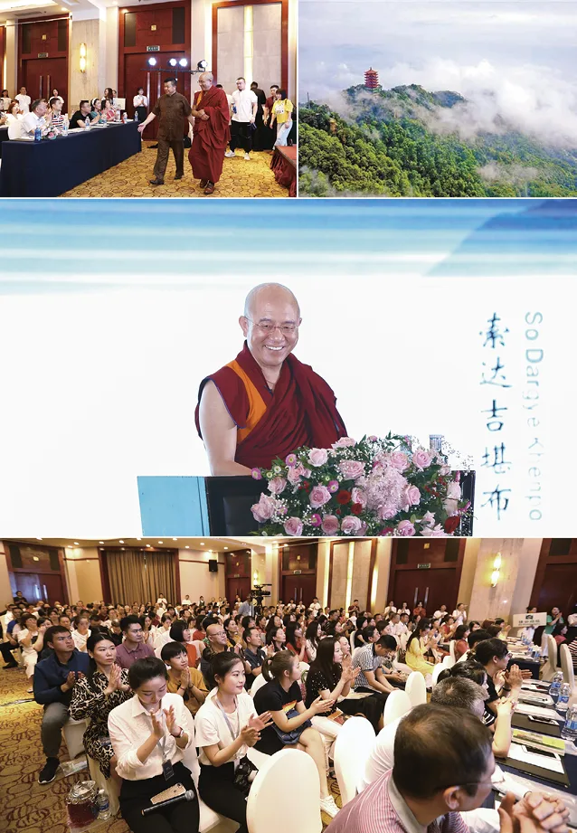
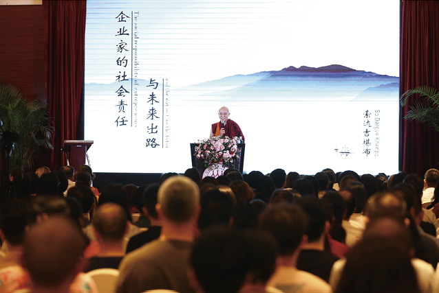
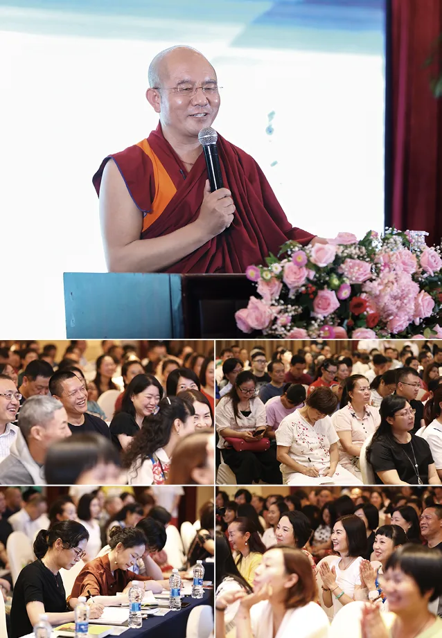
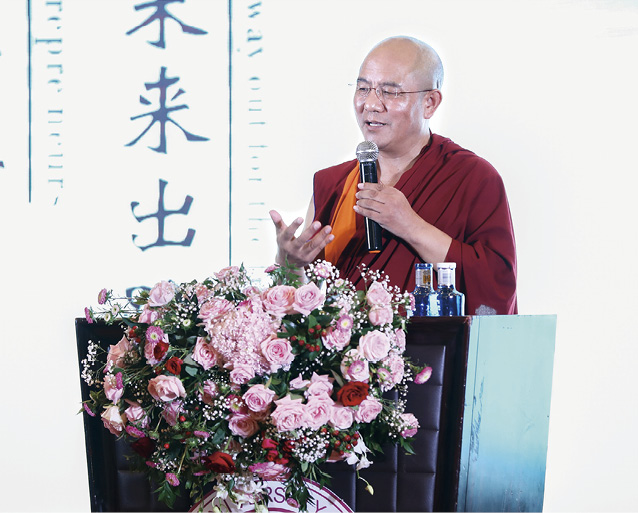
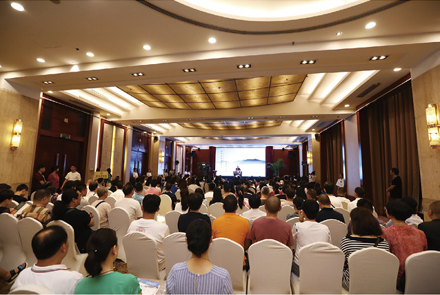
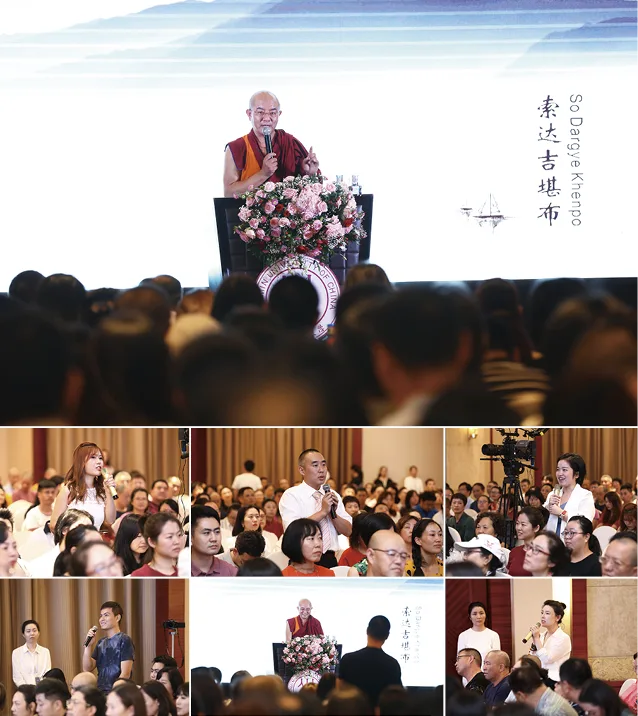

生活离不开金钱的支撑，  
但过多也会成为一种负担。

第99场

重庆人大校友会

RUC Chongqing Alumni Association

中国·重庆

2019 / 7 / 12

## 企业家的 社会责任与未来出路

## Social Responsibility and the Future for Entrepreneurs

主持人：

大家上午好，欢迎来到这里和我们一起学习索达吉堪布的精神财富。首先，请允许我代表今天的主办方——中国人民大学重庆校友会，为各位的到来表示由衷欢迎！

大家都是来自各行各业的精英和领军人物，曾经或者正在经历企业的成长、发展和转型。创业的最初，先要让自己的小家吃饱，然后安顿好和我们一起风雨同舟的伙伴，还要维持好行业的秩序，保证企业的可持续发展。所以，我们要一直开足马力向前。

在企业发展的过程中，我们难免会有迷茫和彷徨，甚至感觉看不到方向。时至今日，社会的变化都是在眨眼之间。除了自我竞争力以外，企业的存在价值和社会责任到底体现在哪里？我们一手开创的商业帝国又将何去何从？该如何调整心态轻装上阵？

以上种种问题，在堪布今天的分享中，相信大家或多或少会得到一些启示。

这次的机会非常难得，能来到现场的都是非常有福报的人。首先，请允许我对堪布做一个简单的介绍。

索达吉堪布来自西藏雪域高原，是著名喇荣五明佛学院的大堪布，同时也是一位不同寻常的学者。堪布对藏传佛教研习精深，并尝试用现代人能够理解的方式来传播传统文化。在过去的三十多年里，堪布花费了大量的时间和精力，进行汉藏典籍的互译，其中有很多书稿已经印刷出版。

除此之外，堪布还是一位慈善家。他发出“启动爱心”的倡议，号召社会各界人士共同奉献爱心。他本人也参与捐建学校和敬老院、资助贫困学生、组织赈灾等，一直帮助和关注着有需要的人。

堪布还被邀请到许多大学演讲，像哈佛、哥伦比亚、北大、清华等等，在海内外拥有极高的声誉和影响力。近几年来，堪布参加了多次论坛会议，与海内外学者保持着良好的沟通和交流，探讨的主题包括跨宗教、人类道德、环境保护、世界和平等等。

欢迎堪布——

非常感谢主办单位邀请我来到这里跟大家一起交流，相信这次的机会能够带来很多善妙的因缘。

今天的主题是“企业家的社会责任与未来出路”，这是大家非常关心的一个话题。从我个人来说，既不是企业家也不是预言家，所以，谈不上承担更多的社会责任，也无法明确说出企业的未来出路。但我也去过一些地方，见过一些人，也在思考当今社会存在的一些问题。

企业家在令无数人羡慕的同时，具有一定的争议性。在我小时候，连“企业家”这个名字都没听说过。而所谓的企业，其实是从欧洲开始出现，然后逐渐发展到美国，最后再到中国。所以，现代企业的管理模式，是从欧美国家引进而来的。如今企业已经成为社会的重要组成部分，承载着重大的社会责任。

## 新时代，新使命

按照经济学的观点，企业家只需要负责个人盈亏，目的也只是希望自己发财暴富。在人们固有的概念中，企业家就是“有钱人”的代名词。诺贝尔经济学奖得主米尔顿·弗里德曼说过：“只要是在法律允许的范围内，企业就应在经营中谨慎地使用有限的组织资源，为股东带来最大的价值。”从这句话我们不难看出，不管是在东方还是西方，企业的唯一任务就是赚取利润。这也是企业家追求的目标，以及企业存在的意义。

后来，随着经济社会的深入发展，企业家社会责任的重要性越发凸显。有一种说法叫做：“能力越大，责任越大；责任越大，压力越大。”所以，真正的企业家，不仅要考虑企业的盈利问题，还要对员工负责，履行相应的社会责任。与以往相比，人们对企业家阶层的看法有所不同，评价也是褒贬不一，因为企业家实际上是占用社会资源最多的人之一。

事实上，社会整体财富是有限的，而有些企业家占据了相当一部分比重。按照佛教的说法，这源于他们前世的福报。而从西方管理学角度讲，这是他们努力奋斗的结果。对此，有些人随喜，有些人嫉妒，有些人羡慕，有些人憎恨，所以评价也是因人而异。在这个世界上，每个人都想获得财富。有些人年纪轻轻便功成名就，受到众人的恭敬，各种资源也是滚滚而来。出于不同的立场，人们对他的评价也完全不同。

企业家群体已经成为一个庞大的社会阶层，因此他们也要比别人承担更多的社会责任。据我所知，企业家也可以分为不同的层次。现在很多年轻人都想成为企业家，但这并不是那么容易做到的。尤其是如今这个时代，很多行业举步维艰。无论是制造业、金融业，还是信息产业，一切都变化得太快，越来越让人没有安全感。

今天早上，我看到一篇报道中说，有一位重庆首富，以前各方面资源非常好，但现在也深陷债务危机。实际上，不同的企业家承担的责任也有差别。财富不多的企业家，主要操心企业的盈利问题，最多涉及家族成员、亲朋好友的利益；财富中等的企业家，要对自己的团队和员工负责，让他们也享有一定的财富；财富上等的企业家，往小了说，是与自己、家人、员工的利益息息相关，往大了说，则要对全人类负责。很多人习惯性地以自我为中心，只想着为自己谋利，其实这种想法并不是很好。虽然我没有做过企业，但也明白做事不能只想自己，还要想着帮助社会中的弱势群体。如果以这种心态创业，应该会有更大的发展空间。

如果你不愿意履行社会责任，一心只想着自己发财，也许最后会成功，但有没有意义很难说。相反，如果你很想让身边的人过上幸福生活，以这种目标来创业的话，最后一定会心想事成。佛教中有一种说法叫“愿大，力就大”，意思是如果你的发愿很大，那你爆发出的力量也会很大。虽然我没有多大的能力，但我之前很想为家乡办一所小学，后来各方面因缘具足，很多资源自然而然就有了。过了没多久，我又很想建一所中学，结果做着做着就成了。然后我又想建一所技术学院，慢慢因缘也成熟了。

因此，作为企业家，目标应首先建立在让他人快乐的愿望上。这样一来，不仅你的压力会有所减轻，而且还能得到社会的认可。美国的公益潮牌Mantra，通过“买一捐一”的商业模式实行公益善举。每卖出一副太阳镜，即为需要帮助的孩子提供一副免费的近视眼镜。后来，他们逐渐得到很多人的认可和支持。在购买眼镜的同时，又能帮助山区孩子矫正视力，这样的善举很多人都愿意做。而且企业也能维持收支平衡，实现可持续发展。

对很多上市公司的董事长来讲，这也许只是一个小小的善举。但看起来很小的事情，却能在无形之中营造出一种特殊的社会氛围。佛教中也讲“种善因，得善果”，行善自然会得到善的果报。

前几年，山东一家民营企业，看到很多农村妇女既要照顾老人，又要照顾小孩，还要做农活，根本没有机会出来上班，而且经济条件普遍不好。于是，他们就想办法解决留守妇女的就业问题。虽然企业暂时可能会出现亏损，但却可以让农村妇女在家门口实现就业。也由于这个原因，这家企业得到了社会的尊重和认可，在当地口碑极好。

工业革命时期的企业家，往往带有一种个人主义色彩，想要建立一个属于自己的赚钱平台。而现在的企业家，不仅仅是追求自己的利益，更重要的是履行社会责任，奉献爱心，服务社会。当然，有些人可能很想这样做，但因缘一直不具足。总之，一个企业想发展好，首先要有正确的定位，或者说美好的发愿。

## 自私的反噬效应

目前，世界各国都十分关注资源分配问题。依靠种种因缘，极少数人占据了大部分的社会资源。哪怕自己一辈子享受不完，也不愿意跟身边人分享。要知道，这些资源不可能永远掌握在你的手里，最终一定会流失掉，这也是一种自然规律。有句话说：“财富如水，如果你有一杯水，你可以独自享用；如果你有一桶水，可以存放家中；但如果你有一条河，就要学会与他人分享。”如果你愿意与别人共享这条“河”，不但自己可以喝饱，别人也能解渴。这是一个很好的比喻。

就全世界而言，关于财富的分配比例，也有不同的说法。尤其是网络信息时代的到来，给很多人带来赚钱的机会。有些人轻轻松松就能赚大钱，而有些人累死累活到头来还是身无分文。其实，当你拥有财富时，不能认为一切全凭你自己的本事，而要想到这些都是社会给予的，现在理应回馈社会。我们每个人都要有一种责任心和愿力。不管是做公益慈善，还是精准扶贫，或者是通过其他方式广行布施，应该为所有需要的人提供关爱和帮助。但我不建议你们一边给钱一边做宣传，你们的关注点更应该是，让被资助者通过学习来改变命运，逐渐摆脱恶性循环的局面。

企业家要有一种利他心。如果发心不纯，只是为了满足自己的私欲，那企业的寿命不一定很长。即使存续期很长，也没有多大的社会价值。为什么这样讲呢？你一个人或一家人生活得再快乐，拥有再多的财富，对全世界来说也不一定有利。那些特别有钱的人，拥有巨额的财富，但也就仅此而已，物质给人带来的快乐是有限的，有钱并不一定就真的快乐。

当你没钱的时候，可能会觉得钱能解决一切问题。但当你有钱之后，会明白事实并非如此。大家应该清楚，人的需求是有层次的。比如，把一个人关起来，五六天不吃不喝，那他出来第一件事就是解决生存需求。但过了一段时间之后，如果还是一味追求物质上的享受，除此之外没有更高的追求，这样的人生并没有什么价值。其实，在生存需求得到解决的基础上，我们还需要艺术、文化、宗教等等，应该有一些更超越的追求。中国近代著名的政治家曾国藩说过：“不为圣贤，便为禽兽。”意思是说，人分为两种，一种人走圣贤之路，一种人走禽兽之路。我们应该向往圣贤之道，追求高尚的精神快乐。而不应该像动物一样，每天只是吃吃喝喝，追求感官上的满足，这样根本无法提升人类的文化素质。

因此，企业的社会责任应该是尽力帮助那些需要帮助的人。除此之外，还要追求全体员工物质和精神两方面的幸福，同时为人类社会做出更大的贡献。这就是企业存在的价值。

另外，企业发展一定要有底线，不能以破坏生态环境为代价。有些企业家为了短期利益，不加节制地开采矿产资源，任意毁坏自然资源，做出很多可怕的事情。正因为这样，现在环境变得越来越差，无论是呼吸的空气，还是喝的水，都有一定的危害性。室内空气污染也直接影响人们的呼吸器官。尤其是在化工厂里，空气中弥漫着大量的细小微尘和有毒气体，容易引发各种肺部疾病，甚至癌症。

在中国，癌症已成为威胁国民健康的头号杀手。据世界卫生组织统计，全世界每年死于慢阻肺的病人接近两百万。数据显示全球有1/4人的死因是“生活或工作在一个不健康的环境中”。也就是说，平均每4个人当中就有一个人是因为环境污染而死亡。这与人类过度开发和破坏大自然有很大关系。而制造业是现今对自然和社会生态环境扰乱最大的一个行业。所以，当企业家在奋斗的时候，一定要保护好人类共同的家园。如果为了满足自己的贪欲，达成个人的目标，随意破坏自然环境，终究是要付出代价的。

做任何事情，都不能违背良心、损害人体健康。有些科学家发现，在人类的粪便中含有塑料微颗粒，而且类型多达9种，平均每10克粪便中就含有约20个微塑料颗粒。可是，我们人类并不吃这些东西。有人认为可能是人们食用的海洋生物体内有这些，因为很多人肆意将垃圾倾倒在江河湖海中，导致塑料染污了水资源。在阳光的曝晒下，塑料制品分解成肉眼不可见的塑料微粒，被各种鱼类误食。而我们又把它们做成美食吃掉，塑料微粒就这样进入我们体内。

其实，这些都是人类自作自受的后果。比如，为了满足自己的利益，在食品加工过程中加入各种有害的添加剂，或者排放超标废水污染海洋环境，导致喝的水、吃的食物，都让人心惊胆战。也有人认为这些都是媒体夸大宣传的结果，因为这类话题比较吸引眼球。不管怎样，人类为了自己的利益，破坏了大自然的生态环境。以前可以食用的东西，现在却成了危险品，这值得每个人深思。

## 尊重生命，敬畏良知

在企业的发展过程中，一定要尊重生命。很多人认为，人类有资格食用其他动物。其实并不是这样，每一个生命都有存在的价值，而且都弥足珍贵。如果为了自己发财，摧毁其他众生的宝贵生命，今生或来世一定会感受果报。

某种程度上讲，人类才是最凶猛的动物。一位记者曾说过，人类其实比猎豹还要可怕。他说，在非洲大陆上，经常可以看到猎豹和羚羊坐在一起，中间不过几米的距离，但它们却可以和睦相处。根据他的分析，猎豹只有在饥饿时才会捕食羚羊，吃饱后就不会再追逐它们。而人类比自然界的猎豹更加凶猛，为什么呢？人类遇到羚羊等动物时，一定会残杀它们，自己吃还不够，还要把它们做成肉干，再卖给其他人。人类还会养很多猎犬，用来捕获其他动物。所以说人类比猎豹还要残暴。

一般来讲，动物之间除了互相啖食以外，它们不会储存，也不会买卖。而我们人类则会依靠机器对动物大肆捕杀。在沿海城市，比如重庆的长江上可以看到，人们每天利用机器捕杀多少鱼类。他们把鱼从江里捞出来，自己会先享用一顿，剩下的通过各种方式来残害。

现在大多数人根本没有保护动物的意识。不管是天上飞的、地上跑的，还是水里游的，全都要吃掉。这样看来，人类确实非常可怕，甚至比野兽更凶残。世间万物皆有灵性，我们要尊重每一个生命。如果剥夺了它们的自由，破坏了它们的生存环境，那不管是个人的业报，还是全人类的共业，将来一定会成熟。这一点值得大家思考。

企业家还要有一颗敬畏心。现在很多房地产企业，经常破坏历史文化遗产，包括古老的寺院和建筑，这种做法很不合理。民间也有一种说法，“举头三尺有神明”，如果践踏、摧毁寺院，到时候自己也会直接或者间接感受种种果报。这并不是我在这里危言耸听，生活中也可以看到很多现世现报。因此，在企业生产经营的过程中，应该考虑到人性的底线、法律的底线、道德的底线，以及自然界的底线。

现在很多人喜欢西方文化，认为在法律允许的情况下，什么都可以做。尤其是按照亚当·斯密的经济学理论，只要不触犯法律，怎样赚钱都可以。其实，西方并没有很多古老的文化传统，而只是有一种西方的思维。虽然他们信仰基督教，认为上帝真的存在，但上帝对当前世界起着怎样的作用，这些问题并没有详细描述。而在我们几千年的传统文化中，对所有道德准则都讲得非常详细。所以，以前的人做事会有敬畏心，严格遵守道德准则，而现在很多人已经西化了，但又不是特别了解西方的科学理念。其实，西方科学并不那么科学，也是一种有限的知识，所以我们不能过度依赖它。

实际上，科学只是一种理论推论。我接触过很多科学家，当你问一些具体问题时会发现，他们在每个问题上都不会给出最终的结论，因为他们也处在不断地观察和探索当中。由此可见，如果我们完全沉迷于西方科学，也不太合理。事实上，大多数的科学家都有宗教信仰。大家应该清楚，西方很多大学设有神学院，多多少少受着宗教的影响，很多西方家庭也会在饭前祷告，世界上大多数国家的领导人都有虔诚的宗教信仰。所以，认为西方科学是绝对的无神论，根本不谈任何神迹，实际上并不是这样的。

因此，如果我们完全照搬西方的管理模式，除此之外什么都不学，其实也不对。他们有他们的管理方式，而我们也需要有自己的文化。

## 坚守义利兼济的商道

未来企业的出路，应该将利他心与传统文化的复兴结合在一起。一家企业想要长存于世，需要具备一定的因缘条件。

第一，无论从事哪一个领域，都要有潜心研究的奉献精神。做企业不仅是一份事业，更是对社会的一种责任。我有时候在想，从我们的穿着、语言来讲，根本看不到传统文化的影子；从我们的内心来讲，并不敬畏传统道德准则。我们经常说，我们有深厚的文化底蕴，有五千年、八千年的中华文明，但是，在书本上很难学到这些文化，大多是国外的寓言故事，以前的课本跟现在的有点不同——再加上高校经济管理专业的核心课程都是西方管理学、西方经济学，导致年轻人对传统文化越来越淡漠。

作为企业家，应该秉持初心，潜心笃志。在做企业的过程中，可能会遇到各种瓶颈与障碍。有些企业家常说：“我的生意是红红火火的，但我的心里是起起落落的，每天都患得患失，一颗心忐忑不安，很没有安全感。”许多人会有这种感觉，这也是一种正常现象。要知道，任何事物都不会恒常存在，包括我们的身体和寿命。就像西藏谚语所说：“明天和来世何者先到，我们不会知道。”谁也不知道自己能不能见到明天的太阳，我们总以为自己不会死，但有什么不死的理由呢？所以，佛教非常重视无常观。

企业文化是在长期生产经营和管理活动中形成的，而现在的人太急于求成，总想短时间内赚大钱，根本不想进行细致性的研究。在国外，可能一个小小的餐厅，都有几百年的历史。而国内企业生命周期普遍偏短，缺乏良好的企业文化。如果没有长期地奋斗，一时的成功很快就会被淹没。因此，我们应该学习西方人刻苦钻研的精神，无论在哪个领域，都要先花时间开展调查研究，然后再深入学习。

第二，要努力复兴传统文化。有些人可能认为，这是国学界的事，跟商界没什么关系，企业只管赚钱就可以了。其实不是这样的。就像我刚才讲的那样，我们的传统文化大多数都失传了。而作为企业，如果没有自己的企业文化作为支撑，一味追崇西方文化，很难实现可持续发展。如此一来，不要说承担社会责任，就连企业未来的命运也很难说。

最近几年，我参观过很多商学院。不管是长江商学院、中欧商学院，还是清华、北大等名校的商学院，学习气氛都非常好。西方的制度化管理，对我们来说是很好的借鉴，但某些带有惩罚性质的管理方式，非常欠缺人性化考量，管理者看起来也没什么慈悲心。用我们的话来讲，就是特别死板，认为该怎么样就怎么样。现在很多企业为了获取更多效益，推行“996工作制”，把员工当成机器一样，这样很不合理。

因此，企业既要有西方的管理理念，又要有东方的人文精神。尤其应该注重人性化管理，做人做事要有道德修养。《论语》中讲：“唯仁者，能爱人。”心仁慈的人，会尊重和关爱每一个人，包括自己的家人、朋友和员工。所以，企业家既要有智商，又要有情商，还要有爱商。一旦有了爱商，周围人自然会对你有一种好感，而且还会对你的产品感兴趣。如果只是人云亦云，完全照搬西方管理模式，不足以支撑企业的长期发展。俗话说“一方水土养一方人”，企业应该制定符合自身的一种管理模式。我们几千年的传统文化非常契合人心。在契合人心的基础上，再引入西方先进的管理经验，把这两者结合在一起，企业才能既有出路，也有未来。

## 企业经营的“道”与“术”

在企业管理中，应该以道为体，以术为用。“术”是指技术层面上的操作方法，包括理论、制度、流程等等；“道”是指按自然规律办事。儒家中也讲“君子爱财，取之有道”。所谓的道，其实就是做人做事要有真诚心、报恩心和感恩心，对天地万物有一颗敬畏心。如果只讲术而不讲道，是不被东方人看得起的。

说话也是同样的道理。现在很多人只讲究说话的技巧，认为嘴巴会说的人特别了不起，特别有魅力。但仅仅嘴巴会说，而心很恶的话，接触久了就会发现，其实他只有术没有道。有些人很喜欢投机取巧，总想轻松赚大钱，这并非长久之计。有些事暂时看来没有什么收获，但对整个社会是有利的，慢慢也会得到大众的认可。这就是生存的意义所在——让身边的人活得更好。

现在的人并不关心道与术的区别。尤其是讲究术的人，特别看不惯求道的人。就像庄子在《逍遥游》中讲到的，麻雀特别看不惯高空飞翔的大鹏，因为大鹏的翅膀如垂天之云，可以毫不费力地飞行几万里。有道之人也是如此，做人做事有底线、懂因果，不像有些人那样，一门心思想着赚快钱、赚大钱。

其实，道与我们的文化息息相关。一个国家必须有自己的文化传统。当初拿破仑侵略俄国时，俄军为了抵抗侵略者，放火烧毁了莫斯科，但是他们的文化还在，所以俄罗斯还是俄罗斯。犹太人在世界各地漂泊了两千年，却始终没有放弃自己的文化，直到他们在巴勒斯坦建国。

以前的锡金和尼泊尔，也具有悠久的历史和灿烂的文化。但在1975年的时候，印度彻底吞并了锡金，这也导致锡金的文化没有保存下来。在喜马拉雅山脉下，还有一个非常可惜的国家——尼泊尔。它的国家领导一会儿是王室成员，一会儿变成其他人，对文化保护没有给予足够重视。我以前去过尼泊尔，那时候也是很乱。他们不搞经济发展，也不搞文化研究，只是自私地活着——这是人类最大的缺点。一般去印度会经过尼泊尔，其实那边有丰富的旅游资源、矿产资源以及水力资源，如果能够进行合理开发，应该会有源源不断的财富。但是，他们的领导人太自私，一直忙着争权夺利，所以尼泊尔直到现在都很贫穷，他们的文化也正在消失。

相对而言，位于喜马拉雅山脉南坡的不丹王国，近几年一直是世界上国民幸福指数最高的国家。不丹王室说他们的幸福指数高，有几个原因。第一，保护生态环境；第二，遵循经济发展的客观规律；第三，重视文化遗产保护；第四，真正实现善政。基于这些原因，不丹的文化被保护得非常好。虽然人均GDP不高，而且地势多以高山为主，但那里的人们过得很幸福，主要原因就是人人有信仰。如果你们去过不丹就会发现，他们不会整天抱怨政府，反而经常说“我们的国王很好”“我们的信仰很好”。每个人都生活得很简单，但内心却有一种利他心，也有一种满足感和自豪感。

由此可见，生活的本质其实很简单，根本不需要花很多钱。人真的越有钱，就会越快乐吗？这很难说。那么，没钱会不会快乐呢？也不一定。从某种意义上讲，生活离不开金钱的支撑，但过多也会成为一种负担。一般来说，过中等的生活就很好。不然，你一个人独享财富，不愿意与他人共享，也是不负责任的表现。相反，如果我们能够做到资源共享，哪怕这个企业只能存在十年、二十年，也能解决很多人的温饱。如此一来，不仅可以实现自我价值，同时也尽到了社会责任。

大家都是有福之人。如果想要长期有福报，就要多积累资粮，也就是要经常发善心、做善事。昨天，有些老板和我说，他们准备在公司里建一个佛堂。我认为这种做法很好。其实，很多国外知名企业都设有祷告室和禅修室。这是一种很好的减压方法，胜过物质方面的福利和奖励。

现代企业要实施人性化管理，管理者应该关爱每一位员工。这样他们才会对企业产生感情，才能凝聚人心，管理自然而然也会顺畅。因此，对企业管理者而言，要将人性化与制度化相结合。只有做好人性化管理，制度化管理才能出效果，也能源源不断地利益他人和社会。

现场互动

问：对于孩子，应该作为接班人培养还是任其自由成长？

堪布：现在人的家庭观念跟以往不同。按照儒家思想来讲，人一定要繁衍后代，断绝后代是最大的不孝，甚至在整个家族里抬不起头。而在西方文化中，并不重视子孙后代的延续。所以，现在许多家庭面临着东西方文化差异带来的冲突。很多留过学或者喜欢西方文化的年轻人，既不想结婚，也不想生孩子。虽然他们的父母特别着急，但父母的权力也有限。

由此可见，在未来时代里，很多传统的想法、说法和做法，也会随着时代的变化而变化。所谓的后代观念，也要根据具体情况确定。

年龄大一点的父母，特别着急没有后代，这也是人之常情。这种观念与儒家思想有一定的关系。在这一点上，藏族人就比较随缘。虽然他们也希望有后代，但即使没有的话，也不会那么着急。每个人的人生都各不相同，以后未必每个家庭都有后代。毕竟现在年轻人和老一辈的观念完全不同。

在这种情况下，大家可以根据自己的实际情况，通过民主选举或其他方式来确定接班人。

问：我个人对佛教很尊敬，但身边的朋友或同事会说不恭敬的话。遇到这种情况，如何调整自己的心态？应该怎样劝阻他们？

堪布：我个人认为，首先你要对佛教感兴趣。但仅有爱好还不够，还要在理论上学通。不管是佛学、儒学还是科学，都需要花费大量的时间和精力，才能通达其中的道理。

因此，除了兴趣爱好以外，还要从理论契入修行，并且真正去行持。佛教与其他宗教相比，有着自己的特色。它的历史文献资料非常丰富，而且至今为止传承也非常清净圆满。在广泛闻思的基础上，再不断地实修，一定能够有所成就。这也是我自己的亲身体验。

通过长期学习，最后明白其中的道理，达到一个更高的境界，那你讲话自然会特别具有说服力。到了那时，如果别人批评佛教，你也可以根据自己所学的知识，辩驳其他人的观点。但如果他说的是个别佛教徒不如法的行为，那他所说也许是真的。而单从佛教的教义来讲，我认为佛教是完美的，即便在科技飞速发展的今天，依然也是如此。

前两天，我去参观了中科院上海物理研究所。在他们的化学实验室里，有很多关于粒子物理与原子核物理的科研实验。后来，我讲了佛法与现代物理学的联系，他们感到很惊讶，因为现代科学眼里的宏观、微观世界，确实与佛陀的描述惊人相似。这并不是因为我是佛教徒，所以要这样说，而是在两千五百多年前，佛陀就已经对整个世界作了细致的描述。

从佛教的教义来看，根本找不到任何过失。但是，不能说佛教徒都没有过失。有些佛教徒的行为确实很过分，甚至比不学佛的人还要差。所以，你的朋友或同事看到的过失，应该不是佛教的过失，而是佛教徒的过失。如果出现这种情况，那他这样说也是合理的，因为他确实看见事实了。

我们不能因为自己是佛教徒，所以让别人连事实都不能说，这也是不合理的。如果他说错了，你应该用道理说服对方；如果他说的没错，你也应该承许他的观点。

问：我身边的企业家朋友，有的彻底放下多年苦心经营的企业，选择专心修学佛法；有的做不到完全逃离世间法，只能选择一边管理企业一边学习佛法。请问，作为企业家，应该如何平衡工作与学佛？

堪布：我们需要具体问题具体分析。如果一个人企业做得并不成功，但是佛法学得特别好，那他可能更适合去山里修行，一天坐禅十二个小时都没问题。然而，有些人不但企业做得不好，佛法也学得不好，这种人进入佛教团体后，也许会更加糟糕。我们佛学院就有这种情况，有的人出家后，在僧团里也不合群。这样看来，有些人还是不出家好一点，因为他连一个贤善的在家人都不如。

所以，我们要具体分析他放弃做企业的原因，毕竟现在什么样的人都有。有些人有能力，但是没有智慧；有些人有智慧，但是没有能力。就像龙猛菩萨在《亲友书》里以芒果的比喻，对人类的不同差别作了分析：有些外在成熟，内在没有成熟；有些内在成熟，外在没有成熟；有些内外都未成熟；有些内外都成熟。这个社会上，有各种各样的人。

我个人建议，如果是在家人的话，应该选择继续经营企业。这样他既可以学佛修行，也可以办好企业。其实，一家优秀的企业能帮助到很多人。我认识的一些学佛的企业家，他们没有自私之心，比较淡泊名利，对身边的员工非常关心，包括合作项目所涉及的众多利益相关者，也能直接或间接地获得利益，他个人也会尽量空出时间修行。

由此可见，有的人既可以在修行中工作，也可以在工作中修行，两者都做得很好。这种人，可以说是智慧和能力兼备的人。当然，如果他的境界比较高，已经断除了对世俗的执著，也可以到山里去修行。像近代的弘一大师，看破世间所有的名闻利养，最后在佛学方面达到极高的造诣。一般人很难拥有这种能力。有些人，好像什么都做不好；还有一些人，什么都做得好，对此我也很随喜。作为在家人，在努力成为企业家的同时，自己也要好好地修行。

佛教里有许多修心方法，对企业的管理来说大有裨益。要知道，在企业经营过程中，会遇到各种各样的事情，面临各方面的压力。如果内心没有修行境界或者信仰作为支撑，真的会有很多人压力大到喘不过气。有些人表面看着风光，其实内心十分痛苦。而有禅定境界的人，或者有利他心的人，确实与众不同。

因此，我比较偏向于他继续做企业家。哪怕只是让极少数人得到利益，对社会也是一种贡献。调用你的资源帮助其他人解决问题，这就是非常伟大的菩萨行为。

问：有一家商贸公司，已经经营二十多年了，帮助过很多人，但现在遇到种种困境，继续支撑下去有点困难，请问可以放弃吗？

堪布：我想先给大家讲个故事，听完也许你们会觉得这种做法过于极端，但为了对员工负责，有时候也不得不做。

以前，有一个日本企业家，他经营一家企业很长时间了。但由于经济危机，很多工作没办法继续下去。后来，他用剩余资产给所有员工发了工资，让他们好好地吃一顿，然后晚上他就自杀了。对于他的这种做法，人们的态度也褒贬不一。有些人认为他做得很好，既然想离开，就彻彻底底地离开；有些人认为这是对自己不负责任的表现。当然，这种行为与日本的特殊文化也有一些关系。

作为企业家，会有成功的时候，也会有失败的时候。当他处于上升阶段，到哪都有人前呼后拥，用鲜花来赞美他，而一旦他处于下滑阶段，身边的资源就会骤减。不管怎样，人世间的起起落落，也是一种正常现象。即使企业发展得不好，我们也要保证员工的利益。如果实在做不下去，也尽量有一个圆满的结局。

世间的万事万物都在变化之中，无论发生什么事情，我们都应该接受。在企业存续期间，确实利益过一些人，这也是不争的事实。但是，不能因此就认为它应该永远存在，这是不可能的。像释迦牟尼佛，他也帮助过无量无边的众生，但最后还是要示现无常。同样，世间上任何一个成功者，到最后也是要离开世间，或者发生一些变故。

因此，这个企业只要能帮助到别人，它的存在就是有价值的。至于说能住世多久，每件事情的因缘都不相同，一切都在随着因缘不断地变化。

问：作为一个父亲，我希望社会的未来能在孩子的身上体现出来，所以我经常给自己的孩子讲无常、讲轮回。但身边的朋友会排斥死亡话题，觉得我的做法比较极端。希望堪布可以为我答疑解惑。

堪布：对于小孩子，要不要从小给他灌输因果的观念呢？要看各自的情况。但是，如果孩子从小就没有畏惧之心，长大后就会天不怕地不怕。另外，地狱、前世后世确实是存在的。现在很多人倾向于现世主义，只承认短短的一个今世。除此以外，既不承认前世也不承认后世，更不承认因果。

这种人，就像我们学《诗经》时讲到的蜉蝣，它只有一天的生命，所以有“朝生暮死”之说。从外表上看，它是一种漂亮的有翅昆虫，有时还会飞到花丛中享受欢乐，而且它也有完整的一生，有出生、恋爱、繁衍后代，有各种暂时的快乐。但是，它的寿命只有一天，就像有些人认为人只有一生，对更长远的一切根本看不见。

孩子的教育，关乎他的一生，因此，家长很有必要给他讲因果轮回的道理。如果单纯用传统概念来约束他，我觉得不是特别重要，因为短时间内，有些恶果并不能成熟，就像单凭法律，也不能及时发现贪污等违法乱纪的事情，如果这辈子都没人发现的话，就不会受到法律的制裁。但实际上，我们不能像蜉蝣一样，只看到短短的一天，如果真的有轮回，那每个人都要提前思考未来的命运。

如果想要改变命运，今生和现在就是一个开端，为了我们以后的生生世世。所以，建议大家给孩子讲明轮回的真相。当然，对于没有信仰的人来说，可能觉得这样做没有必要。但其实这些教义，并不是佛教徒独有的，而是全人类共有的。如果人们没有“善有善报，恶有恶报”的观念，或者不承认前世今生，未来会怎么样真的很难说。

现在人们特别迷茫，主要表现就是连到底有没有后世都不想去观察。一提起后世，他就说：“不要提了，连生都解决不了，还谈什么死呢？”始终有一种畏惧心、排斥心，觉得谈死是很忌讳的事。如果小孩子提起生死的话题，大人就认为这个孩子迷信，应该让他多接受科学教育。

但大家要想一想，如果真的有后世、有业力，而我们一直闭口不谈，这也是一种悲哀。生死轮回，应该是全人类都需要关心的问题。如果我们只关注眼前生活，今朝有酒今朝醉，一生就这样混过去，实在太可惜了。

虽然这是最值得思考的问题，可真正认真思考过的人有多少呢？从现状来看，大多数人都被各种诱惑蒙蔽着，其下场也不得而知。

问：受到市场环境、行业竞争、内部漏洞等多种因素影响，现在很多企业的利润一年比一年低，最后只能维持收支平衡。在这种情况下，还要继续做下去吗？坚持的意义何在？

堪布：我也去过很多地方，确实不管在哪里，现在各行各业举步维艰。有些是因为竞争过于激烈，有些是因为目标定得太高，根本达不到。

在网络上，我们经常看到有人一夜之间暴富。尤其在这个网络信息高速发展的时代，许多人依靠网红经济的商业模式赚到大钱。与以前相比，如今确实变化很大。如果一直守株待兔，那整个世界都已经变完了，你还站在原地吗？在此情况下，企业不得不考虑转型。传统的经济模式，已经很难适应时代。

另一方面来讲，你提到的这个问题，可能还要具体去观察。按照佛教的说法，我们不能把所有资金全部投入生意，应该把它分成四份。一部分用做投资，一部分以备急用，一部分自己享受，还有一部分用做善事。在保证不亏损的前提下，如果还能解决员工的薪酬问题，我认为应该继续经营下去。因为一旦企业倒闭，很多员工就会失去生活来源。

对于具有高度责任心的领导来说，应该为了员工而活着。你自己到哪里都能生存，但如果企业解散，那些跟随你多年的员工，如果没有任何特长，很可能无处可去。因此，你有义务守护好他们。

当然，守护多久要看具体情况。如果实在没有办法，也不可能让老板天天赔钱，这样最后大家都生存不下去。如果短期内能够维持，那就应该继续坚持。其实，每个人都会遇到很多弯路、挫折，但只要坚强面对，也许过段时间就会出现转机。我们藏族有一种说法“晚上睡觉的心态，第二天早上醒来就变了”。比如，你晚上听到一个伤心的消息，第二天早上虽然还是同一件事情，但你可能会觉得没那么严重了。一般来讲，遇到企业危机时，会感觉自己快要扛不住了，但如果大家共同努力，也许到明年或者后年，会有新的契机出现。

世间很多成功人士，在他们的一生中什么都经历过。有些人扛得住，最后获得成功；有些人扛不住，只能中途放弃。所以，如果没有具体分析，很难做出明智的选择。不要遇到一点困难就想放弃，很多事情都在慢慢改变。

从整个大环境来看，大家都过得很艰难，但也会有一些好的因缘，带来奇迹般的变化。所以，无论对社会还是对轮回，都应该一分为二地看待，既不能是完全的悲观主义，也不能是完全的乐观主义，应该用智慧进行多方面的观察，如此才能了知真正的意义。

问：今年中美贸易冲突越来越激烈，受到了各方的关注，像华为公司不断受到美方的打压。请问您怎么看待这个问题？企业和个人又该如何面对？

堪布：我也比较关注中美贸易冲突。前段时间还比较好，现在又开始不行了。因为特朗普做事经常不按常理出牌，心态也是变来变去，还经常在Twitter上发这个发那个。所以，很难说未来的形势会怎么样。

但不管怎样，很多企业都受到一定的影响，未来可能也会这样，包括关于华为的事情。按照任正非自己所说，美国的制裁不会对华为产生太大的影响——希望如此吧。事实上，我们需要提高自身的科研能力，力争取得一些突破性研究成果。否则，在这场国际贸易战中要取胜，恐怕有些困难。

至于说如何处理中美关系，这也不是我能决定的。虽然我也思考过，但这件事情太大了，他们也在不断地谈判，已经谈好几轮了，我们就“随喜功德”吧。

问：我的企业马上就要倒闭了。因为我给员工开的工资很高，而且不管是什么职位，大家做事不分你我，互相平等。另外，在我们那洗车也不要钱，修车只收材料费，不收工时费。现在每个月都亏损几万，我还应该坚持吗？

堪布：虽然你的创业时间比较短，但是你的精神值得赞叹。现在很多人认为，只要有创业精神，就一定会成功。然而，你的管理方式太特殊了。如果清洁工和高管的薪资一样，也不符合西方管理理念，这么做迟早会倒闭的。

我的建议是应该考虑企业的利润。佛经中也讲到，从事农业、工业和商业，这些都是合法的，而且可以追求合理的利润。另外，还要规划好发展目标：你的企业还没有发展起来，想要全部免费服务，可能不太现实；企业发展稳定以后，可以提供一些免费服务，这种做法较为妥当。

问：我和身边的朋友也讨论过企业家的社会责任。他们其实也想回馈社会，但又担心竞争激烈，如果注意环保或者其他方面，企业就生存不下去了。另外，我的工作对象是小孩子，以后也许有人会成为企业家。所以，我给他们讲了一年的《弟子规》，想从小培养他们的责任感和利他心。但有些家长说：“本来学习任务就重，你还让他们学《弟子规》，这样不行。”对此，我感觉特别无力。请您赐予我良方和力量！

堪布：你充满激情的提问，我用比较缓和的语言来回答。

无论是做企业还是做教育，都有各个方面的因缘。大家可能觉得做企业赚钱很容易，但其实按照佛教来讲，这也需要一种福报。否则你再努力奋斗，也不一定会成功。即便有些人没有信仰，有时候也不得不承认这种因缘。比如，同样能力、智慧和人脉的两个人创业，一个人就能成功，而另一个人却失败了。

你们不要觉得，现在有钱了，将来还会更有钱。其实，因缘是很复杂的。依靠往昔积累善法的力量，你现在做的事情才会比较圆满。社会上很多人，包括老师、医生、公务员等等，也想辞职创业。但如果没有这种福报，很难获得成功。从这个角度来看，做企业并不是那么容易的。他们也要通过自己的智慧和努力，才能办成一家企业。

因此，想要成为一名成功的企业家，一方面需要前世的福报，另一方面还需要今生的勤奋，以及其他一些因缘。如果因缘全部具足，最后一定会获得成功。

身处新时代的我们，做人做事要有一种智慧。现在一说到智慧，人们首先想到的就是人工智能，或者是其他智慧。实际上，古人讲的智慧，并不是现代科技的智能，而是善于取舍的智慧。所以，我希望大家能够运用传统智慧来做事。如果只是人云亦云，最后可能什么也得不到。

我们每个人都要有一个美好的目标，同时还要做好最坏的打算。很多年轻人认为，只要自己努力创业肯定没问题，一直往好的方面想，计划也做得特别好，总想着赚大钱以后，自己要买什么什么。但对于不好的方面，一点思想准备都没有，根本没想过亏损了应该怎么办，这些方面提都不提。这样的话，到最后很可能家破人穷，一无所有。在生活中也能看到，有些企业倒闭之后，老板承受不了债务压力，最终可能会选择自杀。

所以，在没有遇到危机时，应该做好有效的防范措施。内心要有最坏的打算，想清楚做不成该怎么办。比如，我去一个地方演讲，最坏的打算就是到了那里却讲不成。有一次，某个大学邀请我去演讲，我坐了四个小时的飞机，结果到了校门口，他们说有点儿不方便，让我不要进去演讲。我就说：“可以可以，没事的，我喝个咖啡就回去了。”

凡事要做最坏的打算，虽然这听起来好像不太吉祥，但对企业和个人来说，可以起到很好的防护作用。即使你再风光再成功，也要有两手准备，这样做很有必要。

问：初创企业融资时，要面对投资人的支持和限制，甚至还会有一些对赌协议。中国有很好的创业大环境，但在与资本的博弈之下，很多小微企业会死掉，当然有些也会挺过去。按照佛教的说法，他们要怎么做才能在复杂的环境中生存下去？

堪布：现在这种大环境下，我也经常听到很多投资、融资成功的案例。当然，也有人遭遇失败和痛苦。在佛法中，并没有特别明确地讲到投资，这些都是现代名词。但在做生意和做人方面，有讲到一些内容。

第一，处理好人际关系。如果一个人站在中间，上方代表领导，下方代表下属，东方代表父母，西方代表夫妇，南方代表师长，北方代表亲友，六个方向都有不同的代表。因此，我们需要学会处理好周围的人际关系。

有些人跟父母关系好，但跟领导关系不好；有些人跟领导关系好，但跟家人关系不好；有些跟领导关系好，但跟下属关系不好。无论是做生意还是做人，都要妥善处理好人际关系。

现在的年轻人比较自私，别人稍微说一句就情绪崩溃，随时准备辞职走人。这样的话，别人也不愿意和你共事。这一点，我想在座的领导都会深有感触。所以，大家不能这样做事，应该处理好上下级关系。对于从事商业的人来说，这是一件很重要的事情。

第二，遇事要淡定，让心静下来，不能心浮气躁、冲动行事。否则，做人做事都会没有可信赖感，不会有人愿意和你深交。

通过禅修和冥想，心自然而然会变得强大。如此一来，对于企业的总体战略分析，包括对当前经济形势的分析、未来经济形势的预测，以及处理事情的方式方法，都会比一般人更加睿智。如果心很粗糙、不敏感，那很多事情都没办法解决。所以，应该先用淡定的心、清净的心分析问题，然后再做出决策。

第三，始终要有一颗善良的心、利他的心。这样的话，自然而然会种下善的种子，以后也一定会收获善果。

问：我是做人力资源管理的。请问，如何培养创业的自信心？如何提升内在价值和内在力量？

堪布：大家都清楚，成功的人往往只是少数。我们在网上看到的那些成功人士，只代表一小部分人，刚才也讲了，这与他们前世的福报有很大关系。前几天，有位上市公司的老板跟我说：“我完全相信人有前世，因为我的创业经历很神奇。大学毕业后，我发现那些比我优秀很多的同学，现在却发展得很一般，而我好像自然而然就有一些好的资源、好的因缘不断出现。”

没有受过因果教育的人，对此不一定认同。但当你创业成功或者创业失败的时候，也许会了知这背后有一种莫名其妙的因缘。有些人创业成功时，觉得这完全是靠自己的努力，直到企业面临倒闭时，才会意识到这个问题。人在特别成功的时候，往往有一种自豪感，认为肯定佛菩萨在保佑他，很喜欢去寺院烧香拜佛，求佛菩萨保佑他继续发财。而那些特别失败的人，也会去临时抱佛脚。

目前中国非常适合创业，像阿里巴巴、腾讯的管理者都在鼓励年轻人创业，也给大家提供了很多方便。这种做法，既能体现出企业的存在价值，也能拓宽年轻人的就业渠道。

至于说个人的内在力量，我认为首先要有非常坚定的信心。虽然我没有真正创业过，但也经历过心灵方面的创业。前段时间，我的朋友慈诚罗珠堪布给我看了一张照片，是1987年我俩在五台山拍的。那时，我们两个刚去佛学院不久，才二十几岁，对佛法还不是特别精通，汉语说得也不好。他对我说：“三十年前，我们还正处于创业的阶段。”我也开玩笑地回答：“我们是不是在办企业？”实际上，我们也算是一种心灵上的创业，除此之外，也没什么真正的创业。

其实，如果想要创业，对于可能遇到的困难，一定要有心理准备。要有一颗坚定的心，即使失败也不后悔，这是不可缺少的一种心力。

关于内在价值，要看对个人、企业、社会，具有多大的改造能力。如果你所创办的企业，让谁都没有改变，那也谈不上对社会有贡献，这样的创业没有多大意义。

关于想改变一切，在英国威斯敏斯特大教堂里，有一段著名的墓志铭：“当我年轻的时候，我的想象力从没有受到过限制，我梦想改变这个世界。当我成熟以后，我发现我不能改变这个世界，我将目光缩短了些，决定只改变我的国家。当我进入暮年后，我发现我不能改变我的国家，我的最后愿望仅仅是改变一下我的家庭。但是，这也不可能。当我躺在床上，行将就木时，我突然意识到：如果一开始我仅仅去改变我自己，然后作为一个榜样，我可能改变我的家庭；在家人的帮助和鼓励下，我可能为国家做一些事情。然后谁知道呢？我甚至可能改变这个世界。”由此可见，我们首先要改变自己，然后才有可能改变家庭，改变国家，改变世界，这应该是创业的动机。

按照大乘佛教的思想，无论做人还是做事，眼光要放长远一点。大家应该这样发愿：“我创业的目的，并不是为了我自己享乐，我怎么样都可以，但一定要让更多人受益。”通过这种方式来创业是十分可取的，哪怕只能利益十个、二十个人，也一定要坚持下去。如果怀有这种精神，做事也会更加顺利。

因此，归根到底取决于你是想改变自己还是改变世界，这就是你创业的力量和创业的价值。
