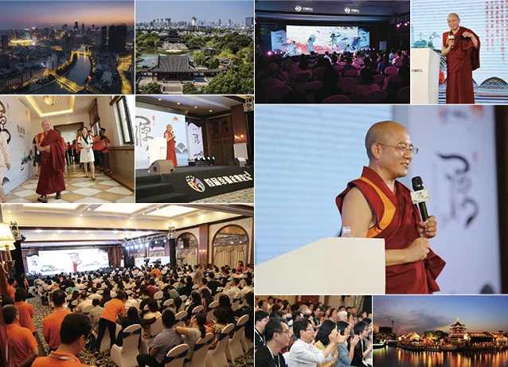
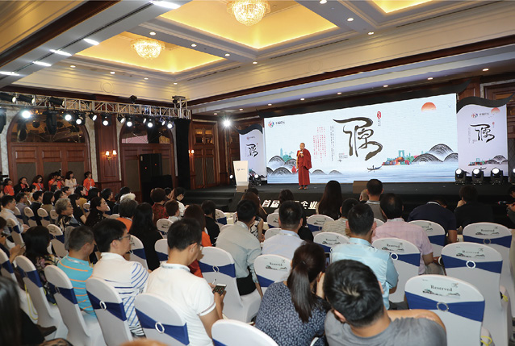
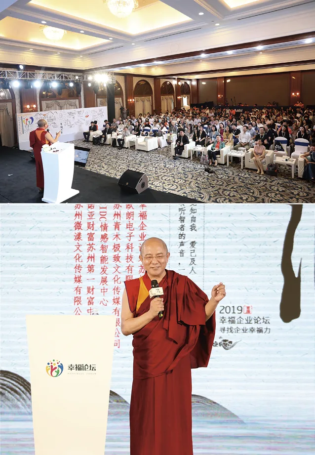
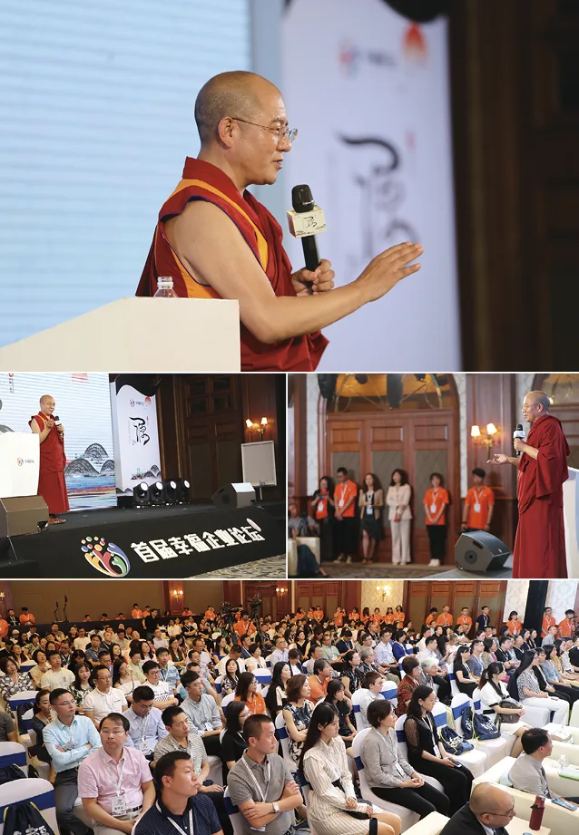
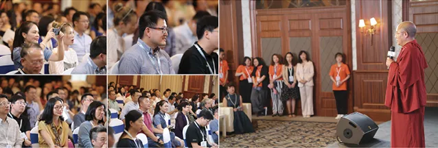

佛教从来没有说过，  
要把对物质的所有需求统统断掉。

第95场

苏州“欧朗幸福企业论坛”

Oley Enterprise Forum on Happiness, Suzhou

中国·江苏

2019 / 7 / 9

## 企业幸福之源

## Source of Corporate Happiness

主持人：

今天，索达吉堪布跨越四千多公里的距离，从世界上最大的佛学院——喇荣五明佛学院来到现场与我们相遇！

堪布出家三十余年，除了在佛学院授课以外，为了利益众生，常年奔波于世界各地弘扬佛法，并引导实修。2013年，堪布被媒体评为年度“宗教面孔”，也是中国最具影响力的佛学大师之一，被称为当代的玄奘。

接下来，让我们用最热烈的掌声有请堪布——

能够参加首届“幸福论坛”，我感觉很幸福、很开心。在座各位都是有能力、有才华的企业家以及成功人士，所以我想跟大家聊聊关于幸福的话题。

在这个世界上，每个人都想要得到幸福。即便是在动物界中，从蚂蚁、蚯蚓到大象，它们从早到晚忙碌，唯一希求的也是幸福。而我们人类，上至国家领导，下至普通百姓，包括乞丐也是如此。当然，追求幸福的方式也各不相同。有些人通过物质，有些人通过精神，有些人通过艺术，还有些人通过宗教来寻找幸福。

## 幸福从来都是比较级

如今这个时代，大多数人追求的幸福是什么呢？就是以物质财富来维持自己的幸福感。然而，通过物质能获得幸福吗？从某种程度上讲，可以得到部分的幸福，但不能完全依靠物质而获得。有些人认为，只要有了金钱，快乐和幸福唾手可得。然而事实并非如此，现在的人们越来越痛苦，越来越浮躁。甚至世界上最富裕的那些人，包括马云也经常在一些论坛中讲，他们一年可以赚好多亿，但心里还是不快乐。许多人则在网上说，他们是在作秀，有那么多钱怎么可能不幸福。

其实，每个人都应该寻找真正的快乐。在生活中，物质确实很重要，它能给我们提供基本的饮食、住宿等等，缺少外在财富无法得到这些。但拥有过多的财富，也是一种负担和压力。事实上，幸福源于内心。一般来说，有了基本生活所需之后，人应该有一种满足感，然而，欲望是填不满的坑，财富越多，欲望也会越多。

刚开始你有一辆国产车，觉得已经足够了；后来感觉这个车好像不行，应该有一辆进口车；有了第二辆车，觉得还是不行，还想在国内买个房，再去国外买个房；国外有了房子，又认为别墅更好；有了别墅以后，还想要个海景房。当你的财富越来越多，痛苦和烦恼也会越来越多。因此，我们要不断地调整内心，从心灵深处获得一种知足。

事实上，佛教从来没有说过，要把对物质的所有需求统统断掉。虽然佛教也提倡清心寡欲、知足少欲的理念，但这是比较高的修行境界。比如十二头陀行[^1]，要住在树下、经常坐禅、不蓄衣服等。南传佛教的僧人会行持这些行为，他们并不需要很多的财富和资具，认为这些都是引生烦恼的因。世间人是否也需要这么做呢？并不一定。

物质是外在的，依靠它来满足感官，获得的快乐很有限。起初，我们可能会有一种快感，就像刚来到一个非常美丽的地方，你会感觉特别舒服。但过一段时间，可能就没什么感觉了。或者，你遇到一个特别喜欢的人，觉得他是世界上最美的人。但再过一段时间，你可能会发现他的很多过失，比如他的长相、性格、为人处世都有问题。久而久之，对于原来特别喜欢、特别欣赏、认为特别可爱的东西，随着时间的推移，自己的心也会有所变化。

现在很多人经常说：“你原来不是这样的，为什么现在变成这样！”其实，这是因为刚开始的时候，我们并没有特别细致地去了解对方。究其原因，一方面是自己的心有所变化，另一方面也是事物本身的一种规律。当我们的心无法一直获得乐受，由于内心得不到满足就会生起厌烦心或远离心。这个时候，你们之间的矛盾就产生了。很多人将幸福完全寄托在外境、金钱或朋友身上，这样做不太明智。要知道，一切外境都在不断地变化。一旦失去这些寄托，你的内心、你的幸福、你的支撑，全部都会崩塌，到了那时，可能连生活自理都困难。

有些人失恋后会选择自杀，或者因为家庭矛盾而患上精神疾病，为什么会这样呢？通常来讲，我们认为人生最大的目标就是追求幸福。然而，很多人并不知道依靠调整内心也能获得幸福，反而认为只有外境才能给我们带来幸福和快乐。事实上，当你把心交付于外境，一旦外境发生变化，就会措手不及，觉得生活没有希望了，甚至做出不明智的选择。因此，我们应该明白，外境只能提供有限的幸福，而且随时都会有变化，应该提前做好准备，想好如何去应对。

## 好心态让你走出困境

如今这个社会，跟以往的农业社会完全不同，大多数人要依止团队、集体来生活。所以，如果能把企业做好、做强、做大，不仅你们自身会得到利益，而且还能帮助到员工以及其他人。现在各国都特别担心就业问题，而这个问题需要依靠企业来解决。政府机构无法满足很多人的就业需求，相反各个企业能够提供这样的方便，但同时也要承担一些风险，面临一些困难。

现代社会瞬息万变，企业家的心理压力非常大。今天还是一个成功的企业，过段时间可能就销声匿迹了。大家应该清楚，每个企业的变化都特别快，并不是个别地方才这样，而是全世界所有人的生活方式、工作方式，方方面面都在刹那刹那地变化。

以前是实体经济为主，现在更多的是虚拟经济。尤其是现代的年轻人，依靠虚拟的网络世界代替现实生活。而随着人工智能或5G时代的来临，我们的生活还有更大的改变。不管是青年人还是中年人，在寻找工作或创办企业的时候，都需要不断地转型再转型。这不但让人没有安全感，反而有一种危机感。

目前，全球经济状况都不太理想。处于这样的变化当中，有些人甚至难以入睡。虽然他们吃的、穿的、住的优于普通人，看似非常阳光、无忧无虑，但其实“压力山大”，心里充满各种焦虑和痛苦。而这些烦恼又很难口头表达出来，所以就更难以放松。当人处在一种恐惧紧张的状态下，无论是说话还是做事，都更容易搞砸。

事实上，每个人拥有的财富，一方面是依靠自己今生努力奋斗得来的，另一方面是依靠前世积累的资粮。如果没有福报，即便现在拥有特别多的财富，也可能会在短时间内荡然无存。如果有福报，也就是佛教常说的因缘，那今生来世都不会遭受贫穷之苦。所以，无论做什么，心态最重要。

有的人，当他成功的时候，得意洋洋、目中无人，感觉自己是世界上最了不起的人；而当他失败的时候，脸色苍白、心情焦虑，这种前后反差特别大。在轮回中，我们会遇到各种各样的事。从出生到离开世间，每个人也有各种各样的经历。有时候是快乐的经历，有时候是痛苦的经历，有时候是富裕的经历，有时候是贫穷的经历；有时候获得成功，有时候遭遇失败，有时候受到别人赞美，有时候受到别人诋毁。

今天早上刚吃完饭，我就受到了别人的责怪，好几位法师责怪我为什么不参加一个佛教活动。其实，每个人都有自己的圈子，每个圈子也有自己独特的语言，比如企业家之间也有自己的共同语言。这边有些寺院的大德，因为我没有参加他们的会议而不高兴，但其实他们也说不出我什么。刚听到这些话的时候，我也有点不开心，想不明白为什么要说我，毕竟我也没有干什么，只不过时间没有空出来而已。后来，我把心态调整过来就好多了，不然可能一天都不开心，晚上也睡不好。可见，如果没有调整好身心，生活逐渐就会变得一片混乱，做事也很难成功。因此，按照佛教的观点，无论遇到任何事情，都要调整好自己的内心。

我非常佩服佛教中的有些人，这并不是因为我自己是佛教徒，而是站在客观公正的角度。我也接触过没有信仰的人，他们通过修持寂止禅定，心态调整得非常好，对此我也很佩服。生活总在不断地变化，我们的状态也在随时切换。在这个过程中，应该保持一颗平常心，最好不要让外境扰乱自心，不然心态可能一直调整不过来。明代心学大师王阳明提倡知行合一，即在修行中工作，在工作中修行。我也比较赞同这种说法。很多人因为工作太忙，经常心浮气躁，其实没必要这样。

《维摩诘所说经》中讲：“诸烦恼是道场，知如实故；众生是道场，知无我故；一切法是道场，知诸法空故；降魔是道场，不倾动故；三界是道场，无所趣故；师子吼是道场，无所畏故。”

## 一、诸烦恼是道场，知如实故

当烦恼产生时，不要害怕，因为烦恼就是道场。每个人都会有负面情绪，比如贪心、嗔恨心、嫉妒心、傲慢心等等。作为凡夫众生，具有烦恼是再正常不过的事情，关键在于如何转化。

如果产生极强的贪欲心、嗔恨心，又没有很好地对治，的确会带来很大危害。有些人因为物质欲望非常强烈，而做出贪污、受贿等违法乱纪的事情，最后被关到监狱当中，即生就要感受无量的痛苦。其实，如果我们能够正视烦恼、观察烦恼，就会发现它的本体是空性的，并没有想象中那么可怕。所以，当你产生种种分别念时，要去观察它的本体，最好能够认识它。

昨天，在一个法学院的研讨会上，有个人说他现在很难过，因为自己的分别念特别重、特别多。事实上，有分别念并不是坏事。《中观根本慧论》中说：“涅槃与世间，无有少分别。”清净法与不清净法本质上没有什么差别，因此烦恼就是道场。

在平时的生活中，当你心里产生烦恼时，要记得“诸烦恼是道场，知如实故”。也就是说，要真正认识到烦恼的本体是空性。《金刚经》中讲：“过去心不可得，现在心不可得，未来心不可得。”当你产生特别大的嗔恨心时，以心观心就会发现，过去心已经灭了，现在心也刹那变化，未来心还没有产生。所以，根本不可能存在真实的心，嗔恨心的本体也是空性的。如果境界再高一点的话，以智慧稍加观察就会发现，嗔恨心的本体与我们本具的如来藏光明，实际上是无二无别的。

为什么佛经中讲一切众生皆具如来智慧德相呢？原因就在于，这些烦恼看起来比较可怕，其实根本不用舍弃，只需要专注它并转为道用。《六祖坛经》中也讲：“烦恼即菩提。”对于修行境界稍高的人来说，生活中还会不会有烦恼呢？肯定还是有的，但不用特意舍弃这些烦恼。

在工作中，有些人跟领导或下属稍微有点不和，就会心烦意乱，甚至想直接出家，这种想法可能是受到一些影视剧的影响。事实上，出家后是否一定能断烦恼呢？有时不但不能断，反而烦恼更多了。刚出家的一两天，你可能会比较舒服，头发没有了，家人也没有了。时间久了，家人慢慢放弃寻找你，而你的烦恼却可能越来越多，因为一个人待在山里也比较孤独和痛苦。如果想要到寺院里生活，现在的僧团跟企业没什么差别，也会有各种烦恼、各种人际关系。

以前，有个人去一位禅师那里。他说自己的家庭状况不好，人际关系也不好，很想出家，结果禅师却说出家也不能解决这些烦恼。我对此深有感触。我们佛学院的出家人很多，有一部分人在社会上做员工时就不服从管理，或者自己开公司当老板，个性比较强势。这种人到了僧团以后，人际关系也不会太好。

出家生活不像你们想象的那样，好像跟谁都不接触，长期与世隔绝。实际上，大乘佛教的出家人责任更加重大，要学习的知识比在家人还多。我这几天去了一些世间大学，感觉相较而言佛学院更忙，因为学得更多，而且也要处理师生关系、同学关系，这些完全都是一样的。

因此，在企业中处理不好人际关系的人，千万别着急出家。即使出家，很多寺院也不会要你。如果是在企业里，你和同事或老板关系不好，还可以换一份工作。但在佛教团体里，寺院不是那么好找的，而且待遇肯定没有企业好，那你的生活会更加痛苦。有些人在家时，虽然也有烦恼，但心情还比较不错；出家以后，反而可能更痛苦，最后实在没办法，只能选择还俗；还俗以后，别人又不把他放在眼里，认为他是在世间混不过去才出家，出家后混不过去又在家。一个人换了不同颜色的衣服，人们对他的看法也会随之变化。

有些人，心情烦躁的时候，想去寺院；人际关系不好的时候，想去出家。尤其和家人吵架时，很多人会说：“你不要跟我这样，惹急了我就去出家。”当然，不是说出家不好，我很佩服那些真正有出离心的出家人，他们非常了不起！但如果没有出离心，仅仅是想逃避现实生活，这种出家可能无法断除烦恼。

如果认识了烦恼的本体，烦恼确实没什么不好的。大乘佛教中讲，烦恼是产生智慧的殊胜因。所以，大家不用怕烦恼，有烦恼是很正常的现象。在你的工作和生活中，如果出现一些性格不好的人，对你而言其实是最珍贵的资源，因为依靠他们可以修持安忍，去除我执。如果有人经常批评你，那他就是你最好的老师。在藏传佛教中，有一位伟大的上师，叫做阿底峡尊者。他曾经说过：“我的侍者脾气特别不好，但他对我恩重如山，因为他经常给我惹麻烦，而我经常对他修安忍。”

一般来说，我们每个人身边都有一个“提婆达多”，这也是一种修行。有些人是有一个坏人经常危害他，有些人是有两三个坏人经常危害他。我听说有的人手机里的黑名单很长。有的人偶尔把跟他吵架的人拉黑，不久后又恢复正常，等再吵架又拉黑，也有这种情况。

## 二、众生是道场，知无我故

有些人认为，现在的社会很没有道德底线，身边的人如何如何不好，其实并不是这样。只要我们的内心清净，即使身边有不道德的坏人，他们直接或间接、正面或反面，对我们的修行和生活也会有所帮助。如果一个人只想要正面的赞叹和帮助，拒绝任何负面的诋毁和伤害，那他是不会上进的。

如果你的修行很好，无论生活中还是工作中，那些对你不好的人，和你对着干的竞争对手，或者经常批评你的同事或领导，都会让你进步得更快。要知道，一直依赖赞叹是走不通的，就像世界有白天和黑夜一样，生活也需要黑与白的交替配合。如果你的心态很好，即使身边人批评你、反抗你，对你也有帮助。我个人的话，如果别人说些刺耳的话，虽然心里有时也不舒服，但我会诚恳地接受。

我在佛学院有一个发心小团队，如果我要开除人的话，是完全有权力的，但我从来不会这样做。那些和我唱反调的人，对我来说是最好的修行对境。我会给他们很高的评价，更加重视他们，这种做法很有意义。做企业也是一样，会遇到各种各样的人。尤其是那些技术过硬的知识分子，他们具备一定的聪明才智，但性格往往特别古怪。这个时候，我们要善用他们的长处。所以，众生就是道场。

另外，用无我空性来对治烦恼是最好的方法，“众生是道场，知无我故”就是讲这个道理。我们之所以有很多的烦恼和痛苦，是因为我执、自私心比较重。当然，你们可能认为做企业需要有我执，否则就无法持续发展，所以主张要有自己的企业文化。但是，当你遇到烦恼和痛苦时，最好把所谓的“我”化为零，再把这种“零”变成空性，这是最好的修行方法。虽然显现上有我、有竞争、有盈利等等，但在真正的实相中，要学会把一切归零，因为万法都是远离四边八戏的大空性。这样的道理，对调整心态有非常大的帮助。

作为企业家，需要一颗强大的内心支撑。有些人内心很坚强，无论遇到任何大风大浪，都能坦然地面对。而有些人内心很脆弱，美国作家卡耐基在《人性的弱点》中讲到，大多数人遇到不顺时，不能直接面对，心非常娇弱。还有一种人，做错事只会责备别人而绝不会责备自己。1931年，有一个美国犯罪分子，公开杀了好多人。但他在公开信中写道：“在我的衣服下跳动的是一颗疲惫的心，而这颗心是仁慈的，它不会伤害任何人。”当时，这个事件在纽约无人不知，无人不晓。做了这样的恶事，他都不觉得自己是坏人，也许真的精神有问题。有些人就是这样，自己性格脾气都不好，但总爱在别人面前夸耀自己，并且真认为自己是个很好的人，而其他人却觉得这个人坏透了。

因此，我们首先要认清自己是什么样的人，再在这个基础上修一些空性法门。比如，你可以学习《心经》，一共只有260个字。不管你有没有信仰，都可以把它当作一种文化来读诵，这对你会很有帮助。我认识的一些企业家，他们就把《心经》当成自己的企业文化，因为这里面讲到很多客观真理。如果你真正懂得了般若空性，烦恼定然会荡然无存，还可以逐渐减少我执。这个时候，我们做什么事都更容易成功。

那么，到底有没有“我”的存在呢？这个问题佛教中讲得非常清楚。在实相中“我”没有，万法都没有，都是空性的，但显现上却如梦如幻地存在，这就是万法的真相。有些人认为，如果什么都没有，一切都是如梦如幻，那做好企业有什么用呢？要知道，我们还没有从梦中醒过来，仍然在六道轮回中一直做梦。梦中的失败和成功，与现实中的失败和成功，没有任何差别，因为人生本来就是一场梦。

很多人不明白这个道理，把工作、事业、感情、家庭等都执著为实有。所以，遇到困难时，总是心烦意乱，非常痛苦，把自己的生活都搞砸了。因此，我希望大家能有一套自己的调心方法，不依靠外在的朋友、老师和家人。要知道，你的财产资源，很有可能会被别人明里暗里地偷走、抢走，但你内心拥有的力量，谁也抢不走、偷不走、骗不走。

在这个纷繁复杂的社会里，我们千万不能认为物质能解决一切，有了钱什么都能办成。那些有钱人，比如刘强东、马云等，在不同场合中也说过钱给他们带来的烦恼。如果有钱就能快乐，那他们应该是世界上最快乐的人，但事实好像并非如此。相反，那些没钱的修行人，在山洞里生活得很快乐。可见，快乐与物质虽然有点联系，但是联系并不紧密。因此，我们应该掌握调节身心的方法，也就是要认识到无我。

## 三、降魔是道场，不倾动故

有些人经常觉得“我着魔了”“我出现违缘了”“我出现危机了”，其实这也是修行的道场。没信仰的人经常会说，他的生活出问题了，他的感情出问题了；而有信仰的人则经常会说，他的修行出问题了，因为最近很懒惰。事实上，所谓的魔与佛无二无别，二者本来就是一体。这个道理在《六祖坛经》《妙法莲华经》中都有讲到。

暂且不谈密宗，儒家的《大学》《中庸》里面，也有提到保持平和的心态。因为通过这种方式，我们可以找到真正的自己。其实，我们认为的魔，并不是真正的魔；我们认为的敌人，也不是真正的敌人。

我执才是最大的敌人。除此之外，没有真正的魔障，明白这一点很重要。有些人经常说这个人是魔、那个人也是魔，甚至称呼自己的朋友为魔女……其实不应该这样去伤害别人。

我今早发了一条微博：“祈祷上师加持，愿生生世世莫舍己道，勿扰他心。”我的老师晋美彭措法王，是当代非常伟大的一位修行者，具有非凡的实证境界。在他七十多岁接近离开人间的时候，给我们留下了一句话：“莫舍己道，勿扰他心。”作为弟子，我们觉得这是极其珍贵的教言，具有非常大的指导意义。

“莫舍己道”，是指不要舍弃自己的道。包括文化、良心、良知等，都不可以舍弃。《道德经》中也有讲到“道生万物”。作为一个优秀的企业家，你的良知不能舍，你的人性不能舍，你的善良、善行也不能舍。

“勿扰他心”，是指尽量不要扰乱别人的心，不要伤害别人。有的企业看起来经营得很好，但实际上却在直接或间接地害别人、害自己。虽然说经商做不到完全公开透明化，否则可能赚不到钱，但是也要通过合理途径实现盈利。佛教的《阿含经》中就有讲到如法求财的商业理念。

无论做任何事情，都要经得起时间的考验，经得起良知的考验，做到问心无愧、坦坦荡荡。这样的话，活在这个世界上才有意义。对于那些跟你关系不好的人，千万不要用“魔女”“魔鬼”“坏人”等词语来称呼，沟通时要多使用温和友善的语言。反过来说，这也是在修正自心。

## 四、三界是道场，无所趣故

你在哪个环境，哪里就是道场。有些佛教徒经常说：“我边修行边工作特别特别烦，很想去寂静的山里面修行。”但刚才我也讲了，即使在寂静的寺院里，同样也会有很多烦心事。那些修行不好、工作不好的人，在哪个地方都不行。你跑去美国，美国人也很烦；你跑去非洲，非洲人也很烦。即便你去世界上最美的国家，也是一样的。没有烦恼的世间人，几乎是不存在的。但是，如果你的心态很好、修行很好，无论哪里都是美妙的天堂。哪怕是在最苦最难的地方，你也会过得很好。吃什么食物，都觉得特别美味。不管是五星级的酒店，还是小小的招待所，都住得很快乐。

事实上，当你修行达到一定的境界时，外境并不会对你有很大影响。你可以恒时保持内心如如不动，因为三界都是你的道场，没有什么可趋入的。绝大多数的世间人，每天都在追求自己想要的东西。但到了一定时候，你会明白单靠勤奋是没有用的。古大德也说：“精勤如山王，不如积微福。”如果你只有小小的福报，那再怎么勤奋，也不一定有收获。有些人，并不是依靠努力来发财，而是依靠他的福报，不知不觉财富就来了。如果完全依靠努力的话，那比你努力、比你勤奋的人还有很多，为什么他们无法成功？所以，我们不得不承认，确实有一种非常微妙的因缘，也就是自己前世积累的福报。当你福报现前时，应该用一部分的财富，做一些善事，积累一些善根，这是很重要的。

## 五、师子吼是道场，无所畏故

《维摩诘所说经》中讲到的“师子吼”，是指空性智慧。在成百上千的野兽当中，狮子的吼声是不可抗拒、不可超越的。同样，如果我们守好自己的良知，坚定自己的修行，调整好自己的心态，那在这个动荡的世界里，也没有必要整天胆战心惊、患得患失。

一直以来，人们都是在希望与担忧中活着。司马迁在《史记》中说过：“天下熙熙，皆为利来；天下攘攘，皆为利往。”我们也可以看到，天下人熙熙攘攘，都是为了各自的私利而来来往往。人生这短短几十年，一直为了追求荣华富贵、高官厚禄而忙忙碌碌。到最后你离开了世间，地球还是照样运转着，一辈子其实也就仅此而已。

在过去的每一个朝代里，不管是富贵的人，还是有权力、有才华的人，他们都曾努力奋斗过。但如今再看，历史上仅留下一些名字而已，有的甚至连名字也没有留下。当然，这并不是说不要去努力，努力很有必要，但不要特别地执著。

我个人的话，遇到事情时，会比较随缘，不是特别执著。有一次，某所大学邀请我去演讲，我坐了四个小时的飞机，结果到那边却被告知，因为种种原因讲不成了。他们对此表示很抱歉，但我说：“没关系，我喝个咖啡就回去了。”然后，我又坐了四个小时的飞机。可见，有些因缘确实没办法强求。

在我们的一生当中，会发生许多难以预料的事情。如果你能调整好心态，用明天的眼光看今天的事情，那今天这些着急的事，并不算什么；用明年的眼光来看，更不算什么；再过十年，也许已经不记得是什么事了。孩童的时候，我们特别执著玩具；少年、青年的时候，我们特别执著感情。还会因为一点点小事就和同学打架，说的话也特别幼稚。现在回头再看，会发现那时的自己很可笑。

其实，生命中发生的所有事情，都是我们自己造成的。在英国伦敦，有一座举世闻名的威斯敏斯特大教堂。它里面有很多名人的墓碑，包括牛顿、爱因斯坦、史蒂芬森等等。其中，有一块墓碑上，刻着这样一段话：“当我年轻的时候，我的想象力从没有受到过限制，我梦想改变这个世界。当我成熟以后，我发现我不能改变这个世界，我将目光缩短了些，决定只改变我的国家。当我进入暮年后，我发现我不能改变我的国家，我的最后愿望仅仅是改变一下我的家庭。但是，这也不可能。当我躺在床上，行将就木时，我突然意识到：如果一开始我仅仅去改变我自己，然后作为一个榜样，我可能改变我的家庭；在家人的帮助和鼓励下，我可能为国家做一些事情。然后谁知道呢？我甚至可能改变这个世界。”

大乘佛教也提倡要从改变自身做起。作为企业家，首先要调整好自己的身心状态。如果想创建企业文化，可以学习《心经》《弟子规》等，组织一些禅修活动。先从企业内部做起，然后再到整个民族、国家，乃至全世界。这样的做法，既符合大乘佛教的教义，也符合现代企业的管理思想，还可以帮助到很多人。

最后我想说的是，企业和个人都应该践行利他的价值观。如果怀有一颗利他心，一切都会容易成办，否则很难把事情做圆满。如果怀有自私自利的心，做任何事都会寸步难行。今天在座的各位，应该都很有福报。如果你们每个人都有利他的思想，一定会对社会有所贡献。

主持人：

让我们再次用最热烈的掌声，感谢堪布如此幽默风趣、贴近生活、与时俱进的开示和演讲！

此时此刻，我的内心非常震撼，也感觉非常幸福！其实，佛门与商界看似远，实相近；佛学与商道看似异，实相通。佛学与企业管理，以及我们的生活，有很多的交汇点，而这些答案都集中在古老而深邃的佛学智慧当中。

相信通过今天的演讲，大家都可以汲取到利益众生的情怀，修身禅定的心态，造福社会的使命，感悟佛法的精神。这些会让我们在人生的道场中裨益终生！

[^1]: 十二头陀行：即修治身心、除净烦恼尘垢之十二种梵行。1．在阿兰若处，即远离聚落，住空闲寂静处。2．常行乞食，即于所得之食不生好恶念头。3．次第乞食，即不择贫富，次第行步乞食。4．受一食法，即日仅受一食，以免数食妨碍一心修道。5．节量食，即于一食中节制其量，若恣意饮啖，腹满气涨，妨损道业。6．中后不得饮浆，即过中食后不饮浆，若饮之心生乐着，不能一心修习善法。7．着弊衲衣，若贪新好之衣，则多损道行之追求。8．但三衣，但持安陀会、郁多罗僧、僧伽梨三衣，不多亦不少。9．冢间住，即住冢间，见死尸臭烂狼藉火烧鸟啄，修无常苦空之观，以厌离三界。10．树下止，效佛所行，至树下思惟求道。11．露地住，即坐露地，使心明利，以入空定。12．但坐不卧，若安卧，虑诸烦恼贼常伺其便。
