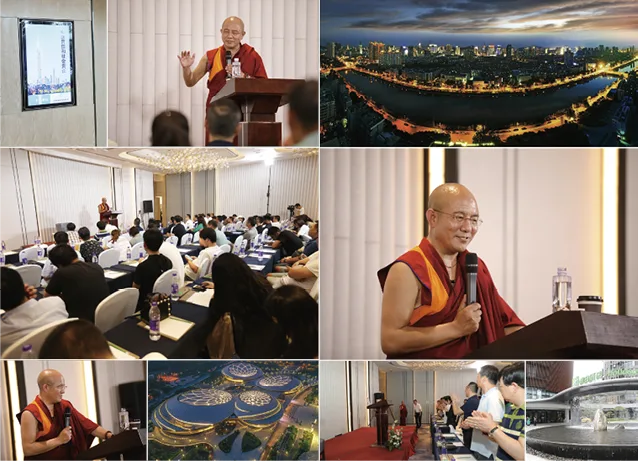
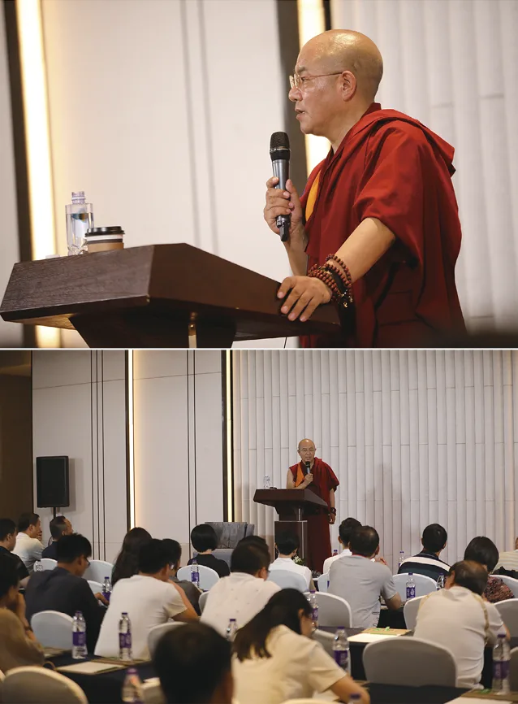
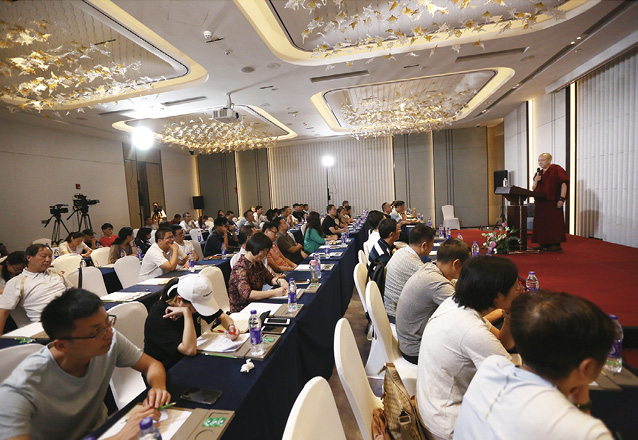
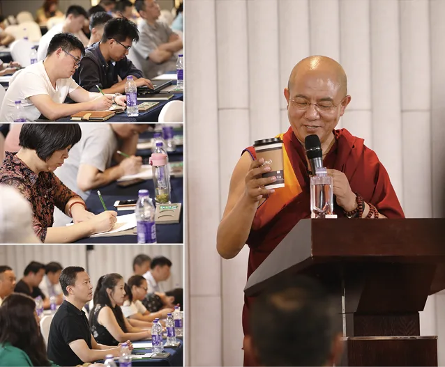
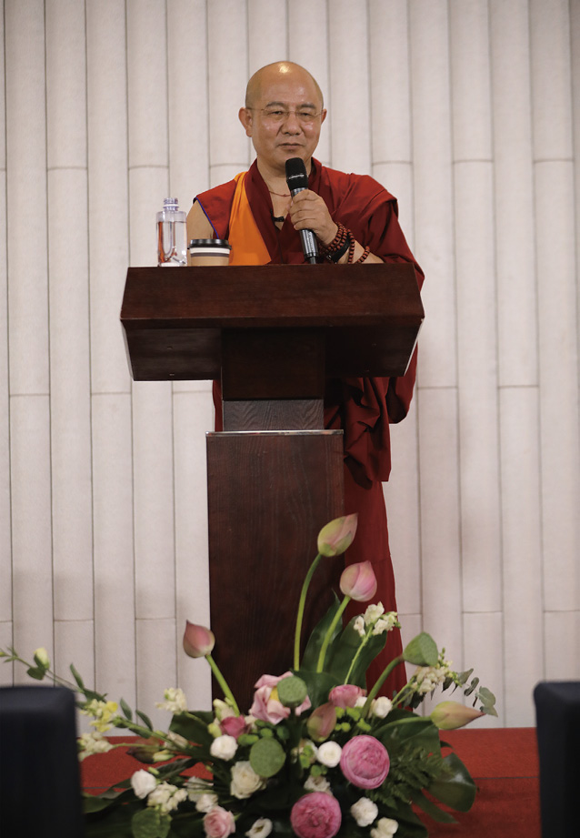
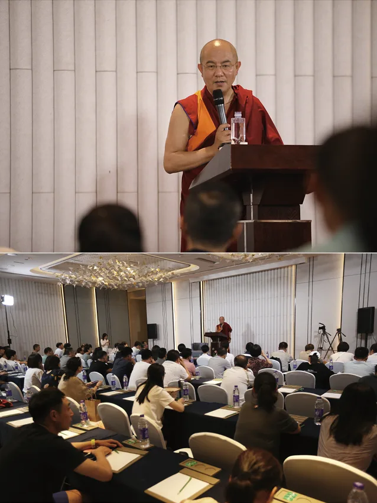
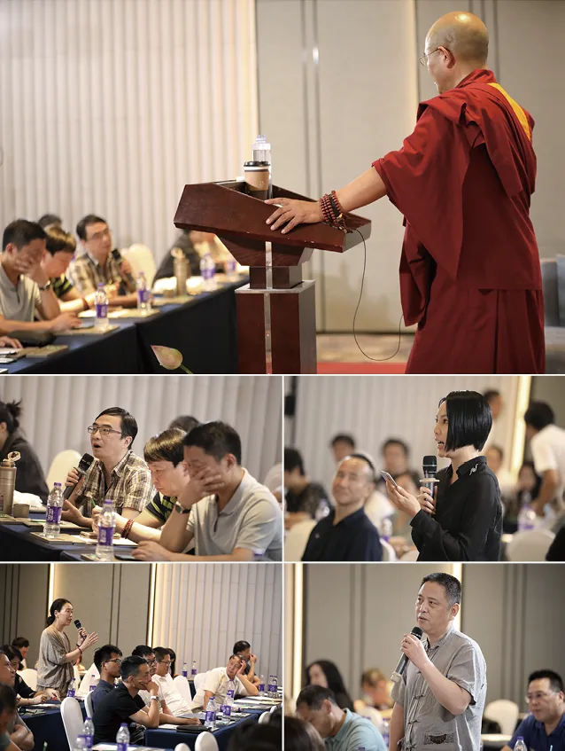
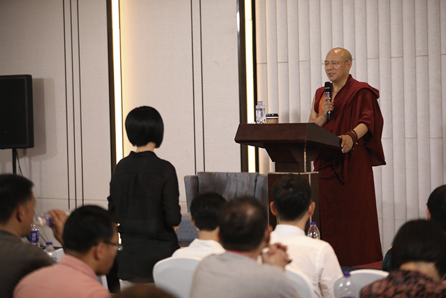
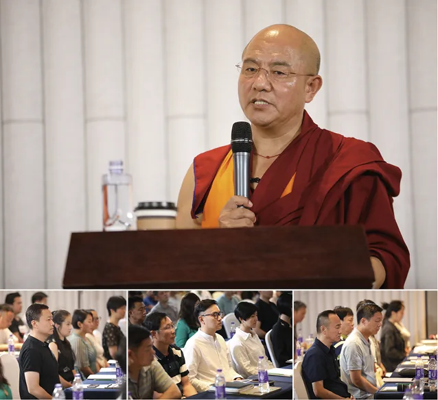

现代人感到迷茫的主要原因，就在于没有认识自己。

第94场

江苏省消防工程有限公司

Jiangsu Province Fire Engineering Co.

中国·江苏

2019 / 7 / 6

## 企业责任与社会责任

## Corporate Social Responsibility

主持人：

感谢大家来参加由江苏省消防工程有限公司举办的“企业责任与社会责任”讲座。今天，我们非常荣幸请到了一位佛教大师，请大家以最热烈的掌声欢迎索达吉堪布进场！

接下来，有请江苏省消防工程有限公司董事长致辞。

董事长：

今天真是一个好日子。我怀着无比崇敬和感激的心情，邀请索达吉堪布来我们公司演讲。

索达吉堪布是色达喇荣五明佛学院的大堪布，是国际佛学家。他智慧深邃，名声享誉海内外。曾被邀请参加人大、复旦、清华、牛津、哥伦比亚、哈佛等知名院校的讲座，把佛学与科学、生活以及社会相结合。

企业的社会责任，是企业可持续发展的一个重要支撑。通过堪布今天的演讲，相信大家对此会有更深层次的理解。

今天是个好日子，因缘也很殊胜。在座各位有些是企业的管理者，有些是社会各界人士。我本人的话，一直在山谷里学佛修行，这十几年才走进学校、企业，以及监狱、戒毒所等地，也想借此了解下不同阶层人的生活。

我并没有丰富的管理经验，但对当今的社会现象比较清楚。从好的方面看，科学技术日益发展，人类已经掌握了很多前所未有的技术，并且运用自如。从不好的方面来看，人心越来越浮躁，生活越来越混乱，伦理道德有日益下滑的趋势。

鉴于这些情况，社会到底是进步还是退化，也很难说。从物质层面来讲，可以说取得了很大的进步，整个世界发生了天翻地覆的变化。而从内心层面来讲，不管是哪个国家、哪个地区的人，好像都不是很快乐。以前科技不发达的时候，至少人们的内心还保留着一份宁静与快乐。然而，随着生活节奏越来越快，压力越来越大，事情越来越多，工作越来越忙，人们身心疲惫以至于健康状态每况愈下。

由此看来，现在的人到底是快乐还是痛苦呢？确实说不清楚。即使是那些经济强国，幸福指数也越来越低，一年不如一年。某种程度上，那些有财富、有实力、有才华、有美貌的人，也并没有感受到最真实的快乐。因此，我们在关注外在物质的同时，还要寻找内心的自在安乐，这一点其实更重要。如果没有获得内心的安乐，即使金钱堆如山王，最后又能得到什么呢？只不过是一片空虚、一片虚荣、一片伤感而已。

每个人生活的目的，就是为了获得幸福的生活。因此，企业应该组织有关内在价值观的学习，让更多人找到自己想要的生活。前几年，香港电影《一代宗师》中曾言：“习武之人有三个阶段：见自己，见天地，见众生。”也就是说，即使已经见到自己、见到天地，但若没有见到众生，还是要继续努力下去。虽然这只是一句电影台词，但从某种意义上讲，企业管理与社会责任的结合，与此也有相通之处。

我这次要分享的内容，也可以分为三部分：首先管理好自己；然后管理好企业；最后对社会的可持续发展负责。

## 一、管理自己

### 1．传统文化与自我约束

生活在这个世界上，必须具备基本的生存条件。不管是哪一个宗教、哪一种文化，都会认可这一观点。因为我们是欲界众生，有很多的欲望，包括吃穿住行以及情感生活、社会交往等等。

在这些基础上，还要具足基本的道德。东方有东方的做人方式，西方有西方的做人方式。亚洲人经常会讲我们拥有上下五千年，甚至八千年的文明。一方面来看，我们拥有漫长而悠久的传统文化，但另一方面，如今在家庭和学校里，在我们的身上，到底有没有传统文化的影子呢？大家可以观察一下。

当今时代的人，既没有传承传统文化，又没有追上西方文化，就像站在十字路口，迷茫不知去向。而且在接受外来文明的同时，我们更多的传统文化也在慢慢流逝。当我们在跟别人讲中华文明有多少年历史的时候，可以观察一下，现在人的服装、语言、意识以及行为中，有多少儒释道的元素？除了在极个别的道观或寺院里，人们很难接触到这些传统思想。而在儒释道之外，还有没有其他传统文化呢？实际上，每个民族都有自己古老的文化，可惜很多都失传了。比如，我们现在穿的服装，大多数是以西式为主。

语言，不仅是交流的工具，还是文化的载体。除了语言文字以外，很多传统文化只存在于博物馆里，包括古董、收藏品和艺术品等。此外，不管是意识形态、知识素养，还是古籍文献，在每个人的身上或家里几乎找不到。

所谓的现代文化，包括东方和西方的。现代西方文化只有几百年，而现代东方文化比较复杂，是东西方交融的产物，既不是东方古老文明，也不是西方现代文明。现代社会的人们，主要推崇的是消费主义文化。消费者以消费为目的，而商家则以利润最大化为目的。上世纪七八十年代，这种思想在西方国家非常盛行，也改变了东方人的消费观念和生活方式。因此，如今很难找到传统文化的痕迹。如果想要守护古老的文明，我们应该回溯历史，继承传统文化。

在经济迅猛发展的今天，不管是年轻人还是中年人，继承我们固有文明、固有道德的，越来越少了。有些老年人，还比较遵守祖辈千百年来留下的规矩。比如“举头三尺有神明”，意思是人要有敬畏之心；或者“善有善报，恶有恶报”的因果观念等。但现在的年轻人很少会有这种意识，他们喜欢跟着自己的心走，想干什么就干什么。所以，如今社会才会发生很多让人难以想象的事情。

### 2．勿让太多欲望走进校园

前段时间，我去一些大学里演讲，这些学校的负责人说，现在的大学生会通过各种平台借钱，很容易陷入“校园贷”的困局。有些大学生认为，可以让父母给自己还钱，所以越借越多。到了最后，已经无力偿还。这也导致他们没办法正常毕业，或者没毕业之前就要去打工还钱。企业里的年轻人也会出现这种状况。通常来说，应该注意使消费与收入相匹配，尽量不要提前消费，但很多年轻人根本不顾及这些。

另外，现在通过网络消费特别容易，有很多的“方便方法”。商家也会根据受众人群，进行有针对性的广告设计。比如，世界上最帅的帅哥喝什么红酒；最美的美女开什么轿车；最舒适的家庭用什么品牌的家具；最快乐的人要做什么什么……这些媒体信息，让年轻人的欲望不断膨胀，并为此不计后果。当钱不够花时，商家还会鼓励你去贷款。

实际上，这种消费理念源自西方发达国家，但他们的法律比较健全，人的素质相对较高，消费也有一定的计划性。而我们的网络经济时代刚刚进步，如果没有理性的消费观，不说是家破人亡，可能也是家破人穷，打一辈子工也还不起。所以，有些白领比蓝领还穷，这也让他们心里特别不舒服。本来大学毕业后，应该能找到一份好工作。结果收入低的工作他看不起，更不愿意做体力劳动，然而脑力工作也不容易找到。因此，这既是社会问题，也是个人问题。如果没有正知正念或自我道德的约束，一旦欠了很多钱，内心就很难快乐起来，生活品质也会下降。

### 3．以寂静道对治分别念

我们每个人都要提升自我管理能力。有一种说法是，管理的最高境界是心理管理。也就是说，首先要正确认识自己，对自身的能力、智慧等各方面进行评估，然后再把心态调整好，这样才有利于自我管理。要知道，调心最好的办法就是禅修。现代人普遍心态浮躁，欲望过度膨胀，内心过于散乱。因此，应该选择一种与平时纷扰的分别念相反的寂静道来修行。

《法句譬喻经》中讲了这样一个故事。从前，有一位国王。一天，他突发善心，想做大布施，于是将金银财宝堆积如山，宣布任何人都可以从中取一撮。

佛陀观察度化国王的因缘已成熟，于是化为一个婆罗门来到他面前。

国王问：“你需要什么？”婆罗门说：“我想要房子。”国王给他一撮珍宝。但他才走七步，又回头说：“这些珍宝虽然可以盖房子，但还不够娶妻，您能不能再给我一些。”国王又给他三撮珍宝。

但是，婆罗门走七步后又返回来。他说：“有房有妻还不够，我还想有田地、仆人、牛马，这些珍宝还是不够。”国王想到自己的发愿，而且看这个人确实可怜，好像什么都需要，所以对他再一次布施。

然而，那人继续说道：“这些钱根本不够养活我的子孙后代，您可不可以把珍宝都给我。”最后，国王把所有的珍宝都送给婆罗门，但他接受后又退还了。国王问：“为什么？”婆罗门说：“财富越多越麻烦，还不如放下一切，去追求无为之道。”国王越想越觉得他的话很有道理。这时，佛陀现出本来的身相，对国王说道：“虽得积珍宝，崇高至于天，如是满世间，不如见道迹。”

见到佛的相好庄严，又听闻此偈颂，国王当下欢喜无比，便从佛处受五戒，后来证得圣果。

很多人可能做不到这样，所以佛教倡导的财富观是不堕两边。太富裕的话，也会成为一种压力。而且这些钱不可能永远都是你的，你只能保管一段时间。在你生前或死后，随时有可能被转移到别人名下。但也不能过于贫穷，否则连最基本的吃住都无法保障。

在佛教中，有一个非常殊胜的发愿：“不生过富家，不转贫穷家，唯生中等家，恒常得出家。”也就是说，不要转生到太富裕的家庭，也不要转生到太贫穷的家庭，希望能转生到中等的家庭，具足出家修行的顺缘。许多人可能不愿意这样发愿，而是想：“我一定要转生到最富裕的家庭。”因为他们觉得成了富二代，做什么都很容易。

前几天，我在农大演讲时喝了一杯咖啡。你们可能认为我演讲时都要喝咖啡，所以今天也特意放了一杯。1997年，我们四五个人跟随法王如意宝去新加坡弘法。第一天早上，我没有吃饭，中午有点饿，就要了两碗米饭。从此之后，将近一个月的时间，工作人员每天都给我盛两碗米饭，其他人是一碗。所以，如果我这次讲座要几天的话，你们可能每天都会给我带一杯咖啡。其实，一切都是随缘的，并不是非要怎么样，但也谢谢你们的用心。到了下午，人会有点儿困，喝点咖啡很好。我看你们每个人桌上也有一瓶水，这样比较公平。

按照佛教的教义来讲，自我管理最好的办法就是心理管理。各企业可以开展一些禅修活动，像波音、谷歌等，他们经常会有禅修培训，这一点非常重要。特别是在心散乱的时候，最好能以自己习惯的方式来安住。否则，做任何事情都会觉得很吃力。

在认识自心的过程中，可以体会到许多奥妙。很多禅师就是通过禅修而大彻大悟，证悟了宇宙万物的真相。有些成功企业，也是依靠禅修来帮助员工调整身心状态，树立正确的企业文化。如果没有禅修，我们很难生起正知正念。因此，希望大家方便的时候，能够多多禅修。不管你有没有信仰，都可以通过禅修安住自己的心，让它不生起任何分别念，以这种方式来认识自己。现代人感到迷茫的主要原因，就在于没有认识自己。

现在，大家调整好身体，保持端正，我们一起做一次短短的禅修。以毗卢七法端直而坐，这种坐式，有利于心的安住。双手放于脐下，眼睛闭不闭都可以。颈部稍向前倾，不要往后仰。如果没办法双盘，可以散盘坐在凳子上。眼睛不要东看西看，心要保持专注，可以什么都不执著，也可以观察“我到底在哪”。禅修过程中，最好不要打瞌睡，结束后双手相互摩擦一下。

以上是通过禅修来管理身心。

### 4．咒语的能量不可思议

还有一种语言的修法，也就是念诵咒语。无论有没有信仰，都可以念六字真言“嗡玛呢巴美吽”。

有些人可能听说过，世界上有三种不可思议。第一种是药，中药和西药都有不可思议的力量。比如，你吃完某种药后，病就神奇地好了。

第二种是幻变。网络的幻化力量非常不可思议。对于全球的网络连接，只有个别专家才能了知其中的道理，其他人很难说清楚。

第三种是咒语。不管你有没有信仰，有没有信心，咒语确实具有神奇的力量。有些人念了咒语以后，比如大悲咒、楞严咒等，身体不正常的现象马上就消失了，这也非常不可思议。

下面，我要教给大家的调心方法就是念诵六字真言。这个咒语，很多人也许没听说过，但确实非常管用。现在，让我们一起来念：

嗡玛呢巴美吽……

大家平时可以经常念诵此咒。当然，没有兴趣的可以不念。但如果有兴趣的话，不管是坐车还是坐飞机，随时都可以念。尤其在生病或遇到困难的时候——人就是这样，顺利的时候，什么都不信，总觉得没事；不顺利的时候，到处去求神拜佛。就像身体好的时候，什么运动都不做；身体不好的时候，马上找药吃。这并不是很好的一个做法。应该在健康顺利、开心快乐的时候，提前做好准备。

我们要通过禅修来认识自己，或者通过念咒来改善身心。现在越来越多的人患有抑郁症、自闭症等严重的心理疾病。有一种说法认为，19世纪威胁人类的是肺病，20世纪威胁人类的是癌症，21世纪的最大威胁是心理疾病。世界卫生组织发布的《2014年精神卫生地图集》显示，全世界每10个人中就有1个人存在精神障碍。其实，治疗心理疾病最好的方法，不是物质，而是心理治疗。

我们每天都在不断地追求物质，致使欲望无限膨胀，从而引发各种心理问题。因此，我们该努力时要努力，该奋斗时要奋斗，但最好不要让这些追求，成为心理疾病的因缘。如果一直把事情憋在心里，自己也不知道从什么时候开始，心理就变得不正常了。

为什么现在各大城市里，心理咨询行业最容易赚钱呢？因为很多人不敢面对自己，也不敢和父母家人倾诉，只能经常去找心理咨询师，或者到医院里去找精神科的医生。而有一部分医生，他们自己也没有接受过这方面的训练，虽然在给别人讲的时候，说得特别好听，但实际上自己也在另外找心理医生。

我遇到过一个非常会说的医生，他说：“我治好了很多人，却没想到自己也需要治疗，而且我的治疗方法对自己根本不管用，只能去寻找别的心理医生，他们对我的一些引导可以起到作用。”由此可见，许多人对心灵没有很好地保护和调养。虽然有房有车，拥有很多世间财富，却容易产生各种心理问题，包括人际关系冲突造成的情绪波动。这样看的话，人们也许过得并不快乐。所以，我们首先要真正地认识自己。

### 5．心性稳定的人最好命

不管是企业家还是普通员工，都要有一颗平常的心、坚定的心。现在的人，一直在找工作，真找到了心又不定，稍微遇到一点事情，马上就甩手走人，这是大多数人的通病。很多年轻人，工作并不是为了工资，一旦不高兴就辞职，说走就走，根本不顾及自己的前途，也不顾及企业的未来，这种心态不是很好。

我们应该先做出智慧的选择，然后再努力奋斗，这样最后会有一个好的结果。蜻蜓点水式的做事，不可能很快获得成功。虽然我们经常在网上看到，某某人如何如何快速成功……但那只是一种网络宣传手段而已。有些人对此特别羡慕，觉得别人可以的自己也一样可以，于是放弃稳定的工作选择创业。但是，大多数的创业者都不会成功。我们在网络和电视上看到的成功人士只是特例，而且背后也要付出百般努力，才能有此成果。所以，大家应该安下心来做与自己能力相匹配的工作。到了一定时候，你就会拥有丰富的经验，企业也需要这样的人才。

工作最好不要换来换去。我遇到过一些人，换了无数次工作，最后很多企业都不想要他们。这些人在这里待一个月，在那里待一年，又换地方再待几年，说明他们的心态很不稳定。包括佛教徒也是如此，如果有人想要出家，我一般会问他之前在哪里住过。如果他说在一个寺院待过一年，又在另一个寺院待过三年，我想他可能在这儿也待不了几年。所以，我有时会建议他们去别的地方。

对于一个人来说，最重要的是心性稳定。无论做什么事情，一定要有决心，这样才会有所成效。当代年轻人浮躁的根源，可以说是不自量力。自己有什么样的能力和福报，自己都不清楚，一味地盲目乱撞，最后只会失败。

因此，如果遇到自己有缘的工作，有缘的家庭，有缘的朋友，最好不要变来变去，要做一个有常性、定性、耐性的人。这种人，不但被社会所需要，自己也会有安全感。

## 二、管理企业

实际上，企业也是一个小天地。现在年轻人的就业是最大的问题，而企业可以提供一些方便。虽然企业是从西方引进的特殊管理模式，但如果企业做得好，对东方社会仍具有重要意义。

现在的年轻人，更倾向于当公务员、医生或教师，所以这些岗位的竞争非常激烈。不知道你们这里的情况怎么样，我们那里考公务员特别难。前几天，听说有一个公务员的考试，招录人数大概是100人，而报名的藏族学生有6万多人。另外，考教师编制也非常难，而当医生又需要有专业知识技能。可见，想要寻找稳定的安身之地，还是有一定的困难。在这一点上，企业可以创造方便，增加就业机会，满足员工基本的生活需求。所以，无论在东方还是西方，企业都是社会的重要组成部分，承担着相应的社会责任。如果企业能持续发展壮大，对员工来说也是大有可为的。

企业中的所有人，除了内部团结以外，还要提高自我学习能力。由于市场竞争日趋激烈，企业的发展并不稳定。毕竟市场资源有限，抢夺的人一个比一个厉害，一个比一个有办法。知因果、讲良心的人，会采取合理的手段竞争，而有些人则会不择手段。这样一来，企业就要面临更多的风险。如果不努力，今天是拥有成千上万人的成功企业，一旦因缘改变，可能很快就面临裁员甚至倒闭。随着5G时代的来临，世界的变化速度日趋加快，我们的学习也应当与时俱进。不仅是企业，佛教寺院也要学会使用微信、微博等新媒体平台，否则难以跟上时代的步伐。

昨天，有些领导给我介绍了“智慧消防[^1]”。它是一套智能化的新技术系统，能解决防火、灭火，以及消防管理的问题。现在网络确实为我们提供了前所未有的便利。但在实际应用的过程中，我们要有敏锐的智慧。这样不但能给自己带来许多利益，也能更好地服务社会、造福人类，体现企业的社会价值。尤其是企业发展到一定程度时，更应该积极承担社会责任，致力于解决社会发展不平等的问题。

从全世界来看，主要矛盾是贫富差距太大，穷的太穷，富的太富。前几年，我去过一些非常贫穷的地区，比如非洲、柬埔寨；也去过一些非常富裕的国家。这个时候，人自然而然就会想到，为什么在同一片蓝天下，同一个地球上，会出现这么大的差距？据报道，全球每年有数百万儿童死于饥饿，超八亿人处在饥饿状态，十三亿人处在多维贫困状态。这样算的话，经济条件特别不好的人约有二十多亿。这是一种很奇怪的现象，因为相关的很多国家其实并不缺钱，他们在联合国总部购买军事设备的支出，单日交易额高达数百万美金。

有些国家真的太穷了，像也门、纳米比亚、马拉维，每天都有许多儿童因饥饿而死，而有些国家的富人却拥有世界三分之一的财富。包括我们国家也是如此，有些人总是找不到工作，连基本的温饱都无法保证。而对于富人来说，钱只是银行里的数字，几百亿、几千亿都不算什么。

前段时间，我跟一些人吃饭，他们在餐桌上谈的都是几十亿的项目。我对金钱的态度是：有也可以，没有也可以。但我心里会想，如果他们能拿出几十亿资助贫穷地区，或者做其他善事，财富会显得更有意义。否则，在个人的账户上转来转去，最后也不一定是谁的。其实，一个人即生当中吃、住、用是有限的，再怎么享受奢侈的生活，也不过如此。西方消费主义，主张幸福生活就是金钱应有尽有供自己享用，这是他们对幸福的定义。但事实并非如此，很多有钱人经常失眠，必须依靠安眠药才能睡着，还有的在豪车里也是哭声震天。

因此，企业责任就是老板对企业负责，员工对工作负责，这非常重要。

## 三、企业的社会责任

从某种意义上讲，企业承担着一定的社会责任。其实，企业就是一个小社会。如果一家企业有一百名员工，那就对应一百个家庭。如果企业解决了他们的就业问题，也就是为一百个家庭提供方便，而家庭是社会的基本细胞。因此，企业的存在，不仅仅是让员工得到工资和分红，必要时还应该回馈社会，服务社会，这才是企业存在的价值。

大乘佛教中，还有一种发愿是：“不为自己求安乐，但愿众生得离苦。”意思是说，真正的利他思想，并不是为自己谋取利益，而是哪怕自己得到的少，也要先以企业为主，然后再回馈社会，帮助那些需要帮助的人。当然，我们不一定有全球富翁、华人首富那样的福报。但有些企业家也说过，他们的目标不是变成首富，而是变成“首负”，也就是说负起应负的社会责任。

作为华人首富，李嘉诚曾经说过：他的父亲因缺少医疗条件而早逝，所以他想拿出一部分钱资助医疗事业；又饱尝过生活的磨难，所以很想帮助有困难的人；还经历过被迫失学的痛苦，所以打算出资兴办教育。他后来创办了汕头大学，我也去演讲过，确实办得不错。虽然我们可能做不到这样，但也不能认为做善事、做慈善只是有钱人的专利。事实上，每个人都有属于自己的力量。哪怕每个月拿出工资的百分之一，也可以帮助一个学生，或者救助一个病人。如果人人都有这种理念，我们一定会做得更圆满。所以经营企业也要有利他心，应该以利他精神作为企业发展的宗旨。

无论是个人管理，还是企业管理，最关键的是要静下心来认识自己，同时还要有一颗利他的善心。如果具备这两点，遇到任何事情都能从容地面对：如果能够认识自己的心，就可以随时调整自心；即便做的事情不是很大，但只要有一颗善良的心，愿意去帮助别人，这个社会就有希望。

不论是企业家还是普通员工，都要为利他而活。这是一个非常崇高的使命，也是一项非常光荣的任务。

现场互动

问：我有一些做餐饮的亲朋好友，直接或间接地会伤害到物命，但他们还没有学习因果方面的知识，请问怎样才能减少他们的过失？

堪布：藏传佛教中，有一位叫措周让卓[^2]的大德。他曾经说过，不管做什么事情，不伤害任何众生是很难的。比如，农民挖土时，会杀害很多的虫子；牧民挤牛奶时，会抢夺小牛犊的食物，还会经常杀牦牛；工人伐木时，也会伤害一些虫类。所以，从事餐饮行业的人，也会伤害到众生。但这位大德说，只要不是故意杀生，而是为了生计，可以通过忏悔来清净罪业。如果有些行为是直接杀生，比如很多饭店里都有点杀，这种是不开许的，最好用其他食物代替。当然，对于固定模式的饭店来说，这样做有一定的困难。

前段时间，有一位佛教徒和我说，他开的海鲜饭店生意很好，想把它转让。但因为合同的问题，暂时没办法。所以，他很希望饭店倒闭，结果生意却越来越好，就是倒闭不了。

由于各种因缘，有些人也是身不由己，暂时难免造业。如果遇到这种情况，最好能够彻底改变。如果实在不行，可以念诵金刚萨埵心咒等忏悔。

问：遭遇企业危机时，如何运用佛法让决策者快速静下心思考问题？

堪布：佛教中讲到的财富观，我觉得是一个很重要的理念。无论是个人还是经营者，都应该把自己拥有的财富分成四份。一份用作投资，一份储存以备急用，一份自己享用，一份用做善事。因此，在你成功的时候，一定要合理分配自己的财富，不要等到最后倾家荡产，连员工的工资都发不起——很多企业就面临着这种境况。

事实上，我们每个人所拥有的财富都不是常有的。就像《金刚经》中所说：“一切有为法，如梦幻泡影，如露亦如电，应作如是观。”世间的财富和名声，确实变化无常、难以预测，没有固定的主人。今天是我的，明天可能就是他的。很多人原来身无分文，非常贫穷，但通过自己的努力，不知不觉就拥有了很多财富。然而，这一切可能很快又落到别人手里。

因此，《阿含经》中讲到，应该把财富分为四份。尤其是在当今社会，一旦出现经济下滑、金融危机等状况，企业家可以利用储存的财富帮助企业渡过难关。这是一个非常好的办法。

当然，我们还可以选择不同的禅修法，让心先平静下来，然后再运用智慧解决问题。要知道，禅定和智慧是最好的抉择方法。如果有了这两者，无论遇到什么事情，最终都能迎刃而解。

问：请堪布推荐一些与企业管理相关的佛教书籍。

堪布：我个人建议，大家可以学习《善生经》[^3]，它对处理人际关系有非常大的帮助。这里面有讲到亲子、师生、夫妇、亲友、主仆、僧俗等人际交往的相处之道。

如果一个人站在中间，会有东南西北上下六个方向。东方代表父母，南方代表师长或领导，西方代表夫妇，北方代表亲友，下方代表仆人或员工，上方代表僧众。在这六种关系当中，我们要扮演不同的角色。因此，《善生经》可以作为处理人际关系最好的参考。

问：如果家人生病，身体特别虚弱，是给他放讲法的音频好，还是给他诵经好？

堪布：两种方法都很好，可以一起做。我们藏族人经常这样对待病人：一边给他念经，一边让他听音频。

问：请问，如何管理好自己的心？

堪布：管理心确实不容易，因为我们的心就像野猴一样，刹那也不停歇。在传统文化与佛经论典中，有很多管理心态的方法。比如，通过禅修，修无我空性、修利他心等，虽然这些修法带有比较浓厚的宗教色彩，但的确对调心非常有帮助，否则，这颗心很难得以驯化。

佛教最主要的教义是“诸恶莫作，诸善奉行，自净其意，是诸佛教”，也就是说，通过断恶修善来净化自心，这才是真正的佛教。如果没有调伏自心，烦恼越来越多，分别念越来越重，那学佛就没什么意义了。

其实，通过禅修来观心的方法有很多，包括声闻乘的禅修方法、大乘显宗的禅修方法、大乘密宗的禅修方法，这些都是很好的调心方法。但由于时间关系，就不详细讲了。

当我们生起贪嗔痴烦恼时，可以运用密乘的调心方法，直接认识烦恼的本性，这就是“烦恼即菩提”的道理。当然，需要长期系统性的学习，如此才能明白其中的甚深意义。

问：我的孩子马上要去国外读书，作为家长还是很担心，希望堪布给予指导。

堪布：如果有机会出国学习，对于孩子来说，也是一种特殊的因缘。

如今是全球化时代，英语已经成为主流语言。无论到哪个国家，飞机座舱里都有英语解说。所以，让孩子出国留学，对于他们未来的发展比较有好处。作为家长，应该给孩子创造这样的条件。

当然，从思想方面来讲，与我们的传统观念会有些冲突，但这也是难免的。一般来说，国内家长会要求孩子孝顺听话、传宗接代，等等。而在西方，提倡自由主义，有些国外家长，虽然自己是科学家或老师，但如果孩子喜欢从事擦鞋的工作，家长也不会制止，比较尊重孩子的选择。所以，如果孩子处在这样一个自由的环境中，难免会与父母的传统观念产生冲突。

不管怎样，世界已经变成这样了。总的来说，国内城市的现代化水平与西方国家差距并不大。而且受到好莱坞电影的影响，很多人的思想已经完全西化，不再像几十年前那样传统，未来应该还会发生一些改变。

虽然东方传统思想与西方现代思想，会有一些碰撞，但并不是不能圆融。只不过有些孩子出国留学以后，如果他觉得对自己有利，就搬出西方的思想，比如说父母不能逼婚，要给他自由空间。但在跟父母要钱的时候，他又不遵从西方习俗了——在西方国家，满十八岁后就要自己打工赚学费，而国内的孩子过于依赖父母，认为父母给自己买房、买车是天经地义。

当然，不仅是中国，在西方留学的其他国家的留学生也是如此，一半是传统思想一半是西方思想。在对他们有利的时候，就会用西方思想要求父母给予自由，不能强迫他们。同时，他们也会用传统思想要求父母提供金钱上的支持。

此外，我也了解到，很多留学生毕业后，不想回国发展，这也是家长的顾虑之一。孩子会给出很多理由，比如气候宜人、思想自由、空气清新、食品安全等等，所以很想在国外长期居住。当然，也有一些人会回来。

我去过澳大利亚，发现那里的中国留学生，从大一就开始准备申请移民。但他们不敢和父母直接说，等最后都办下来了才告诉父母。美国和加拿大的留学生也是如此，他们到了那边以后，觉得各方面都还不错，也会有定居的打算。其实，住在别的国家，也不一定快乐。在当地，即使你是研究生、博士生，也还是要打工养活自己，而且华人要做到高级管理层很不容易。但是，有些年轻人就喜欢待在那边，这也是一种常见现象。

如果有机会的话，让他们出去看看世界，开拓一下眼界，还是很好的。但要注意的是，有些孩子受西方思想的影响，对父母没有报恩之心，认为自己没有赡养父母的义务，对父母不再恭敬。虽然这只是个别人的做法，但也要提前给他们打“预防针”。

问：对于企业的决策者和管理者来说，是先管理好自己再管理好企业最后对社会负责，还是在管理企业和承担社会责任的同时管理好自己？

堪布：如果一个人做人做事非常有责任感，那确实是企业里难得的人才。大家都会认为，他不仅执行力很强，而且工作效率很高。这种人对社会发展也有利，所以这个问题不用分开来看。

不管他的职位高低、能力大小，如果心态非常好，再加上做事特别稳妥，这样的人一定会对企业负责，对社会也会有不同程度的贡献。

当然，除了利他心以外，还要具有智慧。如果没有智慧，只有利他心，这种慈悲心比较容易退失。

问：经营好企业的同时，我们还要回馈社会，很像佛教中讲到的“舍得”理念。请问，如何平衡利润最大化与回馈社会之间的关系？

堪布：佛教中讲到的舍得与企业利润最大化，两者之间有没有矛盾呢？其实并不矛盾。

企业的财富，一方面来自管理者和员工的共同努力奋斗，另一方面来自社会。因此，企业有责任回馈社会。表面上看，好像是你把钱分给别人，但实际上自己会得到更多。大舍即大得，这也是一种规律。就像我们往银行里不断地存钱，钱是用不完的；如果所有的财富都自己享用，一定会有用尽的时候。

佛教中讲到的“舍得”，是指以舍得心行持布施。这也有利于进一步提升企业文化。我们可以看到，全球超级富豪巴菲特、比尔·盖茨、扎克伯格等人，他们是怎么样裸捐，怎么样做慈善的。事实上，你给予的越多，得到的就越多。然而，有些企业比较吝啬，根本不想回馈社会，最后可能只有走向倒闭，这也是一种规律。阿里巴巴集团虽然社会上对它有不同的议论，但总体上讲，它也有开展一些公益事业，所以，自然而然会得到回馈，可以说是有舍就有得。因此，这也是利润最大化的一种途径。

按照西方经济学家的观点，利润主要靠自己的能力、手段来获得。但从另一个层面来讲，那些做慈善的企业家，为什么会得到与众不同的财富，这其中应该有一种不共的因缘。

问：我弟弟整天沉迷于网络游戏，经常一边打游戏一边说“把他杀死”之类的话。请问在虚拟世界里杀人，是否会在现实世界中受报？如果有果报，应该如何善巧劝解？

堪布：在虚拟世界里杀人也有过失。当我们生起恶念时，就会有一种恶的果报。当然，这种恶果并不是说杀人的果报，而是产生恶分别念的果报。不过，这些在虚拟世界的负面行为，会不断对意识进行熏习。

有些监狱里的杀人犯，就是因为沉迷于网络杀人游戏，而萌生在现实生活中杀人的念头。所以，在虚拟世界里打仗、杀人，对青少年的心理健康有非常大的影响。

前几天，我坐飞机的时候，旁边有一个人和你弟弟很像，从他上飞机开始，就拿着手机不停打游戏。我在旁边看了一会儿，但根本看不懂。他一会儿笑得特别开心，一会儿又在那里呆坐很长时间，看起来特别痛苦。现在很多年轻人越发沉迷于网络世界，这是一件很麻烦的事情。依此串习，在现实生活中，他们也容易做出违法犯罪行为。

作为家长，想要阻止孩子玩游戏也很难，因为他们已经上瘾了。网瘾比毒瘾稍好一点，如果染上毒品的话，那更加可怕，更难改变，因为它是生理上的一个问题，会产生严重依赖性。总之，我们只能尽量正面去引导，除此之外，也没有更好的办法。

[^1]: 通过运用物联网、云计算、AI、区块链等高新技术，实现环境感知、行为管理、流程把控、智能研判、科学指挥等目标。
[^2]: 夏格尔哇·措周让卓，藏传佛教宁玛派僧人。一生遍游雪山旷野，以苦行闻名，善以道歌、故事、传说等讲经布道，其著述有二十多函，多由其弟子辑成。
[^3]: 《善生经》的缘起是，有一天早上，释迦牟尼佛在王舍城看到一个长者子沐浴之后向东西南北上下六方礼拜。长者是指那些很富有，在地方上颇具影响的人。这位长者的儿子叫善生。释迦牟尼佛就问善生在做什么？善生恭恭敬敬地回答说，他的父亲去世时叮嘱他要每天礼拜六方，如此就能够得到幸福。佛陀说这六方确实应该礼拜，而我的教法中也有六方，但我的六方跟你所礼拜的六方不太一样。于是善生就问世尊，在你的法中如何礼拜六方呢？佛陀就讲了这个教法。
