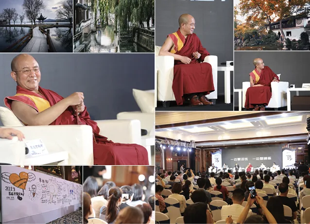
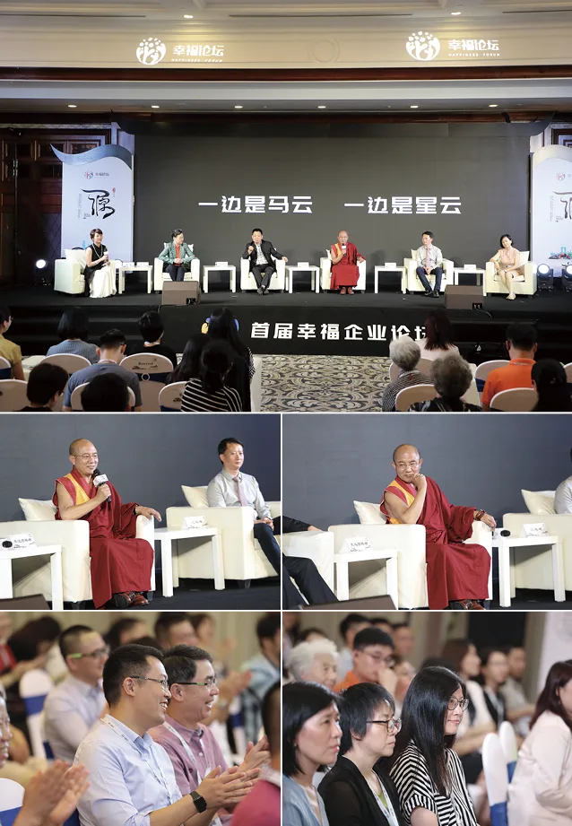
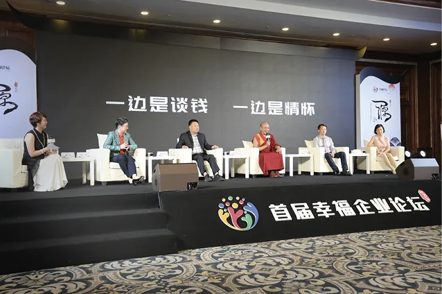
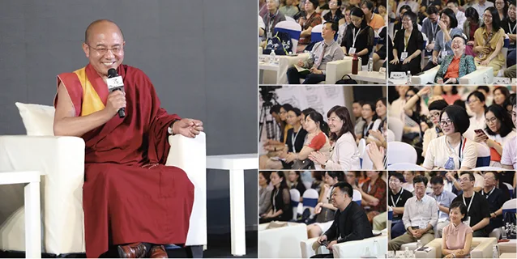

如果只关注物质层面，不追求精神层面，很多人不一定快乐。

第97场

苏州“欧朗幸福企业论坛”

Oley Enterprise Forum on Happiness, Suzhou

中国·江苏

2019 / 7 / 9

## 关于幸福的矛盾

## The Happiness Paradox

## 对话1：一边是马云，一边是星云

主持人：其实，“马云”只是一个代名词，指那些想要快速获得成功的人，而“星云”之道是保持心灵的平和。

每个人都希望陪伴自己的孩子快乐成长，但又不得不为业绩而加班，变成工作超人，天天“996”。我们一边自视清流，一边又要适应职场而随波逐流；一边想用成功证明自我价值，一边又发现生命脆弱，万贯家财终须空。这样一个纠结和撕扯的人生，是当代大多数人的集体困扰。

我先说明一下，今天所有的题目，都不是事先准备好的。所以，一切都是最精彩的发挥。有请堪布发言！

堪布：“马云”和“星云”这两者都是“云”，但应该“马”在地上，“星”在空中，一者比较重视物质，一者比较重视精神。

2017年，马云在一个论坛上说，他有点后悔创立了阿里巴巴，因为现在钱花不完，他忙得没有时间，非常苦恼。我以前也见过星云大师，他现在90多岁了。虽然老人家一直为了弘法利生而忙碌，但心态始终很平和。在他的一些书中，也提到了让人获得幸福的方法。那么，物质到底能不能给人带来幸福呢？暂时的幸福应该可以得到，但究竟的幸福却不一定。

如果我们的境界跟得上，今生一定会获得最究竟的幸福。要知道，骏马在草原上奔驰的时候，也许是快乐的，但草原面积毕竟有限；而星星在无垠的天空中闪烁的时候，无数人看得到它的光芒。不管怎样，每个人的价值观不同，我觉得都是幸福的。

主持人：工作的原因，我平时会接触到很多企业家。如果按照堪布的话来总结，其实很多企业家都在草地上奔跑，偶尔仰望星空。有一首歌叫《如果云知道》，我想只有天空的云可以帮助我们找回内心的幸福。感谢堪布的发言，接下来有请陈教授谈谈他的理解。

陈教授：《易经》中讲：“云行雨施，品物流形。”企业家应该像云一样，云飘在哪里，雨就落在哪里。因此，不管是传播商业理念，还是传播传统思想，是马云还是星云，是释迦牟尼佛还是稻盛和夫，都在用自己的力量去滋养每一个人。

如果没有马云，这个世界会缺少许多商业奇迹；如果没有星云，我们的内心会多一分贫瘠，所以这两者相得益彰。“马”属于乾卦，所谓“天行健，君子以自强不息”。龙马精神，象征着努力拼搏。“星”属于坤卦，月相盈微，星星辽阔，意味着“地势坤，厚德载物”，不断地滋养大地，不断地涵养内心。

这个世界上，不是只需要一匹马，也不是只需要一颗星。万马奔腾，方是天地气象；繁星辽阔，才是星图深远。中国的星象，是二十八星宿；中国的骏马，至少是八骏图。与其厚此而薄彼，不如兼容而并蓄。作为企业家，需要向马云学习，不管如何艰难困苦，都不会停下创业的脚步。同时，也需要向星云学习，无论年岁如何增长，都不会放弃思想的传播。

让世界多一匹马，就会多一分进取；让天空多一颗星，就会多一分遥望，多一分思绪，多一分光明，多一分未来。因此，应该把这两者综合起来，共同创造中华民族商业文明和智慧文明永恒的奇迹。

主持人：陈教授从《易经》的角度来分析，也是非常精彩。再次感谢两位大师！

## 对话2：一边是谈钱，一边是情怀

主持人：前两天，知乎上有一个很火的提问：“现在的年轻人吃不了苦了吗？”很多老板对此非常地感慨，他们认为现在的年轻人普遍吃不了苦，就是因为没有奉献精神，不能接受“996”的工作制度，动不动就辞职。后来，有一个90后的大学生在知乎上回应，他说：“现在的年轻人依然能吃苦，只要钱到位，做什么都可以。”

所以，我想问一下沈总和王博士，有没有面试过这样的90后员工。你们认为和员工谈钱、谈情怀的时候，哪个才是对他最好的尊重？

沈总：我昨天刚好面试了一个员工。他跟我说他之前的工作模式是“996”。我有点不懂，就问：“是不是每天工作9小时，一个礼拜工作6天？”他说：“不是，是每天早上9点上班，到晚上9点下班，一个礼拜工作6天。”我听了后目瞪口呆，然后说：“太没人性了！”我们从欧洲公司出来的人都是这样，不懂这些网络流行语，也不能接受这样的工作制度，这是不尊重人的行为。

其实，用马斯洛的金字塔理论[^1]比较好回答这个问题。如果这个员工处在巨大的生存压力下，当然应该多谈钱，谈情怀是没用的，因为他必须先解决生存问题。所以，作为一个有责任心的企业家，应该帮助他解决这个困难，这样他才能安心地为公司付出。

如果这个员工是高层管理者，那应该多跟他谈谈情怀，谈谈理想，或者他的个人爱好。在交谈的过程中，捕捉他的人生态度，以及对企业文化的认同感。这是我们经常用的面试方法。

主持人：我想从明天开始，沈总会有更多的面试。因为这个信息发布后，应该有很多人想来欧朗工作。接下来，有请王钰博士发言。

王博士：在我个人看来，这两者既是一对矛盾，又是可以相互融合。我们以前经常讨论如何管理90后，但如果你现在到互联网公司，或是其他新兴公司，那些90后的员工会说：“哎呀，我们都是老人了。”因为第一批90后已经接近三十岁，马上要步入管理层。现在职场上的年轻人大多是95后。我们家双胞胎是1996年出生的，已经大学毕业工作两年了。

新生代的价值观与老一代相比，存在很大的差异。他们是不是只为钱，不为情怀，或者只为情怀，不为钱呢？其实，重要的是如何充分激发员工的创造性。当你有新想法的时候，内心会产生愉悦感和满足感。所以，创新能给我们带来快乐。比如，掌握新的知识，开发新的产品，尝试新的做法，这些都可以让我们释放出快乐因子。

马云、乔布斯等人缔造的商业奇迹，给人们带来极大的满足和快乐。所以，对于年轻的一代，我们要留意和观察他们的优势，继而在职场中凸显他们的工作能力。金钱只是对创造力的激励，还要让他们感受到更大的情怀。

所以，如果我们抓住了核心，就能激发他们的赋能，产生更大的创造力。

主持人：为了这次的主持，我看过很多堪布的书，包括《残酷才是青春》《苦才是人生》。堪布经常会与当代年轻人进行对话，讨论学习、工作、生活等等。所以，请问堪布您怎么看待这个问题？

堪布：首先，很感谢主办单位，邀请了不同行业的企业家。这些谈话确实很有深度、有温度，也有一定的思考空间。

现在这个时代非常特殊，东西方文化交织在一起，古文明逐渐消失，西方文明不断涌入。人们好像站在十字路口，不知该往哪走。这个时候，应该给心灵更多的滋养，否则精神与物质一直难以平衡，人们的内心不一定快乐。

现在的年轻人，在学习方面应该没有很大问题，因为通过网络可以在短时间内掌握任何知识。而在创作方面，需要有经验的人给予指导。

我个人认为，物质文明和精神文明两方面都要兼顾。在中外文化交流过程中，面对不同文化的碰撞，年轻人应该有更多的思考。不管是情怀还是金钱，其实我们都需要。如果年轻人都没有马骑，光是看虚空也没办法生活。刚才有的教授也讲了，先要解决基本的生存问题，然后才谈得上解决精神问题。但是，如果只关注物质层面，不追求精神层面，很多人不一定快乐。

因此，我希望年轻人既要重视金钱，又要重视情怀。作为企业家，既要重视员工的福利，又要重视企业的未来发展。

## 对话3：一边是无情，一边是有情

主持人：某种程度上讲，管理制度意味着一种规则，一种无情，一种成本。但是，幸福企业又意味着一种人性，一种情意。当然，这需要企业家更多的付出。所以，我想请教一下真真老师和沈总，你们在处理这样的矛盾时，会选择什么样的方式和尺度？

真真老师：我是一名心理学研究者，你们能够想象我的讲课风格吗？我以前其实挺温柔的，后来上课有时居然会拍桌子，而且我还没有意识到这一点。现在，我讲课经常爱拿自己来举例。从专家学者变成普通人的样子，让我慢慢回归到“直心”的状态。

今天，堪布给我们讲的是“烦恼是道场”“一切法是道场”，《六祖坛经》中还讲“直心是道场”。当我“直心”的时候，不论是娓娓道来，还是拍桌子讲，一颗心只是为了他人好，为了让他人更受益。在讲课的过程中，我并没有加入这种思辨：我拍桌子的样子是不是很丑？是不是跟我的身份不符？这些通通没有想过。当我越来越放下的时候，发现自我正在逐渐消融，取而代之的是只想别人受益。

这是我对“无情”和“有情”的一个答案。事实上，当你站在小我的头脑思辨层面时，会很难把握它。但是，如果你优先考虑别人的利益，那么该依规则去取舍，还是该依人情去衡量，答案是自显的，根本不需要思辨。处在这种状态下，从心里直接流淌出来的，可能就是最好的选择。

这三个问题设计得特别好，都是围绕着生命在谈。在我看来，人生就是一场接一场的考试，而我们在其中不断地成长。刚开始需要“马云式”的成长，然后还需要“星云式”的补充。所以，我不认为“无情”与“有情”是对立关系，二者应该是由心而发的平衡关系。

这一个问题引发了我对三个问题的回答。人生就是一场考试，从心出发，从心应对，一切都OK。

沈总：从企业管理的角度讲，应该有一定的规范。事实上，不仅企业有企业的规范，学校也有学校的制度，人在社会中也会受到法律的约束。如果一个公司没有相应的管理章程，每个人都按照自己的习惯去做事，如此完全放纵的话，团队就没办法形成合力。

实际上，不同文化背景的企业，在“有情”与“无情”或者规章制度的人性化方面，尺度是不一样的。比如，欧洲企业比较人性化，规章制度相对宽松；台湾企业，通常会采取半军事化的管理方式，尤其是针对一线操作人员；日本企业，比较推崇终身工作制，重视上下级之间的忠诚和承诺；美国企业，更多的是受金钱驱动，表面上大家很客气，一旦你的业绩不达标，马上会被炒掉。

另外，不同的工作性质也有不同的管理。比如，研发部和营销部需要员工的创造力和想象力，这类部门就不能把人管得太严，需要给予充分自由的空间。比如，微软公司为了激发员工的创造力，负责研发的员工都有自己的房间，宠物狗可以带去，自行车也可以放在办公室里。但是，对于一线生产员工来说，富士康是比较典型的半军事化管理，还有像法国企业的生产线管理也比较严格，跟办公室的管理模式不太一样。因为生产车间是团队协作，对行为一致性要求非常高。

总体来说，欧朗可以称为科学与艺术的结合。“科学”是指严格的管理制度，比如上班打卡等数字化管理；“艺术”是指如果这个员工平时表现不错，而他也做了解释并道歉，那这次迟到就算了。所以，企业也要有人性化管理，让员工感受到温暖。

## 对话4：一边是位子，一边是孩子

主持人：对于职业女性来讲，幸福意味着要平衡工作与生活的关系。这件事情看似简单，做起来却很难。

每个女性都梦想成为一个英雄，但英雄背后可能是一个不太称职的母亲。在工作中投入太多精力，团队会对你非常满意，但同时又忽略了家庭和孩子。所以，我们先听一听两位女性专家是如何看待这个问题的。

王博士：我个人觉得自己很幸福，这里面其实有幸运的成分在，但这份幸运你要接得住才行。我特别感恩我的先生，他给予我很大的支持。

我的两个孩子是在墨尔本出生，6周时就被带回广州，因为我被派往中国作为首席代表。所以，他们幼儿园和小学都是在国内读的，后来我们决定等他们读中学的时候，全家搬回墨尔本，让他们在那里读书。但是，我又舍不得放弃自己的事业，觉得这个“位子”很重要，因为当时正赶上整个汽车行业的迅猛发展，作为宝马集团的主讲老师，我的课程排得很满。

为什么说感激我的先生呢？因为孩子既是你生命的延续，又是你前进的动力。那个时候，我的先生非常支持我，他选择辞职陪伴孩子，把他们都送到私立学校，男孩送男子私立学校，女孩送女子私立学校。在国外，这样的安排需要一名家长全职陪护。不仅要接送孩子上下课，还有游泳、羽毛球、大提琴、钢琴等一系列活动。

人生短暂，我不想失去这段陪伴的时光。所以，我就有意识的放慢脚步，让自己找到“无情”与“有情”之间的平衡。单月在中国上课，双月飞回墨尔本陪伴孩子，参与他们所有的活动，这让我感到愉悦和满足。

因此，你要想好选择什么样的人生，对你来说什么是最重要的。这样一来，“位子”和“孩子”也是可以并存的，同时也可以获得幸福。

主持人：原来，幸福的女人背后还有一个默默付出的全职先生。今天，王博士的先生也来到了现场，让我们把掌声送给他。接下来，请真真老师谈一谈她的看法。

真真老师：这个问题困扰着很多女性朋友，我也见过太多因此而引发的一系列问题。所以，我只看到一个“苦”字。

职业女性实在是太不容易了，她们在每一个阶段都是“一朝不慎，满盘皆输”，真的是苦苦相连。我也因此离开了很多人羡慕的“位子”，开始出来做公众传播的课程。我做的第一个课程，就叫“女性智慧成长课堂”。

大家可能认为，职业女性很难兼顾好家庭。然而，关键不在于她去打拼自己的事业，而是她从事一个行业久了，渐渐会思维固化。对于这样的女性，我们会叫她“女强人”，这个词是有贬义的情感因素在里面。当你在被别人称为“女强人”时，这背后往往意味着你的家庭生活、情感生活并不如意。这是因为过度的工作或对事业的执著吗？并不是的。其实，导致她陷入这种境地的原因，主要是她固有的思维模式。

我的另外一群咨询者，是全职妈妈和全职太太。她们把所有的精力和时间都给了家庭，可是随着孩子的不断成长，她们的自我价值感也在逐渐消失。

在成都的一次课程中，有位妈妈一口气提了25个问题，全是关于孩子的。事实上，她代表的是一类人，这类人的名字叫“母亲”。我也是两个孩子的母亲。如果没有经过培训，我们会不自觉地用最朴素、最天然的方式，毫无保留地投入全部的爱。就像聚光灯一样，用爱烤着孩子，最后不但烤焦了孩子，也耗干了自己。事实上，如果过分偏重在孩子这边，容易引发很多问题。

在带孩子的过程中，我和我的家人也面临着很多困难。与此同时，我还是一个职业女性，面对孩子和工作该如何抉择？我自己是走过来了，但我看到太多的人掉入陷阱。所以，我决定出来做这方面的教育。

其实，女性真的需要有一个心灵的依怙，它会护持你无惧任何问题，这个依怙就是成长力。无论你是在“位子”上，还是在“孩子”上，始终要不断地学习，不断地成长。如果你拥有了这种成长力，就不会走得过偏，会平衡好各种关系。

所以，成长力是不迷失自己的一条安全带，我们一定要把它系好，这样无论选择在位子上起航，还是在家庭里陪伴孩子成长，都是可以的。

主持人：通过真真老师的分享，相信大家会对“女强人”有一个新的定义——内心强大的女人。

今年“三八”妇女节的时候，我也被西交利物浦大学邀请去做一个关于女性的演讲，同样是平衡工作和家庭的问题。当时我的回答是，这两者无法平衡，只有选择。如何做出最稳妥的选择，才是我们应该思考的问题。

接下来，有请堪布发言。

堪布：让我来回答这个问题，可能不太适合，因为我既没有“位子”，也没有“孩子”。但我也知道这是现代职场女性所面临的问题和挑战。

其实，每一位母亲都非常伟大。我的母亲出生在一个牧民家庭，没有上过学，所以没什么文化。包括我的三个妹妹和弟弟，也都是牧民，这和当时的生活条件有很大关系。但是，我的母亲为每个孩子都付出很多。在座的各位，有些已经像刚才两位教授一样，既有“位子”也有“孩子”。在这种情况下，确实要面对许多问题。

通常来说，母亲比较关心孩子，而父亲比较关心位子。但是，我希望母亲在关心孩子的同时，也不完全舍弃位子。对于内心强大的女性来说，应该能做到两者兼顾。我看在场有些老师，不仅能照顾好孩子，而且工作上也非常出色。作为父亲，在打拼事业的同时，也不能缺席孩子的成长。

有些企业家每天忙于自己的事业，从来不关心家人，这种做法有点极端。今天的话题就是告诉我们，做任何事情都不要落入极端，不管是对于金钱与情怀，还是有情与无情，或者是马云与星云，都需要做好两方面的平衡。而有些女性做了母亲之后，一切为了孩子着想，所有社会创造力都消失了。

昨天，我在一个大学演讲，他们也问到：为什么在大学里成绩好的女性很多，而到了社会上成功女性却很少？其实，这是同样的问题。一味地关爱孩子对事业有影响，一味地关爱事业对家庭也有影响。所以，凡事应该不堕两边，不要过于极端。

主持人：感谢堪布的精彩分享。接下来，有请陈教授谈谈他的看法。

陈教授：对于职业女性来讲，想要做到平衡工作和家庭非常困难。如果为了孩子，不仅会失去“位子”，还可能会失去“孩子”；如果为了位子，可能既会收获“位子”，也会收获“孩子”。

孩子是我们生命的延续，而位子是我们的尊严。如果没有位子只有孩子，那你在孩子面前就无法树立榜样。虽然为了位子要付出很多，对孩子的关注可能会减少，会有一些爱的缺失，但孩子对你会有敬仰之情。其实，太频繁地在一起，反而会疏远，偶尔的疏远反而会亲近。很多时候，我们把责任弄反了，不应该让女性独自面对这样的二律背反[^2]，而应该让更多的男性像王博士的先生一样，承担起家庭的责任。

我个人认为，有了位子以后，更容易获得孩子的尊重。否则，等他长到十四五岁，对你的评价不断下滑，这会让你感觉很挫败。你为他付出那么多，而他对你却不够尊重，这是因为你只有他，而他有一切。

因此，女性必须先做好自己。有了“位子”的“孩子”会更加坚实，有了“孩子”的“位子”会更加温暖。用前者树立自己的社会定位，用后者延续自己的生命关怀，这才是现代女性应该努力和前进的目标。当然，多读书，多学国学，可以让我们做事更圆融、更圆满。

主持人：在“星云和马云”这幅编织的云图中，有着中国人所有的遐想和抱负。我们比以往任何时代的人都忙碌，却也享受着更丰富的物质。然而，有时还是会感到失落，这说明还有一种内在的精神，督促着我们寻找生命的意义。

所以，无论是企业家还是普通人，都希望找到属于自己的企业灵魂和精神生命，这就是我们举办这场公益论坛的意义。

[^1]: 马斯洛的需求层次结构是心理学中的激励理论，包括人类需求的五级模型，通常被描绘成金字塔内的等级。从层次结构的底部向上，需求分别为：生理（食物和衣服），安全（工作保障），社交需要（友谊），尊重和自我实现。
[^2]: 二律背反是康德的哲学概念。意指对同一个对象或问题所形成的两种理论或学说虽然各自成立但却相互矛盾的现象，又译作二律背驰，相互冲突或自相矛盾。
