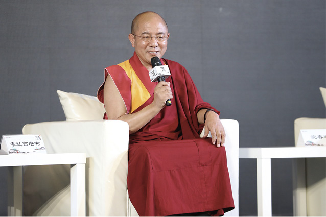
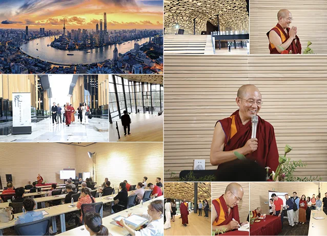
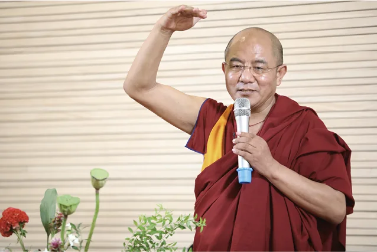
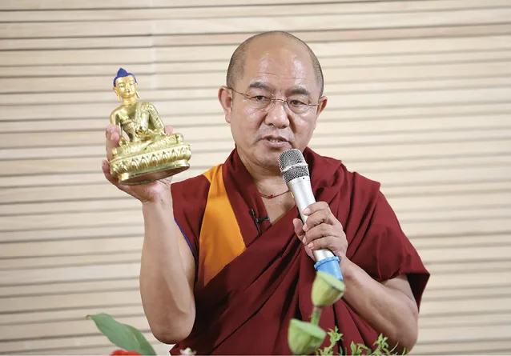
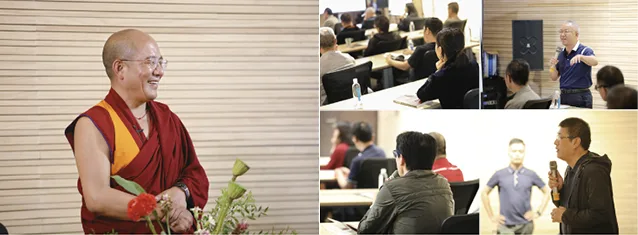
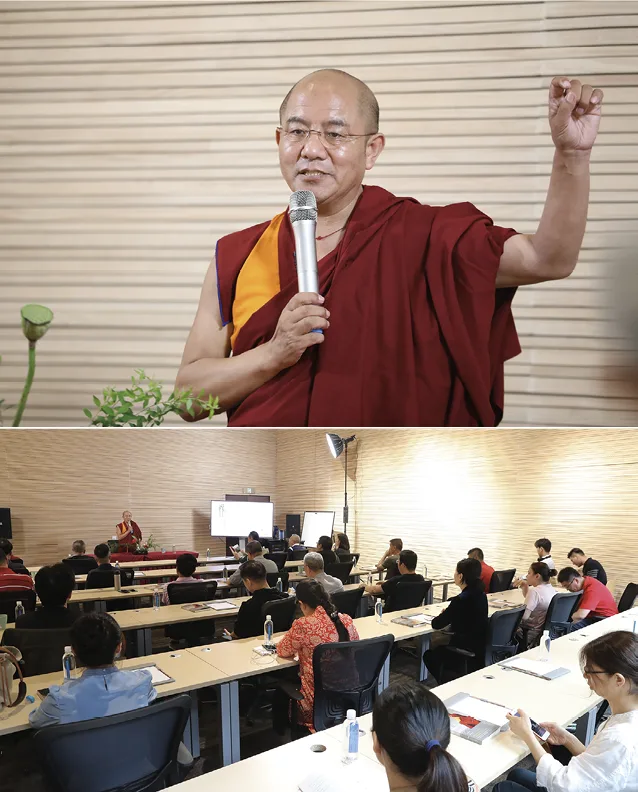
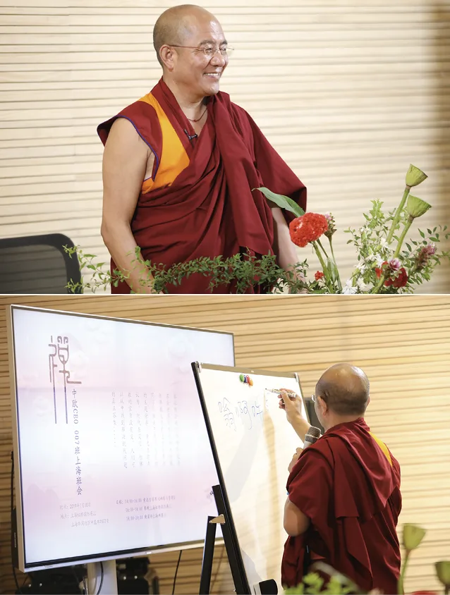
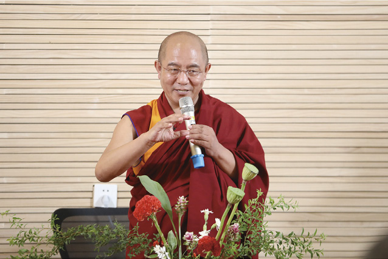
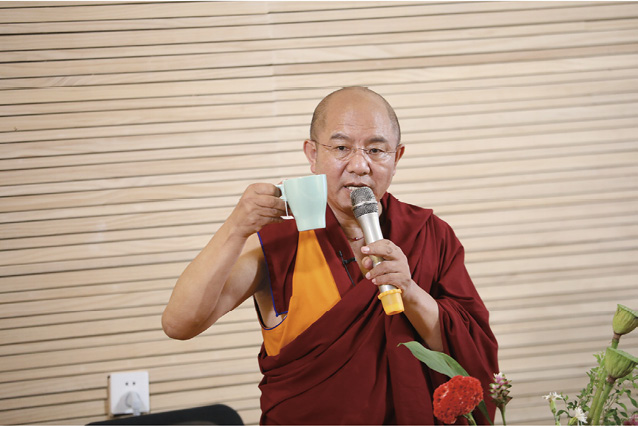

企业家在管理别人的同时，  
更主要的是管理自我。

第98场

中欧商学院CEO班

China Europe International Business School-CEO Class

中国·上海

2019 / 7 / 10

## 禅修与管理

## Meditation and Management

主持人：

今天，我们非常荣幸地邀请到四川喇荣五明佛学院的大堪布——索达吉堪布。堪布是当代著名的佛学家，也是一位慈善家、翻译家，在国内外享有极高的声望。

近些年来，堪布应邀前往哈佛、耶鲁、哥伦比亚，以及清华、北大、复旦、人大、港大等国内外知名院校，为众多知识分子进行深入浅出的佛学讲解，引导学生积极正确地面对学业、情感、工作、人生等问题；并与诸多海内外科学家一起，对生命科学、环保、和平、道德等方面进行深入探讨，让科学与宗教能够真诚地对话。

这次大家有幸聚在一起，聆听堪布的甘露法语，相信会给我们带来极大的收获。

很高兴有这个机会与各位一起交流。希望大家在此期间不要用手机，最好静音或关机。不然，有些人听得三心二意，我讲得也会三心二意。刚才看了每个人的介绍，大家都非常了不起，但了不起的人应该也有了不起的心态和智慧。我非常珍惜这次机会，希望你们也能从中受益。

作为企业家，你们平时思考的，跟我今天要讲的内容也许并不相同。因为你们平时关注的是成功人士要做的事情，而我作为一个佛教徒，更加关注心理方面的引导。因此，我们的关注点可能不太一样。所以，如果大家有什么疑惑，在后面的互动环节可以畅所欲言。

今天的主题是“禅修与管理”。在座各位应该听过很多企业管理讲座，尤其在这样的商学院里，根本不缺这些，而且现在特别流行讲管理学。但是，有些讲座比较有意义，有些只是形式而已。

## 不限于传统，不照搬西方

如今这个社会，企业家占有非常重要的地位，因为他们能解决许多人的生存问题、就业问题，对管理者自身而言就更不用说了，一定会有更多的利益。按照西方经济学的观点，企业的行为目标就是追求利润最大化。而当今社会的主流价值观也是“金钱至上”，这种现象实在令人担忧。现在的企业管理，既不像东方的管理，也不像西方的管理，显得有些不伦不类。

很多人认为，东方的传统文化是一种老旧的思想，因此不太愿意接受。而对于西方的现代文化，又觉得那是一种邪道，也不愿意接受。然而，如果现代的西方思想是邪道，传统的东方思想又是老旧，那人们到底需要什么呢？这是一个值得探讨的话题。其实，现代管理学的理论体系起源于西方。而在东方传统文化中，除了儒家、佛教等略有涉及以外，并未形成专门的学科。

有些人认为，西方文化是垃圾文化、糟粕文化，却又总是一边排斥一边接受。事实上，我们现在还有自己的文化吗？文化应该根植于我们的基因之中，与我们的智慧相融，然而，上世纪六七十年代以后，中国的传统文化大多数已经失传了。因此，我们不得不效仿西方的管理模式。那么，这种管理有没有漏洞呢？大家应该清楚，西方管理思想是在一定的历史条件、民族文化背景下产生和发展起来的。所以，东方人运用它的时候，在法律条例和制度管理方面，会出现一些漏洞。因此，在运用的过程中，应该可以看出它的利弊。

## 回归本性的自我管理

我今天主要想跟大家讲的就是古老的东方思想。要知道，团队管理最根本的就是自我管理，而中国传统文化蕴含着丰富的“自我管理”思想。就像很多人也经常讲，一个企业的成功是一个企业家的成功，一个企业的失败是一个企业家的失败。这样看来，企业家在管理别人的同时，更主要的是管理自我。因为在所有的管理中，最重要的就是自我管理；而在自我管理中，最重要的则是内心管理。所以，我们应该把50%的精力用在反省上面，因为管理者自身也会存在问题和不足。

有些成功人士，表面看起来十分风光，实际内心也有许多苦恼。比如，在健康方面，年轻时身体无恙，而年老后每况愈下；在心态方面，随着做的事情越来越多，烦恼也会越来越多；在家庭方面，以前关系还比较和谐，但拥有金钱、地位、名声之后，幸福感却越来越低；在责任感方面，有些人刚开始社会责任感很强，后来就慢慢淡化了；在道德方面，随着欲望的不断膨胀，道德观念也会出现滑坡。这些负面的情绪和心态，让我们不能有效地进行自我管理。因此，想要成为一名优秀的人，首先要对自身进行净化和调整。

自我管理包括身体管理、行为管理和内心管理。其中，身体和行为的管理，需要依靠心识，而心识可分为眼识、耳识、鼻识、舌识、身识、意识，也叫六根识。六根识的管理，从传统文化的角度讲，包括非礼勿视、非礼勿听等等。也就是说，不合理的不要去看，不合理的不要去听，更不要去享受、接触、品尝等等。这些我们能不能做到呢？并不一定。

商学院的好处是可以拓宽人脉，对事业发展会有很大帮助。另外，商学院还会邀请东西方的专家和教授，传授国学、心理学、管理学等内容，也可以学到很多的知识。但我刚刚讲的自我管理，是指对六根识的管理。一些社会名人，包括大董事长、大企业家，在跟不同人接触的过程中，很有可能会染上不好的习气。这样一来，不仅没有学到有用的知识，反而会带来各方面的烦恼，致使自己开始走下坡路。所以，不要以为自己成功一次，就代表着今后永远成功，不能抱有这种心态。

尤其身处这个时代，现在你可能是特别了不起的人物，但再过几年就说不定了。每个企业的竞争对手都在日益增多，即使没有竞争对手，迟早也会被时代淘汰。就像曾经那些盛极一时的企业，到现在连名字都听不到了。所以，我们是不是永远都有这样的福报和威望呢？非常非常难说。面对复杂严峻的外在环境，如果没有做好自我管理，调整好自己的内心，对你今后的事业发展会很不利。因此，首先要管理好自己的六根识，否则只是表面上的学习，实际上对自己是不利的。

对现代人来说，最重要的是什么呢？就是内心的管理。从表面上看，每个人好像都在做企业、做善事，非常有意义。然而，如果没有关注内心，增长的又是什么呢？可能还是贪欲、嗔恨、愚痴、嫉妒、傲慢等五毒烦恼，对自身不一定有利。如果贪心非常严重，可能该做的事情没有做好，反而入于牢狱之中；如果嗔恨心非常严重，一气之下可能会做出无法挽回的事情；如果愚痴心非常严重，不能了知一切事情的真相，可能会做出很多可怕的事情；如果傲慢心非常严重，由于毫无敬畏之心，所造的罪业其实更严重。

为什么说在所有烦恼中傲慢和嫉妒是最可怕的呢？正如俗语所说：“傲慢的山顶上，留不住功德的水。”人在成功的时候，很容易生起傲慢心，经常摆出目中无人的姿态，旁人根本无法进入他的世界。比如，有地位的人，无法理解别人的痛苦；有才华的人，无法理解平庸者的感受；有钱财的人，无法理解穷人的心情。在这种心态下，他们的所作所为可能会不如法、不合理。另外，如果人与人之间、集团与集团之间，或者同行之间存有嫉妒心，也是非常可怕的。

## 企业长盛不衰的奥秘

人的各种负面情绪，也就是刚才讲到的贪嗔痴等烦恼，会给企业造成不利的影响。那么，怎样才能断除贪嗔痴或者说恶分别念呢？最好的方法就是禅修。一般来讲，禅修分为印度瑜伽、佛教禅修等。现在很多企业和大学里也在提倡禅修，这些方法都非常有用。而对于佛教中的个别禅修法门，在座各位如果想要修的话，可能没有那么多闲暇时间，也不一定有兴趣和信心。但哪怕只是一个简单的禅修法，也可以提升你的战略思维能力，改善身心状态。

很多人认为，企业家应该像乔布斯一样禅修。虽然乔布斯确实经常禅修，但他的精进努力，我想大多数人不一定能做到。听说他从17岁开始，就对禅修有着非常浓厚的兴趣，一直到他人生的最后，都没有间断过禅修。而正是依靠禅修，很多创意自然而然就在他的境界中浮现出来。

那么，企业家到底应该如何修行呢？你们应该听过一些相关讲座，有的人也专门研究过。作为一名佛教徒，我强烈建议大家学习稻盛和夫的管理理念。虽然有些人已经学习过，但行为上却不一定能做到，甚至可能南辕北辙。其实，稻盛和夫的管理方法非常有效。为什么这样讲呢？如果以自私自利之心管理企业，只为满足一己私利，长远来看并非明智的选择，所以应该要有一颗利他心。

稻盛和夫管理企业的原则，是追求正当的利润，通过盈利来养活员工、贡献社会。然而，现在很多的企业家，并不是为了员工而奋斗，唯一考虑的是自己的利益，根本谈不上为社会和人类做出贡献。由此可见，有些企业家的创业目标一开始就错了。他们并不是为了利益社会，而是只想要自己做大、做强，这与稻盛和夫的企业理念完全不同。

大多数企业家会将公司交给自己的孩子，他们则退居幕后。其实，我并不是很明白这些人的想法。一般来说，等到创业成功时，基本上已经50多岁了，同时又占据了很多社会资源。那么当你将要离开世间时，有没有想过自己的人生价值和意义？有些人可能想：“我虽然离开人间了，但我的子孙后代还可以享受。”可是，他们不一定有能力维护这么庞大的企业。

人们总是抱着一种美好的心态，一直想着我要如何如何，从来没有想过如果自己突然离世，要怎么处理这些财富？是传给子孙后代，还是由朋友来接手？国外的企业家，一般会提前写下遗嘱。而我们大多数人在这方面没有一点准备，甚至连提都不想提，总觉得这样做很不吉利。因为按照传统思想来说，人们忌讳提到“我死了以后要怎么样”。但即使你不提，这也是每个人无法逃脱的事情。一旦死亡真正来临时，或者你辛辛苦苦挣一辈子的钱被子孙败光时，那时你又会是怎样的感受呢？这一点值得大家深思。

## 以“六度”来经营企业

按照佛教思想，应该以“六度”来管理企业。第一是布施度，也就是将自己拥有的财富布施给那些需要帮助的人。

第二是持戒度，企业家要恪守道德底线。有些人的做法非常可怕，根本不考虑社会的未来。

第三是安忍度，创办企业的过程中，可能会遇到各种风险，或者竞争对手对你恶意诽谤、制造破坏。在面对这些问题时，要有一颗坚定的心。

第四是精进度，无论做什么事情，都要有一种勤奋努力、坚持不懈的精神。

第五是禅定度，真正的禅修，需要花很多时间去讲，今天因为时间关系，我们只能稍微安住一下。其实，首先让心定下来，然后专注思考问题，最后再进行抉择，这是非常有必要的。

第六是智慧度，做任何事情，都要以智慧来抉择。这不单单是一种世间知识，还包括佛教中讲到的空性智慧。尽管通达空性有一定的难度，但没有智慧的抉择，其实是一种莽撞、盲目的行为。

表面上看，六度只是佛教的一种理念。但实际上，在任何一种行为当中，从布施到智慧这六个环节可以说缺一不可。那么，具体应该怎么去做呢？这需要我们自己去学习。

接下来，我简单讲一下禅定度。

其实，禅修是管理内心最好的方法。下面给大家介绍两种简单的禅修方法。第一种是无缘的禅修。我们每天早上起床和晚上睡觉的时候，或者上班空闲的时候，最好让心什么都不想，安住一会儿。如果用疲惫心、分别心、烦恼心来抉择事情，很难做出正确的选择。心静下来之后，在这种清净心的状态下，才会做出智慧的选择。

大家平时工作很忙很累，还会因为这样或那样的事情而心累。其实，心的劳累，主要是因为我们的分别念太多，想要的也太多。有时候，我们的欲望过于膨胀，在不该执著的事情上执著，必然会导致心特别劳累，而且对健康、睡眠以及整个身体状况，都会带来不良的影响。因此，我们应该每天坚持禅修。

第二种是有缘的禅修，即观佛像的方法。虽然有些人本身并不信仰佛教，但是在遇到一些大事的时候，可能自然而然就有信仰了，这时会提前去寺院里烧香拜佛。有些企业家在工作中遇到瓶颈或者痛苦的时候，也会去寺院烧香拜佛。不管怎样，能有这样的想法和做法，佛菩萨也一定会保佑你的。

每个人的命运都不相同。有些人没有前世的福报，佛陀也无法改变。但是，如果你本身有这些种子，再加上种种外缘，通过祈祷佛菩萨应该可以顺利成办。世间其他事情也是如此，如果你造的业或犯的法非常严重，不可能单纯依靠关系就能避开处罚。但如果你做过很多善事，依靠这种助缘，再加上有人从中调和，也能解决一些实际问题。同样，即使没有真正的信仰，也可以在遇到事情时求佛、拜佛、烧香，做放生等善事。虽然从严格意义来讲，这只是求一种暂时的人天福报，属于比较小的善根，但是对于我们的人生来讲，这样的祈祷非常有意义。

因此，我们还可以通过观佛像来禅修。无论是释迦牟尼佛、阿弥陀佛、莲花生大士，还是观世音菩萨，专注凝视佛菩萨的身相，内心祈祷“加持我、保佑我”。然后，念诵“南无观世音菩萨”或“南无本师释迦牟尼佛”一百遍、一千遍、一万遍……事实上，任何人观想佛、祈祷佛，佛就会安住在他面前，直接赐予加持。

“佛”有两种含义。一种是我们平常所说的佛，依靠色身来到你的面前，在无形当中帮助你的事业；另一种是观想时的意念，这也是佛。不管是哪一种，只要我们念佛、观佛，对企业的转型和转变来说，就有非常大的帮助。当领导者面临重要决策时，或者遇到一些不顺时，可以默默地祈祷诸佛菩萨。这种祈祷一定会起到相应的作用。

你的祈祷是一种缘起力，依此诸佛菩萨可以赐予加持。就像有些水器放在地上，太阳和月亮的光芒自然而然会显现其中，有多少个水器就有多少份光芒。因此，只要我们具足信心地虔诚祈祷，佛陀的加持就会映现在我们的心当中。这种观想方法也叫做禅定或三摩地。不管你有没有信仰，都可以习惯性地祈祷佛陀保佑，这种念头对我们来说非常重要。

如果你们有自己的佛堂，可以摆放一些唐卡和佛像。空闲的时候，可以将佛像放在面前，然后认真地反复进行观想。有些企业里面有特别庄严的佛像或佛堂，还可以摆放一些供品，普通员工和高层领导都可以经常祈祷。这也是一种很好的禅定，对我们的身心健康大有益处。

如果发心向佛或向往圣贤，那你一定会成为善良的人。如果经常与不良风气同流合污，可能暂时看不出来弊端，但你很可能会慢慢堕落。因此，作为企业的领导者，要具有自我管理的素质。从外在形式来说，应该有一种与众不同的氛围和气质；从自身来说，可以有一些信仰，也可以了解它之后，再进行祈祷、观想和礼拜。

## 企业文化要以人为本

目前很多企业的员工流失率特别高，一方面是对薪资待遇不满意，另一方面是企业的人性化管理不够完善，缺少精神层面的关爱。有些企业家特别冷漠，完全采用西方管理模式，对员工进行机械化管理。虽说没有规矩不成方圆，但如果没有人文关怀，可能会出现不道德的现象。也许员工没有你们有钱，没有你们有智慧，但大家同样都是人，都有自己的难处，领导者应该对员工抱有一颗温暖的关爱之心。有些人拥有财富以后，总是一副高高在上的姿态，根本不想进入别人的世界。所以，制度化管理固然重要，但更重要的是人性化管理。这也要求管理者在企业管理上要具有灵活性。

一般来说，对于领导的命令，很少会有人反驳。有些人一开口就说：“我们领导说开除就开除，赶紧让他走人。”根本没有一点人文关怀。而从佛教的角度讲，应该以人为本，慈悲为怀。其实，每个人活得都不容易。

我非常欣赏稻盛和夫的管理观念。他提倡领导者要关爱每一位员工，而我们很多人始终把自己放在最重要的位置。前段时间，任正非说他自己只得到企业1%的利润。如果真是这样的话，确实可以让员工得到更多的利益，反过来也可以增强企业的凝聚力。

每个人都有自己的追求，精神层面或物质层面。对于普通员工而言，会比较重视物质层面的提升。所以，如果在生活上多给一些照顾，那他们也会有一种感恩心。而且每个人或多或少都有攀比的心理，如果他们的薪酬待遇更丰厚，自然会产生一种与众不同的优越感。对于不在乎工资的人而言，更看重的是企业的认可和关爱。所以，需要在精神层面上给予他们更多的关怀，甚至要为他们的信仰提供方便。由此可见，有些员工追求的是物质财富，有些员工追求的是精神财富。

在企业管理中，可以举办一些禅修培训，组织大家一起进行禅修，这样能够提升员工的团队精神与职业素养。其实，人性化管理才是智慧的管理方法。如果只是依靠制度强制性地罚款，除此以外什么关怀都没有，这是一种僵化、死板、机械的方式。

蜉蝣是一种很小的昆虫。它只有一天的寿命，所以有“朝生暮死”的说法。但在这短短的一天里，它也可以完成蜕变、飞舞、交配、产卵。其实，人这一生就像蜉蝣一样的短暂。年轻时勤奋努力，等到中晚年功成名就时，六根也在慢慢衰退，眼睛看不清楚，耳朵也听不清楚。

佛教中经常讲到“人生无常”。不管是对我们的身体和事业，还是对国内外形势的变化，最好多观一切无常。要知道，坏的会变好，好的也会变坏，这才是无常的真谛。

观无常，是最好的修行，也是一种禅修。禅修的方法有观察修和安住修两种。“观察修”是指将我们每天所听的内容反反复复地思考。“安住修”是指在寂静的地方，以毗卢七法的坐式安住下来观心。今天我们不需要这样做，大家也不是专门来这里坐禅的。在稍后的互动问答环节，你们可以提出一些尖锐的问题，这样我们可以互相交流一下。

现场互动

问1：“禅”这个字现在用的很多，请问到底什么是禅？

堪布：其实，“禅”是古印度梵语的音译，也叫三摩地，是指心专注于一处。

让心专于一处，实际上有两种方法。藏传佛教中有一本书叫《定解宝灯论》，里面讲到了两种禅修方法，即通过反复的观察修、安住修，让心彻底安静下来。

禅的范围很广。如果是观察修，可以用自己的分别念寻找觉知，思维人生无常的道理，这是广义上的禅。如果直接讲禅的意义，当心静下来以后，以心观心，最后从根本上认识心的状态，这才是真正的禅。也就是《金刚经》中所说：“过去心不可得，现在心不可得，未来心不可得。”那么，不可得是什么样呢？实际上就是心的本来面目，心的本来状态。

我们每天都忙忙碌碌，认为世界存在、心存在、身体存在。但是，如果静下心来，以心观心时会发现，原来所谓的“我”并不存在。在这种情况下，寂灭一切分别妄念，认识到自心本来面目，这是禅修的一种结果。

当然，现代社会比较提倡“生活禅”，有各种各样的禅文化，企业里也有禅修室。很多西方人也对冥想情有独钟，主要喜欢一些印度瑜伽，因为他们的压力比较大，很难静下心。其实严格来讲，这些并不是真正的佛教禅修。按照佛教的禅定修法，不管修哪种禅定，都要渐进地从初禅、二禅、三禅修到四禅。所以，对修习禅定者的要求也很高，一般世间人难以触及。比如修到第四禅天，很多世出世间的功德，包括神通、神变等，自然而然就会出现。这个时候，你的精神和气色会越来越好，深层意识的智慧也会得以开发，很多前所未有的境界会出现。

按照佛教的说法，禅可以分为世间禅和出世间禅。真正的禅，是指出世间的禅定。但是，现在人们喜欢把禅和文化连在一起用，也就是所谓的禅文化。包括禅意插花、禅意茶室、禅意建筑等，应用范围很广。这样一方面比较吸引人，另一方面也有点庸俗化的倾向。

问2：禅分为世间禅和出世间禅的不同等级吗？

堪布：可以这样说。一般来讲，出世间禅包括声闻的禅、缘觉的禅、菩萨的禅、佛的禅。佛陀的禅定是一种不可思议的超越境界。

问3：佛比菩萨境界高吗？

堪布：对。

问：禅修与佛教是一脉相承吗？

堪布：其实，禅修起源于古印度。在佛教产生之前，印度人主要信仰印度教，已经延续了近四千年。而在古老的印度婆罗门教（印度教）中，也有一种三摩地的禅修，但与佛教中的三摩地意义差别很大。总之，禅修最早是从印度传过来的。

现在很多人喜欢把禅和佛教划等号。实际上，西方也有西方的禅，尤其是一些欧洲国家经常推广“生活禅”。也就是说，将禅落实到生活的方方面面。而柬埔寨、老挝等地，主要是修觉知禅，这是声闻乘的一种禅修。他们会观察自身的每一个部位，包括心脏、肺等等，觉知全身的各种感受。不管是走路还是吃饭，做任何事都要保持清醒的觉知。

问：近二三十年以来，让整个世界变化最大的两件事：一个是全球化，一个是互联网的发展。这使得人们之间的距离、信息传播的速度发生极大改变。同时，也让人们获得幸福感、宁静感的难度增强。所以，对于现代人来讲，静心是一件困难的事情，对此您怎么看？

堪布：你的问题很好。其实，不仅现在很难，未来可能更难。随着人工智能或5G时代的来临，很多事情会变化得越来越快，而人们会不会更快乐呢？并不一定。事实上，接触的事情越多，心也会越浮躁。现代人最大的毛病就是每天都要看手机，尤其是各种短视频，看得特别多。这样一来，不但缺失了文化的整体性，还缺失了思维的整体性。接收的大多数都是碎片化知识，无法建立一个思维框架。长此以往，必将会导致人心不安。

暂且不说世间企业，即使是清净的寺庙和道场中，禅修的违缘也变得越来越多。我所在的佛学院，为了避免道友们上网散乱，要求每个班都上交手机，只在周末还给他们。当然，有的人会再买一个手机，自己偷偷上网看视频，也有这种情况。

现在一方面任何事情都变得很快，互联网也使交流变得更方便；但另一方面，我们想要的越来越多，烦恼也越来越重。这个时候，如果没有知足常乐的心态，内心很难安静下来，做到一心专注就更难了。而有些所谓的禅修，只不过是能减轻一点压力，坐半个小时就算是很成功了。除此之外，想要心长期静下来，对于世间人来说很难，能做到的修行人也会越来越少。

问1：现在的5G速度比4G快了近100倍，AI也比人类学习的速度更快。所以，如果想要静下心什么都不做，可能很快就会被人工智能取代，怎样才能做到心静而又不被淘汰？

堪布：然后呢？

问2：这个问题没有解啊，确实不知道该怎么办。

堪布：现在这个时代也有好处，比如说不用辛苦地做事。依靠各种智能产品，人们可以得到休息，让机器在那儿操作。这样一来，医生、律师等也不用特别劳累。很多企业也从机械化走向自动化、数字化、智能化。

问3：那剩下的时间干什么呢？

堪布：最近，我看到一份报告中说，如果智能机器人不断得到开发，虽然现在天天是“996工作制”，但再过四五十年，大量工作岗位将被机器人替代，大多数人会无事可做。实际上，我们一直生活在一个庞大的虚幻世界中，就像小孩子玩游戏一样，大人们每天也是被机器控制着，很难超过半个小时不看手机。

所以，再过几十年，人们更是生活在一个幻觉组成的世界中。那个时候，虽然不能说全人类都被人工智能控制，但大多数人应该已经被控制了。

问：让心安静下来跟坐的姿势有关系吗？

堪布：跟坐的姿势非常有关系。在其他宗教中，也有一些让心安静的方法。你们在网上也能查到，有各种各样稀奇古怪的姿势，但有些对心的安静不一定有利。

一般来讲，佛教是按照毗卢七法的坐式禅修，这种姿势可以让身心保持放松、稳定。双足金刚跏趺坐或半跏趺坐。双手结定印，右手在上，左手在下，两拇指轻触，放于脐下，也可以结心性休息手印。眼睛放松，如果自己有一些修证可以不闭眼，双目垂视鼻尖；如果眼前的东西容易让心散乱，也可以闭上眼睛。脊背端直，因为身端直则脉端直，脉端直则心端直，心端直则觉性自然现前。如果我们的姿势不对，比如躺着、靠着、歪着、斜着，心也会受到影响。另外，还要颈部稍向前倾，肩膀向后张开，以及舌抵上颚。

从外观上看，这种坐式就像埃及金字塔一样，可以让心自然而然安静下来。所以，心静与坐式有不可分割的关系。

问：我认为藏医与藏传佛教应该有点渊源，但不知道到底是怎样的？有些藏药里含有重金属，和汉地的中药好像不太一样。请问带有重金属的藏药主要治疗哪些方面？在制作藏药的过程中，有什么特殊制作方法可以化解其毒性？

堪布：我以前学过藏医，虽然时间不是特别长，但也了解一些。我学习的地方叫喇荣五明佛学院，“五明”是指五种学科，包括内明、因明、声明、医方明和工巧明。其实，医学可以包括藏医、中医、西医等，但此处的“医方明”是指藏医学，由著名的藏族医学家宇妥·云丹贡布[^1]传下来的。

藏医学与藏传佛教中的续部确实有着很深的渊源，实际上，它涉及很多密宗续部的内容。汉地的《本草纲目》，也讲到一些医药学理论，包括采药、配药等等。藏药与中药有点相似，有些东西确实具有毒性，但通过与其他药配制之后，会变得特别有药效。

其实，专门学藏医还是挺有意思的。当然，由于藏族历史与文化的原因，藏医学中有很多佛学内容。现在有些大学里面，包括成都中医药大学，只是给学生讲藏药学理论，而实际用法以及与藏传佛教相关的内容，医学院里很少有讲。在藏地，大多数的藏医学院是在寺院里。

我读中学的时候，家乡有一位非常著名的藏医。他挽救了无数人的生命，而且他的治疗方式与中医几乎一样，同样是通过号脉来诊断一个人的病情，在挽救生命方面，创造了很多奇迹。事实上，药有一种不可思议的力量。所以，我非常相信中药、藏药和西药。西药是直接作用于病症，而中药和藏药是直接断除病根。

因此，如果真正去寻找藏医的根源，确实与藏传佛教有着不可分割的关系。

问：我以前看过一本书《如何安心如何空》，其作者也经常禅修，据说已经修到第八识。可我听您经常讲的是六识，请问有没有第八识？

堪布：因为时间关系，我今天讲的禅修比较简单。其实，真正的禅修，是先收摄眼、耳、鼻、舌、身，然后切入意识层面，再继续修持到第八识，也叫阿赖耶识。到了这个阶段，没有任何分别念，只留下一个明清的部分。

实际上，修到第八识并不是很困难，只需要收摄眼等五根，心不去乱想，也不去跟踪，最后达到明清、不动摇的状态，安住于阿赖耶识。但是，按照佛教的教义来讲，这种安住并不是解脱之道，还是处在轮回当中。像有些动物，比如藏地的雪猪子[^2]，基本上整个冬天都不出来，也是处于一种无念的状态。还有一些天人，可以几万年一直处于这种状态。他们虽然安住于第八识当中，但不能称之为解脱，也不是最高的境界。

佛教里面确实有这样的修法，但它只是一种暂时的境界。有些人经常打坐禅修，最后停在阿赖耶识上舍不得出来，感觉特别舒服。但是，这只是处于一种明乐无念的境界当中。也就是说，一种是比较明清的状态；一种比较快乐的状态；还有一种没有分别念的状态。从最高的修行境界来讲，一定要排除这三种情况。但暂时来讲，可以在企业中推广禅修。因为人在打坐的时候，安住在阿赖耶识上，有助于压制我们的起心动念、各种烦恼，起到减压的作用。

问：韦伯的名著《新教伦理与资本主义精神》[^3]认为，基督新教的教义积极鼓励经济成就，与资本主义的发展密切相关，基督教发达的地方经济也发达。请问佛教发达的地方经济是否也同样发达？

堪布：宗教与经济发展不一定有直接关系。有些信奉基督教的国家，他们的宗教比较兴盛、经济发展得也比较好，但极个别国家却不是这样。

我去过一些非洲国家，他们几乎全民信仰基督教，比如马拉维、纳米比亚等地。纳米比亚90%的居民信仰基督教，其余信奉原始宗教，但实际上经济发展状况并不乐观。像美国、加拿大，以前全国95%的人信仰基督教，但现在很多年轻人没有任何宗教信仰。

佛教，可以说是起源于印度，也曾在印度兴盛过。而如今佛教主要兴盛于一些东南亚国家，以及日本、中国等地。不丹是世界上唯一以大乘佛教立国的国家，虽然他们的人均GDP不高，但是幸福指数非常高。像柬埔寨、尼泊尔，虽然佛教也很兴盛，但经济却比较落后。所以，不管是佛教还是基督教，跟经济发展都没有直接联系。

事实上，佛教不追求外在的财富。现在人们都认为金钱是万能的，但从佛教的教义来讲，财富应该既不过多也不过少，这样才有利于修行。在佛教中有一段著名的发愿词：“不生过富家，不转贫穷家，唯生中等家，恒常得出家。”意思是说，愿我不要转生到特别富裕的家里，这样不会为富贵所累；愿我不要转生到最贫穷的家里，否则连基本的温饱都解决不了；愿我转生到比较中等的家庭，生活平稳安逸，具足修行的顺缘。

去年，我在网上看到一篇帖子：“一部高档手机，70%的功能是没用的；一款高档轿车，70%的性能是多余的；一栋豪华别墅，70%的房间是空闲的；一辈子挣钱再多，70%是留给别人花的。”虽然这段内容并不完全可信，但也说明一定的问题。现在手机的功能，确实70%是用不上的，除了发信息、看视频和打电话，其功能可能连10%都没有用上。

不管东方还是西方，很多人认为财富越多越好，最好是变成华人首富、世界首富，这是他们的目标和愿景。但是，当你拥有这些的时候，不一定会快乐。大家可能非常羡慕马云的成就，但他在不同的场合中也说过，虽然自己财富自由，但是并不快乐，也没有时间花钱，更不知道怎么花钱。可见，财富太多或者太少，都会让人变得痛苦。所以，佛教认为应该秉持“中道”的财富观。

问：很多企业家已经实现财务自由，那么他们创办企业的源动力是什么呢？

堪布：这些年来，有些企业家在服务社会的信念驱使下，确实做出很大的贡献。

关于源动力，可以从两方面来理解。一个是我们自身的福报。一个人的财运，与他前世今生积累的福报有关。有些企业家虽然财富自由了，内心没有什么动力去赚钱，但是依靠福报，赚钱的模式还是可以自动运转。另一个是利他心。如果没有利他心，未必能坚持下去。其实，每个人都需要获得社会的认可，而这需要我们有利他心和利他行，否则源动力会逐渐消失。

因此，我们一定要重视这两个方面。在你享受福报的同时，还要不断地行持善法、积累功德。比如，依靠自己的能力，尽力帮助那些需要帮助的人。要知道，所谓的财富、名声、地位等等，一切都是变化无常的。一旦有了无常观，做事就不会拖沓。

问：请问什么是因缘？

堪布：很多人认为，因缘就是佛教讲的因果关系。然而，如果因果关系不是自然法则而仅仅是一种佛教观点，那只有佛教徒学一下就可以。但实际上，佛陀只是因果的发现者，而不是因果的创造者。

《菩萨璎珞本业经》中讲道：“善有善报，恶有恶报。”后来民间又增加了“不是不报，时辰未到，时辰一到，立刻就报”，这就是因果的法则。不管你有没有信仰，做善事本身就是快乐的因。如果你生起的是善念，做的也是善事，一定会给你带来快乐。因果不像现在的法律，如果做了坏事，被发现才有惩罚，不被发现就没有惩罚。而是做了善事就一定会成熟善果，只不过有些业今生成熟，有些业下世成熟，有些业来世成熟。

在座各位都是成功人士，但你们有没有想过，为何追求财富的人那么多，而真正成功的人却很少，难道只是依靠今生的勤奋吗？也不一定。在你看不见的地方，应该有一些善的种子，隐藏在你的心田当中，这就是因缘。其中，今生的勤奋努力，叫做缘；前世的善根功德，叫做因。因和缘随时都在集聚。

有些人可能认为，如果是前世的因缘，那是不是命中注定呢？实际上，“因”确实是命中注定，但如果今生的“缘”不具足，也无法获得成功。如果我们现在继续努力，因和缘具足以后，将来还有机会再创辉煌。如果因和缘都不具足，或者只具足其中一者，都是不行的。所以，不管你想得到地位、财富还是健康，都需要具足因和缘。如果只是身体不好，因还在而缘将尽的时候，可以请僧众做佛事，或者进行药物治疗、运动健身，这样应该还能活很长时间。因此，佛教不是宿命论，但也不是说所有事情只依靠勤奋，除此之外不需要其他条件。

如果我们仔细去观察，也不得不承认因缘的关系，确实蕴含着一些甚深道理。比如，一对双胞胎，不管是兴趣爱好还是身体健康，乃至各自的相貌，肯定存在一些差别。可见，世间因缘的确不可思议。如果大家认真思考，应该会明白其中的道理。

问：您刚才讲到，禅修的时候，可以在面前摆一张唐卡或一尊佛像，但具体怎么做才能进入禅定状态？

堪布：你们在网上可以查到释迦牟尼佛的佛像或唐卡，也可以在办公室或家里挂上唐卡、摆上佛像。

大家在修禅定的时候，可以模仿佛陀的手印、坐式，依靠这种因缘，心自然而然会静下来，这叫做所缘的对境。如果你们感兴趣的话，最好是请一幅唐卡或一尊佛像。尼泊尔就有很多特别庄严的佛像。当然，藏地和汉地也有很好的佛像——那边是佛像吗？（答：是释迦牟尼佛的佛像。）我们并没有特意要求安排，这样不谋而合的因缘很好。

希望大家以后也能请一尊小佛像随身携带。要是放在企业里，可以请一尊大点的。如果你没有信仰，可以把它当作艺术品，对你的身心健康会有很大帮助。如果你有信仰，佛陀更会时时刻刻保佑你。西方国家的有些公共场合，也会摆放特别庄严的佛像，这样做很有必要，你们也可以试一试。

问1：您能不能教我们一些咒语？

堪布：如果想事业顺利、身心健康，我建议大家念诵“嗡啊吽”，它在很多咒语前面都有，叫做总持咒。比如，我们经常念的莲师心咒，“嗡啊吽 班匝儿格热班玛色德吽”。

其实，“嗡”是身体的意思，“啊”是语言的意思，“吽”是内心的意思。佛菩萨的身口意全部总集在“嗡啊吽”三个字里面。所以，念得越多越好。很多修行人念了几千万遍，甚至上亿遍。我们可能念不了这么多，但至少也要念几万遍，可以用计数器或念珠计数。

第二个是观音心咒“嗡玛呢巴美吽”。它可以让我们的内心堪能，也可以让自他生起大悲心，汉地一般念诵“南无观世音菩萨”。

其实，“嗡玛呢巴美吽”的作用和功德非常大，即使用几节课，也讲不完它的功德。总之，对大家有非常大的利益。

第三个是忏悔咒“嗡班匝儿萨埵吽”。如果你不想做坏事，但又不得不做，心里感到很愧疚，可以念诵这个心咒。活在这个世界上，为了生存难免会做出一些违背良心的事情，或者曾经做过很多坏事，现在应该怎么忏悔呢？如果在普通人面前忏悔，不一定能够清净罪业。而在诸佛菩萨面前忏悔，可以清净往昔造下的罪业。所以，对于我们来讲，清净罪业的咒语很重要。当然，还要有一颗真正忏悔的心。

一般来讲，我们佛学院的道友每年都要念40万遍金刚萨埵心咒。希望今天在场的佛教徒，也可以发愿念诵40万遍。

问2：这些咒语属于藏语还是梵语？

堪布：一般来说，咒语是梵语，书写的时候可以用梵文或者藏文。

问3：这些咒语属于笔画还是字母？

堪布：字母。

问：请问佛和菩萨有什么区别？是不是菩萨比佛要多，因为我们经常讲这个菩萨那个菩萨，而佛只有释迦牟尼佛？

堪布：实际上，也有非常多的佛。大家一般只知道释迦牟尼佛、阿弥陀佛，但其实佛经中有讲，三千大千世界有无量诸佛，充满十方空间。比如，现在的贤劫会有一千尊佛出世，未来的星宿劫又会有一千尊佛出世。世界上有非常多的佛和菩萨，就像我们人类一样，并没有一个固定的数量。

佛陀，梵文叫Budda，读作“布达”，意思是觉悟者。佛的觉悟境界最高，菩萨还没有达到这个境界。菩萨可以分为十个等级，每一个等级都叫做“地”。比如，一地菩萨、二地菩萨、三地菩萨……就像我们从大一到大四，也是逐层地往上升，真正毕业以后才叫佛。虽然每一层都叫菩萨，但菩萨也分一地到十地的等级，就像有十个年级一样。

声闻阿罗汉比菩萨的觉悟境界稍低一点，但无论是阿罗汉还是菩萨，都已经证悟空性，没有真正的我执，所以也没有真正的烦恼。而佛不分等级，因为佛已经完全通达万法的真相。

问：活佛是什么意思？

堪布：实际上，藏传佛教中并没有“活佛”这个名称，只不过人们喜欢夸大，把某人捧成“活着的佛”。“活佛”在藏语中对应“祖古”，意为转世或化身，是对藏传佛教中有所成就的转世修行者的称谓。

有些人说：“佛通达一切，活佛就是活着的通达一切的佛。”这种说法是不对的。其实，有些活佛并没有佛的境界，只是一个名称而已。有些确实是转世的修行者，他前世修行境界很高，今生转世再来。但在转世的过程中，有一部分认定对了，前世的修行习气还在，不遗余力地弘扬佛法；有一部分可能认定错了，表现得还不如前世。

因此，现在关于活佛的争议比较多，佛教界人士对此也有不同的说法。他们的行为、修行等方面有所不同，所以不能一概而论。少数人的确非常了不起，但也有相当一部分人并不是这样。

问：仁波切和活佛有区别吗？

堪布：仁波切是佛教徒对一些上师的尊称，本意指珍宝。

我们平常说的“三宝”包括佛宝、法宝、僧宝，而在密宗中，还要加上第四宝——上师宝，也是三宝总集[^4]。仁波切是藏语“宝”的音译。因为当时藏传佛教传入美国、台湾时，他们喜欢称上师为“Holiness”，后来就慢慢传开了。其实，它只是一种称呼，也就是上师宝的意思。

问：堪布是什么意思？

堪布：“堪布”是一种佛学的学位。堪布和格西相当于教授或博士，两者并没有明显的区别。一般来说，藏传佛教分为格鲁派、宁玛派等。宁玛派的最高学位叫堪布，堪布也有不同的分类，而格鲁派的最高学位叫格西。它们都是通过佛学考试而得到的一种证书，就像现在的博士一样，同样要通过考试才能录取。

不管是堪布还是格西，都需要通过严格的讲、辩、著的资格考试。而“仁波切”是个泛称，不一定非得通过考试，佛弟子都可以称自己的上师为仁波切。

问：上师是什么称呼？

堪布：上师是指佛学的老师。但在藏传佛教中，一般不称老师，而是叫上师。因为他能传授最无上、最殊胜的教法，所以被尊称为上师，是一种至高无上的称号。

问：藏传佛教的上师多不多？

堪布：从藏地来看，凡是在寺院里传法的老师，都可以称为上师。有的人可能并不传法，但却是老修行人，人们也会尊称他为上师。

一般来讲，如果你在某个人面前得过法，那他就是你的上师，也就是我们平常说的老师。而如果老师没有教课，一般不会叫老师，但有时候民间也会称呼一些不教课的人为老师。藏传佛教也是如此，教授佛教课的人叫做上师，其他人也可以跟着这样称呼。

问：在佛教界中，有没有理论讲得很好但修行很差，或者理论讲得一般但修行很好的人？

堪布：是的，这两种情况都有。有些人根本不出来讲法，而是常年在山里闭关，他的修行也特别好；有些人在大众中讲得天花乱坠，但实际上修行并不到位，至少没有他讲得那么好，这种情况比较常见。如果他的行为和言语有很大出入，那可能会越来越没有空间。总之，有些人能做到知行合一，有些人说和做之间存在一定的差距。

有的人修行特别好，但让他讲却讲不出来。我们学院有些人修行很好，也经常帮助别人，但讲法的话，他既没有口才，也没有能力。所以，跟世间人一样，各种情况都有。

问：以什么来衡量修行的高度？

堪布：修行的高度，一般根据他的日常行为来衡量，也可以根据他造的论来衡量。比如，判断一个人是否开悟，要看他平时有没有烦恼和痛苦，有很多衡量的标准。佛经论典中讲得很清楚，如果具足这些条件，自然而然会得到他人的认可。

当然，也有个别人，明明没有达到这种修行境界，却装作已经开悟的样子。相处一段时间后，可能会暴露出本性。真正的修行人，身心应该越来越寂静调柔。我们有一种说法是：“一个人修行好不好，要看他的烦恼是否减少；一个人学佛好不好，要看他的身语意是否调柔。”

问：刚刚您讲到，修到第四禅时会出现神通，真的有神通存在吗？

堪布：神通确实存在，历史上也有过一些记载。就像现在的特异功能一样，包括不会被燃烧的火灼伤。

一般来说，修习禅定到一定程度，自然会产生神通，也就是超越普通人的特殊能力。

问1：古人云：“大隐隐于市。”您对这句话怎么理解？我们这里有没有大智慧的人？

堪布：这个确实不好说，因为从表面上很难看得出来。但总的来讲，大家前世应该积累过很多福报。佛教里有讲：“欲知前世因，今生受者是；欲知后世果，今生作者是。”意思是说，想知道一个人前世做了什么，看看他今生的感受和遭遇便知；想知道一个人来世会怎样，看看他今生的所作所为便知。

因此，你们应该前世种下过很大的善因，今生才会有与众不同的善果显现。但内心的境界，通常很难从表面推算出来。

问2：那您怎么理解这句话呢？

堪布：有一种说法叫做：“在工作中修行，在修行中工作。”但这需要观待每个人的境界。

如果你的修行境界比较高，即使做世间的事情，也能从中提升自身修行。如果你的修行境界不高，即使天天在山里禅修，也大多都是胡思乱想，根本不叫修行。所以，还要看个人的境界和能力。

问：汉地经常说儒释道三家相通，对此您怎么看？

堪布：我个人认为，儒释道三家既有相同的地方，也有不同的地方。以前，雍正皇帝给《十善业道经》写过一篇序言。其中讲到，儒、释、道三家都是让人觉悟的道，而且这三家并存不悖、互不相违。只不过有些人认为儒教殊胜，而有些人认为道教或佛教殊胜。其实他们并不知道，每一个都在引导人们向善。

一般来讲，儒家比较重视人伦，主要涉及家庭的内部关系、政治的上下级关系，以及社会的朋友关系。道教比较重视“道法自然”，道是对无为自然的回归。而按照大乘佛教的教义，不仅要利益人类，还要利益所有众生。所以，从利众范围来讲，儒教偏少，然后是道教，最后是佛教。但不管怎样，三家都是劝人行善的。

虽然我们有着五千年的悠久文明，但现在所谓的文明主要是以儒释道三家为代表，而在这之前的传统文化，基本上没有留下什么。这三种教派是公元前600年至500年之间出现的，释迦牟尼、老子和孔子大约生活在同一个时期。这三种思想一直延续到今天，对中国传统文化的影响非常深。而西方的基督教则产生于公元1世纪，距今约2000年前，是一个比较年轻的宗教。

问1：我以前看过您的一个故事。有一次，您去五台山的路上，遇到一位年轻的山民，他送了一束花给您。您正要低头闻的时候，一位师父过来阻拦说山上很多花是有毒的，不让您去闻。后来您说这种花叫文殊花，与之结缘者都将得到解脱。又说那个山民应该是文殊菩萨的化身。然后把花分给同行的人，唯独没有分给阻挡您闻花的那位师父，请问为什么不分给他？

堪布：这个故事好像没有这么传奇。它发生在1989年，我去五台山的时候。因为在文殊菩萨的很多传记里面说[^5]，生长在五台山的黄色金莲花就是文殊花，泡水喝可以开智慧，正好当时有个人送我一束花，我觉得应该是文殊花。但有一位老和尚劝我不要吃，我感觉应该没什么事，就吃了一朵，然后又分给他们。

问2：为什么不给那位师父？

堪布：我说这是文殊花，很好的，但他担心有毒。五台山的金莲花，以前并不出名，现在都是包装好，在网上售卖。有些人说它有毒，但应该没有毒，否则也不可能允许售卖。

问3：文殊菩萨在九华山吗？

堪布：文殊菩萨在五台山。

问4：九华山是什么？

堪布：九华山应该是地藏菩萨的道场。

问：请问到底什么是空性？

堪布：“空性”是佛教中非常重要的一个概念。如果想了解空性，大家可以多念《心经》，一共只有260个字。也可以把它当作一种企业文化，这样能够得到我们常说的佛菩萨的加持力。

如果详细分析空性，可能要讲很多天，甚至几年都讲不完。释迦牟尼佛一共转了三次法轮，二转无相法轮时主要宣讲般若空性。后来，由唐玄奘翻译了《大般若经》《中般若经》《小般若经》。现在的藏文《大藏经》里面，有四五十函都是讲般若空性的。

人们普遍认为，万法都是实实在在存在的，但真正去观察就会发现，这一切仅仅是虚幻的概念。比如，你认为茶杯是真实存在的，但如果用现代物理学去分析，所谓的茶杯根本不可能存在。

另外，大家都认为“我”是存在的，但到底身体是我，还是心是我？如果身体是我，那身体的哪一部分是我？每一个部位都是我的身体，可是我到底在哪里呢？事实上，很难找到真正的我。如果说身体不是我，心才是我，那心到底是什么样呢？有没有颜色和形状？有没有过去、现在和未来？如果有，那现在的心到底是什么样？

当你详细观察就会发现，所谓的空性并不是无中生有。从万法的层面来讲，可以抉择为诸法空性；从个人的层面来讲，可以抉择为无我空性。有些人可能在想：“如果说我不存在，为什么还有各种苦乐的感受？”其实，这就像做梦一样，梦中本来没有一个我，也没有我去某个地方感受痛苦，但正在做梦时，确实好像有我存在。

现实生活也是如此，我本来是不存在的，但执著有一个虚幻的我存在。因此，佛教中所说的四大皆空、诸法无我，不仅仅只是一种说法，而是有强大的理论支撑，有非常严密的一种逻辑。这样推理的话，现在的科学家也不得不承认万法空性。明白了这样的道理，我们就可以将一切万法抉择为空性。

如果想要更深入地了解空性，可以看《中观根本慧论》《中观庄严论》，其中的分析比较透彻。

[^1]: 宇妥·元丹贡布是公元８世纪一位杰出的藏医药学大师，是建立藏医药学完整理论体系的创始人。
[^2]: 雪猪子：又名旱獭、土拨鼠。
[^3]: 《新教伦理与资本主义精神》：德国哲学家马克斯·韦伯创作的社会学著作，首次发表于1904—1906年《社会学和社会福利档案》杂志上，后收录于《宗教社会学论文集》。该书中论述了宗教观念（新教伦理）与隐藏在资本主义发展背后的某种心理驱力（资本主义精神）之间的生成关系。
[^4]: 《佛双合续》中云：“佛法僧三宝，上师第四宝。”
[^5]: 《五台山志》中记载：“山有旱金莲，如真金，挺生绿地，相传是文殊圣迹。”
