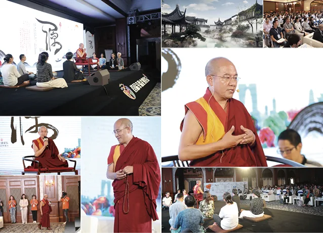
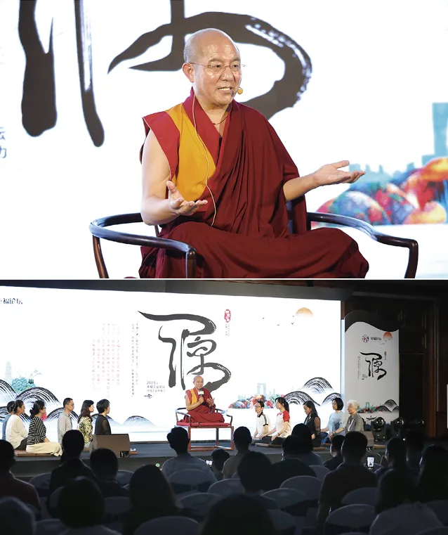
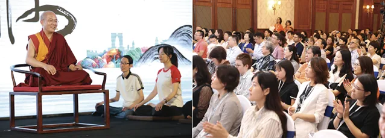
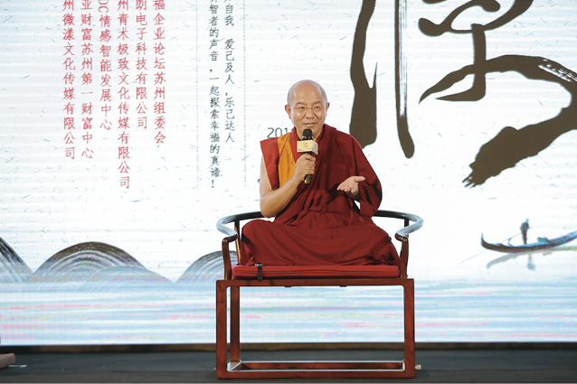

内心能够保持平和，  
做任何事都容易成功。

第96场

苏州“欧朗幸福企业论坛”

Oley Enterprise Forum on Happiness, Suzhou

中国·江苏

2019 / 7 / 9

## 禅修引导

## Meditation Instructions

今天，我们共同禅修。在这之前，我先简单跟大家讲一下禅修的内容。

在座有些人已经禅修很长时间了，有的教授多年以来一直没有间断过，也有一些人刚刚起步。不管怎样，禅修确实非常重要。如果内心能够保持平和，做任何事都容易成功。否则，即使是一件微小的事情，也会做得不圆满、不成功。在座各位大多是企业家，应该懂得在企业中传授一些禅修方法是必不可少的。

## 一切宝中，心宝为上

要知道，自我管理是最高级的管理，而自我管理中最有效的就是心态管理。今天时间有限，没有办法跟大家讲得很深、很广。也许这次的共修不能解决很多问题，但却是一个很好的缘起。我由衷地希望，各企业能够倡导员工去内观。如果只看外在的马云，不看内在的心云，生活未必会过得快乐。

佛教中有很多禅修方法。有些深一点的修法，每天花的时间也特别长，只修一个小时是远远不够的。

我的家乡有一座寺院，叫做朵芒寺。它里面有个禅修院，每年都会举办禅修活动，大约会有二十人参加，其中大多数是出家人，也有少数的在家居士。负责的禅师对他们要求非常严格，在参禅的一百天中，不能带手机等电子设备。在集体禅修的过程中，不能看任何文字，不能念诵咒语，不能做任何事情。上午的禅修是八点开始，十二点钟结束，午饭后也是四个小时，晚饭后还有两个小时，总共十个小时。最初禅修时，因为身体没办法安住很久，有些人会表现得特别浮躁、痛苦，但只要挺过一个礼拜，就完全没有问题了。

土顿尼玛堪布在我们寺院里很有威望，因为他经常出去弘法利生。他也参加过闭关禅修，我问他：“像你这么爱跑的一个人，在那里能待得住吗？”他说：“刚开始确实有点困难，腰酸背痛特别不舒服，但过了一个礼拜以后，就完全没有问题了。”如果按照寺院的修法规定，每天十个小时一点都不能动，可能很多企业家都做不到，坐一会儿就会脚痛，继而产生各种烦恼。

实际上，我们这次的禅修只是一种形式而已，称不上是真正的禅修。只是短短的几分钟、几十分钟坐一下，其实解决不了很大的问题。但如果要求大家每天早上都禅修十分钟或半小时，也是很困难的，因为你们太忙了。在坐禅的时候，还会想着手机里的信息，一想到这些分别念就来了。因为心静下来的时候，什么事情都会想起来。

以前，有一个人禅修的时候，就想起好几年前他曾借给别人钱，但那个人一直没有还。因为在坐禅的过程中，进入到深层意识以后，他就想起来了。一方面这是个好事，说明心有一种观察能力；但另一方面，说明他的心并没有专注在禅修上，该观的内心没有观，一直想着他的钱。

我特别喜欢禅修，即便是外出讲课，也会尽量不间断，早晚都要修一会儿。而在佛学院，禅修的环境比较好，基本上每天都能坚持。

现在很多西方企业设有禅修室。这并不是宗教的原因，因为有些人信仰基督教，有些人信仰天主教，还有些人没有任何宗教信仰。他们只是为了减少压力，梳理情绪，提升工作效率，树立正确的见解和人生观。像谷歌、波音等很多上市公司，都专门开展禅修培训。

我去过的很多地方，包括监狱、大学里面都有不定期的禅修活动，效果也非常好。因此，我希望各企业能够为员工提供禅修的场所，并且邀请真正懂禅修的人进行指导，这应该是最好的“员工福利”。

## 有缘的禅修

### 1．观心本体

今天，我们只是象征性、表示性的禅修。在这种场合中，时间比较短，理论也欠缺。有些人从来没有修过，有些人已经修了很多年，层次完全不同，再加上空间限制，会有一定的困难。

禅修的第一部分，叫做观察修。不管是修什么法，其实都要内观自己的心，这是禅修的唯一要诀。当然，有时也会观面前摆放的木头、标帜、佛像等，这些暂时不详细讲。从小到大，我们从来没有观察过这颗心，每天总是想着外面的世界，忽略了自己的内心世界。事实上，如果懂得反观自心，善根深厚的人真的会开悟。一旦开悟之后，任何成功与失败都成了轻飘飘的浮云。

不管是修行人还是世间人，悟性都是最重要的。如果有了悟性，钱多也可以，钱少也可以。钱多可以帮助员工和身边人。钱少也可以保持如如不动的心态，即使遭遇失败，面对糟糕的境遇，仍会稳如山王，非常淡定。在如今这个变化多端的时代，我们需要有长期稳定的禅修境界，这依靠修行完全可以得到。

大家可以思考一下，这颗心到底是什么样？它有没有颜色，有没有形状，有没有来源，有没有去处，有没有本体……以心来观察心。当你产生欢喜心、嗔恨心等情绪时，应该让心静下来，进而观察它的本体。这种觉知对于禅修来说非常重要。

我们每个人都要观察自己的心，在禅宗里这叫参话头，在藏传佛教的密法里这叫直指心性。以心观心时，有些利根者，也就是悟性高的人，在观察的当下就会发现，心原来就是这个样子，除此之外什么也没有。一旦认识了心性，世间当中的迷乱、痛苦和伤心自然而然就会消失。即使显现上会有一些痛苦，也不一定是真实的感受。

坐禅时，应该按照毗卢七法的坐式，但今天因为座位的关系，可能不太方便。一般来说，双足金刚跏趺坐或半跏趺坐。双手结定印[^1]，也叫做等持印；或者把手掌放在双膝上，这叫心性休息手印。身体要保持端直，既不能前弯，也不能后仰，稍微往前倾斜，这是禅定的基本坐式。如果做不到，也可以散盘[^2]。大家应该清楚，坐禅的姿势是下宽、稳固，就像埃及的金字塔一样。这种坐式，可以让身体端直。身端直则脉端直，脉端直则心端直。如此一来，心自然而然会静下来。心静下来以后，就可以观察它的本体。

在观察修的过程中，你可以产生各种分别念。比如，观察心有没有颜色，有没有形状；或者，产生嗔恨心、烦恼心的时候，观察它的本体是什么。还可以故意产生各种分别心，然后再以心来寻找它。

现在，大家稍微安住一下，一边禅修，一边寻找自己的心，看看心到底是什么样。

（堪布带大家一起禅修）

### 2．观呼吸

第二种修法是观呼吸。这种修法，跟前面的修法类似。呼气的时候，心要跟着往外走；吸气的时候，心要跟着往内来，边呼吸边观察自己的心。我们会发现，根本找不到所谓的心，但却有一种类似能量的东西。这在佛教里属于世俗谛。

其实，心的本体和虚空一模一样。在一些窍诀书里，经常会讲虚空一样的心。真正开悟的大德，最后认识的是什么呢？就是如虚空般的自心本性，也就是心的本来面目。《六祖坛经》中讲：“不思善，不思恶，正与么时，那个是明上座本来面目？”意思是说，产生善念不思，产生恶念也不思，在念头的中间观它的本体，这就是心的本来面目。它不是有，也不是无，而是妙不可言的。世间人为了生计、遣除痛苦而奔波，但对于认识心性的人而言，其实没什么可希求的。因为心的本来面目就是这样，除此之外也没有什么。

大家在修的过程中，要跟随自己的呼吸，观察到底有没有一颗心。如果有的话，让它来来去去，你就一直看着它。这个时候，有些人也许就能明白心的本来面目。如果感觉到累，没有跟上呼吸，也不要担心，最好继续修下去。

## 无缘的禅修

第三种修法，心不执著任何东西而安住，就是大家平常说的心里什么都不想。如果心跑出去，想办法慢慢把它收回来。就像有些孩子出去玩不回家，父母会把他叫回来一样。也就是说，让心静下来，专注于自己的觉知当中。

刚开始，很多人可能起心动念非常粗猛，但一定要坚持经常禅修。没有基础的人会觉得，怎么有这么多的分别念？其实每个人都有这样的过程。在佛经中，会把心比喻成野猴、闪电、河流等等。我们的心本来一刹那也不会停留，经常处于非常动摇、善变的状态，但通过禅修的方式可以让心静下来。

## 禅修的五个阶段

最初内观时，心就像瀑布一样。瀑布的水流非常湍急、勇猛，分别念也是如此，一会儿想这个，一会儿想那个。在刚刚的几分钟里，也许有些人就在胡思乱想。我看个别人的头一直在动，连几分钟都坐不住。如果是在我们寺院，十个小时不能动，稍微动一下，禅师就会用禅杖狠狠地打，或者冬天时用水浇头。在汉地的一些禅宗寺院里，有跑香和坐禅。如果坐禅时动来动去，禅师也会用禅杖打你。

这个过程就像驯服野马一样，刚开始野马并不调柔，但通过驯马师对它进行鞭打等，慢慢会变得温柔、调顺。同样的道理，无始以来，我们的心已经习惯产生各种各样的分别念，从来没有静下来过。按理来讲，禅修必须经过一系列的训练，而且方法比较残酷，否则心没办法安住下来。因此，佛经中会用瀑布来比喻心刹那不停留，就像一个调皮的孩子，一刹那也坐不住。

在这个过程中，最好不要心生厌烦，觉得自己不会修禅，有这么多的分别念。不要害怕，也不要痛苦，这是一种正常的现象。

第二个阶段，心就像峡谷水一样。虽然也在一直动摇，但与瀑布相比稍微缓和些。

第三个阶段，心就像江河一样。比如长江和黄河，虽然在不断地流淌，但比峡谷中的水更平缓一些。

第四个阶段，心就像大海一样。虽然从远方看，好像大海一动不动，但走近会发现，它还是有动摇。此时的心，也像看似平静的大海一样，看起来不动摇，但还有一些细微的起心动念。

到了最后阶段，心会变得像山王一样，非常稳定。

整个禅修的阶段，包括瀑布、峡谷水、江河、大海和山王。大家可以观照现实，看看自己处于哪个阶段。

刚开始，有些人的心就像瀑布一样，哪怕只是禅修半小时，分别念也是纷至沓来。而长期禅修之后，心就像峡谷水、江河、大海一样。到像大海的阶段，境界就比较高了。最后如山王般稳固，遇到任何外境，心都不会动摇，这种境界非常高。

我们要追求如山王般的境界，安住在远离一切边的空性当中，正像惠能大师所说的：“本来无一物，何处惹尘埃。”在真正的本体中，连微尘许的法都不可能存在，又怎会惹尘埃呢？企业发展过程中经历的快乐与痛苦、成功与失败，又怎会伤害到你的心呢？毕竟万事万物的本体，本来都是空性的，连微尘许的成实都不存在。所以，我们首先要认识自心，再以此类推，世间万事万物都是同样的道理。如果没有认识自心，外在的知识再丰富，可能用处也不大。

无论有没有信仰，我们都应该认识到，内在价值比金钱更重要。如果有一定的内涵或修证境界，做什么事情都容易成功。

下面，我们一起观修。观修的时候，什么都不要想，就安住在如虚空般的心性本来面目当中。当然，有些人对自心有所认识，有些人不一定认识。但不管怎样，你都可以用自己的方式来安住，最好不要产生任何分别念。

（堪布带大家一起禅修）

其实，最好有三天或七天严格的禅修。像我刚才说的那样，野马被驯服的过程，难免要受一些苦。比如，藏地的马在被骑之前，一定要好好地驯服它。一般来说，野马是很难调伏的。心也如野马一般，最初要非常严格地管理，一天几个小时的禅修，这样的话，修行慢慢会变得容易。就像刚学跳舞的人，也要进行柔韧性训练，一段时间之后，才可以跳得很高，身体柔软。心也是这样，如果没有长期禅修的习惯，每天随着自己的所思所想打转，很难有进步。

如果时间允许的话，大家可以放下所有的工作，手机也不用，断除一切令心散乱的行为，严格闭关三天或七天，这样我们的心会变得更加调柔。企业也可以组织员工集体去东南亚的泰国等地，这些国家还保留着非常好的禅修传统。通过今天的禅修，相信大家已经有所感受了。

## “咒”是心的保护者

最后，让我们一起默念六字真言“嗡玛呢巴美吽”。这个咒语，有信仰的人可以念，没有信仰的人也可以念。

在这个世界上，有三种强大的能量。第一个是药，中药和西药都有不可思议的力量。第二个是咒语，不管是增长智慧的咒语，还是生起慈悲心的咒语，比如汉地的大悲咒、楞严咒等，对身心健康的利益非常大。第三个是幻变，像现在的网络，佛经中就叫做幻变的力量。

接下来，大家不用出声，默默地念诵“嗡玛呢巴美吽”，有些人会念，有些人不太会念。你们以后禅修的时候，如果心实在没办法安住，可以默念几百遍咒语，这也有利于身心的健康。我也经常这样做，有时候要想的事情太多，心总是静不下来，就会默默地念咒语。其实，出声念也可以，但今天人比较多，还是默念好一点。

事实上，人既要有物质食粮，也要有精神食粮，依此可以净化我们的生命。当然，更重要的是知行合一，否则理论上讲得再多也没有用。因此，实修很重要，这是我最究竟的观点。

希望所有的企业家，都能从内在价值上寻找自我。如此一来，你会比任何人都强大。不然，即使你拥有全世界的财富，也不一定很快乐。认识自心的人，才是最快乐的人。

在此，我祝愿每个人都能成为世界上最快乐、最幸福的人！

[^1]: 右手在上，左手在下，两拇指相轻触，放于脐下。
[^2]: 即盘坐之时，两小腿交叉，置于两大腿之下。
