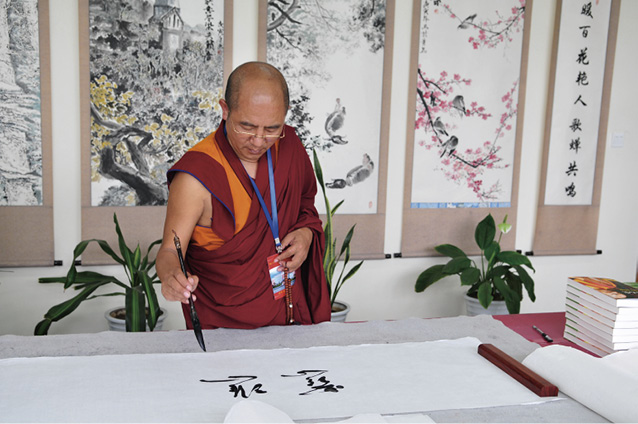
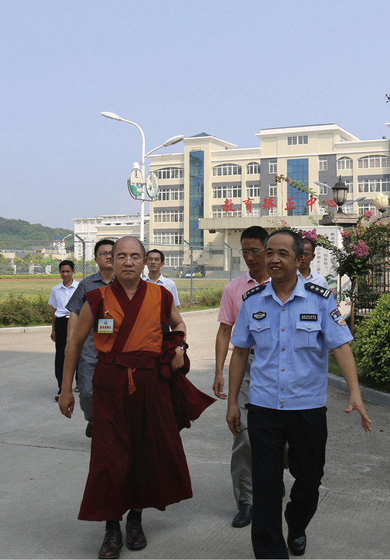
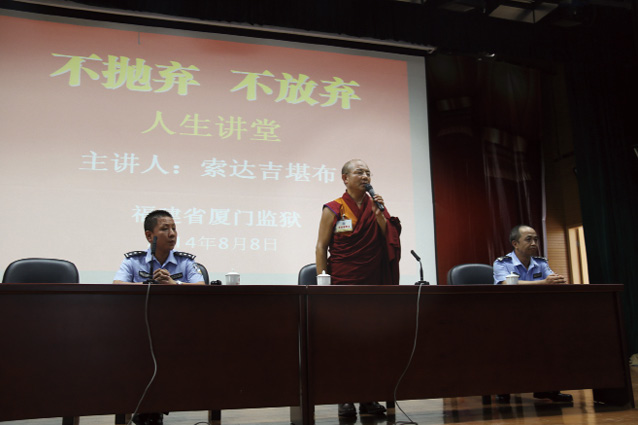
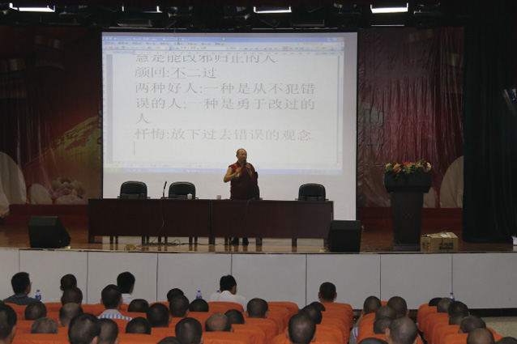
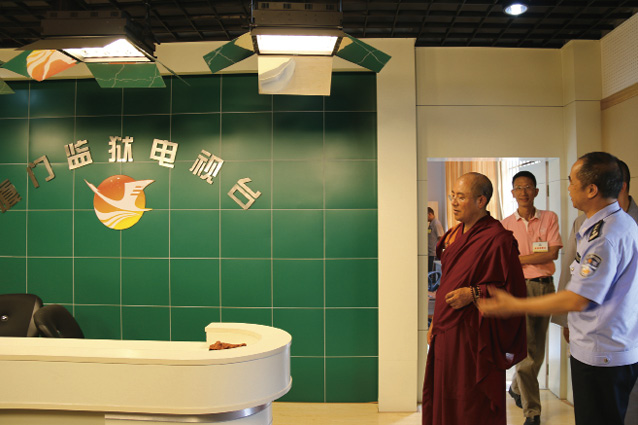

福建厦门监狱

Xiamen Prison, Fujian

中国·厦门

2014 / 8 / 8

## 不抛弃，不放弃

## Don't Give Way, Don't Give Up

今天，我想跟大家聊聊天。

不管人生多么美好，多么残酷，或多么平淡，对某些东西，我们始终不能抛弃，不能放弃。

人活一世，有开心欢笑，也有痛苦绝望。一般人在痛苦面前，容易受情绪控制，自暴自弃。但对坚强的人而言，逆境并不可怕。哪怕处境再恶劣，他们也不会放弃追求，更不会逃避责任，抛弃亲人和朋友。

命运看似不公平，比如每个人都有各自的苦乐，实际上却非常公平。我们的每一段遭遇，都是自己的心在主宰，没有任何人控制。这方面的道理，也许有人不太理解，我先给大家讲几个故事。

## 奔公甲的仇人

以前，我们藏地有个非常有名的强盗，叫奔公甲。他白天上山打劫，晚上入村行盗，是一个人见人怕的大恶人。怕到什么程度呢？如果孩子啼哭不止，怎么哄都没用，母亲只要喊一声：“奔公甲来了！”孩子马上安静下来。有人跟一位老婆婆开玩笑，突然在她背后大叫：“奔公甲来了！”老婆婆被当场吓死。

奔公甲身强力壮，平时爱打架，就算同时被四十人围攻，也应付得了。因为这个原因，他跟很多人都结了仇。为此，他寝食难安，每天背着强弩利箭，腰上别着好几把佩刀。尽管如此，仍然觉得没有安全感，害怕仇人报复。

后来，他遇到了佛教大德仲敦巴尊者。尊者劝他丢掉武器，忘记仇人，专心与自己的烦恼搏斗。最后，他通过不断的修行，调伏了自己的烦恼，全身没有一件武器，却吃得好、睡得香，得到了真正的安乐。

这说明什么呢？真正的仇人并不在外面，而在自己心里。心调好了，哪怕环境依然未变，也会得到解脱。相反，心如果没有调好，只能眼睁睁看着心里的贪婪、愤怒、嫉妒、傲慢等翻滚起伏，一波未平，一波又起，就算待在最舒适的地方，也感受不到丝毫快乐。

人在自由的时候，容易忘乎所以，不知道自己是谁；一旦跌入低谷，才会痛定思痛，向内反省自己，悟出深刻的道理。所以，这辈子受点苦，不完全是件坏事，没必要怨这个、恨那个。抱怨没有任何好处，只会蒙蔽我们的眼睛，让我们看不到世界的美好，也看不到别人的优点。

喜欢报怨的人，总把过错推到别人身上，自己什么都对、什么都好。我们藏族有一句谚语：“别人身上有一只虱子，也看得一清二楚；自己脸上有头牦牛，却完全看不见。”看不到自己的问题，不愿意正视自己的问题，这样的人非常可怜。

人们常说：“可怜之人，必有可恨之处。”其实，可恨之人也必有可怜之处。他们的可怜之处在哪里呢？心态没有摆正。心态不正的人，做人做事一定会偏执。现代社会得心理疾病的人越来越多，原因也在这里。心态失衡的人，就算身体自由，心也关在牢笼，有一堆解不开的结。

你们现在，虽然身体不自由，但只要心没有束缚，看得开，放得下，就是一个真正的自由人。

## 鉴真和尚的泥脚印

人生总是无常的。原本高高在上的人，很可能瞬间就跌入深渊；原来像尘土一样卑微的人，也可能在一夜之间荣登高位。所以，无论何时，我们都不应该放弃自己，都要以一颗勇敢的心，去迎接未来。

唐朝有位鉴真和尚，为了将佛法传到日本，历时十年，五次东渡，都以失败告终。在此过程中，他经历了无数磨难，多次遇到大风大浪，船被打沉，困在荒岛，忍饥受冻，命悬一线。最后，他已经双目失明，仍然不折不挠，踏上了第六次东渡的征途。这一次，他终于成功抵达，将佛法弘扬到了日本国土。

鉴真和尚为什么有如此勇气呢？这要追溯到他小时候的一段经历。那时，他还是一个小沙弥，每天都要出去化缘，磨烂了好几双鞋子，非常辛苦。一天夜里下大雨，他知道路上泥泞难走，第二天就没有去。

师父知道后，便问他：“你今天为何不去化缘？”他回答道：“我做了一年多苦行僧，实在太辛苦了。今天路上全是稀泥，难走得很，不想去！”师父笑笑说：“那你随我出去走走。”

寺前的小路上，满地都是泥泞。师父问：“你是想当一天和尚撞一天钟，还是做一个光大佛法的高僧？”

小鉴真说：“我肯定想做高僧啦。”

师父又问：“你昨天在这条路上走的时候，留下脚印了吗？”

“昨天的路又硬又光，我怎么可能留下脚印啊？”鉴真说。

“那今天呢？”

“当然能！”

师父说：“只有泥泞的道路，才能留下脚印。只有敢于在困境中跋涉的人，才能在人生的道路上留下足迹啊。”

确实如此。有些人，从小活到老，一辈子都比较顺，从未认真思考过人生的意义，临终回顾此生，一点儿有价值的记忆都没留下。有些人，一生经历了九九八十一难，在每一段逆境中不断地反省自己，提升自己，最后人生的价值得到了升华。

## 一切苦乐从因缘生

我坚信，你们大多数都非常好，只因一念之差，没有调整好情绪，或没有摆正心态，加上外缘的推动，才做了不该做的事。我遇到过很多人，本来跟大多数人一样，过着正常的生活，却突然因为某些因缘，做了不好的事，受到了惩罚。

说到惩罚，外面有些人甚至比你们更坏，造的恶业更过分，却没有受到一点惩罚。这是什么原因呢？佛教认为，因果报应丝毫不爽，受惩罚也好，不受惩罚也好，都是自己的因果。这方面的道理，与你们所受的教育相反，大家不一定接受。但无论接不接受，业因果都是一种客观规律。

佛经中讲：“未曾有一法，不从因缘生。”我们此生所有的悲欢离合，都跟因缘密不可分。两个人一起做坏事，事情败露以后，一个判刑入狱，另一个却升官发财，逍遥法外。为什么？各自的因缘不同。

不过，作为凡夫人，我们只能看到今生的部分缘，却无法看到前世的因。很多人认为，所谓的生命，只是身体从出生到死亡之间的一段过程。实际上，除了身体，我们的心上还有许多信息。心上的信息是善是恶，决定了我们此生过得快乐，还是痛苦。而且，善恶信息不仅在今生起作用，还会延续到后世，对后世的生命产生影响。懂得了这一点，我们就知道该用什么样的心态，去面对苦乐。

## 聪明人不犯同样的错

其实，只要是人，就会犯错。只不过有智慧的人善于自省，错了就改；没有智慧的人，不管别人怎么规劝，都意识不到自己的问题。

佛教特别强调忏悔，其中的忏，就是发自内心认识到自己错了；所谓的悔，就是发誓从此绝不再犯，坚决不重蹈覆辙。孔子的弟子颜回，最大的优点就是“不二过”，任何错误只犯一次，不会犯第二次。

佛陀曾经说过，世上的好人有两种，一种从不犯错，一种知错能改。前者的比例极低，极少有人做到身口意完全清净。而错了就改，是大多数人都可以做到的。凡夫都有我执与欲望，一定会有意无意地做错事，所以应该经常忏悔。忏悔对每个人来说，都非常重要。

世界存在不公，这一点不可否认；大家都无惭无愧地做过错事，这一点也不可否认。既然如此，又有什么好抱怨的呢？不如放下心中的怨气，真诚地忏悔罪业，努力地改造自己。

## 心变了，天地就变了

有些人习惯了以前的生活，现在突然换了环境，感觉有一种束缚，觉得不痛快。这一点，我非常理解。不过，苦乐都是心态决定的，只要能保持心态平和，就不会觉得日子漫长。

你们知道佛教的闭关吗？选择闭关的修行人，必须与亲朋好友断绝来往，一心一意地修行。闭关的时间有长有短，长的十年、二十年，甚至是终身。我以前遇到过一个修行人，在山里闭了五十一年的关，从年轻力壮变得白发苍苍。闭关期间，除了送食物的人，他几乎不与外人接触，也不与亲友联系。

你们也可以把这里当成闭关的地方，一心一意学习知识技术。用心去做每一件事，肯定能提升自己。

你们当中，也许有人看过邓小平的传记。邓小平本来是堂堂的国家领导人，但在六十多岁的时候，却被下放到工厂，接受劳动改造。传记中说：他在车间拧螺丝的时候，旁边的人怨天怨地，他却从来不讲是非，默默地干自己的工作，哪怕手指磨烂了，也一声不吭。后来，有人认出了他，希望帮他干点活，他却说：“我自己的事情自己做，不用你帮忙。”他每天按时上下班，不管刮风下雨，从不迟到早退，非常守规矩。

换了别人，遇到这样的陷害，心理很难平衡，可能随时随地都会发泄不满，满脑子想着报仇的事。但邓小平什么都没有说，也什么都没有做，只是平静地接受。我们也可以像邓小平那样，不在乎一时得失，把逆境当机会，好好磨炼自己。

## 你并不是最可怜的

听说你们在学习《弟子规》，我觉得非常好。传统文化蕴含着很多正能量，任何人都可以从中汲取营养。以前，大家没有受过这方面的教育，做了不该做的事，现在重新学习，不但下半生有了方向，还有机会帮助身边的人。

我和服刑人员交流时，经常问他们一个问题：“你每天最想念的是谁？”大多数人都回答：“最想念家人。以前天天在一起，却不知道珍惜。现在很惦记他们，不知道他们过得好不好，也担心他们埋怨我……”

很多人觉得，这里的生活太苦了，尤其不能跟家人在一起，简直过不下去。其实，你并不是最苦的人，反而可以说很幸福。看看现在的马航失事、恐怖袭击、地震海啸等，很多人瞬间就失去了生命。我在新闻中看到，有一家祖孙三代，一眨眼就被洪水卷走；有一个村子，一刹那就被地震吞没。而你们现在，至少还活着——活着就有希望。

比起骨瘦如柴的非洲饥民，你们至少有吃有穿，还有很多人关心。虽然身体有点不自由，心里有点想不开，但都不是什么要命的事。最重要的，你们还有思考的能力，跌倒了还可以重新站起来。

## 从贪污犯到亿万富翁

人这一辈子，时而快乐，时而痛苦；时而有自由，时而没自由。不管怎样的人生起伏，都是再寻常不过的事。

褚时健曾经是红塔集团的董事长，也是中国著名的“中国烟草大王”，在上世纪90年代红极一时。他一手打造了很多著名的香烟品牌，十八年间上交国税1400亿。1996年，他的妻子和女儿因为贪污，被关进了监狱。同年，唯一的女儿在狱中自杀。1999年，71岁的他也因贪污，被判无期徒刑。

后来，他在狱中得了重病，获批保外就医。出去后，他承包了一座荒山开始创业，种出了有名的“褚橙”，82岁再次成为亿万富翁。

褚时健的经历让人非常感慨：人生确实不是一条直线。

遇到坎坷的时候，是做一个脆弱的人，选择逃避？还是做坚强的人，选择勇敢面对？有些人会选择后者，一旦失败，就彻底放弃，一而再、再而三地犯错，根本不听劝。

我听说，有个人获得自由不到一个月，又被抓了回来，真的很可怜。失败并不可怕，可怕的是失败以后，失去了重新开始的勇气。

## 不是别人嫌弃你

我们每个人都有恶的一面，也有善的一面。如果经常接受善的教育，善的力量会日益增强，快乐越来越多，什么环境都觉得舒服。反之，经常沉溺于恶的氛围，恶的力量会不断强大，不但自己越来越痛苦，还给周围带来不吉祥。

那么，怎样增强善的一面呢？爱因斯坦的答案是为他人付出，孔子则认为应该探求真理。尽管说法不同，但都强调对正能量的追求。比如，你们之间如果经常搬弄是非、吵嘴打架，心会越来越暴躁；如果互相帮助、彼此成全，即使生活不如意，由于被友好和善意包围，心情也不会太差。

按照佛教的说法，善良的人会得到天神和护法的帮助。从前，藏地有一个人叫米拉日巴。最开始他很坏，用恶咒杀了很多人。后来他去雪山修行，精进忏悔。有一天，来了一位天神，问他：“你需要什么帮助吗？”米拉日巴回答：“在我最痛苦的时候，在我杀人的时候，在所有人抛弃我的时候，你不来帮我，现在来干什么？”天神告诉他：“你作恶的时候，我根本没法接近你，更没法保护你。现在你的心转变了，开始修持善法，我自然会来帮你。”

所以，一个人遭到大众的抛弃，不一定是别人冷漠，也可能是自己的问题。

## 两只狼的交战

我看过一则北美的寓言。一位切罗基族的老人，给孙子传授人生真谛时说：“在我的内心深处，一直有两只狼在交战。一只是恶狼，代表贪婪、嗔怒、愚痴、嫉妒；另一只是善狼，代表慈悲、智慧、慷慨、谦逊。同样的交战，也发生在你们的内心深处。”

孙子问：“哪只狼能获胜呢？”

“你喂它食物的那只。”

在每个人的内心深处，都有这样的交战。哪一只狼获胜，关键看自己。如果我们看的书、交的朋友、学的知识，全都是正能量的，善狼就有了胜利的资本；如果经常吸收丑恶的信息，恶狼的力量就会不断壮大，未来的道路一定充满黑暗。

我经常听人说“人性黑暗”，感觉有点武断。人性本来是善的，之所以黑暗，跟心的选择有关。要是选择了黑暗的环境和爱好，就不得不走黑暗的道路。

所以，我们应当时时反观内心，观察心态，千万不要让心灵中毒。心灵一旦喝下贪、嗔、痴三种毒药，就会开出毒花，结出毒果，给人生带来痛苦。

## 苏格拉底的作业题

当然，善的力量要延续，离不开长期的串习。你们待在这里，表面是服刑，是身不由己，但只要每天、每周、每年不断地学习，最后一定能学到有用的知识，刑期就成了机遇。

实际上，听一节课容易，看一本书也容易，但要长期坚持学习，却非常困难。做善良的人也一样，需要长期坚持，反反复复串习。以刚才讲的忏悔为例，如果只是心血来潮忏悔一下，之后就抛之脑后，绝对不行。忏悔的心应该一直延续，一天、一周、一个月、一年、两年……持之以恒，才会发生奇迹。

不仅是佛教，世间人也认可串习的力量。古希腊有位哲学家叫苏格拉底，有一次，他给弟子们布置了一道作业，让大家每天甩手一百下。一个星期后，他问：“有多少人在坚持？”绝大多数弟子都举了手。一个月后，举手的只剩一半。一年后再问，只有一个人举手。这人是谁呢？就是苏格拉底的传人——柏拉图。可见，坚持不懈比一时热情离成就更近。

## 传统文化的神奇

另外，大家要多学传统文化，不光从理论上了解，还要落实到行动上。

在中国，传统文化包括儒家、佛家和道家。奇妙的是，三个宗派的创始人几乎同一时期出现。孔子生于公元前551年，释迦牟尼佛生于公元前565年，老子[^1]则生于公元前571年至前471年之间。如今，三位圣人在两千五百多年前传下来的智慧，在国内外都得到了极大的重视。

尤其是佛教，在提升心灵方面，作用非常明显。其中关于忏悔、观心、禅修的方法，非常适合大家。前段时间，我去了山东一所监狱，给他们讲了一下禅修的方法，告诉他们白天用什么心态做事，晚上用什么心态睡觉，如何保持心的安宁、不想没用的事情……明白这些道理，比什么都重要。

只要心态调好了，人就有活力，待在哪里都快乐。世上没有什么是心的力量解决不了的。心力强的人，一切都可以转变。不但自己能从痛苦的泥沼中解脱，还能帮助身边的许多人。当然，要达到这样的效果，离不开一个重要的前提——不抛弃，不放弃。

现场互动

问：您说，善良会让我们今生幸福、来世美满，但很多人却说，人善被人欺。这两者有矛盾吗？

堪布：确实有不少人认为，善良会助长恶人的气焰。事实上，种什么因，得什么果，这是世间的客观规律。为人心善，肯定是快乐之因。善良的人被欺负，并非源于今生的善，而是源于前世的不善。

真正懂因果的人，不管今生遇到什么，都不会只看表面。任何一件事情背后，都有甚深而复杂的因缘。比如，两个人做了同样的坏事，一个被发现，另一个没被发现；即使都被发现，也可能一个受惩罚，另一个安然无恙。原因是什么？跟各自的业力有关。

我们所受的苦，不能都怪别人，应该多反省自己。世界虽有很多不公平，但也有公平的一面，人善并非都被人欺。生活中，很多善良的人都非常幸福。只不过，当我们的心被蒙蔽时，往往看不到事情的全貌。

有些人总喜欢看社会的毛病，认为社会很黑暗，好人没好报，然后愤世嫉俗、言行极端。这些都是心态不正的表现。

英国历史学家汤因比说：要让自己、乃至整个人类得到解脱，唯有依靠孔孟之道和大乘佛教。而孔孟之道和大乘佛教都提倡奉献——发自内心地奉献。为什么呢？因为长久以来伤害我们的，就是对自我的保护。放下自我，奉献自我，快乐一定会走进我们的生活。

喜欢奉献的人，遇到什么问题都想得开，在他们的世界里，所有外境都跟丑恶无缘。

问：几个月前，我看过您的《苦才是人生》，非常有收获。佛教强调因果，劝人行善积德。但如果存在因果，命运就注定了，不放弃、不抛弃的争取还有用吗？

堪布：《苦才是人生》是我近年出版的一本书，比较畅销。有人对这个书名不理解，觉得人生明明有快乐，比如诗人笔下的浪漫爱情和幸福生活，为什么偏说“苦才是人生”？实际上，快乐只是人生的花絮，痛苦才是真正的伴侣。不管什么人，高官也好，富豪也罢，各有各的痛苦和烦恼。佛教讲的“苦海无边”，意义非常深远。

今天，我也带了一些书来，你们有空可以看看。很多人看了这本书，心里都豁然开朗。以前，一位领导在网上被人诬告，后来查到了诬告者，他打算狠狠地报复一番。但他看了《苦才是人生》后，觉得没必要以牙还牙。他告诉我：“那件事我已经放下了。”有些书对大家还是有帮助的，即使帮助不大，也不会有害处。

实际上，命运并非前世所造，不然今生怎么争取都没用。佛教认为，一个人的命运，既来自前世的“因”，也离不开今生的“缘”——“因”“缘”和合才会生果。如同种子是“因”，水、土、阳光是“缘”，缺少其中任何一个，都长不出苗芽。所以，一个人即使有前世的恶“因”，如果今生不再造恶，并励力忏悔往昔罪业，由于“缘”不具足，前世的恶因就不一定会成熟恶果。

佛教不是宿命论，不承认造物主安排一切，只讲善有善报、恶有恶报，不做不报、做了定报。所以，我们所做的任何努力，对今生的命运都有助缘的作用。

佛教认为，命运并非不能改变。依靠行善的强大力量，可以把潜在的苦因转化为快乐。你们正在学习的《了凡四训》，就讲了改变命运的很多方法。

问：人到底有没有前世后世？

堪布：前世后世绝对是存在的。以前，很多人都不承认前后世。随着科技的发展，越来越多的人开始研究这个课题。美国弗吉尼亚大学有一位科学家叫塔克博士，在全世界找到了许多能回忆前世的人，最后发现前世确实存在。

虽然我们想不起自己的前世，但想不起不一定不存在。小时候的很多记忆，我们现在都忘记了，但谁会否认那段时光呢？

关于前生后世，很多人都没有正确的认识。要转变观念，可能需要更多的学习和思考。我以前翻译过一本书，叫《生命的真相》[^2]，现在已经出版。书中引用了很多真实的案例，从心理学、生物学、逻辑学等现代科学的角度，论证了前世后世的真实存在。如果你们感兴趣，也可以看看。

问：我总是活在往事的回忆中，虽然有一些后悔，但还没有忏悔。请问，忏悔应该从哪里开始？

堪布：佛教认为，忏悔是一种认罪的心态，需要重新审视过去的行为，揭露自己往昔的罪业，并发誓绝不再造。

不过，太自信的人往往认识不到自己的错误。就像我，经常看别人的问题，却很少观察自己。前几天，我遇到一个人，他每天都会反省自己。我虽然是个出家人，但在他面前却十分惭愧。我相信，在座也有像我这样差劲的人，而且还不少。

每个人都应该审视自己的言行。你们过去的某些行为，并不是父母师长希望看到的。传统文化讲了很多取舍道理，能帮助各位反省往昔的恶行。当你开始自我反省，就叫作“忏”；发誓再也不干坏事，就叫作“悔”。

佛经中有一个比喻：一个人误喝毒药，非常痛苦，生起强烈的后悔心：“这东西我以后再也不碰了！”大家如果能这样思维：“我过去犯了错误，所以在这里受苦。从今以后，我坚决不再犯错！”就是在忏悔。

问：听您讲鉴真和尚的故事，我很受启发。您说要在逆境中留下足迹时，我有一种很深的体会：“不能因为身处逆境而放弃，要在苦难中磨练自己。监狱只是束缚了我们的身体，并没有束缚我们的心灵！”谢谢您给我们的开示！

堪布：非常好。其实，你们还要感谢这里的领导。我去过很多监狱，有些监狱只是照章办事，在里面待个十年八年，也学不到什么东西；有些监狱比较开明，想方设法让大家学习传统文化和知识技术——这是对你们负责任的表现。

对有些人来讲，哪怕只有一次学习的机会，也会得到极大的改变。将来出去了，见识会跟以前截然不同，就像脱胎换骨一样。

古人说：“塞翁失马，焉知非福？”人的一生，好事可以变成坏事，坏事也可以变成好事。某些人有钱有势，最后却造下弥天大罪；某些人看似失去一切，最后却百炼成钢，东山再起。

人生就像白昼和黑夜，总是不断地替换，不可能始终一个样子。起起伏伏都很正常，每一种经历都不必排斥。如果懂得思考，你会发现任何苦难都有其独特的价值。

问：您刚才讲了因果报应，提倡大家向善，做好人。但俗话说：“好草要先割，好人要先死。”现实中这样的案例确实存在，比如有些人非常好，却只活了四五十岁。这样的矛盾现象该怎样解释呢？

堪布：因果的道理非常深奥，所谓“善有善报、恶有恶报”，并非字面上理解得那么简单。

因果分为两种：一种是外在的，比如原材料是因，产品是果；一种是内在的，比如贪心、嗔心是因，恶业是果，或者善恶业是因，苦乐是果。前者需要的时间比较短，我们可以直接见到。而业因果需要的时间较长，不是一朝一夕能完成的，有时候需要多生累劫。

佛教认为，因果成熟的时间，有些是现世现报，即今生造业，今生受报；有些是后世受报，即今生造业，下一世或多世以后才受报。就像植物，有些是当年种下，当年结果；有些是头年种下，第二年才结果。

所以今生是好人，不一定马上有好报。但不管怎么样，因果都是不虚的，我们种下的善业种子，一定会成熟乐果。这方面有很多的案例和理证。

问：您一般讲课，都会往好的方面讲，但我们过去虚荣心太强、欲望太多，现在已经变得人不人、鬼不鬼，还能做到不抛弃、不放弃吗？

堪布：只要是人，就愿意向善——极个别特殊情况的人除外。彻底放弃未来、抛弃自己的人，毕竟是少数。

我今天的开示，虽然是从善和正的角度讲的，但并不是表面上安慰你们。我所讲的内容，都来自佛教深厚的理论体系和实证经验。无数人依照这样的体系修持，都得到了真正的安乐。你们当然也不例外。

在漫长的人生中，心灵的疏导必不可少。所以我觉得，应该把佛教的这些道理传递给大家。虽然仅有的一次交流，不可能让大家马上转变，但也可以为各位的心灵打开了一扇小小的窗户。

如今的社会，有不少人患上抑郁症、焦虑症等。假如懂得调心的方法，大多数都能康复。虽然有人因为前世的因缘，怎么疏导也没办法，但你们不能因为这样的个案，而轻易放弃自己。

德国的贝多芬，耳朵听不见声音，却凭着自己的努力，成了举世闻名的音乐家。他说：“在艰难的遭遇面前百折不挠，是卓越者的一大优点。”美国的海伦·凯勒，又聋，又哑，又盲，却毕生致力于为残疾人造福。她认为，坚定的信心，能让平凡的人做出惊人的事业。

和他们相比，我们有些人应该为自己的脆弱感到惭愧。每个人都需要奋斗和努力，要对自己有信心，不能一蹶不振，彻底倒下。只要不抛弃、不放弃，一旦因缘和合，马上就可以翻身。

人这一辈子，不管什么身份、处于什么环境，都有数不清的苦。只有正确面对，才能从痛苦中解脱。希望大家充满自信、鼓起勇气，用智慧改变自己的人生。

[^1]: 老子是道家学派的创造人，被后来兴起的道教尊为道祖。
[^2]: 《生命的真相》，又名《前世今生论》，慈诚罗珠堪布著，索达吉堪布译，由世界图书出版公司出版。
