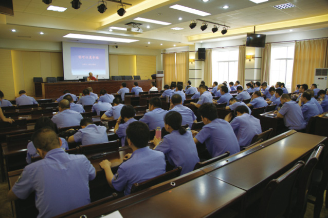
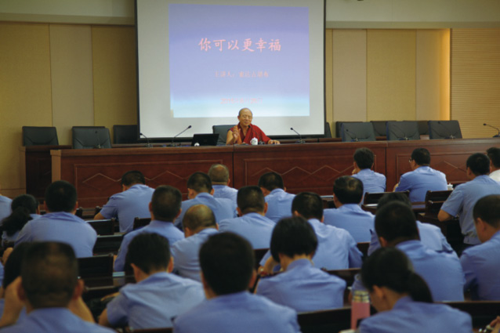

福建武夷山监狱

Wuyishan Prison, Fujian

中国·武夷山

2015 / 6 / 26

## 你也可以更幸福

## You Too can be Happier

今天我很荣幸能有机会与大家进行交流。上午与部分服刑人员的交流结束后，本打算离开，但接到邀请，希望我利用下午的时间，与各位监狱管理人员共同学习，我欣然接受了。

接下来要探讨的话题是“你也可以更幸福”。我们每个人从来到这个世界的那一刻起，就在不断地追求幸福。然而，世上虽然也有幸福的人，但绝大多数人觉得幸福离自己有点遥远。

生活是自己的，为什么总是要与他人相比？

这个世界上，每个人都在追求幸福，但很多人却错误地认为，追求幸福就是追求金钱。在某种程度上，金钱确实能给我们带来快乐。一个人如果没有钱，不管到哪里，不管做什么，都不方便，甚至连基本生活都得不到保障。但金钱能否带来真正的幸福呢？恐怕不能。

无论在东方还是西方，很多有钱人都有一个共同特点：特别无聊。我认识一个人，以前特别穷，后来炒了七八年的股票，可能是福报现前，家产突然暴涨到七八亿。以前穷的时候，他是非常开朗的一个人。有了钱以后，却很不开心。他与家人的关系变差，每天无所事事，常与一群内心贪婪、没有文化的人以钓鱼为乐，他的内心非常迷茫。

从他身上，我深深体会到“有钱不一定幸福”的人生哲理。真正的幸福，其实是我们内心的一种感受。只要我们懂得知足，对自己所拥有的一切感到满意，就与拥有亿万身家的富豪没什么差别。

如今的时代，科技虽然飞速发展，但道德和信仰却在逐渐退步。整个社会都在追求金钱，导致道德沦丧和信仰缺失。无论在公开场合还是私下交流，大家谈论的话题都是金钱。甚至一些所谓的高层人士也在讨论“谁最有钱，怎样才能赚更多的钱”。在这个金钱至上的时代，许多珍贵的传统价值观逐渐消失，即便是富贵之家，也似乎与高尚无关。

年轻人热衷于讨论明星的外貌和流量，但这些话题对真正有深度的人来说毫无意义。电视和电影偶尔看看可以，但如果将影视明星视为人生的偶像，多半会落入虚无缥缈的结局。

很多人经常关心别人赚了多少钱，买了多少房子，开什么豪车，自己的人生目标也只是财富增长。他们大多有攀比心理，喜欢向“高标准”看齐。比如，身边的某个人到城里去了，听说城里工作好找，待遇高，子女读书方便，那他也要想办法去。实际上，大城市的生活压力往往是小城镇的几倍，那里的生活并不如想象中那么美好。

表面上看，生活在一线、二线城市的人过得很快乐、很光鲜，每个月的工资，比三线、四线城市的工资翻倍还多，令人羡慕。但事实并非如此。比如，北京和上海的月平均工资有七八千元，但因消费水平过高，这七八千块钱只能满足基本生活需求，和在小城镇挣两千元的工资没有太大差别。很多人没有经过深入观察，只看到事情美好的一面，就幻想自己也能拥有，然后拼命追求。最后弄得疲惫不堪，却未能得到想要的生活。

我特别羡慕欧美国家的生活方式。在德国、英国和法国，人们不在乎你开什么车，穿什么衣服。每个人都根据自己的经济状况安排生活，很少与人攀比。真正的生活应该是这样。一个人的内在品质，不会因为穿名牌衣服或佩戴奢侈品而提升。既然如此，为什么还要在物质上进行无谓的攀比呢？

大多数人缺乏独立思考的能力，也没有健康的人生观、价值观。他们盲目地模仿别人——别人做什么，我也做什么；别人谈什么，我也谈什么；别人追求什么，我也追求什么。总是随波逐流，最终只会感到疲惫不堪，越来越空虚。

当然，凡夫人有比较之心很正常，但既然要比，就应该全面一点，对上比也要对下比。然而，我遇到的很多人，只喜欢跟上面的人比，不愿意和下面的人比。比如，看到某个同学赚了大钱，与自己拉开了距离，就觉得沮丧。其实，只要和下面的人比一比，心情马上就会好起来，因为“比上不足，比下有余”，满足感和幸福感会瞬间升起。

不过，能上下比较的人很少，大多数人只看上面，为自己赶不上别人而苦恼。其实，生活是自己的，为何总要追逐别人的脚步呢？我看到有些生意人赚了一百万，想赚一千万；赚了一千万，想赚一个亿；赚了一个亿，想赚十个亿。人心是个无底洞，永远无法填满。如果不学会平衡自己的欲望，我们怎能真正快乐？

## 当好灵魂的工程师

在座的各位，你们的工作是改造犯人的思想和行为，可以说是“灵魂的工程师”。作为改造者，你们需要具备平和的心态和高尚的道德。如果整天处于迷茫、贪婪或悲伤的状态，不仅难以改造他人，连自己的正常生活也难以维持。

我也是一名教育工作者。作为同行，我发自内心地赞叹：“你们的工作非常伟大！”实际上，我和你们一样，也在一个特别的地方从事教育，而且一干就是三十年。我所生活和工作的地方，在你们看来条件很差。然而，我在这样的环境中，以一名普通教师的身份，度过了人生最美好的三十年。虽然我完全有能力选择更好的生活条件，甚至可以去一个更富裕的地方，但我认为生命的价值不在于金钱，而在于我们所做事情的意义。在我看来，世上最有意义的事就是教化和改造人，所以我愿意一直坚持下去。

当然，我们教化的对象有好有坏，有些容易引导，有些则非常难以调伏。而你们所面对的群体，恰好是一个不服管教的特殊群体，工作确实辛苦。然而，他们每一个人都是社会的一部分，如果你们能够感化他们，帮助他们走上正道，彻底改过自新，那么你们所产生的社会效益是不可估量的，和大学教授的社会价值没有什么差别。

改造罪犯，听起来似乎没有大学教授的工作高贵，但实际上，你们的工作比任何一所高校都重要。你们改造的人，如果没有培养好，可能会危害社会，伤及无辜。因此，哪怕只能转变一个人的思想，让他不再危害社会，你们对社会的贡献也是巨大的，功德也是无量无边的。

然而，你们是否有这样的决心和信心呢？这很难说。我接触的一些狱警，因为工作时间太长，已经变得有点麻木，内心缺少动力和激情。我最近还听到一种说法：“服刑人员有期徒刑，狱警的工作是无期徒刑。”但实际上，这两者怎么可以相提并论呢？如果任由这种负面情绪蔓延，最终大家都会受到影响，进而影响工作和生活。

在福建，无论是领导还是普通人，大家对佛教或多或少都有所了解。因此，我在这里与大家分享一下佛教中菩萨利益众生的六种心态，佛教的专业术语叫“六度”。这些原则不仅能帮助我们在工作中更好地引导犯人，也能提升我们的生活质量和内在修养，希望大家认真聆听。

## 六度之一：奉献的心

第一种心态，佛教中叫作布施，也就是一种奉献。奉献什么呢？根据自己的能力而定。

上等的奉献是奉献身体和生命。社会上有一些高尚的人，为了人民的利益而牺牲自己，这是奉献身体的一种方式。比如，雷锋把所有的精力都用来“为人民服务”，最后甚至为此牺牲生命，这是一种高境界的奉献。

中等的奉献是奉献智慧，佛教称之为法布施。智慧的传递是人类最重要的活动。马克思主义认为劳动创造一切，所以很多人相信仅通过劳动就可以彻底改造犯人。我去过很多监狱，有些监狱只靠劳动来改造犯人。劳动固然重要，但当代西方学者认为，仅仅进行身体改造是不够的，还需要进行思想改造。

所谓思想改造，就是让犯人通过学习，接受新的知识和理念，从而改变思想。因此，在座各位要不断学习，才能对犯人进行思想改造。活到老，学到老，这对每个人都很重要。你们不仅要学习法律法规等与工作相关的知识，还要学习为人处世的各种道理。现在很多年轻人，不懂人与人相处的道理和沟通技巧，遇到一点小事就反应激烈，容易铸成大错。所以，我们自己先要懂得这些道理，再传递给别人，这就叫奉献智慧。

服刑人员在监狱中无依无靠，确实可怜。当一个人失落时，哪怕只是一句安慰的话，对他也是极大的精神鼓励，甚至可能影响他一生。所以，当你们有能力时，应尽量多给他们传递温暖和力量。我在其他监狱，看到过《佛法的智慧》《弟子规》等书籍，如果你们也能让他们学一下传统文化，他们的内心应该会有很大改变。

你们这里其实就是一所学校，服刑人员在这里可以学习各种知识，最终得到真正的成长。如果他们从内到外都变好了，对他们的家人和社会都有极大的意义。所以，各位肩上的责任重大，不能每天得过且过，也不能只是把他们关起来，动不动就使用简单粗暴的手段。不管什么样的人群，都需要心灵的抚慰。

现在有些大学老师，只关心学生的成绩，对他们的心态不闻不问，这是不负责任的表现。同样，服刑人员因为身上有缺点才来到这里，既然来了，你们就有责任管好他们，而不是“关”好他们。

当然，我们即便再努力，也不可能对所有人都起作用。有一部分人，不管我们努不努力，他们都会主动改造自己；有一部分人，不管我们怎么努力，他们都不会配合改造；但还有一部分人，只要我们努力了，他们就会改变，不努力他们就不会改变。所以，为了第三种人，你们一定要好好努力，为他们传递一些正确的智慧，这就叫法布施。

除了身布施、法布施，还有一种财布施——用财物帮助有需要的人。对很多人来讲，做财布施可能有一定困难，所以不强求。

不管怎么样，我们应该知道奉献的精神很重要。奉献的东西，包括生命、智慧和金钱。对方接受以后，会产生意想不到的利益。

## 六度之二：安全的心

安全的心，佛教中称为持戒。佛教僧团有戒律，你们监狱有纪律，其他团体也有各自的行为规范。这种防非止恶的心，就是安全的心。

如果全社会，包括服刑人员，都能遵守佛教的五戒——不杀生、不偷盗、不邪淫、不妄语和不饮酒，监狱可能基本没人了。现在监狱里关押的犯人中，一部分是杀人犯，罪行极其严重；一部分是盗窃犯、抢劫犯、诈骗犯，他们通过欺骗手段获取非法财物，甚至拐卖儿童或利用高科技犯罪；另一部分是强奸犯，他们伤害女性，行为极其恶劣；还有一部分人，本来很善良，却因酒后一时冲动，做出了杀人、强奸等不法行为。如果他们都能持守清净的五戒，绝不会沦落到今天的地步。

如今，很多人都认为“无酒不成席”，觉得一顿饭没有酒就没法交流。其实，人在喝酒后状态会完全改变，本来好好的人，因为喝了酒，会说不该说的话，做不该做的事，产生不该有的恶念……很多罪业的根源都是因为酒。所以，不饮酒是佛教徒最基本的底线。

作为狱警，你们也要有自己的底线。一旦行为越过底线，就不算是真正的执法人员。普通民众也需要有行为底线，否则会受到良心的谴责和法律的制裁。守护这些底线的心，就是安全的心。

现在，犯罪率一年比一年高。有些地方，去年服刑人员是七八千，今年就达到了一万多，翻倍地增长。这在一定程度上说明，社会的道德底线出现了问题。如果人们早一点知道如何约束自己，包括佛教的五戒等，很多人就不会走上犯罪的道路。

每个人对自己的行为都应该有所约束。即使我今天站在这里，看起来是个传播正能量的教育者，但如果我的行为不合法，最终的结局也会很难预料，毕竟人生无常。

所谓安全的心，就是规范和约束自己行为的一种警觉。以你们为例，如果行为不庄重，下属不一定会服从。我听说，有些服刑人员很聪明，经常观察“上面的领导”——他的为人如何？弱点是什么？爱好有哪些？然后针对性地寻找机会，设套抓他的把柄。如果“上面的领导”没有智慧，没有道德底线，不但改造不了他们，还会被他们毁掉。

因此，各位对自己的行为一定要有约束，要有道德底线。这就是安全之心。

## 六度之三：坚强的心

所谓坚强的心，佛教称之为安忍。有些人认为：“如果事事都忍耐，说明你很脆弱，容易受欺负，所以千万不能忍！”实际上，安忍是一种高尚的品格，与脆弱完全不同。

在任何地方，心太脆弱都很难过活。有些人觉得工作的压力太大，一天八个小时难以坚持，不想继续工作。实际上，不管你做什么，都必须付出努力。正如我在《做才是得到》一书中所说，如果不付出，就得不到任何东西。而任何一件事，要做好都不容易，都需要付出，都会让脆弱者难以承受。

现在有些年轻人，不想付出，只想得到。尤其是许多八零后、九零后，他们不想干活，却想拿高工资，这既不合理，也不现实。

任何收获都来自勤奋，而勤奋的人必须坚强。尤其是在面对逆境时，更是如此。被领导批评了，或者遇到一件小事，我们可以伤心，但不能倒下，否则就比服刑人员还可怜。

有了坚强的心，很多事情都可以忍。无论别人责怪我、辱骂我，甚至攻击我，我都会坚守原则，不会轻易被别人的情绪牵着走，把自己困在牛角尖里。

## 六度之四：勤奋的心

勤奋的心，在佛教中被称作精进，即积极从事善行，决不懈怠。遗憾的是，有些人在行恶时极为积极，而在行善时却显得懒散，这种态度是不合理的。我们应当积极行善，尽量避免恶行。

善行并不局限于寺院中的磕头、烧香或拜佛，而是包括无怨无悔地帮助他人和尽职尽责地完成本职工作，这些同样是善行，也能带来快乐。很多人却未能领悟到这一点。

汉传佛教中的无德禅师，曾被三个年轻人问及人生最快乐的事物是什么。他并未直接回答，而是让年轻人自己先回答。他们分别认为拥有金钱、爱情和名声是最快乐的。无德禅师却指出：“这些看似带来快乐的事物背后隐藏着痛苦。比如，积累财富时痛苦，守护财富时痛苦，财富耗尽时更痛苦；爱情看起来美好，但追逐它却处处充满辛苦；有了名声，暂时会有一些快乐，但最终可能因为名声而遭受诽谤，乐极生悲，这也是许多名人的结局。”

这提醒我们，即便是在感受快乐时，也可以像无德禅师那样，从另一个角度观察其本质，可能会有新的发现。

## 六度之五：安宁的心

安宁的心，佛教称之为禅定。人在世上，需要一颗清净与平静的心。如果每天都处于浮躁和焦虑中，往往妨碍我们应对工作、学习和家庭生活。

要得到安宁的心，首先需要放下过多的贪欲和欲望。作为在家人，虽然有些事情无法完全放下，但可以尝试减少不必要的担忧和追求。各位在寺院应该看到过“看破放下”的大字，如果真的能做到看破放下，将会获得真正的自在。

在生活中，有太多看不破、放不下的事，比如提拔、创业、发财等。这些需求都很正常，不用放下。需要放下的是对目标的过度执著。佛教教导我们“因上努力，果上随缘”，即便我们的愿望未能实现，也应心平气和地完成自己应尽的责任，而不是因挫折而垂头丧气。

现在，很多人做事心不在焉，该做的工作不好好做，不该做的事情却一直惦记着。比如，大学老师的职责是教书育人，为社会输出人才，但有些老师心思根本不在学生身上，每天起早贪黑，一心只想着赚钱……越是这样，越赚不到钱，只会越来越贫穷。

其实，如果没有太大的欲望和野心，现有收入是足够生活的。一个人来到世间，只有几十年光景。前面的三四十年已经过去，剩下的三四十年，只要有足够的生活费和安稳的住处就可以了。除了生活所需，拥有再多也要放下，没有一分一厘能带走。

但现在的人，完全不顾这个事实，拼命赚钱，好像能活一千年、一万年一样。其实，赚这么多钱有什么用呢？死时一分钱也带不走。也许孩子上学有经济压力，但你可以根据自己的福报和收入来定，不一定非要上最贵的学校。

有一个年轻人，拥有一份普通的工作，觉得自己特别贫穷。有一天，他见到一位白发苍苍的老人，便对他诉苦：“我现在特别穷，该怎么办呢？”老人说：“你这么年轻，应该不穷吧？”他说：“不，我非常穷！”

老人问：“如果有人给你一万块钱，砍断你的一根指头，你干不干？”他说：“不干，我不可能为了一万块钱，把自己的指头给他。”

老人继续问：“那给你十万块钱，砍掉你的一只手，你干不干？”他说：“不干，我的两只手都很珍贵。”

老人继续问：“如果有人给你一百万，把你变成八十岁，你干不干？”他说：“我还很年轻，不愿意变成八十岁。”

老人又问：“如果有人给你一千万，让你现在就死掉，你干不干？”他说：“生命这么宝贵，我不愿意现在就死！”

老人说：“这样算下来，你应该不穷啊！先不说你手上有多少财产，光是你自己的身体，就价值上千万。这么有钱还哭穷，不合理吧？”

老人的话，值得我们每一个人深思。我们自己的身体，原来有这么大的价值。所以，健全的身体是人生最大的财富，人应该知足。

我觉得，你们这里的民风、环境，都给人一种松弛感，这是我在大城市感受不到的。在所谓的大都市里，人们连坐下来喝一杯茶的时间好像都没有。尤其在香港，人人行色匆匆，连过马路等红灯都特别着急，一直在催：“还不变绿灯！”好像越发达的地方，人的心灵越忙、越急。既找不到自己，又找不到生活的方向，更找不到快乐。

实际上，越是忙的时候，越需要内心的安静。这种内在的安宁，佛教叫禅定。通俗一点，也可以叫安宁之心。

有了这颗心，我们在物质上，没必要过多追求。每个人都有自己的福分，宝马也好，劳斯莱斯也好，有福报就开，自己的心不要乱。此外，我们在工作上，也不要过度攀比，老老实实做人，踏踏实实做事。

现在很多人犯法，并不是因为缺钱，而是不懂知足少欲，过分放纵自己的欲望。当欲望得不到满足，自己又没有能力和智慧，就容易超越法律的界限，最终受到法律的惩罚。所以我们可以看到，监狱里什么身份的人都有。

现在的贪污分子，真的太贪了。之所以贪，并不是没吃的、没穿的、没住的，纯粹是欲望膨胀。现在这个社会，温饱都有保障，可在欲望的驱使下，有些人的心始终不满足，拼命向上攀，直到掉下来才知道后悔，但为时已晚。

怎样才能让心保持宁静呢？美国很多大学都在提倡禅修，在座的各位也可以试试。一旦通过禅修让心静下来，做任何事情都很轻松。

在新西兰、澳大利亚、加拿大等国家，很多监狱也在引导服刑人员学习禅修。服刑人员经过禅修，心得到训练，性情变得安静柔和，不再像以前那样粗暴蛮横，监狱管理也会轻松很多。

你们也可以让服刑人员练习禅修，令心安住，从而反省自己、认识自己，这比强制性管理可能更有效。现在提倡文明执法，有了禅修的话，管理风格会更趋向人性化，对犯人来讲也是一种福利。

以上讲的是安宁的心，即佛教中的禅定。

## 六度之六：明理的心

所谓明理的心，在佛教中称为智慧度，是指明白道理、懂得取舍的能力。这个复杂多变的世界中，我们有太多不明白的事理，因此需要不断学习更多的知识、文化和思想。

作为执法人员，你们必须紧跟新时代的执法理念和法律精神。在全球化的今天，不仅要熟悉东方的法律观念，还应深入了解西方在管理监狱方面的理念和方法。如果你们仅限于了解一隅之地的情况，就无法与国际接轨。换句话说，既要掌握国内监狱的传统管理思想，也要了解全球各国的监狱状况及其管理方式；既要掌握普遍适用的法律常识，也要清楚不同国家的特殊情况和规定。只有全面了解自己的工作，才能真正实现与世界接轨。

作为监狱管理者，你们需要明确自己的角色：在这里的任务是什么？是管理服刑人员的身体，还是他们的心灵？这一点至关重要。心灵管理是管理工作的最高境界。一旦赢得了人们的心，管理他们将变得容易得多，甚至不需你干预，他们自会管理好自己的行为。在中国，以佛教为代表的传统文化已经流传了几千年。如果能让儒释道三家的教义慢慢浸润服刑人员的心中，他们将自然而然地受到启发。

请在座的各位领导不要轻视服刑人员。在他们中间，未来可能会出现对人类有巨大贡献的伟人。如果我们现在轻视他们，不仅对他们不公，对我们自己也有害。“文革”期间，许多高僧大德曾被关押在监狱中，后来在宗教政策放宽后，他们被无罪释放并恢复了名誉。在世界范围内，无数具有智慧和能力的伟人也曾经历过牢狱之灾。

虽然在监狱中，你们是管理者，他们是被管理者，但在某些方面，他们确实有自己的长处，未来可能对社会做出重大贡献。你们可以根据规定管理他们，但绝不要虐待或故意伤害他们。这样做，当你离职或退休时，将不会感到后悔，而且会获得许多人的尊敬。

曾有一位狱警，他在监狱工作了三十多年，始终以真诚和包容对待每一位服刑人员，没有一次敷衍或简单应付。三十年来，数千名服刑人员在他的帮助下“毕业”，无论他们的过去如何，都对他充满感激。当然，在座也有很多领导，在这里工作了很多年，用自己的一生帮助了很多人，非常伟大，非常值得我们学习。

人们常常对服刑人员持有偏见，认为他们品行不端。确实，他们有诸多缺点，但同样也具备优点，并拥有改过自新的可能性。正如残缺的四肢仍属于身体一部分，无法割舍，服刑人员尽管存在缺陷，但他们依然是社会的一分子，他们的存在对家庭同样重要，因此也不应被抛弃。服刑人员的改造成功与否，直接关系到一个家庭乃至整个社会的未来。作为监狱的管理者，你们承担着极大的责任和使命。通过今天的交流，我相信有智慧的人能够明白如何取舍，这就是明理的心。

## 多想想可怜的人

今天，我向大家介绍了佛教的六度：布施、持戒、安忍、精进、禅定和智慧。这些是比较高的修行境界。下面，结合大家的工作，我做一个简单的总结：

1．奉献的心：监狱管理本质上是一种奉献，你们一直在不断奉献自己。

2．安全的心：在行为上对自己施加约束，坚守道德底线。

3．坚强的心：无论做什么事情，都应保持坚强，不能脆弱。

4．勤奋的心：在任何职责上都应保持勤奋，懒惰无法成办任何问题。

5．安宁的心：要让自己的心平静，避免急躁。

6．明理的心：在工作中运用智慧，明白相关道理。

有了这六种心，大家工作的方方面面也许会有所改变。

总之，我们必须适应时代变迁，不断学习新的知识和技能。人活着，无论年轻还是年老，都需要学习。目前，我也在了解并适应现代年轻人——如八零后、九零后的思维方式。他们的兴趣和爱好，跟我们六七十年代的人完全不同，还经常使用网络语言、影视语言，我们根本听不懂，完全不知道他们在想什么。

很多服刑人员也是八零后、九零后。要想更好地管理他们、改造他们，先要读懂他们的心，走进他们的内心世界。如果仅依赖强制性管理，可能只能得到表面的服从。希望大家能深入了解服刑人员，走进他们的内心，给到他们切实的帮助，这就是佛教讲的普度众生。以你们的身份，这么做是合情合理的，而且功德无量。相比之下，我穿着僧衣到监狱度众生，很多时候都没办法。

地藏王菩萨曾发愿“地狱不空，誓不成佛”，他专门到地狱度化众生。同样，你们这些善良的狱警，如果足够坚强，也可以随学地藏王菩萨发大愿，承担起帮助这些不幸之人的责任——哪怕有机会去大城市挣更高的工资，自己也不去，而是选择终生留在这里。

帮助服刑人员真正得到改造，为社会做出贡献，这比单纯追求物质利益更有意义。所以，我建议大家多想一想这些可怜的人，多想想他们可怜的父母妻儿，多想一想该如何利益他们。希望通过我们的共同努力，能让更多人获得真正的帮助，让我们的世界变得更加美好。

主持人：

短短一个小时很快就过去了。今天下午，堪布从正确的金钱观和职业观入手，为我们讲述了如何调整心态，如何在工作中践行佛教的六度——奉献的心、安全的心、坚强的心、勤奋的心、安宁的心、明理的心。堪布指出，作为监狱管理者，我们要正确对待我们的工作和权力，做一个有智慧的人。

堪布特别强调，我们应正确对待服刑人员，他们不仅是社会的一部分，也是家庭的一分子。对待他们，我们应当心存善念，给予尊重和帮助。

我个人认为，堪布的演讲不仅包含深厚的佛法智慧，更有对现实生活的深刻洞见。对于我们长期在监狱系统工作的管理者，如何正确对待犯人，值得我们深思。

最后，我提议大家以热烈的掌声，感谢堪布为我们带来的精彩演讲！
