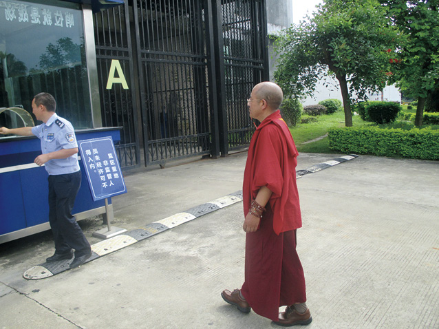
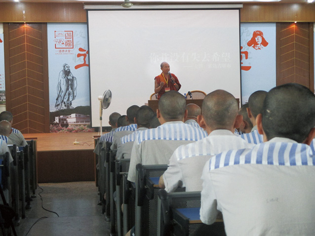

福建龙岩监狱

Longyan Prison, Fujian

中国·龙岩

2015 / 6 / 25

## 你并没有失去希望

## Don't Lose Hope

主持人：

今天，我们非常荣幸地邀请到四川喇荣五明佛学院汉僧部的索达吉堪布，来为我们做一场有关佛学的讲座。作为藏密大乘佛教的传承者，堪布本身的证量非常高。而且，堪布非常慈悲，一心一意把佛法分享给所有的有缘众生。对我们汉地的四众弟子，堪布尤具深恩厚德。

堪布著作等身，已经出版的著作和翻译的作品，超过了1000万字。昨天大家拿到的《苦才是人生》，就是其中的一册。堪布赠送了1000册《苦才是人生》给我们。

从1990年到1999年这十年间，堪布开始前往美国、加拿大、法国等国家弘法，并应邀前往清华大学、北京大学、人民大学、复旦大学等多所高等院校开办讲座。

我们能邀请到这样一位具相的善知识，可以说因缘非常殊胜。希望大家认真聆听堪布的讲座。讲座结束以后，大家在日常生活、人际关系乃至佛法修行方面，如果有困惑，可以提问，堪布会给大家一一解答。下面，让我们用热烈的掌声，欢迎堪布开始今天的讲座——

今天是一个殊胜的日子。能够在这里与大家分享我的心得，以及你们在服刑期间的心理调整方法，我感到非常欢喜。我的演讲时间不长，希望大家认认真真地聆听。

我来这一趟不容易。为了这次讲座，我专门从海口飞到厦门，再从厦门赶到这里。我深知每一个人的生命都非常珍贵，正如古人所说：“寸金难买寸光阴。”生命中的每一秒、每一分钟都非常有价值。所以，不论我们是什么身份，都不能虚耗时间、浪费生命。

## 地狱天堂，一念之间

今天，我们共同探讨的话题是“你并没有失去希望”。这个话题值得我们每个人深思。有些人可能认为：“我已经被判了无期徒刑，没有任何希望了！”也有人在想：“虽然我是有期徒刑，但还是感觉遥遥无期，不知何时才能解脱？”每天都在掰着指头数日子，感觉无比失落、绝望。

表面上看，你们失去了人身自由，确实令人同情。但换个角度来看，失去人身自由并没有那么可怕，不必过分伤心。

在前几站的讲座中，我去了许多监狱，与很多服刑人员面对面、心对心地交流。在这个过程中，我一直有个强烈的愿望，希望大家能够调整好心态，坚强地面对人生。我这样说并不是为了敷衍大家，也不是为了自己的利益，而是真心希望大家能拥有一个美好的未来。

昨天给你们发的书，名叫《苦才是人生》。从某种意义上说，人生确实充满痛苦。但是，如果懂得一些佛法的智慧或传统文化的思想，找到应对的方法，人生就没有那么痛苦。

平时，不管说起“监狱”还是“地狱”，大家都觉得非常可怕。死后堕地狱，活着进监狱，似乎都是最悲惨的下场。尤其是进了监狱，一辈子好像都完蛋了——在里面没有自由，出去后也抬不起头。

如果不能调整心态，监狱确实是一个非常痛苦、非常折磨人的地方。相反，如果能稍微调整一下心态，这里就成了锻炼人、改造人的大熔炉。比如，你本来非常懒惰，如今在高度强制的纪律下，每天都要做很多事情，最后变得非常能干；原来你性情暴躁，通过劳动改造和思想教育，慢慢变得调柔、堪忍、坚强，受到所有人的赞叹。

其实，监狱既可以是人间的地狱，也可以是闭关修行的寂静处。是堕地狱，还是成为闭关修行者，关键在于自己的选择。如果你选择后者，那就在这里好好思考人生，反省从小到大的种种经历。晚上睡觉前，脑海里像放电影一样，浮现以前读书的场景、成家的生活，做了些好事，也做了坏事……每天进行这样的思维和观察，心会慢慢静下来，萌生新的希望。

刚才进来的时候，我心里在想：“虽然你们现在多少有些痛苦和绝望，但实际上，这里周围环山，偏僻幽静，大家都放下了亲朋好友和各种应酬，跟藏传佛教的修行人闭关一样。”

修行人闭关，有闭十二年的，有闭六年的，有闭三年三个月零三天的，也有闭三个月的。对于修行人而言，闭关是一件非常重要的事。要是某个出家人开始闭关，大家都非常向往，很赞叹，觉得他了不起。

一般来说，修行人会选择在山洞里闭关。周围虽然没有高高的围墙，但也不能随意活动。他在闭关前，会下定决心，立下誓言，比如“三年之内，绝不走出百米的距离，否则就请护法神惩罚！”

那些闭关十二年的修行人，生活和你们差不多，都是简单而有规律。你们的衣服是统一的，一天三顿饭专门有人做。他们的衣服也是统一的——都穿出家人的僧装，生活资具也有专人送到山洞门口。

在家人的各种生活，包括年轻人比较执著的男女之爱，修行人都能够断除。为什么呢？因为他们有心灵的追求。人一旦有心灵的追求，什么事情都好办，地狱也可以变成天堂。

但是，心态如果没有调整好，再优越的环境也会饱受痛苦。我认识一些富翁，在香港、日本、美国等地，有好几千万的别墅，开的都是宝马、奔驰等豪车，但他们的心，却被贪嗔痴束缚得比镣铐还紧，一点自由也没有。这些人看起来风光，实际上饱受煎熬，每天晚上做噩梦，早上起来就叹息。甚至严重失眠，需要吃大量的安眠药才能入睡。

真正的苦乐，都在自己的心上。不懂得调心的人，待在监狱里痛苦，在外面自由自在的也痛苦。

## 坐牢不全是你的错

你们很多都是八零后、九零后。年纪轻轻来到这里，心里难免抱怨、委屈：“外面比我坏的人，多得不计其数。为什么他们逍遥法外，我却要坐牢？都是我的命不好，太倒霉！”一想起这些，就伤心绝望。

其实，今生坐牢不全是你们的错。佛教讲因缘，你们之所以来到这里，表面上是因为做了一件错事，实际上却没那么简单——背后还有很多力量在起作用。第一个，你们心里可能有前世种下的不好的种子，它们在今生成熟了，所以这辈子注定要坐牢。第二个，就是导致你们犯错的今生的各种因缘。如果没有今生的因缘，你们也不会走到今天。

如果分析，今生的因缘非常复杂。比如，现在的影视作品大多都含有暴力、色情的情节，尤其是一些香港影片。十几二十岁的年轻人看了，就偷偷模仿，学着影视中的人物打打杀杀、偷盗、邪淫等。

如果我们从小接受的，不是影视剧里的色情暴力，而是佛教提倡的十善业道，今生的命运可能就完全不同了。所谓的十善业，包括身体方面的三种善业、语言方面的四种善业、心方面的三种善业。与十种善业相反的是十种恶业，则是我们需要断除的。

身体方面的三种善业，包括不杀人、不偷盗、不邪淫，与之相反的杀、盗、淫则是三种恶业。由于我们从小没有受过这方面的教育，所以并不清楚杀盗淫的危害。看见电影里的人打打杀杀，觉得很英勇，自己也去杀人；看到电视里的人各种偷盗，不劳而获，过得很轻松，自己也去偷盗；或是偷偷观看黄色碟片，慢慢跟着学……最后，自己成了杀人犯、盗窃犯、强奸犯，受到法律的制裁。很多人的罪行都和杀、盗、淫有关。

语言方面的四种不善业包括：妄语，说各种各样的语言欺骗别人；离间语，故意说挑拨离间的语言，破坏别人的关系；恶语，用伤害性的语言谩骂别人；绮语，谈论是非、军事、战争、娱乐等无意义的话题。

心方面的三种不善业，包括贪心、害心和痴心。首先是贪心，觉得自己的财富不够多，希望把别人的财富占为己有。有些人就是在贪心的驱使下，贪污公款而犯罪的。

第二是害心，即嗔恨心特别大。有些人品性很好，却没控制住怒火，一念之差造了恶业，终生后悔。我遇到过很多人，都是因为嗔恨心生起时，控制不住，一瞬间犯罪，一辈子坐牢。

第三种是愚痴或邪见。有些人不好好学习知识，文化水平不高，比如我们说的法盲，因为不懂国家的法律法规，做出各种犯法行为。

总之，各位如果从小受到十善的教育，大多数今天不会在这里。

## 死刑犯当上国家总统

世事无常，一旦落入困境，我们还有没有机会翻身，重新做人呢？当然有。只要自己不放弃，一定有机会。

比如，一个人被判了死刑，有没有可能减为死缓？有可能。只要自己态度诚恳，认真改造，完全可能减为死缓两年。如果继续努力，在两年内拼命加分，可能就由死缓减为无期。然后再再地努力，两三年以后，很可能减为有期。又再再地努力，不断地积分减刑，再过十几年，可能就有了出狱的机会。

判死刑听起来很可怕，好像彻底没希望了。实际上并不是这样的。通过其他的种种因缘，可以改判无期，也可以走出监狱，获得新生。这方面，我专门研究过，所以敢这么说。

我看过韩国前总统金大中的传记。他的一生起起落落，坎坷不平，却始终坚强不屈。学生时代，他的学习成绩非常优秀。后来被判死刑，六个月中等待执行。之后，改判无期，又改判有期，出狱后被迫流亡国外。他曾经遭人绑架，刀枪直接对准他的胸口。虽然不止一次失去人身自由，他却一直没有倒下。通过不断的努力，最终迎来了人生的曙光。

获得自由以后，他致力于推动朝鲜与韩国之间的和平进程，并为此做了最大的努力。后来，他当选为第十五届韩国总统，之后不断改善韩朝之间的关系，最终促成双方的首脑会晤。2000年，他因此获得了诺贝尔和平奖。

在诺贝尔获奖感言中，金大中讲了自己的人生经历。他说：“我曾五次落入独裁者手中，每次都险些丧命。我在狱中度过了六年的时光。有四十年的时间，我要么遭到软禁，要么遭到流放，并且时刻处于监控之下。如果没有人民的支持，没有全世界民主同仁的鼓励，我不可能忍受这种艰辛。这种力量也源自我不变的信仰。”

所以，不管处于什么样的境地，我们都不要绝望。

## 苦乐都是心的执著

人的一生，有低落、悲伤、绝望的时候，也有阳光、快乐、荣耀的时候。金大中被判死刑时，所有人都非议他，甚至亲朋好友也纷纷离开。当他当选韩国总统、获得诺贝尔和平奖时，那些非议过他的人，又开始赞叹他、奉承他。

谁的人生又不是如此呢？当你痛苦的时候，很多人都看不起你，离你而去，让你苦上加苦；当你快乐的时候，很多人都会接近你、追捧你，让你乐上加乐。

如果仔细分析，真正让我们快乐或痛苦的，不是环境的好坏优劣，而是我们自己的心。所谓的苦乐并不在外面，也不是外缘导致的，而是心的一种执著。比如，大家同在监狱改造，苦乐的感受却不同。悲观的人认为未来没有希望了，然后自暴自弃，不思进取，整天愁眉苦脸，跟狱友处不好，跟狱警也处不好，痛苦不堪之余，甚至想一死了之。而稍有智慧的人则想：“反正已经进来了，不如该放松的放松，该开心的开心。说不定，这段经历会成为最精彩的人生篇章。”

确实应该这样。虽然不愿意，但既然来了，干脆彻底放宽心。就算有一些痛苦，也不至于太痛苦。

据我了解，监狱中的“改造”，最初指的是劳动改造。马克思说：“劳动创造了一切，劳动创造了人本身。”运用到监狱管理上，这句话被理解为，犯人只要参加劳动改造，就可以变成好人。三四十年前，在苏联、东德等很多国家，犯人都必须参加强制性劳动。按照当时的理念，人的身体如果能改变，心也能改变。因此，所有的监狱都安排犯人天天干活，以达到改造的目的，这就所谓的“劳改”。

后来，很多国家都认识到，劳动只是改造的一部分，而不是全部。比劳动改造更重要的，是对犯人心灵的改造。于是，各种心理辅助措施在监狱管理中应运而生。

现在，国内很多监狱逐渐与国际接轨，比如犯人应该有什么样的空间、有什么样的权利和义务等，都有明确的规定。单就这一点，你们和二三十年前的犯人相比，已算是非常幸运的了。在那个特殊的年代，我的很多亲戚入狱后，身上全是伤痕，经常挨饿。你们现在既不会挨饿，也不会伤痕累累，承受的痛苦真的微不足道。有时候，人要学会比较。

总之，心灵的改造很重要。你们每天参加的劳动改造，属于规定内容，很有必要。但更重要的，你们要认识到监狱生活的特殊意义，从而调整心态，开心过好每一天，同时反反复复思考如何重新做人，如何改过自新。

## 她被儿子关进监狱

我在福建省监狱管理局看到，他们给大家提供的学习材料中，有两本佛教书籍。一本是《佛法的智慧》，另一本是西藏活佛对犯人的一些教言。这些都可以帮助大家疏导心灵，非常好。

我希望你们调整心态，把服刑当作学习深造的机会。大家应该这么想：“这里四周都是高墙、武警，无论如何跑不出去。如果试图越狱，很可能是死路一条。不如面对现实，好好改造。无论如何，我的心是自由的，既可以云游世界，也可以好好忏悔。”

佛教非常重视对罪业的忏悔。你们也许有信仰，也许没有信仰，但不管怎么样，忏悔往昔的罪业都很重要。如果有一颗忏悔的心、羞耻的心，过去造的罪业完全可以清净。如果你以前杀过人，现在就想：“生命如此可贵，我却断送了别人的命根，现在感受痛苦也是应该的。以后我再也不杀人了！”如果你以前贪污过，就想：“我以前想不劳而获，抢夺了别人的财富，非常不合理。现在我真诚地忏悔，以后再也不干了！”

很多人的心非常恶劣，自己却认识不到，反而觉得自己很好。大家应该趁这个机会，静下心来好好反省自己。大家不要觉得自己苦，其实你们的父母妻儿更苦。即使为了他们，你也要坚强，要忏悔，要改过自新。以后老实做人，合法做事，才对得起他们。

福建这边，大多数人信佛，也有人信观音菩萨。遇到大的事情，大家都会向佛菩萨祈祷，请求保佑。你们的家人，肯定也常到寺院烧香、拜佛，希望佛菩萨护佑你们，平平安安，尽早释放。所以，你们也要真心地忏悔、祈祷，以感召佛菩萨不可思议的加持力入于自己的心。

在佛教历史上，有一个非常著名的故事。在佛陀时代，有一位频婆娑罗王，在印度有很大的威望。他的儿子未生怨王，也叫阿阇世王，非常坏，杀了很多人。因为受提婆达多的挑拨离间，未生怨王准备杀掉父亲，提前登上王位。

他把频婆娑罗王抓起来，关进黑暗的监狱，不给吃的、不给喝的，准备将他活活饿死。未生怨王的母亲叫韦提希。他允许母亲去探望频婆娑罗王，但不能带任何饮食。韦提希不忍心频婆娑罗王挨饿，但迫于未生怨王的淫威，也没办法。

后来，韦提希想出了一个主意。她在自己身上涂酥油、蜂蜜等食物，在饰品中盛满葡萄汁等饮料，每天都到监狱探望频婆娑罗王，让他享用蜂蜜、葡萄汁等饮食。当时有一位佛法老师，叫富楼那。韦提希还请他给频婆娑罗王做心理辅导，对他进行精神安慰。

按理来讲，一个人七到十天不吃不喝，就会饿死。但因为有韦提希的帮助，频婆娑罗王过了二十一天还没有死。未生怨王很生气：“都二十一天了，父亲为什么还没有饿死？”他派手下去了解情况，才知道母亲一直在给父亲送食物。他大发雷霆，把母亲抓起来，也关进了监狱。之后，频婆娑罗王被活活饿死。

韦提希夫人被关在监狱里，没有别的办法，只能祈祷佛陀，最后得到了佛的加持。以此因缘，促成了《观佛无量寿经》的问世。你们可能听说过这部经典，但不知道有没有读过？其实，这部经典是佛陀在监狱中为韦提希夫人宣说的。

未生怨王为了提前当国王，把父母都关进了监狱。韦提希夫人没有办法，只能祈祷佛陀，得到了佛陀不可思议的加持，获得了成就——她是成就以后才往生的。所以，你们如果对诸佛菩萨真心地祈祷、忏悔，或者持咒、观想、禅修，也会有意想不到的效果。

看到你们监狱有《佛法的智慧》这本书，我心里很高兴。大家学习法律法规当然重要，接受《弟子规》《千字文》等传统教育也很重要，如果再学一点佛法就更好了。因为传统教育只讲做人的基本方法，而佛教能让我们的身心得到真正的放松。

很多人在监狱里一直痛苦，好不容易熬出去，也找不到人生的方向。而在监狱学佛的人，把监狱生活当作修行，认真改造。出去以后，一个个都成了成功人士。“文革”期间，汉传和藏传的很多高僧大德都被关了监狱，但他们把每一天都当作修行，一点不觉得苦。

## 没手没脚，走遍世界

我了解到，监狱中的人常常不团结。大家十几个人住在一起，如果有一个人性格不好，脾气暴躁，所有人都非常恐惧。所以，应尽量减少人为制造的痛苦。

尤其刑期较长的人，相互有十几二十年的相处时间，比和家人在一起的时间还长，关系应该亲密才对。长年在外打工的人就不说了，即使正常的一家人，也只有晚上才能见面，白天各自上班、上学。而大家在狱中朝夕相处，白天在一个工厂上班，晚上在一间房间休息，应该珍惜彼此的陪伴。如果你的性格不好，经常发脾气，会让大家心生不悦，甚至恐惧不安。

如果你有修养、有口才，经常给大家讲讲故事或做人的道理，氛围会比较融洽。以前，有个藏族青年进了青海一所监狱。刚开始跟其他人一样，没什么特别之处。慢慢地，他开始给狱友讲故事，开导大家把监狱当作忏悔和修行的道场、改造心灵的基地。很多人听了，渐渐都想开了，获得了新生。

你们的心，现在非常脆弱，经常为一点点小事痛苦不堪，甚至因为家人的去世而伤心绝望、精神崩溃。如果你们有一点信仰，懂一点调心的方法，这些都不算什么。

任何时候，只要有信心，就有重生的机会。不管怎么样，你现在有手有脚，可以自己走路，自己吃饭，自己阅读。但你们知道吗？对有些人来说，能够自己走路、自己吃饭，却是一个永远无法实现的奢望。

在澳大利亚，有一个特别可怜的人，叫尼克[^1]。他出生时没有双臂、双腿，就像一个肉球。母亲怀他的时候，检查结果把父亲吓坏了：“怎么怀上这么倒霉的孩子？”尽管如此，母亲还是把他生了下来。

尼克渐渐长大，却一度陷入绝望。有一天，他在学校连续遭到十二个同学的嘲笑，非常伤心。他痛苦地告诉自己：“如果再有一个人嘲笑我，我就不活了！”这时，一个女孩走过来对他说：“尼克，你今天气色不错啊！”

女孩的话给了他巨大的安慰。多年以后，他已经想不起那个女孩长什么样，但却记得那一天对自己的特殊意义。从那时开始，他发誓要重新振作，好好努力，将来影响整个人类。

一个连双臂和双腿都没有的人，却想影响人类，听起来有点像天方夜谭。但他无视自己的劣势，不被困难吓倒，坐着轮椅，由别人推着到处演讲。到了讲台边，等别人把自己抱起来，像放瓶子一样放在讲台上，他才开始自己的演讲。虽然没有手、没有腿，但他的演讲却很有感染力，很多人听了都燃起了生活的希望。他先后去了三十四个国家，受益者有好几亿人。

与尼克相比，大家不知道有多幸运。你们当中，有谁绝望到那个地步了？没有一个吧？对你们而言，只要振作精神，认真改造，从无期到有期，从有期到提前释放，一切都有可能。

我希望你们能彻底改变自己，而不是屡教不改。如果再次违法，等待我们的，将是更加可怕的未来。

## 重建自己的心灵

总之，我们既要有洗心革面的决心，又要好好学习各种知识，尤其是以下三种知识：

一是相关的法律法规。我们过去因为无知，违犯了法律，应该感到惭愧，不要觉得无所谓。多懂一些法律知识，可以帮助我们明辨是非，避免再次走上歧途。

二是劳动技能。我去过的所有监狱，都比较重视服刑人员的技能培训，为他们安排了裁缝、绘画等技艺学习，还有心灵疏导等精神引导。你们应该抓住机会，主动学习。这样出狱以后，有个一技之长，可以养活自己。

三是传统文化，尤其是佛教的调心方法。在监狱里，有很好的学佛机缘。我给你们的书，以及其他一些资料，都讲了世间和出世间的很多真理。大家可以传阅、思考，深入学习。希望各位从中得到启发，重塑自己的人生。

你们当中，有些人文化层次高，非常聪明；有些没受过什么教育，但心很善良。不管怎么样，我都希望你们有一颗快乐的心。

以前，你们晚上可能经常做噩梦。如果从现在起，多思考未来，并不断努力，美梦也许就会出现。我以前看过一本书，叫《心灵的重建》。作者是一位女性，遭受过非常多的痛苦。她五六岁时，父母离异，14岁遭到强暴，结婚后又被抛弃，还得了癌症，等等。但她始终没有放弃自己，在人生最困难的时候，她通过吃素、禅修等佛教的调心方法，获得了新生。

总之，不管发生什么，都不要有极端的行为。极端行为不一定害得了别人，对自己却肯定不利。

## 人生是透明的空瓶

我在海南监狱讲了本焕老和尚的故事，在山东监狱讲了南非总统曼德拉的故事，在你们这里讲了韩国总统金大中的故事。这些名人都遭遇过人生的重大挫折，但通过不懈的努力，最后都获得了巨大的成功。虽然我们不一定像他们那样，成为举世闻名的伟大人物，但只要调整自心，彻底洗心革面，未来的人生还是很有希望的。

我接触过很多服刑人员，发现大家有一个普遍的心理，希望马上出去，马上获得自由。其实对你们而言，马上出去不一定是好事。现在放你们出去，有些人可能又会去杀人、偷盗、邪淫，干很多坏事。要不了几天，又进来了。

以前，我有个亲戚进了监狱。我去看他，对他说：“也许你不高兴，但我说的都是真心话。你这个人很坏，暂时还是安心待在这里吧，不然回到社会上，又会祸害你的家人。”

他回答道：“你说得对，我确实很坏。我待在这里挺好，你不用担心。”

我说：“我不仅不担心，心里还挺高兴。”

他听了，也没生气，说明有一点自知之明。

事实就是这样。没改造好就出去，又会干很多坏事，继续危害社会、祸害亲人，没必要。不如定下心来，重树正确的人生观、价值观，发自内心地改过自新。

人生就像一个透明的空瓶，你往里面倒墨汁，它就变成黑瓶；你往里面倒牛奶、椰汁，它就变成白瓶。换句话说，如果你在人生的空瓶中，装入智慧、慈悲、感恩、福德等善妙的东西，就会拥有美好的人生；如果装的是邪恶、嗔怒、贪婪、愚痴等有毒之物，就只能拥有罪恶的人生。

大家一定要记住：人生不管出现什么，都自己亲手装的。

在这样的特殊环境里，如果懂得一些特殊的调心方法，会有很好的效果。过去，狱中有无数人通过这些方法，找回了最初的自己，希望你们也能这样。

无论从哪方面看，各位的未来都充满了希望，千万不要失落、失望，更不要绝望。希望你们坚强地活下去，努力改掉不好的心态和行为。这对狱警的工作有利，对自己的人生也有利。

在任何场合，我们都要创造宁静祥和的氛围，给自他带来轻松和快乐。

现场互动

问：您在书里提到，结婚就等于把自由的钥匙交到了别人手上，从此失去自由之身。但是，如果没有婚姻，今天我们大家都不会存在。这个问题一直困扰着我，您怎么看？

堪布：我是一个单身的出家人，对婚姻的看法可能和世间人不太一样。

虽然爱情很甜蜜，很幸福，但结婚成家却意味着失去自由，增上压力，做什么都不方便。随时会有个“警察”盯着你，查你的手机、看你的留言，监听你、监视你，自由的钥匙肯定是在别人手里。而出家人的生活比较清净，因为没有家庭和感情的困扰，不管做什么事情，都不会有家人的约束，比较自由。

观察任何事物，都有不同的角度，既可以这样看，也可以那样看。我说婚姻让人失去自由，是就婚姻的本质而言，并不是要所有人都不要结婚。在我看来，成家立业有一些好处，但也充满痛苦。很多人恋爱时都向往婚姻，而真正结婚以后，却很难得到期望的快乐，甚至感受极大的痛苦。现在，为什么有那么多人困在婚姻里，过得不开心，甚至不得不离婚？原因也在这里。

不可否认，我们每个人的生命都通过婚姻而来，但这和婚姻本身的苦乐是两回事。从佛教的观点看，婚姻并不像世人赞叹得那么美好。即便有一些美好，背后也不离痛苦。在这方面，我作为一个研究者，从另一种角度观察，自然会得出另一种结论。

其实，人生也好，婚姻也罢，美好总是短暂的，痛苦却那么绵长。

问：请问，普通人如何成佛？

堪布：在印度的梵语中，“佛”叫布达，意思是最高的觉悟。当我们的心里全是善的理念，没有任何不好的情绪，就是成佛。成佛需要经历漫长的修行，包括忏悔罪业、积累资粮。

佛教有大乘和小乘两种不同的修道方式。每一个人经过长期修行，都能达到最高的觉悟。而所谓的长期，究竟有多长呢？不是十年、二十年，也不是一百年、两百年，而是一生又一生，一世又一世，最终达到最高的觉悟，彻底了知世界的真相。

释迦牟尼佛成佛以后，为我们留下了几百部经典，宣说宇宙人生的真相，指点成佛之道。2500多年来，佛教从来没有被历史和文化的发展推翻过。到了21世纪，也依然经得起所有科学和哲学理论的检验。当代不少科学家研究佛经，都发现里面确实有甚深的道理。

佛经之所以经得起时间和科学的检验，是因为出自最高觉悟者的智慧。普通学者或科学家的思想可能会被后世淘汰，而觉悟者宣说的金刚语，不管什么时代，人类社会都不得不承认。

问：佛教讲的“四大皆空”，具体是指哪四大呢？

堪布：佛教讲的“四大”，是指组成人体的地、水、火、风四种元素。具体来说，我们身体上坚固的部分，叫作“地大”；能和合的元素，叫作“水大”；能运动的部分，叫作“风大”；能生起温度的部分，叫作“火大”。

为什么说“四大皆空”呢？因为不管从古代哲学，还是从现代科学的角度观察，这四种元素都是空性的。比如，我们都认为自己有手，实际上所谓的手并不存在，只是一个概念。大家可以伸出自己的手，每一个指头都分开，然后问自己：“到底手掌是手，还是手指是手？如果是后者，具体哪一根是手呢？”你会发现答案都是否定的。有人也许会说：“五个指头加上手掌，合起来才是手。”实际上，凡是聚合而成的东西都是假立的，没有真正的本体。

各位之所以来到监狱，都是因为太执著自我——为了“我”的利益，不惜伤害别人。可见，每个人都认为“我”是存在的。实际上，所谓的“我”只是一个概念，根本不成立。大家可以问问自己：“身体是不是‘我’？心是不是‘我’？”答案也是否定的。而除了身体和心以外，哪里还有一个“我”呢？这样粗略地观察下来，根本找不到“我”的本体。

佛教的经典很多，其中的《心经》篇幅短小、加持力大，主要讲无我空性。希望你们早晚多念一念《心经》，多观一观无我。这样持之以恒，心很容易调整。借助佛教的加持和观察把心静下来，以后不管做什么都很容易。

问：我们知道，波罗蜜多的意思就是到彼岸，我的问题是“此岸”和“彼岸”指什么？

堪布：你们的问题都很专业，很有挑战，我感觉压力比较大（众笑）。其实应该这样的。通过这样的互动，我们大家都有收获，都很开心。无论处于什么环境，应当保持积极的心态。

我父亲过世时，我没哭，还说：“没事，人都会死，活着的人应该开开心心活下去。”我弟弟和亲友很不理解：“父亲死了怎么开心得起来？你精神有问题！”我的精神肯定没问题，只不过觉得事情已经发生，与其毫无意义地伤心流泪，不如开开心心地活下去，做一些有意义的事情。

现在回答你的问题：“波罗蜜多”是印度梵语的音译，梵语发音为“巴绕密达”，意思是到达彼岸。《心经》里有“揭谛揭谛，波罗揭谛，波罗僧揭谛，菩提萨婆诃”一句咒语，其中的“波罗揭谛”和波罗蜜多类似，也是到彼岸的意思。

所谓的此岸和彼岸，是互相观待的一对概念。如果福建是此岸，与它相对的大海另一边的美国，就是彼岸。佛教把轮回比喻为大海，我们凡夫在“轮回的此岸”，此岸充满了烦恼和痛苦。凡夫人通过修行，渡过轮回的大海，就到达了“涅槃的彼岸”，也就是成佛，或者说获得最高的觉悟。涅槃的彼岸没有痛苦，唯有快乐。按照弥勒菩萨的说法，当修行达到了较高的境界，比如证得了菩萨的果位，下地狱就像去花园游乐，不会有任何痛苦。

我想，你们这里肯定有很多菩萨。他们在这里非常快乐，就像生活在花园里，不像有些人那样痛苦不堪。

当然，真正的菩萨不会只顾自己快乐，不管众生的痛苦。地藏王菩萨曾经说过：“我不入地狱，谁入地狱？地狱不空，誓不成佛。”我们虽然不是菩萨，但也要尽量帮助身边的人。在菩提心或利他心的摄持下，教导和帮助周围的人，自己会得到无量的功德。

佛教的教义，有一部分是般若空性，也就是般若波罗蜜多，翻译成汉语是“智度”，智慧到达彼岸的意思。我们现在没有智慧，不能到达涅槃的彼岸，所以很痛苦。当我们以智慧到达彼岸、获得觉悟时，什么事都可以接受。就像地藏王菩萨那样，即使到地狱或监狱度众生，也跟到花园游玩一样，没有一点痛苦。

问：我在您的书里看到一篇文章，里面提到“老友不可轻抛，新友不可全信”，感觉深受触动，却又相当迷茫。我进监狱已近十年，在这里接触了很多人，经历了很多事。让我感触最深的就是人性、义气和道德。感觉交往越深，受伤越大。现在我对人性相当迷茫，不知道以后该如何与新朋友和老朋友交往，也不知道在这种环境里应该怎样面对人性。

堪布：面对人际关系确实需要智慧和勇气。不仅是像你这样在监狱住了很长时间的人，即便是现在的大学生，面对人际关系和社会生活也会感到困惑和迷茫。

昨天，我在海南监狱讲了一个比喻：做人应该像椰子树。椰子树遇到七级狂风也不会倒下。为什么呢？因为它懂得随顺，从不与风对抗。风往哪里吹，它就往哪里弯；风往哪里刮，它就往哪里摇，所以生命力非常顽强。做人也一样，不能太坚硬，要随顺时代，随顺环境，随顺周围的人群，随顺当前的境遇，随顺自己的命运，随顺前世的因缘，随顺各种无形的力量。

所谓的随顺，并不是委曲求全、逆来顺受，而是一种善巧方便的智慧。我之前接触过很多服刑人员，有些人既有智慧，又有勇气。但在某种意义上，这样的智慧和勇气可能用得上，也可能用不上。无论在什么地方，怎样做人，怎样做事，都需要自己去思考。

我们在任何一个群体里，都可能遇到不公平的事。在监狱、僧团、社会的各个角落，都有一些看不惯的人、听不惯的事，也有一些值得我们学习和借鉴的因缘，关键在于自己怎么选择。希特勒本人吃素，还热爱艺术，看起来非常友善，非常正面，但他却没给自己选择一个好的命运。选择什么样的命运，也是需要智慧的。

说到底，利益自己最好的方式是什么？一是学会变通，二是利益他人。虽然我们现在做不到大乘佛教讲的那样“利益无量无边的众生”，但至少要懂得利益身边的人。只有这样，才能真正利益自己。

主持人：

有时候，一个偶然的机会，也会给我们的人生带来彻底的改变。相信堪布今天的讲座，就是这样一个难得的机会，也是这样一盏解脱的明灯！

谢谢堪布！下面请大家起立，用掌声再次感谢堪布！

[^1]: 尼克·胡哲，1982年12月4日出生于澳大利亚墨尔本，是澳大利亚演讲家。他天生没有四肢，但他学会了生活自理，并获得大学双学士学位。他是两个机构的负责人，同时也投资房地产和股票，会骑马、游泳、足球、冲浪等技能。尼克走遍34个国家，做了大约1500多场演讲，成为与命运顽强斗争的象征。他的座右铭是：“没手，没脚，没烦恼。”
