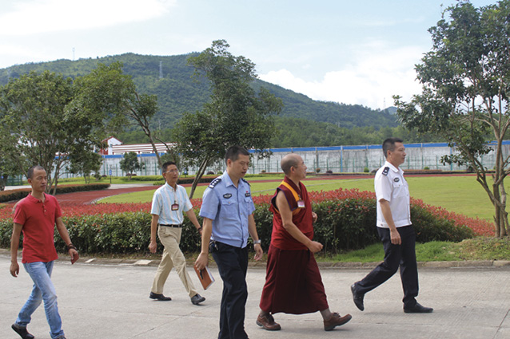
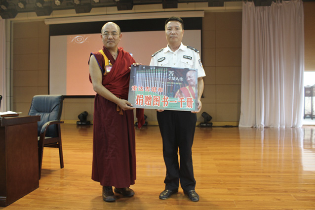
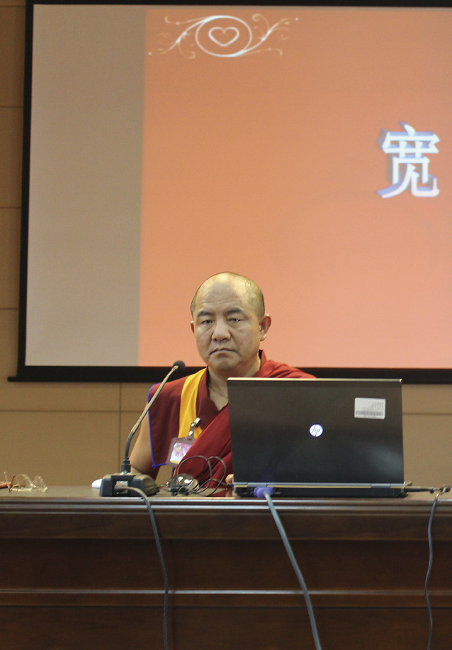

福建武夷山监狱

Wuyishan Prison, Fujian

中国·武夷山

2015 / 6 / 26

## 宽恕

## Forgiveness

主持人：

全体学员，大家上午好，首先，请大家以热烈的掌声，欢迎并感恩索达吉堪布，千里迢迢从藏地来到这里，为大家上课！

索达吉堪布幼具慧根，自1985年舍俗出家，一直潜心研究佛学经典的教理，并精苦修持，取得了深厚的造诣。堪布曾先后前往美国、德国、英国、法国、日本、加拿大、荷兰、印度、不丹、尼泊尔、新加坡、马来西亚等十几个国家弘法，并受邀在哈佛大学、华盛顿大学、哥伦比亚大学、香港大学、香港理工大学、清华大学、北京大学、中国人民大学、复旦大学、南开大学、浙江大学等著名学府演讲。

堪布学识渊博，智慧深邃。从孔孟老庄等诸子百家，到秦皇汉武、唐宗宋祖，从分子、原子到夸克、量子，古今中外诸多领域，堪布均有所涉猎。并针对现代人的思想误区，以浅显易懂的语言，开辟了一条光明与快乐的心灵之路。

堪布勤奋努力，在传法教人的同时，笔耕不辍，创作出版了《苦才是人生》《你在忙什么》《残酷才是青春》《做才是得到》等畅销书。上师注重汉藏文化和中西方文化的融汇贯通，出版各类书籍三十多部，累计字数上千万。

堪布多才多艺，创作了《启动爱心》《放生歌》《世界青年佛学会会歌》等广为传唱的歌曲几十首。近年来，堪布还经常与海内外的众多学者探讨环保、和平、道德、跨宗教等问题，希望进一步提升所有生命的福祉。

今天，堪布的演讲主题是《宽恕》。分为两部分：上半场是堪布的专场演讲，希望大家认真聆听；下半场由各位学员提问题，堪布现场解答。

在演讲开始前，我们进行一个简短的捐赠仪式。听说要来我们这里演讲，堪布特地给我们的图书馆捐赠了一千册图书。下面，有请我们丁监狱长上台，接受捐赠！

（捐赠仪式……）

请大家鼓掌表示感谢！下面，有请堪布为我们演讲——

今天有机会和大家面对面交流，我感到非常荣幸。除了言语上的交流，还希望我们能彼此交心。今天的主题是“宽恕”，即宽容、饶恕的意思。接下来，我想分享一些自己的想法。

## 换个角度，苦不再苦

在座的各位属于比较特殊的群体。你们被困在一个听起来就让人感到恐怖的地方，身心都备感痛苦。不过，如果能换个角度思考，大家所谓的痛苦不一定真的有那么痛苦。

也许，你们会质疑我的说法：“人生最快乐的事，莫过于身心自由，享受天伦之乐，或是如愿以偿地过上自己想要的生活。可是现在，我们就像笼中之鸟，被关在这狭小的地方，既没有自由，也不能陪伴家人，怎么可能不痛苦？”

实际上，真正的自由在我们的心中，而不在外部的环境。外面的世界虽然看似自由，但同样有人在痛苦中挣扎。他们的身体是自由的，可以随意去任何地方，但内心却并不自在。在欲望和压力的控制下，他们经常感到愤怒、焦虑和烦躁，没有丝毫快乐。而在没有自由的环境中，仍然有一些人过着快乐的日子。

所以，懂得调心的人，在哪里都是自由的、快乐的。听起来，监狱是一个充满寒冷和凄凉的地方，但一些有修行境界的人同样能找到属于自己的快乐。在某些特殊时期，被关进监狱的佛教徒，刑期大多在十年以上，有些人甚至关了二十年、三四十年。但他们在狱中，并不觉得痛苦。为什么呢？因为他们把坐牢当作修行，不断修炼自己，最终变得越来越坚强和成熟。入狱前，他们是普通的修行人，内心脆弱而浮躁。经过十几、二十年的磨炼，他们拥有了一定的境界，变得极有力量。

因此，你们也可以换一个角度，重新审视牢狱生活。有人认为，身体被束缚在狭小的空间，无法忍受。实际上，世界上有很多人和你们一样，住在狭小的地方。比如，山洞里的修行人、大中学校的住校生——他们也睡上下铺，一个房间里七八个人，甚至十几个人。

所以，真正的苦与不苦，关键在于我们如何看待。通过调整心态，改变对环境的看法，我们可以在任何境遇中找到平静和快乐。

有些人觉得：“不能跟家人在一起，非常痛苦。”虽然远离家人可以说是一种痛苦，但却不是绝对的。出家人一辈子都待在寺院、山洞或森林里，没有世间的情感和家人，却照样逍遥自在。既然他们能过这样的生活，为什么我们就不行呢？

还有些人说：“我的头发黑黝黝的，非常好看，现在全剃了，没办法见人，所以很痛苦！”其实，剃光头也没什么，我们出家人全是光头。我是在年轻时候剃度出家的。在这之前，我经常为头发烦恼：“该留长一点，还是短一点？往哪边梳更好看？”出家以后，这些烦恼都没有了，而且再也不用摆弄头发，非常省事。现在人老了，因为是光头，也没有脱发的烦恼。这样的生活其实很有意义。

感受真正的快乐，从改变观念开始。观念不改变，总认为活着的压力大、幸福小，那就永远得不到幸福。尤其像你们，学会调心更为重要。心调好了，很多事情都可以接受。

## 没有宽恕就没有未来

有一本书里说：不管发生什么，都要学会说“对不起”“请原谅”“谢谢你”“我爱你”。这几个词看起来简单，学会了却对身心健康有很大的帮助。

你们大多数人心里都有怨气，觉得社会对自己不公平，仇人故意陷害自己，经常愤愤不平、心怀不满。本来，每个人心里都有善的种子，但在环境、恶友以及不良教育的影响下，很多人都舍弃了心中的善，进入恶的循环，最后不得不感受苦果。所以，抱怨不解决任何问题，只会制造问题。

从现在起，我们要学会原谅，找回自己的善心。有人可能想：“有些人我可以原谅，但有些人，我这一辈子都不会原谅！”因为他们深深伤害过你，所以你耿耿于怀，要找机会报仇，甚至杀了他，让他家破人亡……

产生报仇的念头，虽然可以理解，但对你们的人生却非常不利。我希望今天的讲座能转变各位心中的恶念，也希望在座的每一位都能通过改造，变成真正的好人。这对你们的今生来世都有很大的意义，能带给你们长久的安乐。

有人可能会说：“我无所谓，快乐就快乐，痛苦就痛苦，反正人生对我不公平！我就要报仇！”每个人都希望快乐，不愿意痛苦，你又怎么可能例外呢？不愿正视内心的需求，用简单的语言糊弄自己，是不明智的表现。

要做一个好人，获得快乐，必须学会宽恕和包容。特蕾莎修女讲过一句话：“包容是一种信诺，对每个人都很重要。”训练自己的包容度或宽容度，既是一种自我成长，又是创造未来的最好方法。

有一本书叫《宽恕》，在全世界有非常大的影响。作者是南非的图图大主教，曾于1984年获得诺贝尔和平奖。我曾经为这本书写过推荐文，其中有一句话是：“面对伤害，以牙还牙不会让你更好过；选择宽恕，才能轻盈地放下过去。当你试着去宽恕‘那个人’，奇迹不一定发生在他身上，却一定会发生在你身上。”表面上，我们宽恕的是别人，最终受益的却是自己。奇迹会跟在宽恕的后面，自然而然来到你的身边，不需要你付出任何努力。

这本书里有很多精彩的故事，描述了我们没办法容忍的很多事情。我看了之后，感触很深。后来出版社邀请我写推荐文，虽然我一般不写推荐文，但转念一想，尽管作者不是佛教徒，但书里传递的某些思想，与大乘佛教的理念非常相合，所以就答应了。

我记得书里有这样一个故事：某个人的父亲被杀了，凶手残忍地在他父亲身上砍了四十多刀，还往父亲脸上泼硫酸，割下父亲的耳朵、鼻子，甚至剖开腹部，还把双手切得连一根手指都找不到……各种残忍的手段，在他父亲身上留下了可怕的痕迹。此后很长一段时间，他们全家一直努力寻找凶手。但他们找凶手的目的，不是为了报仇，而是为了宽恕——彻底原谅他对父亲所做的一切。

如果换了我们，能不能这样宽容杀父仇人？希望大家好好反思。

做得到也好，做不到不好，都只是一种假设。落到现实问题上，你们服刑人员内部，至少应该相互包容，氛围融洽。虽然这里的四周围着铁网，人身没有自由，但如果内心宽容，也能拥有广阔的空间。相反，心胸狭小的人即使住在宽广的大海边、辽阔的草原上，仍然会被恐惧束缚，得不到一点自在。

我们藏族人过去一直有“以牙还牙，以血还血”的传统，不管被谁伤害，都必须报仇。尤其有人杀了自己的亲友，那更要亲自杀掉凶手，否则就是懦夫，“没有种”。如果一直不报仇，大家都看不起他们：“他们家的人被杀了，到现在还不杀回来，太懦弱了！”

这几年，随着宽恕理念和大乘佛教的推广，情况有了好转。最近我听到很多案例，比如某人杀了人，对方的家人却宽恕了他，甚至连赔偿金也没有接受。在我家乡那一带，杀一个人的赔偿金，根据不同的情况，从20万到200万不等。

现在，很多藏族人都转变了观念：“说大一点，地球是我们共同的家园，所有众生都是家里的成员；说小一点，大家都是人，都有苦乐的感受，都希望感受快乐，远离痛苦。虽然他造了杀人重罪，但我们可以选择原谅，接受他的忏悔和道歉。”

大乘佛教在汉地也好，藏地也好，都非常兴盛。按照大乘佛教的理念，一切众生都当过自己的母亲，应该无条件地慈悲他们。这样的思想，确实能促进人与人之间的和谐友爱。

## 敌对是一把双刃剑

不过，有些地方依然盛行以牙还牙、冤冤相报的仇恨风气，“你杀我，我一定要杀你”“你这辈子杀我，我下辈子必定杀你”。生生世世，辗转相杀，带给自己的是无休无止的伤害和痛苦。

所以，我希望你们能减少敌对，彼此包容——不仅包括同伴，还要包容狱警。

按理说，大家同住一个寝室，应该好好相处。但嗔恨心重的人，好像跟谁都搞不好关系。听说在一个监狱里，两个小伙子想打架，考虑到寝室和改造厂不方便，就约好时间，吃完饭在一个角落里打。结果双方打得头破血流。

都已经进监狱了，还打什么架？应该好好改造、诚心忏悔、重新做人才对。爆发这么大的嗔恨心，让周围的人都不舒服，对自己有什么好处？而且每天都出问题，对狱警而言，也不是什么好事。

有些人觉得狱警很坏，始终抱有敌对情绪。这种想法并不合理。各位被关进来，又不是狱警造成的，他们管理你们，只是他们的工作，并不是故意和你们作对。你们入狱受惩罚，跟他们有什么关系？

按照佛教的教义，一个人堕入地狱后，会有恐怖的狱卒拿着铁锹、锯子、刀枪等各种刑具，对他进行砍杀。而这一切，都是他自己不清净的业力所现，并非真实存在。

同样，你在某个地方犯了错，被公安机关抓住、调查，被法院判决，这些都是你过去的业力和生活历程。如今，你却在监狱里仇恨狱警，有什么道理呢？而且狱警也是人，也需要尊重和理解，你却不顾一切地仇恨，怎么也说不过去。

我们应该用一颗慈悲的心、宽恕的心，相互包容，彼此善待，营造和谐宁静的人际氛围。

## 用好人生的充电桩

我去的监狱比较多，个人感觉是，有期徒刑没有想象得那么苦。大家服的都是有期徒刑，没有无期或死刑，所以气色还可以，住的地方也不错，一天三顿也有保障。唯一不足的，是失去了人身自由，不能像外面的人，想干什么就干什么。

其实，有一点约束也不全是坏事。可以放下散乱，思考人生，好好为未来做准备。我认识一些进过监狱的人，他们都说：“在监狱的五六年是很好的学习机会。以前在社会上，根本没有时间学习、充电。入狱后，电话没办法打，微信也不能用，就连跟亲人说话的机会也很少，完全没地方散乱，只能放下一切，好好学习。”

刚才监狱长和大家谈话，也劝诫大家看破、放下。确实应该这样。到了这里，对世间的名闻利养都要看破、放下，好好配合改造。

其实，入狱服刑只是人间的惩罚，如果不好好忏悔往昔的恶业，下辈子待的地方可能就是地狱——成千上万种监狱的痛苦加起来，也无法和地狱的痛苦相比。

世界上到底有没有地狱？你们也许信，也许不信。但不管信不信，等下辈子亲身感受地狱痛苦时，就知道存不存在了。就像你们以前对监狱没有概念，等真的被关起来了，才知道“关监狱这么痛苦！”

有些人待在这里很难受，很难熬，每天都在算日子：“一年、两年、三年、四年、五年、六年……还有多少天才能出去？”有些人却觉得：“出去还要挣钱养家，太累了！不如待在这里，好好休息，反正饿不死就行。”

但我觉得，大家还是应该积极一点，把服刑当作自我修整和锻炼的绝佳机会，不要消极面对，破罐子破摔。人的一生曲曲折折，有时辉煌灿烂，有时落魄悲惨，有时平淡安稳。就像登山一样，时而是美丽的风光，时而是危险的悬崖，时而是平缓的山路。大家现在处于什么样的人生阶段呢？最需要修整、最需要改造的阶段。

## 像老鹰那样重生

我小的时候，经常放牧。在蓝天白云下，大地开满鲜花。有时候，我会去一些陡峭的山谷。那里有很多小溪，清澈明亮，哗哗哗哗地流向远方。悬崖上，蹲踞着很多老鹰。

在动物界，老鹰的寿命是比较长的，能活七十岁左右。但在接近四十岁的时候，要经历一段痛苦而危险的选择：要么等死，要么重塑生命。这个时候，它们会面临三大威胁：第一，全身的毛越长越多，身体变得沉重；第二，喙越来越长，弯到了胸前；第三，爪子逐渐老化。这样一来，老鹰便没法飞行，也没办法捕捉猎物，一年左右就会死亡。

一些聪明而勇敢的老鹰，会拼命改造自己。首先，它用喙在悬崖上拼命地敲，把坚硬的旧喙全部摧毁。待新喙长出后，老鹰用它把老化的爪子一个一个地拔掉。每拔一个，都会流血，非常痛苦。爪子拔完之后，还要拔全身的羽毛。也是一根一根地拔，拔得满身鲜血。整个过程，需要一百五十天左右。

如果老鹰敢对自己下手，做完这个残忍的“手术”，就可以获得新生、飞向蓝天，自由自在地再活三十年。每一只活到七十岁的老鹰，都需要经历这样的改造。如果忍受不了改造的痛苦，就只能活四十岁。

你们中的许多人，现在正处于三四十岁的阶段，就像那些面临重生的老鹰一样，是选择重获新生，还是放任自流？如果屡教不改，最后肯定会走向彻底毁灭的结局。大家要认真思考，这样做是否真的值得。

在山东监狱等地，复进率控制得很好。服刑人员通过良好的教育，彻底变成了好人，一旦出去，就再也不会回来。刚开始，很多人可能因为你进过监狱而看不起你，但只要你坚持努力，一定会得到社会的接纳。然而，有些人不是这样。他们好不容易放出去，很快又犯错误，又回来。这样反复进出，不仅对不起社会，对不起亲人，更对不起自己，永远都是一个囚犯。

汉字的“囚”字很形象：四方形的屋子或笼子里面，关着一个人——而且是自己把自己关进去的。这是我对这个字的理解。有人或许会说：“哪里是我自己关自己？明明是别人关的！”实际上，任何过错都应在自己身上找原因，别人只是外缘，不是主因。

一切过失归于自己，是佛教的忏悔方法，对调整自心非常有效。如果把所有过失都推到别人身上，自己会变成最顽固、最危险的人。无论谁教育你、开导你，你都听不进去，根本得不到救助。

现在有个特别的名词，叫“顽危犯”，是指顽固而危险的囚犯。如果狱警说：“某人是个顽危犯。”说明这个人很顽固，不管跟他讲什么、怎么讲，他都不听，一副无所谓的样子。而且，这个人还很危险，要么危害自己，有自杀倾向，要么威胁身边的人——在监狱威胁狱友和民警，出狱后危害社会。

作为一个佛教徒，我今天来给你们讲课，没有一丝一毫的自私心，唯一的希望是你们能变好。大家扪心自问：“我来到这个世界，非但没有对国家、对社会、对整个人类，做出一点一滴的贡献，而且还伤害别人、危害社会，这样合理吗？”

所谓的因果报应，并不是佛教独有的说法，而是真实存在、不可更改的客观规律。这种规律在任何人的身上都会体现。如果你天不怕，地不怕，做很多伤天害理的事，结果是什么呢？活着的时候进监狱，死了以后再堕地狱，生生世世都感受痛苦。

回到宽容的话题上来，我希望大家能想开一些，宽容一些，不要总是对身边的人或害过自己的人生嗔恨心。嗔恨心是导致自己的生活空间，乃至整个社会动荡不安的主要因素。

## 改变命运的特效药

佛教传入中国已有两千多年的历史，尤其在你们闽南一带，佛教信仰深植于人们的生活。许多人从小就懂得烧香拜佛，年老时甚至选择在寺院生活。然而，真正理解佛教的内涵，并不是每个人都能做到的。佛教不仅是一种宗教信仰，更是一门系统的教育，蕴含着深奥的智慧。它不是通过简单的拜佛就能完全领会的。

佛教智慧能够跟得上任何时代的科学进步和人类发展。即使面对当代最顶尖的科学理论和哲学思想，佛教也不会显得落后。我强调这些的目的，是想告诉你们，佛教的调心方法真的非常有效。当你们陷入痛苦、恐惧或困惑时，无论是否有信仰，都可以默默祈祷观音菩萨、释迦牟尼佛、阿弥陀佛。只要真诚地祈祷，诸佛菩萨的加持就会像特效药一样，在无形中改变我们的命运。

最近，福建省监狱管理局编写了一些有关佛教智慧和传统文化的书籍。只要你们认真学习，努力实践，必定会改变自己的命运。我并不是因为自己是佛教徒，所以故意这么说。实际上，我个人对佛教研究了很长时间，发现佛教思想在任何群体，确实都能起到不可思议的作用。这一点，在大学、监狱以及其他社会团体，都已经得到验证。

如今，美国很多大学都认为，东方文化融入西方科技是人类有史以来最成功的一件大事。科学家们对此纷纷赞叹，并加入相关的课题研究。

由于传统文化在“文革”中遭到了极大的破坏，所以你们有些人并不太认可传统文化，尤其是佛教，甚至斥之为迷信。实际上，传统文化和佛教思想究竟在讲什么，很多人并不了解；传统文化和佛教思想对人类发展的重要性，很多人也并不清楚。

站在客观公正的角度，人类已经进入21世纪，凡是有点智慧的人，都不愿意接受缺乏理智的、具有迷惑性的信仰。虽然我穿着出家的衣服，是一个纯粹的佛教徒，但也不接受带有迷信色彩和欺骗性质的狂热信仰和宗教活动。

但是，佛教智慧是契合人类身心发展的，对全人类的身体健康和心灵净化确实能起到很大的作用。对这样的智慧，我们为什么不接受呢？我们是人，不是动物。动物只有简单的需求，比如保护生命、繁衍后代等。人类的智商虽然有高有低，但都有取舍的智慧，都愿意寻找生存的意义，创造美好的未来。这一点是动物完全不具备的。

正因为这样，所以我们何时得到真理，何时就要用于实践。

## 原谅别人就是原谅自己

佛教的《六度集经》讲了一个关于包容的故事。

从前，有一个国王叫长寿王，心地善良，乐于布施，对百姓特别好。有一次，邻国侵犯国土，虽然他有能力对抗，但长寿王想：“我如果起兵，一定会伤害无辜平民。”最后他选择退让，躲进了森林。邻国轻松夺走了他的国土。

后来，有个乞丐跑进森林，找到长寿王，向他行乞：“听说你乐善好施，我需要很多钱，你能不能满足我？”国王很想满足乞丐，但他身无分文。怎么办呢？他想了一个办法：“你把我绑起来交给某某国王，他一定会赏赐你大量的财物。”于是，乞丐就把长寿王绑起来，带到了国王那里。国王很开心，给了乞丐很多钱财，并下令将长寿王活活烧死。

正在烧的时候，长寿王在围观的人群中，看到了他的太子长生。他抬起头，望着蓝天，大声地说：“人活在世上，生命最珍贵，善良最珍贵。千万不能报仇！千万不能报仇！”说完这一句，他就死了。

长生太子看着父亲被烧死，非常伤心，暗下决心，一定要报仇。太子是个多才多艺的人，通过各种方法，慢慢混进了王宫。又经过一段时间，他成了国王的侍从。一天，国王带着侍从到森林打猎。长生太子和国王迷失了方向，很长时间找不到出路。后来他们累了，就在一起休息。

渐渐地，国王睡着了。长生太子抽出宝剑，准备杀掉国王，为父亲报仇。但这时，他突然想起父亲“千万不能报仇”的临终遗言，于是停止了行动。

就在这时，国王突然惊醒了，他说：“我梦到长寿王的太子准备杀我，怎么回事？”长生太子装作什么也不知道，安慰国王：“大王，这儿没有刺客，我在保护您呢。”就这样，太子起了三次杀心，抽了三次宝剑，国王也惊醒了三次。

后来，太子忍受不了内心挣扎的痛苦，向国王坦白道：“我就是长寿国王的太子，刚才一直想杀你。但我一想到父王的临终遗言，就下不了手，你现在杀了我吧！”国王问：“你父亲临终前说了什么？”太子说：“千万不能报仇！”

国王深受感动，他说：“我不但不会杀你，还要把王位还给你。”

这个故事告诉我们，宽恕别人就是宽恕自己。表面上看，是“我在原谅别人”“我对别人很好”，实际的结果却是“我在原谅自己”“我对自己很好”。很多人不明白这个道理，但我希望在座的各位能明白，不管遇到什么事情，懂得宽恕的人一定有意想不到的收获。

## 包容的力量

在战国时期，中国分为多个诸侯国，其中楚国是个大国。一次，楚国在战场上获得了胜利，楚庄王决定举行庆功宴，让他的爱妃为将军们敬酒。宴会上，一阵狂风突然吹灭了灯火，在黑暗中，一名醉酒的将军趁机对王妃进行了不当行为。王妃愤怒之下，趁机摘下了这名将军的帽缨，并到楚庄王面前控诉。她请求楚庄王点亮灯火，找出侵犯她的人，并将其处死。

然而，楚庄王展现了极大的宽容。他安慰爱妃说：“酒后男人偶尔会有些出格的行为，而且在庆功宴上处死人并不合适。”接着，他请所有将军摘下帽缨，继续享受宴会，这样就无法辨认出真正的犯人。

三年后，楚庄王在战场上被晋国军队包围，生命垂危。在千钧一发的时刻，有个将军奋不顾身，冲进包围圈，救下了楚庄王。楚庄王心中充满感激，也充满疑惑：“为什么你对我拼死相救？”将军说：“之前我酒后失态，侵犯您的爱妃，您却赦我不死。今天，我是在报答您的恩情。”

这是一个非常有名的历史故事，各位都是有智慧的人，应该好好想想背后的道理。

人的心，有时可以很大很大，甚至大到无限包容。比如在佛教的理念中，有人无缘无故被人砍杀，还要把对方当作老师恭敬对待；有人无缘无故毁谤你，让你恶名传遍全世界，你还要赞叹他的功德，感恩他。这样的行为，即便在大乘佛教里，也是一种很高的境界，普通人是很难做到的。

实际上，我不太敢给你们讲这类高深境界，因为不容易得到认可。很多人听了，会觉得“做人总该有点血性，不报仇怎么行”，还有人觉得“人善被人欺，马善被人骑，所以不能太善良”。其实，善良的人在任何团体中，都会有很多人喜欢他。虽然有时候，极个别的人会欺负他，但这与喜欢他、尊敬他的人相比，根本不算什么。所以，认为“做人不能太善良”，是一种颠倒的价值观。如果从小就给孩子灌输这样的教育，非常可怕。我们应该努力培养孩子善良的品格。

## 以爱对恨，恨自然消失

很早以前，我看过一篇文章，标题是《宽容是最重要的财富》。讲的是二战时期，两个军人在一场战斗之后，与大部队失去了联系。他们相依为命，漂泊在欧洲的大森林中。二人饥饿难耐，好不容易猎杀了一只鹿，靠分食鹿肉勉强活了下来。

后来，鹿肉要吃完了，只剩下一块，由其中一个人背着，两人继续寻找大部队。突然，一声枪响，走在前面的士兵，发现自己的手臂受伤了。后面的士兵一边喊着“母亲，母亲”，一边追上去，用自己的衣服帮他包扎伤口。然后背着他，继续赶路。第二天，他们找到了自己的部队，两人都得救了。

三十多年过去，受伤的士兵——后来活到了九十多岁，在接受一个英国记者的采访时说：“我听到枪声以后，发现自己受伤了。当伙伴从后面跑过来抱住我时，我摸了他的枪，枪管是热的，我知道是他开的枪。但我并没有拆穿他，因为那时我俩都很饿，而鹿肉只剩下了一点。他想活着见到自己的母亲，情有可原。所以，我宽恕了他。”

据他说，开枪的士兵后来找他忏悔，但他没有让忏悔者把话说完。他告诉开枪的士兵：“我从来没有责怪过你。释迦牟尼佛曾说，以恨对恨，恨永远存在；以爱对恨，恨自然消失。”

今天的讲座，其他内容你们记不住也不要紧，但请务必记住英国士兵最后说的那句话。这句话虽然出处我暂时还没查到，但它的意义值得我们深思：“以恨对恨，恨永远存在；以爱对恨，恨自然消失。”

如今，许多人依然坚持以恨对恨的理念。结果是什么呢？恨永远存在。所谓“人不犯我，我不犯人；人若犯我，我必犯人”“你若打我，我必打你；你若杀我，我必杀你”，这种以牙还牙的理念，只会让仇恨深植于我们的血液、头脑和生活中，永远烙印在我们意识的最深处。如果这一生无法报仇，来生还会互相残杀，真是非常可怜。这就是“以恨对恨，恨永远存在”的真实写照。

我希望每个人都能牢记这句话，并且对社会、对他人不要有太大的嗔恨心。根据佛教的教义，嗔恨心能够毁掉我们一百劫积累的善根功德，后果非常严重。

宽容的心可以接受一切，无论身处何地，都能感受到美好。宋朝的无门慧开禅师曾说：“春有百花秋有月，夏有凉风冬有雪，若无闲事挂心间，便是人间好时节。”春天有百花，秋天有月光，夏天有凉风，冬天有白雪，四季都有美景，多么美好啊。

你们这里四季都有鲜花，白的、红的、绿的，五颜六色，种类繁多。冬天还会飘雪，也很美。如果你是一个禅宗大师，住在这里肯定会很开心。禅师能从春花秋月、夏风冬雪中感受到快乐，而你们有些人却视而不见，一直沉浸在痛苦当中。可见，令自己快乐的是心，让自己痛苦的也是心。

我建议你们这样想：“身边的狱警也好，同伴也好，都是我的善知识。不管他们做什么，我都要学会接受。我自己要念金刚萨埵心咒，或通过其他方法，一心一意忏悔无始以来所做的错事。只有好好忏悔，未来才有机会解脱！”

如果能做到忏悔己过、宽容待人，即使身在监狱，心也如处天堂。而“以恨对恨”的人，即使住在最富裕、最自由的地方，心中也是一片黑暗，不得不感受地狱般的痛苦。

澳洲有一种著名的花，叫紫罗兰。当我们踩过紫罗兰时，它总是默默承受，并在我们的鞋底留下香味。这是包容的最好象征。

世界上的每个人，都有办法创造自己美好的未来。我希望你们每一个人，也能开发心灵深处的潜力，唤醒大善的种子，过上真正快乐的生活。

现场互动

问：现在小孩子吸毒的现象越来越严重，吸毒的年龄越来越小，毒品也越来越容易获得。相比之下，杀人、偷盗等其他犯罪还有回头的希望，但一旦染上毒品，今生戒毒的可能性几乎没有，后世也可能越来越糟糕。

请问堪布，关于毒品的缘起，佛教经典有没有特别的描述？吸毒的人将来会怎样轮回？另外，能否请五明佛学院的四众，以后法会时多为这些人禁绝毒品、解脱吸毒而回向？

堪布：你问得很好。我曾经去过一个监狱，那里的人告诉我，吸毒和买毒品非常容易，三分之一的服刑人员都与毒品有关，要么贩毒，要么吸毒。

前几天，我特意与一个省戒毒局的局长聊了聊。现在的年轻人刚开始并不知道毒品是什么，但受港台和西方影视的影响，觉得好玩，好奇，喜欢尝试。而毒品能毁坏人的神经系统，一旦吸了就容易上瘾。上瘾后，任何劝说和教育都很难起作用，后果特别可怕。所以，现在各地的禁毒局、戒毒所工作任务都很重。

毒品是控制人类、摧毁心志的恶魔，非常恐怖。我遇到过一个吸毒的人，他说：“我吸了毒以后，根本没办法控制自己。没钱买毒品，就想去抢！”现在很多打砸抢的行为都与毒品有关。

在帮助大家禁毒方面，我们佛教徒，尤其是像五明佛学院这样有世界影响的僧团，以前确实做得不够。今后，我们要动员讲经说法的法师，在这方面多做一些事情，并想办法为这些人回向。

你们吸过毒的人要注意：如果还想做个人，就要发誓戒掉毒品，否则人生彻底没希望了。不仅如此，我还担心你们的孩子。虽然我也听说过丈夫入狱后，妻子独自将两个孩子培养成大学生的事迹，但这毕竟是少数。相反，因为父亲入狱，孩子无人看管，流落到社会上吸毒，最后关进监狱的现象却是不胜枚举。

佛经对毒品没有详细描述，也没有讲怎样戒毒。佛教徒因为有信仰，一般不会吸毒。很多人因为没有信仰，所以很容易沾染。因此，我特别希望大家有一个信仰，依靠信仰的力量戒除毒品。

毒品对社会的危害实在太大了。虽然很多戒毒部门一直在努力，但却收效甚微。以后，我们佛教徒要在合适的场合倡导全民禁毒，这件事需要全社会的共同努力。

问：您刚一进来，我就感受到您慈悲的光辉，眼泪差点流下来。在这炎炎的夏日，看到您写的《苦才是人生》，心中的郁结打开了，感受到雪域高原的阵阵清凉。有许多同学委托我问您，《苦才是人生》里面的幸福咒语，正确的发音是怎样的？请您慈悲示范。

堪布：《苦才是人生》是一本值得阅读的书。里面写的，都是我自己的亲身感受。虽然我们从小都说“人生很幸福”，但实际上，大多数人的生活，无论有钱的还是没钱的，有地位的还是没地位的，都充满各种痛苦。如果懂得运用佛教的方法，正确面对挫折，人生的很多痛苦都可能转变，从而获得真正的幸福。

在《苦才是人生》里，我提到了一些咒语，比如“嗡玛呢巴美吽”，这是观音菩萨心咒，也是最重要的一个咒语。在闽南一带，很多人都特别喜欢观世音菩萨，经常念“嗡玛呢巴美吽”非常好。

还有莲花生大士的心咒，“嗡啊吽 班匝儿格热巴玛色德吽”；

祈祷阿弥陀佛时，可以念“南无阿弥陀佛”；

忏悔时，可以念金刚萨埵心咒“嗡班匝儿萨埵吽”；

祈祷药师佛时，可以念“南无药师琉璃光如来”；

想增长智慧，可以念文殊菩萨心咒“嗡阿Ra巴匝纳德”；

长寿佛的心咒是“嗡阿玛Ra呢则万德耶娑哈”。

这些咒语按照拼音和汉语直接念，都可以。

问：服刑人员身心失去自由，压力很大，也给家人带来了痛苦。我们在高墙里，度日如年，做什么事都容易分心走神，总觉得未来一片黑暗，前途渺茫。阅读《苦才是人生》以后，心好像变大了，监狱也变宽敞了，周围的人和事也和谐了，心情也开朗了许多。如何才能长久保持这种状态呢？另外，我每天用十到三十分钟，朝着心里的方向或者心里的物体虔诚许愿，有用吗？算不算在修身、学佛呢？

堪布：你问得很好，这是很多服刑人员都关心的问题。

在这样的环境中，虽然生活简单，但也还可以。我刚才讲了，你们的生活与出家人差不多。我在佛学院也是一天三顿饭，不吃肉，饮食非常清淡。我去过一些其他监狱，他们的生活条件和你们差不多。上个世纪五六十年代，监狱里饿死了很多人，那是个非常可怕的年代，而现在大家在生活上应该过得去。听说有些服刑人员经常向家人要钱，我觉得这没有必要。在这里，除了买牙膏、牙刷等必需品外，不需要再买很多零食吧？你们现在不要太奢侈，应该过得清贫一些，像苦行僧那样。这对你们的心理是一种锻炼。

入狱服刑，确实会给亲友带来心理上的创伤。所以，你们要坚强，尽量争取减刑，早一点出去。不要天天给周围的人制造麻烦，这对自己和他人都不利。

虽然佛教不承认宿命论，不讲命中注定，但讲因果业力。你们今生要在监狱里度过一段时间，这就是佛教讲的命运和因缘。既然有这样的因缘，那就应该好好改造。不仅要改造身体，更要改造内心，心灵的改造更为重要。

在《苦才是人生》里，我引用了很多短小的故事，不仅服刑人员看了有所触动和改变，一些高层领导也变得宽容起来。我接触过一些领导，他们的心本来很坏，总是想和别人竞争，甚至想把别人搞垮。后来通过学习，心态有所改变，思想也通了：“我不应该那样做。”

怎样才能长久保持这种好的心态呢？不断地看，不断地学习。这本书的语言简单、通俗，但里面的思想要真正变成自己的东西，仅仅看一遍是不够的，一定要把它当作自己的人生格言，反复阅读。三十年前，我刚出家时，看过一本《大圆满前行》，给自己的人生带来了巨大改变，于是我发愿终身携带。直到现在，这本书依然在我身边。

为了家庭、为了未来，你们内心一定要坚强，并尽量劝家人也坚强。有狱警告诉我，有些服刑人员的家人很坚强，总是安慰服刑人员：“你不要担心，家里虽然有困难，但我们会克服。你也会很快出来的！”这种支持和安慰非常重要。而有些家人却很脆弱，发生一点点事情就全部告诉你们，好不容易通个电话，双方都在哭：“家里出事了，孩子不听话！”“家里全完了，大家都看不起我们！”

之前你高高在上，大家都来吹捧；现在进了监狱，人人都看不惯、看不起，这是很正常的。面对这种情况，你们也许会觉得迷茫。但我在外面接触到的很多自由人，也感到前途迷茫。经常有老师对我说：“当老师既辛苦，又看不到希望。我现在很迷茫，不知道该不该坚持下去。”有些公务员也告诉我：“人人都发财了，就我还没钱，不知道以后该怎么办。”很多人都有自己的迷茫之处。

我个人觉得，只要心还没死，就还有希望。如果心死了，那就没办法了——无论在监狱还是其他地方，都不可能有机会。

所以，我特别希望你们拥有一个宽松的内心世界，不要自己束缚自己。身体不自由，这是没办法的事，但如果心情能够放松，把周围的人都看作佛菩萨，无论遇到什么事，都认为是修行和锻炼的好机会，待在这里的意义就完全不一样了。

佛教的修行人遇到逆境和违缘时，心里都会想：“这是诸佛菩萨赐给我的修行机会。”比如生病了，我们会想：“这个病是诸佛菩萨赐予我的，可以消除我的业障。”用佛教的方法调整心态非常有效。

我希望你们能通过禅修、持咒等佛教方法，得到真正的利益。尤其推荐大家早上起床后静坐片刻，晚上睡觉前念一些咒语。《苦才是人生》里面有很多咒语，比如“嗡玛呢巴美吽”等。以前有些服刑人员，把服刑当作闭关念咒修行，手里无论做什么事情，心里都一直在念咒。结果在监狱待了十年，念了一亿遍咒语。

如果能把服刑当成闭关修行，天天念咒，刑期再长也没关系。大家可以试一试。否则确实会觉得度日如年，自由遥遥无期——很多人都感觉狱中的时间很难熬。不过，外面的人却觉得时光飞逝。我十年前来过一次厦门。这十年一晃而过，感觉像两三年一样。

我刚才问了一下，你们大多数人判的是有期徒刑，而且还有减刑的机会。所以，只要各位把心放在学习和修行上，做事勤快一点，时间还是过得很快的，不会觉得度日如年。

问：尊敬的大师，我想提两个问题：第一个问题，近年来新闻媒体都在报道各行各业的正能量，我们服刑人员生活在社会的最底层，还可以有正能量吗？这个所谓的正能量又是什么？第二个问题，我今年六十四岁了，刑期又很长。像我这样的老年犯人，应该如何度过漫长的刑期？恳请大师指点迷津，谢谢！

堪布：如今，全社会都在提倡正能量，不仅新闻媒体在宣传，各个领域的宣传片也在强调。虽然“正能量”这个词听起来已经被说得很多，但实际上还远远不够，还需要多说。

一个人走上犯罪的道路，不仅有他个人的原因，还有许多其他的因缘。社会风气、教育、宣传，以及从小接触的邻居、同学、朋友等，都可能是导致犯罪的因素。如果一个社会不提倡正能量，负能量就会滋长，犯罪率会不断上升。

现在的很多电影、电视、视频，为了吸引眼球，专门制作不健康的内容。为什么呢？因为好的、善的内容卖不出去，没有人看；不好的、坏的内容，卖得特别快，大家都喜欢看。一个明星花一亿元做慈善，没有人报道，即使报道了公众也不爱看；一个明星违规了、出轨了，家里发生了一点小事，媒体都抢着报道，大家也争着看。可见，我们这个社会对所谓的正能量其实是不太关注的。很多媒体虽然在提倡正能量，但实际上报道的负能量却比较多。

媒体的导向会极大地影响年轻人的三观。我们的八零后、九零后，就是这样成长起来的。人在青少年时期，一般没有判断和分析的智慧，只会照着别人的样子做，渐渐形成自己的人生观。如果影响自己的恰好是负面东西，他做出的很多事情肯定与正能量相反。

我希望大家能关注一下信仰。佛教讲的智慧、慈悲、十善、五戒，如果每个人都做到，世界将不会存在监狱，也不存在地狱。但实际上这是不可能的，因为大多数人都有前世的恶业和今生的恶缘。

你刚才说监狱是社会的底层，我并不认为监狱一定意味着底层。在狱中，虽然有一部分人好吃懒做、人格低劣，但也有相当一部分人既有能力，又有智慧，出狱后不管在事业上，还是在经济上，都会取得成功。

很多人进了监狱，习惯上会觉得“这辈子完蛋了！”实际上，进监狱不一定就会完蛋。如果懂得用另一种方式度过这段时光，人生依然有希望。

你说自己年老，我却觉得六十多岁还年轻。本焕老和尚在狱中待了二十二年，近七十岁才获得自由。出来以后，他一共造了十五座寺院。当年他如果没有进监狱，可能遇到更危险的事。所以他说：“对监狱所有的人，我都充满感激，因为有他们的关照，我在里面过得很好。”著名企业家褚时健，也是七十几岁出狱以后，才开始创业的。他后来打造的企业品牌，获得了举世闻名的成功。

你在监狱的时间比别人稍微长一点，所以觉得没有希望。其实，只要心里没有失去希望，就应该有办法。而且，现在很多人都比较长寿。

问：我拜读过您的《苦才是人生》，收获很大。今天有幸面见您，感到非常荣幸！我们在改造的过程中，经常碰到这样的情况：许多“同改”的安忍力不够，很容易生嗔恨心，不仅影响自身的改造，还影响整体的改造氛围。请大师赐教，如何尽快提升安忍力，泯灭嗔心？

堪布：汉字的“忍”字很有意思——心上一把刀，这意味着，即使被人用刀砍，心也得忍着。听起来有点残忍，但实际上，我们的心非常有力量，遭遇再锋利的刀刃，也有应对它的能力。而且，只要肯修行，每个人都能达到这样的境界。

在大学中，同学们会有四年的时间共同生活。你们的环境更为特殊，彼此之间的联系应该更亲密，所以一定要和睦相处。如果现在不团结，出去以后可能会后悔：“我当初跟很多人关系都不好，现在想起来，真的不应该！”

我家乡有一座寺院的活佛，曾经被关了十一年。在西藏的传统中，活佛的地位是很高的，但他在监狱中，每天早上都起来扫地，默默帮助所有的服刑人员。经过一段时间，大家都开始喜欢他、尊敬他。

嗔恨和傲慢，确实会让周围的人不快乐。平时看看书，学一学，忍耐力也可以提高，但要真正息灭嗔心却很难。严格来讲，安忍其实是一种修行，需要长期的坚持。如果大家愿意一起努力，坚持一两年，彼此的安忍力都会有所提升。等出去的时候，你们已经锻炼得很好了。这对社会、对家庭，都会有很大的益处。

问：大师辛苦了！您刚才提到了好人和坏人。我想，像您这样有修为境界的高僧，应该不会片面地从法律角度来判定所谓的好人和坏人。请问，您会以什么标准来衡量一个人的好坏，特别是我们这些服刑人员？

堪布：人生就像一个透明的空瓶，装上黑色的液体，就变成黑色的瓶子；装上白色的液体，就变成白色的瓶子。

好人和坏人，从外表是看不出来的，真正的差别在心。智慧、善良、诚恳、利他等，都叫好心。身体里住着好心的人，就叫好人。那么，什么叫坏人呢？尽管我们每个人都有贪嗔痴，但如果相续中的贪嗔痴特别炽盛，给他人造成了严重的伤害，那就是坏人。

我怎么衡量好人与坏人呢？如果你原本是个好人，只因一时犯错来到了这里，我不会觉得你不好。因为，即使是出了名的好人，也可能有导致入狱的前世业力。

另外，如果在一个寝室里，大家都觉得某个人很好，那他可以叫作好人。如果所有人都觉得他不好，他走了大家都高兴，那就叫作坏人。

在我们山上的出家团体中，也有好人和不好的人。好的出家人来了，大家都觉得开心；坏的出家人来了，破坏这个、破坏那个，得罪这个、得罪那个，他离开以后，大家都松一口气：“他终于离开了，太好了！”所以，所谓的好人和坏人，并不是我或者其他某个人能认定的，而是大家共同“评选”的结果。

当然，从一个人的外在表现，我也能看出一些端倪。比如，好人在了解任何一种新鲜事物时，都很专注、很用心；不好的人，在态度、举止方面，会稍微有一点差别。

总之，好人和坏人在外表和态度上，会有一些差别。而真正的好坏，即各自价值观的优劣，不需要别人来认定，自己心里都知道。稍微有点智慧的人，都能判断哪些是好的，哪些是不好的。

问：尊敬的索达吉上师，我拜读过您的《苦才是人生》，今天又听了您的讲座，心里确实有种释怀的感觉。您刚才提到，我们服刑人员也好，社会上的人也好，每天都需要忏悔。我的问题是，对于我们这些特殊的服刑人员来讲，如何将遵守监狱纪律与念诵阿弥陀佛名号和《心经》等结合起来？

堪布：我们正处在一个提倡传统文化的特殊时代。《心经》是释迦牟尼佛宣说的《般若经》的精髓，经常念诵非常好，并且与遵守监狱纪律并不冲突。

在《苦才是人生》这本书里，我特别提到一个忏悔咒语：“嗡班匝儿萨埵吽。”除了念诵《心经》，还要多念这个咒语。我个人也发愿念一亿遍，因为自己表面上在为出家、在家的道友，以及大学生、服刑人员等各类群体讲课，内心却经常产生不好的分别念，所以经常念这个咒语忏悔。由于我一直比较忙，目前还没能达到一亿遍。

即使其他念诵没办法坚持，大家心里也要默默念诵“嗡班匝儿萨埵吽”，诚心忏悔往昔的罪业。除了念“嗡班匝儿萨埵吽”，晚上睡觉前还可以念“嗡玛呢巴美吽”。只要声音不大，不影响其他人，就与监狱纪律没有冲突。

十世班禅大师在监狱中待过十多年，每天都大声念经。他身材魁梧，声音洪亮，念起经来震耳欲聋。同住的人觉得吵，无法入睡，就骂他，狱警也批评他。但班禅大师说：“你们不要干涉我念经。我以前在寺院就是这么念的，已经习惯了。”他从监狱出来后，到处讲经说法，我也去听过他的课——声音确实洪亮。

班禅大师在监狱的时候，很多人说他的坏话。出狱后有了名声，很多人又开始赞叹他。人在高处，周围总是一片拥护和赞美；一旦跌落谷底，马上被批评和指责包围。这在世间很常见。

当然，班禅大师是特殊人物，可以在监狱里坚持自己的行为。你们在高墙内，必须要遵守各种纪律。不过，这里的领导都很开明，只要对你们的身心有帮助，无论学习什么知识，都不会阻拦。你们自己要把这段时间当作难得的机遇，用我刚才传授的方法，好好调整心态，好好改造。在智者眼里，任何一件事情都蕴藏着机会。

你们虽然不幸落到了这里，但也幸运地遇到了一些新思想和新知识，包括我的《苦才是人生》——我特别感谢领导们给大家看这本书。以前你们在这里体验到的，可能更多的是黑暗和狭隘，现在稍微想通了一点，感觉没有那么痛苦，也看到了未来的一丝希望。内心能有这样的转变，不是一件容易的事。所以说，你们真的很幸运。

我为什么喜欢到监狱讲课？因为很多服刑人员都深陷痛苦，你们的家人也跟着痛苦。如果不帮大家解开心里的疙瘩，痛苦可能永远不会消失。我希望自己能做一个解心结的人，唤醒大家对未来的希望——只要肯努力，刑期一定会慢慢缩短。这样一来，狱警的工作也容易完成，双方都能感受到心灵的快乐，提高幸福指数。

我并不认为，落到监狱就是坏人，会永远被社会抛弃。你们并不是没有希望，只不过有一种特殊的因缘，需要用这一段时间来呈现。所以，我希望大家发自内心地忏悔。先观想金刚萨埵、阿弥陀佛或诸佛菩萨在前面的虚空中，然后向他们诚心忏悔：“我以前做了很多坏事，现在非常后悔。今天，我在你们面前发誓，以后再也不干坏事了！”诸佛菩萨的功德不可思议，各位只要真心忏悔，就能得到不可思议的加持。用佛教的方法忏悔罪业，解开心结，效果是立竿见影的。

佛教精神非常包容，连害自己命、砍自己头的人都能原谅，还有什么是不能原谅的？被别人打一下、骂两句，根本不算什么。而没受过大乘佛法教育的人，对别人的一点点损害都不愿忍受。我以前遇到过一个商人，脾气有点大，他说：“我这个人嫉恶如仇，别人稍微害我一下，我就要报仇——喝他的血都不行，必须把他的头砍掉！”有些人确实喜欢小题大做，无事变成有事，小事变成大事。大乘佛教根本没有这样的理念。

最后，我有几点希望与大家分享：

第一，要真诚地忏悔。不要总是抱怨：“世上那么多坏人你们不抓，为什么偏偏抓我？这不公平！”抓不抓是别人的事情，而被不被抓是你的业力所致。即便抓了别人，对你也没有任何好处。你只需真心忏悔，好好改造。

第二，一定要坚强。每个人的一生中都会遇到各种各样的挑战。所以，大家不要因为眼前的困境而伤心绝望，一定要坚强地活下去。你们还要鼓励家里的亲人，让他们也保持坚强。只要活着，就有希望，就有机会。

第三，要有信仰。没有信仰的人，身体就只是一具肉体，心灵也很浅薄，看不到未来和希望。有信仰的人相信来世，生命的眼光更为长远，所以任何时候都能看到希望。即使今生没有希望，来世也一定有。即使你不承认这一点，也不要放弃对未来的希望。

总之，大家要忏悔，要坚强，对未来要充满希望。希望大家在信仰和学习的支撑下，每一天都过得快乐而充实，而不是天天数日子——日子没什么好数的，时间到了就到了，那时就该走；时间不到，再怎么数也没有用，反而越数越长。

无论我去美国还是去欧洲，都没有特别的感觉，哪里都一样。只要不饿死，环境其实并不重要。如果心不放松，待在哪里都痛苦；心若放松了，住在哪里都开心，怎么过都可以。佛教讲随缘——随缘很重要，随缘度日更重要。

主持人：

感谢堪布的精彩演讲，两个小时很快就过去了。可能部分学员还有问题，但时间有限，下一次如果有机会，大家再提问。据我了解，堪布的心脏有些问题，两个小时不断地讲课，对他的心脏是一个负担，希望大家能够谅解。

堪布今天的演讲，既有纯正的佛法教育，又有对现实和人生的睿智思考。堪布首先告诉我们，宽恕别人就是饶恕自己。他以楚庄王宽容犯罪将军的历史故事向我们说明，只有学会宽恕，才能处理好上下左右的人际关系，特别是在我们这个群体中，警囚之间和囚囚之间的关系。和谐的人际关系，对大家都有利，能让我们快乐地度过每一天。

堪布还进一步告诉我们，要努力获得重生，这非常重要。我在这里工作了二十几年，见过很多熟面孔，有的甚至两次三次地见到。堪布用老鹰经过磨炼获得重生的故事，鼓励大家从这里出去之后，一定要获得新生，不要让我们再次看到你们。

其实，我们和堪布有同样的希望：你们一旦离开，就彻底离开，再也不要回来。你们不来，我们也不会饿死，可以改做别的工作。这是我们心里最大的希望。当然，真正做起来，可能比较难。

堪布讲到，人生就像一个玻璃瓶，你把黑的装进去，瓶子就是黑的；你把白的装进去，瓶子就是白的。已经过去的事，就让它彻底过去吧。从今天开始，我们把自己当成空瓶子，把爱装进去，让恨永远消失，创造和谐的狱园，创造今后更美好的人生。

最后我提议，大家再次以热烈的掌声，感谢堪布的精彩演讲，让我们能享受如此丰盛的精神盛宴！
