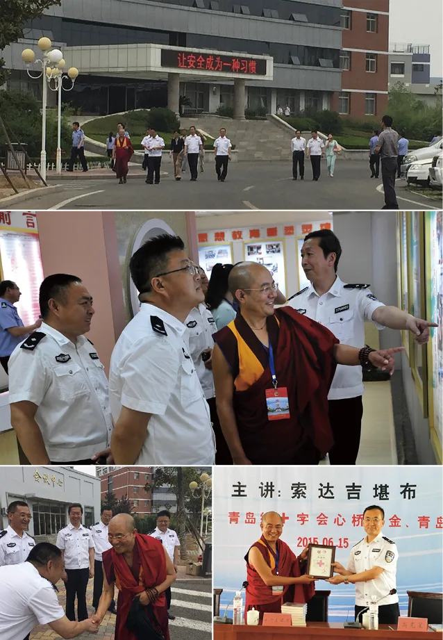
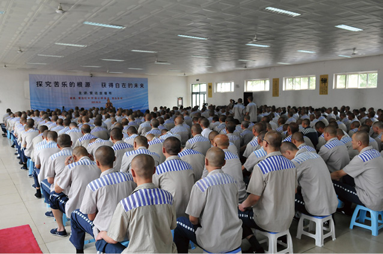

山东青岛监狱

Qingdao Prison, Shandong

中国·青岛

2015 / 6 / 15

## 探究苦乐根源，获得自在未来

## Search the Cause for a Bright Future

又见面了，我发自内心地欢喜。

每个人都想得到快乐，获得自在，每个人也都有这样的机会和能力——包括你们在内。下面，我们就来聊聊“探究苦乐根源，获得自在未来”这个话题。

## 换个环境而已，什么损失也没有

按照佛教的观点，众生皆具如来藏。在座各位虽然在接受改造，但依然具有纯净的佛性，通过学习和磨炼，依然可以提升自己。所以，我对你们充满信心，也充满期待。

可能有人觉得：“我已经彻底完蛋了！以后即使出去，也会被人看不起，一辈子抬不起头！”这样的想法是比较幼稚的。我以前讲过，梦参老和尚认为自己一生最美好的三十多年，就是在监狱度过的那段岁月。他出去以后，照样弘法利生，完成了广大的事业。去年凤凰卫视采访他时，他说：“无所谓，换个环境而已，关三十三年监狱出来，我什么损失也没有——我把它当成闭关。自己不折磨自己，遇到什么环境，都会快快乐乐。”

所以，大家不要心灰意冷，觉得人生没有翻盘的机会。有时候，获得一次成功不如遭受一次失败。突然跌倒在地，反倒能领悟更多的东西。

我见过很多成功人士，他们有财富、有势力、有威望；我也见过很多失败者，穷困潦倒、一败涂地。这两种人，最初可能都站在同一条起跑线上，后来之所以有这么大的差别，就在于关键时刻的一念。关键一念调得好，就上天堂，调不好就下地狱。在佛教中，这一念的力量叫作业力，是一切苦乐的根源。

每个人的语言、行为和心念背后，都有一股看不见、摸不着的力量。这股力量如果是善，带给我们的就是快乐；如果是恶，带给我们的就是痛苦。比如，如果我们在贪心的引诱下，占有了不属于自己的财物，或是在嗔心的驱使下，对他人进行打骂乃至杀害，就会感受痛苦和折磨。所以，恶心如毒药，尽量不要沾染。

## 出狱后，工资翻了两倍多

监狱是一个人才聚集的地方。你们很多人都非常聪明，在绘画、演讲、唱歌等方面富有天赋，甚至称得上是天才。这里就像一所封闭式学校，让你们断绝与外界的一切联系，手机、电脑一律不用——表面上缺少自由，实际上却有助于培养内心的自律和善的力量。如果大家珍惜机会，一心一意、安安静静地学习，一定能更好地挖掘自己的天赋。

而且，你们比过去的服刑人员幸福多了。上世纪六七十年代，监狱条件特别差，有时甚至会饿死人，执法人员也不像现在这样文明。你们现在可以看到青山绿树，可以呼吸海边的新鲜空气，还是比较有福报的，心里应该感恩。不过，有些人在哪里都怨声载道——对这种不明智的行为，大家千万不要学。

作为一个成年人，要善于思考，反省自己。古希腊哲学家亚里士多德说：“人生最终的价值，在于觉醒和思考的能力，而不只在于生存。”

以前自由自在的时候，你们可能从没思考过人生。现在有大把的时间，正好可以利用起来，好好思考。我认识一个公务员，因为贪污被判了六年。我去他所在的监狱做讲座时，他告诉我说：“我现在把服刑当作培训，每天都拼命看书。这些年专心致志、踏踏实实学下来，已经看了好几百本——以前读大学都没这么认真过！”入狱前，他是一名公务员，每个月工资三千多。出狱之后，由于智慧超群、能力出色，被一家公司聘为总经理，月薪七千多。

当然，人生也并不是有钱才有意义，关键是不能对自己失去信心。

## 皇帝与死囚的死亡之约

有些人刑期比较长，认为已经没有机会。其实，就算这辈子没机会，下辈子也还有机会。我们今生的不如意，大多源于前世的恶业，如果现在发愿，今后乃至生生世世，都好好做人，不造恶业，来世肯定会获得快乐的人生。

当然，这只是最坏的打算。实际上，一切都是无常的，有些事不一定要等到来世。如果摆正了心态，很可能出现奇迹。

《资治通鉴》里讲过一个故事：唐太宗反对严酷的刑法，对死刑的审核尤为谨慎。因为人命关天，他规定了“三复奏”，即要向皇帝禀告三次，才能判一个人的死刑。后来觉得“三复奏”不够，他又改为“五复奏”，力求不冤杀一个好人。

有一次，有三百九十名犯人经过五复奏，依然被判死刑。唐太宗问：“你们死前有什么心愿？”大家都说，想回家看望父母妻儿。于是，唐太宗做出了一个惊人的决定：“我现在放你们回去与亲人团聚，但你们必须遵守一个约定——明年九月初四准时返回受死。”

一位大臣担心他们有去无回，便上前提醒。唐太宗说：“我相信，他们不会辜负我的信任。”

到了约定日期，三百八十九名死囚如期而至，一人因病迟到了一个时辰。他们因为信守承诺，从容赴死，感动了所有的人，最后得到了唐太宗的最高奖赏：全部赦免。[^1]

上个世纪80年代，邓小平也给三百多万人平反过，纠正了很多冤假错案，为很多人重新燃起了人生的希望。

任何人身上都可能出现奇迹，所以千万不要放弃自己。我遇到一些服刑人员，因为六七十岁才释放，心里比较悲观。其实，六七十岁也不算晚。如果真的有能力、有智慧，不管什么时候，都可以从头开始。就像原红塔集团的老总褚时健，因为贪污被判无期，后来减为有期，七十多岁保外就医，出去后承包了一片荒山种橙子，最后成了亿万富翁。

重新做人并不是一句空话，只要有勇气，不可能就会成为可能。

## 永远有人对你不离不弃

各位觉得自己苦，其实家人比你更苦。如果大家自暴自弃，一而再、再而三地重蹈覆辙，那非常对不起自己的家人。

汉地的情况，跟藏地好像有点不同。在藏地，如果一个人进了监狱，他的家人不会受到歧视。而在汉地很多地方，儿子犯了法，父母就抬不起头，周围全是指指点点；父亲犯了法，孩子就没脸见人，上学会被欺负，于是慢慢荒废学业，很可能也走上犯罪的路。到最后，两代人都进了监狱，只留下家中老人无依无靠。最可怜的是老父老母，日夜想念孩子，盼他早日回家。而等到孩子出狱，他们可能已经在思念中离世了……

我相信，各位都非常挂念自己的父母妻儿。如果真的为他们着想，就要好好认罪、努力改造，所作所为守规矩，尽量减少服刑的时间。

最重要的是改变心态，不要整天抱怨，认为别人都很坏，唯有自己无辜受罚。要正视自己的错误，承认自己的过失，言行举止尽量调柔一些。还要提升心力，不被脆弱打败。心力强大的人，什么都可以轻松面对。否则，哪怕有再大的成就，也会在挫折面前倒下去。

## 一束花的巨大力量

再给大家讲一个故事：

在美国华盛顿，有一个保险公司的营销员，叫乔治。一次，他去花店为女友买花，认识了花店的老板——本。不过，两人只是认识而已，乔治在那里只买过两次花。后来，乔治为一位客户理赔时，被客户无端控告，最后以诈骗罪入狱，刑期十年。听到消息，女友无情地离开了他。

乔治在监狱里痛苦万分，几乎快要疯掉。这个时候，却突然有人来探望。乔治在华盛顿没有一个亲人，他想了半天，也想不出到底是谁。来到会见室，他惊讶地看到了花店的老板本。本给他带来了一束鲜花。看到美丽的鲜花，乔治心里萌发了一丝生机，似乎看到了人生的希望。之后，他在监狱里大量地阅读，刻苦钻研电子科学。

由于他表现良好，第六年就提前释放了。他先在一家电脑公司做雇员，不久开了一家软件公司。两年后，他身价过亿。

成为富豪的乔治，去看望本。这时的本因为破产，已经搬到乡下，一家人贫困潦倒。乔治把本接了回来，给他买了一套房子，还在公司为他留了一个职位。乔治对他说：“你当年的那束花，让我感受到人间的温暖，给了我战胜厄运的勇气。无论我为你做什么，都不能回报你给我的帮助。所以，我想以你的名义成立一个基金会，让天下不幸的人都能感受到你博大的爱。”后来，乔治捐出一大笔钱，成立了“华盛顿·本陌生人爱心基金会”，帮助了很多需要帮助的人。

我讲这个故事，是想告诉大家，不论你在这里待五年、十年还是二十年，都要利用这段时间学点东西。我经常把监狱比作封闭式学校，因为远离俗世的打扰，所以能安安心心学习知识技能，或者观观心性、念念咒语，重新定位未来的人生。如果只在这里混日子，动不动就打架滋事，表面上很过瘾，实际上错失了大好机会。

无论什么时候，我们都要用智慧观察利弊，不能莽撞行事。

## 不要把偶然当必然

有些人过度追逐金钱或权力，最后犯了错误。其实，钱权都是身外之物，没有多大意义。《金刚经》中说：“一切有为法，如梦幻泡影，如露亦如电，应作如是观。”荣华富贵、位高权重，都是因缘和合的产物，就像梦幻、水泡、彩虹、水月一样无常，虚幻，根本不值得执著。

大家看新闻就知道，很多人的人生都会在顷刻间发生改变。有些政界人员级别很高，最后也毫无征兆地锒铛入狱。之所以这样，并不是因为他倒霉，或人缘不好，而是有众多因缘在背后起作用。万法都是因缘所生，因缘一旦成熟，谁也躲不掉那个果。

美国心理学家提出的“踢猫效应”，可以简单解释一下何为因缘。比如一个女人，在家跟丈夫吵了架，去单位又被老板骂，因为心情不好，就打孩子发泄；孩子心里窝着火，就狠狠踹身边的猫；猫不开心，就在家里乱抓乱咬，弄得到处一片狼藉。家里狼藉是一个结果，看似与猫有关，实际上却是众多因缘共同促成的。

如果详细分析，你们现在身处监狱，也不是单单因为某一个人或某一件事。一直往前追溯，还跟你们的学校教育有关，跟家庭教育有关，跟身边朋友的影响有关，甚至跟前世根深蒂固的习气有关……总之，是众因缘的和合之力，把你们推到了这里。只要有一个因缘不具足，你们都不会走到今天。

黑格尔在《生命的哲学》中，讲过这样一个故事：一个年轻的死囚被押赴刑场时，一个围观的老太太突然喊了一句：“你们看，他金色的头发多么迷人，这孩子太可惜了！”即将告别人世的年轻人听了老太太的话，朝她深深地鞠了一躬，含着泪大声说：“如果我周围多一些像您这样的人，我今天就不会站在这里！”

因缘非常复杂，凡夫根本看不清，只能随缘。你们已经到了这里，暂时没办法改变，那就坚强地活下去，不断地学习，不断地磨炼自己、提升自己，静静地等待时机。

## 劳动竟然有不少好处

我们心的力量是非常强大的，有了它，再平凡的人也可以变得伟大。在佛教历史上，六祖惠能大师早年以卖柴为生，连字都不认识。有一次，他在卖柴的时候，听到有人读诵《金刚经》，内心有所领悟。后来依靠自己的努力，通达了万法真相，成为禅宗第六代祖师。

所以，大家不要认为：“将来就算出去了，工作也丢了，妻子也跑了，谁都看不起！”这些都没什么。如果换作是我，大不了到一个陌生的地方从头开始。

还有人觉得自己笨，什么都不会，比较自卑。其实，笨并不是大问题，你再笨也比不上佛教历史上的周利槃陀。周利槃陀生性愚钝，不管学什么，学了就忘，根本记不住。后来随哥哥出家，哥哥教了他短短的四句教言，他背了三个月也没背下来。

实在没办法，佛陀就让他一边扫地，一边念“扫尘、除垢”四个字。结果还是念了前面忘后面，背了后面忘前面。不过他心态比较好，每天坚持为僧众扫地，非常勤恳。最后业障清净，证得了圣果。

其实，扫地既是一种改造，也是一种忏悔，其真正的意义，是清扫自己的心地。佛教禅宗有一句名言：“扫地扫地扫心地，心地不扫空扫地，人人都把心地扫，世上无处不净地。”

在这里，我看到很多人都在劳动，觉得非常好。劳动虽然有点累，有点枯燥，却可以遣除罪业，完善人格。比如，以前你特别有钱，特别傲慢，现在变成了普通人，慢慢养成平常心，坏习气就会改变。

从佛教的角度，若想忏悔罪业、改造自己，需要做一些事情。公元1000年左右，藏传佛教有一位伟大的上师，叫阿底峡尊者。他从印度来到藏地之后，每天都会用泥巴做一种小佛塔，我们叫作擦擦像。做擦擦像是体力活动，非常辛苦，弟子们请求尊者：“像您这么伟大的上师，怎么能做这些事呢？还是我们来吧。”尊者拒绝道：“难道我自己的饭，你们也要替我吃吗？”

像阿底峡尊者这样的高僧大德，每天还要如此辛苦地忏悔业障、积累福报，何况我们这些普通人呢？

## 聪明的商人喜欢下雪

此外，念诵金刚萨埵心咒“嗡班匝儿萨埵吽”，也可以忏悔罪业。在台湾、澳门和新加坡，有很多服刑人员都在念这个咒，发自内心地忏罪。

人生的牌有各种打法，你们过去拿了一手烂牌，给自己和家人都带来了痛苦，今后应该换一换。而真正有忏悔心的人，由于放下了狂躁，人生可以重新洗牌。

有人认为，人生的路只有一条，失败了就再没有希望了。我却觉得，人生的路四通八达，这一条走不通，可以换另一条。佛教讲“万法唯心造”，大家只要真心改错，今后很多愿望都可能实现。

去年我给大家讲过，只要心是自由的，即使身体被约束，也照样可以过得洒脱、快乐。所以，真正的成功是心的成功，真正的自由也是心的自由。

你们每天服从军事化管理，吃饭睡觉都有规矩，这样其实挺好。人毕竟不是动物，不能想什么就做什么。像我们出家人，行住坐卧也都有约束，吃饭有吃饭的规矩，穿衣有穿衣的规矩。三十多年来，我一直穿着这身僧衣，如果哪天换成西装，就会违反规矩。表面上，受约束是一件痛苦的事，但反过来看，这样的不自由是一种人生训练，能造就全新的自由。

相比之下，外面的世界虽然很自由，但很多人都不愿意学习，也不愿意自我反省，更不愿意被人监督，所以很难有真正的成长。如此换个角度一想，也许就豁然开朗了。

我们藏地有一句谚语：“聪明的商人喜欢下雪。”一般来说，下雪天路上堆满积雪，马队很难走，是一件让商人头痛的事。聪明的商人为什么喜欢下雪呢？因为不会有小偷来偷马，否则，雪地会泄露他的足迹。

所以，一个人只要有智慧，看什么事都是好事，而不是障碍。

## 几点期望

最后，希望大家能找到几颗心：

第一，忏悔心。以前的事，自己确实有错，所以应该真诚地忏悔。对过去犯下的错，要像吃了毒药一样后悔，下决心改头换面、重新做人。

第二，坚强心。不管什么人，一生都会遭遇困境。有时候，我会问自己：“如果被关进监狱，我会怎样做？”我会把它当成修行的机会。历史上，很多高僧大德都把监狱当作修行的道场，在里面不但不打架，而且帮助大家，给大家做心灵辅导，令人非常钦佩。所以，我也希望各位能在逆境中保持坚强，不要太脆弱。

第三，精进心。希望大家精进学习，努力掌握一些新知识和新技术。狱中虽然很苦，但只要精进学习，不荒废时间，苦中也可以有乐。这样的话，即使被关上十年八年，一切也来得及。

第四，欢喜心。我们不管遇到什么事情，都不能失去欢喜心。事情已经发生，愁眉苦脸有什么用呢？不如看开一点，微笑面对。就像有些修行人，无论到哪里，无论吃什么饭菜、住什么房子、干什么工作，都开开心心的，再大的困难都无所谓。我们应该学习这种态度。

第五，利他心。很多人之所以走到今天，归根结底是因为过于自我保护、过于自私自利。如果你身口意跟菩萨一样，一直考虑众生的利益，绝不会落入人生的困境。所以，从现在开始，我希望大家对周围的每一个人，不管熟不熟悉，都尽量去利益他们。

第六，感恩心。希望大家能远离抱怨，感恩所有的人，哪怕他以前伤害过自己。心怀感恩的人，白天心情平和安稳，晚上睡觉特别香甜。我教你们一个动作：双臂交叉，同时与两边的人手拉手，然后一起说：“感——恩——你——”

总之，有了忏悔心、坚强心、精进心、欢喜心、利他心和感恩心，大家今后一定会快乐的。

现场互动

问：您赠予我们的《苦才是人生》《做才是得到》，我看了好多遍。您在书说：“追求错了，当然痛苦。”“学佛后，你会发现一种莫名的欢喜在心里冉冉升起、不可思议。”学佛以后，我自己确实有一些感应，非常奇妙。“众生度尽，方证菩提。”在我心中，您就是菩萨。

请问，您读过《易经》《论语》吗？孔子讲过很多道理，我以前很喜欢。这次接触佛教，发现佛教的慈悲也很感人。您能给我们再讲几句吗？

堪布：我非常喜欢读书，也看过《易经》和《论语》。

孔子活了七十多岁，他一生的智慧由弟子们记录下来，汇集成《论语》一书。里面的很多道理，都值得我们学习。一般读过《论语》的人，都懂得做人的重要。人都做不好，还谈什么修行呢？尤其你们现在的处境，更要学会做人。传统文化有很多这方面的教言，希望大家好好学习。

那天我在候机厅，听到马云的一段演讲——前不久，马云成为中国首富。他说自己刚刚创业时，根本没想过会有今天，他当时只有一个想法：如果创业失败，就把失败的教训讲给别人听。你们也可以把失败当作财富，以后有机会，与更多的人分享。

你提到了佛教的慈悲，非常好。佛教认为，慈悲应该贯穿在我们的日常生活中，因为所有众生都需要慈悲以待，没有一个众生不值得原谅，即使对我们有严重的损害，也要把他当作最好的上师。大乘佛教的这一理念，无论在监狱、大学，还是东西方的文化领域，都散发着不可思议的包容光辉。

我们人一般都很自私，只要对自己不好，就会恨对方。而大乘佛教却强调包容、慈悲，为了帮助他人，甚至可以付出自己的生命。这种精神，我们每个人都需要。有了慈悲，心量就可以打开，什么事情都能接受。

问：菩提心就是善心吗？可当今社会有种现象，老人摔倒了，围观的人却不敢上前施救，怕被赖上。针对这种情况，该如何发菩提心？

堪布：菩提心是一种善心，但层次比较高——希望所有众生都能得到暂时和究竟的利乐。而其他的不杀人、不偷盗等，只是普通的善心，没有菩提心的境界深广。一个有菩提心的人，不管对什么众生，都会全力以赴地帮助。

现在确实有很多不好的现象，比如老人摔倒了没人敢扶。当社会的道德风气整体下滑时，很多人就会只考虑自己，不考虑别人。但我们遇到这种情况，就算会被冤枉，也要去扶。这对推动社会的良性风气，有非常重要的作用。

其实，佛教提倡的十善[^2]特别适合现代人。如果每个人都懂十善的道理，老人摔倒了，不可能没人扶。

问：六祖惠能说：“何期自性？本自清净。”这个自性到底是什么？

堪布：六祖在《坛经》里讲的这个自性，是指我们心的本来面目。心的本面原本就是清净的。为什么呢？因为它是空性的。当我们生起贪心、嗔心、嫉妒心的时候，如果详细观察，它们的本体就像虚空一样，没有任何垢染。所以归根结底，心的自性就是清净的如来藏。

问：入佛门要先皈依，希望您老人家慈悲，为我们想学佛的人做个皈依好吗？

堪布：我下面念三遍皈依偈，你们如果有兴趣，可以跟着念。没有兴趣的，不念也可以。

有了皈依戒，成为三宝弟子以后，对自己要有一种约束。平时的行为要如理如法，还要多念金刚萨埵心咒“嗡班匝儿萨埵吽”、观音心咒“嗡玛呢巴美吽”或者“南无阿弥陀佛”。尽量一边观想佛菩萨，一边默默念诵。

下面，我念三遍梵语的皈依偈，想皈依的可以跟着重复。

（堪布传授皈依戒）

问：有时候，我们对父母妻儿的痛苦，会感觉无能为力。自己的心如果安定不下来，对改造和修行也不利。请问，怎么解决这个问题？

堪布：的确，很多人除了自身感受痛苦，还会因为对家人无法尽责而愧疚。

不知道你们的情况如何，在我家乡，有些服刑人员经常跟家里要钱，感觉不是太好。在这里有吃有穿，基本生活都能保证，没必要给家人增加负担。

大家无论要待多长时间，都应该努力改造自己，争取缩短刑期。同时要宽慰家人：“我现在非常好，不要担心。”还应该多学点东西。出去以后，有个一技之长可以谋生，家人会比较欣慰。

总之，再苦也要坚持，千万不要放弃自己。家人要坚强，你也要坚强，双方都像松树一样，扛住寒冬，等待春来。其实，时间过得很快，机会总有一天会出现。

问：什么是业力？

堪布：我们在田里播下种子，只要具足阳光、雨水等外缘，就会发芽、开花、结果。同样，人的身体、语言和心念传递出来的或善或恶的信息，会像种子一样留在心上，一旦因缘和合，便会结出快乐或痛苦的果实。我们心上善恶种子的力量，就叫作业力。

我们今生的一切苦乐，都跟前世的业力有关；今生播下的业力种子，又会影响来世的苦乐。这是心的循环规律。也许你认为今生是独立存在的，实际上，它的背后有很多力量在起作用。

问：我们入狱，身体上的痛苦都能忍受，可心灵上的痛苦，比如家庭变故、亲人逝去，却很难忍受。怎样才能化解这种痛苦呢？

堪布：家庭变故、亲人逝去，你即使没有入狱，也可能发生，因为一切都是无常的。

现在离婚率那么高，就算你整天守着妻子，也不是没有离婚的可能。至于死亡，谁都逃不过，即使你在家陪着父母，他们总有一天也会离去。所以，对这些人生变故，我们不要特别在意。

我在《苦才是人生》中讲过一个比喻：面对同样的半杯水，悲观者看到杯子一半是空的，乐观者看到杯子一半是满的。事情本身没有好坏，如何看待它，跟自己的心态有关。

我们经历的所有痛苦，都可以变成财富。缅甸的昂山素季被软禁了十五年，1991年却获得诺贝尔和平奖。最近，很多国家首脑都在接见她。其实无常也挺不错，它会让不可能变成可能——只要你的心准备好了。

[^1]: 《资治通鉴》云：“辛末，帝亲录系囚，见应死者，闵之，纵之归家，期以来秋来就死。仍敕天下死囚，皆纵遣，使至期来诣京师。”“去岁所纵天下死囚凡三百九十人，无人督帅，皆如期自诣朝堂，无一人亡匿者。”
[^2]: 十善：永离杀生、邪淫、偷盗、妄语、两舌、恶口、绮语，贪欲、嗔恚、邪见等十种不善业。详见《十善业道经》。
