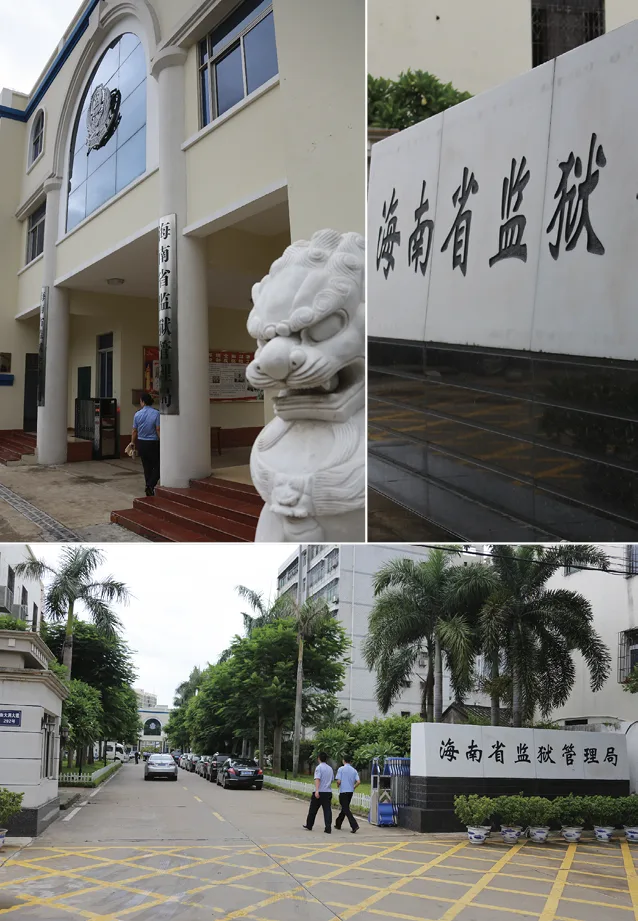
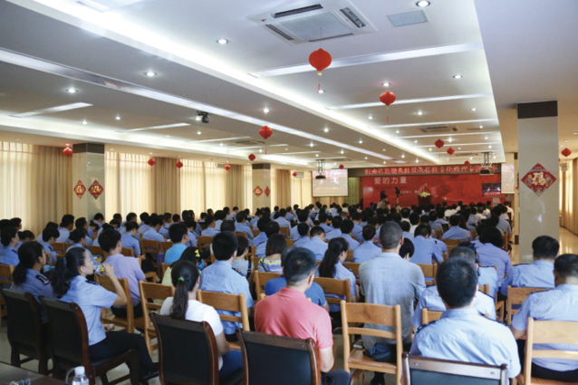
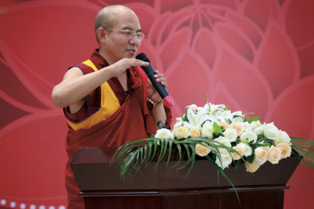
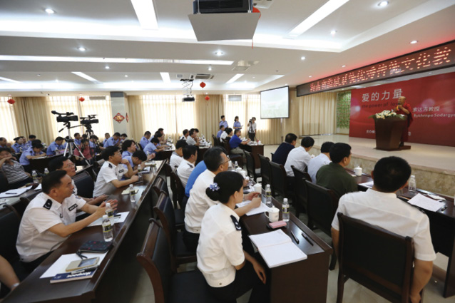
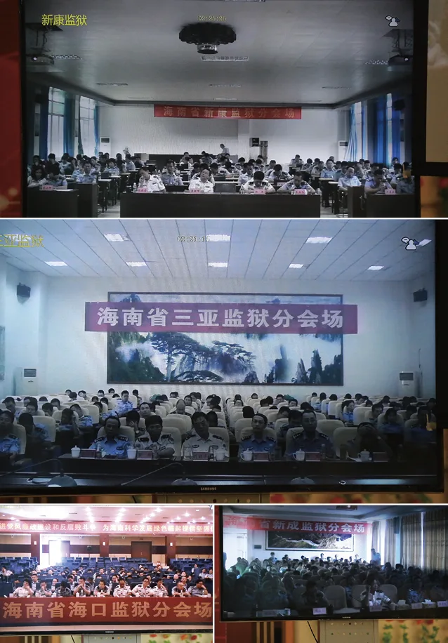
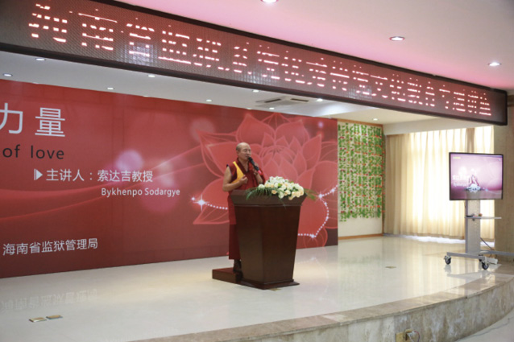
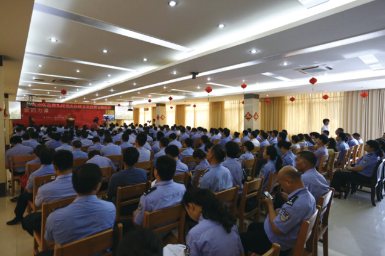

海南监狱

Hainan Prison

中国·海南

2015 / 6 / 23

## 爱的力量[^1]

## Strength of Love

主持人：

尊敬的各位领导、嘉宾、同志，今天，很荣幸邀请到享誉海内外的佛学专家索达吉堪布。接下来，堪布将为大家带来一场别开生面的心灵演讲，题目是《爱的力量》。演讲之后，会有一个小时的交流互动，希望大家踊跃提问。

索达吉堪布是四川喇荣五明佛学院的大堪布，也是当今具有国际影响的佛学专家、翻译家。从2010年起，堪布受邀前往哈佛大学、耶鲁大学、悉尼大学、墨尔本大学，以及香港大学、香港科技大学、清华大学、北京大学、复旦大学、浙江大学、厦门大学等近百所国内外著名的高等学府进行演讲，与世界各地的专家学者交流、研讨。堪布还受邀前往厦门监狱、山东省监狱管理局、山东青岛监狱等，为改造人员洒下心灵的雨露。

堪布还发起并参与主办了多届“世界青年佛学研讨会”，与海内外众多专家学者探讨环保、和平等问题，将佛教真理与现代科学相结合，引导世人正确面对学业、感情、工作和人生。

堪布在教学之余，笔耕不辍，将大量的藏文经论翻译成汉文，传讲的教言与出版的书籍累计数字超过千万，先后出版了《苦才是人生》《做才是得到》《残酷才是青春》《能断》《不离》《有求》《你在忙什么》等心灵畅销书，并被译为英、日等多种文字，深受社会各界的喜爱。

海南省监狱系统尝试用优秀传统文化教育改造服刑人员，已经走过了近十年的历程，各级领导和广大干警都付出了辛勤的汗水。在省内外产生了广泛的影响，中央电视台进行了专题报道，《人民日报》发表了内参文章。

尤其是监狱局编写的《中华传统美德教材》，被司法部列为全国通用教材。这部教材融合《弟子规》、《了凡四训》和《太上感应篇》等三部传统经典的内容与结构，而成为一个有机的整体。《弟子规》阐明儒家的五伦八德，《了凡四训》阐明佛教改变命运的道理，《太上感应篇》阐明道家关于因果报应的问题。给服刑人员轮番讲授以后，收效十分明显。

去年三月，习总书记在联合国教科文组织会议上指出，佛教产生于古代印度，传入中国以后，经过长期的演化，同中国儒家文化和道家文化融合发展，最终形成了具有中国特色的佛教文化，为中国人的宗教信仰、哲学观念、文学艺术、礼仪习俗等产生了深远的影响。前不久，总书记接见印度总理时也指出，佛教文化是中华传统文化的重要组成部分，是中国化的佛教。

为了更好地运用优秀传统文化特别是佛教文化，教育改造服刑人员，广大干警首先要提高自己的教育水平。为此，我局特意举办了这次讲座。希望通过本次学习交流，大家能在各自的岗位上，提高个人的修养和境界，大力弘扬奉献精神和爱岗敬业精神，以爱心与人道主义关怀，调动服刑人员接受教育改造的积极性，以监狱民警的良知形象和人格力量，帮助服刑人员转变人生。

下面，让我们以热烈的掌声，有请索达吉堪布给我们授课——

今天，能与在座的各位领导、来宾以及监狱工作人员共同交流，我感到非常欢喜。一直以来，我都非常关注服刑人员的各方面情况。

虽然我一生都在研究佛教，但无论到什么场所，我都不会仅从佛教徒的立场出发。我喜欢将现代科学与传统文化结合起来，真诚地与大家进行探讨。

## 心灵管理是全世界的共识

社会就像一部电影，有正面人物，也有反面人物。现在有相当一部分人，由于违背社会的伦理道德、违反国家的法律法规，不得不入狱改造。然而，尽管如此，他们依然是社会的一分子，我们不能抛弃他们。

在座各位都是从事监狱管理的优秀人才，肩负着改造犯人的重大使命。过去，犯人的改造主要依靠体力劳动，进入21世纪后，越来越多的人开始重视犯人的心灵转变——最高级的管理是对心灵的管理，这已经成为全世界的共识。

说到心灵的管理，就不得不提到宗教。全世界所有的宗教，包括基督教、伊斯兰教、佛教、印度教等，都是直接针对心灵管理的。有些宗教已有四千多年的历史，有些则有两千多年的历史。佛教是中国传统文化中儒释道三家的重要组成部分。儒家、佛家和道家的主体思想都在公元前500年左右形成，三家的创始人——孔子、释迦牟尼佛和老子，也大致生活在同一时代。佛教是中国传统文化中儒释道三家的重要组成部分，历经两千多年，完整保存至今。

关于佛教，中国科技大学的前校长朱清时教授曾说：“当科学家千辛万苦爬到山顶的时候，佛学大师早已在那里等候多时了。”有一次，当我与他交流时，问他：“您作为中国科技大学的前校长，多年来一直研究科学，为什么对佛教有如此高的评价？”他告诉我，这种观点来自他多年的研究成果。

在当今时代，科学发展是主流。随着新兴科技不断诞生，为人类提供各种生活便利，人类越来越重视物质的发展。然而，我们可能需要更多的思考，是否忽略了更为重要的心灵世界。不管人类社会如何发展，都不能轻视心灵世界。只有从心灵中挖掘潜力，才能不受物质的控制，随时感受到身心的安乐。据说你们十多年来一直研究传统文化，以保护和继承人类珍贵的心灵财富，这在当前，是非常重要的一件大事。人类社会的发展，不能只依赖经济，不能只注重财富的积累。努力在智慧、道德等精神层面提升自己，可能更为重要。

## 监狱不空，誓不提拔

当然，有些年轻人可能不信佛教，认为是一种迷信。其实不信也无妨。无论信仰与否，都是个人的自由。但即便如此，对于有些问题，我们依然可以互相探讨。

佛教中有一位地藏王菩萨，他曾发愿：“地狱不空，誓不成佛，众生度尽，方证菩提。”成佛虽然是修行人追求的终极目标，但地藏王菩萨因为悲悯受苦众生，宁愿放弃成佛解脱，而选择入于地狱，救度那里的可怜众生。甚至在地狱未空、众生未度尽之前，他绝不求取最高的佛果。

在佛教中，对地藏王菩萨的恭敬和赞叹，甚至比对佛陀还多，因为他有无与伦比的奉献精神。同样，你们在人间管理的人群比较特殊，某种程度上，工作性质也类似于地藏王菩萨，服刑人员类似于人间的地狱众生。服刑人员的心理、性格和行为比普通人恶劣得多，他们的痛苦也比普通人大得多。要管理这样一群人，与他们善巧地沟通，成功地引导他们，自己若没有一定的智慧和境界，是非常困难的。

有些人对自己的工作并不喜欢，看到同学朋友在条件更好的单位享受优厚待遇时，便非常羡慕。不过，也有相当一部分人热爱这份工作，觉得服刑人员虽然难以调伏，但如果耐心去教化他们，对社会是一大贡献。这种精神非常值得赞叹，和地藏王菩萨一样了不起。地藏王菩萨说“地狱不空，誓不成佛”，你们选择在监狱里帮助服刑人员，“监狱不空，誓不提拔”，尽一切努力履行自己的使命，把这当成人生中最有意义的事业。

## 再坏的人，也有血有肉

其实，服刑人员虽然犯了法，但他们依然是有血有肉的生命，与我们一样，渴望离苦得乐。如今，他们已经陷入了人生的最低谷，我们不应再舍弃他们。

一个人犯了大错，虽然从法律和佛教的角度来看，都应受到相应的惩罚——即使佛陀提倡慈悲，但对于违反僧团戒律的人，佛陀也会先进行警告，然后给予处分，严重者甚至会被逐出僧团。然而，对于犯错者的惩罚方式，我们需要认真考量。

我曾见到一些狱警在管理上过于冷酷苛刻，缺乏人性的关怀。他们认为自己是管理者，而服刑人员低人一等，认为可以任意惩罚。实际上，即使是死刑犯，也有血有肉，犯罪往往只是因为一念之差，不应被视为十恶不赦、罪大恶极。

谁也不会永远身处高位，谁也不会永远低人一等，人的地位高低很容易发生变化。有些人曾经位高权重，但短时间内也可能被判无期徒刑。既然地位是变化不定的，我们就不应以一成不变的眼光看待服刑人员的处境，而应尽量以温和的态度对待他们。

上世纪七八十年代，监狱中经常发生打骂等恶性行为。而如今，各地的执法手段已经变得相当文明，这无疑是一种进步。有些监狱领导告诉我，现在的犯人既不能打，也不能骂，他们不听话还自认为很厉害，管理起来很难。其实在这种情况下，可以尝试使用爱的管理方式。

具体该怎么做呢？首先要认识到，所有服刑人员和我们一样，都希望远离痛苦、获得快乐，然后尽量换位思考，站在他们的角度上，理解他们为什么会那样做，然后以关爱的态度开导他们。

对于各位而言，唤醒内心的慈悲，以和善的方式对待服刑人员，虽然充满挑战，但却是一次自我成长。如果你心中有爱，你的人生就会充满机遇，有时甚至会遇到意想不到的幸运。

## 让禅修在狱中遍地开花

作为监狱的工作人员，提升自身的修养和境界至关重要。如果我们自己感到烦乱和痛苦，就很难真正管理好服刑人员。

我曾去过许多国家的监狱，包括美国在内，很多国家都在监狱中推行禅修，并取得了显著效果。苹果公司创始人乔布斯每天上班前都会进行五到十分钟的禅修，以使心灵平静。在他需要做重大决策时，更是如此。因此，我建议大家也通过禅修来调整自己的心态。

我们的内心常常会生起贪执、嗔恨、愚痴等烦恼。如果不懂得调整，这些情绪会直接影响我们的工作、家庭和身心健康。然而，如果掌握了一套禅修方法，内心就能获得平静。当感到心烦意乱、焦虑不安、工作力不从心时，可以试着通过禅修来进行调整，这非常有效。

在坐禅时，可以观想一个物体，然后将注意力集中在上面；或者用心观心，思考“我的心从哪里来？住在什么地方？去往何处？”当你愤怒、贪婪、茫然或烦躁时，就可以用这种方法。此时你会发现，烦恼的本性了不可得。安住在这种境界中，可以让自己放松下来。

当然，要达到这样的境界需要不断训练。即使无法完全达到这种境界，禅修也能让我们保持平静的心态，提高工作效率，更轻松地帮助和疏导服刑人员。因此，我认为在监狱中推广禅修，是非常有必要的。

实际上，禅修不是一种宗教形式，而是一种智慧。在美国，哈佛、耶鲁、斯坦福等许多高校都不允许在校内传播宗教——我以前认为美国是一个宗教自由的国家，实际上他们对宗教的管理非常严格，教授们只能在自己负责的宗教领域做研究，不能随便跨越。然而，他们虽然限制宗教，却允许禅修在高校内推广。据说在英美国家，有70%的学校明确要求学生可以进行禅修。

禅修确实值得推广。早在20世纪90年代，印度的不少监狱就开始提倡禅修。狱警在日常工作中可以通过禅修来调整心态；服刑人员在劳动改造的空隙，利用短短的五到十分钟进行禅修，静心反思自己的过失，观察自己的心态，也是非常有必要的。

心灵管理的效果，远远胜过木棍和电棒等暴力手段。因为无论是什么身份的人，都需要心的平静和爱的温暖。

## 耶鲁大学的研究表明：爱是有力量的

美国约有四十所大学经过十年的跟踪调查和数据分析发现，只要有爱心，就能以不同的方式得到回报。这一点与佛教“善有善报、恶有恶报”的理念完全一致。

尽管“善有善报，恶有恶报”的规律在表面上可能不太明显，有些年轻人因此认为，好人不一定有好报。但实际上，喜欢行善的人，将来会从各个方面得到回馈。例如，当你今天发善心帮助某个人，这种善的力量就会成为一颗种子，将来在你的事业、家庭等方面成熟。科学已经证明了这一点。

有一项研究成果来自耶鲁大学。他们经过九年的时间，对七千人进行了心理跟踪调查，结果发现，如果长期浸润在爱心里，爱会变成一种善妙的因，给人带来快乐；而经常陷入愤怒和暴力情绪的人，这些烦恼会变成一种毒素，引发各种疾病，影响生命质量。因此，我们的心中不应充满抱怨和暴力情绪，而应尽量保持爱的状态。

一些年轻人不仅对宗教和传统文化了解不多，对现代科学也知之甚少。所以，我提到的这些科研成果，可能很多人不太清楚。但不管怎么样，希望大家能够不断学习和了解，这一点非常重要。

## 物质与精神的平衡

现在许多年轻人认为，生活中最重要的是金钱，要买车、买房。当然，生活在大城市里，基本的物质条件确实重要，但如果把人生的一切建立在物质上，内心没有更高的精神追求，整天只顾吃吃喝喝，白天谋生，晚上睡觉，一辈子的奋斗都是为了自己，这连动物也能做得到——它们也会吃吃喝喝和繁衍后代。但我们人类是万物之灵，一生的追求怎么能跟动物一样呢？

我们的人生目标不应太狭隘，只想着赚钱、升职，而应将眼光放长远，考虑到十年、二十年，甚至一百年后，哪些行为对人类有利，哪些有害。有了这样的情怀，自己每一天都会变得意义重大。

当然，你们每天与犯人在一起，可能感到烦躁、疲惫、苦闷，好像自己也成了犯人，没有一点自由。其实，人不一定需要太多自由。在某种意义上，我们出家人的生活，与你们的工作有相似之处。我们也有固定的穿衣规矩、作息时间、修行安排，并没有太多自由空间。

有些人认为：“现在是开放的时代，为什么要有这么多约束？”我个人认为，自律还是需要的，吃饭守规矩，穿衣守规矩，做事守规矩，这样才能避免各种散漫。否则，过度放任自流，不一定会带来好的结果。

## 让枪口抬高一厘米

当然，守规矩虽然重要，但更重要的是要有一颗善良的心。当规矩与良心发生冲突时，最好不要违背自己的良心。

去年我在德国的时候，特意去看了柏林墙遗址。东德和西德在统一之前，中间竖立着一面柏林墙。当时有个规矩：凡是翻越柏林墙的人，都会被射杀。有一次，一个军官看到一个人正在翻墙，就开枪打死了他。东德和西德统一后，对战犯进行审判时，这名军官被列入了审判名单。

法庭上，军官的律师辩护道，军官开枪是执行命令，不应该受到处罚。法官却认为，虽然他是在执行命令，但可以把枪口抬高一厘米，放对方一条生路——当规定和良心冲突时，人应该听从自己的良心。

这是真实发生在德国的故事。给我们的启发是，当执行任务违背良心时，应该保持一颗善良的心。这颗心不仅自己需要，他人需要，乃至整个人类都需要。只有善良，才能创造世界的美好。虽然有善必定有不善，我们却不应该容忍这种不善发生在自己身上，否则，无论对自己还是他人，都是一场灾难。

作为监狱的管理人员，平时接触的人，不是杀人犯，就是抢劫犯，算得上是高危人群。但你们仍然可以用爱心去引导他们、帮助他们，这样工作会更有意义。

除此之外，你们还可以进行一些有价值的研究。例如，研究这些犯人的人生，包括他们犯罪时的心理活动、入狱后的心理变化。这样的真实记录，积累十年二十年后，将成为一份极有价值的资料。我以前看过一个狱警的日记，里面记录了当时的社会背景、犯人的普遍心态、他的工作环境等。看完之后，我对相关情况有了更清晰的认识，觉得特别有现实意义和历史价值。

其实，和犯人的接触方式，可以根据需要进行切换，有时候以狱警的身份，有时候以朋友的身份。曾有一档电视节目，展现了一对狱警和犯人的深厚友情。那名犯人在音乐方面很有特长，出狱后还专门写了一首歌，献给那位狱警。后来，两人一起登上了那期节目，场面非常感人。所以，人与人之间不应该只是领导和被领导的关系，还应该让爱成为共同的理念。

## 一位流浪汉的心灵坚守

在佛教中，修行人非常注重培养自己的慈悲心。所谓慈心，是希望众生得到快乐；所谓悲心，则是希望拔除众生的痛苦。真正拥有慈悲心的人，会希望所有众生无条件地获得快乐、远离痛苦，并为此不懈努力、付出一切。尤其是发了慈悲心的大菩萨，他们会最大程度地解除众生的痛苦，赐予众生安乐，甚至选择趋入地狱、饿鬼、旁生等三恶趣度化有情。

这种慈悲心就是一种爱。爱的力量有大小之分：世间人的两情相悦，以及对父母、孩子、朋友的爱，都只是小爱；将这样的爱推及所有生命，包括动物在内，才是大爱。这样的大爱非常难得，即使我们做不到平等地关爱人和动物，也要努力做到平等地关爱所有的人。

如果这个世界没有爱，将会被利己主义控制，每个人都极度自私，无法获得真正的快乐。今年，哈佛大学校长德鲁·福斯特在毕业典礼上，用比喻强调了世界需要爱的理念。她说：“这是一个自拍还有自拍杆的时代。仔细想想，如果社会里的每个人都开始过上整天自拍的生活，这会是怎样一个社会呢？世界只是暂时属于我们，我们肩负着过去和未来的责任。真正的我们，要比我们自己和我们的自拍照要广博得多。”

如今的社会，各个层次的人似乎都只关心自己，只在意自己的工资涨不涨。昨天，我在海南大学作了《做才是得到》的主题演讲，核心思想是财富的增长需要靠自己的勤奋努力。为什么要讲这些呢？因为现在很多年轻人只想轻轻松松、舒舒服服地工作，事情要干得少，钱要拿得多——最好什么都不干，钱就从天上掉下来。他们茶余饭后谈论的，也都是钱、钱、钱。

其实，现在的人们并不太缺钱。与上世纪七八十年代相比，现在的生活已经富裕了许多。然而，随着财富的增长，我们的欲望也在不断膨胀。即使有一天拥有比尔·盖茨、巴菲特、马云、李嘉诚的财富总和，也不一定会满足，依然会想要更多。这种无止境的欲望对自己非常有害。

一个人的福报与命运息息相关，强求是得不到想要的东西的。所以，不该做的事、不该得的东西，不要去做、不要去拿。在任何环境下，与自己有缘的工作，要踏踏实实地去做，不要整天不切实际地白日做梦。

现今，经济发展越来越迅速，但伦理道德和宗教信仰却在逐渐丧失，犯罪率也越来越高，这是非常不好的现象。按理说，社会经济发展了，人们的生活应该越来越好，幸福感越来越强，犯罪率越来越低。但是，如果一个社会的人们都在欲望的驱使下，不择手段地追求利益，导致许多社会问题的产生，那么幸福和快乐将无从谈起。

我们这一辈子，不一定非要过得富裕。有时候越富裕，反而越不开心。我遇到过很多富人，他们的财富多得数不清，几百万、几千万对他们来说只是一个数字，但他们内心并没有得到真正的快乐。其实，只要不违背良心，不做违法的事，贫穷一点也没有什么。

美国有个流浪汉，一直流落街头，过着贫寒的生活。有个记者想了解他的内心世界，主动接近他，询问他流浪的原因。刚开始，流浪汉并不愿意讲。后来，他觉得记者很真诚，就说了自己的经历。

流浪汉说：“我年轻时是一名士兵，被国家派往伊拉克。我们的任务是维护公平和正义，推翻独裁统治，帮助当地人获得自由和人权。然而，上级军官却命令我们开枪射杀当地平民。我不愿杀害无辜，所以拒绝了命令。法官认为我不服从命令，判我违法。之后，我被遣送回国，在监狱里关了180天。出狱后，我失去了合法的身份和地位，家人也离我而去。我无家可归，只能选择流浪。”

即便如此，他依然不后悔。他告诉记者：“我现在一贫如洗，什么也没有，看上去很可怜。可是，我的内心却充满欢喜，因为我的枪没有杀过无辜平民。如果当初开了枪，那我的枪不干净，心也不干净。现在我成了流浪汉，身体不干净，但心是干净的。我宁愿过流浪的生活，也不愿违背良心杀害无辜。”

这个故事，每个人可能都会有所触动。

## 监狱：修行的理想之地

对你们来说，监狱不仅是研究的好地方，也是修行的理想之地。从更高的佛教追求来看，监狱是修行的最佳场所。如果我有你们这份工作，会将其视为修行的一部分。

在你们的团体中，其实有很多无私奉献的人。我曾读过一位狱警的文章，讲述他三十多年管理监狱的工作经历，深受感动：“世界上还有这样舍小家、为大家的人。他的行为，就像佛教中所说的，‘亏损失败自取受，利益胜利奉献他’。”虽然小家和大家难以两全，但内心有力量的人，做什么都比较容易。如果缺乏精神支撑，即使事情简单，做起来也会困难重重。因此，我希望大家能不断思考，特别是从传统文化中汲取营养，滋养自己的心灵。

你们的工作对象是服刑人员，任务是改造和教育他们。现在很多服刑人员水平很高，有些是电脑高手，有些是某个领域的专家，只因一时冲动而犯罪入狱。要改造这群既聪明又顽劣的人，没有一定的知识水平和思想境界是很困难的。因此，大家要多学一些现代知识，同时要努力培养慈悲心和奉献精神。

## 物质的表面繁荣，不是发展的全部

在佛教中，有两个最核心的理念，一个是智慧，一个是慈悲。智慧能通达万事万物的现象和本质，任何人依靠修行，都可以达到这种境界。除了智慧，佛教的另一个特点就是至高无上的爱心，又称为慈悲。这两者也是人类思想的精髓，就像双目和双足，缺一不可。如果没有慈悲，人类的历史将黯然无光；没有智慧，人类的脚步不会走得太远。

与此二者对应的，可以说是宗教和科学，它们的关系也相辅相成。爱因斯坦曾说过：“没有宗教的科学是跛子，没有科学的宗教是瞎子。”只有将科学和宗教结合起来共同发展，人类的未来才有希望。因此，我们应该运用科学创造物质文明，运用佛教为主的宗教创造精神文明。

人类的未来既需要物质的发展，更需要精神的发展。如果不回归宗教，寻求心灵的提升，只信仰金钱和物质，整个社会将充斥着拜金主义和碎片文化，人类的精神世界会日趋低俗。即使满街都是豪车高楼，也只是表面繁荣，不是真正的发展。

这次我来这里，很多人告诉我：“与以前相比，海南现在有了很大的发展。你看，我们的高楼大厦一年比一年高。”房子越来越高固然不错，但更重要的是，我们的智慧和爱心是否也在不断提升？

之前我去北京和山东时，也有人向我夸赞他们的发展。有个人对我说：“您上次来的时候，我们家的车是二十万的，现在已经换成六十万的了。”然而，我并不认为换了一辆六十万的车就是真正的发展。也许，开上六十万的车，生活反而会更痛苦，因为费用更高，压力更大。很多时候，苦乐与物质条件没有太大关系，反而与心灵状态直接相关。如果心态没有调整好，即使物质再丰富，幸福快乐也是遥不可及。

总之，今天给大家分享了培养慈悲和爱心的重要性。爱的力量不可思议，它可以消除我们的痛苦，改变他人的行为，将荒芜的沙漠变成绿洲，让我们的世界变得越来越美好。

现场互动

问：请问“自他”如何理解？

堪布：自他是指自己和他人。广义上，“他”不仅包括男性的他、女性的她，还包括动物的它。这个词可以涵盖自己、其他人和动物，甚至所有生命。

问：佛教既然讲因果报应，那么罪犯伤害他人也应视为一种报应，这是否合理？

堪布：因果报应的确是不虚的。罪犯在过去世中可能曾伤害或杀害过他人，这些行为如同种子一般，种在他的心田里，一旦因缘成熟，就会显现出结果。因此，今生他再次伤害别人，可能正是他的“同行等流果”现前。

他因今生的恶行会经历各种痛苦，比如法律的惩罚或强制劳动改造。而这些今生的苦难，其实是他前世恶业的果报。监狱的惩罚只是今生的一个层面，后世的报应，如下地狱等，可能更加严厉。

问：作为干警，我们的工作日复一日，常常感到缺乏新鲜感。我们有一个形象的说法：“犯人是有期徒刑，干警是无期徒刑。”因为我们献出了青春，甚至终身奉献，有些民警因此感到前途迷茫、内心彷徨，甚至对职业产生倦怠。我们该如何应对这种情况？

堪布：你的问题非常深刻。有些干警确实认为“犯人是有期徒刑，干警是无期徒刑”，觉得这份工作非常辛苦，我对此并不完全认同。

所谓的有期徒刑和无期徒刑，是指那些在监狱中接受惩罚的囚犯的生活状态。而你们作为狱警，是管理监狱的人员，虽然和囚犯在同一个环境中，但你们的身份与囚犯有着本质的不同。因此，这份工作并不等同于徒刑。

一些干警可能感到日复一日的工作乏味无趣，缺乏新鲜感。其实，人生并不一定需要不断追求新鲜感。台湾有一位法师在监狱中服务了二十九年，依然感到非常满足和快乐，这说明人的感受和态度各不相同。

我也认识一些干警，他们对工作充满热情，认真负责，并且感到工作非常有意义。我在藏地有一位熟人，最初在宗教部门工作，后来被调到监狱局。他问我是否应该去，我鼓励他说：“你一定要去，那里可能有很多需要你帮助的人。”结果，他在监狱局工作了很多年，虽然有过升职的机会，但他选择了留在原岗位。他认为监狱是一个特殊的地方，不仅提供了许多苦行的机会，帮助自己修习安忍，还能让自己利益许多囚犯。

监狱确实是一所特殊的“大学”。常规大学每年有一届一届的毕业生，而你们这里，服刑人员也在持续不断地更换。我去山东监狱时了解到，他们每年接纳两千多人，同时也有两千多人离开——山东监狱的规模较大，人员流动频繁。

作为干警，你们可以选择成为这所大学中有爱心的老师，不仅帮助囚犯改造身体，更要关注他们的心灵改造，这一点尤为重要。如果你们能够善巧地引导那些原本危害社会的人，让他们真正转变成好人，那么你们对整个社会和他们的家庭都做出了巨大的贡献。

如果你们觉得在这里工作与囚犯没什么不同，感到每天都很痛苦，那么即使换到其他岗位，也可能不会太成功。因为那些无法满足现状的人，无论在哪里都难以获得真正的快乐。我接触过很多人，他们不断换工作，对每份工作都感到厌倦，不珍惜，也因此在每个地方都不开心。这种喜新厌旧的态度，其实不利于个人成长。

做一行爱一行是非常重要的。比如我，这身僧衣已经穿了三十多年，平时除了讲课，生活非常简单平淡。无论是监狱、小学、大学，还是其他团体，只要有人邀请我，只要我有时间，都会去分享法义，因为这能帮助他人，非常有意义。对我来说，地位和财富并不是重点。

当然，你们的生活背景不同。我是一个单纯的出家人，而你们有家庭、有责任。为了家庭的幸福，你们可能会渴望升官发财。这种心情可以理解。

然而，升官发财本质上都是虚幻的。佛教教导我们：“一切有为法，如梦幻泡影。”财产和地位实际上如水泡般虚无，并无实质意义。因此，评判一份工作的好坏，不应仅仅依据是否能带来更多的财富。

我认为，如果能把监狱看作是一所值得珍惜的学校，踏实工作，认真帮助囚犯改造自己，这将是一份有价值的工作，也能使人生更有意义。若将工作视作无期徒刑，这是一种负面情绪，应该进行调整。如果心态调整好，无论从事什么工作都不会感到疲倦，每天都能非常快乐。否则，日复一日的工作可能会让人变得麻木，对任何事都失去兴趣，成为“老油条”。在佛教中，也有一些人对学习缺乏热情和兴趣，浪费了宝贵的时光，这种现象很可惜。

人生在世，一定要不断学习和进步。就像电脑系统需要不断升级，才能保持正常运行。作为干警，特别需要以积极的心态投入工作和学习。如果能够这样，自己将会过得非常快乐。

总之，囚犯没有自由，而我们是自由的，二者不能等同。

问：儒家、道家、佛家三者之间的联系与区别是什么？

堪布：历史上，三个教派的创始人大致同时出现，都在公元前500年左右。道家主张道法自然，强调内心的和谐与安宁；儒家强调仁义礼智信，注重为人处世的道理；佛教的教义更为广深，涉及三世因果、内在的心灵世界和外在的物质世界等。虽然三个教派的教义不同，但整体而言，都是引领人类在真善美方面不断进步。

我去过山西的一些大学，里面有儒家研究所、道家研究所和佛教研究所，每一个研究所的书籍都不相同。我们通常认为儒教只有《论语》，道家只有《道德经》，佛教只有《金刚经》《心经》。实际上，每个宗派都有丰富的思想和书籍，远不止我们熟知的几部经典。如果深入研究，会发现其中蕴含着丰富的价值和意义。

问：世界上最难的工程是改造人的内心世界。假如您是一位监狱管理者，会如何运用传统文化教育和改造服刑人员？

堪布：首先，如果我是监狱的管理者，我会非常欢喜，因为这份工作很难得，也很有意义。

我们称医生为“白衣天使”，因为他们的医术能使我们的身体健康；称老师为“人类灵魂的工程师”，因为他们能将无知的心灵变得有智慧。同样，作为监狱管理者，我们也可以将一个个迷茫、染污的心灵转变为光明、清净的灵魂。当然，若想获得心灵的最高觉悟，这个过程比较艰巨，按照佛教的观点，需要经过三大阿僧祇劫，精进地积资净障。

内心世界的净化和改造，确实不是一件容易的事。你今天和这个人谈谈话，明天和那个人聊聊天，对方马上就脱胎换骨，这样的情况并不常见。有些犯人的习气非常恶劣，甚至让人感到恐惧。我去监狱讲课时，有时从他们中间走过，心里都会有些害怕，因为他们的眼神中带有一种恐怖的血色，内心充满反抗和敌对。他们的怨恨不仅针对社会，更多的是对所有生命的仇恨。

根据佛教的观点，这些怨恨可能来自生生世世的积累。如此深厚的仇怨，要一下子抚平、消除，是有一定的困难。尤其是那些屡教不改的人，仅靠简单的说教或一两句话，很难有太大改变。

尽管如此，我们仍然要努力去做，尽量帮助他们改好。通过佛教的爱与慈悲、三世因果，或《太上感应篇》等理念，他们应该会慢慢认识错误，弃恶从善。对此，我们要有决心和信心。他们毕竟也是人，在长期的教化下，一定会有所改变。如果我是监狱管理者，我会这样做。

在我们佛教团体中，偶尔也会遇到很坏的人。甚至有些人表面出了家，恶劣习气还非常深厚。我们的管理经验是，在任何人身上花的心血和汗水，最后都会有效果。

总之，我建议用慈悲、因果等传统思想，帮助服刑人员。爱和智慧的教育，是净化心灵最好的方法，但它需要善巧方便，也需要长期努力。

问：随着文明执法、严格执法的要求越来越高，服刑人员的维权意识也越来越强，接受管理的意识越来越弱，甚至连批评教育都接受不了。如果出现服刑人员拒不服从管理教育的情况，民警如何运用慈爱之心去教育他们？如何把握慈爱的度？

堪布：管理的时候，虽然不能舍弃慈爱之心，但必要时也可以像父母对待孩子那样，用一点严厉的手段。

我们知道，父母是非常爱孩子的，但孩子如果不听话，也会用棍棒教训。同样，对特别野蛮的服刑人员，温和的方式有时很难起作用。只要内心不舍慈悲，表面上用一些方便法，吓唬吓唬也可以。

关键是要把握一个度，即使在严格管理时，也要保持内心的慈爱和关怀。让服刑人员感受到我们的善意，而不是单纯的惩罚。通过这种方式，我们可以在必要时用严厉的手段，但最终目的是帮助他们改过自新，走上正途。

问：监狱民警的工作十分辛苦，需要非常强的责任心。目前，有一部分人对这份工作缺乏使命感，如何用爱的力量去改变他们？

堪布：无论在哪个国家、哪个群体，都有一部分人表现得很好，一部分表现中等，一部分表现较差。所以，不仅是监狱民警，任何一个岗位都会有这种情况。

我去学校的时候，很多老师问我：“部分老师没有责任感，我们很头痛。您看怎么办？”我去德国和英国的科研机构，也听到他们发牢骚：“我们是严谨的科研机构，个别人员却没有兴趣。您有什么好办法？”在基督教和伊斯兰教的宗教场所，我也了解到有这种情况。当然，我们佛教团体也不例外。

作为一个英明的管理者，我们应该知道鱼龙混杂是群体的正常现象，有好的，有不好的，也有中等的——中等占大多数。

对没有使命感和责任感的人，我们不应该失去信心，也不应该产生厌离；对爱岗敬业的人，也不要过分喜欢。因为人心无常，人的行为也无常，如果对某个人希望太大，也许过段时间就会失望。

在管理的场合，我们要善于控制情绪，不能因为他人的行为，一会儿失望，一会儿高兴。自己要有平常心。

此外，无论在哪里，学习氛围都很重要。在一个群体内部，如果人人喜欢读书，个个爱好学习，这个群体一定是有希望的。如果大家都不愿意学习，天天只谈金钱、地位，最后可能变得不可救药。目前，在传统文化和知识技能的学习方面，我们可能还需要进一步营造氛围。只要大家共同努力，文明执法的情况会越来越好。

日本企业家稻盛和夫曾说：“从来到这个世界，到最后离开，我们应该有一点进步，而不是倒退。”如果在内部管理上，每天有一点点进步，我觉得很有意义。

问：您今天的话题是“爱的力量”，强调心灵管理的重要性。请问，对服刑人员应该如何进行心灵管理？

堪布：对服刑人员的心灵管理，需要从多个方面入手。

首先，要给他们灌输法律法规和社会的主流思想，让他们知道自己错在哪里。但如果仅有这些，他们可能会产生逆反心理：“不该犯的法，我都已经犯了，现在讲这些有什么用？”所以，在适当的时候，还要给他们讲一些传统思想，让他们好好反省，认真忏悔。比如，可以这样开导他们：“你今生虽然没干大的坏事，但前世可能伤害过别人，所以现在会受苦。”对有些人而言，这种引导产生的效果，会比其他方式好。

因此，我希望你们多了解一下传统文化。里面的内容，对改造服刑人员非常有用。对他们这样的特殊群体，只讲法律法规，对部分人应该有效，但对另外一部分则不一定。有时讲讲传统思想，作用可能更大。

当然，我们做开导的时候，要用心、交心。比如这样和他们交谈：“你家里有孩子和老人，这样下去，对你不好，对家人也不好……”如果一心为他们好，再加上善巧的沟通，他们很容易被感化。

最高级的管理，应该是先感动自己，再感化别人，而不是纸上谈兵、敷衍了事。如果心怀慈悲、胸中有爱，很容易做感化工作。而受到感化的服刑人员，对你们也会充满感恩。

感动、感化、感恩，这三个“感”，在监狱管理中非常重要。如果用得好，它们发挥的作用会超出我们的想象。

问：我女儿在学校被人欺负，却不敢还手。请问，该怎么教育孩子，既与人为善，又不被欺负？

堪布：现在很多人认为，太善良就会被欺负。实际上，虽然个别地方确实存在这种情况，但从整个社会来看，并不是所有的善人、好人都会受欺负。

不知道为什么，很多影视媒体都喜欢宣扬“人善被人欺”的观念。看了以后，好像做人真的不能太善良，不然就会受欺负。而事实并非如此。真正心地善良的人，反倒是处处有机会。

当然，现在确实也有一些恶劣事件或极端行为发生。昨天，我临睡前收到一段视频，看了以后整晚都睡不着。视频中，好几个中学生围在楼梯口，轮流打一个小学生。不知道那个小学生做了什么事，被打得那么惨。

即便如此，我们的教育也不能把负能量当作正确的价值观，把正能量视为脆弱消极的陈旧思想。如果从现在开始，所有孩子都认为“我现在不打别人，将来就会被别人打”，这样一代一代传下去，后果真的不堪设想。任何时候，我们都要给孩子幼小的心灵注入慈悲和爱的力量，而不是削弱它们。

很多犯人之所以走到今天，就是因为从小生活在负能量的环境中。他们走上犯罪的道路，跟环境有关，跟教育、父母也有关。如果分析背后的原因，他们的犯罪行为也情有可原。

总之，我们应该多给孩子爱的教育。虽然当他们长大以后，可能会受到不公平的待遇，但这只是暂时的，不可能一直如此。极端事件毕竟少见，不能代表社会的主流思想。

我们应该用爱拥抱世界，也要教育孩子这样做，因为有爱才有未来。

主持人：

非常感谢堪布精彩的演讲和答疑！

相信大家通过堪布的言语，更加深刻地体会到爱心的力量。我们对堪布提出的一些重要观点，下来要进行深入的思考。比如，干警不仅要有庄严的服装，还要有庄严的心灵；改造和教育服刑人员，要有崇高而慈悲的思想境界和巧妙的管理方法；要用禅修调整心态，以一颗平静的心对待服刑人员。再比如，我们的人生目标不能太短浅，只知道追求金钱，还应该有长远而高尚的精神目标；精神的力量是伟大的，也是无穷的；人人都应该有一颗善良之心、大爱之心；监狱既是一个很好的研究场所，也是一个很好的修行之地，等等。

佛教的核心是智慧和慈悲，在某种意义上也可以说是大爱。希望大家用心体会这次演讲的深刻内涵，在工作中切实转变角色和位置，充分发挥“心灵教师”的作用，用实际行动帮助服刑人员重塑人生！

让我们再一次以热烈的掌声感谢堪布！

[^1]: 6月23日上午，在海南监狱，堪布为全省3000多名司法局相关人员、戒毒局管理人员、监狱狱警等讲授了《爱的力量》。下午，为监狱2000多名服刑人员讲授了《命运可以逆转》，并通过网络视频直播，让全省多地监狱的服刑人员同步听受。
