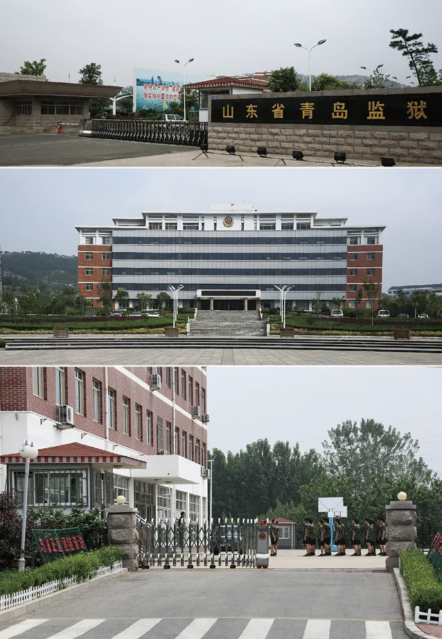
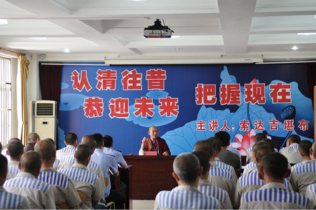
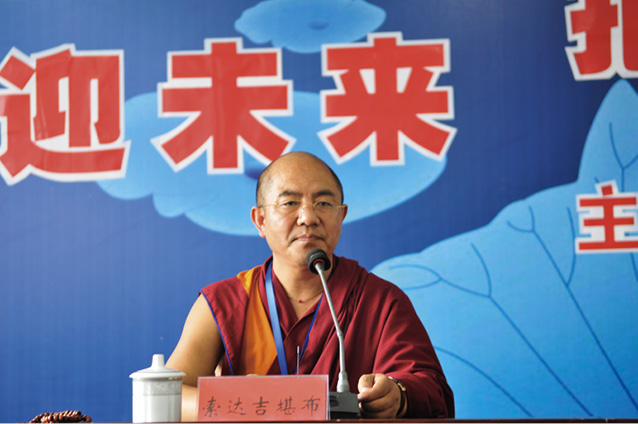
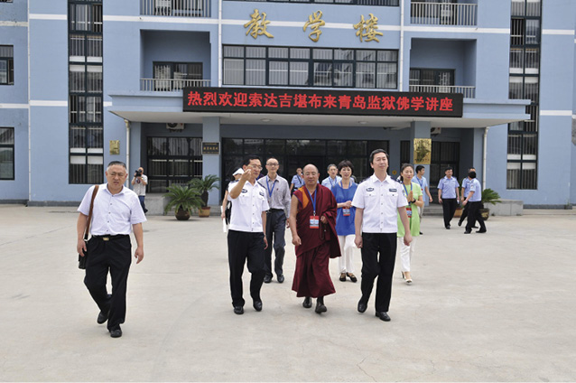
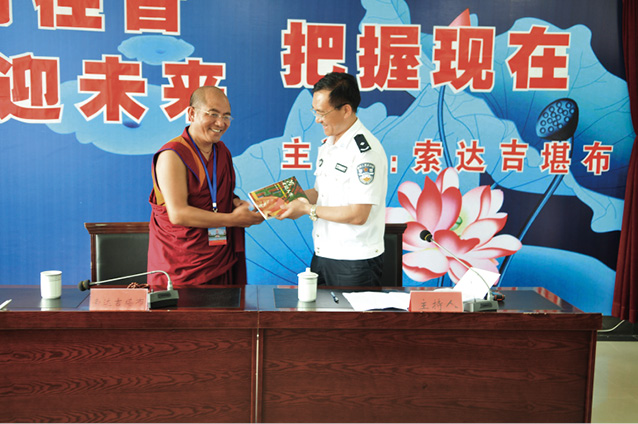

山东青岛监狱

Qingdao Prison, Shandong

中国·青岛

2014 / 6 / 22

## 认清往昔 把握现在 恭迎未来

## Accept, Mindful, Embrace

这几年，我特别喜欢走进大学，走进监狱。

其实，一个人不管想什么、做什么，背后都有它的因缘。虽然我是第一次来这里，但却有一种说不出的感觉。这也是一种因缘。

## 一切苦乐是这么来的

你们这里山清水秀，令人赏心悦意。不过，如果心里有解不开的疙瘩，环境再美也不快乐。

你们每个人心里，可能都有自己的痛苦，甚至感到绝望。不过，学佛多年的我，却始终认为人的一生变化莫测，不能轻易下结论。在现实生活中，有些人上半生无比成功，下半生一败涂地；也有一些人，上半生极其悲惨，下半生却活成了人上人。

其实，人生就是一场戏，无论拿到什么角色，都必须演下去。

有人或许会抱怨：“外面有些人，明明罪大恶极，却过得逍遥自在；我只是犯了无心之过，却要遭受牢狱之灾。老天为什么如此不公，安排我演这样的角色？”

对此，佛教给出的答案是：业和烦恼。

所谓的业是什么呢？是你过去的语言、行为和心态播下的种子。所谓的烦恼又是什么呢？是你犯错当下爆发的情绪。比如，一个人的性格本来很好，却因为控制不了情绪，一念之差，铸成大错，令他失控的情绪就叫烦恼。

人最主要的烦恼有三种，即贪心、嗔心和痴心。贪心会让人在见到喜欢的对境时，控制不住欲望，不顾一切做出非分之行。嗔心会让人在面对不愿接受的对境时丧失理智，想方设法伤害乃至杀害对方。而所谓的痴心，是一种迷迷糊糊的愚痴状态，不明道理，不懂取舍。贪嗔二者的根源，都来自痴心。

儒家说：“人之初，性本善。”佛教也认为，人人都有佛性，本初都是善良的，所有人犯错都是阶段性的，不会永远沉迷于错误。

其实，一个人犯错跟环境有很大的关系。也许，你原本是一个秉性善良、与世无争的人，却因为交了恶友，或受恶劣环境的影响，在不知不觉误入歧途。我就遇到过这样的人，他自己并不想做坏事，却因别人的蛊惑而造恶业，后悔终生，痛苦终生，家人也跟着受苦。

回到前面的问题：“有些人作恶，比我更可怕、更恐怖，为什么只有我倒霉、受惩罚，他们却平安无事？”其实，我们只要做了坏事，不管有没有被发现，有没有被抓到，因果都不会错乱，一定感受果报，没有谁可以逃脱。

所以，陷入眼下的困境，大家不要怨天尤人，而应该自我反省。我们现在感受的所有痛苦，都不是无因无缘的。除了今生的恶缘，可能还有往昔的业力。业果成熟的时候很可怕，哪怕你没犯什么大错，也可能受到严厉的惩罚。

佛经中有这样一个故事：一个出家人在林中煮染法衣，附近有人丢了小牛，四处寻找。丢牛的人来到林中，发现出家人锅里煮着东西，以为他杀了小牛，偷偷煮着吃，于是不由分说，抓他去见官。因为这个原因，他冤枉坐了六个月的牢。

为什么会这样呢？原来，这个出家人前世当过小偷。有一次，他偷了一头牛，被失主追赶，慌乱中把牛扔在一个入定的修行人面前，令其遭受了六天的牢狱之灾。以此因缘，他这一世被人冤枉，整整关了六个月。

总之，我们身上发生的一切，都不是无缘无故的。当我们对某些遭遇想不通时，要意识到可能是业力的作用。

在藏地，绝大多数人都相信前后世和业因果。因为有这样的信仰，大家碰到解释不了的问题，都会从业果上找原因。比如，我自己遇到不开心的事，就会想：“我从来没得罪过他，他却一直恨我，肯定是我前世欠他的。”这并不是单纯的心理安慰，而是一种客观真理。

我们所受的一切苦，确实都跟业力有关。明白了这一点，很多问题就能想通了；问题想通了，心也就释然了；心释然了，那就一切皆有可能了。否则，心结打不开，永远不会有真正的自由。

真正的自由，是心的自由。有了它，即使身在牢狱，也一样逍遥自在。

不论我们追究什么事情，都应该追到自己头上。佛教有一句话：“恶业未熟时，痴人谓甜美，其业既熟已，方知是苦难。”意思是说，愚人做坏事时，觉得很好玩、很开心，一旦果报成熟，才知道是苦难，悔不当初。

所以，我们现在受苦，不应该怨恨别人。如果非要怪，那就怪自己。俗话说“种瓜得瓜、种豆得豆”，你种什么因，就得什么果。做好事感受快乐，做坏事招致痛苦，是一种必然的因果规律。

因果非常可怕。佛陀曾说：“众生之诸业，百劫不毁灭，因缘聚合时，其果定成熟。”我们往昔造的业，历经百劫也不会消失，一旦聚合因缘，果报必定现前。比如，一个人偷了东西，不管有没有被发现，该还的迟早都要还。或者，一个人无论出于贪心、嗔恨或是无知，只要夺杀了别人的生命，自己总有一天要以命偿命。当然，别人害了你，肯定也要承受同样的果报。

因果是一种自然法则。如同播下种子就会发芽，罪业的种子一旦播下，一定会长出痛苦的苗芽。这一点，没有谁可以逃脱。

## 把监狱变成大学

痛苦的果报，有的今生现前，有的下辈子成熟，有的多世以后才感受。今生受报的，叫现世报；今生侥幸躲过，那就来世报或后世报。只要做了坏事，不管什么时候报，都一定躲不掉。

相比之下，服刑是一种很好的命运。否则，等到来世再报，必定会在地狱、饿鬼、旁生等三恶趣，感受无量无边的痛苦。不管你们信不信，那时候的痛苦远远胜过现在，完全超乎我们的想象。在人间再苦再难，也没那么深重，没那么惨烈。

大家现在服一点刑，受一点苦，不但能消除罪业，如果想得开、放得下，还能获得巨大的精神财富。

我认识一个出家人，曾在我家乡的监狱关了二十年。有一次，我俩经过那里，他指着远处告诉我：“我在那里读过大学。”我听了很纳闷：“那里好像没什么大学呀。”一问才知道，他所谓的“大学”，其实就是那所监狱。

他告诉我：“以前，我从来没有受过苦，一直受人尊重，在恭敬和赞美声中度日。后来突然关进监狱，名声没有了，享受也没有了，还接连不断地遭受各种折磨。因为这样的契机，我才有机会重新审视人生。”

他的心念一转，怨恨就变成了感恩，觉得身边都是好人。在监狱二十年，他没有跟任何人吵过架，更没有打过架。即便出狱之后，仍然感恩监狱的管理人员，感恩遇到的每一个人。可见，只要调整好心态，逆境就是学习的良机。

汉地有一位本焕老和尚，前几年刚离世，活了106岁。1958年，他被错打成“反革命”，被捕入狱，判处有期徒刑十五年。但他的心态非常好，觉得“种种烦恼炼我心，种种艰苦修我定”。服刑期间，他把劳动当作修行，积极劳作，从不懈怠。出狱后，本焕老和尚一手兴建了十五座寺院，弟子多达几百万人，为振兴佛法做出了极大的贡献。

还有一位梦参老和尚，也在特殊年代被判入狱，一关就是三十三年。回顾那段历史，他感慨地说：“那是一个很好的修行机会！”梦参老和尚利用狱中的三十三年，忏悔了业障，提升了自己的修行境界。

人这一生，顺风顺水固然好，但有时候经历一些苦难，也会有特别的收获。我们每个人都有需要改正的坏习气、坏毛病，如果能像修行人那样，把劳动改造当作改正习气、净化心灵、完善人格的机遇，未来一定不会让自己失望。

当然，在逆境中调伏自心，也需要一些方法。这样的方法，佛教里面有很多。无论哪一种，都要先让心静下来。

## 闭关修行二十年

我曾经去过藏地一些监狱，感觉那里是很好的闭关房。佛教通常有两种闭关方式：一是集体闭关，比如我居住的佛学院附近，有二十多位出家人，每天都在固定的时间，花四五个小时一起打坐观修，观自己的心或让心安住；另一种是个人闭关，独自一人待在静处，从早到晚念咒、打坐、调心、参禅等。大家可以根据具体情况，选择适合自己的禅修方式。

在英美等西方国家，无论监狱、学校，还是高科技中心，都在推行各种禅修方法。研究发现，当人焦躁不安、伤心难过的时候，胡思乱想不但于事无补，反而会激化情绪；如果坐坐禅，让心静下来，当下就能转变念头，并体会到一种微妙的快乐。要是能认识心的本来面目，进入空乐无别的深层境界，那不管你是什么身份，都容易获得无上的解脱。

总之，大家如果能放下执念，好好禅修，二十年改造就是二十年闭关。即使判了无期徒刑，只要认真禅修，增强善念，也有机会减刑，改变未来的命运。

大家一定要善于调心。心态不好，就算像我一样出了家，还是会心烦气躁，痛苦不堪；心态好了，哪怕环境再艰苦，也可以自得其乐。

所以，千万不要浪费人生，应该把精力用在调心上，用在学习谋生技术、与人交往和培养善心上。对做得不够好的地方，要尽量想办法完善。

## 与其抱怨，不如改变

我们应该与身边的人和睦相处，不抱怨社会，也不抱怨他人。抱怨是一种非常不好的心态，有智慧的人最好远离。

1963年8月28日，二十多万美国人在华盛顿示威游行，争取黑人与白人的权利平等。黑人领袖马丁·路德·金站在总统府前，没有任何抱怨，只是充满激情地发表了《我有一个梦想》的演讲，呼吁大众对未来满怀希望。《我有一个梦想》也成为20世纪最著名的演讲。

抱怨只能带来冲突，解决不了任何问题。所以，你们对自己的遭遇、对监狱的管理人员，最好不要抱怨。应该心怀感恩，感恩磨炼自己的所有人、所有事。

对很多问题想不通、喜欢抱怨的人，是因为心结没有打开。《心地观经》里讲：“三界之中，以心为主。能观心者，究竟解脱；不能观者，究竟沉沦。”在这个世界上，心是最重要的，时时观心的人，一定能从苦难中解脱；不能调心的人，身处再好的环境也痛苦不堪，最后只有沉沦。就像某些富豪、高官，明明拥有令人羡慕的一切，却仍然烦恼一堆、苦不堪言，白天承受各种压力，夜里靠安眠药入睡。

所以，自由在心，而不在身。希望大家把握当下，调伏自心，引发内在本具的善，让未来变得更加美好。

## 几个希望

趁着今天的因缘，我给大家提几点希望：

### 第一，多看书。

在你们宿舍，我看到有很多书，非常好。我自己很喜欢看书，只要有书看，不管待在什么环境，我都可以接受。我昨天一到青岛，就有人建议去海边玩，但我谢绝了，待在屋里看了一下午的书。不仅在这里，我在别的地方也是如此。如果不能看书，我心里就非常苦恼。对我来说，看书是世界上最快乐的事。

你们最好也能抽时间多读点书。养成看书的习惯，可以学到很多东西。我认识一个人，在监狱服刑好几年，其间读了十多本书。过去他不会讲课，因为在狱中不分昼夜，认真学习，出狱后很快成为一名讲师。

现在的时光，其实是一种机遇，大家不要感到痛苦，应该抓紧时间多读书。而且，就算你身在外面，心若没调好，照样有烦恼。如今在外面，有不少人得抑郁症、焦虑症，即使非常有名望的人，也有各种打不开的心结。可见，一个人不管在哪里，都应该学会调心。

大家在学习调心的同时，如果再学一些技术，学一门外语，研究一下禅修，懂一点传统文化，那就更好了。将来不但可以谋生，而且对身心还有极大利益。尤其《弟子规》这本书，内容非常好，很多学者都在推广。不少人学了以后，明白了很多道理，不仅对过去有了新的认识，对未来也做出了新的打算。大家有空可以学一学。

我们如果把精力用来学习，从某种意义上，在监狱跟在学校就没有太大的区别。现在很多学校都是封闭式的，学生在里面学习，很长时间都不能回家——基本上也没有自由。我在藏地办的几所学校，老师和学生一个礼拜都不能出去，大门平时一直关着。

愿意学习的人，调整心态很容易。希望大家把现阶段当作学习的最佳时期。这样做，既有利于你们自己，也有利于你们的家庭。

### 第二，要知足少欲。

大家在这里，吃穿都是统一的，生活上没有太多讲究。这样其实挺好。可我在别的监狱却了解到，有些人经常伸手向家里要钱。这会增加家人的压力，让家人担心，不是太好。如果家里条件不错，要点钱也可以；要是经济条件一般，向家人要钱就没必要了。其实，人在吃穿上，不必要求太多。像我们出家人，平时就几件僧衣，每天就一两顿饭，照样过得很开心。懂得知足少欲的人，才是最快乐的。

跟家人联系的时候，应该多传递积极的信息：“我在里面很好，你们不用担心。”至于以后，能出去当然好；万一不能出去，那也没什么。人生本来就是一场梦，只不过有时做美梦，有时做噩梦。但不管美梦、噩梦，都一样是梦，没必要太在意。什么样的梦来了，都可以接受。事实上，我们越执著，越痛苦；越想得开，越自在——反正哪里都一样。

佛教中有一些人，也是一辈子与世隔绝，不跟亲人见面。我家乡有个修行人，在山洞里住了三十二年。有一次，他下山探亲，很多亲戚都已经不认识他了。他跟家人见了面，共住了两三天，发现没什么共同语言，很快又回到了山洞。

人生的选择，有少数是主动的，绝大部分是被动的——被命运操控，身不由己，每个人的命运都不是自己说了算。过去期盼的，很多都没有成真；未来希望的，也不一定能实现。唯一可以把握的，就是珍惜现在。

有人可能会想：“我现在又不成功，有什么可珍惜的！”

实际上，有钱、有地位、有名声，并不代表真正的成功，光鲜的背后总有很多失败和堕落。真正的成功在于，当情绪生起时，自己有能力控制，不被情绪左右。退一步想，我们现在眼睛能看、耳朵能听、手脚能动，跟某些人比起来，已算是非常幸运了。所以，没有必要自怨自艾，应该珍惜当下。

### 第三，多忏悔。

有些人想忏悔自己的罪恶，却不知道方法。忏悔的时候，可以念金刚萨埵佛尊的心咒：“嗡班匝儿萨埵吽。”金刚萨埵在成佛以前，曾经发过愿：“如果有众生祈祷我，却无法净除他的罪障，那我绝不成佛！”最终，金刚萨埵愿力圆满，示现成佛。因此，金刚萨埵心咒在消除业障方面，有非常大的力量。经常念这个心咒，罪业会慢慢减轻，行为会越来越如法。

行为如不如法，直接关系到能否减刑，所以特别重要。如果你态度好，表现不错，就有希望早点出去。刚才我看了各位的分数，大多数应该都有希望。有些人刚开始只有0.3分，现在也越来越高。通过打分制度，我们可以发现，原来自己有这么多问题需要改正。

虽然外在的监督很重要，但实际上，自我监督才是最根本的。否则，有些事情明明想不通，却必须接受，久而久之，很可能产生逆反心理。只有自己想通了，知道痛苦的根源是往昔的罪业，而罪业通过忏悔可以清净，自己的行为才会既有动力，又有约束力。

### 第四，培养利他心。

佛教认为，一切快乐源于利他，一切痛苦出于自私。所以，哪怕只是为了自己快乐，也不能没有利他心。

仔细想想就知道，人类的所有恶行确实都出于自私——为了自己的利益而贪婪，而嗔恨，而傲慢，而嫉妒，等等。以自我为中心的无明愚痴，让我们感受了种种痛苦，也让亲人饱受折磨。假如当初懂得利他，一心想帮助别人，很多错误都不会犯。因此，从现在开始，我们要改变自私的习惯，从帮助周围的人做起。

我认识很多人，由于服刑期间受过利他的心灵教育，内心发生转变，出去以后言谈不凡，彬彬有礼，和气包容，心态和行为都不同于一般人。

人这辈子，时而高、时而低，上也容易，下也容易，有钱不一定是优势，懂得调心才是关键。就像我们出家人，因为明白了心的奥秘，生活怎样都行，只要白天有衣穿、晚上有被盖，吃好吃坏都无所谓。而且我们吃素，早上一碗稀饭，中午米饭加青菜，晚上一碗面，一件衣服穿十几年，平时也不跟家人见面，一辈子都如此简单。这样的生活，跟你们没有什么差别。不过相比之下，出家人却自在快乐，少有痛苦。原因是什么？大家可以认真思考。

### 第五，不要再犯错。

最后，还有一点大家要注意：以后出去了，千万不要再犯错。

我认识一个人，仅仅因为偷盗，就坐了三次牢。其中一次关了六年，释放的当晚就去酒吧偷东西，结果又被抓了回来。这样进进出出，实在没有必要。

改造的意义，在于改造我们的心灵，而不是在行为上敷衍。否则一错再错，就跟佛经中讲的笨人差不多。从前，有一个愚笨的人，生养了七个儿子。一天，一个儿子突然得病死了。他把尸体放在筐里，准备挑着去尸陀林。由于另一头没有东西，怎么都挑不起来。他想来想去，最后杀掉另一个儿子，装在另一个筐里，挑着担子走了。如此愚蠢的行为，一般人都觉得可笑。但如果犯了错误，不知悔改，跟这个笨人又有什么区别？

《地藏十轮经》中讲，有两种人是真正的智者：一种是从来不造恶业的人；另一种虽然也造恶业，但会以惭愧心发露忏悔。我们若要做第一种人，可能不太现实，但可以做第二种人，知错就改，改了就不再犯，而不是一而再、再而三地造恶。

其实，后悔是一种很好的心态，可以让人生重新洗牌。希望大家对过去生起后悔心，发誓绝不再犯，断掉恶业的种子，彻底改正恶习。当然，所谓的改正，不是表面上做做样子，而要发自内心，真诚悔改。

## 像大禹治水那样

今天的现场，还有很多执法人员，特别感谢你们的辛苦付出。你们每天面对的，都是有血有肉的人，需要奉献自己的慈悲，在不违背政策和法律的前提下，尽可能给他们温暖和方便。这一点特别不容易。

以后，如果有人家庭困难，孩子失学，我们可以一起想办法。我也愿意力所能及地提供帮助，让他们安心改造，重新做人。

当然，你们执法的时候，可能会跟某些人发生冲突。遇到这种情况，以暴制暴不能解决问题，若效仿大禹治水，重在疏导，效果可能更好。

人与人之间，需要相互的关心和谅解。我们如果态度温和，他们也会温和地配合我们的工作。这样一来，上上下下，和谐友好，很多事情都容易成办。

## 身心安，自在来

今天跟大家相遇，也是一种缘分。以后，不管是心理上、物质上，还是行动上，只要大家有需要，我都会尽量提供帮助。也希望大家能以佛教“诸恶莫作，诸善奉行，自净其意”的教义为准则，调整自己的心态，杜绝坏事，多行善法。

善恶的分界线，就在我们自己的心上。如果心存恶念，就会造恶，最后招致痛苦；如果心存善念，则会行善，未来感召快乐。希望大家从今天起，彻底断恶行善，走上一条崭新的人生路。若能如此，明天一定更美好。即使遇到痛苦，也能转为快乐。

人活着，心态最重要，心安则身安。身心俱安的人，在哪里都自在，逆境也会成机遇。所以，大家不要悲伤、绝望，而要微笑着迎接明天，相互传递温暖和希望。

现场互动

问：要想改变命运，需要行善积德。但这样的环境，有时并不具足条件，我们应该怎么做？

堪布：行善其实并不难。如果没有条件，看到别人做善法，自己真心随喜，也有很大的功德。

还可以多祈祷佛菩萨。观世音菩萨的加持尤其不可思议，多念观音心咒“嗡玛呢巴美吽”，诚心祈祷观世音菩萨，我们的罪业会逐渐消减，善法功德会不断增上。

其实，越是危难、越是痛苦的时候，佛菩萨的加持越能强有力地呈现。你们正处于人生的困境，如果经常祈祷，一定可以断除恶业、积聚善法，对今生和来世都有非常大的利益。

问：佛教讲的行善断恶，跟我们平时理解的有什么不同？

堪布：现在很多人虽然提倡行善，但衡量善恶的标准，一般却只看语言和行为。而佛教认为，只有心善，言行才会善；如果心恶，说得再好听、做得再漂亮，性质也是恶。所以，佛教是从根本上让人断恶行善。

佛教辨别善恶的唯一方法，就是我们这颗心。以后，你们要学会观察自己的心。如果心生恶念或邪见，就说明是在犯错，因为恶念一定会引发错误的言行。

佛教有一种说法：“宁可百年不修行，不可一时生邪见。”这里的邪见是指什么？明明与事实不符，你却深信不疑；明明与事实相符，你却死不承认。本来，造恶业就要感受恶果，遭受惩罚是非常公平的，可你却不理解、不接受，非要以恶制恶、以怨报怨，这种心态就叫邪见。

佛教讲万法唯心造，心恶，一切都会成为痛苦之因；心善，一切都会变成快乐之源。以后，有些事想不通时，要学会随缘，放下执著，这样的人生会充满快乐。

问：我在书上看到，佛陀提倡十种好的品德，请问是哪十种呢？

堪布：十种好的品德，应该是佛陀讲的十种善业。两千五百多年前，佛陀为弟子宣讲了十善业，并将其作为佛弟子的行为准则。这十种品德分别是：身体方面，不杀生、不偷盗、不邪淫；语言方面，不说妄语、粗语、离间语和绮语；心灵方面，不贪婪、不嗔恚、不邪见。

具足这十种素质，身体、语言和心灵都有了规范，会过得非常安乐。如果因为无明，突破了十种底线，正常生活就会被打乱。

问：您说人人都具有佛性，佛性其实就是所谓的善，那什么又是真正的人性？

堪布：人的本性确实是善。一个人再怎么恶，都有善良的一面。这一点，与人接触就会发现。

任何人，作恶都只是暂时的，而且跟环境有很大的关系，所谓“近朱者赤、近墨者黑”。如果有幸遇到善友，可能一生都不会犯罪；如果不幸遇到恶友，就很容易受染污。但不管染污也好，没染污也好，人的本性不会改变。就像一块金子，即使被扔进粪坑，看起来很肮脏、很恶心，令人唾弃，但它还是一块金子，纯净的自性从来没有变过。

有些人常说，某某人非常恶劣，眼神特别凶，感觉没有一点人性。即便如此，把他放到清净的环境，经常接触善良的人，再给他讲一些认识心性的窍诀，到一定的时候，他也会认识心的本来面目。那个时候，如同金子表面的污秽被洗掉一样，自心的纯净本性自然会显露。这一点，我是深信不疑的。

所以，不管处于什么环境，我们都要有勇气迎接未来。千万不能消极悲观，觉得这辈子完了，彻底没希望了。真正有智慧的人，可以在不同的境遇找到不同的价值。就像在良医眼里，所有的草木都是药物，在智者眼里，任何一段经历也都是财富。当我们心的潜能被彻底开发出来，上面没有一点点恶，全部都是善。

不要对自己失去希望，也不要对人性失去希望。我们的时代虽然浮躁，但也并非人人不择手段。世上善良而有德行的人非常多，他们用自己的善心和善行温暖世界，令人佩服，也令人感动。所以，我们对任何一件事，都应该一分为二地剖析。

问：佛教中讲，即有即无，非有非无。罪业既然有，怎样才能变成无，回归本源？

堪布：究竟而言，有和无都不成立。但如果没有证悟这样的最高境界，善也好，恶也好，罪也好，福也好，都是存在的。就拿罪业来说，如果它不存在，就不可能带来约束和痛苦，正因为它存在，所以能影响我们的正常生活。

应该怎样面对罪业呢？首先要观察，罪是自己犯的？还是别人强加的？认清这个问题，才愿意忏悔，而不是怨天尤人。我们出家人也会造罪，比如违背戒律等，所以每个月的十五和三十，都会在诸佛菩萨面前忏悔。

忏悔的时候怎么说呢？“我因为无知、放逸、烦恼深重，造下了罪业，今天我诚心忏悔，以后尽量不再造！”经常这样忏悔，就能慢慢净化自心，清净罪业，逐渐获得平和与安宁。

问：我们如何借助佛教的智慧安抚心灵，平稳地度过刑期？

堪布：佛教的智慧确实具有奇妙的作用。对此，东西方不少科学家都比较关注。

要想运用佛教的智慧，首先应该多看佛教关于因果、道德方面的典籍，如《百业经》《贤愚经》等，拓宽自己的视野和空间，重新认识一些现象和规律。

同时，还要学会用佛教的方法，观察自己的心。比如，当你感觉痛苦时，可以这样观察：我这颗痛苦的心，到底在哪里？在体内，还是体外？如果在体内，那是在上半身还是下半身？如果在上半身，那是在头上还是在胸腔？等等。这样观察以后，会发现这颗心既没有颜色，也没有形状，更没有确定的住处，所谓的痛苦也并非真实的存在，就像《金刚经》里面说的，“一切有为法，如梦幻泡影”。这就是佛教的智慧。

很多人都会说如梦如幻，却没有深入体会。实际上，昨天的痛苦到了今天，就是一场梦。你们刚到这里时，都感受过恐惧、怨恨、纠结、痛苦，可现在回想起来，是不是没那么强烈了？是不是像做了一个噩梦？

同样的道理，今天的生活到了明天，也是一场梦。既然过去是昨日的梦，未来是明日的梦，都没有一点实质，那我们对有些人、有些事，为什么还要拼命执著呢？

总之，大家可以尝试学习佛教的智慧。掌握了这些方法，很容易解开心结，渡过难关。

问：生活中，我们经常因为欲望，产生虚荣心、攀比心，忘记自己是谁，看不清自己真正的需要。怎样才能反观内心，找到自我？

堪布：所谓的虚荣心、攀比心，都与环境有关。如果生活环境比较简单，欲望不会太炽盛，对虚幻的外境也不会太执著。就像藏地的孩子，从小生活在纯朴的环境中，没什么物质的执念，所以容易满足。一旦进入城市，掉进令人眼花缭乱的广告海洋，就会慢慢受到诱惑。

这个世界，有无数人为了不需要的东西，整日奔波劳累。似乎登上了一艘单程飞船，朝着虚妄一直飞，很难再找回初心。英国著名历史学家汤因比说过，21世纪人类的希望，只有从大乘佛教和孔孟思想中寻找。但对大多数人来说，这是一个非常遥远的梦。找到初心，回到最本真的状态，已经越来越难。

当然，如果你确实希望找到自我，那求助于大乘佛教和孔孟思想，认真探索，最后一定能如愿以偿。

问：我看过不少的书，也听过类似大师这样的演讲，获得了一些有益的启示。但在复杂的人性和现实面前，心态和行为很快又回到原点。请问，如何才能长久保持善心？

堪布：每个人都希望自己的善心能持久，而不只是一时热情。但要做到这一点，需要进行长期训练。

一个人的转变，虽然之前的启发很重要，但更重要的是之后的努力。在毅力面前，世上无难事。如果能坚持调心三四年，一定会有大的改变，而且能保持很长时间，不会轻易退转。

我始终认为，转变心态很重要。心态一转，很多问题都不再是问题。希望大家不断学习，努力把好的道理变成好的习惯。否则，你们在这方面接收的理念本来就少，而习气又是根深蒂固的，单凭听几堂课或看几本书，力量远远不够。

佛教认为，要让一种力量在心里扎根，需要进行长期的闻、思、修：先听闻教理，然后仔细思考，最后实地修持。其中，听闻的时间相对较短，思考的时间稍微长一点，而修行的时间则是最长的。

所以，听了我今天的简短开示，你们还要不断思考，思考之后再付诸行动。这样的话，有些东西可能会存活久一点。
