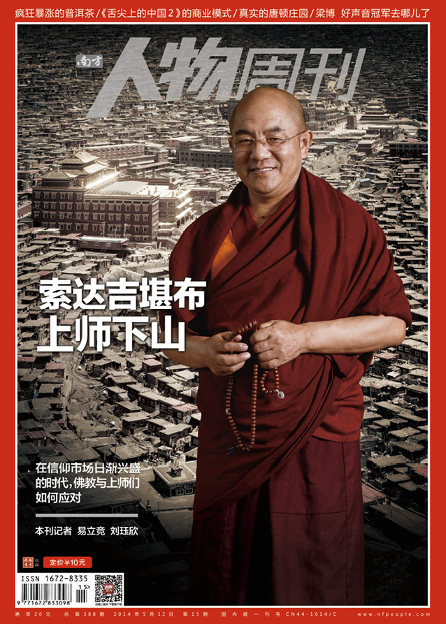

# 上师下山

——《南方人物周刊》封面人物专访

2014年5月12日

采访者：《南方人物周刊》高级主笔易立竞

## 1

“我以前就是一个放牧的少年，那座山上还留有我少年放牧时的脚印。如果愿意，你可以下车去拍照。”越野车行驶在四川省炉霍县的上、下罗科玛乡之间的山路上，刚从人群中挣脱出来的索达吉堪布[^1]指着前方的山说。

阳光洒在青藏高原上，爬坡时，车开得很慢，一个牧民忽然看到车里的索达吉堪布，惊喜地双手合十、弯下身体，一阵小跑追到车旁，请求加持，不敢置信地重复着：“今天太吉祥了！今天太吉祥了！”

只要离开喇荣五明佛学院（以下简称佛学院），索达吉堪布就随时处于被围观和拉着签名合影求加持的状态中。“被围观是件很累的事。”这位国内最具影响力的藏传佛教上师说。

让他最放松的地方是待了近三十年的佛学院。在这里，每天要处理的事情无数，但再忙再累也还能挤出时间看书，这是让他很满意的地方。

在城市待太长时间后，“念诵经文时，经常会陷入迷糊的状态”，在寺院里就不同，“念诵经文时非常有欢喜心”。

## 2

从成都到五明佛学院，大约七百多公里，行程通常在12个小时左右。遇到天气不好，云雾缭绕，盘行至海拔三千多米时，车里通常只剩藏族司机的诵经声，其他人连喘气都小心翼翼。

这七百多公里的山路，索达吉堪布一年至少往返十几次——他常应邀去国内外各高校、企业做学术交流——随着影响力与日俱增，他走在这条路上的次数也随之增多。

他还常去监狱给犯人讲课，并和同门师兄慈诚罗珠堪布在几所监狱里建立了图书馆。他们甚至还参与过预防艾滋病的活动，因为附近的凉山彝族有很多艾滋病患者。“作为出家人，有些事情我们参与可能不是很方便，但从长远来看，现在不是该顾忌这些的时候。”他说。

他为贫困孩子建了两所小学、一所中学。在家乡炉霍县上罗科玛乡建中学的愿望有十年之久，正式申请就用了六年时间，去年才获得批准。他曾经发愿：不管遇到多大的困难，都会全力以赴，付出一切来实现建中学这个梦想。因为他觉得，如果自己当初没读过书，现在的命运会完全不同。“这些家境贫困的孩子，哪怕没有考上高等学校的缘分，至少也应该完成九年制的义务教育，多学一分知识，他们的人生就会多一种可能。”

这几所学校的老师有一部分是志愿者。“堪布告诉我们，牧民家的孩子想学点东西非常不容易，要视这些孩子为自己的孩子。”从深圳到此当志愿者的庞老师说，“这几年，我一直在琢磨，怎么样才算把他们当成自己的孩子。”

出家前，索达吉堪布就读于甘孜师范学校。同学们毕业后大多当了老师。2006年聚会，大家盘点哪个同学改行时提到了他。“我只是衣服换了，但还一直在教学。”他说，最想做的事情就是讲课。“哪天如果没有讲课就觉得这一天有点浪费了，哪怕有一个人听课我也愿意讲。”只要在佛学院，除非极特殊情况，他每周都会至少讲三四次课。“上师把上课讲法当成最重要的事，他曾说，希望在法座上咽下最后一口气。”弟子圆利说。

佛学院的规划、建设大都是索达吉堪布负责。他为佛学院建了许多经堂，这些经堂全都当作教室，每个经堂里也就摆放了一两尊佛像。“教育对佛教来说是重中之重。我的上师法王晋美彭措就非常重视教育，我也希望能如上师一样。”堪布说。

“和上师一样”，这是他的行事准则。

法王创办了佛学院，十年前圆寂时并未交待弟子坚守，可他觉得交待和不交待没什么区别。“在上师心里，培养僧才、弘扬佛法是最重要的事。”堪布了解法王的想法，“只要是佛学院的事，我就比较勤快，无论什么事。”

对他来说，“失去上师”是人生中经历过的最大苦难。法王晋美彭措圆寂十年来，他想念上师的情感不但未淡化，反而“时间过得越久越思念，只要想起他就会泪流满面，甚至，在梦中也会如此”。他的弟子们早已习惯，他在课堂上想起法王晋美彭措时哽咽的情形。

## 3

走进佛学院大门几百米后，抬头就可见千余所木质结构的红色僧房，从山洼处向海拔四千多米的山顶辐射出去，漫山遍野。诵经声透过音箱飘荡在每一条路上。这里不仅是朝圣者也是摄影爱好者的圣地。

佛学院拉动了当地经济，但有关部门不甘于此，近几年，每隔一段时间就会要求佛学院答应搞旅游开发，均被拒绝。“如果卖门票，就分不清楚是寺院还是旅游景点了。作为佛教道场，应该保持清净如法，给人们带来精神上的满足。”索达吉堪布说。

1980年，法王晋美彭措在这里建立了佛学院，当时的喇荣沟荒无人烟，起初只有32名学员。1985年，尚未从甘孜师范学校毕业的索达吉堪布来到这里，依止法王晋美彭措座下，当时的佛学院有一百多人。“清净戒律，闻思修行，团结和合，弘法利生”是他们的校训。

2004年1月，法王晋美彭措圆寂。门措上师接任院长，但因健康原因，多数时间不在佛学院。佛学院由十五位堪布、活佛建立了“学院管理理事会”，轮值制，每五年一换。索达吉堪布今年初结束了五年的任期。但常住的汉族僧众千余人，却是从1987年开始一直由他主管。

为了僧众能有更好的学习、修行的环境和秩序，他会看企业管理方面的书籍，学习培养管理人才。

有着六千名常住人口的佛学院，水、电这两件事都让管理者头痛。

在刚刚过去的冬天，色达电力局每天在早上5点到7点为没有被国家电网覆盖的佛学院送电两个小时。晚上，索达吉堪布上课的大经堂要在柴油发电机的供给下才能保证正常用电，这样的发电成本很高，平均一度电在三元以上。

因为电的事情，索达吉堪布每年冬天都要不停地和当地政府交涉，问题到现在也没得到最终解决。

佛学院的水，主要依靠一个泉眼和附近东山上收集而得。但这两个水源，冬春两季出水量非常少，有时会断流，导致学院完全停水。这种时候，索达吉堪布就会派佛学院配备的救火车，去色达郊区的河边取水，给僧众使用。

索达吉堪布说，他刚到佛学院时，条件比现在差太多，大约有十年左右的时间，都是在烈日暴风中听闻佛法。“有一年冬天，我们坐在外面的空地上学习《释量论》，天上飘着鹅毛大雪，地上冻得坚硬如铁，没有坐垫，大家都直接坐在冰地上，身上也没有盖的东西，一个个像雪人一样。有时突然刮起狂风，书就被卷走了，到处去找。这种情形经常发生。”

## 4

索达吉堪布到佛学院将近三十年，这期间，中国经历着巨大的变革，包括对宗教的态度，特别是对藏传佛教态度的变化。佛学院也从一片空地成长为世界上最大的佛学院。

在此出家的人，有名校教授、医生、律师、4A广告公司的部门总监、富二代、海归博士，也有十几岁就远离红尘的少年，还有先后看破红尘，来此寻求人生终极答案的三口之家。

索达吉堪布说，他出家是为了继续学习佛法。他从小就对佛法感兴趣，上学时，老师在上面讲课，他在下面看佛经，经常遭受批评。二十三岁离开学校前往佛学院时，他也不确定这条路究竟能走多远。“听说喇荣沟是个非常寂静的山谷，我想，可能这辈子就待在那里了。离开炉霍县城的时候，站在路边看了很久，心想，今后再也看不到这么繁华的城市了。”他还记得，那天下着很大的雪。

与三十年前相比，上课方式也在发生变化。

2006年，索达吉堪布建立了智悲佛网，开始网上授课。他是内地第一个用网络讲授藏传佛法的僧人。“每次去汉地，看到很多人对基本的佛教道理都不懂，就特别着急，心想要是有个道场多好。后来看到一些台湾的法师利用互联网、光盘弘法，觉得这是一个好方法。当时就想，未来的时代，网络应该越来越发达，如果现在不用，就会失去一个机会。我大概是在2004年的时候就开始思考和了解这方面的信息。”

近两年，每次上课，世界各地同时在线听他讲法的人大概在万人左右。

从1997年开始，他就试着把藏语的佛教经典翻译成汉语。从那以后，无论多忙，他每天下午都会抽出两个小时翻译经书。现在，汉族佛弟子学习藏传佛教时所用书籍大多是他翻译。有人说他是现代玄奘，他拒绝这种称谓，他说自己只是一名教授佛法的老师。

出家近三十年，他所做的事情，其实可以用一组数字简单描述：翻译藏文佛学论著98部；传法教言与出版书籍一千余万字；演讲去过的国内外著名学府66所；传讲佛法28年，上课7000余节；畅销书6本，总销量超过100万册。

## 5

2010年10月29日，索达吉堪布开通微博，至今粉丝超过150万。没有特殊情况，他基本每天更新一次。他发过一条题为《请假条》的微博：“这几天我要前往一个城市讲法，因为那里没有信号，故暂时无法发微博，特此请假几天。”

他说，他曾试着在微博上发一些比较深的内容，比如谈佛法中的空性，发现大家不是很明白，转发量不高，从那以后，决定“只发浅显易懂的，让大家尽量先明白如何取舍一些问题”。

微博的评论里，大量的人等待他回答各种问题——让取名字的，请教怎么挽留感情的，问自己胆子太小怎么办的……林林总总，他基本不回复，但如看到因贫穷上不起学寻求帮助的留言，他定会马上调查情况，尽量给予帮助。但，“也有被骗的时候”。

他的电话上经常会有几百条未读短信，一天接打上百个电话也是常事。因为太过劳累，他的肝脏和脊柱都出现了问题，常年吃药。

2002年，堪布因为脊柱问题在厦门看病，医生误诊，下发病危通知，告诉他最多只有几个月时间。他谁也没告诉，回到佛学院处理后事，“我观察自己的心，很平静，没有恐惧。这种状态让我很欣慰——学了那么多年的佛法还是有效果的”。作为一个出家人，死亡是他经常思考的问题，“那不过是一段旅途的结束，又一段旅程的开始”。后来发现是误诊，“也没觉得很高兴”。

## 我也曾经特别喜欢钱

⊙ 问：佛学院现在越来越出名，旅游的、朝圣的……外来人员越来越多，这会带来什么影响？

堪布：本来佛学院是一个清净的圣地，但现在因为来的人特别多，整个环境比较嘈杂，特别是假期的时候。人越来越多，可能会对佛学院低年级出家人的学习、修行带来一些影响，也会导致很多修行人在修行方面受到影响。

⊙ 问：想过办法改善这种状况吗？

堪布：想过，但改变这种状况很难。因为现在康定、甘孜几个机场的开通，还有317、318国道畅通之后，汉地很多对藏地有好奇心的人就更容易来了。可能这是一个趋势，要改变有一点困难。

⊙ 问：有考虑过卖门票吗？

堪布：我们不愿意，寺院自古以来就没有卖门票的传统，卖门票好像就把寺院商业化了。有很多部门找我们谈过，我们说这种事绝对不可以。

⊙ 问：您在钱的方面似乎特别谨慎。

堪布：只不过觉得金钱害了很多人，对金钱的贪执会伤害一些修行人，影响佛教徒之间乃至师徒之间的关系。所以我们在这方面谨慎些，会比较好。

⊙ 问：现在是商业社会，无论做慈善，还是弘法，很多事情都会跟金钱发生联系，您身在其中，怎么面对这种情况？

堪布：不管是做慈善，还是做其他的事情，我会在能力范围内做事，会随缘，做不成心里也不会有什么痛苦。我始终认为，金钱只有在能帮助一些人的时候才能体现它的真正价值。但一点没有的话，也会让人烦恼。佛教里提倡的就是不走极端，要持中道，其实就是我们说的中庸。现在很多人要么一点积极性都没有，要么就是欲望太大了，贪得无厌。

⊙ 问：金钱在某个时段对您产生过诱惑吗？

堪布：小的时候特别特别喜欢钱。一直想，如果有钱的话该多好。每天做梦都是有钱多好。尤其在读初中的时候，每次开学，同学都有钱，就我没有。自己去外面砍木材、打工，就是想开学的时候有钱买件衣服。

那个时候可以砍木材赚钱。有一次，我跟弟弟在一个山沟里砍了很多木材，结果一棵树砍倒后压断了电线，害怕供电局会找我们，晚上就跑到另外一个山沟里去砍。两三天后发现没事，我们又回到原来的地方，把那些砍完的木头放到拖拉机里拉出去卖，赚了二十几块钱，特别高兴。当时确实条件很受限制，穿的吃的等各方面都非常非常艰苦，那时觉得有了钱就拥有了一切。

⊙ 问：使用互联网进行授课之后，您的事业和心态发生变化了吗？

堪布：在藏传佛教推广方面，比以前范围更大了。事情越来越多，因为涉及的人越来越多。除非实在是做不下去了，一般情况下，只要开始的事情，我不会轻易停下。这样一来，就不像以前那样空闲，现在越来越忙了。

我也会用网络收发邮件，查找资料，和人进行一些沟通。除此之外，网络对我个人的修行和生活，没什么不好的影响。心态应该没受什么影响。

⊙ 问：您在网上一般关注什么信息？

堪布：我对政治、环保、天文地理、神秘事件——比如外星人之类的事，都感兴趣，有时候也关注当前一些金融、社交以及国际上发生的大事和案件……几乎囊括了所有。对世间人的心态、知识的了解还是很重要的。有时候也看报纸，但有些报纸的内容不是很真实，所以也没太大兴趣。

⊙ 问：这一切都是为弘法做准备吗？

堪布：也不全是为了弘法准备，因为自己也感兴趣。其实我对世间很多事情不了解，每次看了以后，也会学到一些新的知识。

⊙ 问：一个出家人学很多世间知识的目的是什么呢？

堪布：如果出家人住在一个山洞里，或者是住在一个寂静的地方，那不学世间的任何知识也是可以的。但如果他想帮助世间人，就必须知道世间人的心态，所以向学校里的老师或学生学习是非常重要的。我们要了解很多人的心态，每个时代人们的心态都会有变化。上世纪80年代人的心态和21世纪人的心态完全不同。作为出家人应该做对众生有利的事情，如果不想做，那就可以住在一个与世隔绝的地方。

⊙ 问：传统印象中，出家人是出世、隐居的状态，但现在却是入世的状态，为什么有这样的变化？

堪布：实际上，我觉得在山上隐居的有两种人。一种是他自己确实没能力面对世间的人和事；还有一种人确实超离世间，到山上隐居。到底是哪一种，要分别。人们以前认为出家人全是在山里，这是个别媒体的宣传而导致的印象。

出家人到红尘中来也有两种情况。一种是在山上、在寂静的地方没办法待下去，跟世间人一样，想融入他们的生活；还有一种，一个人待在山里，会失去帮助很多人的机会，因此他会一心一意地传播教义，帮助有缘众生，这样与佛教的教义不相违背。因此我们不能认为出家人或者佛教徒应该永远都待在山里。

佛教徒有很多层次。初学者为了不受环境的影响，比如刚开始不要阅读一些异教的书，否则连自己的正见都不能确定。到一定的时候可以看，可以学习，也可以和外道在一起。佛陀跟刚出家的人说你不要接触这种人，因为刚开始你的心还是很弱的，没有成熟。到一定时候，不会受世间影响的时候，你可以到世间去度化众生。这两个都是佛陀的教义，就像父母对孩童的教育。

⊙ 问：出家后，您第一次从山上下来是1987年，那会儿感受到的物质世界和现在的世界，有什么区别？

堪布：现在城市里修的高楼大厦越来越多，人也越来越忙碌。那个时候城市里面的人没有这么大的压力，但现在好像不管是谁，压力都很大，都好苦啊。所以，我下山后，希望能做一些力所能及的事，想改变这个世界。

⊙ 问：想要这个世界变成什么样子？

堪布：想这个世界变得和善、快乐，变成一个很美丽的世界。

## 心灵鸡汤也有营养

⊙ 问：您听过对出家人开微博的质疑声吗？

堪布：其实任何事都不能一概而论，《宝积经》中说：“有智者依方便得解脱，无智者依方便得束缚。”这段话很适合用来解答使用网络的取舍问题。不管什么身份的人，只要是做对别人有利的事，方式并无一定之规。作为出家人，每个人的因缘也不相同，儒家也说：“穷则独善其身，达则兼济天下。”这话应该可以引发大家的思考吧。

⊙ 问：有人觉得，您微博上的内容貌似心灵鸡汤，听过这种说法吗？

堪布：听过。本来我也想过，做一些研究性强一点、专业性强一点的开示，但我的微博是面向公众的，不能只考虑专业的佛法研究者，像五部大论这类甚深的佛教内容，可能不适合这些受众。

微博是面对很多普通人的社交平台，现在的人比较适合“人天乘”[^2]。甚深的佛法内容，喜欢的人非常少。如果对大家有利的话，有人说是心灵鸡汤也没关系。我知道，这些内容在当前可能比较适合。

⊙ 问：在您看来，心灵鸡汤的作用是什么？

堪布：众生能从中得到暂时的内心的安慰吧。心灵鸡汤对喜欢甚深道理的人来说肯定是不够的，但对多数人来讲，是有帮助的。心灵鸡汤也有营养。

⊙ 问：您出版的书都很畅销，想过原因吗？

堪布：我也不是很清楚。我写的书都是针对性比较强的，比如我会关注现代人在一些人际关系中出现的问题，这些问题在传统文化当中也能找到答案。书的内容应该会对大家的生活起一点作用吧，如果不起作用，那它很快就会没有人看。

⊙ 问：在您看来，现在的社会环境和佛教之间的冲突是什么？

堪布：和社会很多方面有冲突。佛教的要求是不要杀任何众生，但现在的社会发展，很多人需要通过杀生来增加收入。这个比较难解决。

⊙ 问：您觉得现在中国社会面临的最大问题是什么？

堪布：中国大多数人没有信仰。因为没有信仰，很多对社会有负面影响的问题不断出现，比如贪污等。

⊙ 问：您怎么看待现在社会充满戾气的一面？

堪布：不仅仅是现在，每一个时代都有这样的情况。如果我们对历史稍微有所了解的话，会发现，每个时代的人都会说“我们这个时代的人是如此的暴力、贪婪、充满戾气”等等。每个时代都有一些相同的事情发生。

## 佛教的戒律也是一种管理制度

⊙ 问：在一些非佛教徒的眼里，佛教的戒律非常严苛，让人产生畏惧感和距离感。

堪布：佛教的根本戒律是“戒杀、盗、淫、妄”，这也符合世间的法律对人们的基本要求。人生活在这个世界上，都要遵守一些戒律，中学生有中学生的戒律，大学生有大学生的戒律，企业也有企业的戒律——其实就是一种管理制度。佛教的戒律也是一种管理制度。

而且，对不同层次的人会有不同的要求，就像三星级宾馆的管理方式和五星级宾馆的管理方式肯定不同。不仅仅是佛教，其他宗教也是一样，都有相应的戒律。

⊙ 问：在您看来，藏传佛教比汉传佛教被更多人关注和接受的原因是什么？

堪布：一个是藏传佛教自己的特点，传承比较严谨，特别是对一些高级知识分子来说，藏传佛教的逻辑性或者说它的理论性很强。藏传佛教的仪式也比较有特色，比如说灌顶之类。

⊙ 问：但也有人诟病藏传佛教太过仪式化。

堪布：同一件事情在不同的人眼里，会呈现出不同的样子。

⊙ 问：您经常会举一些科学方面的例子，用以证明佛法不是迷信，甚至做过《生命科学与价值观》的主题演讲。在您看来，科学和佛法到底是什么关系？

堪布：我自己用了近二十年时间研究科学与佛法的关系，最后发现科学并不能真正地解释佛教的意义。现在好多人觉得佛教跟不上科学的脚步，实际上是科学跟不上佛教的脚步。关于这个道理，我在十年前举过一些例子，还跟一些科学家探讨过。

⊙ 问：既然如此，为什么还要用科学来证明佛法？

堪布：因为现在很多人只相信科学，没有佛教的概念。如果我直接说佛法，他不承认，如果用科学家的语言来证明佛法的正确性，他就会觉得有力度。

⊙ 问：可您刚才也说，科学并不能真正地解释佛教的意义。

堪布：对，佛教的部分内容，比如说空性的意义、如来藏的光明等等，科学是无法解释的。大多数人还没有到那么高的境界。佛法中的甚深内容，目前的科学还无法触及。但科学的一些道理和佛法相通，佛法中一般的道理还是可以用科学解释的。

⊙ 问：现在佛教徒的人群结构相比以前有什么变化吗？

堪布：我发现，最近在网上报名上课、皈依的，很多都是年轻人，而且很多都有专业背景，学历也比较高。上世纪七八十年代的时候，汉地学佛的大多是老人，所以佛教徒是一个老年化的团体。现在不仅是年轻化，知识分子也非常多。还有很多演艺圈的人，包括一些文艺工作者，有相当多的名人，他们热衷于研究佛教，做慈善。类似这样的情况越来越多。

⊙ 问：感觉您很重视知识分子这个群体。

堪布：是，我很重视，即使有人反对佛教、反对宗教，我也想听听他们反对的道理和理由。虽然我们感兴趣的点不一定相同。有些深层次的智慧，跟知识分子进行碰撞，可以发散出很多有意思的想法。

⊙ 问：您会想要影响他们，让他们走近佛法吗？

堪布：他们可以来了解、研究佛教，自己去修行也是可以的。我一般是随缘的态度，并不会刻意强迫他们去学习。

## 找男女朋友都需要好好观察，何况找上师

⊙ 问：我们偶尔会看到一些年轻的活佛穿着紫红色僧袍拉着女友的手逛街，这让一些人对藏传佛教的戒律产生了疑问。藏传佛教的出家人是否可以结婚，有不同版本的说法。相应的戒律到底是什么呢？

堪布：首先，不管是藏传佛教还是汉传佛教，一个人只要出家了，就一定不允许结婚和有配偶。第二，藏传佛教的活佛并非都是出家人，在家活佛可以谈恋爱、结婚。你们看到的这种，应该是在家活佛。而且，他们穿的紫红色衣服，虽然看起来跟袈裟比较像，但实际上不一样。出家人的五衣[^3]，裙子上有福田格，也就是一些口袋状的缝制，非出家人的裙子上没有福田格，这是最根本的区别。

藏传佛教的出家戒律非常清净、完整，但也有个别不如法的人，这是在任何时代、任何团体中都会有的现象。

⊙ 问：现在汉地确实有好多活佛，很多人不知道怎么去分辨真假。

堪布：如今，一些别有用心的人，打着“某某佛菩萨转世”“密传佛教大法王”的旗号，以达到谋取私利的目的。而个别佛教徒在寻找上师时，也不经过长期观察，饥不择食地盲目依止。

我经常对他们说，就算你们在世间找一个男女朋友，或者是找一个合作伙伴，也要知道这个人的背景、家庭状况，进行一些观察。但现在很多汉地的佛教徒根本不去花时间了解上师，只是看一个简单的广告，听说有个活佛来传法，好吧，就去皈依他。最后造成的不良后果，双方都有不可推卸的责任。但这并不是藏传佛教的过失。

⊙ 问：据说北京某地集中居住了很多活佛，您怎么看这种现象？

堪布：来到汉地的活佛，大多数是非常好的，他们有慈悲心、能力、知识，引导众生走向解脱，但是，任何事情都无法避免个别现象。当时印度佛教来到藏地的时候，刚开始也有一些混乱的现象。以前藏传佛教和汉传佛教关系不是很密切，现在藏传佛教来到汉地，中间也会有很多问题出现，但我觉得并不是外面所传的那么严重。极少数人也不能代表所有的活佛、上师和仁波切，当然，我们希望大家对不好的现象进行抵制。

⊙ 问：为什么现在会有这么多的假活佛，和藏传佛教的活佛转世制度有关吗？

堪布：藏传佛教的活佛转世制度没有问题。但是，这个制度被很多人利用了。

⊙ 问：在您看来，佛法需要与时俱进吗？

堪布：佛法不需要与时俱进，它可以跟得上时代，但是我们的管理方法和弘扬佛法的方式，确实需要与时俱进。

## 成功两个字已经被说烂了

⊙ 问：作为藏族人，在您看来，这个民族的优劣势分别是什么？

堪布：优势是非常吃苦耐劳，顽强勇敢，这个民族的本性具有天生的慈悲心，可能跟从小生于佛教家庭也有关系。我前段时间在学校里问汉族的支教老师，这些孩子给他们印象最深的是什么。他们说，这些孩子有感恩心。以前在汉地也教过书，教完以后，学生也就没什么联系了。在这里，即使毕业了，有些学生也会过来找他们，感谢他们。

劣势是，除了一些出家人外，大多是文盲。我的父母、弟弟、三个妹妹都没有读过书，不认识字。我们现在一直在呼吁，在学会书写藏语的基础上，要懂汉语、英语。这种呼吁也符合国家的政策，比如每一个民族有学习和记录自己语言文字的义务和责任，同时也要学习一些国际化的语言。

⊙ 问：汉地的一些人在物质水平达到一定程度后，开始寻求信仰，您怎么看这个现状？

堪布：物质水平达到一定程度后，寻求信仰的人也未必全是真心。比如贪官、一些干了坏事的人是为了保护自己，功利性地寻求信仰，所以，有些信仰不一定很正确。藏地的人从小就生活在有信仰的环境中，信仰为他们的人生带来快乐和满足。不过现在的藏族年轻人，越来越缺少信仰，贪欲也越来越强烈，也不太追求文化知识。我特别担忧这些年轻人。

⊙ 问：现在，国人对成功的追求比较极致。我想知道，藏地孩子的成长过程中，“成功”这个词出现的频率高吗？

堪布：很长时间以来，我对孩子们都比较关心。虽然我自己是出家人，没有孩子，但我接触的孩子可能比一般的在家人还多，因为这几年建了几所学校。在藏地，孩子的心里基本上没有“成功”这个字眼。

藏地人非常重视家庭教育。很小的时候，父母就经常告诉我们，在生活中一定要有一个远大的理想，但如果没有实现，也不必痛苦，因为世间的一切并不是你心想就能事成的。也就是佛法中所说的，无常。从小对这些理念有了解的话，长大后就能少些痛苦。

现在全球有七十多亿人，完全没有宗教信仰的只有10%左右。作为孩子，有对因果的信仰很重要。没有任何信仰的人，人生是没有着落、没有方向、没有归宿的，不知道人为什么要活在这个世界上，没有生活的底线，没有生活的规则，是非常可怕、危险的。这些也属于道德教育。现在我们的教育完全是颠倒的，所有的精力都放在追求知识上面，这些知识学得再多，也不能让你对社会、对家庭多些理解。

以前在汉地，成功这两个字出现的频率也不像现在这么高，成功学还不是很突出，现在因为媒体、个别企业的宣传，这两个字经常被放在嘴边，甚至说烂了。

⊙ 问：什么样的词汇在藏地孩子的成长过程中出现的频率最高？

堪布：慈悲。藏族人衡量一个人，慈悲和内心善良是非常重要的标准。包括找结婚对象，对方有房有车不是最重要的，一定要善良；找商业上的合作伙伴也是如此，先要看这个人的人品，再谈合作。

## 死亡就是下一个旅程的开始

⊙ 问：我想知道，在藏地，60岁以上人的心理状态怎么样？您观察过汉地60岁以上人的状态吗？

堪布：在藏地，60岁以上的人还是对生活充满希望的。我发现汉地的人到了六十多岁就觉得自己的人生已经到了边缘了。我跟很多人聊天，他们都说自己老了，都抱着等待终老的心态。我母亲今年83岁，前几天我们聊天的时候，她说：“我现在已经算老了吧，但是好像也很开心。”

有一次，有人问我叔叔：“你多少岁了？”他说：“年龄不是很大，80岁，只不过身体现在有点沉重了。”这种思维上的不同，应该说还是信仰导致的差异。藏地的人，觉得死亡也就是到另一个地方去，就好像我们这一程的旅途已经结束了，他在等待着下一世的到来。这辈子好好修行，多做些善事，下一世也不会很差的。当然，造业多的人是比较害怕的。

没有信仰的人，会觉得这一辈子结束后就什么都没有了，想到这些，他会特别灰心，甚至恐惧。因为没有归属感，他们不敢面对死亡。

⊙ 问：您去过汉地的老人院吗？

堪布：去过。汉地现在很多家庭都是独生子女，孩子不给父母打电话、不理他们，父母有特别多的愿望和伤感不知道对谁倾诉。问他家里有什么人时，他们的语言里充满怨气，给人的感觉，好像就在那里等待终老了。

⊙ 问：您跟母亲之间经常有沟通吗？

堪布：我特别忙，但每个礼拜都会去看她一下，一起待几分钟，有时候时间多，就稍微聊一下以前的事情、现在的一些状况。看她一眼，对她就是种安慰，她的心态跟我们完全不同，她是随时随地惦记着她所有的子女。她会担心我会不会生病，我出去以后会不会翻车……我们藏语里有句话说：母亲的心像水一样，儿子的心像石头一样。

## 不一定非要谈个失败的恋爱， 才知道人世间的苦

⊙ 问：您每天要做非常多的事情，貌似有种急迫感，这是年龄带给您的吗？

堪布：我今年52岁了，人到了50岁以后，好像夕阳一样，活在这个世界上不会长的。我经常想就算我再活18年，也已经70岁了，看看周围，很多70岁的人基本都做不了什么事情了。

⊙ 问：您不只关注教育，还有医疗、养老、环保……一个出家人这么关注社会问题，不耽误修行吗？

堪布：刚开始我也有这样的担心。因为做慈善不像我们的修行，是一个人的事，做慈善要借助很多社会上的人，不是一个人的力量能达到的。后来想，做慈善也是布施，这也是一种修行。

⊙ 问：您没毕业就出家了，世间人的很多事情并没有经历和体验过。有人说，修行人应该对世间的苦乐多些体验，而不只是理论上了解，这样才能更好地利益众生。

堪布：我觉得不一定所有人都需要这样吧。藏传佛教中有些大德没有经历过世间的苦乐，但是他修行非常好，发心纯净。不一定非要谈个失败的恋爱，才知道人世间的苦，不同的人有不同的方法吧。

⊙ 问：您出家近三十年，最初的目标是什么？后来的变化是什么？

堪布：最初，我就想在山里面成为一个非常有成就的修行者。现在，我的目标是在有生之年，把所学的知识跟更多人分享，当我离开这个世间以后，也还有个别人因佛法而受益。

## 同性恋和异性恋都是执著

⊙ 问：您关注过同性恋群体吗？

堪布：没有特别关注过，但我也知道，社会中有这样的群体。佛陀早已说过，因为众生的业力不同，有些人对异性起贪心，有些人对非异性生贪心。都是执著。

⊙ 问：现在是信息社会，人们整天陷在各种信息里。有人说，现代人想要修行、获得解脱会更难了。

堪布：的确是这样。现在很多人求的都是升官发财，包括一些佛教徒。真正想从佛教中获得解脱、发自内心追求的人并不是很多。但这是一个社会现象，没办法。我们传输佛法的时候，如果讲一些比较高的境界或大乘佛教的思想，很多人都听不进去，甚至根本听不懂。讲一些世间人的故事和概念，大家都特别乐于接受。佛教中，也有不同层次的弘扬方法。可能大多数人适合的是这一世的心灵慰藉，跟来世的解脱没有很大的关系。但暂时来讲，佛教也可以成为今世的一个妙用，适合现在大多数人。

⊙ 问：您说这话的时候，感觉有点无奈。

堪布：现在时代已经变成这样，再怎么样，也是无可奈何。

⊙ 问：您现在有烦恼吗？

堪布：贪嗔痴、傲慢、嫉妒都有，只不过不严重。我们的习气没有断之前，所有的这些烦恼都有。

⊙ 问：这个世界上多数地区都有宗教信仰，但这个世界上还是有战争、污染……各种各样的问题。宗教到底解决了什么？

堪布：宗教也并不是解决战争、解决污染的。

⊙ 问：它不应该是让世界变得更美好吗？

堪布：它是让内心世界变得更美好。

⊙ 问：内心世界变美好了，外部世界不应该也随之美好吗？

堪布：实际上如果没有宗教的话，现在的战争和污染问题可能更严重。

⊙ 问：什么样的人最需要佛法？

堪布：我觉得堕入恶趣的或苦不堪言的人很需要佛法，佛法可以拯救他们。

⊙ 问：信仰到底是什么？

堪布：严格来说，没有信仰也是一种“信仰”。有些人追求金钱，这就是他的信仰。信仰不是有或没有，关键是对或不对。

[^1]: 堪布，藏传佛教称谓，意为佛学教授。
[^2]: 人天乘是佛陀接引众生的方法之一，即教导众生修习五戒十善，由此功德往生人道与天道二善道中，比较容易成就，对于接引懒惰怕苦求安逸的众生是一方便法门。
[^3]: 袈裟的一种。
