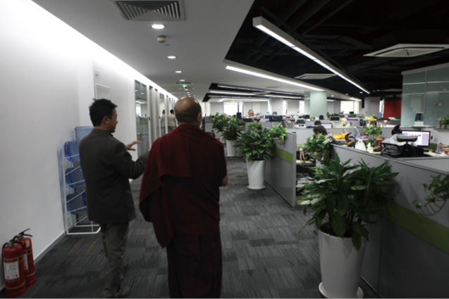
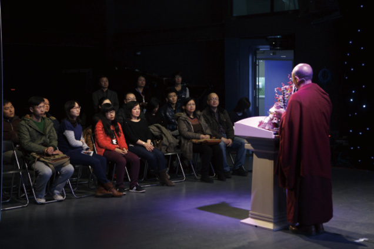
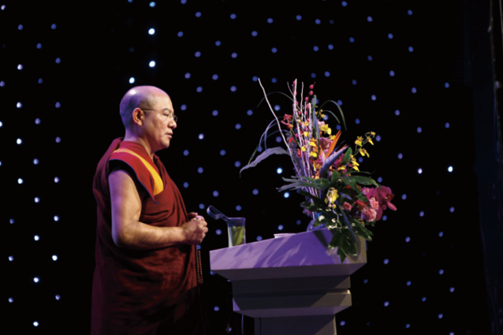
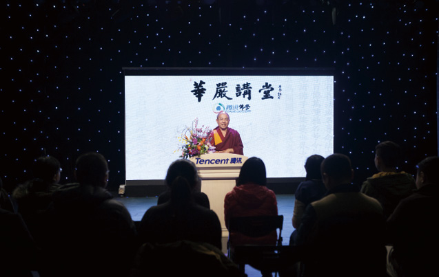
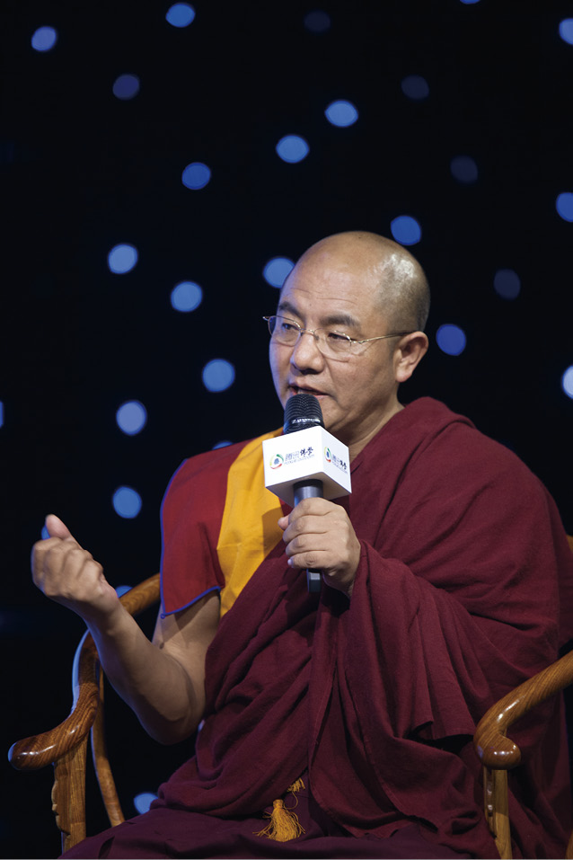
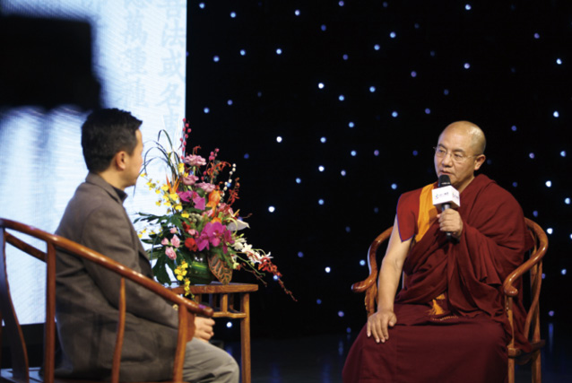

# 什么是密宗

——腾讯佛学频道华严讲堂

2014年3月10日

主持人：

各位朋友下午好，欢迎大家来到腾讯佛学华严讲堂的录制现场。今天是一个非常吉祥的日子，我们非常荣幸地礼请到四川喇荣五明佛学院的索达吉堪布。对在场的人来说，这是一个非常殊胜的机会。同时今天的内容会通过网络，分享给无数人，让大家蒙受法益。我们非常感谢堪布，感恩上师三宝！

今天堪布所讲的题目叫“什么是密宗”。在座和不在座的很多人都对佛法当中非常殊胜的密宗有兴趣，也有一些人通过不同的渠道在学习。今天通过这样的机会，聆听堪布为我们开示什么是密宗。有助于我们树立正确的知见，更有助于我们未来的修行。

让我们用热忱的掌声，礼请堪布为我们开示！

大家好！首先很感谢腾讯佛学频道提供这样一个交流平台。今天我们在此探讨的内容是：什么是密宗。关于密宗的见解、密宗的修行、密宗相关的行为，在座的有些人非常清楚，也有些人不一定那么清楚，还有些人或许有一些不同的见解。不管怎样，我希望今天利用短短的时间，与大家共同交流，希望大家能得到少许利益。

## 密宗是一种非常严密的佛法教育

在座的各位可能在电视屏幕上都看到过藏地神秘的喇嘛庙，里面有一些穿着僧袍的出家人。看到他们，内心会产生一种神圣感。在世间汉地的城市里、街道上，也时常能看到一些穿着红色僧袍的僧人。此时不知道大家的内心有什么样的感受。面对这些画面，大家最应该知道的一件事就是：所谓的密宗，其实是非常严密的一种教育，一种佛法的教育。

我认为现在大众对密宗的认知，其中有一些观点比较极端，这是不合理的。有哪些极端的观点呢？有一种极端是把密宗过于神圣化了；还有一种极端是把密宗妖魔化了。第一种极端：只要是藏地过来的出家人，就不加辨别地视作珍宝。似乎只要亲近、依止了他们，就很荣幸、很有福报了。但其实依止上师需要用细致的智慧加以观察，冷静地思考。

在佛教的教义中，不管是显宗还是密宗，都要求我们一定要观察善知识、观察上师。如果不明白这个基本道理，一开始就非常冲动地依止上师，很可能埋下一些隐患。

我们首先要明白依止上师的目的是什么。扪心自问：你为什么要寻找一位上师，你需要的是什么？你需要的是佛教里所说的解脱呢？还是需要为浮躁的内心寻找到一些安慰，找一个类似于心理咨询师角色的人？还是需要一些其他的东西？如果你需要的是解脱轮回，那么要对这位上师有一定的了解。

在藏地这片神圣的土地上，过去和现在都有着许许多多的高僧大德。为什么呢？最初当印度的佛教传入到藏地后，在藏地的各个寺院和佛学院里，都有非常完整的理论和修行体系。虽然在历史的变迁中经历了一些风雨，但是到目前为止，毫不夸张地说，藏地还完好无损地保留着佛教的闻思体系和规范的教育体制，在这样的历史背景下，有这么多高僧大德就不足为奇了。

现在在全世界范围，各个国家和地区的人们都关注到了这块宝地以及宝地上的这么一群人才。因为当下有太多人需要精神依托和精神归宿，他们会四处寻找自己所需要的上师，在这种时候，很有可能被鱼龙混杂的乱象所迷惑，从而无法找到真正的善知识。

在藏传佛教中，依止善知识是非常重要的。因此，我再再地告诉大家，如果你真正想要学习佛法，无论是显宗还是密宗，首先你要反问自己：你想要的是什么？通过佛法，是想获得解脱，还是想治病，还是想获得一种成就？如果你想解脱，那么就要进一步了解，出世间的解脱可以从哪一位上师那里得到？你所要依止的这位上师也需要有相应的功德和能力。

我最近遇到很多佛教徒，他们说自己的上师是佛，上师说什么就要听什么。这其实是一种很高层次的修行。在显宗和密宗中，都有“上师是佛”的教义，但是在我们依止上师的初始阶段，不需要把上师看成佛。我以前专门就此讲过一堂课《初学者不应视师如佛》，里面讲到刚开始要把上师当成一般人去看待。将他当作朋友，或者相当于世间的合作伙伴去对待。在这个过程中你会发现，他到底有没有相应的资质和知识储备，以及真正的功德和修证。如果他真正具足这些功德，你就可以去依止。

现在是信息非常发达的时代，一方面，我们可以收集、利用各种信息；另一方面，很多的信息和宣传，有虚假不实的部分，我们应该通过各种方式来进一步辨别真假。有很多人来不及观察，听到了宣传就马上去依止。这就好比在世间，你要与一个人交朋友，或者你要寻找一个合作伙伴，一起做生意，你需要对这个人的方方面面，包括他的能力、人品等都非常了解。同样的，当我们要依止上师的时候，一定要了解他的能力、智慧和悲心以及一切的一切，这样我们才能找到一个真正的善知识。

找到真正的善知识对一个修行人来说很重要。比如我们学习开车时，光在网上下载资料是不够的，或者找一个从来没开过车、自己不会开车的人来教你肯定也是不行的。你需要的是一位真正熟练掌握驾驶技术并且有丰富经验的老师。同样的道理，我们要依止显宗、密宗的上师，都需要先进行观察。

《米拉日巴尊者传》在上世纪的七八十年代已经译成汉文，在汉地流通。里面的故事很精彩，但也出现了一个误区：人们都自认为和米拉日巴尊者一样，是上等的根基，作为弟子必须对上师言听计从；上师也认为自己不是一般的上师，摄受弟子的方式不太规范。

以上是我想讲的第一点，大家没有必要把密宗过于神圣化，而应该认识到它是一种很完整、很圆满的佛法教育。

## 正面了解密宗，切勿妖魔化谤法

第二种极端：现在很多人把密宗妖魔化。因为他们不太了解密宗的教义，也不懂得密宗的一些修行方法，误把密宗与印度的婆罗门教和一些其他宗教混为一谈。还有些人认为密宗主张吃肉等等，从各种角度去说密宗与佛教的教义相违。其实对于密宗乃至世间的任何一个知识领域，我们都要先从正面来了解它，这是非常重要的。

藏传佛教中实际上包含了佛陀所宣说的大量无上密法，如《时轮金刚》、《文殊真实名经》、《密集金刚》以及大圆满相关的续部等。的的确确，只有你去真正地闻思修行的时候，才会明白密法中的甚深意义。所以面对众说纷纭的情况，大家要擦亮眼睛，首先要比较全面地了解藏传佛教的内容和体系，然后再通过学习真正地趋入。如果你缺乏基本的认知，很有可能会对密宗有种种不合理的误解。

弘一大师刚开始接触到一些密宗的仪轨，觉得不太合理，在不同场合对密宗有一些毁谤之意。后来，他在《佛法宗派大概》中说，自己刚开始的时候对密宗有一些质疑，后来通过系统学习，才明白自己的质疑不合理。因此他劝勉后人不要先去阅读仪轨，应该先去学习经论。[^1]

我看到汉地的一些佛教徒，刚开始特别重视密宗的火供、烟供等各种行为，除此之外，并没有认真地学习各种显密的基本教义。即使学习了，也只是自行阅读一两本书，并没有系统闻思。在藏传佛教的学习体系里，至少需要十年、二十年的闻思，才算得上是认识佛教。因此，无论是在家居士还是出家人，都要秉承这样一种学习传统。

在汉地，唐朝及唐朝之前，各个寺院中都有讲经说法的传统，后来这种传统不知不觉地消失了。如今除了个别寺院，讲经说法的行为和系统正规的佛法学习越来越少了。

大家如果想要了解藏地的佛法，应该先从学习开始。同时在学习的时候，没有必要去分别每一位上师：我是这位上师的弟子，我只学他的法；这位上师不是我的上师，我不能学他的法；那位上师的法脉和我没有关系……诸如此类的说法都是不合理的。只要是一个合格的上师，传讲的是合格的佛法，我们都可以去学习。

除了合格的佛法，有没有不合格的佛法呢？佛法本身没有不合格的，但在市面上传播、流通的佛教信息中，有一些不符合佛教教义的内容，可以说是不合格的。就像现在有很多假冒伪劣商品一样，佛教信息在传播中也会有真有假。因此我们也要学会分辨真伪。

很长时间以来，人们在精神和信仰领域都是一片空白。此时，当藏传佛教或世间任何一种思想出现时，各种各样的议论都会纷至沓来。这是一种自然规律，也是一种正常的现象。任何思想复兴的时候，都会有很多人排斥它，也会有很多人接受它。在这个过程中，作为修行者一定要擦亮自己的眼睛，看清事物的真相。

比如般若法门，也就是空性思想的弘扬就经历过类似的阶段。释迦牟尼佛在佛经中宣说过空性相关的法义，后来印度的龙猛菩萨对空性思想进行了真正的广泛弘扬。一开始，印度有许许多多的人不承认般若法门，说这是邪道，甚至把龙猛菩萨判为魔王。后来，龙猛菩萨的思想经过月称论师的传播，同样受到了印度很多人的诽谤。但真金不怕火炼，在印度，慢慢地，人们通过不断地了解，最后真正地接受了空性思想。

同样，印度的中观般若思想刚传入藏地时，也有许多人不能接受。后来，人们发现原来中观思想是非常纯正的佛法，渐渐地接受了。从汉地的佛教历史中也可以看到，达摩祖师最初将禅宗的思想传到汉地时，梁武帝根本无法接受。因此达摩祖师在嵩山少林寺面壁九年，没有弘扬禅宗。直到后来二祖慧可断臂求法，达摩祖师才寻找到法器，禅宗的思想才慢慢传播开。

就当下来讲，除了极个别人，大家基本上都能接受禅宗的思想。那么密宗呢？有些人不太接受，有些人特别向往。大家可以通过网络等渠道看到，世界各地有特别多的人在学密法。但是学习的人群中，有一部分人将密法看作童话，想得特别简单：依止之后，稍微修一下，上师给摩顶一下、加持一下，什么事都不用做，马上就可以成佛、成就了。有一部分人则将密法看得过于神秘，觉得充满禁忌，甚至有点可怕。

这些对密法的误解有历史原因。其中之一是上世纪七八十年代的媒体报道。当时有作家描写了一些密宗大师，他们身负绝世神功，但有些行为与佛法背道而驰。通过这些描写和刻画接触到密宗，人们对密宗的印象和看法可想而知。以至于当我们这些穿红色僧袍的人走在街上，也会有人指指点点说：“这是密宗大师啊，他们有没有神通，会不会武功……”

这种社会现象的背后，实际上是对密宗的另一种极端认知。我们不能将密宗妖魔化，因为这并不是密宗的真相。

## 密宗为何称之为“密”

我对密宗相关的事情一直都很关注。大概在十多年前，有个别的法师，在显现上替众生提问题，在显现上对密宗有不同的看法。他们对密宗的双运、降伏、即身成佛等见解有一些误解。实际上，这些见解有着完整的理论体系，并不像他们所认为的那么简单和可怕。

基于此，我写了一本书叫《密宗断惑论》。在书中，我引用了一些显宗浅显易懂的教证来加以比对——不仅仅是密宗中有类似的见解。比如密宗为什么要保密，佛教续部中宣讲了具体的原因。密宗并不是由于有过失才保密，而是为了利益众生而保密。因为密宗的一些见解，如果直接宣说，很多人根本接受不了。不仅密宗中有需要保密的，显宗当中也有需要保密的。比如出家人的戒律，在家居士不能看。

同样的道理，《中观四百论》里说到，宁可产生我执，也不能将空性法门传给智慧浅薄的人。因为给智慧浅薄的人讲无我法门，他根本接受不了。既然这些法门都要观待对方的根器而保密，更不要说密宗中更高的大光明法门了。

密宗当中所说的大光明实际上是如来藏的真正本体。面对没有理论基础的众生，这些道理根本没有办法宣说，就算宣说了，对方也无法理解。可见佛教并不是现在有些人所想的那么简单，更不是有些人所说的那么虚无缥缈。

我特别希望大家去了解一下佛教真正的道理。如果你去了解了，应该对你的生活、工作乃至人生都有非常大的帮助。

这些话并不是从理论的角度对大家说的，而是我自身在长期思考中切实感受到的。在思考过程中，我发现，人们的确需要佛教思想。刚开始接触的时候，大家不应该盲目接受；接受之后，也不要很轻易地舍弃，毕竟这对自己没有好处。

我最近看到有一些人，出于各种目的，把网络上藏传佛教的各种信息全部收集起来，自行加工、演说。对于任何一个宗教或派别，将网络上的相关信息胡乱拼凑到一起，表面上看似乎有一些道理，实际上都是没有经过深刻观察的一种武断的结论。

如果你去修行密宗，也不要认为很简单——只要依止一位上师，他说什么就跟着做什么，或者看一本书就可以了。并不是那么简单。如果你想诋毁、诽谤藏传佛教，也可能没那么容易。藏传佛教中有辩论的传统，如果你去参加辩论，在这个过程中会发现自己的无知，会发现自己根本没有能力去驳斥。

未来，依然会有一部分人把密宗神化，我希望他们去系统地学习；还有一部分人会对密宗进行毁谤，随着大家真正了解教义，这些观点会自生自灭，不攻自破。因为任何虚假的理论在世界上都不会有很大的空间，也不会占据市场很长时间。

现在极少数人，看到个别的密宗师父或者个别人的言行举止不如法，就以此来攻击整个密法、毁谤整个佛法。这样会不会对密法乃至佛法有害呢？我觉得不会。因为不如法的个别人只代表他自己的形象，不能代表密宗乃至整个佛教的教义。

佛陀在佛经里说，佛教徒要依法不依人。意思是说，在某种场合中，具体的某个人并不是佛法的代言人，他的言行举止不一定能代表佛法。就比如大家都知道北大和清华是中国最有名的高等学府，那么从北大、清华毕业的人百分百是优秀人才吗？也不一定。名校毕业生进入社会后，可能会有各种各样的形象，做出各种各样的事情。就算是美国最有名的耶鲁大学、哈佛大学，这些学校的毕业生是不是都对社会有所贡献呢？也不一定。

生而为人，自相续中都有着种种烦恼。就算有些人从外在来看，自我包装得很好，但实际上也会有一些不合适的行为。但是，这些行为并不能代表他所在的派系等。

## 正确认识佛法，了解世间真相

佛教里有没有一个理论依据，能证明我们现在能离苦得乐呢？关于这个问题，在座的各位可以通过长期的学习去寻找答案。在学习的过程中，大家自然而然会明白的。

正如大家所知，人类社会刚开始是原始社会，慢慢进入农耕社会，之后经历了工业革命，渐渐发展进入现在的科技时代，或者说是后工业文明时期。在这个发展过程中，人们所有的生活方式都发生了很大的变化。什么样的变化呢？之前农耕社会时期的生活方式，人们当时的生活起居、言行举止与今天完全不同。

今天的生活变得更加复杂了。在这样非常复杂的社会和生活中，我们需要什么样的心态呢？需要一种安静的心态。当然我们也需要物质，物质对我们的幸福和快乐也有一定的作用，但这种作用并不像我们想象的那么圆满。就像很多人所说的那样，当你没有财富的时候，你去拼命地寻找和获取财富；当你拥有财富的时候，却不一定那么快乐。当你没有感情的时候，会觉得如果拥有一份感情一定会非常幸福；真正拥有了之后，虽然会有一些快乐，但执著它、追求它、守护它的过程中，带来的压力、不幸和痛苦可能更多。原来你向往的和后来你真正得到的，终究会有一些差距。

此时，人们对自己内心真正的认识，也就是佛教所讲的感悟，是非常重要的。因为现在人们所谓的感觉、各种执著，实际上已经远离了事物的本质。佛教认为，人们有两种错误的执著，人我执和法我执。实际上，万法都是空性的，“我”不存在。基本上现在所有的人，对物质、对自己的身体特别执著的人，根本都不知道“我”其实不存在。

听到佛教里说“我”不存在，很多人都会产生怀疑。不要说一般的人，佛教内部也会有这样的错误执著。佛教有大乘和小乘之分。小乘里有声闻十八部。其中有一个犊子部，他们也认为有一个“我”：如果没有“我”，是谁解脱？又是谁堕地狱呢？因此，“我”应该存在。

佛教的宗派安立中，第一个宗派是有部，之后是经部，再之后是唯识宗，接下来是中观自续派和中观应成派。每个宗派有各自的不同观点。小乘的个别人认为“我”是存在的。唯识宗认为有一个阿赖耶识，这个阿赖耶识又叫依他起识，他们认为一切遍计法是虚假的，都是空性的，唯一不空的是我们心识的本体。

到了更上面的中观宗的时候，中观应成派认为，一切法都是空性的。中观宗能抉择空性，但是对心性光明、众生即佛、烦恼即菩提、众生在实相中跟佛陀无二无别等道理却没有广泛抉择。

总之，现在大家普遍认可的事物实际存在的道理，并不符合事实的真相。佛教中所说的这些道理并不仅仅是一种理论和假设。这些理论，我们可以逐个去观察。比如说，我认为这朵花很美，这是我带有个人主观色彩的一种想法。我认为这朵花很美，但其他人不一定这么认为，他们都有各自不同的认识和说法。同样，我觉得这朵花的本质是存在的，是一直没有变化的存在——但这其实是我的错觉。从刚才到现在，虽然看不出它有很大的变化，但实际上它每分每秒每个刹那都在变化。这是我们的第一个错觉。第二个错觉，其实这朵花是由很多的微尘组成的，这些微尘之间并不相连。就像宇宙虚空中的星星，星星与星星之间都不会接触。但我们的眼睛根本无法发觉这样的真相。

同样的道理，我们所认为的世界的真相并不符合实际，包括对自我的认知。人类认为“我”是存在的，真正用智慧来观察，所谓的“我”的确无法找到。最后连佛教小乘中犊子部的观点也是不得不破，不得不承许一切万法都是空性的。

如果想要更深入具体地了解这些理论，我特别希望在座的人去学习《中观根本慧论》以及相关的般若法门。这些道理并不是我今天用一两个小时就能跟大家交代清楚的，也不是一两天就能真正明白的。需要通过系统地闻思，用一种细致的观察，到一定时候，才会明白佛教传递给我们的信息是非常合理的。

学习到了一定阶段，你会发现：那些原本你特别特别执著的世间的道理，原来有很多都是错觉；我们所想象的那些，美丽也好，丑恶也罢，都不是真实的。

那么，佛教是不是什么都不承认？也不是。佛教没有那么极端——认为一切皆空，善业也不用做，恶业也不用制止，并不是这样的。当我们懂得了世间真相，就会明白，我们身上所发生的事情并不是偶然的，而是一种必然。而且所发生的一切，并不只是由于外在的因缘，也有自己内在的因缘，比如你的心态、前世等各方面因和缘的共同作用。如果你懂得了这个道理，对于生活中发生的任何事情，你都会很冷静，处事也会很稳重。反之，有些人在生活中遇到一些变故，会非常痛苦和伤心，根本无法面对。这样对自他都是无益的。

## 修学密宗必须依次第进行

进入佛门一定要有一种次第性的学习。现在很多人不是这样的，有一些想学密宗的人，他们想要现成的、最好的、最高境界的法，马上就要修。密法中有大威德、大圆满等修行法门，这些人认为类似这样的修行法门，不需要任何前提和修行基础，直接就可以灌顶，直接就可以修最高的密法，得到最高的境界。我觉得这样的想法是不现实的。

显宗的《譬喻经》里有这样一个故事。有一个人特别特别有钱，他请来一位木匠，说要修一栋三层楼的房子，但提出了一个比较特殊的条件。他对木匠说，我不需要一层和二层楼，我只需要第三层楼。木匠很为难，根本没办法满足他的要求，就详细地解释给他听：第三层楼必须建在第二层楼上，第二层楼必须建在第一层楼上，而第一层楼需要相应的地基。但这个愚笨的人听不进去，一直要求木匠只建造第三层楼。

现在很多学密法的人也是这样的。他们不愿意一步一步地按照次第去修。比如先修加行，将一些系统的前行法门，慢慢地修完，有了基础之后经过灌顶，再去修正行。这样你的修行会很稳固，应该不会出现什么问题。如果没有经过基础的修行，自己直接去看密宗最高的法本，或者依止一些上师后，要求直接给自己传最高的法。这样的做法并不合理。毕竟并不是每个人都有六祖或者龙钦巴、莲花生大士那样的根基。

宗喀巴大师曾经写信给他的上师仁达瓦大师，信中专门讲了一些显宗和密宗的道理，将密宗的见解建立在空性的基础上。宗喀巴大师后来写的《甘露妙药》中的内容，与莲花生大士在《问答金鬘录》里面的观点完全是一致的。为什么呢？藏传佛教中有很多不同教派，如噶举派、觉囊派、格鲁派、宁玛派、萨迦派等，这些教派所讲的法，都是密法中的无上密法。要想真正趋入无上密法，需要一些真正的实修，并对人身难得、寿命无常、轮回过患等基础的前行法有所认知。没有这方面的基础，学习无上密法很难。

我们学习佛法的过程中，建立一个正见很重要。如何建立正见？就是一定要去学习。如果没有系统学习，直接奔向佛教最高的阶梯，恐怕修行中会出现很多问题。

在依止上师的过程中，最关键的就是要如理地思维、如理地观察，最后一心一意地依止。

## 显密佛教应该团结，共同利益众生

同时我也希望，显宗也好，密宗也好，所有佛教徒之间一定要团结和合。有个别佛教徒认为“我是这个教派的弟子、我是这位上师的弟子”，或者“我是禅宗的、我是净土宗”的，在佛教内部搞分裂。虽然在历史上，佛教内部也发生过一些不愉快的事情，但我们现在要像其他宗教一样，极为和睦地相处。不管是显宗还是密宗，大家都应该有一种和合的气氛。

在藏地，显密是不分家的，所有学密的人同时都学显宗，学显宗的人多多少少都会学一些密宗。在汉地，以前在这方面做得不够好。主要是有一些汉地的佛教徒对藏传佛教有一些误解，现在稍微好一些。

实际上，早在唐朝，汉地就有唐密，后来的宋朝、元朝、明朝时期，汉地也弘扬过密宗。虚云老和尚就曾在他的年谱中说过，密宗最初是由善无畏、金刚智、不空引入中国，依靠一行大师加以弘扬。不管怎么说，密宗也是纯正的佛教。这就是当时虚云老和尚对唐密的看法。

印光大师在《文钞》里也说过，密宗是一个不可思议的法门，依靠这个法门可以即身成佛。说到即身成佛，很多人都很感兴趣，我在其他地方讲过其中的道理，在这里暂时不说。

汉地的大德们对藏传的密宗是能接受的。大概在二零零几年的时候，有一次跟本焕老和尚一起吃饭，他当时说过一句话，我记得很清楚。他握着我的手，说：不管是藏传佛教，还是汉传佛教，都是释迦牟尼佛的法，我们都是佛陀的弟子，只是地域不同而已，实际上是一样的。老和尚圆寂以后，我心里一直想着这句话。

作为佛教徒，不要用自己带有主观色彩的想象，随意地改变佛法的形象和底色。不然的话，未来真正的佛法很难得到弘扬。我们首先应该在一种和合、和睦的基础上，大家互相学习、彼此尊重，佛法才能兴盛。

当然，我觉得也没有必要改变自己的教派。你原来学的什么教派，就继续学。你原来是这位上师的弟子，也不用舍弃这位上师，去依止另一位上师。这些都没有必要。但不管你学的是什么教派，一定要有一个佛法的基础教育。佛教徒整体的综合素质需要有所提高。

现在有很多佛教徒正在学习，正在自我提升；但也有一部分佛教徒对佛教的教理一无所知，自认为根基好，修行也不错，觉得自己什么都可以做，甚至可以做到“酒肉穿肠过，佛祖心中留”——其中的真实性有多少，也很值得大家观察。

作为佛教徒，真正地去了解佛法、学习佛法，确实特别有必要去了解密宗。但了解密宗不是那么容易，一定要有次第性。先接触一段时间，再慢慢深入探究。

我觉得一生中最幸运的一件事，就是遇到了显密圆融的佛法，这也是人生中最开心、最有意义的一件事。如果去希求世间法，应该会得到一些名闻利养，但这些都没有很大的意义。对我来说，最有意义的是什么？就是在年轻的时候，系统学习佛法。那段时间是非常珍贵的。

同样，我特别希望有兴趣、有信心研究佛法的人，一定要建立佛法的正见，有了正见会有正信，有了正信就会利益众生。《楞严经》中讲到，“因地不真，果招迂曲”——如果刚开始的基础没有打好，刚开始的知见没有对，已经歪曲了，那最后的果不可能是正确的，也一定会是歪曲的。因此，希望大家一定要趣入正道，有了佛教真正的修行和感悟时，我们就可以利益众生。

最后，不管显宗、密宗，最终的目标是什么？并不是自己享受，一定会是利益众生。大乘佛教最究竟的宗旨，就是利益众生。每一个佛教徒，每一个修行人，心里有菩提心，心里有利益众人的一颗心，面对生活也会非常轻松。面对生活中的各种烦恼时，无论家庭里的、工作中的，都非常容易克服，或者说是超越。

究竟而言，每个人都需要显宗和密宗的见解，证悟空性或者证悟等净无二的境界。在这个基础上，我们需要时刻修行，时刻保持自己的这种心态，这样就可以利益众生。

我特别希望大家在短短的人生当中，提升自己的修行境界，并把这种境界传递给无量的众生，让天下的众生都得到暂时和究竟的利益。谢谢大家！

现场互动

主持人：

感恩堪布。一个多小时好像一刹那一样。在短短的时间里，大家蒙受甘露法语，享受到非常充沛的甘霖。此刻演播室外的无数星辰，就像法界的光明一样。非常感谢堪布！

接下来是互动的时间，大家可以向堪布提问。希望大家珍惜这个万分难得的机会。

观众甲：堪布您好！特别感谢您给我们宣讲这些知识。我有一个困惑：很多人学密宗，懂得了很多佛法的道理，但是不是除此之外还要实修？我自己遇到的问题就是，我原先是只学不修，因为密宗要念咒，我信心不足的时候就没有念。后来我觉得自己信心挺足的，但还是没有念咒。想请教您这个问题。

堪布：在密宗中，不管是念咒语，还是观想一些仪轨的教义，信心都非常重要。有了信心以后，修密宗的任何一个法都特别容易。当然，所谓的信心时时会改变。同一个人的信心，前后不同时期也会有所改变。在这个无常迁变的世界中，人们的心态会随着年龄、环境的影响而不断改变，这也是一个自然的规律。

不管怎么样，学习任何佛法，如果没有信心的话，都很难成就。密宗的教义也是如此。

观众乙：堪布您好。我修习密宗已有一段时间。在修行过程中，我和同修都会遇到的问题，就是关于上师的问题。您在很多课程和讲座里都讲过如何鉴别上师。作为汉地弟子，能够接触上师的时间有限，时常会遇到真真假假的上师。我看到有位大德的开示中说，密宗中有密乘戒，如果诋毁上师或心中对上师有邪见，会破密乘戒，果报很严重。这位大德还说，上师是具德上师，才会涉及破戒的问题。

想向您请教：如果上师本身不具备一定的资格，皈依了他，也接受了他的灌顶，之后发现他不如法的行为，此时远离他会不会破密乘戒？

堪布：如果你发现一个上师是假上师，然后考虑远离——这种情况是先依止、后观察。和我经常讲的依止上师的方法刚好相反。按照真正的次第，应该是先观察、后依止。如果没有先去观察就依止了，后面再发现问题，这样不太好。

观察后会有两种情况。第一种，世间人对于情感或者某个具体的物品，刚开始都特别好奇，有一种新鲜感，但时间久了就觉得没有那么好。哪怕这种情感或者物品没有什么变化，他也会觉得变了，想要舍弃。这是个人的主观感受引起的。还有一种情况，是的确发现对方的一些问题。所以，首先要确定，到底是哪一种情况，是自己的问题还是对方的问题？如果是对方的问题，你当初为什么没有这样观察？归根结底，不仅仅是上师的错，自己也有错。首先是自己没有如法地去依止。如果不去依止，上师也不可能强迫你。具体情况是怎样的，也要根据个人情况去做不同的分析。

观众丙：堪布您好，今天能亲眼见到您，心情很激动。

我现在在学宗喀巴大师的《菩提道次第广论》，也正好学到如何依止善知识。从中学到了弟子应该有弟子相，善知识应该有善知识相，我们应该视师如佛，把上师看成佛。书中又讲到，上师可能也会有一些过错，比如，对我们提出一些不如法的要求的时候，我们应该婉言谢绝，但是内心依然要恭敬。

对于这部分内容，我自己很难转过这个弯。一方面要对自己的上师很恭敬，不能观他的过失，要视师如佛；另一方面又要判断上师的对错，对不如法的要求要婉言谢绝，同时内心保持恭敬。这个真的很难把握。当然，书中也讲到自己要先具备弟子相，弟子相又包括要具慧。

想请堪布开示一下，如果感觉上师有一点不如法的时候，自己的心态应该怎样调整？

堪布：这个问题和前面道友的问题基本相同。

我是这样认为的，所谓的上师，是修行的导师，在其他方面，上师与弟子之间不应该有很多的牵连。

为什么要依止上师？我刚才讲了，你要去寻找精神的导师，你希求解脱。因此，你寻找的上师应该具备相应的能力。作为上师，摄受弟子的时候也不应该有其他的目的。如果出于其他目的摄受弟子，那么上师的发心也不纯正。如果遇到这样的上师，比如出于金钱的目的来摄受弟子，最后弟子在金钱上没有满足他，我觉得弟子不会有什么过失。我们所需要的关系不是金钱关系，我们需要的是解除痛苦、断除烦恼、获得解脱，这才是真正的依止。如果是金钱关系、情感关系，这些与其他的世间法也没有什么差别。世间人有很多复杂的关系和问题。真正的具德上师不会为这些世间法痛苦或担心。所以，如果是在这些方面，弟子没有满愿，上师不高兴是他的事。

但是，如果你在修行中，在解脱方面没有按照上师的要求去做，产生一些矛盾的时候，你要观察自己的心。

很多汉地的佛教徒，将自己与上师的关系，演化得很微妙。在佛教一直比较兴盛的藏地和不丹，都没有这种情况，上师和弟子之间的关系很纯粹。但汉地的有些佛教徒觉得，依止上师，一定要全身心供养，把家里的钱都供养上师，最终也带来各种烦恼和痛苦。其实佛经中讲到，让上师真正欢喜的就是法供养，除此之外，其他让上师欢喜的行为都不是最重要的。作为弟子，与上师的交往，应该是修行上的交往。现在很多人将上师当作工具，这是弟子的不对；上师把弟子当作满足自己欲望的工具，这是非理的要求，即使弟子拒绝他，也不会有大的过失。

主持人：

今天的互动就到这里。我们在讲座结束后安排一个环节，为现在失联的马航MH370航班做一次祈福。今天是非常殊胜的莲师会供日。我们祈请上师带领大家一起为这个航班诵经祈福。

堪布：我们一起念莲师心咒和观音心咒。会念的人都一起念。

主持人：

这一期讲堂就到此宣告圆满。我们再一次感谢堪布，为我们做无比殊胜的法布施。希望大家从这次讲座中获得修行闻思的增上，也祝大家在以后的修行道路上福慧增长，一直向前。

[^1]: “在大乘各宗中，此宗之教法最为高深，修持最为真切。常人未尝穷研，辄轻肆毁谤，至堪痛叹。余于十数年前，唯阅《密宗仪轨》，亦尝轻致疑议。以后阅《大日经疏》，乃知密宗教义之高深，因痛自忏悔。愿诸君不可先阅仪轨，应先习经教，则可无诸疑惑矣。"（弘一大师《佛法宗派大概》）
