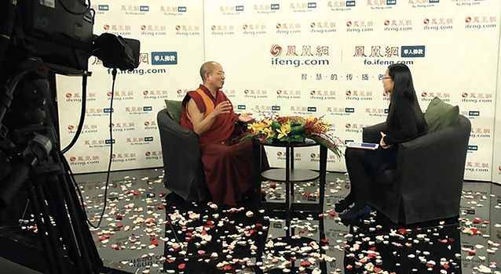
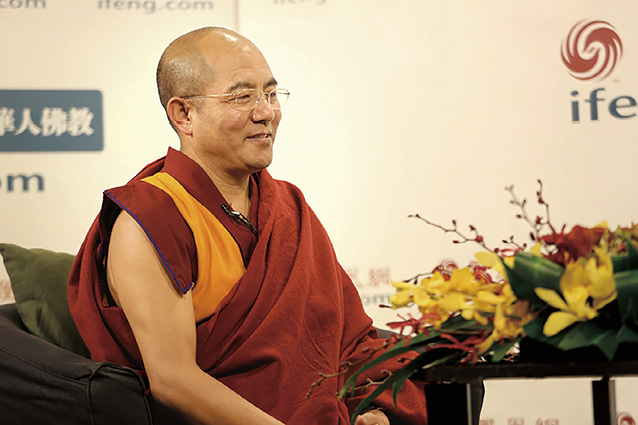
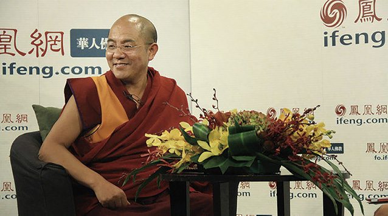
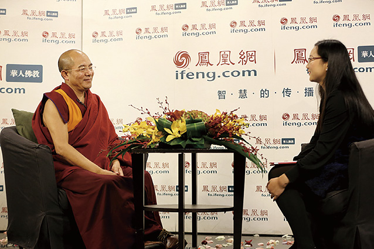

# 修行是人生中 最美好的经历

——凤凰网华人佛教栏目采访

2014年1月24日

## 残酷才是青春，还原人生本来的面目

⊙ 问：索达吉堪布您好！欢迎您做客凤凰网华人佛教，我代表广大网友对您的到来表示感谢！

您最近出了一系列书籍，如《苦才是人生》《残酷才是青春》等。在我们大部分人眼中，青春应该是美好的，人生应该是快乐的，为什么您会取这样的书名？是与您的亲身经历有关吗？

堪布：应该说，与我的亲身经历没有直接关系。我认为，对于现在的社会，可能从另一个角度看待人生会更准一点。

现代人经常说幸福才是人生、快乐才是人生，实际上，生活中的快乐非常少，幸福也不一定找得到。很多人不一定有钱、有地位，而什么条件都具足的人内心也很痛苦、很困惑，这样的现象比比皆是。

在我看来，所谓青春，正如佛教中说的“无常”，消失得特别快。就像一朵盛开的花，很快就枯萎了或者凋谢了，会有这样的情况。

如果用佛教里“生老死病的痛苦”“万法皆无常”的道理来解释我们的人生和青春，可能会使很多人觉得人生没有那么苦，同时在面对苦的时候，会更加坚强。同样，如果人们意识到，青春实际上是残酷的，那么也会提前就做好相应的准备。但如果我们一直认为人生是多么幸福快乐，一旦在生活中遇到挫折和磨难，就会觉得难以接受和面对。

我在这两本书里提到，正值青春或者青春已过的人，都需要对人生做一个思考。另外，我们的人生中的确有很多快乐，但是与痛苦相比较，后者更多一些。了解到这一点，人们在面对痛苦的时候，就应该有一种智慧、一种洞察力。毕竟，这才是人生的本来面目。

⊙ 问：我们大部分人的青春都有一个叛逆期、冲动期，您的青春有没有过类似的叛逆、冲动？

堪布：所谓的叛逆期或者冲动期，只是人们的不同说法而已。对任何一个人来说，都会对自己的青春有很多美好的回忆。比如对我来说，在我还没有上学的时候，平常会在山上放牦牛，在蓝天白云下，跟着一群群牦牛走。那时，我的思想多么广阔，好像所有烦恼都跟蓝天融为了一体，大自然给我的心灵带来了非常难忘的快乐。后来上学读书了，虽然看起来是一种艰苦的经历，但在我现在的年纪回忆过去，那个时候的学习经历很有意义。因此，我的青春也有一些美好的回忆。

对我个人而言，包括青春在内的人生，没有非常痛苦、伤心的时刻，也没有非常难忘的事情。

⊙ 问：您的童年或者少年时代都是跟天地自然相伴，相比之下，我们大部分人的童年几乎都在上各种各样的辅导班。您对此有什么看法？

堪布：确实，和现在的孩子相比，我的童年有所不同。最大的不同就是我童年时期学到的知识不多，因为整天都与大自然、牦牛群相伴。虽然很开心，但没有学习的机会。现在我还会想，如果十几岁的时候一直在学习，背诵各种经典、论典，学习世界各国的语言文字，那会非常有意义……还是很可惜！

虽然那个时候没有真正开始读书，但我的父母和邻居经常向我传递慈悲和爱——这种慈悲和爱的教育在现在的学校里不一定找得到。因此，我的心地比较纯洁善良。

从获取知识的层面来说，十四岁之前没有机会读书很遗憾；从为人处世的层面来说，我从身边人的言传身教里，获得了很多难忘的关于智慧、慈悲和爱的教育。这些对我的人生来说非常必要。和现在孩子的童年相比，有缺失的一面，也有好的一面。

## 从小最大的愿望是出家， 修行生活是最美好的人生经历

⊙ 问：您虽然十四岁才上小学，但是只用了两年时间就考上了初中，接下来又进入甘孜师范学校读书。在一般人看来，您的世间生活充满了希望，前程美好；同时大家普遍认为修行的路充满了艰辛。您为什么会选择出家呢？

堪布：实际上，在我还没有去上学时就非常非常想出家，很想终身做一个出家人。因为前世的一些因缘，我从小就非常向往出家人的生活，看到他们的各种行为、听到他们念经的声音就特别感动，经常热泪盈眶。

那时候政策还没有开放，当时我还不能披上出家人的袈裟，我经常会找一些红色的布匹披着，假装出家人。后来我去上学，最大的担忧就是害怕以后当不成出家人了。师范学校即将毕业的时候，我发现自己出家的因缘应该到了。出家对我来讲是非常好的一种选择。

我选择出家还有一个原因。不管在初中还是在师范学校，我似乎总是不满足于现有的知识体系，认为需要进行更深层的研究。只有通过出家这条路，才能充分利用时间，才有机会深入学习佛经论典以及现代社会的一些知识。

本来出家也好，佛教修行也好，在世间人看来都是一种艰苦的生活；但对我而言，这种生活是人生中最美好的经历。在出家后的十多年中，不管白天还是黑夜，可以说我把所有的精力和时间都用在了学习和钻研佛经论典上。

现在回看，我也不觉得那是一种痛苦或一种折磨。现在无论到哪个国家、哪个城市，都不会羡慕当地的建筑，也不会羡慕人们的财富、地位，但是我很怀念曾经的自己有那样一段刻苦学习的经历。对我来说，是一个很难得的珍贵因缘。

⊙ 问：您在五明佛学院仅仅学习了九个月就成为堪布。我们都知道，堪布一般要经历好多年的经论学习，还要通过考试。当时法王对您是不是有一个破格的提升或特别的考验？还是您本身学习能力特别强，所以能在这么短的时间内就成为堪布，为大家讲经说法呢？

堪布：是不是九个月，其实我不是很清楚，后来有些人说是九个月。法王对我也没有破格提拔或者特殊考验。在我的记忆中，法王会点我做特殊的抽考[^1]。

我那时特别沉浸于看书和学习，白天晚上都在学，当法王点名抽考因明、戒律等时，我很盼望让法王知道我对这个经懂一点，那个经也懂一点。我那个时候比较幼稚，不像现在有些人特别害怕老师抽到他，我是每天都害怕抽不到自己，每天都很期待当众展示口才。其实我当时口才并不是很好，学得也不是很好，刚学了《入行论》和中观之类，只是对学习很有激情。

那时僧众也不太多，我自己又很愿意分享和传授，慢慢地就开始给大家做辅导。

从学院的制度来看，其实评选堪布、格西、法师等的过程是很严谨的。我们现在的评选就是严格按照法王后期制定的考试制度来执行。评选堪布或者法师，要对他的各方面行为和能力进行全面、长期的考察。我们觉得这样做应该比较合理。

## 世间弘法与个人清修不矛盾， 自利利他是责任

⊙ 问：许多人都认为佛法是出世间的法，作为修行人就应该待在深山老林，与青灯古佛、晨钟暮鼓长期为伴。您来到世间弘法与个人清修会有矛盾吗？

堪布：我觉得没有很大的矛盾。

按照佛教声闻乘的教义，修行人确实需要在寂静的地方自己修行。但如果每个人都只关心自己的解脱，都到寂静的山里、清静的寺院里修学，那么很可能现在的芸芸众生就感受不到佛法的智慧和慈悲。

有一句话叫“不忍众生苦，不忍佛法衰”，就是说：现在的众生特别痛苦时，作为佛教徒应该尽心尽力，用自己的智慧帮助他们；同时，现在佛教也处于比较衰败的状况，这个时候，佛教徒很有必要一起努力。

对于能够在寂静地方修行的人，我们很羡慕。我自己也特别喜欢修行，喜欢一个人待着，谁都不见，感觉很悦意。但有时候确实不忍心。

我们的人生非常短暂，在短暂的人生当中，如果没有将自己年轻时学到的佛法知识分享给其他人的话，总觉得从责任上讲，有点过意不去。真正按照大乘佛教的教义来说，修行人必须自利利他，即自己修行和利益众生实际上是一样的。

我倒是没有到达大乘修行人发起菩提心那么崇高的境界，还谈不上。只不过在修学过程中多少从中获得了利益，我很迫切地想和有缘人分享。哪怕只能影响少数人，也能传播一些佛教的教理。

很多人不管其他事情，整天强调修行，强调解脱——当然真正能让自己和他人解脱是很好的。但有些人并不是真正地想要自我解脱，而只是在逃避，一直不敢面对社会，不敢接触他人。这样的话，即便你一直待在非常清静的地方修行，也不一定很好。

我也看到有些佛教徒一直没有放弃自己的修行，也没有放弃利益众生。一部分时间自己修行，另一部分时间去帮助别人。如果真正有这样一种心态，也不一定非要在山里。

实际上，佛教并不完全是出世的。现在很多人认为佛教是出世的，其他宗教是入世的。其实佛教最高的境界恰恰是入世的。修行人证悟之后、成佛以后的主要目的是什么？就是利益众生！

我的老师法王晋美彭措在学院讲过几句非常重要的教言：一是戒律清净，即要规范个人的行为；二是团结和合，现在是一个开放合作的社会，成办任何一件事都需要和合；三是闻思修行，即我们要学习和修行；四就是利益众生。

按照我的老师的理念，我们一直修学是为了什么？是为了自己发财、享乐吗？并不是。当我学有所成的时候，就是去帮助众生的时候。哪怕只是在很短的时间中帮助到极少数的人，那也应该是学习佛法最重要的意义。

我特别希望很多修行人不要只重视自己的修学。在短暂的人生中，如果你没有把自己的修行境界传给别人，也许你在离开人间时自己会得到解脱，但是你所拥有的智慧、慈悲以及各种各样出世间和世间的功德，别人都享受不到。这样的话就很可惜。

## 最大的浪费是对时间的浪费， 要做有意义的事

⊙ 问：您在弟子眼中好像是一个工作狂，您认可这个称呼吗？他们反映说，您有时候生着病甚至打着点滴还在给他们讲经说法。您爱惜自己的身体吗？

堪布：如果经常打点滴说明是爱自己的，吃饭是爱自己，穿衣服也是爱自己，晚上睡觉也是爱自己……

所谓工作狂，也可以这么说。因为我总觉得想做的事情很多，但是好像时间始终不够。我很希望在短短的时间中做出很多事情。

我曾看到一本书这样定义“现代人”，就是能在短暂的时间中做很多事情。我觉得在短暂的时间中做一些有意义的事情，是人生最有意义和最有价值的。这样一来，说我是工作狂也可以。但我还是很会自我调整，我吃饭也吃得很好，睡觉也睡得特别香。而且我吃饭睡觉都是很有规律的，归根结底还是特别爱自己。

⊙ 问：时间对您来说意味着什么？

堪布：时间对我来说意味着生命。说实在的，每个人都应该珍惜、重视时间。如果我们虚度光阴，成日闲聊，或者在一些无意义的状态中浑浑噩噩度过的话，我觉得非常浪费，非常可惜！

所有浪费中最大的浪费就是对时间的浪费。因此，我只要有时间，就一定会珍惜，一定要用在有意义的事情上。否则浪费时间就是浪费生命，也是浪费财富——时间是一种最最宝贵的财富。

## 出家前爱发脾气， 大乘佛法有不可思议的加持力

⊙ 问：堪布，您平时对弟子的要求严格吗？

堪布：我对弟子该严格的时候严格，该放松的时候放松。

⊙ 问：您对他们会有生气的时候吗？

堪布：会有生气的时候。

⊙ 问：您生气时是什么样的感受，您会原谅自己吗？

堪布：我以前没有出家的时候脾气很不好。发起脾气来，好像既没办法原谅自己，也没办法原谅别人。甚至也爱打架，有很多不好的习气和毛病。

后来学习了《入菩萨行论》等一些大乘经典和论典后，虽然还是会生气、会有嗔恨心，但是也学会了很多对治和调节的方法，一下就可以转变负面情绪。

以前我因为某件事生气，可能一直不能原谅也不能释怀，好多天都不说话，甚至耿耿于怀。学习了这些大乘论典之后，给我带来了不可思议的加持力。现在一件事只要结束了，就不会再影响我了。

我对别人所谓的生气，可能就是当场批评他。过了一会儿，这件事就好像没有发生过一样。我不会记在心里，这是我现在能从根本上做到的。

所以我觉得大乘佛教，特别是《入菩萨行论》等论典有一种不可思议的力量，这种力量在对治烦恼方面有非常大的作用。

⊙ 问：您从十年前就开始汉藏的经论互译，并通过网络、光盘等各种方式进行汉藏文化交流。因此您被大家称为现代的玄奘。您怎么看待这个称呼？

堪布：我在不同场合说过，把我称作“现代玄奘”是一种夸张之辞，也是一种不合理的称呼。

十多年来，我出于兴趣，翻译过一些经典和论典。因为我总觉得，现在汉地佛教徒虽然有机会学习很多经论，但是藏传佛教中特别珍贵的经论，也可以让汉地众生了解。由此，我花了大量时间做汉藏互译，也将部分中国传统文化和汉传的佛经论典译成藏语。这些翻译工作是我的一种爱好，也只是我工作的一部分而已。

我之前有一次去清华还是北大演讲，当时有一位主持人称我为现代的玄奘，这样说了之后，一传十，十传百，大家就经常这样说。实际上，对于这个称呼，我觉得很惭愧，也希望大家不要再提。这种称呼其实很虚无缥缈，也并非名副其实。

大家都知道，玄奘法师的翻译工程相当庞大，他受托于皇命，用了大概十九年的时间，翻译了如《大般若经》《瑜伽师地论》等大量经论。相比之下，我只是做了一些如修剪小草一样的工作。

总之，这种称呼我觉得没有任何必要。别人这样说时，我也从来没有过丝毫的认同之心。

## 现在的年轻人应该多学习古代文化， 很多烦恼可迎刃而解

⊙ 问：您在讲课中经常会引用中国传统文化经典中的内容，从唐诗宋词到诸子百家，也会引用如自然科学等现代科学知识。一般人想要掌握这些知识都很困难，您却能够融会贯通、运用自如。您如此用心用力地学习这些，是出于什么样的目的呢？

堪布：我最喜欢学的是佛学，佛学是我最重视的一门学科。与此同时，我认为不管是唐宋元明清的经典著作还是诸子百家的格言名言，其中包含着很多为人处世和待人接物的哲理和常识，是我们日常生活中不可或缺的。因此，我对传统文化很有兴趣，经常阅读相关内容。但其实我了解的也不算多。

我认为现代人尤其是年轻人，应该用更多时间学习传统文化。古人的思想高度与现代人相比，有所不同。如果现代人能通达古人的思想境界，心灵上的种种烦恼与困惑都可以迎刃而解。

⊙ 问：您认为中国传统文化在修行次第当中起着什么样的作用？

堪布：中国传统文化包括了儒教、道教和佛教等。其中的佛教文化在修行次第中起到了非常大的作用。

我们希望众生学佛，并不仅仅是为了今生的快乐，更重要的是，它让我们活的时候快乐、死的时候快乐，乃至来世也快乐；不仅仅是自己快乐，也让周围的人快乐，乃至让所有有情众生都快乐。此外，从思想的广度、深度等方面来说，佛教的理论次第和修行次第都非常完整、圆满。

其他传统文化的一些观点可能与佛教的大乘思想不太一样。我们可以进一步地互相学习、互相探讨，才能找到相通之处。个人认为，佛教的理念，尤其是它的慈悲观涵盖了所有生命。在这一点上，就超越了很多宗教与文化。大乘佛教的慈悲观只有通过实践才能了知其中的甚深意义。

这几年，我喜欢将佛教思想与其他宗教、各种传统文化乃至一些现代科学思想进行对比。我不会因为自己是佛教徒就刻意地去赞叹佛教，而是在对比的过程中，发自内心地认为佛教的智慧非常了不起。为什么了不起？因为它既能跟得上现代科学的发展，也能与古人优秀的哲学思想不谋而合。应该说，像佛教这样的智慧思想是比较罕见的。

因此，我特别希望大家用一种正面的心态来了解佛学知识，这样它与其他各种文化学说相比之下的特殊性和优越性，就很容易被发现。

## 佛教没有民族差别， 汉族人也适合修学藏传佛教

⊙ 问：现在藏地很多高僧大德包括您在内，都致力于将藏传佛教传到汉地。但是也有部分人认为，汉族人的根性更适合修学汉传佛教。您对此怎么看呢？

堪布：我觉得佛教其实不分民族，佛教思想也不应该受到国家、民族、地区等的限制。与其他佛教宗派一样，藏传佛教也是释迦牟尼佛传下来的教法，汉族人、藏族人都可以学。从我的经验来看，只要大家对它感兴趣，就可以学。

就好比西方生产的一台非常实用的机器，谁都可以上手操作；又好比日本生产的一辆质量很好的车，只要掌握了驾驶技术，谁都可以开。不会是日本车只有日本人可以开，其他人不能开，没有这种说法。如果传承非常清净圆满，修行次第和理论次第也都很圆满，那么谁都会从中受益。

⊙ 问：与藏族人相比，汉族人修学藏传佛教时会不会有一些特别的困惑？您觉得他们在这方面会有障碍吗？

堪布：应该不会有什么障碍。佛教是汉族、藏族、蒙古族等任何一个民族都可以学习的。佛教中所说的“度化天边无际的一切众生”，不仅针对人类，更是让所有生命都能得到利益。

作为藏族人，见到任何民族学习、修行佛教，都会很随喜赞叹。因为对于现代人来说，佛教确实是一种特别珍贵的思想。此外，我并没有发现汉族人学习藏传佛教，会给他们带来困惑不解或者担忧、伤心等情绪。

佛教所提供的完全是一种催人向善的力量。我特别希望所有人都能切身感受、得到这种力量。毕竟这个世界上多一个善人，大家都会很欢喜；多一个恶人，大家都会很担心。我并不担忧很多人都来学藏传佛教，我担忧的是很多人的所作所为不符合佛教的教义，整天作恶。

如果恶人越来越多，这个世界会让人没有安全感，人心惶惶。这才是让我们担忧的事情。学藏传佛教是一件好事，没什么可担忧的。

## 如何辨别真假活佛？用智慧来分辨

⊙ 问：我们接触藏传佛教后发现，会遇到很多活佛，尤其在网络上自称活佛的就更多了。我们应该如何辨别真假活佛、跟对上师呢？

堪布：其实这个问题我以前在不同课程中都讲过。现在很多人依止的活佛中，有些是真的，有些是假的。其实选择上师有一个标准，这个标准在佛经论典当中说得清清楚楚。就像我们找老师时，会看他有没有相应的教师资格证，他从哪所学校毕业，学历如何，他的人品怎样……从学校的角度去考评一个老师，同样也需要确认他的相关履历和资质。

又比如说，我们要在世间找一个对象，肯定要去观察他的个人经历和社会背景。但很多人在依止前并没有去了解上师。按照佛经的说法，依止上师之前要观察六年、十年乃至十二年之久。做不到这么长时间也可以，但至少应该搞清楚这位上师的基本情况，要先确定他是不是一位真正的上师。

我希望大家不要上当受骗。有些人找到了个别信徒的弱点，通过一些手段装作活佛，或者假借别的活佛的名号，这种情况也时有发生。不仅仅是藏传佛教，其他佛教教派和其他宗教中也都有类似情况。在世间，依靠外在的形象欺骗、引诱他人的情况也非常普遍。

因此，大家一定要观察，不要听到某个信息或者对方自称活佛，就信以为真了。实际上有没有活佛？是有的。活佛在藏传文化中处于非常高贵的地位，历代活佛对佛教做出了很大贡献，也对社会做了很多非常有益的事。同时，也的确存在个别人假扮的活佛，尤其是在现代。这种欺骗行为甚至会触犯法律，给佛教徒带来了很多痛苦和麻烦。

遇到这类问题时，大家一定要思路清晰，用智慧来分析。这并不神秘，也不困难。正如我们要找一位老师，或者需要找一个人成办事情，你要先了解他是否具足相应的能力。如果考察下来，确实具足，你的判断思路也没有问题，那就做出抉择。如果最后才发现问题，那就要反省一下自己的判断能力。

我们购买任何产品，都会先去了解这个产品的生产厂家、保质期等，更何况是依止老师这样重大的选择，更要仔细了解、观察，认真判断。这个过程是很重要的。

假设我们聘请一位老师给孩子上课，父母会去确认老师的工作单位、教学经验等情况。不可能来了一个人说，“我要当你们孩子的老师”，对他一无所知，仅凭一个自我介绍就接受他。这样的抉择也是一种愚痴。

我认为出现跟错上师的情况，一方面是自己的愚痴，另一方面是个别人别有用心的欺骗。大家要学会用智慧来做抉择，依止真正的善知识。

## 西方人比中国人更容易接受藏传佛教

⊙ 问：藏传佛教在现代西方似乎没有受到过过分的质疑，您觉得现在藏传佛教在西方受欢迎的原因是什么？

堪布：藏传佛教在西方受欢迎，首先是因为西方人的思维方式比较直接，和藏族人比较类似；其次是西方人可以从藏传佛教的理论和实修中，直接受益。如此一来，西方人很容易接受藏传佛教。

在中国汉地，一直以来的舆论导向和宣传，造成了大众思维的固化，人们对藏传佛教本来的清净面目有一定的误解，接受它反而很困难。

为什么藏传佛教在西方可以产生很大的影响？实际上西方人很有分辨力，看到了藏传佛教既有理性的智慧，也有感性的智慧。理性的智慧指的是藏传佛教的理论体系和辩论等行为，这些都得到了西方学者的特别认可。感性的智慧体现在仪轨、唱诵和实修方面，可以激发人们的信心，同时也使他们在日常生活中获得真实的利益。这些应该是西方人接受藏传佛教的原因。

⊙ 问：西方一般有比较久远的宗教传统，同时西方人的思维偏理性，逻辑性强，也很重思辨。而藏传佛教给我们的感觉是很神秘、很感性，您在西方传法时会不会根据西方文化做一些调整？

堪布：我觉得在西方传法不需要调整，反而在汉地会需要很多调整。为什么？因为很多人普遍对佛教的思想和教义有一种误解，甚至会用马克思主义和其他理论来曲解佛教思想。其实佛教并不是一种古老、陈旧、颓废的思想，也绝对不是一种死板的思想。

在西方，我可以直接宣讲，虽然他们有自己的信仰，但只要讲清楚其中一些甚深的道理，一下子就可以揭开藏传佛教神秘的面纱。但在汉地呢？尤其面对年轻人，我需要做很多解释，比如为什么佛教不是迷信，要用很多很多道理来说明。也有一部分人会将佛教过分地娱乐化、世俗化，也需要为他们解释，还原佛教原本的形象。针对大众不同的误解，要从思想层面进行厘清和匡正。

西方很多人都接受了藏传佛教。前阵子我遇到一位美国的大学教授，他提到，大多数西方人信仰基督教，但现在很多信基督的年轻人开始学习藏传佛教的逻辑思想和辩论方式。为什么？因为他们需要一种教义很深、威力很强的宗教，而不是教义相对简单，只有祷告和仪式的宗教。基于此，他们现在既信基督教，同时也学藏传佛教。

西方人学习藏传佛教的主要目的，一部分是希望通过学习密法，很快就能在实践中感受到一种特殊的加持力，比如认识烦恼的本性是智慧、菩提等；还有一部分是希望了解古人卓越的宗教思维，特别是如何用逻辑来应对他人的挑战——他们对这一点特别感兴趣，西方的一些大学校园里，很多学生和教授都特别想学习藏传佛教的辩论方法。

藏传佛教的某些内容，在西方反而马上就能被接受，有这样的情况。

⊙ 问：您在全球弘法的过程中，觉得哪些地区是亟需关注的重点？哪些人亟需佛法的滋养？

堪布：我觉得好像没有什么差别，哪些地方因缘成熟，就可以去哪里，为他们传授佛法。现代人所遇到的种种问题，大部分都不是物质方面的问题，而是心灵问题。要想解决心灵问题，在世俗传统文化和现代的知识中是找不到答案的，只有在宗教中才能找到答案。就算是心理咨询师，他们的解答也无法解决根本问题。

为什么宗教到现在已经延续了几千年？有的是两千年，有的是三千年，佛教是两千五百多年，一直存在着，而且与时俱进，从未过时。

不管是什么地方，只要有需要，就是我们传递智慧与爱心的地区。并不存在重点关注一个地方，放弃另一个地方。如果一个地方的因缘具足，人们在真的有需要时会很容易接受佛法，接受了就会从中得利。很多人心里特别痛苦，其实这种痛苦通过佛教可以轻而易举地消除。因此我特别希望大家能够更多地了解佛教。

最重要的是，学习佛法和宗教知识会让自己得到利益。我个人而言，一刹那也没有想过要去控制谁，或者谁加入了佛教团体，我就如何如何开心，能从中得到什么好处……类似这种念头，不管白天还是梦境，都从未有过。

我很希望大家的痛苦减少、快乐增加，不只是今生，而是包括来世乃至生生世世都处在快乐的状态中。这也是大家所渴望的。大乘佛教最重要的精神和最究竟的教义，就是要为他人传递快乐。

## 真金不怕火炼， 不怕为知识分子们宣扬佛法

⊙ 问：您被邀请前往北京大学、清华大学、人民大学、香港中文大学、美国哥伦比亚大学等众多知名高校宣讲佛法。有一种说法是，为知识分子讲佛法是比较困难的事情。您怎么看待这种说法？

堪布：我觉得为知识分子讲佛法很容易，我们可以面对面直言不讳地交流，他们如果不接受相关教义也可以辩论，大家用讲道理的方式来沟通。如果是和文化层次不高的人交流，可能说半天也说不通，或者说完了他也记不住，即使记住了，也有一些误解。

知识分子中的一些人刚开始比较顽固，有自己独到的见解和思想，但如果对方说得很有道理，他们也容易接受。我本人特别喜欢与一些文化水平高的知识分子直接交流。

当然，传法不分高下，我也特别喜欢去一些偏僻的地方传法，那里的民众普遍文化水平不高。比如我去藏地一些比较偏僻的地方，路上要花二十几个小时，到了之后讲两个小时的课。那里的信众没有做笔记的习惯，大部分人只是虔诚地合掌聆听。一般来说，我希望大家不仅仅是合掌，也要把我讲的内容都记住。不做文字记录的话，他们也许记得住，也许记不住，但不管怎么样，我都被他们虔诚的心所感动。

总之，不同的人接受佛法，有各自不同的特点。在高等学府，大家有一定识别、抉择的能力和思维方法。佛教确实是真金不怕火炼，在激烈的辩论中，有些真理会自然而然地呈现。我个人对佛教的信心非常坚定，这也是为什么我进高校与那么多学生、老师交流，一点也不担心和紧张。我认为佛教所蕴含的真理既符合现代科学，也符合古人的优良传统，同时与人类生存的福祉息息相关。这样的真理如果有人真的可以驳斥、驳倒，我也可以接受。

在和大家面对面交流的过程中，我只要告诉年轻人，这里有一种很稀有的思想，你们是否愿意去了解和观察，也许你们能从中找到真正珍贵的宝珠。通过这样的交流，我们有机会挖掘出更深层次的真理，这对我来说也是一个很好的学习过程。

## 明星学佛是好事，可带动社会风气

⊙ 问：目前明星学佛也成为一种潮流，您的粉丝当中也有很多明星。您怎么看待这个学佛群体，您对他们会不会有什么特别的期待？

堪布：在网络非常发达的当下，有些人通过一部电影、一个节目，一下子就火了，成为大众眼中相当了不起的公众人物，得到很多人的赞美和喜爱。

很多明星，包括我认识的个别明星，都很关心社会，对佛教也很虔诚。佛教的宗旨是“诸恶莫做，诸善奉行，自净其意，是诸佛教”。如果这些拥有百万乃至千万粉丝的明星们能够通过自己的行为和语言，影响和带动很多人去断恶行善，为世界创造一份美好，就是在很好地承担社会责任。

我们经常看到明星们参与各种慈善活动、做善事，同时也宣扬制止暴力、和平至上等善的理念。普通人做同样的善事，影响可能非常微弱；而明星说的每一句话、每一件事都会得到大量关注，也会影响他人。因此，明星的正能量行为会提升整个社会善的风气、善的力量。

有些明星会特意发微博，号召大众一起行善；有些明星则身体力行地加入行善的行列。我觉得这样会在社会上形成非常好的互动，非常希望他们多做善事！

## 都市白领修行，从了解理论入手

⊙ 问：佛教徒分为在家人和出家人，现在的在家信众在数量上占据更多的优势。您觉得在家信众修行的时候，怎么样在修行、生活、工作之间取得平衡？尤其对于一个都市白领来说，从哪方面入手可以更好地进入修行？

堪布：作为在家修行人，先了解理论是很重要的。因为佛教是一门非常深邃、广大的学科，如果没有了解和学习基本理论的话，根本谈不上进入修行。藏传佛教中有一句格言：如果没有学习而直接修行，就相当于没有手臂的人去攀岩登山一样危险。我们特别希望在家人先完整系统地学习相关的佛教教义，然后再去修行。

修行和生活会不会冲突呢？有时候是会冲突的。如果内心有佛教倡导的爱心，则可以很好地融合修行和生活。

就像鲁迅先生所说，时间就像海绵里的水，只要愿意挤，总还是有的。修行和工作、生活是可以并行不悖的。有些人总认为，现在没有修行的时间，等老了退休了、下岗了再去修行。我认为这种说法不成立。你现在就可以边修边上班，边修边做家务。就算已经完全退休了，在家人也不可能永远都在修行。实际上，坐车也好、上班也好，做什么事情都可以修行——用心修行，用身体修行，用语言修行。

我们藏族有一句非常著名的格言：生活不离开修行，修行不离开生活。也就是说，在生活中修行，在修行中生活。这个道理很重要。对在家人来说，一定是这样的。如果做不到，认为现在要上班挣钱，没办法修行，等老了、退休了再修——可能等不到退休，无常来临时就离开了世界。有这种风险。

因此，我特别希望每个人在有能力和意愿修行的时候，挤出时间去修行，不要一直等着所谓的合适的时机，或者等把所有工作都辞了再去修行。作为在家人，现在生活和工作的压力这么大，要对很多事情负责任，不可能抛弃家人、孩子去修行，那样既不现实，也不负责任。我们特别鼓励大家边修行边生活，这是非常好的一种方式。

⊙ 问：有一种说法是，末法时代是知识的时代。很多人可能有佛学知识，但修行的功夫上不来。您觉得在世间修道是不是属于越来越难的情况？

堪布：其实现在也不是什么“知识的时代”，很多人的知识也比较欠缺。如果有很丰富的知识，那当然很好。但现在很多人整天看的都是一些无聊的信息，也不算真正的知识。

我觉得，如果你真正愿意修的话，修行并不是很难。所谓的“修行”分为不同的层次，有很高的层次，也有中等的层次。我们也许达不到像藏传佛教中的米拉日巴尊者或者汉传佛教中的六祖大师那样至高的境界，但是至少可以做到断除罪恶、行持善法——这样的行为谁都可以行持。大家都可以做到把自己拥有的智慧用在修行上。

## 手机强迫症令人担忧， 系统修学才可能接近圆满

⊙ 问：现在很多人都会有一种信息焦虑症、手机强迫症，您怎么看待这种现象？

堪布：这种情况确实比较严重。

现在大家多少都有点信息焦虑症或者手机强迫症。人们只要稍有空闲就开始刷屏，一直看着手机。虽然也可通过手机和网络学习，但大部分人都是在玩游戏，或者娱乐、购物等。

我感觉信息越发达的时代，人们越少阅读。曾经看过一篇文章，是一位在上海的印度工程师写的，叫《令人忧虑：不阅读的中国人》。里面提到很多种情况，比如很多中国人在地铁、火车和飞机上都不看书，只用iPad打游戏或者看电影，或者热衷于微博等碎片化阅读。诸如此类，讲了很多很多。我也很有同感。

当我去其他国家时，经常看到很多人一直在阅读各种有价值的书籍。一方面，手机很重要，依靠它能很方便地获取信息，成办对自他都有利的事情；另一方面，也不能过于依赖手机，好像哪怕一天没有手机都活不下去。

现在有些培训机构，包括一些寺院，把大家的手机没收，要求在七天的时间内不能使用手机、不能上网。能够七天不用手机，很多人就觉得自己境界很高。其实古人一直都处于这样的状态中，也并没有认为自己的境界很高。

那些重度的手机强迫症患者，早上起来最先摸的就是手机，晚上睡觉之前也是一直拿着手机。这样的话，可能死之前最后摸的也是手机，摸完就离开世界了。

在应该打的电话打完、应该找的资料找完之后，我们应该把手机放在一边，让心安静一会儿。心应该在合适的时间里安静下来。我在佛学院里很多年以来都是这样做的：上午不得不使用手机，因为要办很多事情；到了下午，就关掉手机，这段接近四个小时的时间，全部属于自己，看书也好、念经也好、打坐也好，都可以很专注。不然的话，想要修行和学习确实有点困难。我想，在家人被手机所干扰的情况也是越来越严重。

⊙ 问：您觉得通过手机、通过微博来学习佛法知识是一种好的修行方式吗？

堪布：是一个好方法，但还不够。真正学习佛法是需要次第性的、一本书一本书地学习和研究。一条微博只有区区不到140个字，里面可能会有一点简单的内容，让你了解到某个信息，或者抚慰一下内心。如果想要学习更广、更深的知识，只通过微博和手机是做不到的。我还是希望大家能通过书本，真正系统地学习，这样的修行才能比较圆满。

我经常遇到一些佛教徒，问他：“你学佛吗？”“我学佛。”“你怎么学佛？”“我天天看某某上师的微博。”一位上师的一条微博只有几句话，如果仅有这些作为精神食粮，可能是吃不饱的。还是需要用更多知识来充实自己，对治自己的烦恼，提升自己的智慧。

## 公益是修行的一部分， 以善巧智慧对待不诚信事件

⊙ 问：我们知道您不仅弘法利生，还投身慈善公益事业，发起了“启动爱心”的号召。您认为佛教人士从事公益事业与世间的公益事业会有什么不同吗？

堪布：佛教人士与世间人士在从事公益事业方面，大体上是相同的。只是我接触到的做慈善公益的佛教徒大多数更愿意付出。

佛教徒，尤其是大乘佛教徒，无条件地希望成为众生的奴仆。因此很多大乘佛教徒将做慈善视为有生之年非常难得的机会，他们完全不会有从中为自己谋好处的想法，全心全意想着他人的痛苦，想着帮助他人，能付出的都会付出。这样的心态很有助于开展慈善公益事业。

此外，如果都是佛教徒从事公益事业，价值观等方面比较一致，在管理上也会容易很多。

总体而言，佛教徒和世间人士在心态和认知上会有一些差别。从整体成就来看，一些没有宗教信仰的爱心人士所做的慈善事业非常成功。我们也非常随喜。

⊙ 问：可不可以理解为佛教徒所从事的公益事业也属于修行的一部分？

堪布：对，我是这样认为的。

⊙ 问：有一些公益组织，之前可能做了一些不诚信的事，导致很多人对目前的慈善公益组织有一些负面情绪。您怎么看待这个情况？

堪布：我们现在做慈善还处于初期的摸索阶段，就像一个孩子刚刚学会爬行，在他真正可以走路之前，一定会摔很多跤，但是不能放弃，要坚强地走下去。

其他一些国家在慈善方面的经验比较丰富，会有比较完整的立法和非常完善的管理制度。相比之下，我们正在起步阶段。这个时候，不应该因为个别人或个别组织的不良行为，就将所有做慈善公益的人都当作怀疑对象。我觉得这是不合理的。

在慈善公益事业里，有一些人做得非常好，为什么不将他们作为榜样？有时候，事态演变得很奇怪，比如发现某个企业或者个人做得不好，媒体宣传曝光后，负面信息大量传播，公众质疑所有的公益组织和机构，最后演变成谁都不去支持慈善公益了。

其实就是一种借口吧，很多人本来也不愿意做慈善，在别人没做好的时候，把这个当作借口，就名正言顺地不用加入慈善行列了。

如果一个人做得不好，还有其他人可以做得好。为什么不跟做得好的人一起做呢？因为极个别公益组织的不良行为影响到整个公益事业，进而抵制公益，这是一种不合理的选择，也很奇怪。

个人的行为是个人的，应该具体问题具体分析，不能一概而论，这既不科学也不理性，不是我们应有的态度。不能因为一两例特殊事件就把所有慈善行为推翻，应该就事论事，一分为二地去分析。

⊙ 问：佛弟子在面对这些不合理、不公正的现象时，应该忍辱还是拍案而起？您认为什么样的行为比较恰当？

堪布：作为佛弟子，可以用一种善巧智慧去抉择。发现不合理、不公正的事情时，也会有不同情况：一种是因为自己的分别念所产生的误解，这种情况下应该要尽量地忍辱；另一种情况是确实不合理，那么也需要拍案而起。比如面对当下佛教被娱乐化的情况，我虽然不会使用非常严厉的语言和行为，但也经常在不同场合，表达过不满。

比如在经典名著《西游记》中，记录了唐僧取经的经历，但拍摄电影的人完全把它当作了一种娱乐工具，对其中的佛教教义加以扭曲。这对我们佛教徒来说，是非常不合理的行为。他们为了商业和娱乐，为了赚钱，随随便便地将佛教的教义改得面目全非，让大众对佛教产生误解。尤其现在电影、电视等媒体对公众的影响是非常大的。

佛陀讲过，可以忍辱的时候忍辱，该讲真理的时候讲真理，需要显示威力的时候，就显示威力。诸佛菩萨也会示现忿怒相。我想，作为佛教徒，对于身边发生的事情全部置之不理、置若罔闻的话，也不一定是非常合理的。每个人都需要掌握不同的对治方法。

## “剩男”“剩女”的原因可能是过于贪心

⊙ 问：现在有一种社会现象被大家普遍关注，就是所谓的剩男剩女问题。这个问题在大城市里更为突出。这个群体的人心情普遍比较焦虑，他们的父母更焦虑。您怎么看待这个问题？

堪布：我没有特别关注过这个问题，但我经常听到这方面的一些担忧，比如常有父母请僧众念经，希望子女能够获得美满的姻缘。

在我看来，这个问题的主要原因可能是：不管男生还是女生，都把择偶标准提得比较高。希望对方长得好看、有钱，还要有丰厚的社会资源。很多人的自身条件如智慧、钱财等都不怎么样，却对对方提出了特别高的要求，结果就是这样的要求很难得到满足。

因此我觉得，一方面可能与自己过于贪心、欲望过高有关。比如说本来可以选择条件一般的对象，但是一定要找条件很好的，结果可能就是始终找不到。另一方面，现在的整体社会氛围比较浮躁，再加上人心自有的烦恼和痛苦，人与人之间很难有真诚的沟通与交流。总之，有社会的原因，也有自己的原因，是各种原因导致的结果。

最近有一个流行语是：“宁可在宝马车里哭，也不愿意在自行车上笑。”实际上也说明了一种社会现象：人们追求的目标特别高。

不管怎么说，很多人都为找不到另一半而苦恼，但谁都不愿意与层次比自己低的人交往，永远都处于一种求而不得的痛苦中。这可能是现在的各种媒体和娱乐节目给大家带来的一种比较特殊的“境界”，也只能依靠个人来面对了。

⊙ 问：有一种说法是“追求物质是现代文明的动力”，堪布您认可这种说法吗？

堪布：现代文明的发展动力从很大程度上来讲，确实是对物质的追求。但我希望不仅追求物质，同时也追求精神。人们现在更需要的不是物质，而是精神，因为很多人的精神世界是空白的。

21世纪是人类有史以来物质成就的最高峰。我们经常看到城市里建造的高楼，一年比一年高，都是以往的时代从未有过的高度。但是人心的境界有没有越来越高呢？可能反而是越来越低了。

有一位日本学者写了一本书，提出了“低智商社会”的说法。低智商是怎么回事呢？日本很多人不阅读，也懒于思考，导致智商越来越低。在中国，人口一万左右的乡镇里就有很多网吧、麻将馆。小孩子看电视，年轻人上网娱乐，老年人打麻将。除了娱乐，大家完全没有自我的方向。

虽然现在的物质越来越丰富，却仍然无法满足人们的欲望和心灵。如果我们内在的智慧能越来越提升，外在的高楼大厦不用太高，我们也会生活得更快乐。

人们的境界各有不同。境界比较高的人非常重视精神领域，会有信仰方面的追求；境界一般的人，会追求艺术审美等文化领域；境界比较低的人，会追求物质。

所以，追求物质的人内在的境界不高，因为物质能给人带来的满足感非常有限。

## 谈北京雾霾天气，佛教对环境保护最重视

⊙ 问：我们大家，尤其是北京市民，目前比较关心一个问题：雾霾。上周有好几天都是雾霾天，接下来的冬天可能会面临更严重的雾霾问题。大家的情绪都很焦虑。您有什么好建议，能够缓解大家焦虑的情绪？

堪布：我昨天看到了蓝天白云，好像没有雾霾（凤凰佛教：对，很难得的一天，没有雾霾）。前一段时间，新闻上经常报道各地的雾霾；我还看到一个新闻报道，韩国还是日本分析中国雾霾的来源，等等。

大家的焦虑可以理解，我也同样担忧，但眼下的情况不是我们说一两句或者某一种方法可以解决的。我希望大家能够借此提高环保意识。如果很多企业，尤其是大型的五百强企业，持续在城市里建设工厂，空气质量和环境很难改善。

希望通过各方的努力，让空气越来越新鲜，环境越来越美好，这样每个人的内心都会很快乐。

⊙ 问：佛教中对环境保护有没有自己的解释？

堪布：应该是有的，首先要保护自己的内心环境，然后保护外在的环境。其实佛教是最重视环境保护的。释迦牟尼佛的降生、成道、苦行和转法轮，都是在非常优美的环境中进行的。因此所有的佛教寺院都非常让人心生欢喜、心生寂静。在佛教经典《毗奈耶经》《阿含经》中，都直接宣说了要保护草地、清水和山脉等。

我特别希望大家去了解一下佛教中保护环境的概念，从而生起环保意识。这样我们赖以生存的地球，所承受的压力会轻一点。否则人类把地球上的资源在短短的几十年中都消耗尽了，后人会难以生存。对我们每个人来说，都有必要提升环境保护意识。

⊙ 问：佛法当中的环保概念不只是保护自然环境，还包括生命的环保吗？

堪布：佛教里的环保概念包括内环保和外环保。内环保就是我们对内心的保护，经常清净自心，也就是佛教中所说的保持正知正念。心灵就像是一座花园，如果希望这个花园非常美好，就要及时清理花园里的杂草和无用的垃圾。因此佛教中有很多心灵环保方面的教义和方法。

⊙ 问：感恩堪布，谢谢您带来的慈悲启示，谢谢！

[^1]: 藏传佛教在面试、考试时会像抽签一样在僧众中点名讲考。
