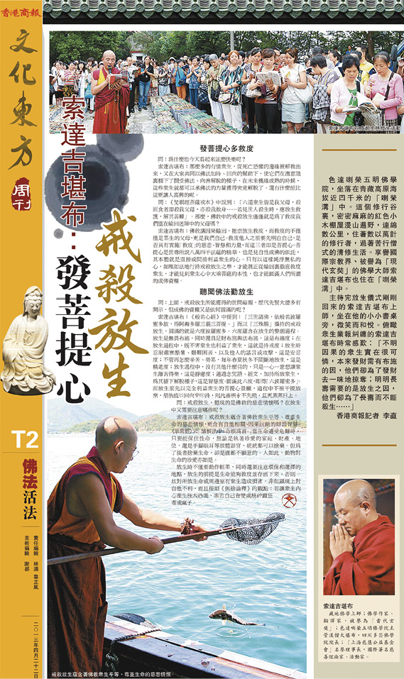

# 发菩提心，戒杀放生

——《香港商报》采访

2013年4月22日

## 发菩提心多救度

⊙ 问：为什么您今天看起来这么快乐呢？

堪布：那么多的有情众生，从死亡恐惧的边缘被解救出来，又在大家共同以佛法加持、回向的帮助下，使它们在潜意识里种下了闻受佛法、向善解脱的种子，在未来机缘成熟的时候，这些众生就都可以承佛法的力量获得究竟解脱了。还有什么能比这更让人高兴的呢。

⊙ 问：《梵网经菩萨戒本》中说道：“六道众生皆是我父母，杀而食者即杀我父母，亦杀我故身……若见世人杀生时，应放生救护，解其苦难。”那么，佛教中的戒杀放生仅仅就是为了救度我们堕在轮回迷障中的父母吗？

堪布：佛教讲因果轮回，推崇放生救度，而救度的不仅仅是累生的父母，更是我们自己。救度他人之前要先明白自己，是否具有实施“救度”的慈悲、智慧和力量，而这三者即是菩提心。

菩提心是世尊所说八万四千法蕴的精华，也是见性成佛的依托，其本体就是直接或间接利益众生的心。只有以这样纯净无私的心，如理如法地行持戒杀放生之举，才能真正从轮回里彻底救度众生，才能见到众生心中大乘菩萨的本性，也才能圆满人们所谓的成佛资粮。

## 听闻佛法勤放生

⊙ 问：上师，戒杀放生所能获得的世间福报，历代先贤大德多有开示，但成佛的资粮又是依何圆满的呢？

堪布：《般若心经》中提到：“三世诸佛，依般若波罗蜜多故，得阿耨多罗三藐三菩提。”而以“三殊胜”摄持的戒杀放生，圆满的就是六度波罗蜜多。

六度蕴含在放生的整个过程。放生是无畏布施，同时还具足财布施与法布施，这是布施度；在放生过程中，既不害众生也利益了众生，这就是持戒度；放生时忍耐严寒酷暑、艰难困苦，以及他人的谣言或攻击，这是忍辱度；不管再怎么辛苦、劳累，每年春夏秋冬不间断放生，这是精进度；放生过程中，没有其他什么目的，只是一心一意想让众生离苦得乐，这是静虑度；通过念咒语、经文，加持所放众生，为其播下解脱种子，这是智慧度。圆满此六度，即得“六波罗蜜多”。而放生前先以完全利益众生的菩提心发愿，过程中不被干扰放弃，最后能以回向来摄持，则此善根永不失毁，且蒸蒸日上。

⊙ 问：戒杀放生，体现的是佛教的慈悲情怀吗？在放生中又需要注意哪些呢？

堪布：戒杀放生蕴含着佛教众生平等、尊重生命的慈悲情怀，更含有自他相换、因果回馈的辩证智慧。《华严经》云：“诸根法中，命根为首。”当生命遭受危难时，只要能保住性命，无论是执著珍爱的家庭、财产、地位，还是手脚眼耳等肢体器官，统统都可以舍弃。但为了后两者舍弃生命，却是谁都不愿意的。人如此，动物对生命的珍爱亦如是。

放生时不仅要动作轻柔，同时还要注意环保和地点的选择，放生的前提是生命能够被救度并存活下来，否则一旦对所放生命或周边原有众生造成损害，非但显现上对自他不利，而且按照《俱舍论释》的观点：若让众生内心产生极大恐慌，来世自己会变成精神疯狂者或疯子。

采访后记

色达喇荣五明佛学院，坐落在青藏高原海拔近四千米的喇荣沟中。这个修行谷里，密密麻麻的红色小木棚屋漫山遍野，连绵数公里，住着数以万计的修行者，过着苦行僧式的清修生活。

享誉国际宗教界、被誉为现代玄奘的佛学大师索达吉堪布也住在喇荣沟中。主持完放生仪式刚刚回来的堪布上师，坐在他的小小书桌旁，微笑着，神情和悦。

俯瞰众生业报纠缠的堪布时常感叹：“不明因果的众生实在很可怜。本来发财需有布施的因，他们却为了发财去一味地掠夺；明明长寿需要的是放生之因，他们却为了长寿而不断杀生……”
