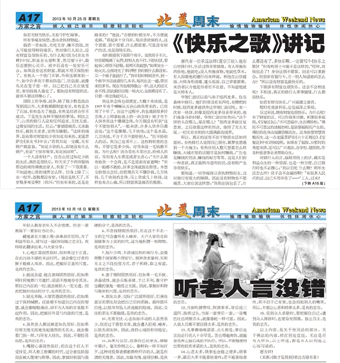

2013年10月25日

## 善的教育照亮成长之路

——中国人权发展基金会公益讲堂

2013年11月9日

大家好！感谢各位关注和谐家庭基金公益大讲堂，我是和谐家庭基金项目执行人殷智贤。我们今年的公益主题是“慈爱就是生命力——中国儿童阳光成长行动”，我们呼吁全社会都来关心未成年人的生命安全。

在过去的几个月，我们请来各路专家，跟广大网友分享保护儿童生命安全相关的法律、教育学、心理学等方面的知识。

今天这一期公益讲堂是今年公益讲堂的收官之作，我们非常荣幸地请来了索达吉堪布。

主持人：堪布，您好！从去年的《苦才是人生》到今年的《残酷才是青春》，您出版的这几本书一直是很多人的案头必读之书，您的一系列开示给了很多人非常珍贵的启发。大家从您的书里面看到了希望，看到了力量，看到了智慧。

今天，我们想请您来和广大网友谈一谈与孩子有关的话题。孩子是每一个家庭的希望，也是一个国家的未来，今年以来，我们听到了很多令人痛心的消息，很多未成年人在不同的案件中受到了伤害，很多家庭也陷入了深深的痛苦。天下人都希望自己的孩子幸福，家长们也为此做了很多努力，但还是有很多悲剧发生。

据卫生部公布的数据显示，每年有 38 万孩子死于意外。也就是说，每天都会有1000个孩子死去。这真的是让人很痛心的事情。您作为一位智者，能给我们一些开示吗？什么才是对生命真正的爱护？

堪布：我个人而言，很关心生命，也很关心孩子们的生命。他们确实是家庭的未来，也是全人类的未来，承载着很多希望。

这几年来发生的各种事情，在我看来，并不是很稀有。很多事情经过新闻报道等曝光之后，大家都会有一种提心吊胆的心态。但实际上，如果你去深入了解，任何一件事情的发生都是正常的。比如说，全世界每年死于艾滋病的人非常多，死于癌症的人也相当多。通过这些数据，我们会发现，生命是很脆弱的。

当然，基金会关注孩子们的生命是非常必要的。有些孩子失去生命，是各种因素综合导致的，按照我们佛教的说法，是各种因缘聚合造成的结果。有些意外的发生，是不一定能阻止的，是必定会发生的；但有些意外，如果事先的保护措施做到位，是完全可以避免的。

对于家庭、学校以及孩子的父母、亲友来说，首先要提高重视程度，生命对于所有人来说都是最重要的。同时，也要清楚，在陪伴孩子成长的过程中，应该用什么样的方式，尽可能让他们的生命变得有意义。

在这个领域，我没有像基金会那样长期投入、长期关注。从佛教层面来说，在关爱和保护孩子的时候，一方面，我们要注重一些因缘；另一方面，我们不能被过多的负面新闻所裹挟。如果大家因为接收了过多的负面信息，始终处于一种恐慌的状态中，觉得外面到处都很危险，对任何人都充满防备，这样会给自己的内心蒙上阴影，反而会将自己置于险境。

我想，做任何事情都应该把握一个分寸，了解事情背后真正的原因和意义。在这样的心态下，才能把事情做得圆满。

主持人：您刚才谈到，家长应该认识到生命的重要性，同时也应该了解一些保护的方法。

要知道，现在很多家长非常忙碌，中国有5800万留守儿童，这些孩子的父母都不在身边，一般都托付给年迈的爷爷、奶奶或者姥姥、姥爷来照顾。老人们在能力和精力上往往不太能做到对孩子精心的照料，有些悲剧就是这么发生的。比如，因疏于看护，不小心溺死的、受到伤害的、发生意外的，等等。

从父母角度来说，他们要出去打工，要赚钱，也是为了孩子的将来有更好的生活。他们觉得这是一个很难做选择的事情。您觉得，在孩子的生命安全和家庭和谐发展这方面，应该做一个怎样的排序？什么是真正重要的，要怎么抉择呢？

堪布：作为父母，在城市里，有一些有条件的，可以天天接送、陪伴孩子，有一些可能就不具备这样的条件。刚才提到的父母在外面打工，不在孩子身边，这样的情况是相当多的。

在农村和一些偏远地区，很多孩子都要自己步行几公里去上学，从前条件不好的时候，很多地方都是这样。现在好一些了，学校会安排车和老师，沿路把孩子们一个个送到家。

我想，即使不能每天接送孩子，父母们也没必要过于地担忧和伤心。当然，现在有很多拐卖儿童的事情，这些人的手段很多，在很短的时间内就把孩子骗走了。我们需要提前做一些防护措施，尤其是对于孩子的教育，比如放学后尽快回家，不要去陌生的地方，对于陌生人的搭讪，也要有所防备，诸如此类的常识。通过这样的常识灌输和教育，孩子会具备自我保护意识，防范意识也会提高。

如果父母时刻都关注孩子的安全，一般来说问题不大。现在有些意外的发生，往往是父母根本不关心，有的孩子是饿死了，还有的孩子失踪遇害了好几天都没被发现。

此外还有一种现象，现在的新闻媒体为了吸引大众的眼球，对一些极端的案例，反反复复地报道和宣传。如此一来，营造了一种异常紧张的社会氛围。当我们去看各种新闻的时候，会发现，负面的事情居多。但实际上，正如大家所见，我们的社会并没有那么黑暗，那么负面。

作为媒体，不仅要曝光不好的事情，也要报道一些正面、真善美的事情，同时也要普及一些安全保护方面的常识和信息。就像基金会对于儿童的关爱和保护，大家共同学习相关的知识，这些在当前来说都是非常重要的！

主持人：继续请教您。

南京发生过这么一起事件。两个年幼的女童，分别是5岁和3岁，她们的父母进了戒毒所后，没有人照料，在家中饿死了。这起事件在社会上引起了很大的反响。大家都在反思：周围的人只要有一个人施以援手，两个孩子都不会陷入如此悲惨的境遇。与此同时，这家人的邻居们也为自己辩解说，孩子的父母都是吸毒的人，为了避免惹麻烦，他们能做的就是向有关部门报告和报警，就算尽到自己的义务了。

您认为应该怎么看待成年人保护未成年人的义务？作为一个陌生人，我们对另一个幼小的生命是否有义务和责任？

堪布：对于这类事件，整个社会都应该予以关注和重视。就像前几年发生的小悦悦[^1]事件，很多在我们身边发生的事情，人们遇到后都很冷漠，或者不屑一顾，不理不睬。如果一直都是这样的状况，这个社会就没有希望了。从佛教的角度来说，就是连基本的怜悯心和同情心都没有了，整个社会都会陷入一种恶性循环的悲惨状态。

南京的事件里，邻居因为孩子的父母吸毒，产生了反感和排斥心理，有可能是这样的，也有可能是其他原因。不管怎么样，我特别想呼吁的是：如果以后在我们身边发生类似的事件，当他人的生命处于危险之中，在非常危急的情况下，我们应该挺身而出，放下自我保护意识。也许有些新闻报道里说，救助别人，结果自己陷入麻烦中。但这种情况是非常少的。

按照佛教的说法，我们要以大慈大悲心对待一切生命。这是一个正常的社会中，人们应取的价值观。在藏地，当身边的人需要救护和帮助，大家是没有什么顾虑的，都会施以援手。我自己也亲眼见过很多次这样的情况，从来都不会有“他们会不会找我的麻烦”之类的想法。当各种意外事件发生的时候，如翻车等交通事故，老人摔倒，孩子被人抛弃，等等，大家都要有一种善的理念：一定要站出来，帮助他人。无论如何，毕竟是一个众生，一个生命，我们应该要救护他、帮助他。我特别希望每一个人都发起这样的救护心。

现在的社会上存在着各种各样的现象和意外，对于未成年人来说，也会遭遇各种意外和伤害。经常看到报道未成年人被性侵或者被伤害的新闻，我们要通过各种方式来保护他们。这是非常有必要的。

主持人：现在很多家庭都是独生子女，有的家长会认为，为了避免自己的孩子被别人欺负，要让孩子变得强大。他们选择让孩子去学武术防身。与此同时，变得强大的孩子，也有可能会伤害到别人。如果自己的孩子伤害了别人的孩子，作为家长，应该如何正确对待和处理？

堪布：首先我认为，作为家长，出于自我防护的目的，让孩子去学习武术等技能，这可能不是特别好。孩子现在最需要学习的是必备的知识和技能，其次是道德教育。一个人学习了很多知识和技能，同时道德高尚、心地善良，是会终身受益的。

我们没有必要花费大量的时间、精力去学习和研究如何保护自己、提防他人。如果在孩子面前，过多地强调、灌输这方面的想法，也许会潜移默化地对孩子的内心造成影响：在他的世界里，他所见闻的各种人事，稍微陌生一点或者负面一点，他都会习惯性用一种抵抗的方式去应对。这样的教育会导致孩子长大以后，对社会和整个外部世界都有所抵触，从而产生诸多抱怨、抵抗甚至愤恨的情绪。

这样来看，当今社会犯罪率的提高，也是有原因的。如果我们能够按照佛教的理念，给予孩子们善的教育，会对他们的一生都有非常大的积极影响。以前我就和很多人说过，藏地的孩子们，不会因为小小的事情，就选择自杀，舍弃自己的生命。因为他们从小接受了一种信仰的教育，父母也经常会告诉他们：生命非常可贵，一定要善待生命，不管是自己的生命，还是他人的生命。在这样一种信仰教育、善的教育之下，当他们长大后，对待人事会有正确的取舍，尤其在感情、金钱、事业上遇到挫折的时候，他们不会选择结束自己的生命。

回到主持人所提的问题，如果自己的孩子，真的伤害了别人，作为父母是有责任的。作为施害者，毫无理由地或者在不合理的情况下伤害了别人，首先一定要认清自己的错误，之后决不能再做这样的事情；同时应该要向对方道歉，对自己所犯的错误进行忏悔，并根据实际情况予以赔偿。作为施害者的父母，不管你的地位和财富有多了不起，如果你的孩子伤害了其他孩子，你本身有着不可推卸的责任，一定要承担自己那份错误，千万不要再为自己和孩子辩护和推诿责任，这也是为人的基本底线。

我们给予孩子们的应该是一种爱的教育，这样一种教育无论对自己，还是对他人，都有很多益处。现在的学校和家庭教育中，普遍都很重视应试的需求，同时父母也很重视语言、音乐素养等方面的学习。但大家却并不重视爱的教育，即培养孩子内心的爱、包容和慈悲。如果缺失了这些，未来我们的社会会变得非常冷酷、非常糟糕。

总而言之，这个世界要变得更美好，不一定是建起更多的高楼大厦，或者说不一定是外部景观的繁华和美好，更多的应该是每个人都从内心出发，完善自己、充实自己，让自己由内而外地变得更美好！那么，自然而然的，孩子与孩子之间，大人与大人之间都会和谐共处，才能从家庭和谐到社会和谐，慢慢地，整个世界也会变得更加和谐美好。

我认为，我们所有教育的根本和出发点，就是爱心。所谓的爱心在佛教中叫慈悲心，以慈悲心为基础，整个世界都会充满和平与阳光，所有人都会过得很快乐。

主持人：大家都知道，现在很多孩子是独生子女，家长总希望把最好的东西给孩子。我们也看到了，很多孩子在家里，被六个大人悉心呵护，要什么给什么。那么在这些孩子的心里，很自然地就认为想要的东西都可以得到。因此，现在的一些少年犯罪案件中，起因往往就是这个孩子想要的东西没有得到。其中，有人为了一台手机杀害了自己的母亲；有人为了得到一个在我们看来微不足道的东西杀害了自己的同学；还有人，仅仅是不喜欢同学说话或走路的方式，就打伤了同学。

在这样溺爱教育下成长起来的孩子，未来的人生是很让人担忧的。父母爱孩子，尽量满足孩子的各种要求，希望把最好的东西给孩子，您怎么看待这样的养育观念？怎么样才能避免未来悲剧的发生呢？

堪布：确实如主持人所说的那样，现在很多孩子，从小在非常美好的环境里长大，理所当然地会有一种想法：在这个世界上，自己需要什么，父母和周围的人都会给予。当他长大之后，发现外部的世界并不是这样的，社会并不是这样的，自己想要什么不一定能得到。此时内心会产生一种逆反心理，对他人和社会都很敌视。

从过往的历史来看，从前很多孩子从小在比较艰苦的环境里长大，生活里有很多苦难，但父母给予孩子的是一种慈悲的教育，当他们长大后，往往会获得一定的成功。可见，从小就生活在想要什么就有什么的环境里，予取予求，对孩子来说不一定是好事。很多富二代、官二代就是如此，长大后遇到问题，往往非常脆弱，最后甚至会走上违法犯罪的道路。有很多这样的案例。

我认为，父母对孩子的爱，应该是适当的。可能现在生活条件变好了，很多父母从小就在物质上过于地满足孩子，往往就把孩子惯坏了。比如说，孩子要各种名牌衣物，要新款手机，甚至长大后要名牌汽车，都一一满足，这样从小就一直在培育他的贪欲心，孩子长大以后，欲望也会日益增长，只会更加地不满足，永远都不会知足少欲。

如此看来，很多落马的腐败分子也许可以追溯到他们的童年，那时所受的教育导致了一些不良习惯的养成。因此，父母应该保有一种正确的教育理念，尤其是在青少年学习和成长的时期。国外的一些名校如哈佛大学、哥伦比亚大学等，校园里的学生普遍穿着朴素，不会追求名牌，甚至会觉得讲究穿戴是很羞耻的事情，是没有学问的表现。他们认为，学生就应该以学业为重，不管学生和老师，都持这种观念。当然，这些学校的门口也没有家长开车来接送孩子。

这样一心一意学知识的教育理念和思想值得我们学习。在孩童时代和学生时代，不应该过分地满足孩子的物质欲望。不然的话，孩子的心思难以集中在学习上，学习成绩下降不说，最后恐怕该学的都没学到，不该学的却学了很多。当然，并不是让父母一味地苛待孩子，什么都不管了，而是说，应该有一种比较适当的关爱，这种关爱不能过度，过度的关爱变为溺爱，对孩子不一定有益。

主持人：我们都知道佛教中是讲因果的。有些孩子在做出伤害别人的行为的时候，其实并不知道后果是什么，后果有多么严重。您觉得家长应该如何对孩子进行因果方面的教育呢？

堪布：因果方面的教育确实非常重要。在藏地，孩子还很小的时候，父母就会告诉他们：“不能杀生，不能杀害这个众生，生命是很可贵的，如果你杀它，就像杀自己一样。”这样从小就给孩子讲各种故事，建立起对因果的认知——整个世界就是在一种善有善报、恶有恶报的因果循环中显现的。孩子长大后，在生活中也会非常谨慎地去做取舍。

我认为，因果教育不仅对孩子来说很重要，对学校、对现在的社会来说也非常重要。现在大多数的学校里都只教授课本上的知识，完全成为知识和技能的培训基地，不会教孩子为人处世的道理，比如如何和家人、朋友相处等，也不会教育孩子断恶行善的因果观念和基本的道德观念。

其实学校不仅仅应该培养孩子们的智慧，更应该培养他们的人格。如果一个人的人格不完备，那不管他有多聪明，对家庭和社会也不一定是有利的。

作为父母，关心孩子的方式并不是给他们买玩具、买许多衣服，满足他们所有的欲望，这不是真正的关心。真正的关心是在孩子的成长中，给予正确的引导和教育。这样才是对他们的人生真正有意义的关爱。

在这个过程中，父母应该从孩子看待世界的视角出发，用孩子所熟悉的语言和方式，和他们进行沟通与交流。因为孩子的世界与成人是不同的，他们有自己的语言和思维方式，有自己特别喜爱的动画片和文学作品。作为父母和老师，也许不能理解孩子的喜好，但想要和孩子进行真正地交流，进入他们的世界，一定要学会他们的语言，了解他们的心态。

用孩子们能够接受的语言和方式，告诉他们因果方面的道理，比如为什么要善待生命等等。在这样的教育下，等孩子长大，渐渐融入社会，他各方面的行为都会比较积极正面。

我看到现在很多父母都特别疼爱孩子，但他们关爱孩子的方式多少有些问题。比如过于纵容孩子的喜好，让孩子想干什么就干什么。结果孩子每天都是上网、看电视……通过这些媒体频繁观看充斥着色情、暴力、犯罪等元素的影视作品，长此以往，耳濡目染，孩子的内心和生活都被染污了。

很多孩子对学习没兴趣，就喜欢看电影和剧集，只要有一台电脑可以上网，不分白天黑夜地沉迷其中，完全分不清现实和虚幻。

所以，在孩子还没有分辨力和取舍能力的时候，父母应当帮助和引导他们，而不是一味地纵容。孩童时代的教育和养成的习惯，会影响孩子们的一生。如果从小就沉浸在网络上不能自拔，未来也将会成为重度的网络依赖者，很难融入真正的现实生活。这样的结果是很可怕的。

主持人：您刚才也谈到了青少年自杀的问题。我们从各种媒体上看到，有些青少年仅仅因为一次考试没考好就选择自杀，还有因为失恋而自杀的，甚至有的孩子会因为没有得到一个想要的玩具就自杀。作为父母，应该怎么教育孩子要珍惜自己的生命呢？

堪布：没错，生命教育其实非常重要。但很多父母根本就没有教育孩子认识生命的重要性。在学校里也没有相关教育。可以说，生命教育的缺失，父母有父母的责任，老师有老师的责任。

现在很多青少年自杀的诱因，来自新闻媒体的报道和过度渲染。我们经常看到电视和网络媒体里报道很多人在人生陷入绝境时选择了自杀。这就给很多年轻人造成了一种错觉：人生遇到苦恼和困境的时候，可以这样做。媒体对于这类事件的报道可以少一些，

我们也不需要了解那么多。同时作为父母，应该从小就告诉孩子们，就算再痛苦、再伤心，也千万不能走极端。完全没有这个必要。

就像主持人刚才所举的例子，有些年轻人仅仅因为老师要求他们好好完成功课，否则会被当着全班的面公开批评，就觉得压力很大，觉得自己做不到，从而选择了自杀。就是这么简单的理由。现在很多年轻人都非常非常脆弱。作为老师，应该反反复复地告诉他们，生命非常珍贵，生活是充满希望的，只要活着就有各种可能。无论如何，生存本身就是最重要的。

德国哲学家叔本华也说过，人之所以会自杀，是因为他活着的痛苦超过了对死亡的恐惧。当生存的恐惧到达极限的时候，人才会选择死亡。所以，人是在失去了生存的能力和意志之后，去选择死亡的。

在现有的家庭和学校教育中，生命教育并没有被大家所重视。有些学校里，一个学期就连续发生了好几起自杀事件。应该说，这和家长、老师有一定的关系。大家应该经常强调生命的可贵。这方面的教育非常重要。

在世间，很多东西都不一定很珍贵，你所拥有的一切，包括车子、房子等，一旦死亡来临，统统都要放下。可以说，一切的一切，都不如生命珍贵。在佛教中，不仅是人的生命很可贵，其他的众生比如动物的生命也可贵。虽然动物不会说话，心也比较愚钝，但它们也有和我们一样活着的喜乐和痛苦的感受。

让孩子们从小就了解到，任何生命都很可贵，生活中遇到任何问题，都不应该放弃宝贵的生命。

主持人：现在还有一个现象，卫生部公开的数字是每年中国有800万到1000万的女性会堕胎，其中有一些是未成年少女。

我们都知道佛教是反对堕胎的，但这些未成年女性的父母认为，孩子还没有成年，所以只有这一个选择。对这些无助的父母，您有什么想说的吗？

堪布：从佛教观点来讲，胎儿毕竟已经是一个生命了，堕胎和杀人没有什么差别，过失非常大。从世间的角度，世界上也有一些国家，从法律上明确禁止堕胎。在我们国家，堕胎并不违法，但从道德层面来看，这种行为非常不合理。

我希望父母对自己的孩子，多一些谅解和包容。因为作为父母，对未成年孩子的所作所为要负起一定的责任。孩子固然是犯了错，但作为父母，直接、间接地也有过失。也许是家庭内部的很多因素导致了这样的结果。比如父母离婚，父母对孩子不够关注，父母对孩子相关教育的缺失，等等。不应该将所有的错误都归咎到孩子头上，一直埋怨和责怪孩子。

不管怎么样，我们每个人都应该重视生命，爱护生命。

主持人：在一些青少年的刑事案件和冲突事件中，对于受害的一方，也就是受到伤害的孩子和他们的父母，您认为受害者的父母应该怎么看待自己的孩子所受到的伤害？

堪布：伤害可能有各种各样的……

主持人：有的伤害很极端，孩子真的被罪犯杀死了。

堪布：对，应该具体问题具体分析。

有一些冲突事件，受害方也有自身的责任；而另一些事件，受害的一方确实是无辜的。其中最极端的情况就是被杀害了。一般来说，会根据未成年人年龄的不同，通过相关法律规定来处理。

如果是在藏地发生类似的冲突事件，双方首先要坐下来进行谈判，大家就整件事情的来龙去脉和发生过程，进行分析和探讨。其实人和人之间发生任何不愉快的矛盾，都不能通过武力来解决，而是应该通过一些和平的方法进行沟通和解决。

在矛盾发生的当下，人们的内心往往非常冲动，在这种情绪的驱动下，所作所为也会不太理性，以至于演变成终身后悔的局面。现在很多人，包括知识分子，发生事情的当下，来不及理性思考，说一些过激的语言，乃至于做出过激的行为。人在气头上很容易做出不理智的事情，但确实没有必要。

因此，一旦发生了冲突事件，首先要做的就是挽救和弥补，而不是继续动武。挽救生命是最重要的。当务之急就是双方都冷静下来，用一种比较合理的方式来解决。这样事情的结果就不会太坏。

主持人：谢谢堪布！今天聊到的大部分话题都比较沉重。

在我们这一期公益讲堂即将结束的时候，希望您能给予广大网友，尤其是父母们一个寄语。我们今年的公益主题是“中国儿童阳光成长行动”，什么样的人生教育，可以让孩子们获得一个充满阳光的人生？

堪布：我始终认为，不管是谁，父母也好，孩子也好，只要心地善良，这种善良的光芒，不但能够照耀自身，也会照耀身边的一切。非常希望孩子们都能在一种善的教育中成长，家长和老师们都能去推广这样一种善的教育。

其实善的教育也就是现在所提倡的一种正能量教育。这样一种正能量，如果有更多人去不断地挖掘它、推广它、弘扬它，我想我们的社会会变得更美好。

主持人：谢谢堪布！

堪布：谢谢！

[^1]: 2011年10月13日，小悦悦（本名王悦）在广东省佛山市南海黄岐广佛五金城相继被两车碾压，7分钟内，18名路人路过但都视而不见，漠然而去，最后一名拾荒阿姨陈贤妹上前施以援手，引发网友广泛热议。2011年10月21日，小悦悦经医院全力抢救无效，在0时32分死亡，年仅2岁。
