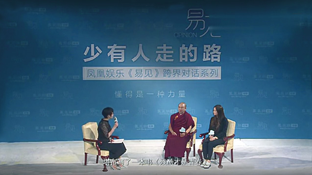
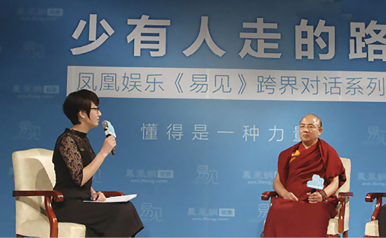

# 少有人走的路

——《易见》跨界对话特别节目

2014年3月12日

很多人都觉得，人生的路应该是走一条大多数人都认为成功的路，或者是看到大多数成功的人所走的路，觉得那才是充满希望的。很少有人考虑到，少有人走的路，可能也会让你更接近或者有可能接近心目中完美的自己。

易立竞：

跟大家介绍一下我的下一个采访者。喇荣五明佛学院的堪布，索达吉堪布。

索达吉堪布，藏区牧民的儿子，16岁上学，用了五年时间完成小学至初中的学业。考入甘孜师范学校，他的理想是当老师。1985年春，还有一个学期就可毕业留校任教时，他选择了一条让很多人意外的路——到喇荣五明佛学院出家。这个学院现为世界上最大的佛学院。

到佛学院八个月，升为堪布，也就是我们通常所说的教授。打破了从沙弥到堪布的时间纪录。

出家近三十年，除了在佛学院授课外，为利益众生，他常年游走于世界各国弘扬佛法，并引导实修。他利用一切空余时间互译汉藏经典数百部，已出版的书籍销量百万余册。

2013年，他被媒体选评为“中国年度宗教面孔”，成为国内最具影响力的藏传佛教领袖。

易立竞：堪布，如果让您对自己进行介绍，您会怎么介绍？

堪布：我16岁之前没有受过任何教育，就是一个牧童。后来读到了我们当地——在藏地算是比较好的师范学校，马上要毕业的时候，我选择了出家。刚开始选择这一条路的时候还是很迷茫的。本来在我们家乡做出家人，大家都觉得很正常，但是对我来讲，这是一种很艰难的选择。

易立竞：为什么艰难？

堪布：我在当时有很多的疑惑，很多的怀疑，比如我出家后能不能坚持下去？我选择出家的时候，很多老师和同学都认为我以后的前途可能毁了。

到今年，我出家三十年，我从来没有后悔过。当时选择出家的路，我自己认为还是很有意义的。

易立竞：堪布写了一本书《残酷才是青春》。您怎么定义自己的青春？会用什么颜色去形容它？

堪布：我出家的时候，其实我的青春应该说是灰色的，因为那个时候不知道将来会成什么样子。

易立竞：您小时候是循规蹈矩的孩子吗？

堪布：现在回到我小学母校的时候，基本上想不起来我在哪里背书、学习，经常想到的是，我在这里打过架、在那里打过架。我们班上很多人，只要是男孩子的话，基本上没有一个是我没有打过架的。（笑）

易立竞：堪布，从一个放牛的孩子成长为现在的您，您想过有一天可以影响到那么多的人吗？

堪布：没有。最早的时候，我只是因为很喜欢佛教才选择出家。我觉得人活在这个世界上，并不只是为了衣食住行，生命是有限的，只要有机会，我就尽量地传播一些正能量。

易立竞：我想知道，您了解现在的年轻人吗？

堪布：他们现在最关心的是，就业、感情，还有刚才说的，自己的家庭。感觉他们对哲学方面不是那么关心。

易立竞：您的微博私信是开放的吗？您一般会对什么样的事情做回应？

堪布：一般来说，我不太回应。别人对你的各种批评，如果自己身上有这些问题，那别人说的就没问题；如果没有的话，别人说你是黑色，你也不会变成黑色。

我基本上不回复微博，但是有个别的贫困学生需要帮助，在评论里留言，我就会找到这个人。

易立竞：因为这样的留言您就会资助他？

堪布：我会找到他，然后去观察。

易立竞：万一是骗子呢？

堪布：我确实上过很多当，所以现在我有一套观察的方式。通过很多方法鉴别以后再去帮助他。

易立竞：受骗的经历会让您失去帮助陌生人的意愿吗？

堪布：不会，我会想，这只是个别人的行为。我们不应该因为一个人干了一些坏事，就对所有人一概而论。这是一种不理智的态度。

易立竞：我想知道，堪布作为一个出家人，有为金钱犯愁的时候吗？

堪布：出家人本身对金钱不会有很多执著。现在我经常感觉到，在帮助一些贫穷的人时，金钱才真正地体现了它的价值。我经常资助一些贫困大学生，让那些本来读不起书的孩子有学上。这时，金钱才有了真正的意义。

易立竞：您什么时候会感觉到时间流逝？

堪布：对每个人来说，时间都流逝得非常快。

十二年前，我想翻译一部论，结果时间一下子就过去了，前两天才刚刚翻译完。时间过得这么快，不知不觉。

尤其是现在，事情比较多，感觉时间过得更快了。这几年，我经常想，不知道死亡会什么时候来临？我们出家人对死亡的问题思考得比较多。

易立竞：您经常坐飞机。在飞机上，肯定都遇到过大幅度颠簸的情况，恐惧吗？

堪布：有一次去西宁，当时我旁边坐着一位女士。飞机降落的时候，突然从高空中急速下降，她就一把拉住我，大声地叫起来。我当时很平静，虽然有一些恐惧。确实，每一天都有可能是最后一天，生命是特别脆弱的。

易立竞：一个人的人生遇到很多困惑，怎么解决呢？

堪布：当我们遇到困惑的时候，第一，可以请教一些经验丰富的人；第二，不能太执著；再有，就是需要等待——我今天认为这件事特别令人困惑，但是明天不一定还这么觉得。

易立竞：我想知道您会如何安排生命的最后一段时光？

堪布：这方面我也想过，我想做一段时间的慈善、讲经说法，几年以后很想去一个比较寂静的地方，应该回归自心，真正地去实修。

易立竞：堪布，您来到这个世界上的使命是什么？

堪布：我的使命是当一个出家人。我特别希望真正的智慧和慈悲在人间传递，让更多人得到多一点儿的安宁。这是我的愿望，也是我奋斗的目标吧。
