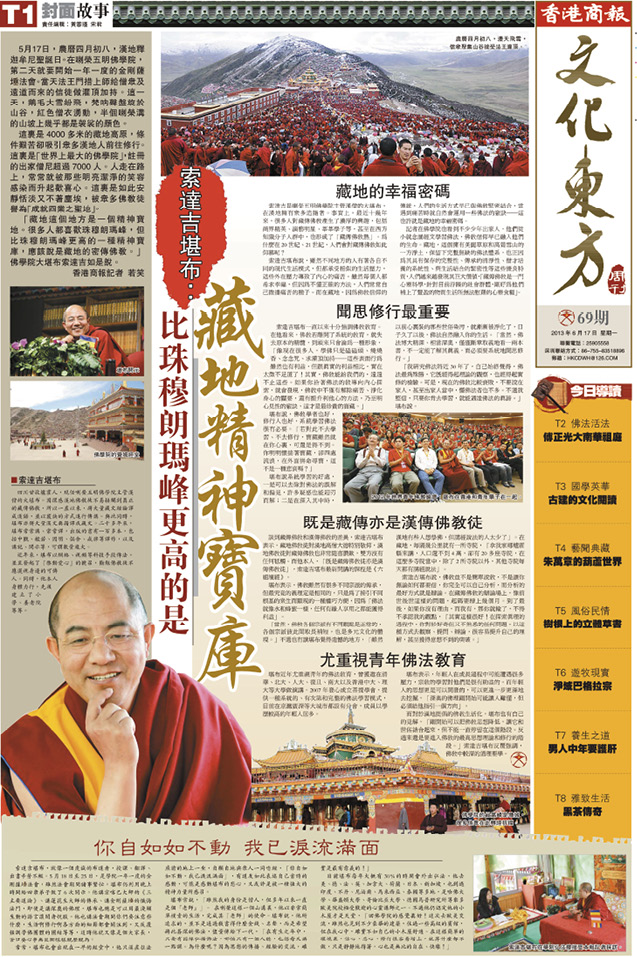

# 比珠穆朗玛峰更高的 是藏地精神宝库

——《香港商报》封面故事

2013年5月17日

5月17日，农历四月初八，汉地释迦牟尼佛圣诞日。在喇荣五明佛学院，第二天就要开始一年一度的金刚萨埵法会。当天法王和门措上师给僧众及远道而来的信徒做灌顶加持。这一天，鹅毛大雪纷飞，梵呗声盘旋于山谷，红色僧衣涌动，半个喇荣沟的山坡上几乎都是袈裟的颜色。

这里是4000多米的藏地高原，条件艰苦，却吸引了众多汉地人前来修行。这里是“世界上最大的佛学院”，注册的出家僧尼超过7000人。人走在路上，常常就被那些明亮洁净的笑容感染而生起欢喜心。这里是如此安静恬淡又不着尘埃，被众多佛教徒誉为“成就四业之圣地”。

“藏地这个地方是一个精神宝地。很多人都喜欢珠穆朗玛峰，但比珠穆朗玛峰更高的精神宝库，应该说，是藏地的密传佛教。”佛学院大堪布索达吉如是说。

索达吉堪布，四川甘孜炉霍人，喇荣五明佛学院主管汉僧的大堪布。因深感汉地佛教徒不易接触到真正的藏传佛教，一直以来，将大量藏文经论译成汉语，并以窍诀的方式进行传讲。

与此同时，堪布亦将大量汉文典籍译成藏文。二十多年来，堪布常常讲，常常译，出版的书有一百多本，包括中观、般若、因明、俱舍、戒律等译作，以及讲记、开示等，可谓数量庞大。

近年来，堪布以网络、视频等科技手段传法，并且发起了“启动爱心”的号召，劝勉佛教徒不应漠视身边的可怜人。同时，他本人身体力行，先后建立了小学、养老院等等。

## 藏地的幸福密码

作为喇荣五明佛学院主管汉僧的大堪布，索达吉堪布在汉地拥有众多追随者。事实上，最近十几年来，很多人对藏传佛教产生了浓厚的兴趣，包括商界精英、演艺明星、莘莘学子，甚至在西方知识分子人群中，也形成了“藏传佛教热”。为什么在二十世纪、二十一世纪，人们会对藏传佛教如此仰慕呢？

堪布说，虽然不同地方的人有着各自不同的现代生活方式，但都承受相似的生活压力，这些外在压力导致了内心的痛苦。虽然每个人都希求幸福，但因为不懂正确的方法，人们常常自己撒播痛苦的种子。而在藏地，因为佛教信仰的传统，人们的生活方式早已与佛教紧密结合，当遇到痛苦时就自然会运用一些佛法的窍诀——这也许就是藏地的幸福密码。

记者在佛学院也看到不少少年出家人，他们从小就念诵经文、学习佛法，佛教信仰早已融入他们的生命。

藏地，这个拥有着美丽草原和高耸雪山的一方净土，保留下完整无缺的佛法体系。也正因为其佛法体系的完整性、传承的清净性、僧才培养的系统性、与生活结合的紧密性等优良特质，人们越来越发现其巨大价值，“藏传佛教是一门心灵科学，针对目前浮躁的社会群体，刚好为他们奉上了丰盈的物质生活所无法提供的心灵慰藉”。

## 闻思修行最重要

一直以来，堪布十分强调佛教教育。在他看来，佛教若离开了系统的教育，就失去原本的精髓，到头来只会沦为一种形象。“像现在很多人，学佛只是磕磕头、烧烧香、念念咒、求灌顶加持……这些表面行为虽然也有利益，但跟真实的利益相比，实在太微不足道了！其实，佛教能给我们的，远远不止这些。如果你沿着佛法的教导向内心探索，就会发现，佛教中不仅有解除痛苦、净化身心的关要，还有提升利他心的方法，乃至明心见性的窍诀，这才是最珍贵的宝藏。”

堪布说，佛教学者也好，修行人也好，系统学习佛法很有必要。“若对此不去学习、不去修行，宝藏虽然就在你心里，可还是得不到。你明明怀揣着宝藏，却四处流浪，在外面拼命寻宝，这不是一种悲哀吗？”

堪布说系统学习的好处，一是可以去除对佛法的误解和偏见，许多疑惑也能迎刃而解；二是在深入其中时，以前心里装的那些世俗染污，就渐渐被净化了，日子久了以后，佛法自然融入你的生活。“当然，佛法博大精深、相当深奥，仅仅断章取义地看一两本书，不一定能了解其真义，而必须系统地闻思修行。”

“我研究佛法将近三十年了，自己始终觉得，佛法最为殊胜，它既经得起理论的观察，也经得起实修的检验。可是，现在的佛教比较衰败，不要说在家人，甚至出家人当中，懂佛法者也不多。不过我坚信，只要你肯去学习，就能通达佛法的真谛。”堪布说。

## 既是藏传亦是汉传佛教徒

谈到藏传佛教和汉传佛教的差异，堪布表示，藏地佛教徒对汉地高僧大德特别敬仰，汉地佛教徒对藏传佛教也非常随喜赞叹，双方没有任何抵触。而他本人，“既是藏传佛教徒亦是汉传佛教徒”。堪布最新开讲的课程是《六祖坛经》。

堪布表示，佛教虽然有很多不同宗派的传承，但最究竟的义理是相同的，只是为了接引不同根基的众生而显现的一种善巧方便，因为“佛法就像水和蜂蜜一样，任何有缘人享用都能获得利益”。

“当然，佛教各个宗派有不同观点是正常的，各个宗派彼此间取长补短，也是多元文化的体现。”不过也有让堪布觉得遗憾的地方，“虽然汉地有些人想学佛，但讲经说法的人太少了”。在藏地，每隔几公里就有一所寺院，“拿我家乡炉霍县来讲，人口还不到四万，却有二十多座寺院，在这么多寺院当中，除了两所寺院以外，其他寺院每天都有讲经说法”。

堪布说，佛教并不是简单说教，不是让你无论如何都要信，你完全可以自己分析，而分析的最好方式就是辩论。在藏传佛教的辩论场上，像前世后世这样的问题，起码要辩上几个月。到了最后，如果你没有理由而我有，那你就输了，不得不承认我的观点，“其实这样很好！在探索真理的过程中，你对于好奇但又不熟悉的任何问题，以这种方式去观察、提问、辩论，很容易提升自己的理解，甚至获得意想不到的突破。”

## 尤重视青年佛法教育

近年来，堪布尤重视青年的佛法教育，曾获邀在清华、北大、人大、复旦、南大以及香港中大、理大等大学做演讲。2006年发心成立菩提学会，提供一种系统的、有次第和完整的佛法学习模式，目前在京沪广深等大城市都设有分会，成员以学历较高的年轻人居多。

堪布表示，年轻人在成长过程中可能遭遇很多压力，宗教的学习对他们是很有助益的。而年轻人的思想更是可以开发的，可以更进一步更深地去挖掘，“深奥的佛理刚开始可能让人难懂，但必须给他指引一个方向”。

而对于汉地提倡的佛教生活化，堪布也有自己的见解：“刚开始可以把佛教思想降低，让它和世俗结合起来，但不能一直停留在这个阶段。还是要进入佛教的最高思想理论和修行的阶段。”堪布反复强调，佛教中较深的道理要系统学习。

## 你自如如不动，我已泪流满面

堪布，就像一个虔诚的布道者，授课、翻译、出书，辛劳不辍。5月18日至25日，是学院一年一度的金刚萨埵法会，虽然法会期间诸事繁忙，堪布仍利用晚上时间给四众弟子做了6次开示。

他讲宗喀巴大师的《三主要道论》，讲莲花生大士的传承，讲金刚萨埵的忏悔法门，即便是讲深奥的佛理，堪布也总是可以用最浅显生动的语言让闻者心悦诚服。他也讲法会期间要注意些什么，生活和修行等各方面的细节，他都会关注到，又反复强调学佛团体的团结等等。此时的他像是个大家长，苦口婆心，事无巨细，样样亲力亲为。

常常，堪布也会出现在一早的经堂中，他只径直往法座前的地上一坐，自顾自地与众人一同念经。“你自如如不动，我已泪流满面”，有道友如此表述自己当时的感动，可能是感动于堪布的悲心，又或许是被一种强大的精神力量所感召。

堪布常说，“虽然我的身份是僧人，但多年以来一直是个‘老师’”。在喇荣这样一个山沟里，他以非常简单朴素的生活，完成其“老师”的使命。堪布说，他所追求的，并不是通过教书得什么金钱、名声，而是希望将此甚深的佛法，尽量传给下一代，“在有生之年中，只要有因缘弘扬佛法，哪怕只有一个人听，也想每天讲一点课。为什么呢？因为思想的传播、经验的交流，确实是最有意义的！”

目前，堪布每年大概有30%的时间会外出弘法，他去过美、德、法、英、加拿大、荷兰、日本、新加坡，也到过印度、不丹、尼泊尔、马来西亚、泰国等多地，是哈佛大学、华盛顿大学、哥伦比亚大学、德国马普研究所等众多欧美院校极受欢迎的心灵导师。

不过，他仍认定他的小木屋才是天堂，“回佛学院的感觉真好！这次去欧美交流，虽然也见到不少豪华的建筑，住过一些高级的宾馆，但在我心中，确实不如自己的小木屋舒适。这样简单的环境里，信心、悲心、修行很容易增上，就算什么都不做，只是静静地待着，心也是无比的自在、快乐！”
