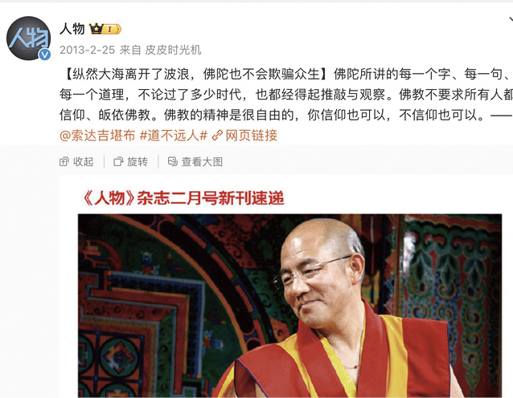
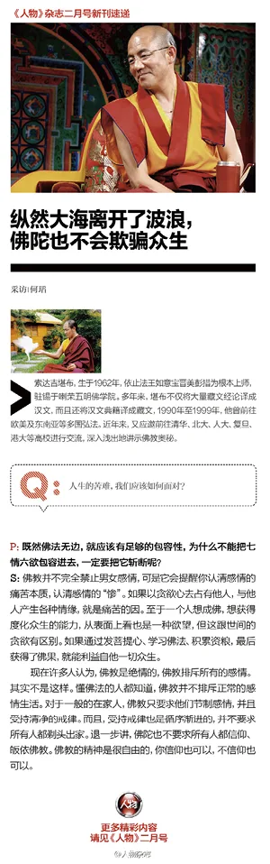

# 纵然大海离开了波浪， 佛陀也不会欺骗众生

——《人物》杂志采访

2013年2月25日

2012年下半年，《苦才是人生》《做才是得到》两本书横空出世，在图书市场比较低迷的情况下，造就了“上市45天热销20万册”的奇迹，也让很多人记住了“索达吉堪布”的名字。

对佛教稍有了解的人都知道，堪布的弘法利生事业，并非始于这几年，而是已有近三十年的漫长岁月了。

堪布是藏地著名的高僧大德，他的著作令人叹为观止，累计字数超过千万，在海内外有着非常广泛的影响。其修行境界无法揣测，随口所说之语，往往带有惊人的预见性与准确性，但他平时为人低调，闭口不言自己的功德，只称自己是一业障凡夫。

此外，堪布也是社会慈善事业的推动者，不遗余力地做了许多公益活动，如修小学、建养老院、资助失学孩子、救济身患重疾的病患……他曾立誓：“只要有可怜而无助的人向我发出求救信号，只要各种因缘具足，我将尽己所能地为他们提供帮助，直到因缘终结、山穷水尽。”

“欲为佛门龙象，先做众生马牛。”这一句话看似简单，但从字里行间细细品读，是堪布心怀苍生的真实写照。

## 苦，才是人生

⊙ 问：为什么说“人生皆苦”？

堪布：倘若将人的一生分成十份，不称心之时会占几份？古人说，占八九份。如曾国藩言：“人生不如意，十有八九。”佛陀也常常提醒我们：人生皆苦。且不论生、老、病、死都是苦，单单在日常生活中，就难免爱别离苦、怨憎会苦、求不得苦。

或许有人不以为然：“明明人生还有很多乐趣可言，又何必夸大痛苦，紧盯着痛苦不放？”

其实，佛教中之所以说“苦”，并不是不承认生活中的一些快乐，但这些快乐往往稍纵即逝，只是偶尔的“点缀”，却不是人生的“底色”。

在我们的人生中，唯一不变的，就是什么都在变。位高权重的，会一落千丈；生死相许的，会势同水火；合家欢聚的，会曲终人散；寿比南山的，会撒手人寰。所以，一切的美好都难逃变化，变化就会带来痛苦，这才是“人生皆苦”的真谛。

懂得人生皆苦，实际上，对每个人来讲至关重要。假如你一直看不清这个世界的真相，认为它应该充满快乐，一味地蒙蔽自己，以“苦”为“乐”，那永远也离不开痛苦。只有认识痛苦、正视痛苦，才是迈向快乐的第一步。

## 不能战胜苦难，它就是你的屈辱

⊙ 问：人生中的苦难，我们到底应该如何面对？

堪布：有些人觉得，苦难是安乐的障碍，因而不愿意接受它。这是一种肤浅的看法。实际上，对将苦难转为动力的人来讲，苦难会显露出功德和利益的一面。

人生需要一些苦难，才能激发自己抵御逆境的潜力。对坚强的人来讲，苦难可以转为前进的动力，可以成为成功的助缘。否则，没有丝毫苦难、整天放逸无度的话，这种人生就像大海上没有载货的“空船”，往往一场突如其来的“狂风巨浪”，便会轻易把它打翻。

## 做，才是得到

⊙ 问：了解佛法能给生活带来哪些益处？

堪布：我经常在想：学佛最大的好处是什么？就是对生老病死有所准备，一旦出现疾病、死亡，不会觉得特别不幸，反而有勇气从容面对。

不学佛的人不是这样，一旦出现天灾人祸，或者遇到生老病死的痛苦，就会抱怨命运不公，觉得自己实在太倒霉了。他们平时很少考虑：“我病了怎么办？死了怎么办？”即使偶尔考虑一下，也只是给自己买一份保险。其实所谓的“保险”并不保险，医疗保险不能保证你不生病，养老保险不能保证你不衰老，保险公司再怎么厉害，也解决不了你的生死大事。

一个人只有学了佛，面对困境时才会轻而易举、游刃有余：快乐时，突然出现痛苦了，这没什么，苦乐本就是无常的；健康时，突然出现疾病了，这也很正常，轮回的本性就是生老病死；亲朋好友忽然离去了，这就是聚际必散的规律。可见，佛教对于人生种种，有着不同于常人的认识。

## 善恶有报是真的吗

⊙ 问：在生活中，我们经常会看到，有些人做了很多好事，却没有得到相应的善报；有些人做了很多坏事，却没有受到恶报。于是许多人就认为，“善有善报、恶有恶报”只是一种心理安慰、精神鸦片。因果报应真的不存在吗？

堪布：因果报应肯定存在，对此我深信不疑。

但为什么行善得不到好报，造恶得不到恶报呢？因为不管是什么样的业，并不是造了马上就会成熟。就像一个贫穷的农民，他以前没有种庄稼，所以如今特别贫穷；但如果现在他勤勤恳恳地种地，以后就不会再穷了，可在秋天收割之前，他当下的生活仍然改变不了。我们也不能因此就说他种庄稼没用。

佛教里也专门讲了，我们所造的业要成熟，需要一定的时间，有些业力会现世现报，有些业力在下一辈子才感受，有些业力要再过好几世才现前。所以，因果并不是那么简单的，它是非常复杂的一个概念，必须通过系统的学习才能了达。

当然，你产生这样的怀疑也很合理。但就如同你正在上学，就算现在很爱学习，也不一定马上会出现它的果，在因果之间会有一个时间跨度。

## 为什么说没有信仰很可悲

⊙ 问：一个没有正确信仰的人，可悲之处在哪里？

堪布：很有可能无恶不作，最终毁坏自己和他人！

⊙ 问：佛教慈悲观对当代人最重要的作用是什么？

堪布：佛教慈悲观对当代人的作用，是方方面面的。现在很多人追求金钱，但实际上，就算你拥有很多钱，可以买车、买房子，百般享受也随之而来，你也不一定真正快乐，钱财也很难陪伴你一生。

而你心里若有一种慈悲观，这种“财富”就会用之不尽。无论你在人生中遭遇什么，你都可以游刃有余地面对，同时还能帮助身边许许多多的人。这样的生命非常有意义。所以，希望大家能渐渐意识到，真正的幸福，并不是一定要建立在物质上。

现在人们提倡“低碳”生活，而我们佛教中提倡“低贪”生活，只有贪心越来越少，才能减少不必要的欲望，以随缘心来面对一切。这样的人不管在哪里，即使住的是露天郊外，吃的是粗茶淡饭，也会感到心满意足。否则，一辈子都在贪心的驱使下，拼命地往前追、往前赶，到了死时，才发现人生竟然如此苍白，这时候叹息也没有用了。

## 念《心经》有什么用

⊙ 问：在汶川地震的时候，王菲曾唱过一首歌叫《心经》，这首歌的要义是什么？唱出来的话，对众生有怎样的利益？

堪布：王菲唱的《心经》我也听过，并建议大家大力推广。《心经》主要讲了眼耳鼻舌身、色声香味触等一切皆空。我们这个社会有非常多的痛苦、挣扎，万法也有各种各样的形象，但这些追究到本源，其实完全是空性。

所以，《心经》的主要精神，就是让我们对万法断除执著，这是一种至高无上、不可思议的境界。释迦牟尼佛在第二转法轮中，就讲了这种般若空性，而般若空性法中最根本的一部经，即是《心经》。这种智慧就像人的心脏一样。

我们平时若能念《心经》、唱《心经》的歌，内心的各种分别念就会减少。我认识一位老师，她说自己心里特别烦时，念一遍《心经》，心就能安静下来，然后再坐一会儿，原来的痛苦便全部消失了。

## 问佛陀情为何物

⊙ 问：佛教中如何看待爱情？

堪布：古人说：“问世间情为何物？直教生死相许。”如果问佛陀“情”是什么，答案就会有所不同了。

当然，在世俗层面，佛陀也承认爱情。《长阿含经》《增一阿含经》《善生经》中，对于在家人的正常感情生活，佛陀有许多相关的教言。所以，并不是学佛都要出家，也不是学佛就要绝情绝爱。

但随后，佛陀又会讲：爱情归根结底是一种执著。当你执著一个人时，暂时有一些快乐，但终究必定会带来痛苦。

为什么呢？《四百论》中讲过：无常法一定会坏灭，会坏灭则非真正的安乐，所以，凡属无常的一切法，皆是痛苦。因此大家一定要明白：所谓爱情，本质就是一种无常。今天他对你好了，明天也许心就变了，这难道不是痛苦吗？

当今时代，人们对爱情过于推崇，许多影视剧里，爱情被渲染成了人生的全部。由于从小受这种影响，很多人长大以后，根本没有辨别的能力。其实，爱情只是一种弱不禁风的易碎品，就像美丽的水泡，稍微一碰就会破灭。当这种水泡破灭时，有些人特别失望，甚至因绝望而自杀，这实在是不智之举。

佛经中说，人和人之间的感情，其实是前世、今生的种种因缘形成的，在这些感情里，有些是讨债的，有些是还债的。比如，一个人对另一个人情有独钟，一见面就生欢喜心，按佛教的解释，这种感情不是偶然的，而是源于前世的债。不过，现代科学解释不了这种复杂的情感，因为它只能看到今生，而对前生后世，则是一片空白。

世间的爱，其实只是一种“小爱”，大多数都是出于占有的欲望，所以，得不到了必然痛苦。与之相比，佛教的爱是一种“大爱”，它要求对一切生命都无条件平等关爱，有了这种理念，才是世上最宝贵的财富。

## 执著是不是都要放下

⊙ 问：执著于情才会痛苦，那是否只要放弃对情的执著，就可以不痛苦？同样，您执著于对真理的追求、对内心的塑造，这是否会给您造成痛苦？您是否应该放弃这种执著？

堪布：执著有两种：第一种执著会带来痛苦，比如对感情、财物的执著，这是颠倒的作意，因为这个事物本来不值得追求，可你偏要去执著它；第二种执著不会带来痛苦，比如你追求善法、追求利益他人，虽然这也是执著，到了佛法的最高境界，也需要将其抛弃，但暂时来讲，这种执著是需要的。

就像世上有两种船：一种船非常安全，可以渡你过河，这种船到岸后就不需要了，但正在过河时，它是不可缺少的；另一种船是危船，它不仅不能渡你过河，还会给你带来危险，这种船必须放弃。

同样，我们的执著有好的，也有不好的。好的执著暂时可以利用，最后才会放弃；而不好的执著，应该尽早舍弃。

## 佛教并不完全禁止男女感情

⊙ 问：学佛的人想成佛，这其实也是一种欲望，为什么佛家对男女感情要禁止，而对成佛不禁止？既然佛法无边，就应该有足够的包容性，为什么不能把七情六欲包容进去，一定要把它斩断呢？

堪布：佛教并不完全禁止男女感情，可是，它会提醒你认清感情的痛苦本质，认清感情的“惨”。如果你以贪欲心去占有他人，与他人产生各种情缘，这就是痛苦的因。至于一个人想成佛，想获得度化众生的能力，从表面上看，这是一种欲望，然而这跟世间的贪欲有区别。如果你通过发菩提心、学习佛法、积累资粮，最后获得了佛果，就能利益自他一切众生。

现在许多人认为，佛教是绝情的，佛教排斥所有的感情。其实不是这样。懂佛法的人都知道，佛教并不排斥正常的感情生活。对于一般的在家人，佛教只要求他们节制感情，并且受持清净的戒律。而且，受持戒律也是循序渐进的，并不要求所有人都剃头出家。退一步讲，佛陀也不要求所有人都信仰、皈依佛教。佛教的精神是很自由的，你信仰也可以，不信仰也可以。

## 仓央嘉措的诗是讲爱情的吗？

⊙ 问：您说会在空余时间读泰戈尔、莎士比亚的诗，那您会读仓央嘉措的诗吗？您对他的诗怎么看待？

堪布：我很喜欢仓央嘉措的诗，在读的过程中有两种感受。第一种，仓央嘉措是一位非常伟大的诗人，他用浅显易懂的语言，以人们特别执著的感情为切入点，逐渐将我们引入看破、放下、自在的境界。

还有一种感受。从仓央嘉措的密传或传记来看，在当时的历史背景下，在那样的生活环境中，他仍洒脱地面对现实。当饱受各种挫折时，不但没有怨天尤人、被痛苦打败，反而还能写出那样的诗歌，描写心里最微妙的境界，如此高尚的情操，非常值得赞叹。

仓央嘉措的情歌，实际上有外、内、密三层意思。世间人大多只懂外层的意思，觉得它适合在家男女的心意，却不知它里面还有更深的修行教言。

## 多为未来作打算

⊙ 问：人应该追求什么？

堪布：我希望更多人能追求对生命有真实利益的智慧。有时候，我感觉很多人挺可怜，虽然他们学问不错，但因为从来不懂得佛教的道理，所以遇到小小的问题就无力应对，给自己带来了许多不便。

许多人年轻时，一直为了感情、财富而忙碌，没有寻求真理，到了生命的最后时刻，比如身患绝症，或者人老得不行了，才开始考虑：“人死后，生命会不会继续下去？如果生命会延续，下辈子我会变成什么样？”但这时候考虑，已经来不及了。

## 科学重要还是佛教重要？

⊙ 问：佛教与科学之间关系是怎样的？将来社会发展的过程中，科学重要还是佛教重要？

堪布：佛教，如今被称为内在的科学。像著名的心理学家荣格，在研究多年心理学之后，接触了藏传佛教的《西藏度亡经》，发现它对自己的心灵有极大帮助，于是认定佛教是一种心灵科学，并给予极高的评价。同样，科学家爱因斯坦也认为：“如果有一个能应付现代科学需求，又能与科学相依共存的宗教，那必定是佛教。”

佛教，或者说佛法，实际上是佛陀照见万法真相之后，抉择并加以宣扬的一种真理。一般而言，“法”有十种含义，如古籍中云：“法乃所知道，涅槃及意境，福德寿典籍，未来定境规。”而佛法中的“法”，则是指佛法的精要，正如佛经所言：“诸恶莫作，诸善奉行，自净其意，是诸佛教。”也就是说，提倡不造恶业、行持善法，这即是佛教的本意。

如今的科学，对于外在的物质，可以说有诸多观察，然而对于内心世界，却是一筹莫展，只能无奈地在门外徘徊。而佛教的教义，则淋漓尽致地揭示了这方面的真相。因此，著名院士朱清时认为，佛教是当之无愧的心灵科学。

所谓的“科学”，其实除了社会科学、自然科学以外，还有一种叫心灵科学或心智科学。在我看来，人类只要生存于世，并想不断发展，心灵科学就不可或缺。这种内在的科学，与外在的发展只会相辅相成，而绝不会成为它的绊脚石。

倘若没有心灵科学，随着物质生活的不断提升，人们的内心只会越来越空虚、苍白。像如今美国和中国的很多富翁，纵然拥有数亿家产，却感觉不到丝毫快乐，始终被痛苦的大山压得喘不过气来。可见，外在的物质再怎么富足，也无法带来内心的安乐。这些人不像我们藏族人，基本都相信前后世存在，也有许多对治痛苦的调心方法。对他们而言，假如今生根本不快乐，那一切的发展都没有了意义。

对没有信仰的人来说，人生往往缺乏归属感，随着社会的发展，内心的欲望会越来越大——有了一套房子，还想要一套；有了一辆车子，还想要一辆……如此，一辈子都沦为金钱的奴隶。许多类似的现象看起来令人非常伤感。所以，对这些人来讲，我觉得，心灵科学显得尤为重要。

## 不要因为不知道，就轻易否定一切

⊙ 问：佛教中有很多科学无法解释的现象，比如来世、鬼神，这是不是一种迷信？

堪布：在这个世间，很多人总爱拿科学作为衡量一切的标尺，认为科学说不存在，那它就绝对不存在。却不知当今科学只是对物质的一种研究，对心灵领域的研究可以说是一片空白。纵然偶有涉猎，也只是略知皮毛。

我以前看过一个有趣的小故事。说第一次欧战结束后，某个国家想用科学的方法宣传无神论，于是政府在广场上筑台，邀请三位博士进行演讲。

第一位上台的是天文博士，他上台解释了许多无神的理由，最后大声喊着：“我用望远镜观察宇宙二十多年，从来没有看见过神，所以一定没有神。”由此博得观众不少掌声。

第二位上台的是医学博士，他讲了许多人类绝没有灵魂的道理，结尾说：“我曾解剖一百具以上的尸体，仔细观察各部分，从来没有发现灵魂寄放的地方。它在心脏中呢？在脑中呢？还是在血液中呢？我都解剖检验过，数十年来根本没有见到，所以一定没有灵魂。”又是掌声雷动。

第三位上台的是位女博士，伦理学家。她告诉大家：“人死像灯灭。死了死了，一死就了，绝对没有天堂地狱。我曾遍读古今中外的各种书籍，都没有发现这种记载。”大家又是一片欢呼。

讲完之后，主持人向众人宣告：“无论什么人，如果对这三位博士所讲的，有不满意的地方，或是要辩论的话，可以公开提出来。”等了许久，没有人提出反驳。

正要在欢呼声中结束这场大会时，突然有一位乡下老太婆走到台前，对主持人说：“我可以提几个问题吗？”主持人说：“欢迎之至。”

老太太问第一位博士：“你用望远镜望了二十多年，你望见过风吗？它是什么形状？”博士说：“用望远镜怎能看见风呢？”老太太说：“这世界上有没有风呢？你用望远镜尚且看不见风，难道能用望远镜望见神吗？你用望远镜望不见神，就能说没有神吗？”博士哑口无言。

老太太又转向第二位博士问道：“你爱不爱你太太？”博士回答：“爱。”老太太说：“请把解剖刀给我用用，我要把你肚子剖开，看看你爱你太太的那个‘爱’在哪一部分，在肝里呢？在胃里呢？还是在肠子里呢？”众人哄堂大笑。

老太太再转向那个女博士问道：“当你在母腹里时，如果有人告诉你：‘不久你要生在地上，有日有月有山有水，还要吃饭穿衣。’你能信吗？而如今你不只是信，还生活在这样的环境中，所以，不要因为你自己不知道，就轻易否定一切。”

这个故事虽然很短，但里面三位博士的“科学”观点，却代表了现在大部分人的认知盲区。

那天就有个佛教徒，说要去寺院里朝拜，消灾延寿。他父亲不信佛，连声阻拦说：“你要相信科学，不能去！”他父亲其实并不知道什么叫科学。所谓的科学，并不是裹足不前的，也需要对未知领域不断探索。

假如科学对某些现象暂时解释不了，就一概否认这种现象的存在，这反而是最不科学的。

## 科技越发达，越不能忘记佛教

⊙ 问：科技对人类有利还是有害？

堪布：爱因斯坦讲过：“没有宗教的科学是跛子，没有科学的宗教是瞎子。”我思索以后，这样认为：当科学离开了宗教的引导，那么这种科学在行进时，很可能会损害自然、社会及人类，有害的就不会被认可，所以它走不快也走不远，甚至会倒下来，就像跛子一样；同样，当宗教不能与时俱进，经不起科学的验证时，它的教义也很难被普遍信赖，就像盲人一样，在方向上总是不太确定，这样一来，跟随者也常常有“盲修瞎炼”的疑惑。

当然，爱因斯坦所谓的宗教——尤其是能引导科学的宗教，不一定仅指佛教，但从他的很多语言可以看出，他对佛教非常推崇。

我认为，对宗教重视，或许有助于解决如今社会的很多失衡。

失衡的原因在哪里呢？人们追求物质的节奏太快了，也太过了！现在，人们常说“时间就是金钱，效率就是生命”，但这种认识，和哲学家所谓的“时间就是生命”，其实是有不同意味的。

大家知道，随着科技的发展，现在人们在物质享受上有了飞速的发展，但与此同时，人们的心灵是否安宁、快乐呢？绝对不是！这一点，所有智者是公认的。那这是什么？就是失衡！

当人们只看重物质，而缺乏宗教善的规劝，任由良心泯灭的时候，许多匪夷所思的事情就频频发生了。比如“毒奶粉”事件、“苏丹红”事件、“孔雀石绿”事件……这就是科技被野心大而又毫无人性的人掌握的结果。由于缺乏良知，也不像古人那样畏惧因果，所以，当他只考虑自己而不关心别人的时候，就什么事都做得出来。在这个时候，说他是人，实际跟动物没什么差别。

一旦一个国家或社会的物质水平越来越高，而道德水准或人文素养越来越低，这就叫失衡——精神与物质失去了平衡。那这种失衡，是进步还是倒退？很值得专家们研究。

作为一个佛教徒，我希望人人知道的是：在当今世界，要调整这种失衡状态，人们需要佛法的教育。

我是一个穿袈裟的人，不管是在知识界，还是在偏远地方的老百姓中，到哪儿都会讲佛教的基本理念。为什么要讲呢？一方面，因为我自己在学习佛法之后，的确得到了许多真实利益，虽然说出来别人也不一定了解，所谓“如人饮水，冷暖自知”；同时，我也深刻认识到：从佛陀乃至印、藏、汉高僧大德们传下来的一切教言，全都是无价如意宝，而世间的金钱、地位、幸福，绝对无法与之相提并论。当然，这是我个人的看法。

另一方面，我认为这是现代人的需要。我与大家分享佛法，并不希求什么，也不是口头上说得好听，心里却揣着种种目的，不是这样。当然，作为一个凡夫，如果说毫无自利心，这个我做不到，但我大多数的心思，的确是想真诚地交流佛法——佛法这么殊胜，人们又这么需要，那我再累再辛苦，也还是愿意去传播。哪怕让一个人领会了慈悲与智慧的理念，体验了宽容与放松的心境，我都非常欣慰。

一位十九岁的大学生曾问爱因斯坦：“人活在世界上到底为什么？”爱因斯坦说：“一个人活着，要在力所能及的范围内，尽量满足所有人的欲望和需要，建立人与人之间和谐美好的关系。这就需要大量的自觉思考和自我教育。”

现在很多人想改变世界，就像乔布斯一样，以一种事业利益整个世界。可是，如果不是有一些前世因缘的话，再怎么想，也不一定能实现。即使你一本一本地看那些成功人士的传记，一次一次地去照样实践，但从我一个佛教徒的角度来看，也许你有智慧、有毅力，但如果没有前世的福报，最终也不一定得到社会认可。

我学佛的时间比较长，看的书也比较多，显宗的、密宗的，藏文的、汉文的，藏传的、汉传的、南传的……越看越觉得佛教的智慧最为卓越。我更认为，科技越发达，越不能忘记佛教；社会越失衡，越需要佛法的教育。如果因为不懂、因为神秘，就打个问号放着，甚至当作迷信排斥，这是非常不科学的！

⊙ 问：是什么原因促使您皈依佛门的？又是什么契机让您选择出家的？

堪布：藏族的传统跟汉族不太相同，我们藏族基本上是全民信佛，而且每个人从小就学佛、念佛。藏族有一种说法：“孩子会叫妈妈的时候，就会念观音心咒‘嗡玛呢巴美吽’了。”这不仅是一个说法，实际情况也是如此。所以，对我来说，不存在“为什么会皈依佛门”的问题。

读中学的时候，我对佛法的信心越来越大，并生起了出家的念头，但没有成功。读师范的第一年，我也想出家，还是没成功。后来在读师范学校的最后一年，终于出家成功了。

## 僧人可以用iPhone吗？

⊙ 问：通过媒体，我们常看到一些僧人开宝马，手里拿着iPhone。这些东西是怎么来的呢？

堪布：这种现象，可能要从两个角度来理解。一方面，佛教徒不一定全部是好的，里面也有一些“腐败分子”。像有些出家人，把信众做功德、做慈善的钱，自己偷偷拿去享用，该做的功德却没有做，这种因果报应非常可怕。

还有一种情况是，对于有些上师，为了方便弘法利生，施主供养他一辆车，或者其他财物。按照施主的意愿和要求，这个东西必须他来用，这样也是可以的。

佛教的《毗奈耶经》中讲过，倘若你前世福报很大，今生不需要勤作就腰缠万贯，就算是一个出家人，所住的房屋价值五百两黄金也是允许的，所吃的东西具足百味也是可以的。这些都不算违背戒律。

现在是21世纪，出家人不一定都要穿破烂的僧衣，个别人有能力的话，也可以享用自己的福报。但若是通过不正当的手段来敛财，那么“好花不常开，好景不常在”，迟早会受到今生或来世的各种报应。

所以，这个问题不能一概而论，需要一分为二地去分析。

## 藏族喇嘛都是真正的大德吗？

⊙ 问：如今前往汉地城市的藏族喇嘛，叫做“汉喇嘛”。其中，有一部分是真正续佛慧命的，用佛法饶益了无数弟子。但还有一部分，没有任何修证，只是依靠打卦算命等方式来敛财，甚至盗用一些高僧大德的名称，四处搜刮钱财，最终让自己腰缠万贯。从佛教教义的角度来看，这样做是否合理？我们应当如何对待这一现象？

堪布：就我本人而言，应该算是最早的“汉喇嘛”了。1987年，法王如意宝前往五台山。那之前，汉地从来也没人见过“汉喇嘛”，以至于我们去一些商场时，售货员见到我们都不卖东西了，一直围着我们指指点点，好像发现了外星动物。当然，现在可不会那样了。

正如你所说，在“汉喇嘛”当中，有些是真正的高僧大德，他们前往很多城市，并不以金钱为目的，而完全是以佛法利益大众，引导很多人皈依佛门，为他们种下解脱的善根，并开创非暴力的和平妙道，给无数人和动物带来了今生来世的快乐。但也有一些人，假借佛教和寺院的名号，穿着袈裟，前往汉地，各种行为特别恶劣、令人发指。

不过，让我们一口咬定谁是真、谁是假，这非常困难。从历史上来看，昔日阿底峡尊者来到藏地之前和之后，印度也有很多人入藏，有些是为了骗取金子而来，但也有些是为弘扬佛法而来。因此，我们不能一开始就急着断定好坏，而应当通过细致的观察，去粗取精、去伪存真。

## 是否走投无路了才去寺院？

⊙ 问：现在修行人中，苦行的越来越少，很多人是混不下去了，走投无路才投奔了佛教，不少寺院更像是一个收容所，不是吗？

堪布：不一定所有的寺院都是如此，正规的佛教道场，还是以学习佛法、修行佛法为主。其实，不管是什么样的群体，都会存在良莠不齐的现象，关键看你个人如何取舍。

## 佛经是一半骗一半劝吗？

⊙ 问：有法师称，“佛经是一半骗一半劝”。骗是为了劝，开始都是骗大家，让大家产生敬畏之心，但最终的目的，是劝大家断除贪嗔痴慢疑。对于这句话，您是否赞同？

堪布：他说佛经一半是骗人的，这个我肯定不承认。我学习佛法、研究佛法这么多年，没有一刹那这样认为过。

只不过，佛经有了义、不了义之分。所谓的不了义，是为了接引根基不够的众生，暂时给他讲一些特殊法门，到了最后，待他的根基成熟了，再慢慢宣说究竟的法义，引导他进入更深一层的境界。如果将不了义的法认为是“骗”，用词可能不太恰当。

要知道，语言有贬义词、褒义词之别。作为佛教徒，对佛经的金刚语，应该有正面的评价。为什么呢？因为佛陀确实是真语者、实语者、不诳语者，纵然大海离开了波浪，佛陀也不会欺骗众生。这是前辈大德异口同声赞叹的。佛陀所讲的每一字、每一句、每一个道理，不论过了多少时代，也都经得起推敲与观察。

⊙ 问：出家人不能喝酒，也不能吃肉，但为什么济公活佛会说“酒肉穿肠过，佛祖心中留”？

堪布：这句话的后面，济公和尚紧接着还说了一句：“世人若学我，如同进魔道。”

济公和尚是历史上公认的成就者，他“酒肉穿肠过”的话，可以做到“佛祖心中留”。就好比一些前辈大德，修行境界特别高时，肉和菜、酒和水对他来说完全没有差别。古印度就有一位大成就者，喝完酒以后，酒可以变成水，从指尖流出来。同样，济公和尚也有这种非凡的境界，喝酒、吃肉对他并不会有障碍。但我们作为普通的出家人或修行人，千万不能盲目地去模仿。

如今很多影视作品里，经常断章取义，只取这段话的前半部分，以此作为自己可以吃肉喝酒的佐证。甚至好多根本不懂佛法的领导，喝酒时也喜欢把这句话挂在嘴边。我在藏地就有一个朋友，天天喝得烂醉如泥，别人去劝他时，他总拿这句话来搪塞。实际上，当他醉得人事不省时，留在心中的肯定不是“佛祖”，而是“酒肉”。

所以，不管是出家人、在家人，最好不要说大话，在你还没达到济公和尚那样的境界之前，切莫用这种话来为自己造恶业找借口。

## 出家人为什么不结婚

⊙ 问：你们出家人是怎么做到禁欲的？专家说禁欲有害健康呀。

堪布：搔痒固然觉得无比舒服，但不痒的话，岂不是更快乐吗？

## 为什么人们如此空虚？

⊙ 问：您觉得现在人的精神空虚吗？

堪布：空虚！很多人现在追求的东西，未必是真正需要的东西。

⊙ 问：如何才能发财呢？

堪布：多布施！

⊙ 问：请问您有什么样的成就？

堪布：我没有什么成就，只是始终觉得佛法是真理，多年以来自己坚定认真地学习、修行，收获非常大。这种心灵的财富、智慧的财富，很想跟世间不同角落的人，尤其是苦难深重的人分享。

只有这么一颗心，除此之外，没有任何所谓的“成就”。
