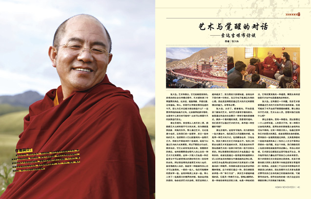

# 艺术与觉醒的对话

——《亚洲新闻周刊》采访

2014年

⊙ 问：佛法在传播过程中，艺术扮演了非常重要的角色。在今天，艺术还能为佛法做些什么？一定要用传统方式吗？

堪布：从历史上看，佛教与艺术之间的关系密不可分。佛教的一些境界很抽象深奥，但通过艺术，无论是传统艺术、现代艺术，一定程度上可将其展示出来。所以，古代也好，现代也好，艺术在佛教中占有很大比重。

现代的佛法传播，特别需要借助于适合现代人的艺术方式。若能如此，人们在享受艺术的同时，可以感受到佛教的微妙与奇特。

当然，无论是接受艺术，还是接受佛法，都需要一种超然的心态。如果对精神层面不太关注，更受金钱和物质的吸引，这种人可能难有这种体会。只有当你有更高的追求，比如追求信仰、追求艺术品位，才能领略其中奥妙。

现在，这样的人也越来越多了。大家都知道有钱不一定快乐，钱不能满足一切心理需求。因此，在这个时代，用艺术方式来展现佛法的魅力，非常有必要。

⊙ 问：通过艺术，是否有一种传递觉醒的可能？

堪布：这是有可能的。佛教一些前辈大德，在认识觉性之后，也有用金刚歌舞等艺术方式为弟子直指心性的，这在藏地、汉地都有。

还有一些大德，出生的家庭，跟艺术有关；在家的职业，跟艺术有关；甚至开悟的契机，也跟艺术有关。

艺术是非常心灵化的，更容易接近佛教的境界。本来，艺术就是一种沟通工具，可以引导我们感受十分玄妙的精神领域。而佛教追求的，往往也是这个。

用佛教的语言来说，艺术是一种“心灵的表示方法”。艺术感越强，越要摆脱心灵的各种框架，达到常人难以理解的境地。

这也算是用世俗谛来追求胜义谛吧。尽管艺术是一种世间法，却可以传递出更深奥的觉醒，这是它的最高境界。

⊙ 问：很多搞艺术的人，想通过艺术来寻求生命答案，但找了半辈子也找不到。对于他们，您想说什么？

堪布：我看过一种说法：人的层次不同，低等是追求金钱，中等是追求艺术或哲学，高等是追求宗教信仰。

追求艺术，暂时可达到忘我的状态，让你快乐。但若没有佛教的修心要诀，往往会走不下去，耗尽一生也找不到生命的答案。

佛教无论是显宗、密宗，其教义中都有这方面的要诀，这也是释迦牟尼佛在2500多年前宣说的心性奥妙。

所以，从事艺术工作的人，若想寻找生命答案，就要找到自性。而找自性的方法，在佛教的调心要诀中有。
