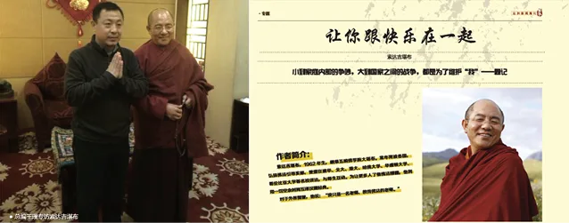

# 让你跟快乐在一起

——《亚洲新闻周刊》专栏

2014年

题记：

小到家庭内部的争吵，大到国家之间的战争，都是为了维护“我”。

提起佛教，很多人马上想到影视剧中听到最多的一句话：“人生皆苦”。那么，我们人生的一切苦，到底源于什么？

印度寂天论师给出了答案：“执我唯增苦。”也就是说，痛苦的根源是我执。

你可以观察一下：当自己痛苦时，不管是身体上的，还是心理上的，也不管是感情上的，还是工作上的，它来自哪里？

对“我”的执著。

《修心七要》也提到，自己遇到的一切痛苦，应该归罪于我执，而不是外在的人、事、物。

作为一个人，谁都不愿意受苦，愿意快乐，可命运很少会按着这种轨迹前进。当我们遇到坎坷、不公时，与其怨天尤人，不如寻找痛苦的根源，然后除掉它。

## 都是“我执”惹的祸

若想根除我执，首先观察一下：每个人执著的“我”，是不是真实的？

这个问题，柏拉图在《理想国》中以比喻作了很好的解答：

有群人世世代代住在一个洞穴里。他们从出生起就犹如囚徒，被铁链锁在固定的地点，甚至还被锁住了脖子，不能回头或四下张望，只能永远“面壁”。

在他们背后，有一群人每天举着火把来回走动，这些人的身影投射到那面墙壁上，成了他们唯一能看到的精彩世界。

他们每天看着这些影像，久而久之已成习惯，认为这些影像是真实的，从不知道外面还有一个光明世界，更没有人想要脱离这种“困境”。

一天，有个囚徒偶然挣脱了锁链，沿着光走出洞穴，生平第一次见到炫目的光亮。他克服了最初刺眼的痛苦，看到阳光下的一切，才知道洞壁上的所见都是假的。

他庆幸自己的解脱，并怜悯同胞，于是义无反顾地回到洞穴，一一解开同伴身上的束缚，向他们说出真相。殊不知，所有的人都不相信，大家嘲笑他，认为他疯了，最终用乱棍打死了他……

这个故事说明什么？我们一向认为最真实的东西，可能最不真实。

走出洞穴的人，见到了真实，为什么不被他们相信？这正应验了《红楼梦》里的一句话：“假作真时真亦假，无为有处有还无。”我们一旦把“假”当成“真”，“真”就成了“假”；一旦把“没有”当成“有”，“有”就变成“没有”了。

众生执著的“我”也是如此，虽然看似明明存在，但不过是洞壁上的影像。

既然“我”是假的，那什么是真实的？“无我”才是。

或许有人提出疑问：“若只是我一人执著有‘我’，可以说我错了，但世上所有人都执著有‘我’，难道人人都错了？”

月称论师在《中观四百论释》里讲过一个公案：

从前有个国王，婆罗门通过占星告诉他，几天后要降一场毒雨，谁饮用了就会疯。几天后，果然下了雨，全国百姓喝了雨水后，都疯掉了，只有国王一人没喝。可因为和大家不一样，大家认为他不正常，说他是疯子。国王不得已，喝下毒雨，变成跟他们一样。

这种情况，有人听后觉得荒唐，不幸的是，现在的我们就是如此。

## 心底无“我”天地宽

若能减少“我执”，不但可以断除痛苦，还能证达万法的真相——空性。

对于空性，有些人不理解：“佛教天天讲空性，如果一切都空，那生活、事业是不是别管了？”

并不是。所谓空性，是指我们周围的一切，包括我们自己，本体是空，但显现上仍存在。所以，该做什么，还是要做，但在做的时候，因为懂得空性，私心少了，天地就宽了。

《吕氏春秋》中说：“天无私覆也，地无私载也，日月无私烛也，四时无私行也。”意思是：天无私，才能遍覆世界，如果它有私，只能遮盖部分地域；地无私，才能承载世间万物，如果它有私，只能负荷少数器物；日月无私，才能普照世间，如果它有私，只能偏照一方；春夏秋冬四季无私，才能正常地依次运行，如果它有私，四季就颠倒了。

人应当效法天地，断除执“我”的私心。

其实，不论小事大事，小到家庭内部的争吵，大到国家之间的战争，都是为了维护“我”。

古人发明的汉字，实际上也很有趣。像“我”字，里面就藏着一把伤人的兵器——“戈”。只要有了“我”，既会“戈”别人，又会“戈”自己。

我执比较大的人，心量特别小，一点点委屈也不能忍受，动不动就大发脾气。常言说得好：“君子量大，小人气大。”一个人的心量大不大、脾气大不大，关键就在“我”上面。

假如“我”的分量太重，眼里容不得半点沙子，即使给他全世界的一切，他仍有诸多不满；假如“我”的分量较轻，对任何事物都不执著，即使生活简陋，屋里只有一张床，他依然心怀感恩。

日本的梦窗禅师也说：“眼内有尘三界窄，心头无事一床宽。”

当然，这种境界起初可能难一点，但只要经常放下自己，多考虑别人。久了，你会感觉到：这是最快乐、最放松的心境。

## 别无所求，只求你好

作为凡夫俗子，我们没有“我”也是不可能的，但这种执著不要过大。否则，白天想自己，梦里想自己，从来不为别人着想，你的生存空间不会太广；对别人而言，你的存在，不一定有价值。

什么样的人有价值？

利他的人。

利他让人感动，而最让人感动的，是大乘佛教的利他——没有任何条件、利益一切生命。

普通人利他是有条件的，我帮了你，就希望你回报，相互间像一种交易。可大乘佛教不是如此，它的利他不谈条件，只要众生有苦难，就全力以赴去帮助，付出一切也愿意。

对我们来讲，这有些不可企及，但的确让人景仰。
