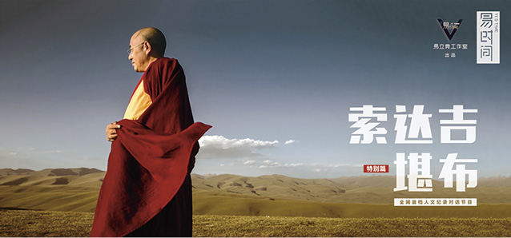
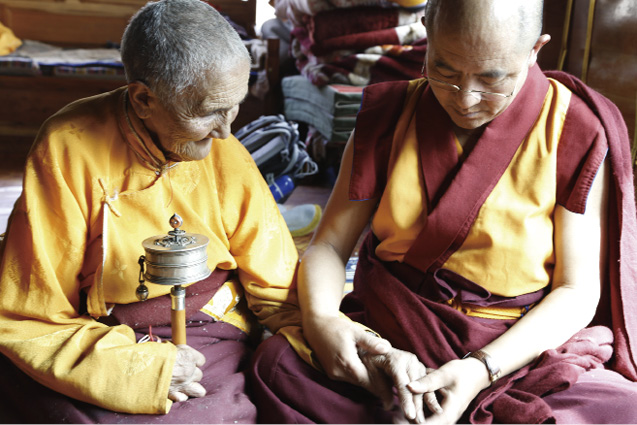
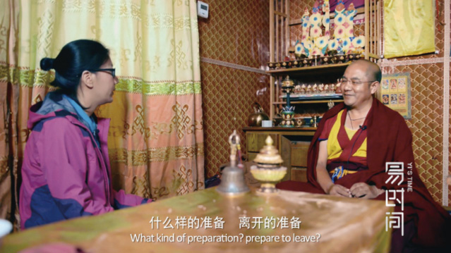
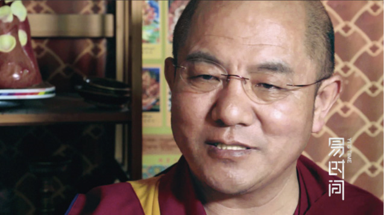
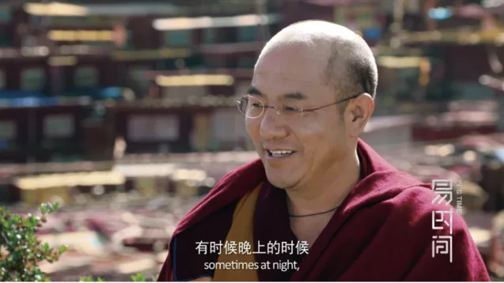
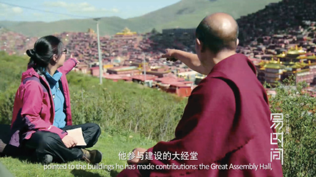
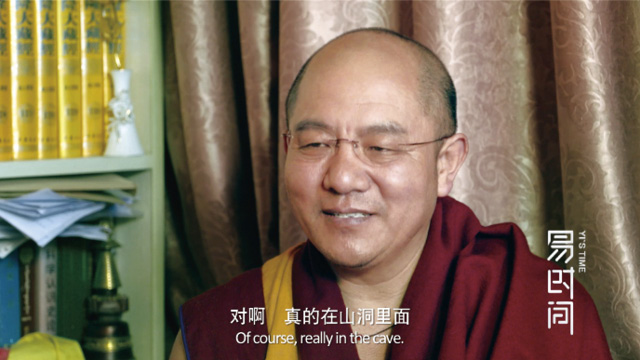
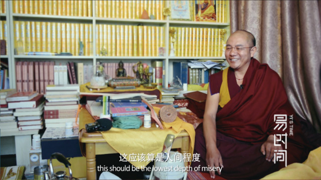

# 一次别离· 带你走近堪布的身边

——《易时间》特别节目

2017年9月21日

简介：

作为《易时间》第二季的前奏，《易时间》特别节目将于9月21日在爱奇艺平台上线，第一期的受访者是索达吉堪布——全球最大佛学院喇荣五明佛学院的著名大德，除中国外，他还在美、英、法、德等十几个国家弘法，具有国际影响力。

节目主持人是拥有“中国顶级人物访谈记者”之称的易立竞。她曾是《南方人物周刊》的高级主笔，也是《易时间》的创始人。在《易时间》中，堪布首次面对媒体，谈起在母亲去世以及佛学院重新规划这些重大人生时刻，自己的心路历程。

记者：您的母亲圆寂的头一天，您回的学院是吗？

堪布：对，本来当天我身体也不太好，在学校（炉霍的上罗中学）输液。听到这个消息之后，我连夜赶回来。她也知道我来了，心里很满足，拉一下我的手，然后亲一下。说话的时候有气无力的。

记者：有交流吗？

堪布：交流是前两天的事情，该跟她说的话都说了。但是一般人在临终之前可能对子女都是非常执著的。

【旁白】

6月5日早上8点多，送别母亲后，10点钟，堪布赶往山下的县城参加关于佛学院重新规划的会议。第二天，按照原有的课程安排，前往经堂讲解《妙法莲华经》。时值五明佛学院发展的重要节点，每天堪布几乎从早上7点开始，参加大大小小的各种会议，经常持续到凌晨一两点钟。

记者：参加会议的时候能专注吗？

堪布：可以的，能专注。我该说的话、该做的事情都圆满。

记者：是属于情绪的控制吗？

堪布：没有控制。

记者：我想知道您私下里和母亲的交流方式是什么样的？

堪布：我私下里跟母亲的交流方式应该是：去看望她的时候，就聊一聊我小时候或者我年轻时候的一些情况——她经常会讲这些；我经常会聊一下她在修行方面、健康方面还有心情方面的一些事情。

记者：您拥抱过母亲吗？

堪布：按照我们藏族的习惯，拥抱母亲的情况比较少。她生病的时候，我心里也比较疼，经常会扶她，但这也是少数的情况，大多数时候都是妹妹和弟媳她们来照顾的。

她离开以后，我才觉得好像我陪她的时间是比较短的，这方面我稍微有一点所谓的遗憾吧。因为我确实比较忙，跟她在一起的时候，似乎每次都觉得我的工作很重要、修行很重要。但一旦她离开的时候，就觉得当时应该多陪她一下。现在在这个世界上，连她的一根头发也找不到，想说话也没办法。有时候会有这种感觉。

记者：可是这是您经常在课堂上讲给弟子们听的——父母在世的时候要及时行孝。您自己却没做到，可以这样说吗？

堪布：从我自己来说，一方面，我没有遗憾，因为我对她的修行等各方面应该都照顾得比较周到。唯一的遗憾可能是陪她的时间少了点。她很希望我们一起吃顿饭，如果我哪天中午有时间跟她一起吃饭的话，她会特别高兴。但是这种情况是很少很少的。

记者：母亲私下里称呼您什么呢？

堪布：一般都称呼“宝贝”，我们一般说Ma Lo（藏语），可能就是宝贝的意思吧。

记者：这是藏族人常有的称呼吗？

堪布：是，大多数都这么称呼。

记者：您和母亲之间这种感情的表达多吗？就是相互表达对对方的爱。

堪布：主要通过电话，回来的时候会去看看她。还有给她一些加持品和东西，就这样。

记者：我记得法王如意宝圆寂的时候您说过，现在是大孤儿领着一群小孤儿。这是从佛弟子的层面来说的。我不知道母亲圆寂之后，您又有这样一种孤儿的感受了吗？

堪布：法王的圆寂，包括去年我另一位上师德巴堪布的圆寂，对我来讲，可能是最大的伤心事。比较而言，世间的母亲虽然对我的恩德很大，对我肉身的培育和关爱，可以说其他的一切都无法与之相比，但我好像没有因此而特别伤心。她85岁了，离开的时候也比较安详，没有什么痛苦，神智也很清醒。

就我自己的感受而言，上师的离去会更加难受，感觉好像在这广阔无垠的世界上成了孤苦伶仃的一个孤儿，被丢下一样，特别悲伤。

【旁白】

1985年，23岁的堪布到达喇荣五明佛学院后，跟随上师晋美彭措仁波切学习和修行。仁波切圆寂十余年，堪布说，想念上师的情感不但没有淡化，反而时间过得越久越思念，只要想起他就会泪流满面，甚至，在梦中也会如此。

记者：母亲离开的时候，您有流泪吗？

堪布：这次没有。

记者：藏语里有句话，“母亲的心像水一样，儿子的心像石头一样”。我很想知道在这样的时刻，您还认同这句话吗？

堪布：的确，母亲和儿子的想法是不同的。每一个母亲都特别疼爱孩子，相比较而言，孩子可能并不是那么在意，但是也并不是所谓的像石头一样。我知道世事无常，不管是父母也好，还是我们的亲人也好，所有人在这个无常的世界当中一定都会示现无常。

【旁白】

我见过堪布多次，并有过几次深度采访，但他很少提及母亲。在他对母亲有限的描述中，我知道，他的母亲不识字，却在他很小的时候试着引导他读书识字。从甘孜师范学校中止学业出家时，母亲并不同意，也不给予他生活上的供养。作为牧民的儿子，考上师范学校并不是一件容易的事。毕业后，他将拥有稳定的工作和经济收入，毋庸置疑，这对家庭的帮助巨大。而且作为一名师范生，中途退学，将面临高达3000元人民币的赔偿，这是他家里几年都无法赚到的钱。没想到的是，几年后，母亲却追随他去了喇荣五明佛学院，并成为一名出家人。她会在堪布的指导下修行，换句话说，她成了自己儿子的学生。

堪布：我原来来的时候，母亲一般坐在这个位置，她拿着一个大的转经轮。现在我一进来的时候，只有给她念经49天超度的出家人。她睡的地方都空空的。

有时候，人的死亡，可能一下就让整个生活节奏发生翻天覆地的变化。所以很多人可能都难以想象死亡。我的几个妹妹她们都不敢上来，她们觉得上来以后，这个地方会给她们带来很大的刺激。她们不敢看房子的院子，一旦看到，可能就会有特别特别强烈的痛苦。

记者：在这样的时刻，心里可能会更脆弱一些。

堪布：我应该没有。虽然我今年身体也不大好，再加上内内外外有很多事情，但是我的心态好像跟以往也没有差别。睡觉也好、吃饭也好，都没有什么差别。

可能一般人的母亲死了，好几天都睡不着，我的几个妹妹当时就昏过去了，我也去扶她们，让她们不要这样。我自己呢，也许在有的人眼里是不孝顺的，其实也不是不孝顺，应该是在用我的方法来调整自己的心态。

记者：常人看起来有些什么？是觉得您有些不近人情？不近情理？

堪布：我今年生病，光做手术都要6个小时。接着这件事情之后，我母亲也死了。然后还有种种事情发生。在常人看来，这些可能就是我们所谓的“苦苦”吧，也就是苦上加苦。

但是我们好像对人生看得比较透：任何事情都会有一个可能的变化或变故。因此我们就觉得这些事情的发生应该是很正常，没有什么变化。

我觉得我不脆弱。我好像在最快乐的时候觉得自己很脆弱，最痛苦的时候觉得我是很坚强的。

记者：最快乐的时候觉得最脆弱？

堪布：对，因为快乐的时候有很多诱惑，人们好像并不能把自己的心态调整得很好。反而可能在遇到一些痛苦的时候，所修的一些法就用上了。

【旁白】

这几年，我每年都会几次离开城市来到这里，不是为了逃避什么，而是为了寻找。我想知道，宗教到底能给一个人带来什么。如今40岁以下的中国人，自出生之日起就相信个人奋斗，相信人可以掌控自己的命运。但同时，也有深深的不安全感，这也许就是为什么，我在一个修行人面对无常时，坚持要追问“常人感受”的原因。

我曾和同事讨论过关于“实相”的问题。在佛学中，“实相”的意思是指事物的本来面目，它通常被各种幻觉与假象遮蔽。从某种角度来说，“实相”是一个不断被探究的结果。事实上，堪布在三十多年的修行中，也在不断探究、验证。

2016年2月，因左肾长肿瘤，堪布在医院做了一次长达6小时的手术。由于肿瘤长在重要的血管旁，原本两三个小时可以完成的手术，时间多了一倍，风险也大大增加。手术前，医生让他做好可能失败的准备。

记者：什么样的准备？离开的准备？

堪布：对啊。

记者：当时家里人知道吗？

堪布：家里人就我弟弟知道。

记者：那当时在医院的时候是谁陪着您呢？手术室外是谁在陪着您呢？

堪布：有一位堪布，还有我的一个侄子。

记者：您当时跟他们交代的是什么呢？

堪布：当时也没交代什么吧。我说，人生都是无常的，万一离开，大家也不要伤心。

记者：6个小时，您自己进手术室之前，难道一点担忧都没有吗？

堪布：好像没有。因为一些原因，我稍微晚到了大概三四分钟。当时手术室里有很多人，我就跟手术室的医师聊天。我问了很多问题，比如：“你们在这里做过多少手术？”“你多少岁？”“你有没有信仰？”那个医生就很奇怪，问我：“你难道不紧张吗？”我说，也没什么可紧张的。就也无所谓。

【旁白】

手术成功后，医生叮嘱堪布不能急着回高海拔的佛学院，务必在山下养好伤口。但他并未听从，他说，在佛学院给弟子们上课让他更安心。他是内地第一个用网络教授藏传佛教的僧人，早在2006年起就开始网络授课。随着社交媒体的普及，他陆续开通了微博，注册了微信公众号，阅读量可观。教授佛法的同时，他还是一位多产的翻译家。有人把他称为“现代玄奘”。从1997年开始，他就试着把藏语的佛教经典翻译成汉语。从那以后，无论多忙，每天下午都会抽出两个小时翻译经书。包括此次住院的二十多天里，也会躲过医生查房的时间，继续翻译的工作。

堪布：每个人的价值观不同吧。我觉得讲经说法、看书这些都是很快乐的。而且作为一个病人，天天想着自己身体不好的话，可能会更痛苦。所以，我的心很放得开。我对很多医生和护士说，没有想到做手术是一件很快乐的事情。他们根本不相信。

记者：您竟然能用“快乐”这个词？

堪布：我感觉到，一般人会觉得做手术很痛苦，而我在这个过程中修了一些法，收获更大。

记者：如果医生真的告诉您，只剩下三个月时间的话，您会想要做什么呢？

堪布：我可能会对后面的翻译工作和课程做一下安排，其他应该没什么。

记者：走到现在，人生有遗憾吗？

堪布：走到现在，应该是没有留下什么遗憾。过去的54年，刚开始比较迷茫，后来从出家那个时候开始，我觉得人生开始有意义了。更重要的是，我有机会讲经说法。通过这种交流，让一部分人明白一些佛理。这是我觉得人生当中最有意义的。

记者：如果我让您用一个词或一句话概括现在这个时刻的生命状态，您会选择什么词？

堪布：生命的状态都是无常的。

【旁白】

母亲走后第七天，堪布为她选择了天葬。在世俗人眼里，这样的告别方式有些残忍，但在藏传佛教中，这是一种很殊胜的仪式。

记者：母亲天葬的时候，您在现场吗？

堪布：在，按照佛教的说法把她的身体布施给秃鹫。让很多的众生吃饱喝足，对她来讲，也是最后一次布施。

记者：您当时在那儿看着的时候，心里难道没有要强忍着一些感受吗？

堪布：我当时也很难受。当我看到虚空中一个个秃鹫抻着爪子，很凶猛地飞下来时，心里特别地沉痛。但另一方面来讲，这也是事实，每个人最后都要面对这个。因为这个世界上最公正的就是死亡。

死亡的这一条路上，谁也没办法回避。可能是有点难受，最残忍的那个场面我没有看，我就避开了，去做会供、念经。

记者：您很坚定母亲获得解脱了？

堪布：这个我不敢说。

记者：但是我看到了您和母亲最后一次对话的视频，您母亲自己是很有信心的。

堪布：对，她自己说她对修行的各方面胸有成竹，没有任何的后悔。

记者：这样的一个临别状态，是修行人常有的吗？比如说对于马上要离开这个世界充满了信心——对于解脱的信心。

堪布：如果修行的时间比较长，再加上比较成功的话，应该在死的时候，所有的恶念、不好的情绪都没有。同时会觉得，离开这个世界是很幸福的。可能有个别的修行人是这样的。

【旁白】

2016年，堪布共参加过483次会议。在佛学院的一周，时不我予和时不我待的感觉经常交替出现，学院的发展和堪布的生活变故在此时此地交汇，我们都被一种不安全感冲刷着，而一个成功的采访，需要安全的氛围。我想，我需要一点点的运气，或者，按佛教徒的说法，寻求一点点外力的加持。

第二天的采访，堪布带我们去了西山对面的一个山坡。这里同样可以俯瞰整个佛学院，却没有西山络绎不绝的游客。

记者：这里可能是很多游人不知道的地方，看来您很熟悉这片山坡。您经常来吗？

堪布：我经常来，自己有空的时候，会到树林里看书，有时候参禅，有时候看一些小花，有时候从这里看到蓝天白云，整个风景很美。

记者：您最近一次来这里是什么时候？

堪布：最近……今年开春一直没有来过这里。以前年轻的时候，在这些树林里一待就是一天。

记者：在这儿待一天？

堪布：对。有时候拿一点吃的在这里看书，一直背书。

记者：会发呆吗？

堪布：有。我在《旅途脚印》里写到黄色的落叶，就是有一次我到这里看到秋天了，树上的叶子一片一片地落下来。

记者：跟画家画风景似的。

堪布：我是在心里描画的画家。

【旁白】

堪布告诉我，喇荣所在的这片山沟曾是第一世敦珠法王的道场，当时有十三个虹身成就者。虹身成就是密宗修行的最高成就，因此，喇荣沟从历史上讲，就是藏传佛教出名的圣地。而从更高的地方看下来，整个山沟呈莲花状，风水极好。

记者：看到眼前这片景象，您脑海中会出现什么样的词汇？

堪布：很神秘、很神圣，可以说是一个人间净土吧，我自己这样认为的，别人不一定这么认为。

记者：您说到人间净土，我想起来，好像听说您家里也失窃过。

堪布：嗯，对。

记者：这是佛学院啊，我听了之后觉得特别意外。

堪布：虽然我们学院大多数是出家人，他们的修行很清净，但是有时候有些人穿着出家人的衣服来当贼，盗窃财物，也有来当乞丐的。甚至天葬台那边，有些乞丐装成交警，安排车、收停车费。这些人都不是我们佛学院的，但是佛学院当中也难免有这样的。

就像印度金刚座是佛陀成道的地方，也经常有一些小贼，乞丐也特别多。美国的白宫周围安保不当的时候，也有很多不同的故事。所以我觉得世界上任何比较清净的角落也会有负面的一些人或者现象存在，或许是一种自然规律吧，阴阳相对。

记者：这跟佛学院的开放式管理有关吗？

堪布：应该没有关系吧。实际上，按照佛教的戒律来讲，学院并不是很开放，还是挺保守的。在这里，破戒的和不符合佛教要求的人员一律都要开除。但很难避免有些人穿着僧衣混进来，佛陀时代也是有这样的。

记者：我想知道您家里失窃以后，您是什么心情、什么感觉？

堪布：有一次，我从印度请回来的一尊文殊菩萨的像被盗了，这是我很执著的对境，所以当时有点……其他的被偷了，我好像也没有什么感觉，也没有追究。他们有些人说，能不能去抓这个贼。我说，算了吧，随他去吧，但愿对他有利。

记者：但愿那尊文殊菩萨的像可以加持他。

堪布：他可能没有想得到加持，只是想把它卖出去，能得一点钱。

【旁白】

1980年，晋美彭措仁波切在这里建立佛学院时，喇荣沟还荒无人烟，学院只有32名学员；1985年，从甘孜师范辍学的索达吉来到这里时，人数刚超过百位；1999年，《纽约时报》一篇发自色达的报道称，有将近8000位僧人在此修行，彼时，喇荣五明佛学院就已成为全世界研究藏传佛教的重地。三十多年来，有越来越多的人在此出家，其中不乏教授、医生、律师、4A广告公司的部门总监、富二代、海归博士，有十几岁就远离红尘的少年，还有先后看破红尘，来此寻求人生终极答案的三口之家。现在，这里的常住僧人和居士数万，喇荣五明佛学院已被公认为是全世界最大的佛学院。

记者：佛学院被世界更多的关注，您觉得是好是坏？

堪布：可能要从两方面来看，有好处也有弊端。好处是传播正能量的知识，让世界上知道的人越多越好；不好的是树大招风，所以将来可能要面对很多问题。

记者：听说佛学院接下来要重新规划，您有什么打算吗？比如会花更多的时间去世界各地弘法，还是会不断地回到山上来讲课。

堪布：将来的事情要根据情况而定，看因缘在哪里。如果外出弘法的因缘比较殊胜，我可能就出去多讲一点；如果觉得在学院当中各方面的因缘比较殊胜的话，我可能会主要在学院中。当然，近几年我可能一半时间在学院当中讲课、修行；一半时间去学校、监狱等地方讲学。所以可能是要观待一种因缘的契合吧，就看哪里的因缘成熟。都可以。

记者：那您看到学院里来来往往的年轻学僧们是什么感觉？

堪布：经常想起我以前刚来学院的时候也是非常活泼，但是思想并没有成熟，不是说我现在有多成熟，只是当时的很多想法都比较简单。那时候学习佛法的智慧应该说是非常尖锐。

看到这些年轻的僧人，有时候感觉到很开心，有时候又觉得有点担心，不知道将来这些人的修行、戒律，会不会善始善终。

【旁白】

2004年1月，晋美彭措仁波切圆寂后，门措上师接任院长，但因健康原因，多数时间不在佛学院。由15位堪布、活佛建立了“学院管理理事会”轮值制，每5年一换。堪布于2014年初结束了5年任期，但常住的汉族僧众，却是从1987年开始一直由他主管。佛学院和当地政府之间的各种事宜，也大多由他和慈诚罗珠堪布出面进行接洽。堪布说，这几年的事情越来越多，他已经忙得写日记的时间都没有了。

堪布：以前写，现在每天的日记都是记事多一点：今天开什么会、去哪里讲座、接触了什么人……自己的感想写得比较少。现在主要是记录事情和工作，今天要建学院的什么什么建筑、有多少个工人、设计的卫生间大小是多少……实用性更强。

记者：为什么现在不写日记了呢？是因为心情或者人生状态的改变吗？

堪布：可能这几年做的事情比较多。事情多的时候，自己的想象力有点减退，或者说没有想象的时间。所以最多的是记一些事情。

记者：您喜欢看星星吗？

堪布：我喜欢看星星。

记者：这里是观星最好的地方吧？

堪布：对啊。我们这个山顶上是观星最好的地方。藏传佛教当中有一种修法，晚上可以看星星、看月亮。以前我们有时候会到山顶上去修，效果很好的。

记者：这么美妙的修法方式啊？

堪布：对对对，这个不能传给别人，绝对不能传。

记者：让世间人多接触接触，让我们也享受一下，一边看星空一边还能修行的感觉。您看星星的时候有什么遐想呢？

堪布：看星星的时候感觉自己更渺小。星星实际上是很大的，但从我们的视角看的话，它也是那么渺小。我们人自以为自己很了不起，实际上从另一个角度来看，我们可能更渺小。

记者：您最近那么忙碌，有时间看星星吗？有时间抬头看天吗？

堪布：不需要时间，我每次晚上出来的时候，抬头一看就能遥望星星。每天晚上都有时间看。有时早晨，有时晚上，有时透过我的窗户也能看星星。

【旁白】

山坡上的谈话，让我感受有些复杂。那里阳光极好，晒得每个人的后背都暖洋洋的。采访进行得很顺利，聊到看星星、看月亮这种浪漫的修法方式时，在场的每个人都笑了。觉得那真是美好的时刻。可是想一想，实际上，我们聊的每一个话题，都和“失去”有关。美好的事物必不长久，所以还没有结束，人们就开始留恋。我也渐渐理解，为什么这些年，堪布总是要不断地回到山上、回到学院。

记者：您每次从山下坐车上来的时候，转过山弯，可能就会看到这一大片红色的僧房，什么感觉呢？

堪布：感觉这里很亲切，这么多年来我一直在这里学习、修行，好像到了自己的学院，回到自己的屋子里面，感觉还是很舒服。每一次我回来就会发微博说，我回到自己的小木屋，感觉很亲切。

记者：特别放松是吗？特别有安全感，还是家的感觉好，是吧？

堪布：对对对。但是我已经出了家了。

记者：出家人处处为家。

堪布：对，四方为家。

【旁白】

我很好奇带给堪布安全感的小木屋，决定去看看。我带了一份普鲁斯特问卷，这份问卷由一系列固定问题组成，涉及被问者的生活方式、人生经验和价值观。据说，《追忆似水年华》的作者普鲁斯特曾在13岁和20岁两次作答，答案完全不同，可以见出他的个人成长轨迹，这也是问卷名字的由来。经由美国《名利场》杂志对明星的提问，普鲁斯特问卷已经成为拷问世间人价值观的模板之一。我很好奇，这个模板和一位出家人之间会有什么化学反应。在堪布人生中这个特殊的时刻，我希望以问卷为刻度，记录下更多的东西。

记者：您认为最完美的快乐是什么？

堪布：一般在入禅定，在禅定当中享受一些比较超出世间的境界。这是我们所谓的无漏的快乐，应该是最完美的。

记者：您最希望拥有哪种才华？

堪布：对别人有帮助的才华吧。因为有些才华虽然很让人羡慕，但是到头来害人害己，这样的才华有很多。我们很希望是一种道德上的才华，尤其能是对我们这个人间、整个世界都有帮助的。这样的才华，我们会很羡慕和向往。

记者：您最恐惧的是什么？

堪布：我最恐惧的是自私和懒惰。

记者：您是害怕自己有，还是曾经有过？

堪布：对，我有过，也害怕有。现在有时候也有，所以我最害怕了。

记者：您认为您最伟大的成就是什么？

堪布：一直活到现在。

记者：您不是开玩笑吧？

堪布：不是开玩笑。成功活到今天很不容易的。

记者：您自己的哪个特点让您觉得最痛恨？

堪布：有时候心比较脆弱。在面对一些事情、一些修行的时候，可能并没有坚持下来。

记者：您最痛恨别人的什么特点？

堪布：斤斤计较吧。

记者：您有过这样的时候吗？

堪布：我也有过，也痛恨自己这一点。

记者：比如什么时候您会斤斤计较？

堪布：怎么讲呢，当我们一起探讨某个事情的时候，当时我好像斤斤计较，再过一两天回想起来，觉得自己当时的感受不太合理。

记者：您最珍贵的财产是什么？

堪布：我最珍贵的财产是信心，还有智慧和慈悲心。这些我们叫精神财富，也叫作圣者七财。

记者：您最奢侈的是什么？

堪布：我最奢侈的，应该是一个人到山洞里面去闭关修行，或者是一个人到山上去看蓝天白云。

记者：刚才的场景，您是不是特别希望是一个人，而不是周围围了一堆人？

堪布：我最奢侈的好像不是吃火锅。现在对我来讲，到山洞里面修行是很难得到的。偶尔去一下觉得这是很好的。

记者：真的是在山洞里修行吗？

堪布：对啊，真的在山洞里面，特别向往，但是也没办法吧。

记者：您认为程度最浅的痛苦是什么？

堪布：我认为程度最浅的痛苦是前一段时间我做了6个小时的手术，比起地狱、饿鬼、旁生的痛苦，这应该算是程度最轻的一个痛苦。

记者：您对自己的外表哪一点不满意？

堪布：我对自己的外表……也并没有特别的关注，就，还行吧。

记者：都很满意？

堪布：还可以吧，还行。

记者：您就这样敷衍我了。

堪布：不是敷衍啊……

记者：您对自己的外表很自信是吧？

堪布：对，你觉得特别不行是吧？

记者：没有没有。您最后悔的事情是什么？

堪布：我最后悔的事情是以前跟上师一起的时候，上师讲过很多有意义的教言，包括生活细节相关的和佛教中甚深的窍诀，当时应该有机会，但是我没有一个一个地记录下来，总觉得上师会永远都在身边，没有想到有一天他离开了。离开的时候才发现，他的教言的价值超越一切。

记者：您最喜欢男性身上什么品质？

堪布：比较坚强、稳重、勇敢、直接。

记者：您最喜欢女性身上什么品质？

堪布：宽容，合群。

记者：您最看重朋友什么品质？

堪布：情意深长吧。不是变来变去，应该常年如一日。

记者：您这一生中最爱的人或东西是什么呢？

堪布：我这一辈子当中最爱的人应该是上师如意宝。最爱的东西，可能是书吧。

记者：看出来了，满屋子的书。

堪布：还有好几个屋子全是书。

记者：何时何地让您感到最快乐？

堪布：看书。不管在车上也好，还是在走路、旅行中，或者在自己的屋子里。通过看书，很多烦恼自然而然就消除了。

记者：您的座右铭是什么？

堪布：诸恶莫作，诸善奉行。

记者：您认为自己是一个真诚的人吗？

堪布：我还可以吧。作为一个凡夫人，百分之百真诚可能做不到，因为凡夫人有凡夫人的特点。在凡夫人当中，我是中等的真诚。

记者：您害怕误会吗？会经常被误会吗？以您所处的位置，被误会应该是一个常态吧？

堪布：好像没有害怕。寂天菩萨的《入行论》中说，如果自己能改的事，就不要对它不满，改就可以了，对它担忧或者不高兴，也没有什么用。同样的道理，如果自己是清净的话，别人对我冤枉也无所谓；如果我自己不是清净的话，别人对我怎样的评价也是理所当然的。

记者：那这种委屈的感觉不是很难受吗？

堪布：好像没有委屈吧，偶尔可能会有一点，但是很短的时间就消失于虚空当中了。看蓝天的时候，所有的委屈全部与它融为一体，并且那时候很有可能旁边出现一朵朵的白云。

记者：什么东西可以对您构成威胁？

堪布：睡懒觉。

记者：浪费生命是吗？

堪布：对。

记者：什么东西可以对您构成诱惑？

堪布：天界的快乐。

记者：您对什么东西上瘾过吗？

堪布：看中观的书。

记者：都是跟修行有关的。

堪布：对，还有喝咖啡。

记者：喝咖啡？

堪布：还有喝红牛，但现在我不喝了。不敢喝了，喝红牛还是会上瘾的。

记者：哦，是医生的警告，不是您自觉断掉的，是吗？

堪布：对，原来医生的警告我不听的，但是这次做了手术以后，我就觉得自己的想法可能不可靠，虽然想喝。

记者：这是好事。如果让您对无神论者说一句话，您会说什么？

堪布：中观最究竟的思想，其实也是没有神没有鬼，没有任何的外境和形式，是这么一个境界。如果无神论者也能达到真正的中观观点，我觉得挺好的。

记者：如果让您对未来五明佛学院的建设者说一句话，您会说什么？

堪布：法王在世的时候，这里也是一个戒律清净、闻思修行、利益他众的道场。我对未来的建设者也会说这句话。

记者：您希望以什么方式死去。

堪布：我希望以比较淡定的方式，用上自己的修行。更重要的，我很希望像我们上师所说的那样，讲经说法的时候，在法座上或是在讲堂里死去。我很喜欢讲经说法这个职业，通过这种方式离开的话，我觉得是很有意义的。

记者：如果您能选择的话，希望能让什么重现？

堪布：还是说实话，上师吧。

记者：您现在还有孤儿的感觉吗？

堪布：我现在还是有孤儿的感觉。有时候，比如说自己做一件事情，非常无助的时候，很想请教上师；还有，修行上没有进步的时候，很想上师亲自拍拍头啊，给我做个加持；有时候自己做事情的过程中，无法抉择的时候，也很想亲自到上师那里去问一问，这件事情到底怎么做才好。所以，遇到很多问题的时候，看看这个世界上，需要有一种怙主来帮助和指点我。

【旁白】

用堪布的话来说，2016年是“不平凡的一年”，一场大手术后，身体尚未痊愈，母亲就离开人世。与此同时，他修行、生活了三十多年的佛学院面临重新规划。我们有机会在这个特殊时段走进他的生活，了解到他所谓的“不平凡”是何其艰难。

我对堪布的追问，本意是希望得到一个标尺，为我们的生活探索其他的可能性。在这个过程中，却意外地看到了更多。堪布同样也有无助、难以抉择的时候，但他说：“自己一点也不脆弱，内心非常坦然，而且，仍然在努力。”有些人听到这句话，不免觉得他太天真。我想，那是他看清了生活的实相和生命的无常后，仍然保有的天真，或者更准确地说，是热爱。
