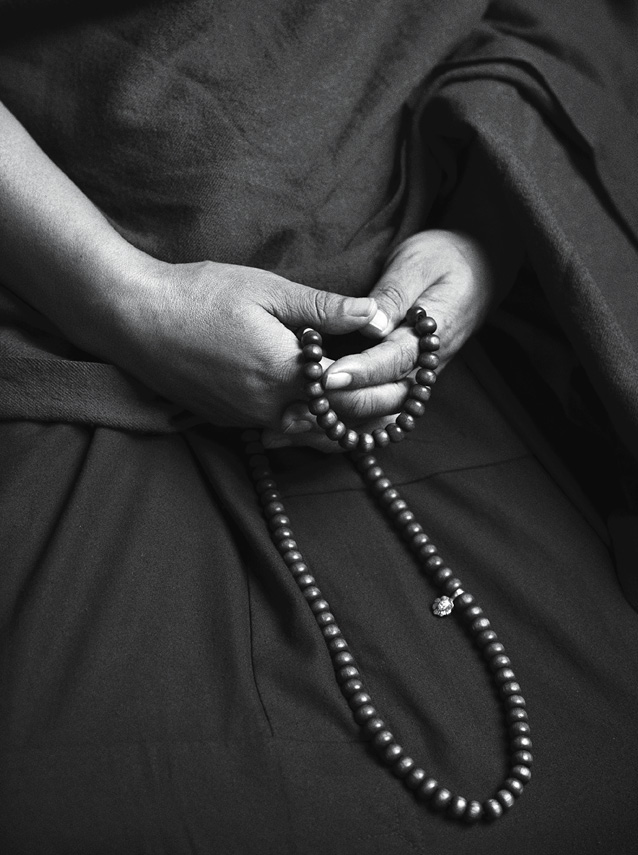
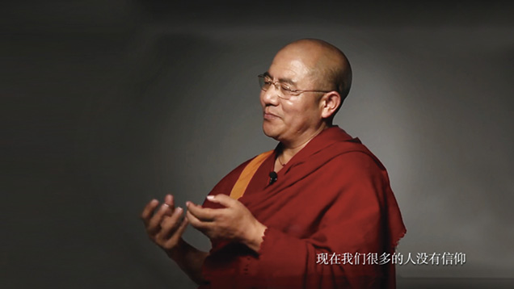

## 三问堪布

——《人物》杂志专访

2013年12月26日

作为《人物》记者，我在2013年底采访索达吉堪布[^1]。从出租车到影棚再到拍摄结束。聊了一两个小时。访问到最后，我问了他三个问题。我觉得这些对话是这次访谈最重要的内容，既体现堪布的水平，也会对很多人有帮助。

⊙ 问：人生最绝望的时刻，觉得自己被全世界抛弃，觉得不为人所爱，这样的灵魂暗夜要如何度过？

堪布：其实我自己从来没有过这种绝望或者是悲哀的时候，说实在的，在我的生命历程中没有这样的（经历）。但是我想，任何一个人，可能是因为众多因缘，到最后实在是对人生感到失望，甚至绝望，乃至觉得人活在这个世界上没有一点意义，这种现象是经常有的。

在这个时候，可能我们需要勇敢，活在这个世界上如果不勇敢，无论是什么阶层的人都会非常痛苦。我们人生的路不是只有一条，应该有很多条——即使我在财富方面不成功，换一种方式生活可能更好；如果我在这一段感情上不成功，换另一段感情应该也是可以的；我在修行层面不成功，换成另一种修行应该是可以的。

所以，往往在这样绝望的时候，你需要突破。就像我们以前说的，黑暗的背后有光明。尤其是黎明前的黑暗，更是漆黑一片，在那种时候，哪怕是有一个光亮的窗口，哪怕是有一种等待，那么光明就会在你的前面。因此，我看到，很多不能突破当下黑暗的人，往往过不了这一关，甚至有些人选择自杀。我也在很多年轻人面前讲过，在你的人生中，当你自己内心觉得最绝望、最痛苦的时刻，实际上并没有那么黑暗。这个世界没有改变，只不过你的心改变了，一个人的心改变以后，好像世界都改变了。实际上，这个世界照样有着光明存在。

就像一些修行人，也曾经经历过非常黑暗的时光，但他们也都这样过来了。如果能够调整自己的心态，对生命保持着一种光明的态度，就会发现，现在遇到的问题也好，痛苦也好，其实都是不值一提的。如果没有及时调整好自己的心态，面对生活中的各种困难，哪怕不是特别严重的事情，自己也会认为非常严重。这其实是不合理的。

总而言之，我们还是要坚强、明智，一定要有一种智慧，还要有一种坚强，这样就一定能越过难关，看到光明。

⊙ 问：作为一名修行了这么多年的僧人，您现在已经克服了对死亡的恐惧吗？

堪布：我虽然没有完全克服对死亡的恐惧，但是在我修行这么多年当中，已经把死亡当作是一个自己的课题，就像现在人们所关注的生活焦点一样。我们应该如何面对死亡，也应当列入人生必做的重要功课。因此，和从来没有关心过死亡的人相比较，我还是有一点点把握的。面对死亡，我也会有恐惧，但并不是没有准备的恐惧，是一种有准备的恐惧。我相信自己还是可以正面地面对死亡。

⊙ 问：随着您的知名度越来越高，人们对您的期待值也会越来越高。有人可能会期待您是一个摆脱了不安全感的人。有人会想，您是不是一个已经证悟、已经觉醒的成就者。还有人会想，您是不是已经不再恐惧死亡了。

我想知道，您如何面对大众对您的期待，您如今已经证悟了吗？

堪布：我有没有证悟呢？……证悟其实有很多的层次。什么是证悟呢？如果是完全通达一切万法的最高的层次，这种证悟我没有。但是我对生命的历程、春夏秋冬的历程、万事万物的历程……这些方面还是有一些微小的证悟。我觉得不管任何事情，它随时都在变化，这就是一种无常，这就是我的一种感悟。

因此，不管别人对我有什么期待，我还是跟之前一样，以前的行为和想法也都没有改变。其实对我也不应该有什么期待，因为我是一个普通的出家僧人，我也解决不了什么大的问题，也满足不了很多人的种种渴望。所以说，力所能及的、该做的事，我会做下去，无论是别人赞叹我也好、诽谤我也好，或者期待我也好、抛弃我也好，我还是做我自己该做的事情，我还是有信心做下去。

[^1]: 堪布当选《人物》杂志2013“年度宗教面孔”。
