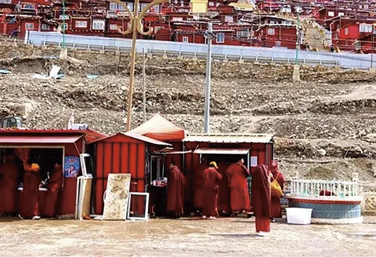
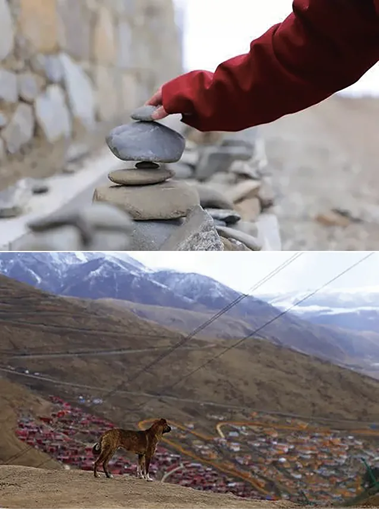

# 不怕你不信，就怕你不学

——《LOHAS乐活杂志》采访

2018年6月

简介：

《LOHAS乐活杂志》六月刊的“寺院二三事”栏目中，我们介绍了四川喇荣五明佛学院。在这个“离天空最近的佛学院”采访堪布之前，不时被帮忙联络的法师提醒：“问题不妨再大胆一些，只要能帮助到现代人，尖锐些也没关系。”

几个月过去了，那些曾困扰我们的人生难题是否也过去了呢？来看看堪布的解答吧。

在学院的生活质朴而简单每个出家人都要自己背水

## 现代人的焦虑

在准备采访堪布时，有人递上一封六岁孩童写给他的信，还附上几幅孩子想象中堪布与大家在一起的涂鸦。几句童稚的言语和单线条的涂画，却让他笑着把几页纸翻了一遍又一遍。

他看起来就像面对稀有的宝物那样珍惜，十分细致和专注，让时间都变慢了。有一瞬间，我甚至觉得他好像不是在看画，而是正在与一个孩子真实地交流。

“轮回中的众生，都是贪玩的小孩。”无论是面对小孩子的涂鸦，还是成年人的焦虑，堪布都耐心而真实地感受并回应着。在无休止的人生困惑中，愿人们能够早一些“回家”。

⊙ 问：科技的发展能使人类更幸福吗？

堪布：对于内心的教育，可能科学家他们自己也很困惑。当前许多欧美的大学教授，本身是科学家，但是他们后来通过禅修得到的幸福，应该是物质所带来的幸福无法相提并论的。

⊙ 问：世界上是否只有一种病，“穷”病？

堪布：我们也经常听到“消费降级”的说法。其实人们没有真正认识到自己内心的状态，尤其是欲望的过失。人类短暂的一生当中，欲望永无止境。

⊙ 问：在“低欲望社会”，是不是就不用太积极？

堪布：人生并不是无用，人生的每一个阶段都是有用的。现在很多人都不懂得前后世的道理，觉得人生可能是突然冒出来的，就像草地里的蘑菇一样，人死了就没了。

⊙ 问：为什么愿意付出的人越来越少，而“精致的利己主义”越来越多？

堪布：从佛教的角度来说，利己也是理所当然的。大乘佛教的思想是最无私、最利他的，但刚开始修行观想的时候，也会先从自己的父母开始。

## 如何保持学习

在五明佛学院，一切都围绕着“学习”而运转着。这里的课程（除了密法与部分戒律之外）对所有人开放。

即使是偶尔来访的游客，也能在每晚七点进入大经堂听堪布的大课。在“学佛”面前人人平等，无论男女老少、职位高低、身份来历，每个人都有了解佛法、参与讨论的契机。

那么对于学院之外人们的学习，堪布是怎么看的呢？

⊙ 问：堪布会刷抖音吗？

堪布：有一些新东西来得比较快，可能消失得也会比较快。

⊙ 问：碎片信息时代，该如何保持专注？

堪布：藏地有一种长嘴蚊子，经常这里咬一口，没有喝饱，又到那里咬一口。它飞走的时候，肚子还是空的。

⊙ 问：如何让人们的时间变得更有意义？

堪布：如果实在不能放弃散乱，就去寻找一个非常成功、善良的人，和他交往。这也许是很好的妙药。

⊙ 问：到了人生后半场，是否需要继续学习？

堪布：学习是不能放弃的。

## 让学佛，经得起理性观察

学院虽然地处高原的山沟，笼罩在传统佛教的质朴底色中，却有着相当现代化与国际化的教学氛围。堪布也是内地第一位使用互联网弘法的出家人。他常说，21世纪的佛教要与时俱进，要有开放的心态，不然“很容易死在起跑线上”。

说到如今的佛教，他认为要能经得起人们理性的观察。“不能只满足于做一个观音菩萨或金刚萨埵的粉丝，还要能够明白打坐参禅背后的道理，也必须保持学习。”比起鼓励更多人来“相信”，他似乎更愿意接受人们的“怀疑”。也只有持续的学习，才能解答这些怀疑。

在他看来，怀疑本身也是十分必要的。因为在禅宗里，大疑背后还有着大悟。

⊙ 问：现代人学佛是否更容易了？

堪布：得法是更容易了。但我们常说，“得法容易修法难”。

⊙ 问：佛学院里为什么会有精品咖啡馆？

堪布：对于佛教来说，只要能利益众生，不管什么样的事情、行为，不但要开许，还必须去做。我们不能总想着“别人会不会说什么”。去做一件事，不是从众生那里去获取什么，而是自己应该无条件地付出，然后让很多众生得到利益。

佛学院中的咖啡馆

⊙ 问：学佛的人是否都不够理性？

堪布：21世纪，在不舍弃传统的前提下，最重要的是学习。同时，这种学习要经得起理性智慧的观察。

⊙ 问：为什么无形的“加持”会有作用？

堪布：外在的物质上有物质上的“加持”，内心的精神有精神上的“加持”。我们一般所说的加持、灌顶等，更多的是内心层面的一种作用力的交换。而科学家所做的研究和实验，更多的是针对物质层面，观察物质与物质之间的作用和交换。

每日课前的加持

⊙ 问：面对动荡不安的世界，我们能做什么？

堪布：其实人类历史真的很血腥。面对这样的世界，我只能在不同场合中为大家祈福。但是，就像断臂母亲的孩子落到水里一样，母亲也是无能为力。

## 关于五明佛学院

喇荣沟的山谷里，屋棚密布，这里不仅是一所佛教学院，也是有条不紊的社区。两年前，学院开始改造，门口竖起了当地规划部门的改造方案公示牌，出于安全及各种原因的考虑也已大量减少僧房。

如今人们要抵达五明佛学院，比以往更为不易了。这一切，在见证了学院三十多年来变迁的堪布看来，并不算意外。

他说，这里的变化时刻在发生，正如世间内外。但唯一确定的是，只要这里的僧侣存在，“莫舍己道，勿扰他心”的精神就不会改变。

在这片高高的山脊上，或许有人不胜高海拔的负荷，有人面对着难以抵达的障碍，有人来了又离开，但高山无言，始终怀抱着众生。

