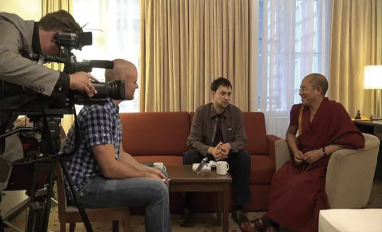
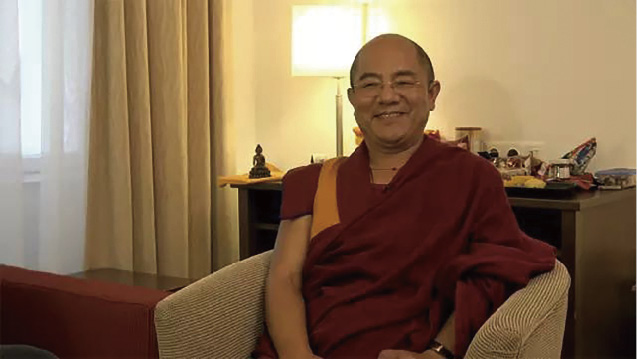

# 不是矛盾，是不同

——奥地利电视台（ATV）采访

2015年11月28日

⊙ 问：堪布您好，您这次会在欧洲好几个国家讲课，其中一站是维也纳。请问您即将演讲的内容是什么？

堪布：今天的内容是关于藏传佛教的特别之处，特别是与其他传统宗教的不共之处。

⊙ 问：我得知这次演讲也与藏密金刚乘有关，请问什么是“金刚乘”？

堪布：密宗金刚乘，是一个很大的话题。单看相关文献，在西藏就有很多分类。比如密法又被分为四个大类：事部、行部、瑜伽部及无上瑜伽部。其中对每个类别密法的解释，都是巨大的工程，涵盖了非常广阔的领域。

⊙ 问：您提到佛教与其他宗教有不同的地方。它们之间最大的区别是什么？

堪布：每个宗教都有自己的特别之处，比如天主教、伊斯兰教、印度教，都有突出的特点。当然，有着两千五百多年历史的佛教也不例外。我一向都主张研究、关注和尊重所有宗教的不同特点。

佛教的特别之处，是不仅关注人类如何得到幸福和脱离痛苦，也关注动物等生命，让它们也得到同样的利益。

⊙ 问：佛教给公众的印象一直是和平、非暴力。对于现在世界上发生的一些危机事件，佛教怎样看待？比如叙利亚内战所发生的残暴行为。

堪布：近期很多人都在关注叙利亚，刚才你也提到了目前难民的处境。欧洲能够提供这么多帮助，是一件很好的事情。对于被迫逃离自己国家的人而言，这是一种非常苦难的境况。

我们都清楚，难民所在的国家，和这里的国情完全不同，他们和这里的居民也很不一样，有不同的生活习惯、不同的宗教，等等。而佛法面对这些问题时，有多样化的解决方法和各种善巧方便。

看到那么多人在关注难民，这很好。关注与帮助是对待难民应有的态度，如果在他们遇到巨大困境时，我们不提供帮助和关怀，那就太糟糕了。所以我非常支持帮助难民，希望能帮多少就帮多少。

最后我想强调的是，帮助的方法一定要善巧，整个过程中必须要有善巧和智慧，这是关键。

⊙ 问：换个话题，一个佛教徒应该如何应对嗔怒？这在工作或日常生活的各种关系中都可能遇到。

堪布：不管遇到什么样的问题，最重要的是不用暴力去回应，而是用和平的方法。这是佛法的基本观念——用非暴力的方法解决问题，杜绝暴力的途径。佛教中有很多层面，但最根本的就是杜绝一切会对其他生灵造成伤害的行为。

当然也可以运用一些更高的窍诀。比如在某些情况下，有些行为即使看似会造成损害，也可以做，因为能成办更大的利益。但这需要更高的能力和见解，并不是每个人都能行持。它必须源于爱和同情，希望尽可能地利益他人。

不管怎样，就一般的人际交往乃至国际关系而言，我们都要运用非暴力的方法。这是最根本的出发点。

⊙ 问：您的回答让我有点惊讶。到底在什么情况下，一个具有更高能力的佛教徒，可以打骂另一个人？

堪布：如果他能预见，这样做可以产生更大的利益。你必须非常确定，通过一些看似有损害的行为，比如伤害、欺骗他人，或者其他不符合世间常理的做法，能够实现更大的利他。如果无法确定，就不被允许。

还有一种简单的情况是你别无选择，不这样做会导致更严重的损失，而你又非常确定你的伤害行为可以避免这种损失。这种情况下是可以的。

⊙ 问：长期行持佛法的您，还会生气吗？

堪布：是的，在我的意识里也会有嗔怒，有时候也会生气。但是与没有修学佛法的时候相比，差别很大。

⊙ 问：我想到了一个故事，是教人如何不对他人起嗔恨心。故事是关于一艘空船：有个人刚给自己的船刷完漆，他很喜欢这艘船。当他乘船旅行时，不巧遇上大雾，此时他看到前方有另一艘船，于是开始大叫，试图避免两船相撞，但结果还是撞上了。这个人很生气，认为对面船里的人故意害他。后来，他遇到一个神灵，神灵告诉他，对面的船是空的，他根本无法对任何人生气。

佛法里有没有类似的故事？

堪布：在藏传佛教里，我没有听说过类似的，但有很多与心灵有关的修行故事。比如有一个很出名的故事，关于一个禅者。上师给他一个任务：在山洞里观想自己的头上长了角。禅者被派到山洞里禅修，通过观想，头上真的长出很大的角来，以致他无法离开山洞。后来，上师又让他以相反的观想方式禅修，令头上的角消失，这位修行人才从山洞里出来。

还有个故事关于一位女性修行者，她得到指示，不断观想自己是老虎。后来在当地人的眼中，她真的变成了老虎。

不管信不信，这是藏地的一些修行故事。这些故事告诉我们，思维能对一切产生影响。

⊙ 问：在西方世界，大家都容易处于紧张状态，这里的节奏可能也比信仰佛教的地区更快。请问您对非佛教徒有没有一些建议，如何化解生命中遇到的嗔怒、争执或压力？

堪布：不管是否信仰宗教，每个人都尽力地追求快乐和幸福，这也是很重要的。其实真正观察下来，令我们感受到压力的，往往是无关紧要的事。很多事物对我们而言，并没有那么重要。所以要分析，如何才能够给我们带来真正的快乐和幸福——心灵上的快乐和幸福，并往这方面努力，而不是为了一些不必要的事情烦恼。这些事情往往与钱财和物质相关，和我们所要追求的心灵舒适并没有关系。

心灵上的平和、幸福，是一种安详、开放、广阔的精神状态。这和任何宗教无关，只和利益他人的意愿有关。帮助他人得到幸福，这样的意愿能帮我们获得放松、宽广的体验。相反，如果只关注自己的幸福，则会导致精神上的紧绷和凝固。所以，应该去关注那些真正重要的事，比如他人的利益和幸福。

⊙ 问：佛教一向给人的感觉是，很高尚、很放松、很平和。这些是佛教的正面部分，那它有没有负面的部分？

堪布：我长期钻研佛法和研究现有的资料。从教义来讲，找不到什么错误或不符合逻辑的地方，甚至与科学研究有分歧或者错漏的地方也找不到。但必须说，的确有一些修行人利用佛法的教义，谋求自己的财富、名声。至于教义本身，我至今没有找到任何导人行恶的内容。

⊙ 问：如果我理解正确的话，佛教是不是与其他宗教，比如基督教和伊斯兰教有相似之处，因此教义可能被从不同的视角来解释，而这种不同的解释就会产生一些分歧？

堪布：总体来讲，佛教里的确有很多不同的传统和理论。原因是不同上师的讲授方法不同，形成各自不同的传承；不同地域也可能产生区别，比如印度和西藏的传承就不一样。但是如果查看史料，我们会发现这些区别不会导致人们之间的矛盾、争斗甚至战争，更不会涉及对非佛教徒的迫害或攻击。历史可以证明，佛教的发展过程中，并没有产生和制造什么麻烦。

⊙ 问：有一个问题是与奥地利有关的。在这里，与心灵和佛教有关的事情经常吸引一些高层人士，他们试图从中找到平和，或给生命带来一些方便。佛法到底有多酷？感觉对某些人来说，这是一种时尚生活。在西方，年轻人尤其喜欢佛法。

堪布：确实如此。为什么佛法对年轻人这么有吸引力？比如在中国，很多人选择佛教，是因为他们得到了很好的答案。谁有疑问，都能从中得到答案。他们有机会辩论和讨论，谁也不会因为学佛时间太短或者太年轻而被排斥在外。人们可以得到他们能够接受的解答。佛法中有一种平等观，不论男女、智慧高低，都能平等地享用，这正是佛法非常吸引人的地方。

不管你是无缘无故地加入，还是对佛法早有归属感，都一定有自己的原因。每个人都会因为精神上、身体上的困扰和问题去寻求治愈。无论谁想通过佛法获得利益，我都非常欢迎。

⊙ 问：对您来说，什么是佛教？

堪布：有一个广为人知的偈颂：“诸恶莫做，诸善奉行，自净其义，是诸佛教。”这里面包含了帮助他人和降伏自心的教义。

⊙ 问：最后一个问题，您会如何建议一个想在生命里找到更多平和的人？

堪布：尊重、专心对待悠久的传统和现代的方法，关怀他人的幸福。

⊙ 问：非常感谢您付出宝贵的时间！

