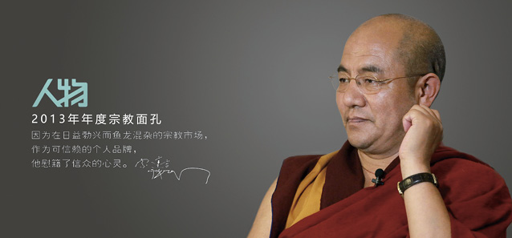
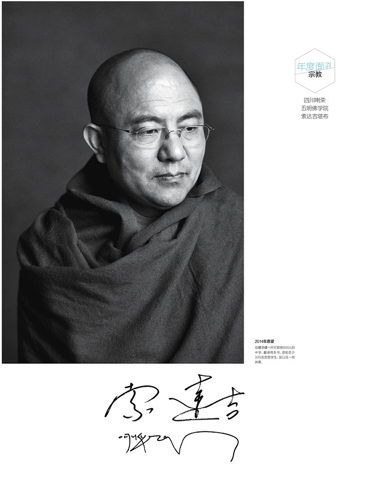
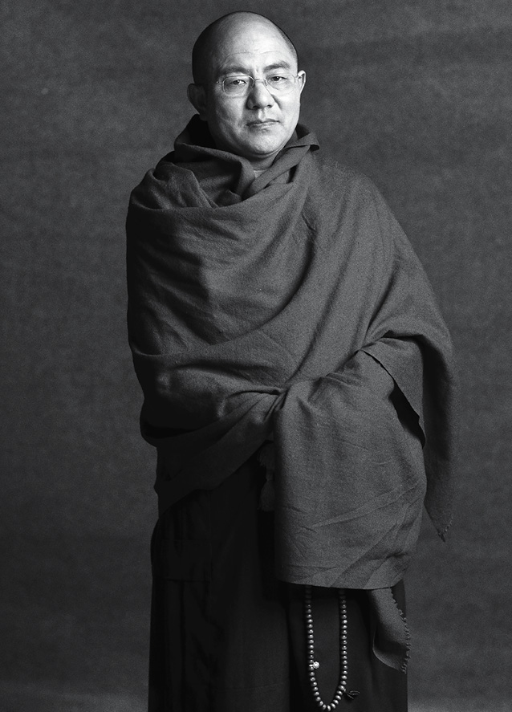

# 堪布下山

——《人物》杂志年度宗教面孔特稿

2013年12月26日

简介：

《人物》杂志以影响力为首要标准，评选并报道过去一年中对中国社会产生影响力、在时代进程中具有标志性意义的人物。他们或因个人的成功，或因坚持，或因激起大众热情，已被记入历史。

2013年年度宗教面孔是来自四川喇荣五明佛学院的索达吉堪布。入选理由：因为在宗教市场日益勃兴而鱼龙混杂的年代，这个最高求学经历仅为中专的川西牧民后代塑造了可信赖的个人品牌，慰藉了其信众的心灵。

堪布传密法时对闻法者的要求很严，必须经过严格的入门训练，持有“闻法证”才能进入经堂，门口有管家严格把守。一次堪布上课前心血来潮，用衣服压着头硬往里闯，管家一个劲地叫：“你的闻法证呢？”堪布也不说话，结果闯进了经堂。几个管家赶紧跟上来，使劲拽住他，问：“你的闻法证呢？”堪布低着头还往里走。最后一个管家使劲把他的帽子摘掉，才发现是堪布。堪布笑着说：“考试合格！”

2013年12月19日，晚上8点，堪布在四川喇荣五明佛学院的大经堂给弟子们讲课，其间他讲了这个故事，学员们笑了。学院位于川西藏区一处莲花形的山沟里，海拔4000多米。今年冬天，山上已经下过好几场大雪，夜间十分寒冷。有人看过温度计，19号晚上，学院的温度是零下25度。

国家电网仍未对喇荣五明佛学院正式供电。夏天，当地用水力发电；到了冬天，河流已经冻结。经过争取，色达电力局每天送来一点电，时间限定在早上5点到7点半，僧众要在这段时间内给手机、手电筒、MP3充电。除此之外，讲课、发心工作的必需用电，僧众们用大型发电机解决。因此，大经堂里没有空调、电暖器之类的耗电设备。

按照藏传佛教的习惯，身穿僧袍的堪布在讲课中全程袒露右边的手臂，目的是保持如法的威仪。“堪布”者，“教授”也。在藏语里，“堪布”意为“法师”“亲教师”，担任这一僧职的通常是藏传佛教各寺院或学院里具备渊博佛学知识的高僧，他们担负着讲经说法的使命。听闻密法，对听闻者的门槛很高，至于藏传佛教的显宗类教言，堪布希望听众越多越好。19号晚，除了台下的僧众、居士，还有更多的信众选择网络在线听课。

## 觉醒

这样的冬天，堪布已经在喇荣五明佛学院度过了近三十个。此前，他在甘孜师范学校读书。再往前，他还曾是草原上的顽皮小孩。

“我小时候特别爱打架，读中学时一天打过五次架。读小学的时候，我也经常打架。所以现在回到母校，我回忆不起来学了什么知识，只记得在这里打过架，在那里也打过架。因为在学校里不太方便，我经常约别人在外面打。‘等一会儿吃完午饭，到那里来。’然后就开始打架。所以，周围的山上、河边，到处都留下了我打架的身影。”一次讲座时，堪布对学生们回忆道。

出家以后，索达吉成为堪钦[^1]晋美彭措的弟子。堪钦晋美彭措是当代藏传佛教的大成就者，他重视教育，在藏地极具威望。1987年，堪布跟随上师，偕同一万多名藏汉僧俗朝拜了中国佛教四大名山之一的五台山。朝山期间，上师命堪布将《佛子行》等藏地流传甚广的佛学论著翻译成汉语，为当地汉族僧俗传讲。

“当时，我的汉语水平捉襟见肘，汉传佛教的专用词汇更是一窍不通。但为了不违上师教言，不破坏缘起，我费尽周折，连夜查阅了许多资料，才算勉强完成任务。这，也是我第一次以佛法与汉地众生结缘。”堪布说。

五台山之行，堪钦晋美彭措收了许多汉族弟子，从那时起，上师要求堪布“负责对汉族朋友的佛学传授和管理”。

对堪布而言，这是一趟神圣的旅程，他被传授了“佛教中许多最精华、最重要、一般世间根本得不到的神圣之法”，觉得自己从此开了智慧，甚至认为自己的背诵能力和记忆力增强了。二十六年后，他对《人物》记者回忆，激动之情不减，称这是“特别、特别特殊的旅行”“从此人生发生了变化”。

之后的某一个上午，堪布突然一个人“有点幼稚的，也没有跟任何人打招呼”去见上师。他供养了一本书，然后在上师面前发愿，大意是：“您怎么样，我也要这样，哪怕因缘不足，哪怕没有人听，但只要有一个人愿意听闻佛法，我也要去传，我要把佛法教育当作一生中最重要的事情来做。”

上师笑了笑，给了一个点头，说“好好好”。其他什么都没说，也没有更多的鼓励。但堪布认为，在上师面前发愿，对他来说非常重要。

什么是愿呢？堪布说，愿就是“自己心里的一种觉醒”，因为觉醒，所以发愿。他说：“人来到这个世界上，不是浑浑噩噩走过就可以了。每个人应该对自己的人生有一种定位。这种定位有些是以教育为主，有些可能以商业为主。我自己是以教育为主的，是这样一个抉择。所以，我围绕我的这个觉醒，就开始做自己应该做的。”

## 信仰市场的优质品牌

堪布是运用网络平台最成功的喇嘛。不论身在何方，只要登录“智悲佛网”，就能在线听课，同步、高清，堪布和他的弘法团队管这个叫“网络开示”，“智悲佛网”被定位为“弘法平台”。

2006年，堪布第一次使用网络向佛学院之外讲《入菩萨行论·善说海》。这是中国的藏传佛教僧侣较早使用现代化的网络技术面向社会讲课，也可以看作堪布“下山”的开始。当时，他在一封公开信里说：“现在大城市里的人对佛法的希求心很强，但真正精通佛理的人少之又少，为了让更多的人了解佛法，这次的传讲方式是在传统基础上，采用了现代化的网络传媒。”

美国普渡大学（Purdue University）中国宗教与社会研究中心主任、社会学教授杨凤岗在一篇文章中说：“中国经济改革三十多年来，伴随着宗教信仰的大复兴，无论是传统的儒释道、伊斯兰和基督教，还是新兴教派和灵性运动，都吸引了众多的信徒……无论是否接受，中国已经迎来信仰兴盛的时代，这恐怕是个不以人的意志为转移的发展趋势。”

在众多宗教中，藏传佛教更容易让现代都市人体验到心灵神秘感，以及审美上的吸引力。新浪微博上，仁波切比禅师多，禅师比牧师多。随之而来的是大众疑虑，密宗“密”在何处？修密是不是靠谱？其次是随着藏传佛教的昌盛，出现了真假上师等鱼龙混杂的现象，缺少了解的大众因此而屡屡上当受骗。

藏传佛教最讲传承，堪布是大德堪钦晋美彭措的弟子，传承清净，背后还依托有喇荣五明佛学院的修行资源。他不做速成教育，不说神通，网络函授班的加入者每周须至少抽一小时听课，否则就将从学员名单中除名。年轻人要定期参加开卷考试，老年人每年须持诵一万佛号。其成员除了完成每周规定的思考题作业以外，还要将当周的实修成绩，在次周上报小组长，最终由各分会大组长汇总上报。读这个函授班的人要三到四年才能毕业，属于“次第”修行，意思是从小学到初中，再到高中，一步步来。

堪布形象清新正派，从未有过敛财的传闻，一直用的念珠是1997年有个喇嘛在五台山买的六道木，三元钱。他一改“法不能轻传”的传统，坚持免费授课。“许多高僧大德，无论是在藏地还是去印度（求法）的时候，当时那样的艰苦岁月当中，他们拿着黄金去。佛教来源地印度的很多班智达，他们虽然不会贪财，但是为了体现佛法的尊贵，他们也是接受黄金然后传授佛法，也有这样的传统。”堪布承认，有些学员让他感到免费授课时有一种不被珍惜的感觉，但他认为：“佛法跟世间好像有一种教育的关系，如果我给你传佛法，你给我钱，那么，佛法就好像成了一种商品。我后来不但不接受学校的讲座费，包括差旅在内的住宿费、机票（都不接受），所有的佛教的课我都是免费，跟经济不挂钩。”

堪布严守戒律。他提倡放生，绝不吃肉，这一点破除了很多人对藏传佛教“吃肉”的疑虑。他以佛教教育的精进而著名，2001年因强直性脊椎炎住院期间，每天依然早起，先做功课，再译经典，三个月里翻译了两三部经论，然后再给学院的弟子讲一两个小时的课。“学院把电话放在扩音器旁，当时学院的弟子就是这么听堪布讲课的”，堪布的一位弟子对《人物》记者回忆。

## 入世情怀

除了内在信仰世界，对于外部环境的变化，堪布也予以关注，这让他的宗教教育相较于其他上师，有着更强的现实针对性。他告诉《人物》记者：“新闻当中，我比较关心的是现在的高层领导的演讲以及他们的指导性政策，然后从社会事件和一些时政新闻当中去发现社会问题。”

去年的社会新闻中，堪布非常关心复旦投毒案，“出现这种事情，确确实实是由于我们现在没有爱的教育，没有慈悲的教育。如果一味探讨实验啊，科学啊，我们人类最终的结果还是很可怕的。”堪布将他入世的情怀寄寓到博客、微博发言和通俗书籍的出版中。到2013年底，堪布的新浪微博粉丝数量已经超过129万，出版社也热衷于和他展开合作，连续推出较为通俗的佛教书籍。

国际上的一些学者和研究机构也开始注意堪布。德国马普宗教与民族多元研究所（Max Planck Institute for the Study of Religious and Ethnic Diversity）的中国科研组主管郁丹教授（Prof.Dan Smyer Yu）从2011年开始与堪布合作研究当代佛教全球化的现象。在郁丹看来，堪布是现代佛教中的领军人物。

他列举了支持他这一观点的原因：“堪布是堪钦晋美彭措的心传弟子之一，朝夕相处，继承了他恩师的所有法脉，这是堪布成为当代佛教领袖的内在条件之一。其次，慕名来喇荣五明佛学院学习的人群中人才济济，出版、网络技术、影视制作等各个专业的人才都有。堪布讲完一堂课，会在学员的协助下整理出文字稿通过网络或书籍方式流通，这是重要的外在条件之一。”

堪布也曾设想过，如果这辈子没有成为堪布，生在藏地的索达吉会是一个怎样的人。

“首先我绝对是一个佛教徒，因为藏地99.9%都是佛教徒。如果我没有去读书，也没有出家，那现在是当牧民生活。如果我没有去读书，但是出家了，可能是寺庙里一个专门给人超度、只会念经的僧人。如果读书了，后来没有出家，我很可能是一个一般的小学或者中学老师，因为我过去的同学大多数毕业后都这样。”

关于他的生命，堪布设想的所有可能性，都仅仅是“读书”和“出家”这两件事情的排列组合。

[^1]: 意为大堪布。
