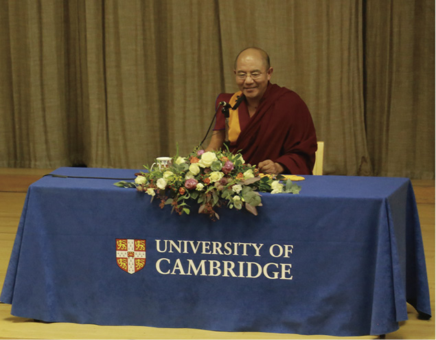
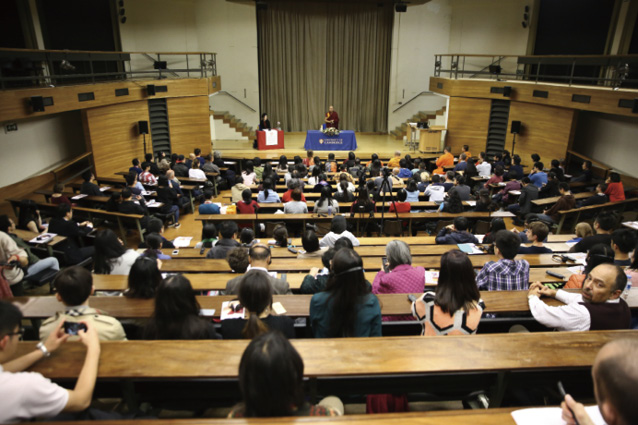
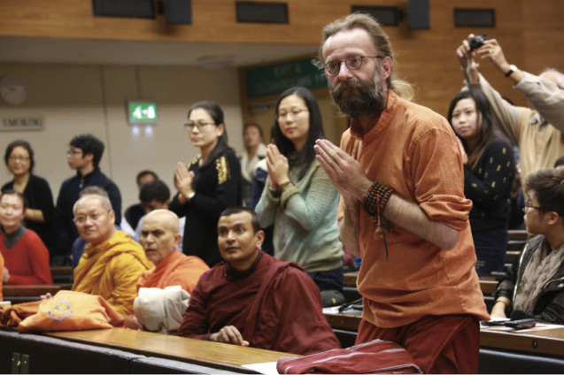

# 堪布的弘法人生

——BBC人物特写

2015年11月24日

10月下旬，来自中国四川甘孜的堪布仁波切来到剑桥大学弘法演讲。从高原上的放牛少年到当代最知名的佛教大德之一，堪布的传奇经历吸引了众多中英两国学子和佛学爱好者。

## 苦才是人生

索达吉堪布，1962年出生于中国四川省甘孜州炉霍县，1985年出家于当今世界上最大的佛教大学——中国四川省喇荣五明佛学院，并得到当时最杰出的佛教大德之一——堪钦晋美彭措仁波切亲自教授和培养。

维基百科这样描述堪布：作为一位藏族喇嘛、一位佛教学者和老师、一位多产的藏汉翻译家、一位现代佛教思想家，堪布以用传统佛教理论审视、分析全球现代生活问题并提供应对措施而闻名于世。

堪布在剑桥大学弘法

当天在剑桥，堪布使用藏语进行了演讲。精通汉语和藏语的堪布近年来致力于把一些藏传佛教的经典和论典翻译成汉语。近年来，更为年轻人熟悉的是堪布所著的文学作品，如《苦才是人生》《残酷才是青春》等。

针对年轻人对人生的困惑，堪布说，如果我们一直认为人生是多么幸福快乐，一旦在生活中遇到挫折和磨难，就会觉得难以接受和面对。如果人们意识到，青春实际上是残酷的，人生也是有许多痛苦的，那么也会提前就做好相应的准备。正值青春或者青春已过的人，都需要对人生做一个思考。我们的人生中的确有很多快乐，但是与痛苦相比较，后者更多一些。了解到这一点，人们在面对痛苦的时候，就应该有一种智慧、一种洞察力。毕竟，这才是人生的本来面目。

用堪布的话讲，多年修行带给他的都是难得的经历。“本来出家也好，佛教修行也好，在世间人看来都是一种艰苦的生活；但对我而言，这种生活是人生中最美好的经历。在出家后的十多年中，不管白天还是黑夜，可以说，我把所有的精力和时间都用在了学习和钻研佛经论典上。现在回看，我也不觉得那是一种痛苦或一种折磨。现在无论到哪个国家、哪个城市，都不会羡慕当地的建筑，也不会羡慕人们的财富、地位，但是我很怀念曾经的自己有那样一段刻苦学习的经历。对我来说，是一个很难得的珍贵因缘。”

## 全球弘法

堪布来自当今世界上最大的佛教大学——中国四川省喇荣五明佛学院。1980年，法王晋美彭措在甘孜州色达县建立了这座佛学院，当时的喇荣沟荒无人烟，学院只有32名学员。“清净戒律，闻思修行，团结和合，弘法利生”是佛学院的校训。

1985年，当时就读甘孜师范学校尚未毕业的索达吉堪布来到这里，依止法王晋美彭措座下，当时的佛学院有100多人。

堪布在剑桥大学演讲现场

2004年1月，法王晋美彭措圆寂。门措上师接任院长，佛学院的15位堪布、活佛建立了“学院管理理事会”，实行轮值制，每5年一换。2014年初，堪布结束了5年的任期。但自1987年起，堪布一直管理着佛学院常住的汉族僧众。

从成都到色达，车程700多公里，行程12个小时左右。这条崎岖的山路，堪布每年要往返几十次，从这里前往世界各地弘法。

随着网络和社交媒体的流行，堪布也尝试开辟网上弘法的渠道。开通了微博，注册了微信，每天坚持更新微博。

当被问到是否可以通过微博学习佛法，堪布说：“是一个好方法，但还不够。真正学习佛法是需要次第性地、一本书一本书地学习和研究。一条微博只有区区不到140个字，里面可能会有一点简单的内容，让你了解到某个信息，或者抚慰了一下内心。如果想要学习更广、更深的知识，只通过微博和手机是做不到的。我还是希望大家能通过书本，真正系统地学习，这样的修行才能比较圆满。一位上师的一条微博只有几句话，如果仅有这些作为精神食粮，可能是吃不饱的。还是需要用大量的知识来充实自己，对治自己的烦恼，提升自己的智慧。”

西方信众聆听堪布演讲

## 东西融合

当天堪布在剑桥的演讲也吸引了不少英国朋友到现场聆听。说到藏传佛教为什么在西方大受欢迎，堪布认为，首先是因为西方人的思维方式比较直接，和藏族人比较类似；其次是西方人可以从藏传佛教的理论和实修中，直接受益。堪布分析，西方人很有分辨力，看到了藏传佛教既有理性的智慧，也有感性的智慧。

说到现代社会中人们对手机的过度依赖，堪布认为，这和大家缺乏阅读的习惯有直接关系。堪布说：“一些寺院把大家的手机没收，要求在七天的时间内不能使用手机、不能上网。能够七天不用手机，很多人就觉得自己境界很高。其实古人一直都处于这样的状态中，也并没有认为自己的境界很高。在应该打的电话打完、应该找的资料找完之后，我们应该把手机放在一边，让心安静一会儿。心应该在合适的时间里安静下来。”
