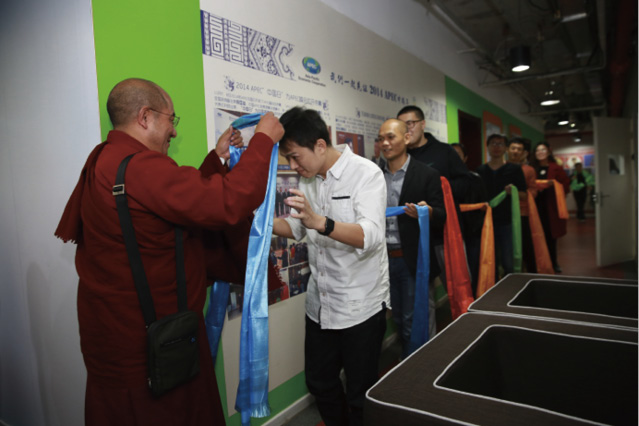
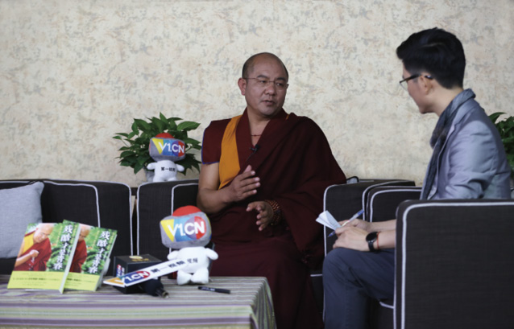

# 当90后“小鲜肉” 遇见藏传佛教“大咖”（一）

——第一视频专题

2016年11月9日

平台：第一视频

简介：

这是一次传统与现代的相遇，也是一场佛法与生活的对话。一边是德高望重的藏传佛教“大咖”，一边是个性鲜明的90后“小鲜肉”，当堪布对话90后，将产生怎样鲜活睿智的火花？

11月9日下午一点半，享誉海内外的藏传佛教大德堪布仁波切莅临“第一视频”演播厅，接受一期人物专访，并展开一场与90后网友的座谈对话。此前的几天，堪布仁波切刚刚结束北京大学、中国人民大学的两场主题演讲。此次堪布应邀莅临第一视频，或将再次开启不一样的弘法之旅。

## 专访堪布：“媒体应该多多扬善抑恶”

专访环节，堪布仁波切就中西方信众的特点，发表了他的观察与看法，并就“人间佛教”与此前堪布多次开示的“生活佛教”的异同展开论述。堪布特别强调，二者均是佛法的圆融智慧显现，只是提出的时代背景不同、利益信众的方式不同而已。当问及在这个负面信息常常像海啸一样席卷而来的互联网时代，媒体应如何服务和利益网友时，堪布回答：媒体要有自己的定位、智慧和价值观，要有弘扬正法和正能量的责任感，多多扬善抑恶，不要人云亦云，不要不负责任地传播负面信息。

堪布接受专访

接受人物专访之后，迎来令人期待的环节——与六名90后网友现场对话，倾听90后们的声音，与他们交流学习和生活上的困惑。

## 90后提问：学习的，工作的，生活的

六名应征而来的90后幸运网友来到演播现场，首次与重量级的佛教“大咖”面对面交流，却显得相当轻松，个性十足。他们当中有大学生也有白领，有博士生也有高中生，还有一位留学女孩是来自英国萨塞克斯大学的金融管理硕士在读生。

他们的问题带着普遍而鲜明的90后色彩：打游戏问题、校园打架斗殴问题、“微整形”问题、同性恋问题、与父母的沟通问题、留学生的舆论压力问题、毕业后是留京还是回家孝养父母问题……

现场气氛温暖而热烈，堪布仁波切十分欢喜，对这帮90后孩子似乎格外欣赏和慈爱，就每一个问题都予以耐心的解答，直到他们满意为止。

## 90后的结束感言： 温暖，大爱，快乐，获益

对话结束，堪布仁波切评价这帮90后孩子“真诚机智”。我们随机采访了这几位年轻的嘉宾，询问他们与堪布对话后的感受。即将博士毕业的阿酩说：“堪布慈悲，今天的交流让我获益良多。每个人身上都有自己的责任，尽自己的能力去肩负自己的责任，用智慧去对待自己的责任。”

在英国萨塞克斯大学留学的女孩语浓说：“今天与大师的近距离接触让我心中一直暖融融的，充满了力量。就像大师所说，有时候某个人的某节课会受用一生。我觉得，我遇到了这个人，也遇上了这样一节课。”

从事公关执行工作的白领笑笑立刻接下话说：“遇到这个人也让我遇到了一生！佛教不是教导我们要变得无情无趣，是教导我们不应执著的不要过分执著，调化内心，转向积极与有意义的人生追求。”

正读大四的小科则心情激动地说：“今天我过得非常快乐！因为我的心灵得到了进一步的升华，这种快乐是发自内心的喜悦！大师身上有一种大爱的力量，普照众生，温暖众生，照亮他人！”

年龄最小的嘉宾是来自清华附中的崔崔，他说：“这次和上师面对面交流，让我领悟了很多。我也深深感到自己在各方面学习得不够、知识储备的不足，我会谨遵上师劝导，多多读书。”

堪布的慈悲和风趣不仅给嘉宾们留下深刻印象，也给第一视频的全体员工带来前行的智慧与启发。

下午四点半左右，堪布仁波切结束了他的访谈与对话，离开第一视频，赶赴下一场活动现场。
